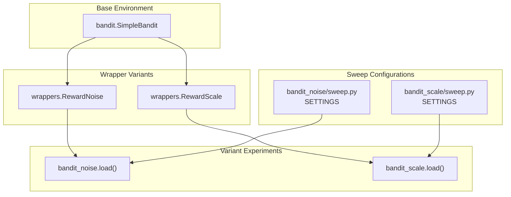
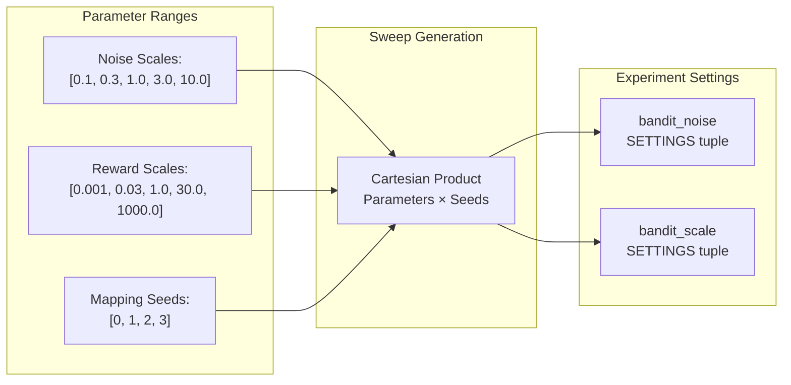
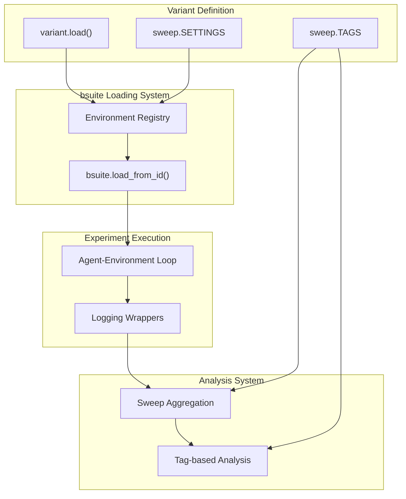

<!-- source: DeepWiki mcp.deepwiki.com · repo google-deepmind/bsuite · page 3.3 Environment Variants and Extensions · fetched 2026-10-26 -->

# Environment Variants and Extensions

<details>
<summary>Relevant source files</summary>

The following files were used as context for generating this wiki page:

- [bsuite/experiments/bandit_noise/bandit_noise.py](bsuite/experiments/bandit_noise/bandit_noise.py)
- [bsuite/experiments/bandit_noise/bandit_noise_test.py](bsuite/experiments/bandit_noise/bandit_noise_test.py)
- [bsuite/experiments/bandit_noise/sweep.py](bsuite/experiments/bandit_noise/sweep.py)
- [bsuite/experiments/bandit_scale/bandit_scale.py](bsuite/experiments/bandit_scale/bandit_scale.py)
- [bsuite/experiments/bandit_scale/bandit_scale_test.py](bsuite/experiments/bandit_scale/bandit_scale_test.py)
- [bsuite/experiments/bandit_scale/sweep.py](bsuite/experiments/bandit_scale/sweep.py)
- [bsuite/experiments/deep_sea/__init__.py](bsuite/experiments/deep_sea/__init__.py)
- [bsuite/experiments/deep_sea/deep_sea.py](bsuite/experiments/deep_sea/deep_sea.py)
- [bsuite/experiments/discounting_chain/__init__.py](bsuite/experiments/discounting_chain/__init__.py)
- [bsuite/experiments/discounting_chain/discounting_chain.py](bsuite/experiments/discounting_chain/discounting_chain.py)
- [bsuite/experiments/memory_len/__init__.py](bsuite/experiments/memory_len/__init__.py)
- [bsuite/experiments/memory_len/memory_len.py](bsuite/experiments/memory_len/memory_len.py)
- [bsuite/experiments/mnist/mnist.py](bsuite/experiments/mnist/mnist.py)
- [bsuite/experiments/mountain_car/mountain_car.py](bsuite/experiments/mountain_car/mountain_car.py)

</details>


This section documents the variant and extension system in bsuite, which enables systematic evaluation of agent performance across modified versions of base environments. Environment variants test agent robustness to different conditions such as reward noise, scaling, and parameter variations without requiring separate environment implementations.

For information about the core diagnostic environments themselves, see [Core Diagnostic Environments](#3.1). For details about environment wrappers and utilities, see [Environment Wrappers and Utilities](#3.2).

## Variant Creation Patterns

Environment variants in bsuite follow two primary patterns: wrapper-based modifications and parameter-based variations. Both approaches maintain the same interface as base environments while systematically altering specific aspects for evaluation.

### Wrapper-Based Variants

**Wrapper-Based Environment Variant Architecture**


The most common variant pattern applies environment wrappers to base environments. The `bandit_noise` experiment demonstrates this approach by wrapping the base bandit environment with reward noise:

```python
def load(noise_scale, seed, mapping_seed, num_actions=11):
  env = wrappers.RewardNoise(
      env=bandit.SimpleBandit(mapping_seed, num_actions=num_actions),
      noise_scale=noise_scale,
      seed=seed)
  env.bsuite_num_episodes = sweep.NUM_EPISODES
  return env
```

Similarly, `bandit_scale` applies reward scaling through the `RewardScale` wrapper:

```python
def load(reward_scale, seed, mapping_seed):
  env = wrappers.RewardScale(
      env=bandit.SimpleBandit(mapping_seed=mapping_seed),
      reward_scale=reward_scale,
      seed=seed)
  env.bsuite_num_episodes = sweep.NUM_EPISODES
  return env
```

Sources: [bsuite/experiments/bandit_noise/bandit_noise.py:27-34](), [bsuite/experiments/bandit_scale/bandit_scale.py:27-34]()

### Parameter-Based Variants

Parameter-based variants modify constructor arguments of base environments to create systematic variations. The `memory_len` experiment exemplifies this pattern by varying the `memory_length` parameter of `MemoryChain`:

```python
def load(memory_length: int, seed: Optional[int] = 0):
  env = memory_chain.MemoryChain(
      memory_length=memory_length,
      num_bits=1,
      seed=seed,
  )
  env.bsuite_num_episodes = sweep.NUM_EPISODES
  return env
```

This approach enables systematic evaluation of how agents perform as problem complexity scales through parameter changes.

Sources: [bsuite/experiments/memory_len/memory_len.py:31-39]()

## Systematic Sweep Configurations

**Variant Sweep Configuration System**


Variant experiments define systematic parameter sweeps to enable comprehensive evaluation. Each sweep configuration generates multiple environment instances with different parameter combinations.

### Noise Variants Sweep

The `bandit_noise` experiment defines noise scale variations:

| Parameter | Values |
|-----------|--------|
| `noise_scale` | 0.1, 0.3, 1.0, 3.0, 10.0 |
| `mapping_seed` | 0, 1, 2, 3 |
| `seed` | None |

This generates 20 total configurations (5 noise scales × 4 mapping seeds).

### Scale Variants Sweep  

The `bandit_scale` experiment defines reward scaling variations:

| Parameter | Values |
|-----------|--------|
| `reward_scale` | 0.001, 0.03, 1.0, 30.0, 1000.0 |
| `mapping_seed` | 0, 1, 2, 3 |
| `seed` | None |

This also generates 20 total configurations, spanning several orders of magnitude in reward scaling.

Sources: [bsuite/experiments/bandit_noise/sweep.py:22-28](), [bsuite/experiments/bandit_scale/sweep.py:22-28]()

## Variant Integration with bsuite System

**Environment Variant Integration Flow**


All environment variants integrate with the standard bsuite loading and analysis systems. Key integration points include:

### Standard Load Interface

Every variant experiment provides a `load()` function that accepts the sweep parameters and returns a configured environment. The function signature varies by experiment but follows consistent patterns:

- **Wrapper variants**: Accept wrapper parameters plus base environment parameters
- **Parameter variants**: Accept modified constructor parameters
- **All variants**: Set `bsuite_num_episodes` attribute for experiment management

### Sweep Configuration Structure

Variant sweeps define three key components:

- **`SETTINGS`**: Tuple of parameter dictionaries for each experiment instance
- **`TAGS`**: Tuple of analysis tags (e.g., `('noise',)`, `('scale',)`)  
- **`NUM_EPISODES`**: Episode count (typically inherited from base experiment)

### Analysis Tag System

Variants use tags to enable systematic analysis across related experiments. Tags group experiments by the type of variation applied:

- `'noise'` tag: Groups experiments with reward noise variations
- `'scale'` tag: Groups experiments with reward scaling variations

Sources: [bsuite/experiments/bandit_noise/sweep.py:28](), [bsuite/experiments/bandit_scale/sweep.py:28]()

## Creating Custom Environment Variants

Custom variants can be created following the established patterns in bsuite. The process involves three main steps:

### 1. Define Variant Load Function

Create a load function that applies modifications to a base environment:

```python
def load(variant_param, seed, base_env_params):
  """Load custom variant with prescribed settings."""
  base_env = BaseEnvironment(**base_env_params)
  variant_env = CustomWrapper(base_env, variant_param=variant_param, seed=seed)
  variant_env.bsuite_num_episodes = base_sweep.NUM_EPISODES
  return variant_env
```

### 2. Configure Parameter Sweep

Define systematic parameter variations in a sweep configuration:

```python
_settings = []
for param_value in [list_of_values]:
  for seed_idx in range(num_seeds):
    _settings.append({
        'variant_param': param_value,
        'seed': None,
        'base_env_params': seed_idx
    })

SETTINGS = tuple(_settings)
TAGS = ('custom_variant',)
```

### 3. Add Testing Infrastructure

Implement standard environment tests to ensure dm_env compatibility:

```python
class InterfaceTest(test_utils.EnvironmentTestMixin, absltest.TestCase):
  def make_object_under_test(self):
    return custom_variant.load(default_params)
```

This pattern ensures custom variants integrate seamlessly with bsuite's experiment management, logging, and analysis systems.

Sources: [bsuite/experiments/bandit_noise/bandit_noise_test.py:24-34](), [bsuite/experiments/bandit_scale/bandit_scale_test.py:24-34]()

---

