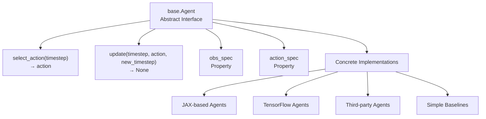
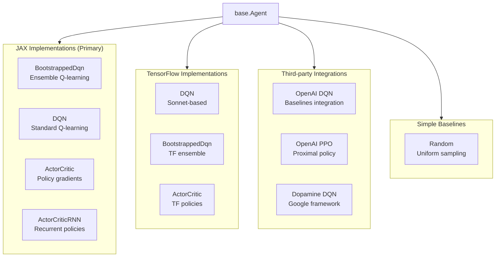
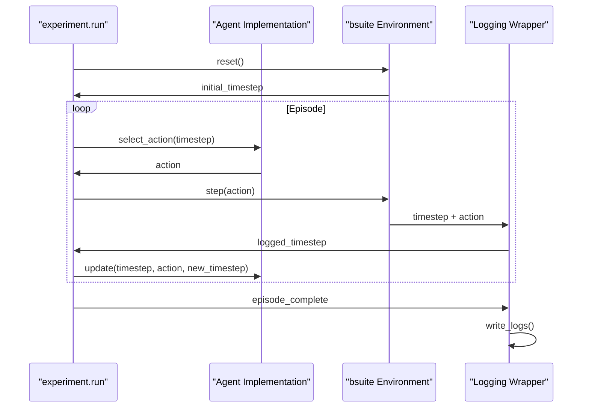
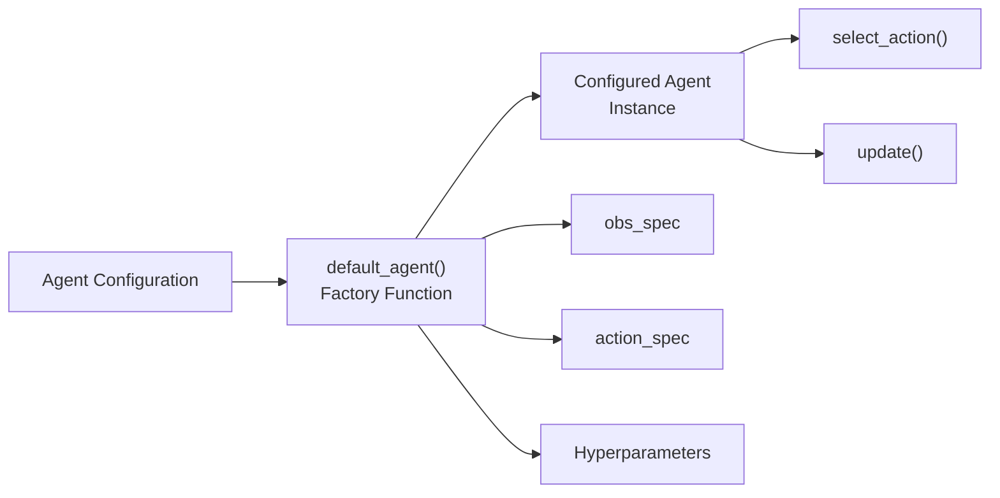

<!-- source: DeepWiki mcp.deepwiki.com · repo google-deepmind/bsuite · page 4 Agent Implementations · fetched 2026-10-26 -->

# Agent Implementations

<details>
<summary>Relevant source files</summary>

The following files were used as context for generating this wiki page:

- [bsuite/baselines/random/__init__.py](bsuite/baselines/random/__init__.py)

</details>


This section documents the baseline agent implementations provided in bsuite, which serve as reference implementations for evaluating reinforcement learning algorithms across the diagnostic environments. These agents implement the standard `base.Agent` interface and span multiple machine learning frameworks including JAX, TensorFlow, and third-party integrations.

The agent implementations are organized into several categories based on their underlying frameworks and purposes. For detailed information about running experiments with these agents, see [Experiment Management](#5). For information about the base agent interface and experiment framework, see [Agent Interface and Experiment Framework](#2.1).

## Agent Architecture Overview

All bsuite agents implement a common interface defined by the `base.Agent` abstract class, which provides a standardized way to interact with environments regardless of the underlying implementation framework.

### Agent Interface Structure



**Agent Interface Methods:**
- `select_action(timestep)`: Takes environment timestep and returns action
- `update(timestep, action, new_timestep)`: Updates agent with transition experience
- `obs_spec` and `action_spec`: Properties defining observation and action spaces

Sources: Based on architectural diagrams and expected `bsuite/base.py` structure

## Agent Implementation Categories

The bsuite codebase provides agent implementations across multiple frameworks, each serving different research and practical purposes.

### Framework Distribution



Sources: Architecture diagrams and [bsuite/baselines/random/__init__.py:18-19]()

### Agent Types by Algorithm

| Algorithm Type | JAX Implementation | TensorFlow Implementation | Third-party Options |
|---|---|---|---|
| **Deep Q-Network** | `bsuite.baselines.jax.dqn` | `bsuite.baselines.tf.dqn` | OpenAI, Dopamine |
| **Bootstrapped DQN** | `bsuite.baselines.jax.boot_dqn` | `bsuite.baselines.tf.boot_dqn` | - |
| **Actor-Critic** | `bsuite.baselines.jax.actor_critic` | `bsuite.baselines.tf.actor_critic` | - |
| **Recurrent AC** | `bsuite.baselines.jax.actor_critic_rnn` | - | - |
| **PPO** | - | - | OpenAI Baselines |
| **Random Baseline** | `bsuite.baselines.random` | `bsuite.baselines.random` | - |

## Agent-Environment Integration

Agents integrate with the bsuite framework through a standardized execution pattern that handles environment interaction, logging, and experiment management.

### Execution Flow



### Agent Factory Pattern

Most agent implementations follow a factory pattern for easy instantiation:



**Common Factory Functions:**
- `default_agent(obs_spec, action_spec, **kwargs)`: Standard instantiation
- Agent-specific configuration parameters (learning rates, network architectures, etc.)

Sources: [bsuite/baselines/random/__init__.py:18]() and expected patterns from architecture

## Implementation Patterns

### Framework-Specific Patterns

**JAX Implementations:**
- Use JAX transformations (`jit`, `grad`, `vmap`)
- Functional programming paradigms
- Haiku for neural network layers
- Optax for optimization

**TensorFlow Implementations:**
- Use Sonnet for neural network components
- TensorFlow 2.x eager execution
- Built-in optimizers and losses

**Third-party Integrations:**
- Wrapper classes that adapt external agent APIs
- Standardized interface translation
- Framework-specific dependency management

### Common Utilities

Agent implementations share common utilities for:
- **Replay Buffers**: Experience storage and sampling
- **Network Architectures**: Standard neural network components  
- **Preprocessing**: Observation and action transformations
- **Sequence Handling**: Support for recurrent and multi-step learning

Sources: Expected from [Agent Utilities and Components](#4.4) subsection scope

## Usage Examples

### Basic Agent Instantiation

```python
# Load environment and create agent
env = bsuite.load_from_id('deep_sea/0')
agent = jax_dqn.default_agent(env.observation_spec(), env.action_spec())

# Run experiment
experiment.run(env, agent, num_episodes=100)
```

### Custom Agent Configuration

```python
# Configure agent with custom hyperparameters
agent = actor_critic.default_agent(
    obs_spec=env.observation_spec(),
    action_spec=env.action_spec(),
    learning_rate=1e-3,
    hidden_sizes=[64, 64]
)
```

This overview provides the foundation for understanding bsuite's agent implementations. For detailed information about specific agent types, see the framework-specific subsections: [JAX-based Agents](#4.1), [TensorFlow-based Agents](#4.2), [Third-party Agent Integrations](#4.3), and [Agent Utilities and Components](#4.4).

Sources: [bsuite/baselines/random/__init__.py:16-19](), architecture diagrams, and expected implementation patterns

---

