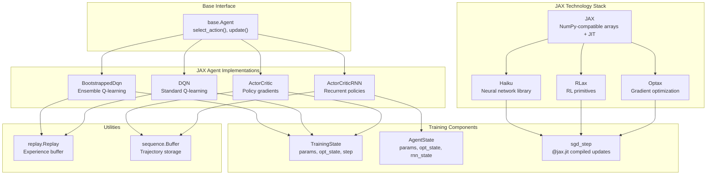
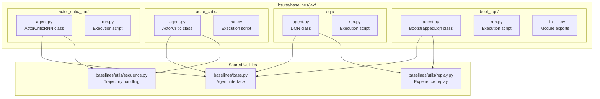
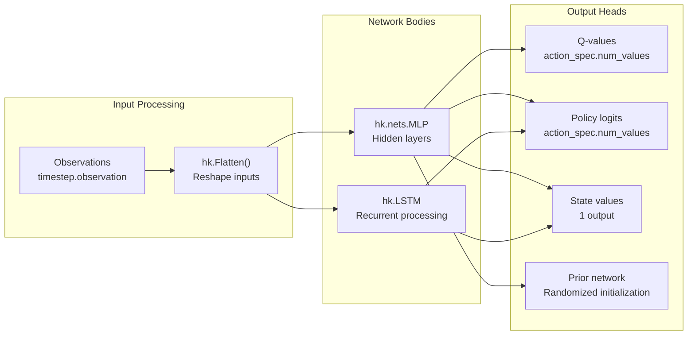

<!-- source: DeepWiki mcp.deepwiki.com · repo google-deepmind/bsuite · page 4.1 JAX-based Agents · fetched 2026-10-26 -->

# JAX-based Agents

<details>
<summary>Relevant source files</summary>

The following files were used as context for generating this wiki page:

- [bsuite/baselines/README.md](bsuite/baselines/README.md)
- [bsuite/baselines/jax/actor_critic/agent.py](bsuite/baselines/jax/actor_critic/agent.py)
- [bsuite/baselines/jax/actor_critic_rnn/agent.py](bsuite/baselines/jax/actor_critic_rnn/agent.py)
- [bsuite/baselines/jax/boot_dqn/__init__.py](bsuite/baselines/jax/boot_dqn/__init__.py)
- [bsuite/baselines/jax/boot_dqn/agent.py](bsuite/baselines/jax/boot_dqn/agent.py)
- [bsuite/baselines/jax/boot_dqn/run.py](bsuite/baselines/jax/boot_dqn/run.py)
- [bsuite/baselines/jax/dqn/agent.py](bsuite/baselines/jax/dqn/agent.py)

</details>


This document covers the JAX-based reinforcement learning agent implementations provided in bsuite. These agents serve as baseline implementations for evaluating RL algorithms across the diagnostic environments in the behavior suite.

For TensorFlow-based agent implementations, see [TensorFlow-based Agents](#4.2). For third-party agent integrations, see [Third-party Agent Integrations](#4.3).

## Agent Implementations

The JAX baseline implementations include four main agent types, each implementing the `base.Agent` interface:

| Agent Class | Algorithm | Key Features |
|-------------|-----------|--------------|
| `BootstrappedDqn` | Bootstrapped DQN | Ensemble of Q-networks, exploration via Thompson sampling |
| `DQN` | Deep Q-Networks | Standard value-based learning with experience replay |
| `ActorCritic` | Actor-Critic (A2C) | Policy gradient with value function baseline |
| `ActorCriticRNN` | Recurrent A2C | Memory-capable version using LSTM |

## JAX Agent Architecture



Sources: [bsuite/baselines/jax/boot_dqn/agent.py:59-241](), [bsuite/baselines/jax/dqn/agent.py:45-186](), [bsuite/baselines/jax/actor_critic/agent.py:41-148](), [bsuite/baselines/jax/actor_critic_rnn/agent.py:46-182]()

## Dependencies and Installation

JAX agents require the JAX ecosystem libraries:

- **JAX**: Core array library with JIT compilation
- **Haiku**: Neural network library for parameter management  
- **RLax**: Reinforcement learning primitives
- **Optax**: Gradient-based optimization
- **dm-env**: Environment interface compatibility

Install JAX dependencies using:
```bash
pip install bsuite[baselines_jax]
```

Sources: [bsuite/baselines/README.md:34-47]()

## Code Organization



Sources: [bsuite/baselines/jax/boot_dqn/agent.py:1](), [bsuite/baselines/jax/dqn/agent.py:1](), [bsuite/baselines/jax/actor_critic/agent.py:1](), [bsuite/baselines/jax/actor_critic_rnn/agent.py:1]()

## Common Implementation Patterns

### Training State Management

JAX agents use `NamedTuple` structures to manage training state:

```python
class TrainingState(NamedTuple):
    params: hk.Params
    target_params: hk.Params  # For DQN variants
    opt_state: Any
    step: int
```

The `AgentState` variant used by recurrent agents adds RNN state:

```python
class AgentState(NamedTuple):
    params: hk.Params
    opt_state: Any
    rnn_state: LSTMState
    rnn_unroll_state: LSTMState
```

Sources: [bsuite/baselines/jax/boot_dqn/agent.py:52-57](), [bsuite/baselines/jax/dqn/agent.py:37-43](), [bsuite/baselines/jax/actor_critic_rnn/agent.py:38-44]()

### JIT-Compiled Updates

All agents use `@jax.jit` compiled update functions for performance:

```python
@jax.jit
def sgd_step(state: TrainingState, 
             transitions: Sequence[jnp.ndarray]) -> TrainingState:
    """Performs an SGD step on a batch of transitions."""
    gradients = jax.grad(loss)(state.params, state.target_params, transitions)
    updates, new_opt_state = optimizer.update(gradients, state.opt_state)
    new_params = optax.apply_updates(state.params, updates)
    return TrainingState(...)
```

Sources: [bsuite/baselines/jax/dqn/agent.py:78-92](), [bsuite/baselines/jax/boot_dqn/agent.py:96-109]()

### Network Transformation

Networks are transformed from impure functions to pure functions using Haiku:

```python
# Transform the (impure) network into a pure function
network = hk.without_apply_rng(hk.transform(network))

# Initialize with dummy data
dummy_observation = np.zeros((1, *obs_spec.shape), jnp.float32)
initial_params = network.init(next(rng), dummy_observation)
```

Sources: [bsuite/baselines/jax/dqn/agent.py:63-96](), [bsuite/baselines/jax/boot_dqn/agent.py:80-116]()

## Agent-Specific Implementation Details

### BootstrappedDqn

Implements deep exploration via ensemble of Q-networks with randomized priors:

- **Ensemble Size**: Configurable number of Q-networks (`num_ensemble`)
- **Thompson Sampling**: Selects active network per episode
- **Bootstrap Masking**: Uses Bernoulli masks for ensemble training
- **Prior Networks**: Adds randomized prior functions with `prior_scale`

Key methods:
- `select_action()`: Thompson sampling with epsilon-greedy fallback
- `update()`: Updates all ensemble members with masked bootstrapping

Sources: [bsuite/baselines/jax/boot_dqn/agent.py:59-202]()

### DQN

Standard Deep Q-Networks implementation:

- **Experience Replay**: Uses `replay.Replay` buffer
- **Target Networks**: Separate target parameters updated periodically  
- **Epsilon-Greedy**: Configurable exploration policy
- **Double DQN**: Uses target network for action value estimation

Sources: [bsuite/baselines/jax/dqn/agent.py:45-159]()

### ActorCritic

Feed-forward policy gradient agent:

- **Policy-Value Network**: Shared trunk with separate heads
- **TD(λ) Returns**: Uses `rlax.td_lambda` for advantage estimation
- **Trajectory Buffer**: Uses `sequence.Buffer` for batch collection
- **Softmax Policy**: Categorical action selection

Sources: [bsuite/baselines/jax/actor_critic/agent.py:41-121]()

### ActorCriticRNN

Recurrent variant with memory:

- **LSTM State**: Maintains hidden and cell states
- **Dynamic Unroll**: Uses `hk.dynamic_unroll` for sequence processing
- **State Reset**: Resets RNN state at episode boundaries
- **Separate Unroll State**: Maintains separate state for training unrolls

Sources: [bsuite/baselines/jax/actor_critic_rnn/agent.py:46-145]()

## Usage Examples

### Creating Default Agents

Each agent provides a `default_agent()` factory function:

```python
# BootstrappedDqn with ensemble
agent = boot_dqn.default_agent(
    obs_spec=env.observation_spec(),
    action_spec=env.action_spec(),
    seed=0,
    num_ensemble=20
)

# Standard DQN
agent = dqn.default_agent(
    obs_spec=env.observation_spec(), 
    action_spec=env.action_spec(),
    seed=0
)
```

### Running Experiments

Use the provided run scripts for single experiments or full sweeps:

```bash
# Single environment
python bsuite/baselines/jax/dqn/run.py --bsuite_id=cartpole/0

# Full sweep  
python bsuite/baselines/jax/boot_dqn/run.py --bsuite_id=SWEEP
```

Sources: [bsuite/baselines/jax/boot_dqn/run.py:51-98](), [bsuite/baselines/jax/boot_dqn/agent.py:204-241](), [bsuite/baselines/jax/dqn/agent.py:161-186]()

## Network Architecture Patterns

JAX agents use consistent network architecture patterns:



Sources: [bsuite/baselines/jax/boot_dqn/agent.py:216-222](), [bsuite/baselines/jax/dqn/agent.py:166-170](), [bsuite/baselines/jax/actor_critic/agent.py:128-136](), [bsuite/baselines/jax/actor_critic_rnn/agent.py:157-169]()

---

