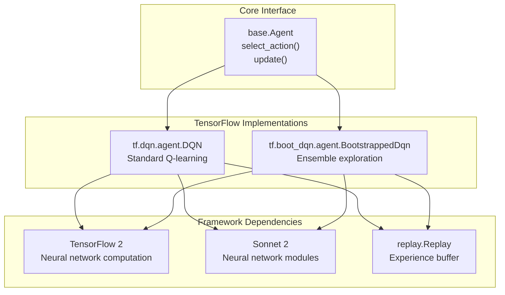
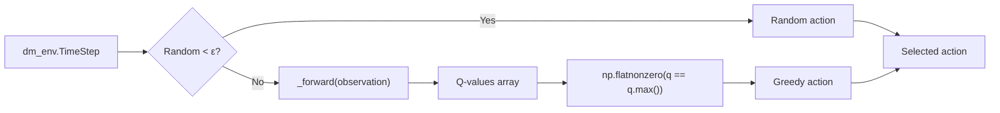
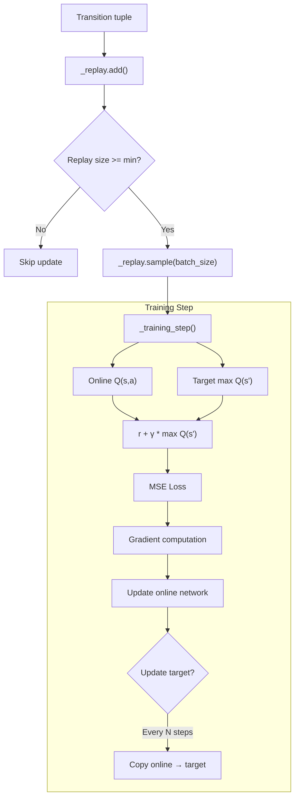
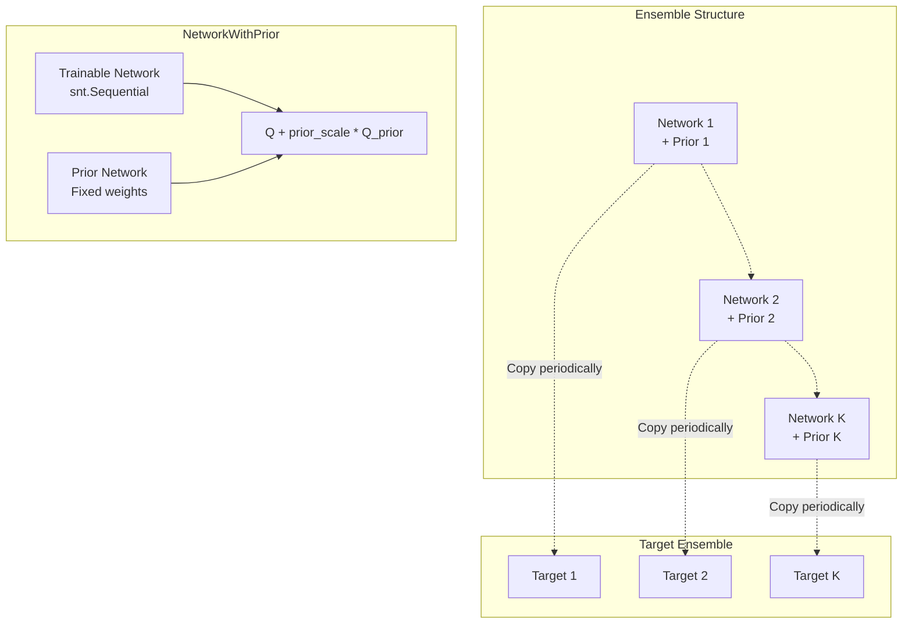
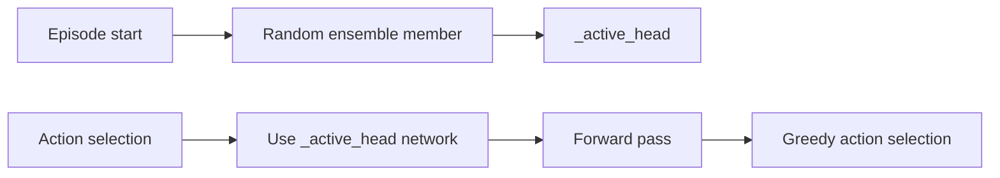
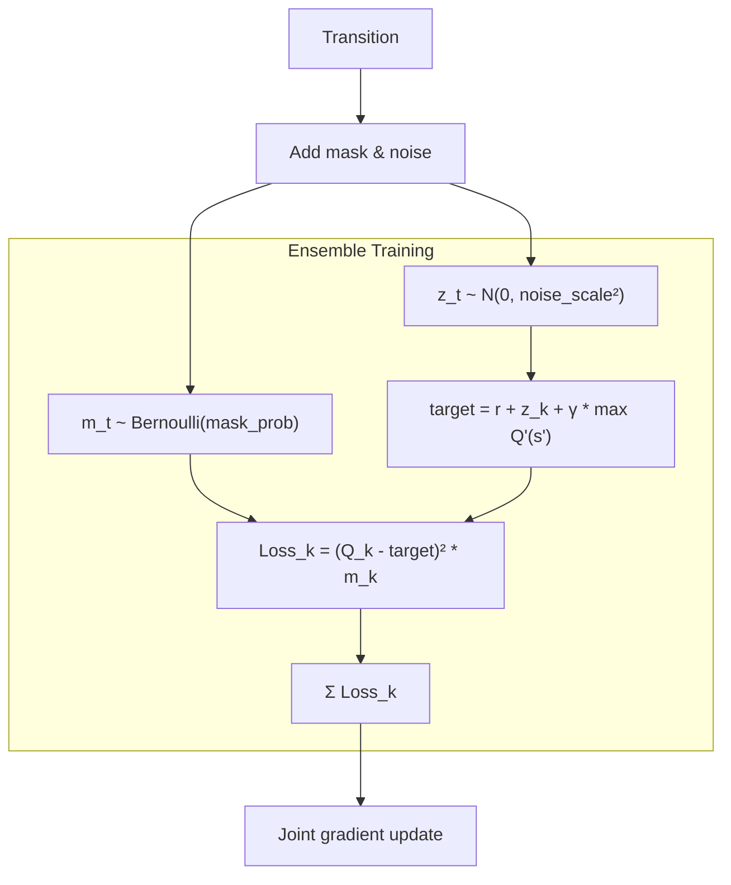
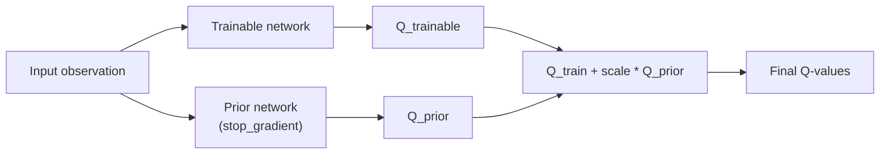
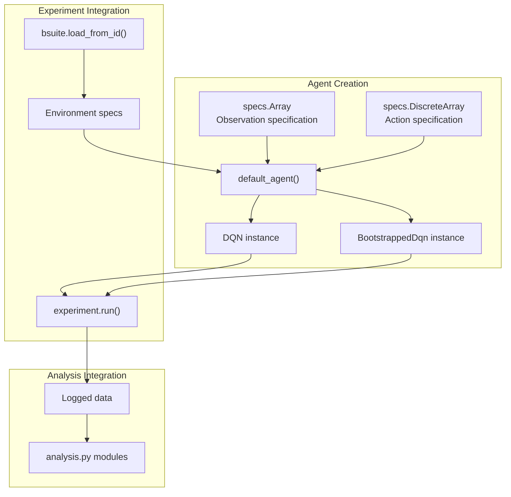

<!-- source: DeepWiki mcp.deepwiki.com · repo google-deepmind/bsuite · page 4.2 TensorFlow-based Agents · fetched 2026-10-26 -->

# TensorFlow-based Agents

Relevant source files

The following files were used as context for generating this wiki page:

- [bsuite/baselines/tf/boot_dqn/agent.py](bsuite/baselines/tf/boot_dqn/agent.py)
- [bsuite/baselines/tf/dqn/agent.py](bsuite/baselines/tf/dqn/agent.py)
- [bsuite/experiments/bandit/analysis.py](bsuite/experiments/bandit/analysis.py)
- [bsuite/experiments/cartpole/analysis.py](bsuite/experiments/cartpole/analysis.py)
- [bsuite/experiments/catch/analysis.py](bsuite/experiments/catch/analysis.py)

This document covers the TensorFlow 2 and Sonnet 2 implementations of reinforcement learning agents in bsuite. These agents provide reference implementations for Deep Q-Networks (DQN) and Bootstrapped DQN algorithms using Google's TensorFlow ecosystem.

For JAX-based implementations, see [JAX-based Agents](#4.1). For third-party agent integrations, see [Third-party Agent Integrations](#4.3).

## Agent Implementation Overview

The TensorFlow-based agents are located in the `bsuite/baselines/tf/` directory and implement the base `Agent` interface defined in the core framework. These implementations prioritize readability and serve as educational references for the algorithms.

Sources: [bsuite/baselines/tf/dqn/agent.py:35-36](), [bsuite/baselines/tf/boot_dqn/agent.py:50-51]()

## DQN Agent Implementation

The `DQN` class provides a standard Deep Q-Network implementation using TensorFlow 2. It implements epsilon-greedy exploration with experience replay and target network updates.

### Core Components

| Component | Type | Purpose |
|-----------|------|---------|
| `_online_network` | `snt.Module` | Primary Q-function approximator |
| `_target_network` | `snt.Module` | Stabilized target for Q-learning |
| `_replay` | `replay.Replay` | Experience replay buffer |
| `_optimizer` | `snt.Optimizer` | Network parameter updates |

### Action Selection and Learning

The DQN agent uses epsilon-greedy action selection with tie-breaking:

The learning process follows standard Q-learning with experience replay:

Sources: [bsuite/baselines/tf/dqn/agent.py:74-83](), [bsuite/baselines/tf/dqn/agent.py:111-143]()

### Default Configuration

The `default_agent` factory function provides standard hyperparameters:

| Parameter | Value | Purpose |
|-----------|-------|---------|
| `batch_size` | 32 | SGD batch size |
| `discount` | 0.99 | Future reward discount |
| `replay_capacity` | 10000 | Maximum replay buffer size |
| `min_replay_size` | 100 | Minimum transitions before learning |
| `sgd_period` | 1 | Steps between SGD updates |
| `target_update_period` | 4 | Steps between target updates |
| `epsilon` | 0.05 | Exploration probability |

Sources: [bsuite/baselines/tf/dqn/agent.py:146-166]()

## Bootstrapped DQN Agent Implementation

The `BootstrappedDqn` class implements an ensemble-based approach for deep exploration, combining multiple Q-networks with bootstrap sampling and optional prior networks.

### Ensemble Architecture

### Thompson Sampling and Bootstrap Learning

The agent uses Thompson sampling for exploration by randomly selecting an active ensemble member:

The bootstrap learning process incorporates masking and noise injection:

Sources: [bsuite/baselines/tf/boot_dqn/agent.py:133-142](), [bsuite/baselines/tf/boot_dqn/agent.py:100-132]()

### Prior Network Integration

The `NetworkWithPrior` class combines trainable and fixed prior networks:

Sources: [bsuite/baselines/tf/boot_dqn/agent.py:186-201]()

## Agent Factory Functions and Integration

Both agents provide `default_agent` factory functions that integrate with the bsuite experiment framework:

### Usage in Experiments

The TensorFlow agents are used across bsuite experiments with environment-specific analysis modules:

| Experiment | Analysis Module | Scoring Function |
|------------|----------------|------------------|
| Bandit | `bandit.analysis` | Average regret score |
| Cartpole | `cartpole.analysis` | 50% regret + 50% solve rate |
| Catch | `catch.analysis` | Average regret score |

Sources: [bsuite/baselines/tf/dqn/agent.py:146-166](), [bsuite/baselines/tf/boot_dqn/agent.py:225-249](), [bsuite/experiments/cartpole/analysis.py:32-42]()

## Implementation Characteristics

### TensorFlow 2 Features

Both agents leverage TensorFlow 2 features:

- `@tf.function` decorators for compiled execution
- `tf.GradientTape` for automatic differentiation  
- `tf.Variable` for mutable state tracking
- `tf.random.set_seed` for reproducibility

### Sonnet 2 Integration

Network construction uses Sonnet 2 modules:

- `snt.Sequential` for layer composition
- `snt.nets.MLP` for fully connected networks
- `snt.Flatten` for input preprocessing
- `snt.optimizers.Adam` for parameter updates

Sources: [bsuite/baselines/tf/dqn/agent.py:32](), [bsuite/baselines/tf/boot_dqn/agent.py:46]()

---

