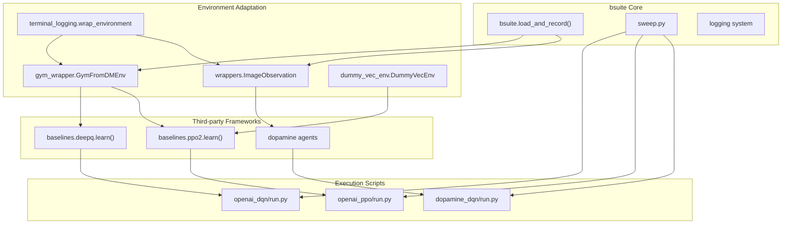
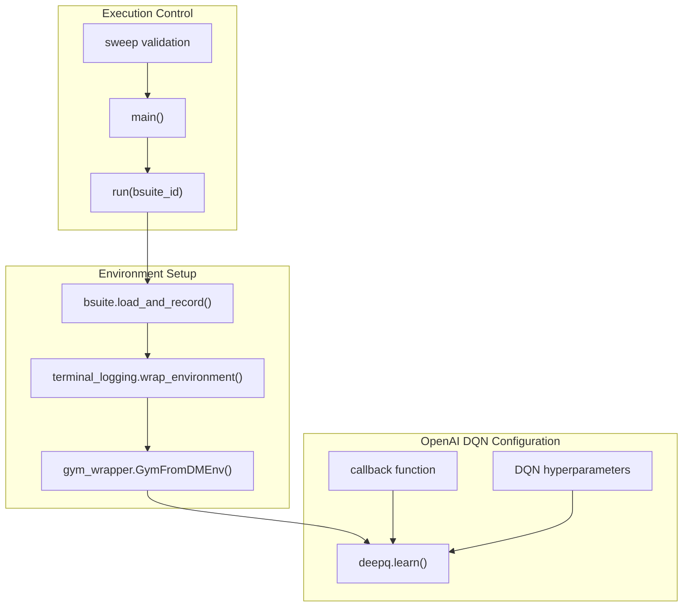
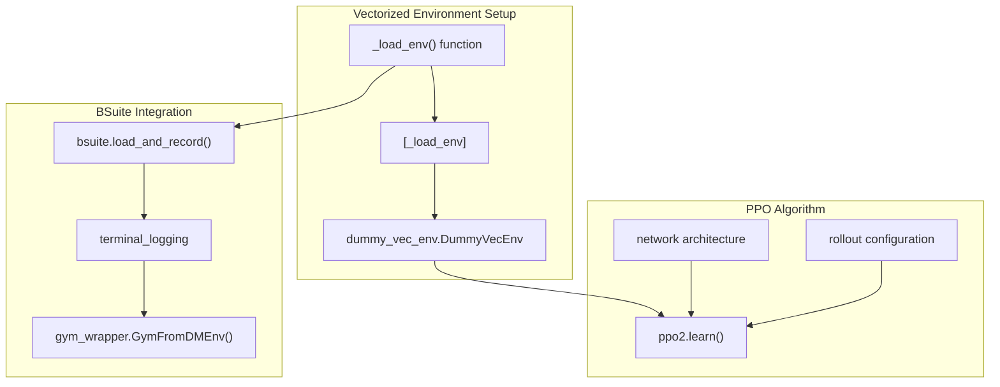
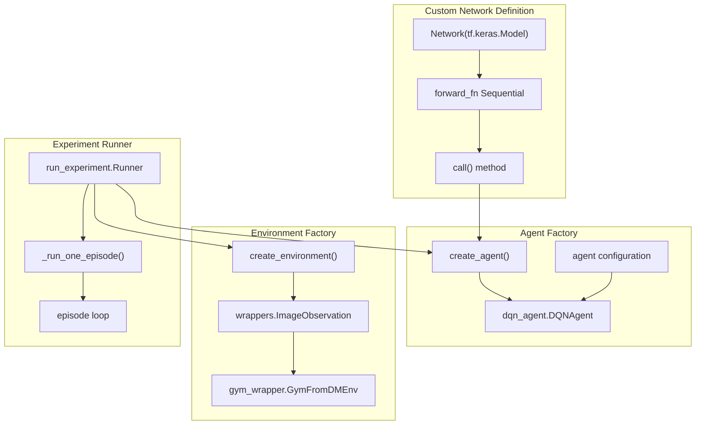
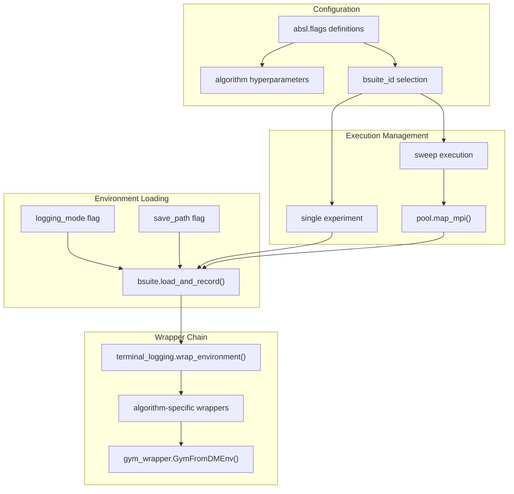

<!-- source: DeepWiki mcp.deepwiki.com · repo google-deepmind/bsuite · page 4.3 Third-party Agent Integrations · fetched 2026-10-26 -->

# Third-party Agent Integrations

<details>
<summary>Relevant source files</summary>

The following files were used as context for generating this wiki page:

- [bsuite/baselines/third_party/dopamine_dqn/__init__.py](bsuite/baselines/third_party/dopamine_dqn/__init__.py)
- [bsuite/baselines/third_party/dopamine_dqn/run.py](bsuite/baselines/third_party/dopamine_dqn/run.py)
- [bsuite/baselines/third_party/openai_dqn/__init__.py](bsuite/baselines/third_party/openai_dqn/__init__.py)
- [bsuite/baselines/third_party/openai_dqn/run.py](bsuite/baselines/third_party/openai_dqn/run.py)
- [bsuite/baselines/third_party/openai_ppo/__init__.py](bsuite/baselines/third_party/openai_ppo/__init__.py)
- [bsuite/baselines/third_party/openai_ppo/run.py](bsuite/baselines/third_party/openai_ppo/run.py)

</details>


This document covers the integration of external reinforcement learning libraries with bsuite, including OpenAI Baselines and Google's Dopamine framework. These integrations enable evaluation of well-established RL algorithms on bsuite's diagnostic environments without requiring users to reimplement algorithms from scratch.

For bsuite's native agent implementations, see [JAX-based Agents](#4.1) and [TensorFlow-based Agents](#4.2). For information about creating custom agents, see [Agent Interface and Experiment Framework](#2.1).

## Integration Architecture Overview

The third-party integrations follow a consistent pattern of adapting external RL frameworks to work with bsuite's environment and logging infrastructure. Each integration provides a complete runnable script that handles environment loading, agent configuration, and experiment execution.

### Third-party Integration Structure



Sources: [bsuite/baselines/third_party/openai_dqn/run.py:1-134](), [bsuite/baselines/third_party/openai_ppo/run.py:1-106](), [bsuite/baselines/third_party/dopamine_dqn/run.py:1-165]()

## OpenAI Baselines DQN Integration

The OpenAI DQN integration adapts the `baselines.deepq` module to work with bsuite environments. This integration demonstrates how to use established DQN implementations for systematic evaluation.

### DQN Integration Implementation



The DQN integration uses the following key components:

**Environment Loading**: The `run()` function loads environments using `bsuite.load_and_record()` [bsuite/baselines/third_party/openai_dqn/run.py:71-76]() and wraps them for OpenAI compatibility with `gym_wrapper.GymFromDMEnv()` [bsuite/baselines/third_party/openai_dqn/run.py:79]().

**Algorithm Configuration**: The `deepq.learn()` function is called with bsuite-appropriate hyperparameters including network architecture, replay buffer settings, and exploration parameters [bsuite/baselines/third_party/openai_dqn/run.py:92-108]().

**Episode Termination**: A custom callback function ensures experiments terminate after the correct number of episodes for each bsuite environment [bsuite/baselines/third_party/openai_dqn/run.py:82-87]().

### Key Configuration Parameters

| Parameter | Default | Purpose |
|-----------|---------|---------|
| `num_hidden_layers` | 2 | Network depth |
| `num_units` | 50 | Hidden layer width |
| `replay_capacity` | 100000 | Replay buffer size |
| `target_update_period` | 4 | Target network update frequency |
| `learning_rate` | 1e-3 | Optimizer learning rate |
| `epsilon` | 0.05 | Exploration rate |

Sources: [bsuite/baselines/third_party/openai_dqn/run.py:49-63]()

## OpenAI Baselines PPO Integration

The PPO integration uses OpenAI's `ppo2` module with vectorized environments. This demonstrates policy gradient methods on bsuite's diagnostic tasks.

### PPO Integration Components



**Vectorized Environment**: PPO requires vectorized environments, implemented using `dummy_vec_env.DummyVecEnv` with a single environment factory function [bsuite/baselines/third_party/openai_ppo/run.py:61-71]().

**Policy Network**: Uses the `mlp` network architecture by default, configurable via the `network` flag [bsuite/baselines/third_party/openai_ppo/run.py:49]().

**Rollout Configuration**: Configured with `nsteps=100` for rollout length and standard PPO hyperparameters [bsuite/baselines/third_party/openai_ppo/run.py:73-80]().

Sources: [bsuite/baselines/third_party/openai_ppo/run.py:58-82]()

## Dopamine DQN Integration

The Dopamine integration is more complex, requiring custom network definitions and image observations. It demonstrates integration with Google's Dopamine framework for deep RL research.

### Dopamine Integration Architecture



**Custom Network**: Defines a `Network` class inheriting from `tf.keras.Model` with a configurable MLP architecture [bsuite/baselines/third_party/dopamine_dqn/run.py:84-100]().

**Image Observations**: Uses `wrappers.ImageObservation` to convert bsuite observations to 20x20 images required by Dopamine [bsuite/baselines/third_party/dopamine_dqn/run.py:71](), [bsuite/baselines/third_party/dopamine_dqn/run.py:124]().

**Agent Creation**: The `create_agent()` factory function configures `dqn_agent.DQNAgent` with bsuite-appropriate parameters [bsuite/baselines/third_party/dopamine_dqn/run.py:102-120]().

**Experiment Execution**: Uses Dopamine's `run_experiment.Runner` with custom factory functions for both agent and environment creation [bsuite/baselines/third_party/dopamine_dqn/run.py:131-140]().

Sources: [bsuite/baselines/third_party/dopamine_dqn/run.py:74-141]()

## Common Integration Patterns

All third-party integrations share several common patterns that facilitate integration with bsuite's infrastructure.

### Shared Integration Utilities



**Standard Flags**: All integrations use consistent flag definitions for `bsuite_id`, `save_path`, `logging_mode`, and `overwrite` [bsuite/baselines/third_party/openai_dqn/run.py:39-46]().

**Environment Wrapping**: Common pattern of loading with `bsuite.load_and_record()`, optional terminal logging, and conversion to Gym format [bsuite/baselines/third_party/openai_dqn/run.py:71-79]().

**Sweep Support**: All scripts support both single experiment runs and full sweeps using `pool.map_mpi()` for parallel execution [bsuite/baselines/third_party/openai_dqn/run.py:118-129]().

Sources: [bsuite/baselines/third_party/openai_dqn/run.py:113-133](), [bsuite/baselines/third_party/openai_ppo/run.py:85-105](), [bsuite/baselines/third_party/dopamine_dqn/run.py:144-164]()

## Usage Examples

The third-party integrations can be executed as standalone scripts or integrated into larger experimental pipelines.

### Running Single Experiments

```bash
# OpenAI DQN on a specific bsuite environment
python -m bsuite.baselines.third_party.openai_dqn.run \
    --bsuite_id=deep_sea/0 \
    --save_path=/tmp/results \
    --logging_mode=csv

# OpenAI PPO with custom hyperparameters  
python -m bsuite.baselines.third_party.openai_ppo.run \
    --bsuite_id=cartpole/0 \
    --learning_rate=3e-4 \
    --nsteps=128

# Dopamine DQN with terminal logging
python -m bsuite.baselines.third_party.dopamine_dqn.run \
    --bsuite_id=catch/0 \
    --verbose=True \
    --base_dir=/tmp/dopamine
```

### Running Experiment Sweeps

```bash
# Run full sweep using MPI parallelization
python -m bsuite.baselines.third_party.openai_dqn.run \
    --bsuite_id=SWEEP \
    --save_path=/tmp/sweep_results
```

**Installation Requirements**: Third-party integrations require additional dependencies not included with bsuite by default. OpenAI Baselines requires `gym` and `baselines`, while Dopamine requires the `dopamine-rl` package.

Sources: [bsuite/baselines/third_party/openai_dqn/run.py:17-22](), [bsuite/baselines/third_party/dopamine_dqn/run.py:17-22]()

---

