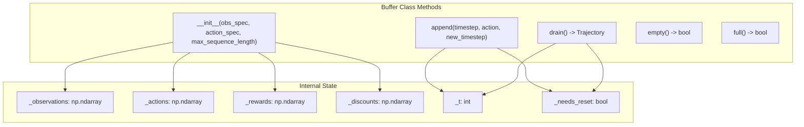
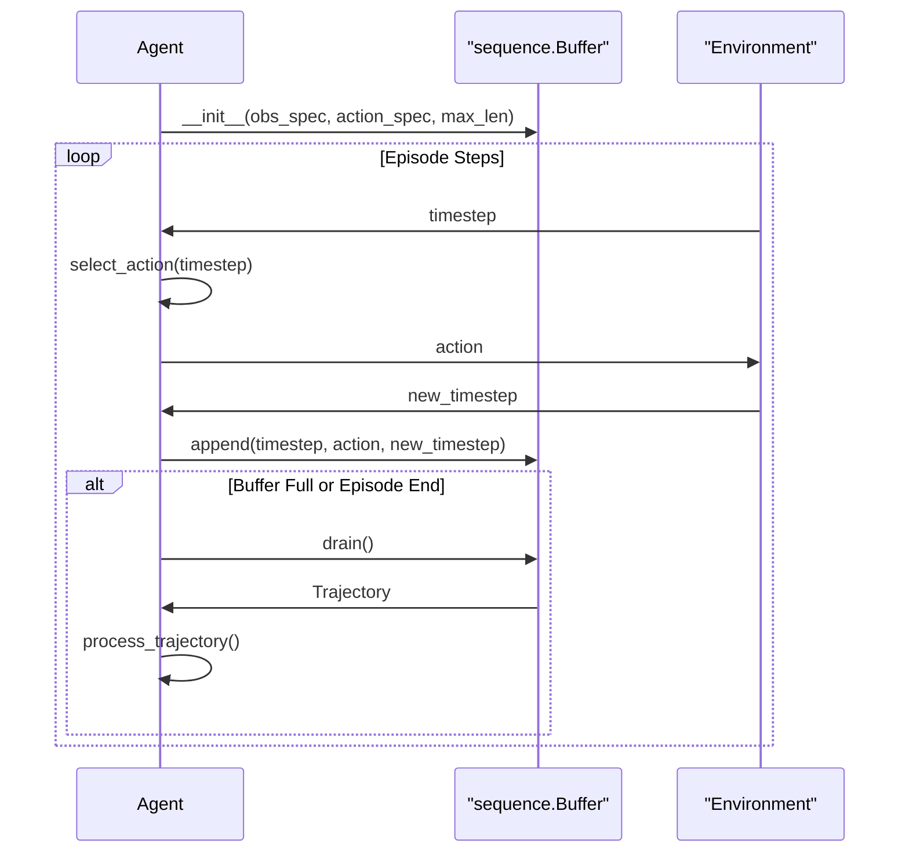
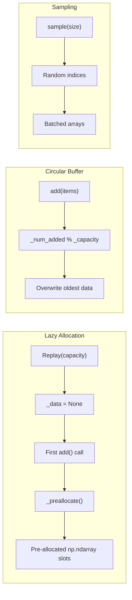
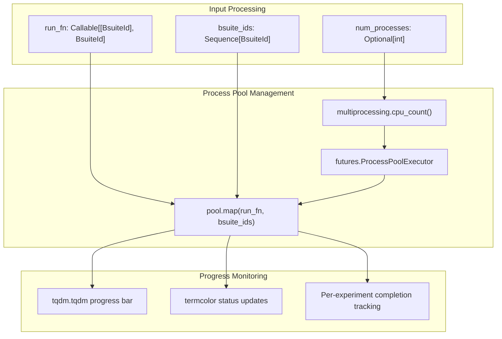
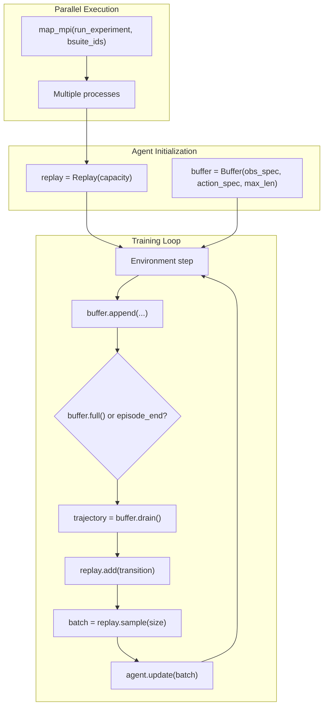

<!-- source: DeepWiki mcp.deepwiki.com · repo google-deepmind/bsuite · page 4.4 Agent Utilities and Components · fetched 2026-10-26 -->

# Agent Utilities and Components

Relevant source files

The following files were used as context for generating this wiki page:

- [bsuite/baselines/utils/__init__.py](bsuite/baselines/utils/__init__.py)
- [bsuite/baselines/utils/pool.py](bsuite/baselines/utils/pool.py)
- [bsuite/baselines/utils/replay.py](bsuite/baselines/utils/replay.py)
- [bsuite/baselines/utils/replay_test.py](bsuite/baselines/utils/replay_test.py)
- [bsuite/baselines/utils/sequence.py](bsuite/baselines/utils/sequence.py)
- [bsuite/baselines/utils/sequence_test.py](bsuite/baselines/utils/sequence_test.py)
- [bsuite/experiments/mountain_car_scale/__init__.py](bsuite/experiments/mountain_car_scale/__init__.py)
- [bsuite/experiments/mountain_car_scale/mountain_car_scale.py](bsuite/experiments/mountain_car_scale/mountain_car_scale.py)
- [bsuite/experiments/mountain_car_scale/mountain_car_scale_test.py](bsuite/experiments/mountain_car_scale/mountain_car_scale_test.py)

This document covers the shared utility components and building blocks used by agent implementations in bsuite. These utilities provide essential functionality for trajectory handling, experience replay, and parallel execution that are commonly needed across different agent architectures. For the specific agent implementations that use these utilities, see [JAX-based Agents](#4.1), [TensorFlow-based Agents](#4.2), and [Third-party Agent Integrations](#4.3).

## Sequence Handling System

The sequence handling utilities provide efficient buffering and trajectory management for agents that need to accumulate sequences of experience data before processing.

### Trajectory Data Structure

The `Trajectory` named tuple serves as the standard format for representing sequences of agent-environment interactions:

| Field | Type | Shape | Description |
|-------|------|-------|-------------|
| `observations` | `np.ndarray` | `[T+1, ...]` | Sequence of observations including final state |
| `actions` | `np.ndarray` | `[T]` | Actions taken by the agent |
| `rewards` | `np.ndarray` | `[T]` | Rewards received from environment |
| `discounts` | `np.ndarray` | `[T]` | Discount factors for each step |

The extra observation in the observations array ensures complete transition information for value function bootstrapping.

### Buffer Class Operations

The `Buffer` class provides windowed trajectory accumulation with automatic memory management:

Sources: [bsuite/baselines/utils/sequence.py:26-116]()

### Buffer Usage Pattern

The buffer follows a clear lifecycle for trajectory management:

Sources: [bsuite/baselines/utils/sequence.py:67-107]()

## Replay Buffer System

The replay buffer system provides uniform sampling of past experiences for off-policy learning algorithms.

### Replay Class Architecture

The `Replay` class implements a circular buffer with lazy memory allocation:

| Method | Parameters | Returns | Purpose |
|--------|------------|---------|---------|
| `__init__` | `capacity: int` | - | Initialize with maximum capacity |
| `add` | `items: Sequence[Any]` | - | Add single transition to buffer |
| `sample` | `size: int` | `Sequence[np.ndarray]` | Sample batch of experiences |
| `reset` | - | - | Clear all stored data |

### Memory Management Strategy

Sources: [bsuite/baselines/utils/replay.py:23-87]()

### Buffer Properties and Monitoring

The replay buffer provides runtime monitoring capabilities:

| Property | Type | Description |
|----------|------|-------------|
| `size` | `int` | Current number of stored items |
| `fraction_filled` | `float` | Ratio of current size to capacity |
| `_capacity` | `int` | Maximum storage capacity |
| `_num_added` | `int` | Total items added (including overwrites) |

Sources: [bsuite/baselines/utils/replay.py:65-72]()

## Multiprocessing Utilities

The pool utilities enable parallel execution of bsuite experiments across multiple processes.

### Parallel Execution Framework

The `map_mpi` function orchestrates experiment execution with progress tracking:

Sources: [bsuite/baselines/utils/pool.py:28-55]()

## Integration Patterns

These utilities integrate into agent training workflows through standard patterns:

### Typical Agent Training Loop Integration

Sources: [bsuite/baselines/utils/sequence.py:67-94](), [bsuite/baselines/utils/replay.py:42-59](), [bsuite/baselines/utils/pool.py:28-55]()

### Component Dependencies

The utility components have minimal external dependencies:

| Component | Dependencies | Purpose |
|-----------|-------------|----------|
| `sequence.Buffer` | `dm_env`, `numpy`, `bsuite.baselines.base` | Trajectory accumulation |
| `replay.Replay` | `numpy` | Experience replay storage |
| `pool.map_mpi` | `concurrent.futures`, `multiprocessing`, `tqdm`, `termcolor` | Parallel execution |

These utilities are designed to be framework-agnostic and can be used with JAX, TensorFlow, or other machine learning frameworks.

Sources: [bsuite/baselines/utils/sequence.py:18-24](), [bsuite/baselines/utils/replay.py:18-21](), [bsuite/baselines/utils/pool.py:18-24]()

---

