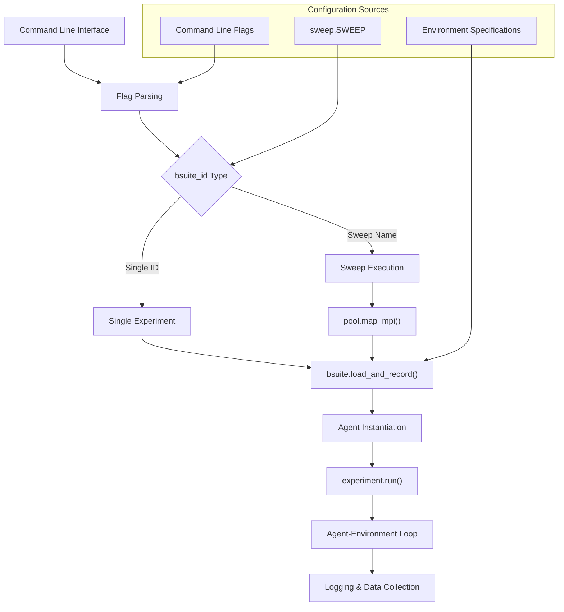
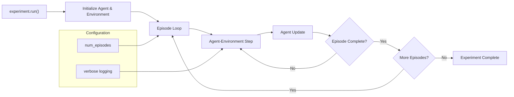
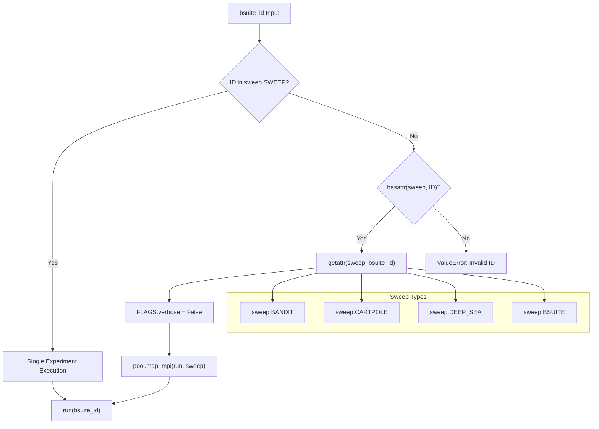

<!-- source: DeepWiki mcp.deepwiki.com · repo google-deepmind/bsuite · page 5 Experiment Management · fetched 2026-10-26 -->

# Experiment Management

Relevant source files

The following files were used as context for generating this wiki page:

- [bsuite/baselines/random/run.py](bsuite/baselines/random/run.py)

This document covers the experiment management system in bsuite, which orchestrates the execution of reinforcement learning experiments from single runs to large-scale parameter sweeps. The system provides command-line interfaces, configuration management, parallel execution capabilities, and integration with the logging framework.

For detailed information about running individual experiments, see [Running Experiments](#5.1). For information about parameter sweeps and configuration, see [Experiment Configuration and Sweeps](#5.2). For logging and data collection specifics, see [Logging System](#6.1).

## System Overview

The experiment management system coordinates the execution of RL experiments by integrating environment loading, agent instantiation, execution loops, and data collection. It supports both individual experiment runs and systematic parameter sweeps with parallel execution capabilities.

## Experiment Execution Architecture

The experiment management system follows a hierarchical execution model that handles both single experiments and multi-experiment sweeps:

Sources: [bsuite/baselines/random/run.py:46-84]()

## Core Execution Components

### Environment Loading with Logging

The `bsuite.load_and_record()` function serves as the primary entry point for experiment execution, automatically setting up environments with integrated logging:

| Parameter | Purpose | Configuration Flag |
|-----------|---------|-------------------|
| `bsuite_id` | Environment identifier | `--bsuite_id` |
| `save_path` | Data output directory | `--save_path` |
| `logging_mode` | Logging format (csv/sqlite/terminal) | `--logging_mode` |
| `overwrite` | Overwrite existing data | `--overwrite` |

The system automatically configures the environment with appropriate wrappers based on the logging mode specified.

Sources: [bsuite/baselines/random/run.py:49-54]()

### Experiment Execution Loop

The execution loop handles episode management, agent updates, and progress logging based on configuration parameters.

Sources: [bsuite/baselines/random/run.py:59-63]()

## Sweep Management

### Sweep Identification and Execution

The system distinguishes between single experiments and parameter sweeps using the `sweep` module:

Sources: [bsuite/baselines/random/run.py:73-84]()

### Parallel Execution

For sweep execution, the system uses `pool.map_mpi()` to distribute experiments across multiple processes:

- Automatically disables verbose logging to reduce output noise
- Maps the `run()` function across all experiment IDs in the sweep
- Supports MPI-based parallel processing for large-scale experiments

Sources: [bsuite/baselines/random/run.py:79-81]()

## Configuration Management

### Command-Line Interface

The experiment management system provides comprehensive configuration through command-line flags:

| Flag | Type | Default | Purpose |
|------|------|---------|---------|
| `bsuite_id` | string | 'catch/0' | Environment identifier or sweep name |
| `save_path` | string | '/tmp/bsuite' | Output directory for results |
| `logging_mode` | enum | 'csv' | Logging format (csv/sqlite/terminal) |
| `overwrite` | boolean | False | Overwrite existing data files |
| `num_episodes` | integer | None | Override environment episode count |
| `seed` | integer | 42 | Random seed for reproducibility |
| `verbose` | boolean | True | Enable detailed output logging |

Sources: [bsuite/baselines/random/run.py:31-42]()

### Dynamic Configuration

The system supports runtime configuration adjustments:

- Episode count can be overridden or use environment defaults via `env.bsuite_num_episodes`
- Verbose logging is automatically disabled during sweep execution
- Agent configuration adapts to environment specifications

Sources: [bsuite/baselines/random/run.py:62-63](), [bsuite/baselines/random/run.py:80]()

## Integration Points

### Agent Integration

The experiment management system integrates with the agent framework through standardized interfaces:

- Agent instantiation uses environment specifications (`obs_spec`, `action_spec`)
- Seed management ensures reproducible experiments
- Agent updates occur within the experiment execution loop

Sources: [bsuite/baselines/random/run.py:55-57]()

### Logging Integration

Experiment management automatically configures logging based on the specified mode:

- `csv`: Structured data output for analysis
- `sqlite`: Database storage for complex queries
- `terminal`: Real-time output for monitoring

The logging system captures experiment metadata, episode results, and agent performance metrics transparently.

Sources: [bsuite/baselines/random/run.py:35-36](), [bsuite/baselines/random/run.py:52]()

---

