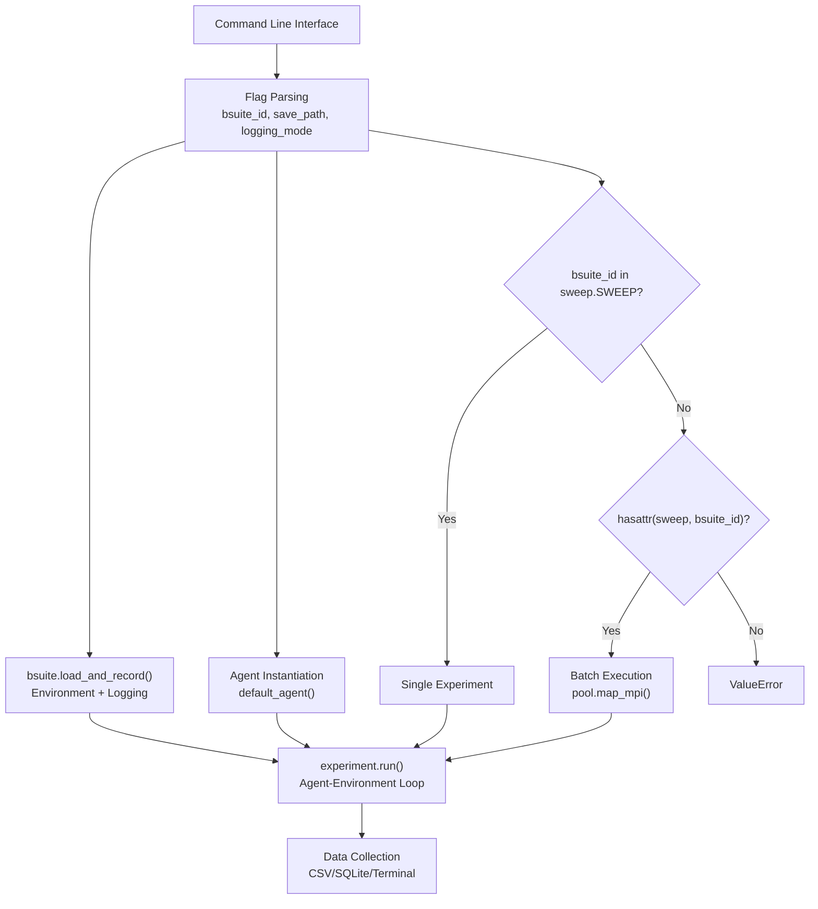
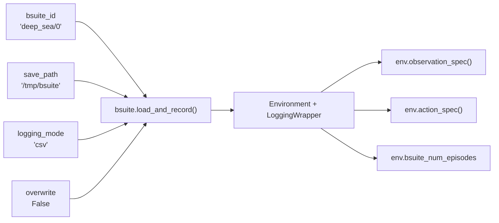
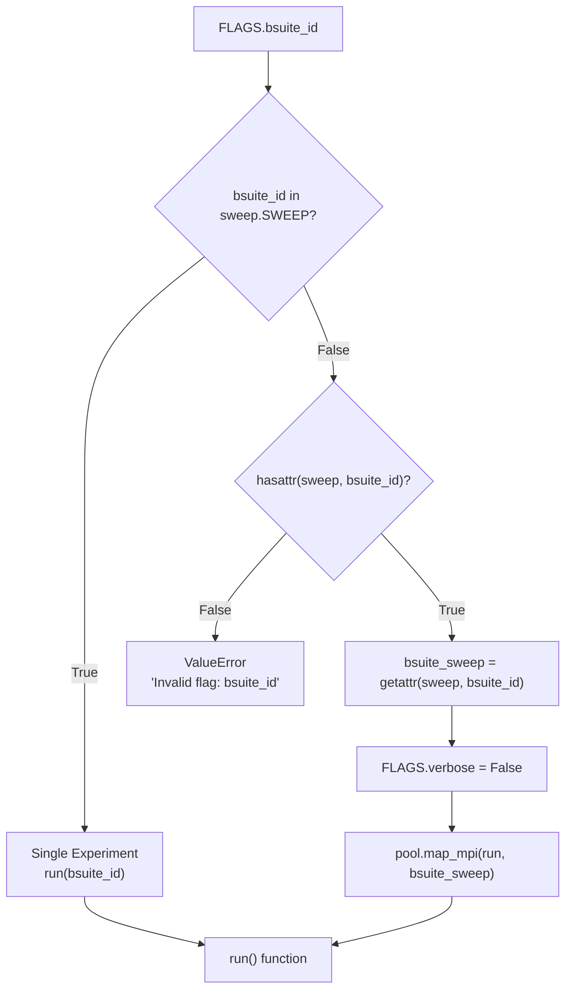

<!-- source: DeepWiki mcp.deepwiki.com · repo google-deepmind/bsuite · page 5.1 Running Experiments · fetched 2026-10-26 -->

# Running Experiments

<details>
<summary>Relevant source files</summary>

The following files were used as context for generating this wiki page:

- [bsuite/baselines/random/run.py](bsuite/baselines/random/run.py)

</details>


This document covers the basic execution of bsuite experiments, including command-line interfaces, experiment orchestration, and integration with the logging system. It focuses on the run scripts and execution patterns used to evaluate agents on bsuite environments.

For information about parameter sweeps and systematic evaluation approaches, see [Experiment Configuration and Sweeps](#5.2). For details about the logging system and data collection, see [Logging System](#6.1).

## Experiment Execution Overview

The bsuite experiment execution system provides a standardized way to run agents on diagnostic environments with automatic logging and data collection. The core execution pattern involves loading an environment with logging wrappers, instantiating an agent, and running the agent-environment interaction loop.

### Basic Execution Flow



Sources: [bsuite/baselines/random/run.py:46-88]()

## Command-Line Interface

The run scripts use `absl.flags` to provide a consistent command-line interface across all baseline agents. The standard flags control environment selection, logging configuration, and execution parameters.

### Standard Experiment Flags

| Flag | Type | Default | Purpose |
|------|------|---------|---------|
| `bsuite_id` | string | 'catch/0' | Environment identifier or sweep name |
| `save_path` | string | '/tmp/bsuite' | Directory for logging output |
| `logging_mode` | enum | 'csv' | Logging format: csv, sqlite, terminal |
| `overwrite` | boolean | False | Whether to overwrite existing logs |
| `num_episodes` | integer | None | Override default episode count |
| `seed` | integer | 42 | Random seed for reproducibility |
| `verbose` | boolean | True | Enable stdout logging |

Sources: [bsuite/baselines/random/run.py:31-42]()

### Usage Examples

```bash
# Run single experiment
python run.py --bsuite_id=deep_sea/0 --save_path=/results --logging_mode=csv

# Run with custom episode count
python run.py --bsuite_id=bandit/0 --num_episodes=1000 --seed=123

# Run a complete sweep
python run.py --bsuite_id=DEEP_SEA --verbose=False
```

## Environment Loading and Configuration

The experiment execution uses `bsuite.load_and_record()` to create environments with integrated logging. This function wraps the base environment with appropriate logging wrappers based on the specified configuration.

### Environment Loading Pattern



Sources: [bsuite/baselines/random/run.py:49-54]()

The loaded environment provides the specifications needed for agent instantiation and includes the default episode count for the specific bsuite task.

## Agent Instantiation

Each baseline implementation provides a `default_agent()` factory function that creates an appropriately configured agent for the given environment specifications.

### Agent Creation Pattern

```python
agent = random.default_agent(
    obs_spec=env.observation_spec(),
    action_spec=env.action_spec(),
    seed=FLAGS.seed
)
```

The agent factory functions handle:
- Observation and action space compatibility
- Default hyperparameter configuration
- Random seed initialization
- Framework-specific setup (JAX, TensorFlow, etc.)

Sources: [bsuite/baselines/random/run.py:55-57]()

## Experiment Execution Loop

The core experiment execution is handled by `experiment.run()`, which orchestrates the agent-environment interaction loop with episode management and logging integration.

### Execution Parameters

```python
experiment.run(
    agent=agent,
    environment=env,
    num_episodes=FLAGS.num_episodes or env.bsuite_num_episodes,
    verbose=FLAGS.verbose
)
```

The execution loop:
- Respects the environment's default episode count unless overridden
- Handles episode initialization and termination
- Manages agent training and evaluation phases
- Integrates with the logging system for data collection
- Provides optional verbose output for monitoring

Sources: [bsuite/baselines/random/run.py:59-63]()

## Single Experiment vs. Sweep Execution

The run scripts support both individual experiment execution and batch processing of experiment sweeps through a unified interface.

### Execution Mode Selection



Sources: [bsuite/baselines/random/run.py:73-84]()

### Sweep Execution Features

When running sweeps:
- Verbose output is automatically disabled to reduce log noise
- Parallel execution is handled through `pool.map_mpi()`
- Each experiment in the sweep runs with the same configuration flags
- Results are collected across all sweep variants

The sweep system allows systematic evaluation across:
- Multiple environment variants
- Different parameter settings
- Statistical replications with different seeds

Sources: [bsuite/baselines/random/run.py:77-81]()

## Return Values and Integration

The `run()` function returns the `bsuite_id` for integration with batch processing systems and workflow management. This enables:
- Progress tracking in sweep execution
- Result correlation with experiment identifiers
- Integration with analysis pipelines
- Error handling and retry logic

Sources: [bsuite/baselines/random/run.py:46-65]()

---

