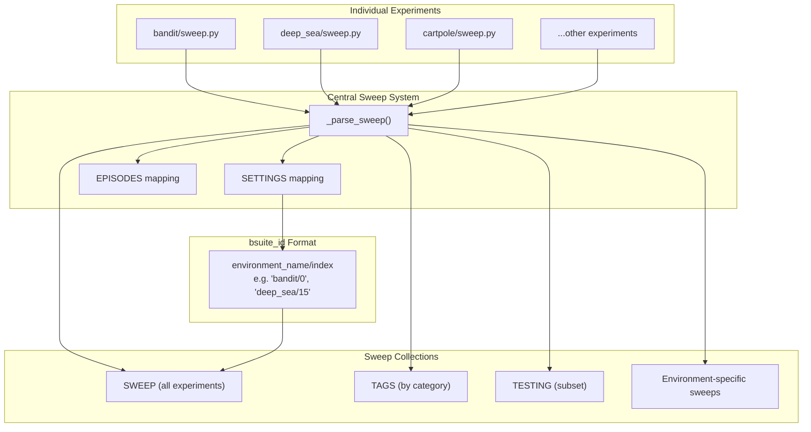
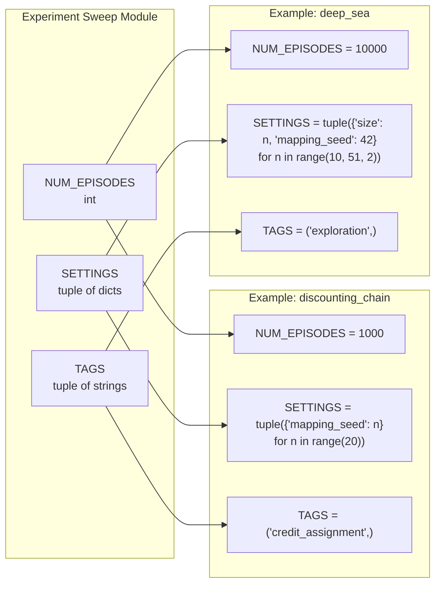
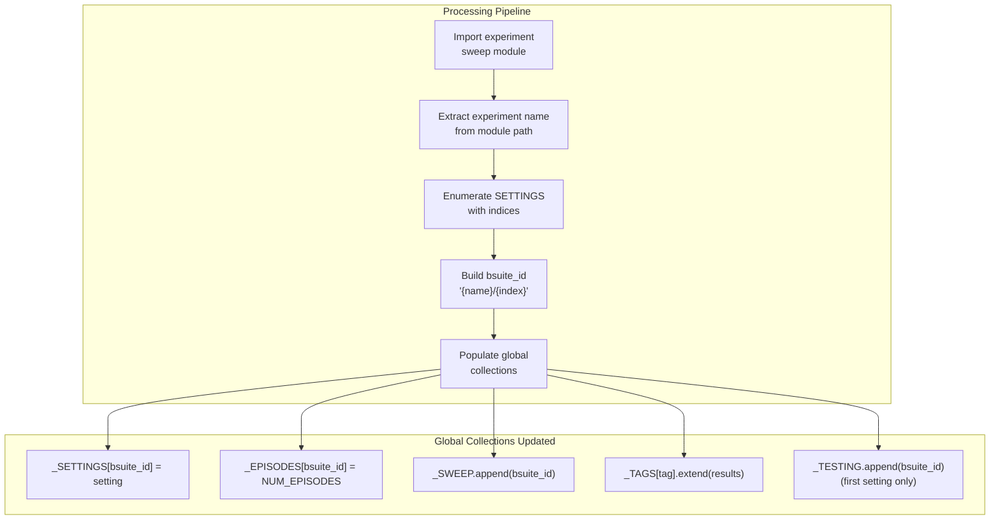
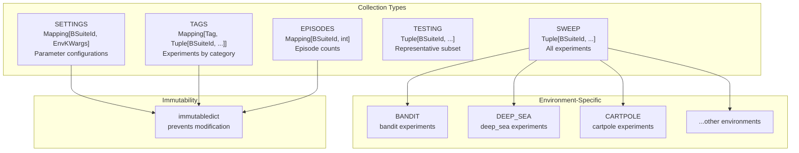
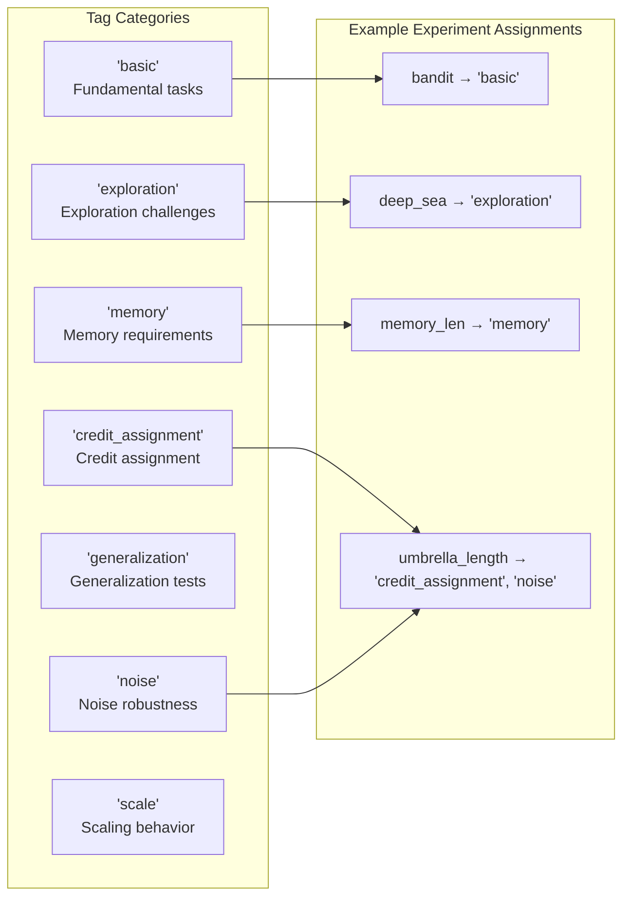
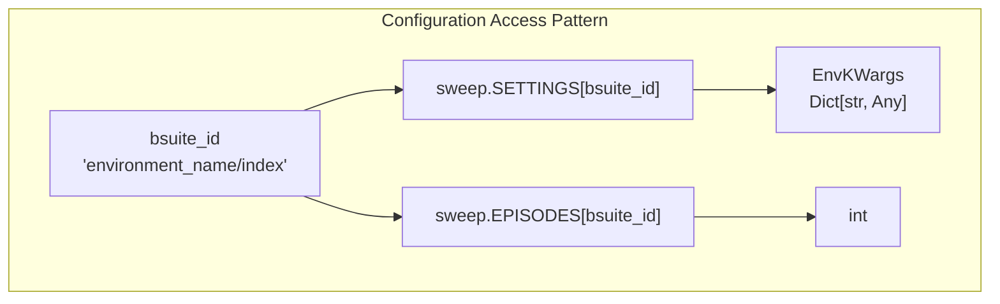

<!-- source: DeepWiki mcp.deepwiki.com · repo google-deepmind/bsuite · page 5.2 Experiment Configuration and Sweeps · fetched 2026-10-26 -->

# Experiment Configuration and Sweeps

<details>
<summary>Relevant source files</summary>

The following files were used as context for generating this wiki page:

- [bsuite/experiments/deep_sea/sweep.py](bsuite/experiments/deep_sea/sweep.py)
- [bsuite/experiments/discounting_chain/analysis.py](bsuite/experiments/discounting_chain/analysis.py)
- [bsuite/experiments/discounting_chain/sweep.py](bsuite/experiments/discounting_chain/sweep.py)
- [bsuite/experiments/mnist/sweep.py](bsuite/experiments/mnist/sweep.py)
- [bsuite/experiments/mountain_car/sweep.py](bsuite/experiments/mountain_car/sweep.py)
- [bsuite/experiments/umbrella_distract/analysis.py](bsuite/experiments/umbrella_distract/analysis.py)
- [bsuite/experiments/umbrella_distract/sweep.py](bsuite/experiments/umbrella_distract/sweep.py)
- [bsuite/experiments/umbrella_length/analysis.py](bsuite/experiments/umbrella_length/analysis.py)
- [bsuite/experiments/umbrella_length/sweep.py](bsuite/experiments/umbrella_length/sweep.py)
- [bsuite/sweep.py](bsuite/sweep.py)
- [bsuite/sweep_test.py](bsuite/sweep_test.py)

</details>


This page documents bsuite's experiment configuration and sweep system, which enables systematic evaluation of reinforcement learning agents across diverse parameter settings. The sweep system provides a structured way to define parameter configurations for each experiment and organize them into collections for batch execution.

For information about actually running experiments and sweeps, see [Running Experiments](#5.1). For analysis of sweep results, see [Analysis and Visualization](#6.2).

## Overview of the Sweep System

The bsuite sweep system is built around the concept of `bsuite_id` strings that uniquely identify specific experiment configurations. Each experiment defines multiple parameter settings, and the sweep system aggregates these into organized collections for systematic evaluation.



**bsuite_id Format and Usage**

Sources: [bsuite/sweep.py:16-34]()

## Experiment Parameter Configuration

Each experiment defines its parameter space through a sweep module that specifies the settings to evaluate. The configuration follows a standardized structure across all experiments.

### Individual Experiment Sweep Structure



**Key Configuration Elements:**

| Element | Type | Purpose |
|---------|------|---------|
| `NUM_EPISODES` | `int` | Number of episodes to run for this experiment |
| `SETTINGS` | `tuple[dict[str, Any], ...]` | Parameter configurations for the experiment |
| `TAGS` | `tuple[str, ...]` | Category tags for organizing experiments |

**Parameter Configuration Examples:**

- **Fixed Parameters**: `{'size': 10, 'mapping_seed': 42}` - specific values for all runs
- **Sweep Parameters**: `{'mapping_seed': n} for n in range(20)` - systematic variation
- **Complex Sweeps**: Mixed fixed and varied parameters across multiple dimensions

Sources: [bsuite/experiments/discounting_chain/sweep.py:18-21](), [bsuite/experiments/deep_sea/sweep.py:18-21](), [bsuite/experiments/mountain_car/sweep.py:18-21]()

### Settings Processing and Validation

The sweep system processes experiment configurations through the `_parse_sweep` function, which converts raw experiment definitions into the structured collections used throughout bsuite.



Sources: [bsuite/sweep.py:81-106]()

## Sweep Collections and Organization

The sweep system organizes experiments into several immutable collections, each serving different purposes for experiment selection and execution.

### Primary Sweep Collections



**Collection Usage Patterns:**

| Collection | Use Case | Example |
|------------|----------|---------|
| `sweep.SWEEP` | Complete evaluation | Run all 230+ experiments |
| `sweep.TESTING` | Quick validation | Test agent on representative subset |
| `sweep.TAGS['exploration']` | Focused evaluation | Test exploration capabilities |
| `sweep.BANDIT` | Single environment | Evaluate on bandit variants only |

Sources: [bsuite/sweep.py:133-151]()

### Tag-based Organization

The tag system enables logical grouping of experiments by research focus or algorithmic requirements.



Sources: [bsuite/experiments/discounting_chain/sweep.py:21](), [bsuite/experiments/deep_sea/sweep.py:21](), [bsuite/experiments/umbrella_length/sweep.py:27]()

## Working with Sweep Configurations

### Loading and Using Sweep Data

The sweep system provides programmatic access to experiment configurations through the central `bsuite.sweep` module.

**Basic Sweep Access:**
```python
import bsuite.sweep as sweep

# Get all experiment IDs
all_experiments = sweep.SWEEP

# Get experiments by tag
exploration_experiments = sweep.TAGS['exploration']

# Get specific environment experiments
bandit_experiments = sweep.BANDIT

# Get experiment configuration
config = sweep.SETTINGS['bandit/0']  # Returns: EnvKWargs dict
episodes = sweep.EPISODES['bandit/0']  # Returns: int
```

**Configuration Structure:**


Sources: [bsuite/sweep.py:64-67](), [bsuite/sweep.py:133-151]()

### Testing Sweep Validation

The sweep system includes validation to ensure configuration integrity and immutability.

**Immutability Enforcement:**
- All sweep collections use `immutabledict` to prevent modification
- Prevents accidental configuration changes during execution
- Ensures reproducible experiment definitions

**Testing Coverage:**
- Validates sweep structure and contents
- Checks bsuite_id format compliance  
- Verifies tag assignments and collection integrity

Sources: [bsuite/sweep_test.py:24-61]()

## Configuration Examples by Experiment Type

### Simple Parameter Sweeps

**Single Parameter Variation:**
```python
# discounting_chain: varies mapping_seed
SETTINGS = tuple({'mapping_seed': n} for n in range(20))
```

**Multi Parameter Variation:**
```python  
# deep_sea: varies size, fixes mapping_seed
SETTINGS = tuple({'size': n, 'mapping_seed': 42} for n in range(10, 51, 2))
```

### Complex Parameter Spaces

**Logarithmic Spacing:**
```python
# umbrella_length: non-uniform parameter spacing
_log_spaced = []
_log_spaced.extend(range(1, 11))
_log_spaced.extend([12, 14, 17, 20, 25])
_log_spaced.extend(range(30, 105, 10))

SETTINGS = tuple({'chain_length': n, 'n_distractor': 20} for n in _log_spaced)
```

**Random Seeds and Replication:**
```python
# mountain_car: multiple random seeds for statistical reliability  
SETTINGS = tuple({'seed': None} for n in range(20))
```

Sources: [bsuite/experiments/discounting_chain/sweep.py:20](), [bsuite/experiments/deep_sea/sweep.py:20](), [bsuite/experiments/umbrella_length/sweep.py:20-26](), [bsuite/experiments/mountain_car/sweep.py:20]()

---

