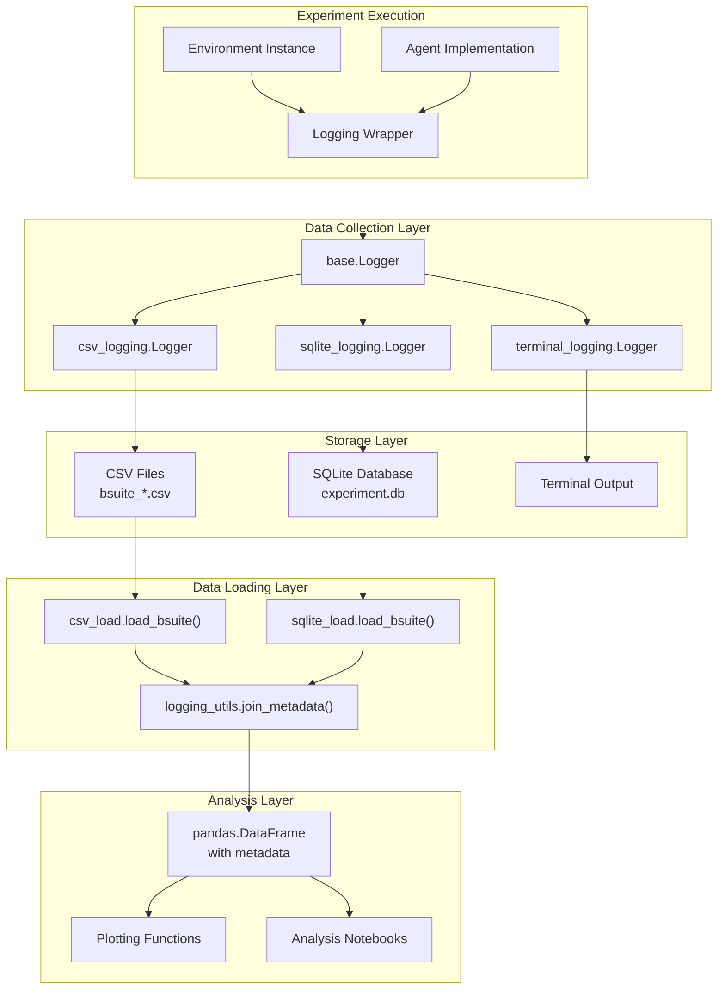
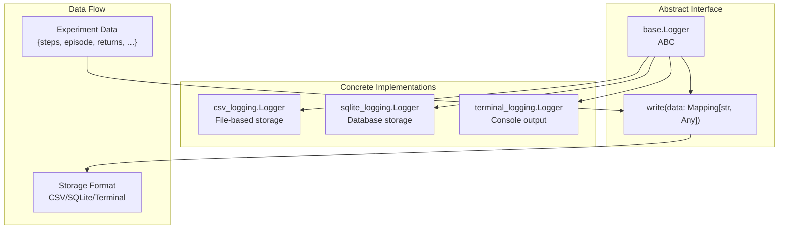
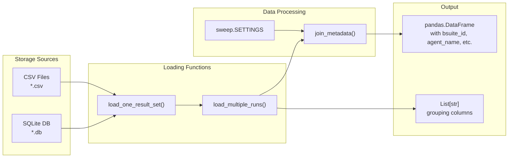

<!-- source: DeepWiki mcp.deepwiki.com · repo google-deepmind/bsuite · page 6 Data and Analysis · fetched 2026-10-26 -->

# Data and Analysis

<details>
<summary>Relevant source files</summary>

The following files were used as context for generating this wiki page:

- [bsuite/logging/__init__.py](bsuite/logging/__init__.py)
- [bsuite/logging/base.py](bsuite/logging/base.py)
- [bsuite/logging/csv_load.py](bsuite/logging/csv_load.py)
- [bsuite/logging/logging_utils.py](bsuite/logging/logging_utils.py)
- [bsuite/logging/sqlite_load_test.py](bsuite/logging/sqlite_load_test.py)
- [bsuite/logging/sqlite_logging_test.py](bsuite/logging/sqlite_logging_test.py)

</details>


The Data and Analysis system provides comprehensive capabilities for collecting, storing, loading, and analyzing experimental data in bsuite. This system enables transparent data capture during experiment execution, flexible storage options, and powerful analysis tools for evaluating agent performance across the diagnostic environments.

For specific details about the logging infrastructure, see [Logging System](#6.1). For analysis tools and visualization capabilities, see [Analysis and Visualization](#6.2). For automated reporting and results notebooks, see [Results and Reporting](#6.3).

## System Overview

The data and analysis pipeline in bsuite follows a systematic flow from experiment execution through storage to analysis and visualization. The system is designed to be transparent to researchers while providing rich data collection and analysis capabilities.

### Data Flow Architecture



Sources: [bsuite/logging/base.py:22-28](), [bsuite/logging/csv_load.py:28-58](), [bsuite/logging/logging_utils.py:27-46]()

### Core Components

The data and analysis system consists of several key components that work together to provide end-to-end data management:

| Component | Purpose | Key Classes/Functions |
|-----------|---------|----------------------|
| **Logger Interface** | Abstract base for all logging implementations | `base.Logger` |
| **Storage Backends** | Concrete implementations for different storage formats | `csv_logging.Logger`, `sqlite_logging.Logger` |
| **Data Loading** | Functions to read stored experiment data | `csv_load.load_bsuite()`, `sqlite_load.load_bsuite()` |
| **Metadata Management** | Utilities for joining sweep parameters with results | `logging_utils.join_metadata()` |
| **Multi-run Support** | Handling multiple experimental runs and agents | `logging_utils.load_multiple_runs()` |

## Logger Architecture

The logging system is built around a simple but powerful abstraction that allows different storage backends while maintaining a consistent interface for data collection.

### Logger Interface Design



Sources: [bsuite/logging/base.py:22-28]()

The `Logger` abstract base class defines a single `write` method that accepts a mapping of string keys to arbitrary values. This simple interface allows for flexible data collection while enabling different storage backends to handle the data according to their specific requirements.

## Data Storage and Loading

The system supports multiple storage formats, each with corresponding loading functions that return standardized pandas DataFrames for analysis.

### Storage Format Support

| Format | Logger Class | Loader Function | Use Case |
|--------|-------------|----------------|----------|
| **CSV** | `csv_logging.Logger` | `csv_load.load_bsuite()` | Human-readable, portable |
| **SQLite** | `sqlite_logging.Logger` | `sqlite_load.load_bsuite()` | Structured queries, large datasets |
| **Terminal** | `terminal_logging.Logger` | N/A | Real-time monitoring |

### Data Loading Pipeline



Sources: [bsuite/logging/csv_load.py:28-58](), [bsuite/logging/logging_utils.py:52-86]()

## Metadata Integration

A key feature of the data analysis system is automatic integration of experimental metadata with collected results. The `join_metadata` function enriches experiment data with parameters from the sweep configuration.

### Metadata Joining Process

The system automatically joins experimental results with sweep metadata using the `bsuite_id` as a key:

1. **Data Collection**: Each logged data point includes a `bsuite_id` identifying the specific experiment configuration
2. **Metadata Lookup**: The `join_metadata` function retrieves parameters from `sweep.SETTINGS` 
3. **Environment Parsing**: The environment name is extracted from the `bsuite_id`
4. **Parameter Enrichment**: Environment-specific parameters are added to the dataset

```python
# Example of metadata joining from logging_utils.py:27-46
def join_metadata(df: pd.DataFrame) -> pd.DataFrame:
  """Returns a DataFrame with bsuite sweep metadata joined on bsuite_id."""
  metadata = copy.deepcopy(sweep.SETTINGS)
  
  for bsuite_id, env_kwargs in metadata.items():
    bsuite_env = bsuite_id.split(sweep.SEPARATOR)[0]
    bsuite_params = {
        'bsuite_id': bsuite_id,
        'bsuite_env': bsuite_env,
    }
    bsuite_params.update(env_kwargs)
```

Sources: [bsuite/logging/logging_utils.py:27-46]()

## Multi-Agent and Multi-Run Support

The system is designed to handle complex experimental scenarios involving multiple agents, algorithm variants, and repeated runs.

### Path Collection Handling

The `load_multiple_runs` function provides flexible input handling for different experimental setups:

| Input Type | Description | Example |
|------------|-------------|---------|
| **String** | Single path | `"/path/to/results"` |
| **Sequence** | Multiple paths | `["/path1", "/path2"]` |
| **Mapping** | Named agent results | `{"DQN": "/path1", "PPO": "/path2"}` |

### Data Standardization

All loading functions return a consistent tuple format:
- `pd.DataFrame`: Combined results with standardized columns
- `List[str]`: Grouping variables for analysis (e.g., `['agent_name']`)

This standardization enables consistent analysis across different experimental setups and storage formats.

Sources: [bsuite/logging/logging_utils.py:52-86]()

## Integration with Experiment Framework

The data and analysis system integrates seamlessly with bsuite's experiment execution framework through environment wrappers that provide transparent data collection.

### Wrapper-Based Data Collection

Data collection occurs transparently during experiment execution through logging wrappers that intercept environment interactions without affecting agent behavior. This design ensures that:

- **Transparency**: Agents are unaware of data collection
- **Consistency**: All experiments collect standardized metrics
- **Flexibility**: Different logging backends can be used without code changes
- **Completeness**: Full interaction histories are captured for analysis

The collected data includes standard RL metrics (returns, episode lengths, steps) as well as environment-specific information that can be used for detailed analysis of agent behavior across bsuite's diagnostic environments.

Sources: [bsuite/logging/base.py:22-28](), [bsuite/logging/logging_utils.py:27-46]()

---

