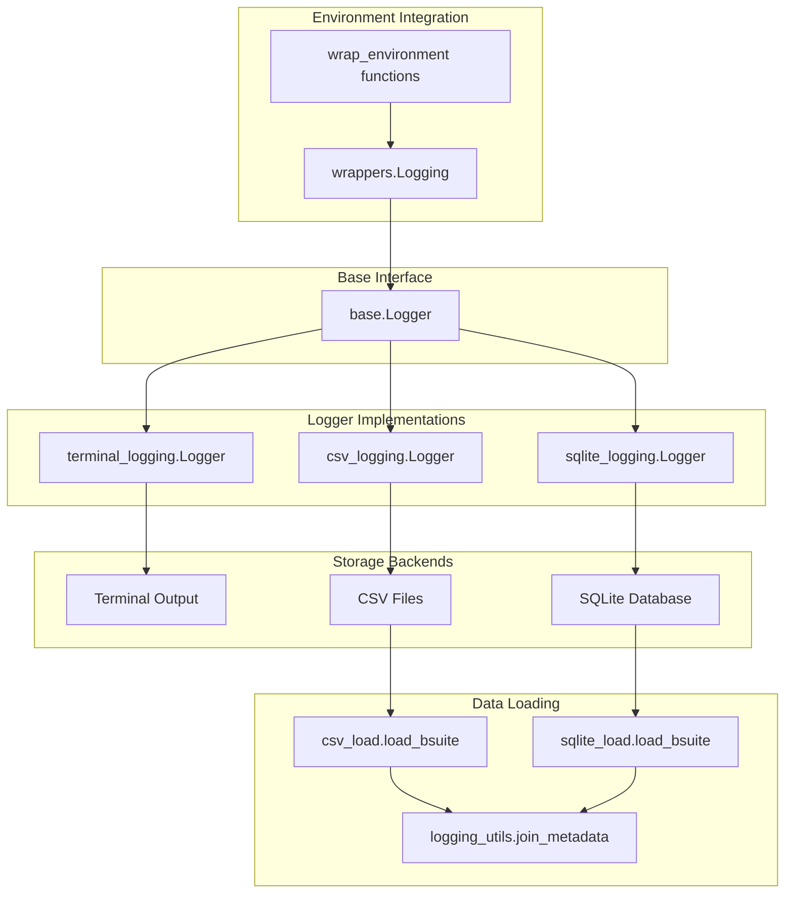
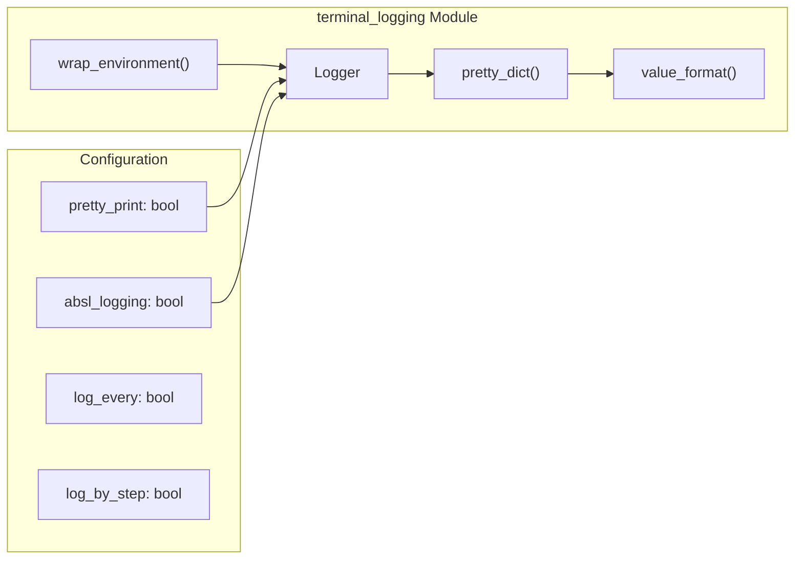
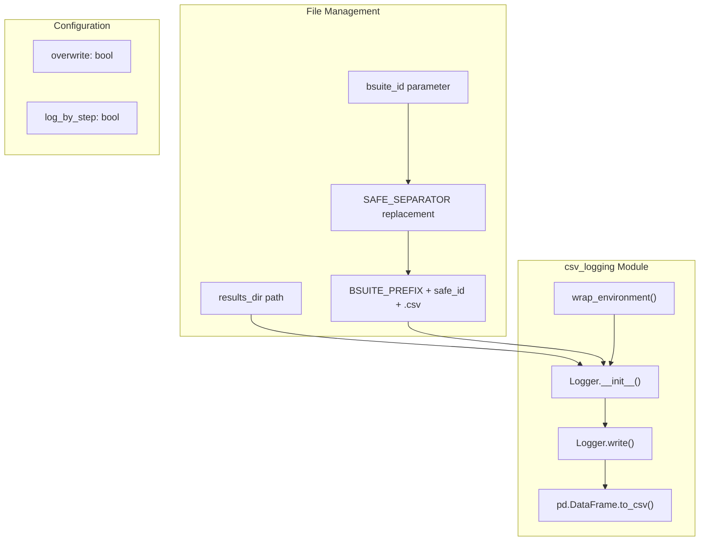
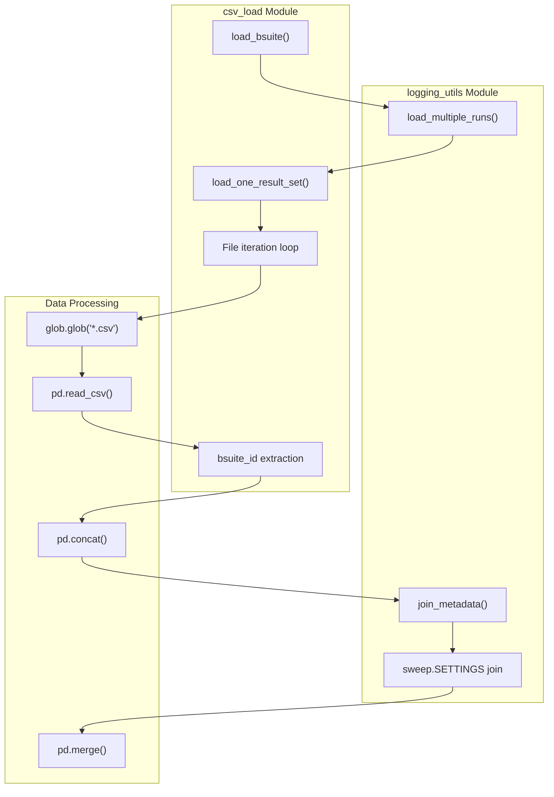
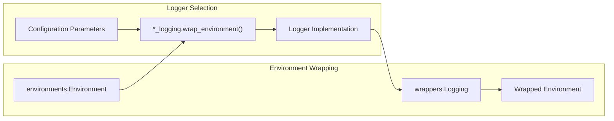
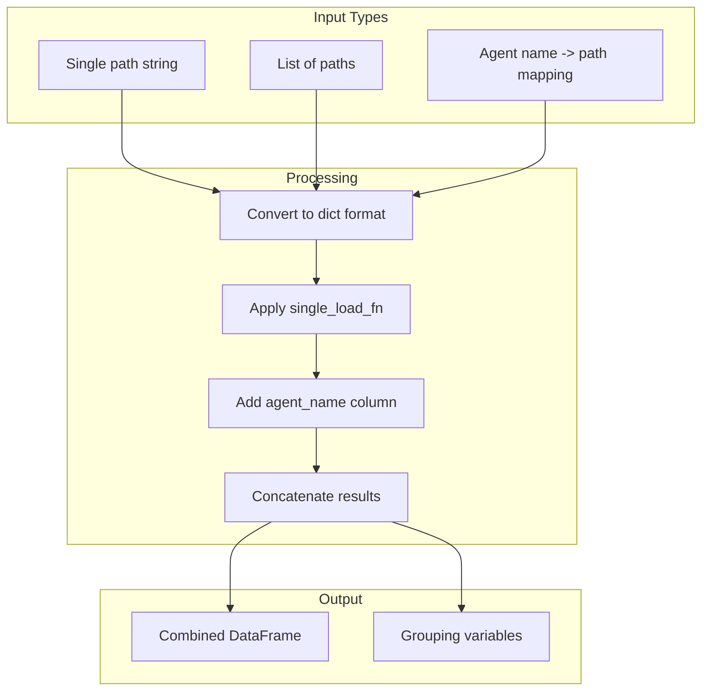

<!-- source: DeepWiki mcp.deepwiki.com · repo google-deepmind/bsuite · page 6.1 Logging System · fetched 2026-10-26 -->

# Logging System

Relevant source files

The following files were used as context for generating this wiki page:

- [bsuite/logging/__init__.py](bsuite/logging/__init__.py)
- [bsuite/logging/base.py](bsuite/logging/base.py)
- [bsuite/logging/csv_load.py](bsuite/logging/csv_load.py)
- [bsuite/logging/csv_logging.py](bsuite/logging/csv_logging.py)
- [bsuite/logging/logging_utils.py](bsuite/logging/logging_utils.py)
- [bsuite/logging/sqlite_load_test.py](bsuite/logging/sqlite_load_test.py)
- [bsuite/logging/sqlite_logging_test.py](bsuite/logging/sqlite_logging_test.py)
- [bsuite/logging/terminal_logging.py](bsuite/logging/terminal_logging.py)

## Purpose and Scope

The logging system provides comprehensive data collection, storage, and retrieval capabilities for bsuite experiments. It enables transparent capture of agent-environment interactions across multiple storage backends including CSV files, SQLite databases, and terminal output. The system integrates seamlessly with bsuite environments through wrapper mechanisms and supports downstream analysis workflows.

For information about experiment configuration and parameter sweeps, see [Experiment Configuration and Sweeps](#5.2). For analysis and visualization of logged data, see [Analysis and Visualization](#6.2).

## Logging Architecture

The logging system follows a modular architecture with abstract interfaces, multiple concrete implementations, and integrated data loading capabilities.

### Core Architecture Diagram

Sources: [bsuite/logging/base.py:22-28](), [bsuite/logging/terminal_logging.py:29-38](), [bsuite/logging/csv_logging.py:34-41](), [bsuite/logging/csv_load.py:28-47]()

## Logger Interface and Implementations

### Base Logger Interface

The logging system is built around the abstract `base.Logger` class which defines a simple but flexible interface:

| Method | Description | Parameters |
|--------|-------------|------------|
| `write` | Writes data to storage backend | `data: Mapping[str, Any]` |

The `write` method receives a dictionary of key-value pairs representing experiment data such as episode returns, step counts, and custom metrics.

Sources: [bsuite/logging/base.py:22-28]()

### Terminal Logger Implementation

The `terminal_logging.Logger` provides real-time experiment monitoring through formatted console output:

Key features:
- **Pretty printing**: Formats data as `key = value | key = value` strings
- **Numeric formatting**: Integers displayed as-is, floats rounded to 4 decimal places
- **Logging integration**: Supports both standard `print` and `absl.logging`
- **Flexible timing**: Configurable logging frequency via `log_every` and `log_by_step`

Sources: [bsuite/logging/terminal_logging.py:41-75]()

### CSV Logger Implementation

The `csv_logging.Logger` persists experiment data to CSV files for offline analysis:

Key implementation details:
- **File naming**: Uses pattern `bsuite_id_-_{safe_bsuite_id}.csv` with dangerous characters replaced
- **Directory management**: Automatically creates results directories
- **Data accumulation**: Maintains internal list and rewrites entire CSV on each `write()` call
- **Collision detection**: Prevents overwriting existing files unless `overwrite=True`

Constants used:
- `SAFE_SEPARATOR = '-'`: Replaces filesystem-unsafe characters
- `INITIAL_SEPARATOR = '_-_'`: Separates prefix from bsuite ID
- `BSUITE_PREFIX = 'bsuite_id' + INITIAL_SEPARATOR`: File naming prefix

Sources: [bsuite/logging/csv_logging.py:29-90](), [bsuite/logging/csv_logging.py:44-58]()

## Data Loading System

The logging system provides comprehensive data loading capabilities to support analysis workflows.

### CSV Data Loading

The loading process involves several key steps:

1. **File discovery**: Uses `glob.glob()` to find CSV files matching bsuite naming patterns
2. **ID extraction**: Parses filenames to recover original `bsuite_id` values
3. **Data aggregation**: Combines multiple CSV files into unified DataFrames
4. **Metadata joining**: Merges experiment data with sweep configuration metadata

Sources: [bsuite/logging/csv_load.py:28-58](), [bsuite/logging/logging_utils.py:27-86]()

### Metadata Integration

The `join_metadata()` function enriches experiment data with configuration parameters:

| Data Source | Contribution |
|-------------|--------------|
| `sweep.SETTINGS` | Environment parameters and configurations |
| `bsuite_id` parsing | Environment name extraction |
| File metadata | Results directory paths |
| Agent identification | Agent name assignment for multi-run analysis |

Sources: [bsuite/logging/logging_utils.py:27-46]()

## Environment Integration

The logging system integrates transparently with bsuite environments through the wrapper mechanism.

### Wrapper Integration Pattern

Each logging backend provides a `wrap_environment()` function that:
1. Instantiates the appropriate logger with configuration
2. Wraps the environment using `wrappers.Logging`
3. Returns a transparent logging-enabled environment

### Logging Configuration Options

| Parameter | Purpose | Available In |
|-----------|---------|--------------|
| `log_by_step` | Log every environment step | All backends |
| `log_every` | Log at episode boundaries | Terminal |
| `pretty_print` | Format output for readability | Terminal |
| `overwrite` | Allow file overwriting | CSV, SQLite |
| `results_dir` | Output directory path | CSV, SQLite |

Sources: [bsuite/logging/terminal_logging.py:29-38](), [bsuite/logging/csv_logging.py:34-41]()

## Usage Patterns and Examples

### Basic Logger Usage

The typical workflow involves three steps:

1. **Environment wrapping**: Use backend-specific `wrap_environment()` functions
2. **Agent interaction**: Standard agent-environment loop with transparent logging
3. **Data analysis**: Load and analyze logged data using provided utilities

### Multi-Run Analysis Support

The system supports complex analysis scenarios through the `load_multiple_runs()` function:

This enables comparative analysis across different agents, parameter settings, and experimental conditions.

Sources: [bsuite/logging/logging_utils.py:52-86]()

---

