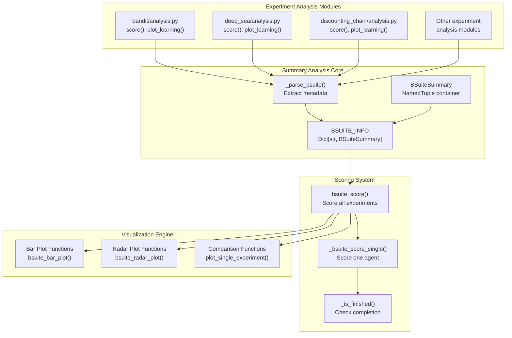
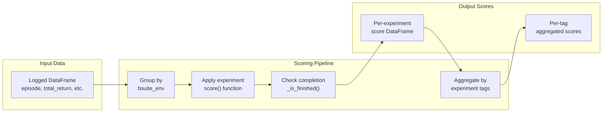
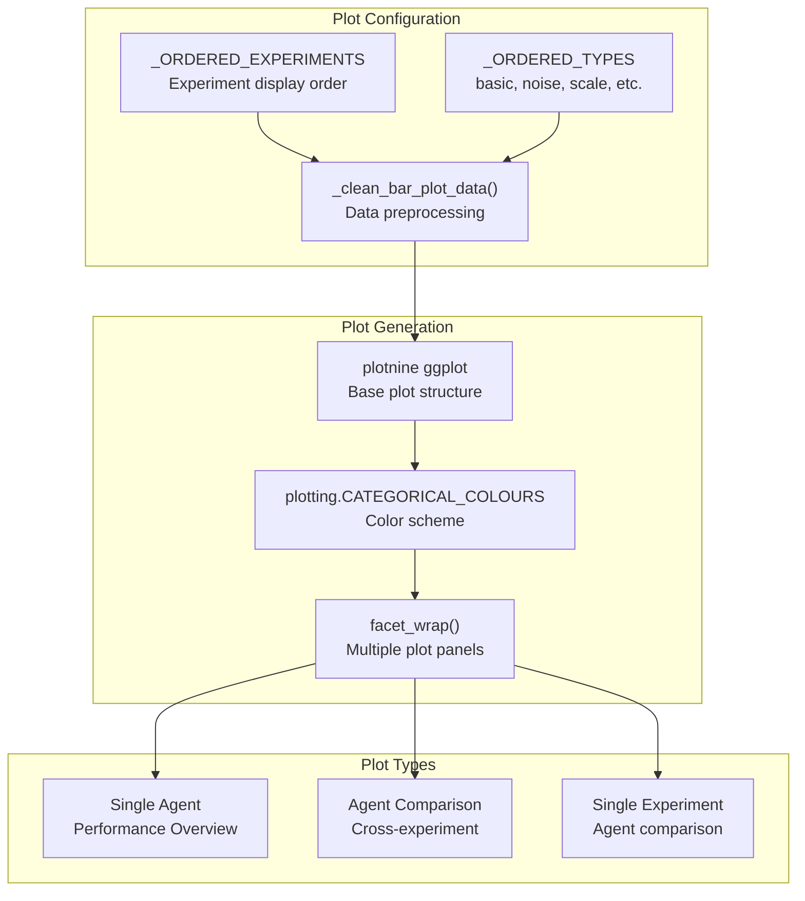
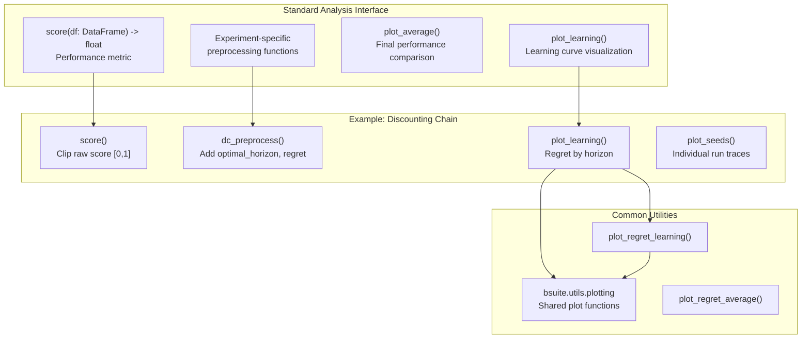

<!-- source: DeepWiki mcp.deepwiki.com · repo google-deepmind/bsuite · page 6.2 Analysis and Visualization · fetched 2026-10-26 -->

# Analysis and Visualization

Relevant source files

The following files were used as context for generating this wiki page:

- [bsuite/experiments/deep_sea/sweep.py](bsuite/experiments/deep_sea/sweep.py)
- [bsuite/experiments/discounting_chain/analysis.py](bsuite/experiments/discounting_chain/analysis.py)
- [bsuite/experiments/discounting_chain/sweep.py](bsuite/experiments/discounting_chain/sweep.py)
- [bsuite/experiments/mnist/sweep.py](bsuite/experiments/mnist/sweep.py)
- [bsuite/experiments/mountain_car/sweep.py](bsuite/experiments/mountain_car/sweep.py)
- [bsuite/experiments/summary_analysis.py](bsuite/experiments/summary_analysis.py)

This document covers bsuite's analysis and visualization system, which provides tools for evaluating agent performance across experiments, generating summary statistics, and creating publication-ready plots. The system processes logged experimental data to produce comparative analyses and visualizations that help researchers understand agent behavior patterns.

For information about data collection and logging mechanisms, see [Logging System](#6.1). For the comprehensive results notebook and automated reporting, see [Results and Reporting](#6.3).

## Analysis Framework Architecture

The analysis system is built around a modular architecture that separates experiment-specific analysis from cross-experiment summary analysis:

Sources: [bsuite/experiments/summary_analysis.py:55-96](), [bsuite/experiments/summary_analysis.py:111-147]()

## Summary Analysis System

The summary analysis system aggregates results across all bsuite experiments through a standardized interface. Each experiment provides analysis metadata via the `BSuiteSummary` structure:

| Component | Purpose | Key Attributes |
|-----------|---------|----------------|
| `BSuiteSummary` | Metadata container | `score`, `type`, `tags`, `episode` |
| `BSUITE_INFO` | Experiment registry | Maps experiment names to summaries |
| `bsuite_score()` | Cross-experiment scoring | Applies scoring functions uniformly |
| `ave_score_by_tag()` | Tag-based aggregation | Groups experiments by capability tags |

The scoring system processes experimental data through several stages:

Sources: [bsuite/experiments/summary_analysis.py:133-147](), [bsuite/experiments/summary_analysis.py:165-173]()

## Visualization Components

The visualization system provides multiple plot types for different analysis needs:

### Bar Plot System

Bar plots compare agent performance across experiments or agents within specific experiments:

- `bsuite_bar_plot()` - Performance across all experiments for single agent
- `bsuite_bar_plot_compare()` - Multiple agents across all experiments  
- `plot_single_experiment()` - Agent comparison on specific experiment

The plotting system handles categorical ordering and sweep variable support:

Sources: [bsuite/experiments/summary_analysis.py:180-294](), [bsuite/experiments/summary_analysis.py:217-268]()

### Radar Plot System

The radar plot system creates comprehensive capability overviews by aggregating experiment scores by tags:

- `bsuite_radar_plot()` - Multi-dimensional performance visualization
- `_radar()` - Core radar plotting utility
- Tag-based aggregation across experiment categories

Key features include:
- Polar coordinate system with capability axes
- Semi-transparent fill areas with edge highlighting
- Support for multiple agents with color coding
- Automatic legend and label positioning

Sources: [bsuite/experiments/summary_analysis.py:300-421]()

## Individual Experiment Analysis

Each experiment provides specialized analysis functions following a consistent interface:

Example analysis workflow for discounting chain experiment:

| Function | Purpose | Key Operations |
|----------|---------|----------------|
| `dc_preprocess()` | Data preparation | Add `optimal_horizon`, compute `total_regret` |
| `score()` | Performance metric | Normalize average return to [0,1] score |
| `plot_learning()` | Learning dynamics | Regret curves grouped by horizon |
| `plot_seeds()` | Individual traces | Per-run return trajectories |

Sources: [bsuite/experiments/discounting_chain/analysis.py:33-114](), [bsuite/experiments/discounting_chain/analysis.py:58-67]()

## Plot Types and Usage

The analysis system supports several visualization patterns:

### Learning Curve Plots
- Time-series performance tracking
- Grouping by experimental conditions
- Confidence intervals across seeds
- Baseline comparison lines

### Performance Distribution Plots  
- Final episode performance comparisons
- Statistical significance testing
- Hyperparameter sweep visualization
- Error bar representations

### Summary Comparison Plots
- Cross-experiment performance matrices
- Agent capability profiles
- Tag-based performance aggregation
- Publication-ready formatting

All plotting functions accept optional `sweep_vars` parameters for hyperparameter analysis and use consistent color schemes from `bsuite.utils.plotting.CATEGORICAL_COLOURS`.

Sources: [bsuite/experiments/summary_analysis.py:16-49](), [bsuite/experiments/discounting_chain/analysis.py:69-114]()

---

