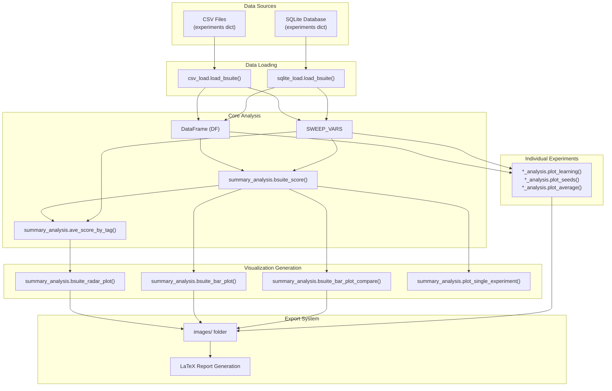
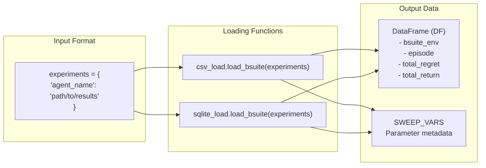
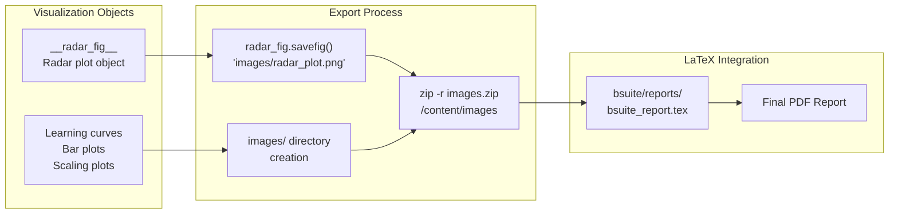

<!-- source: DeepWiki mcp.deepwiki.com · repo google-deepmind/bsuite · page 6.3 Results and Reporting · fetched 2026-10-26 -->

# Results and Reporting

<details>
<summary>Relevant source files</summary>

The following files were used as context for generating this wiki page:

- [bsuite/analysis/results.ipynb](bsuite/analysis/results.ipynb)

</details>


This document covers bsuite's comprehensive analysis and reporting system for evaluating reinforcement learning agent performance. The system provides automated visualization, statistical analysis, and report generation capabilities for experiment results collected through the logging framework.

For information about data collection and logging setup, see [Logging System](#6.1). For details on analysis tools and plotting utilities, see [Analysis and Visualization](#6.2).

## Overview

The results and reporting system centers around a comprehensive Jupyter notebook that provides standardized analysis and visualization of bsuite experiment results. The system supports both CSV and SQLite data sources, generates multiple visualization types including radar plots and learning curves, and provides automated report generation capabilities.

The main analysis interface is provided through `bsuite/analysis/results.ipynb`, which serves as both an interactive analysis environment and a template for generating standardized performance reports.

## Analysis Pipeline Architecture



Sources: [bsuite/analysis/results.ipynb:36-48](), [bsuite/analysis/results.ipynb:123-129]()

## Data Loading and Processing

The analysis system supports loading experimental data from multiple sources through standardized interfaces:

### Data Source Configuration



The system expects an `experiments` dictionary that maps experiment names to result paths. For CSV logging, paths point to directories containing result files. For SQLite logging, paths point to database files.

| Data Source | Function | Path Format |
|-------------|----------|-------------|
| CSV Files | `csv_load.load_bsuite()` | Directory containing CSV files |
| SQLite Database | `sqlite_load.load_bsuite()` | Path to `.db` file |

Sources: [bsuite/analysis/results.ipynb:125-128]()

## Overall Performance Analysis

### Radar Plot Visualization

The primary summary visualization is a radar plot that provides a comprehensive view of agent performance across all challenge domains:

```python
BSUITE_SCORE = summary_analysis.bsuite_score(DF, SWEEP_VARS)
BSUITE_SUMMARY = summary_analysis.ave_score_by_tag(BSUITE_SCORE, SWEEP_VARS)
radar_fig = summary_analysis.bsuite_radar_plot(BSUITE_SUMMARY, SWEEP_VARS)
```

The radar plot displays normalized scores (0-1) across different challenge categories:
- **Basic**: Fundamental learning tasks
- **Noise**: Robustness to reward noise
- **Scale**: Robustness to reward scaling
- **Exploration**: Deep exploration capabilities
- **Credit Assignment**: Temporal credit assignment
- **Memory**: Memory and context retention

Sources: [bsuite/analysis/results.ipynb:145-147]()

### Bar Plot Comparisons

The system generates multiple bar plot formats for detailed performance comparison:

| Plot Type | Function | Purpose |
|-----------|----------|---------|
| Individual Scores | `bsuite_bar_plot()` | Per-agent performance by challenge |
| Cross-Agent Comparison | `bsuite_bar_plot_compare()` | Side-by-side agent comparison |
| Single Experiment | `plot_single_experiment()` | Detailed single challenge analysis |

Sources: [bsuite/analysis/results.ipynb:189](), [bsuite/analysis/results.ipynb:222]()

## Individual Experiment Analysis

Each bsuite experiment provides specialized analysis functions tailored to its specific evaluation criteria:

### Analysis Function Structure

```mermaid
graph TB
    subgraph "Experiment Types"
        BASIC["Basic Experiments<br/>bandit, mnist, catch,<br/>cartpole, mountain_car"]
        NOISE["Noise Variants<br/>*_noise experiments"]
        SCALE["Scale Variants<br/>*_scale experiments"]
        EXPLORATION["Exploration<br/>deep_sea, cartpole_swingup"]
        CREDIT["Credit Assignment<br/>umbrella_*, discounting_chain"]
        MEMORY["Memory Tasks<br/>memory_len, memory_size"]
    end
    
    subgraph "Common Analysis Functions"
        PLOT_LEARNING["*.plot_learning()<br/>Learning curves over time"]
        PLOT_SEEDS["*.plot_seeds()<br/>Individual seed performance"]
        PLOT_AVERAGE["*.plot_average()<br/>Average performance by parameter"]
        PLOT_SCALE["*.plot_scale()<br/>Scaling with difficulty"]
    end
    
    subgraph "Specialized Functions"
        DEEP_SEA_SCALING["deep_sea_analysis.plot_scaling()<br/>Exponential scaling analysis"]
        DEEP_SEA_LOG["deep_sea_analysis.plot_scaling_log()<br/>Log-scale scaling analysis"]
        UMBRELLA_SCALE["umbrella_*_analysis.plot_scale()<br/>Chain length scaling"]
        MEMORY_SCALE["memory_*_analysis.plot_scale()<br/>Memory capacity scaling"]
    end
    
    BASIC --> PLOT_LEARNING
    BASIC --> PLOT_SEEDS
    NOISE --> PLOT_LEARNING
    NOISE --> PLOT_SEEDS
    NOISE --> PLOT_AVERAGE
    SCALE --> PLOT_LEARNING
    SCALE --> PLOT_SEEDS
    SCALE --> PLOT_AVERAGE
    
    EXPLORATION --> DEEP_SEA_SCALING
    EXPLORATION --> DEEP_SEA_LOG
    CREDIT --> UMBRELLA_SCALE
    MEMORY --> MEMORY_SCALE
```



Sources: [bsuite/analysis/results.ipynb:63-85](), [bsuite/analysis/results.ipynb:317-320]()

### Standard Analysis Workflow

Each experiment analysis follows a consistent pattern:

1. **Data Filtering**: Extract experiment-specific data from the main DataFrame
2. **Score Computation**: Calculate experiment-specific performance metrics
3. **Visualization Generation**: Create standard plots (learning curves, seed plots, scaling analysis)
4. **Specialized Analysis**: Generate experiment-specific visualizations

Example workflow for bandit analysis:
```python
bandit_df = DF[DF.bsuite_env == 'bandit'].copy()
summary_analysis.plot_single_experiment(BSUITE_SCORE, 'bandit', SWEEP_VARS).draw()
bandit_analysis.plot_learning(bandit_df, SWEEP_VARS).draw()
bandit_analysis.plot_seeds(bandit_df, SWEEP_VARS).draw()
```

Sources: [bsuite/analysis/results.ipynb:318-320](), [bsuite/analysis/results.ipynb:337](), [bsuite/analysis/results.ipynb:370]()

## Experiment Categories and Analysis

### Basic Experiments

| Environment | Analysis Focus | Key Metrics |
|-------------|----------------|-------------|
| `bandit` | Regret minimization | Average regret over episodes |
| `mnist` | Classification accuracy | Correct classifications |
| `catch` | Control learning | Successful catches |
| `cartpole` | Balancing control | Time spent balancing |
| `mountain_car` | Goal reaching | Steps to goal |

### Robustness Testing

**Noise Experiments**: Test robustness to Gaussian reward noise with `noise_scale = [0.1, 0.3, 1, 3, 10]`

**Scale Experiments**: Test robustness to reward scaling with `reward_scale = [0.01, 0.1, 1, 10, 100]`

Both categories use the same base analysis functions but with parameter-specific filtering and interpretation.

Sources: [bsuite/analysis/results.ipynb:843-871](), [bsuite/analysis/results.ipynb:1564-1598]()

### Exploration Analysis

Deep exploration experiments use specialized scaling analysis to evaluate exponential vs. polynomial learning time scaling:

```python
deep_sea_plt = deep_sea_analysis.find_solution(deep_sea_df, SWEEP_VARS)
deep_sea_analysis.plot_scaling(deep_sea_plt, SWEEP_VARS).draw()
deep_sea_analysis.plot_scaling_log(deep_sea_plt, SWEEP_VARS).draw()
```

The analysis identifies whether agents achieve polynomial-time learning (good exploration) versus exponential-time scaling (poor exploration).

Sources: [bsuite/analysis/results.ipynb:2351](), [bsuite/analysis/results.ipynb:2402]()

## Export and Reporting System

### Image Export Pipeline



The export system generates a compressed archive of visualization images for integration with LaTeX-based report generation:

```python
# Create images directory
if not os.path.exists('images'):
    os.makedirs('images')

# Save radar plot
__radar_fig__.savefig('images/radar_plot.png', bbox_inches="tight")

# Create downloadable archive
!zip -r /images.zip /content/images > /dev/null
files.download("images.zip")
```

Sources: [bsuite/analysis/results.ipynb:3610-3622]()

### Report Generation Workflow

1. **Execute Analysis**: Run all cells in `results.ipynb` to generate visualizations
2. **Export Images**: Use the export cell to download `images.zip`
3. **LaTeX Integration**: Copy images to `bsuite/reports/images/`
4. **PDF Generation**: Compile `bsuite_report.tex` to produce final report

Sources: [bsuite/analysis/results.ipynb:3589-3595]()

## Configuration and Customization

### Visualization Settings

The notebook includes comprehensive visualization configuration:

```python
import plotnine as gg
pd.options.mode.chained_assignment = None
gg.theme_set(gg.theme_bw(base_size=16, base_family='serif'))
gg.theme_update(figure_size=(12, 8), panel_spacing_x=0.5, panel_spacing_y=0.5)
```

### Analysis Parameters

| Parameter | Purpose | Default Behavior |
|-----------|---------|------------------|
| Smoothing | Learning curve smoothing | Rolling mean over 10% of data |
| Confidence Intervals | Error bars | 95% Gaussian standard error |
| Regret Thresholds | Success criteria | Environment-specific values |
| Episode Limits | Analysis windows | Per-experiment specifications |

Sources: [bsuite/analysis/results.ipynb:44-47]()

## Integration Points

The reporting system integrates with other bsuite components through well-defined interfaces:

- **Data Input**: Consumes logged data from CSV and SQLite logging systems
- **Analysis Modules**: Uses experiment-specific analysis functions from each environment package
- **Visualization**: Leverages plotnine/ggplot2 for consistent plot styling
- **Export**: Generates assets for external reporting tools

This comprehensive system provides researchers with standardized, reproducible analysis and reporting capabilities for evaluating reinforcement learning agent performance across the full spectrum of bsuite challenges.

Sources: [bsuite/analysis/results.ipynb:1-48]()

---

