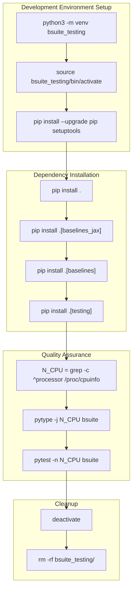
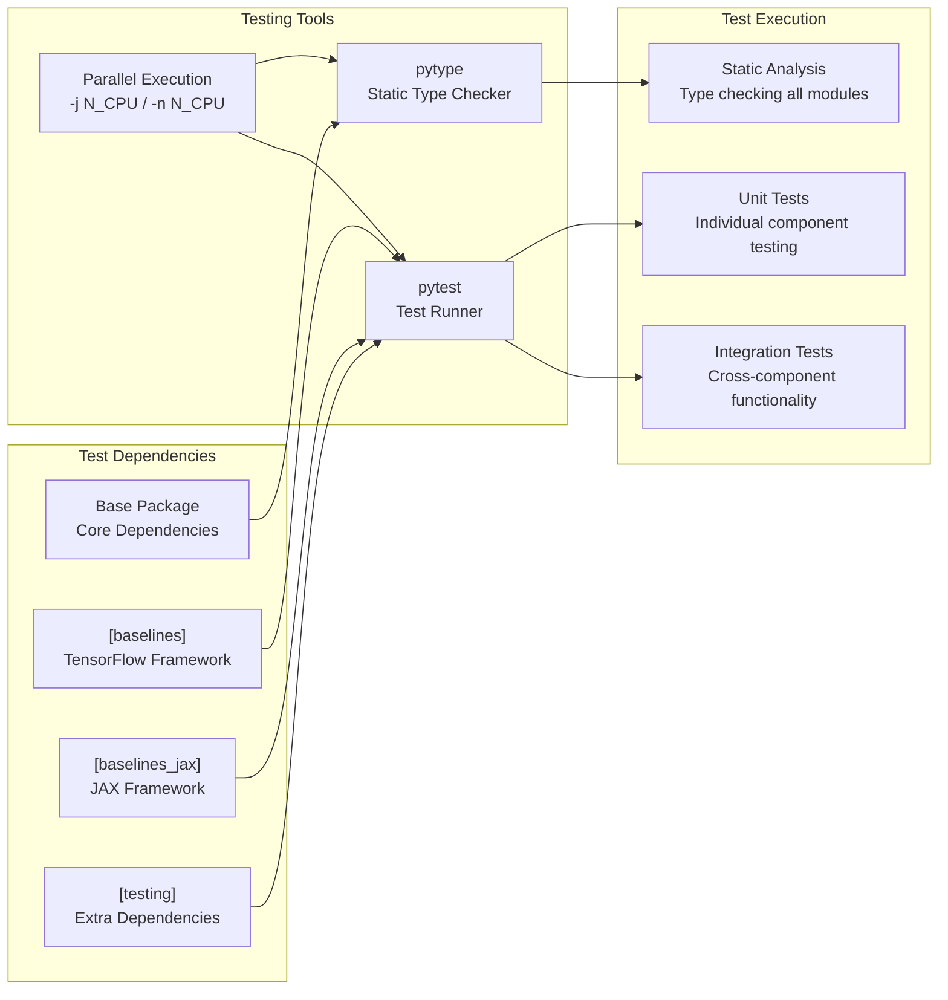

<!-- source: DeepWiki mcp.deepwiki.com · repo google-deepmind/bsuite · page 7 Development and Testing · fetched 2026-10-26 -->

# Development and Testing

<details>
<summary>Relevant source files</summary>

The following files were used as context for generating this wiki page:

- [test.sh](test.sh)

</details>


This section provides guidance for developers contributing to the bsuite codebase, including development environment setup, testing procedures, and development workflows. It covers the infrastructure and processes needed to maintain code quality and ensure reproducible research results.

For information about running experiments and analysis, see [Experiment Management](#5) and [Data and Analysis](#6). For details about the testing framework implementation, see [Testing Framework](#7.1). For comprehensive development setup instructions, see [Development Setup](#7.2).

## Development Workflow Overview

The bsuite development process follows a systematic approach that ensures code quality through automated testing, type checking, and dependency management. The primary development workflow is encapsulated in the automated testing pipeline.



**Development Workflow Process**
Sources: [test.sh:1-32]()

## Testing Infrastructure

The bsuite testing infrastructure is designed to ensure code quality across multiple dimensions including type safety, functionality, and integration across different ML frameworks.



**Testing Architecture Components**
Sources: [test.sh:18-27]()

## Package Dependencies and Installation

The bsuite package supports multiple installation configurations to accommodate different development and usage scenarios. The testing process validates all supported dependency combinations.

| Dependency Group | Command | Purpose |
|------------------|---------|---------|
| Core Package | `pip install .` | Base bsuite functionality |
| JAX Baselines | `pip install .[baselines_jax]` | JAX-based agent implementations |
| TensorFlow Baselines | `pip install .[baselines]` | TensorFlow/Sonnet agents |
| Testing Dependencies | `pip install .[testing]` | Development and testing tools |

**Installation Dependencies**
Sources: [test.sh:14-19]()

## Automated Testing Pipeline

The automated testing pipeline executes both static analysis and dynamic testing in parallel to maximize efficiency while ensuring comprehensive validation.

### Static Type Checking

The `pytype` tool performs static type analysis across the entire bsuite codebase:

```bash
pytype -j "${N_CPU}" bsuite
```

This command utilizes all available CPU cores for parallel type checking of the `bsuite` module and its submodules.

### Dynamic Testing

The `pytest` framework executes the test suite with parallel processing:

```bash
pytest -n "${N_CPU}" bsuite
```

The `-n` flag enables parallel test execution across multiple CPU cores, significantly reducing test execution time.

**Testing Commands**
Sources: [test.sh:21-27]()

## Environment Management

The development workflow uses isolated virtual environments to ensure reproducible testing conditions and prevent dependency conflicts.

### Virtual Environment Lifecycle

1. **Creation**: `python3 -m venv bsuite_testing`
2. **Activation**: `source bsuite_testing/bin/activate`
3. **Dependency Installation**: Multiple `pip install` commands for different configurations
4. **Testing Execution**: Type checking and test running
5. **Cleanup**: `deactivate` and `rm -rf bsuite_testing/`

This approach ensures that each test run starts with a clean environment and doesn't interfere with the developer's local Python setup.

**Environment Management**
Sources: [test.sh:8-31]()

## Development Setup Requirements

The development environment requires several system-level dependencies and tools:

- **Python 3**: Base Python interpreter
- **Virtual Environment Support**: `python3 -m venv` capability
- **Multi-core Processing**: CPU detection via `/proc/cpuinfo` for parallel execution
- **Package Management**: `pip` with `setuptools` for dependency installation

The testing script automatically detects the number of available CPU cores and configures both `pytype` and `pytest` to utilize parallel processing for optimal performance.

**System Requirements**
Sources: [test.sh:21-27]()

---

