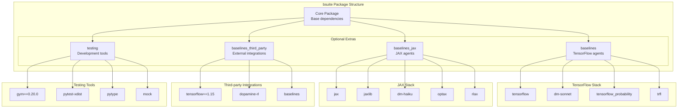
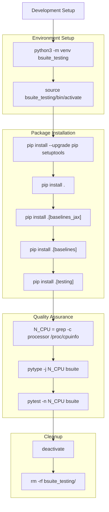

<!-- source: DeepWiki mcp.deepwiki.com · repo google-deepmind/bsuite · page 7.2 Development Setup · fetched 2026-10-26 -->

# Development Setup

<details>
<summary>Relevant source files</summary>

The following files were used as context for generating this wiki page:

- [bsuite/_metadata.py](bsuite/_metadata.py)
- [setup.py](setup.py)
- [test.sh](test.sh)

</details>


This document covers the development environment setup for contributing to bsuite, including dependency management, testing configuration, and development workflow. For information about the testing framework and test organization, see [Testing Framework](#7.1).

## Purpose and Scope

This page provides technical guidance for setting up a development environment to contribute to the bsuite codebase. It covers the package structure, dependency installation, testing setup, and automated development workflows. The focus is on the practical aspects of getting a working development environment rather than the testing infrastructure itself.

## Package Structure and Dependencies

The bsuite package uses a modular dependency structure with optional extras for different use cases. The core package provides the essential framework, while additional functionality is available through optional dependency groups.

### Core Dependencies

The base bsuite installation includes fundamental libraries for reinforcement learning research and data analysis:

| Category | Dependencies |
|----------|-------------|
| Core Framework | `dm_env`, `absl-py`, `immutabledict` |
| Data Analysis | `numpy`, `pandas`, `scipy`, `matplotlib`, `plotnine` |
| Utilities | `scikit-image`, `six`, `termcolor` |

### Optional Dependency Groups

The package defines several optional extras that enable different agent implementations and development tools:



Sources: [setup.py:22-58]()

## Development Environment Setup

### Virtual Environment Creation

The recommended development setup uses Python virtual environments to isolate dependencies. The automated testing script demonstrates the standard workflow:

```bash
python3 -m venv bsuite_testing
source bsuite_testing/bin/activate
```

### Package Installation

Install the package in development mode with all relevant extras:

```bash
pip install --upgrade pip setuptools
pip install .                    # Core package
pip install .[baselines_jax]     # JAX baselines
pip install .[baselines]         # TensorFlow baselines
pip install .[testing]           # Development tools
```

The installation order is important as some baselines may have conflicting dependency versions, particularly for TensorFlow versions between the main baselines and third-party integrations.

Sources: [test.sh:8-19]()

## Testing and Development Workflow

### Static Type Checking

The codebase uses `pytype` for static type analysis. The development workflow runs type checking across all CPU cores:

```bash
N_CPU=$(grep -c ^processor /proc/cpuinfo)
pytype -j "${N_CPU}" bsuite
```

### Test Execution

Tests are executed using `pytest` with parallel execution across available CPU cores:

```bash
pytest -n "${N_CPU}" bsuite
```

The testing configuration uses `pytest-xdist` for parallel test execution, which significantly reduces testing time for the comprehensive test suite.

### Automated Development Workflow

The complete development workflow is captured in the test automation script:



Sources: [test.sh:1-31]()

## Version Management

The package version is managed through a separate metadata module to avoid circular dependencies during installation. The version information is stored in `bsuite/_metadata.py` and imported by the setup script.

The current version is defined as `__version__ = '0.3.5'` and is accessed during package building through dynamic import in the setup script: `imp.load_source('_metadata', 'bsuite/_metadata.py').__version__`.

Sources: [bsuite/_metadata.py:22](), [setup.py:70]()

## Development Considerations

### Dependency Conflicts

The package structure accommodates potential conflicts between different ML framework versions. The third-party baselines specifically require `tensorflow == 1.15`, which may conflict with the main TensorFlow baselines that use more recent versions.

### Platform Compatibility

The package is designed for cross-platform compatibility, supporting Linux, Windows, and macOS environments as specified in the classifier metadata.

### Python Version Support

The package officially supports Python 3.6 and 3.7, as indicated in the setup classifiers. Development environments should use compatible Python versions.

Sources: [setup.py:92-103]()