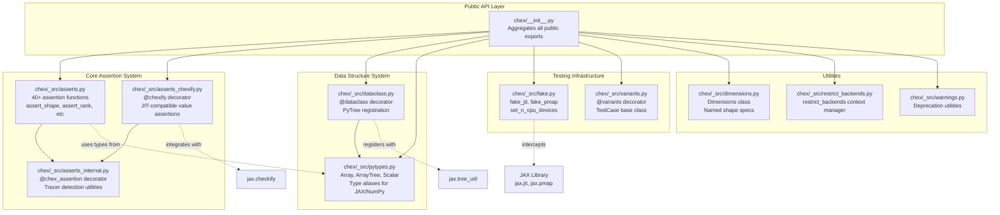
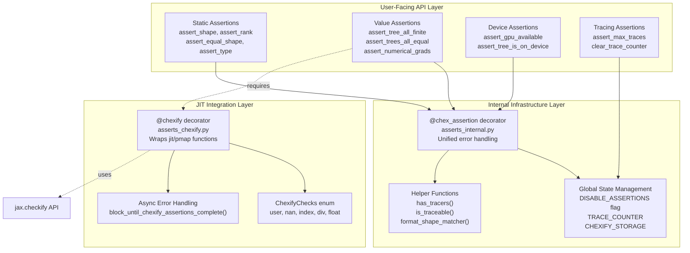
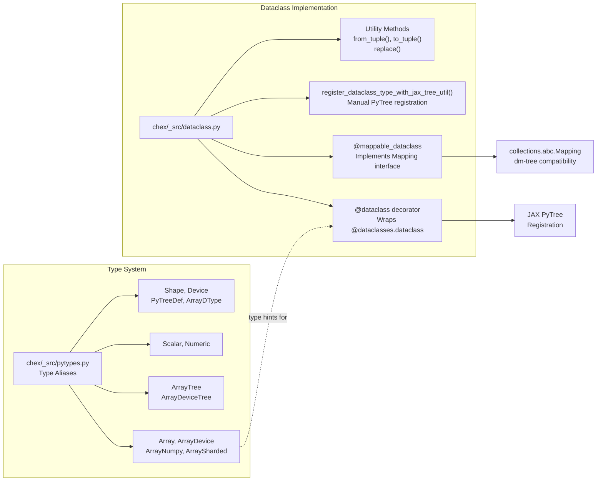
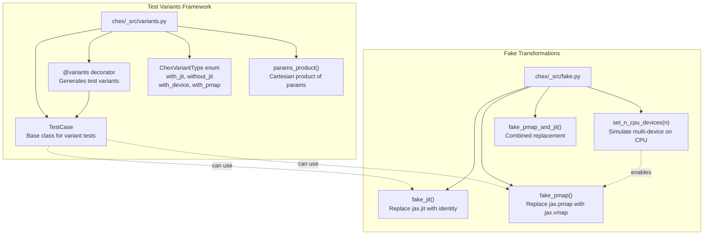
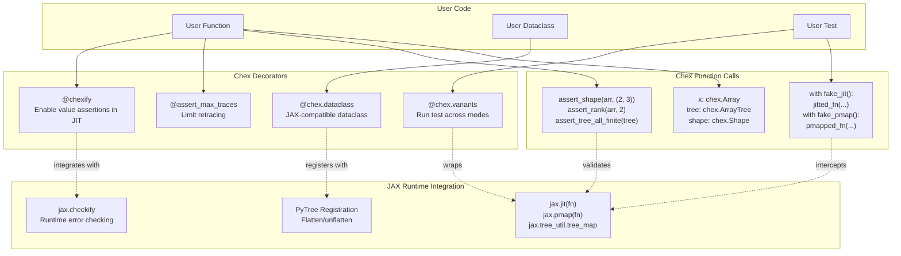

<!-- source: DeepWiki mcp.deepwiki.com · repo google-deepmind/chex · page 1 Overview · fetched 2026-10-26 -->

# Overview

<details>
<summary>Relevant source files</summary>

The following files were used as context for generating this wiki page:

- [README.md](README.md)
- [chex/__init__.py](chex/__init__.py)
- [docs/api.rst](docs/api.rst)

</details>


This document provides a high-level introduction to the Chex library, its architecture, and its primary capabilities. Chex is a testing and debugging utility library designed specifically for JAX code, providing robust assertions, dataclass support, and testing infrastructure.

For installation instructions and basic usage examples, see [Getting Started](#2). For detailed documentation of specific subsystems, see [Assertion System](#3), [Dataclass System](#4), [Type System](#5), [Testing Infrastructure](#6), and [Utilities](#7).

**Sources:** [chex/__init__.py:1-213](), [README.md:1-474]()

## What is Chex?

Chex is a library that addresses three fundamental challenges when working with JAX:

1. **Validation and Instrumentation**: JAX's type system cannot express array shapes, ranks, or dtypes. Chex provides 40+ assertion functions to validate these properties both statically and at runtime.

2. **JAX-Compatible Data Structures**: Standard Python dataclasses are incompatible with JAX transformations. Chex provides `@chex.dataclass` decorator that registers dataclasses as JAX PyTrees while maintaining compatibility with dm-tree.

3. **Testing Across Execution Modes**: JAX code behaves differently under `jax.jit`, `jax.pmap`, and eager execution. Chex provides testing variants that automatically run tests across all these modes, plus debugging tools like `fake_jit` and `fake_pmap` to simplify development.

**Sources:** [README.md:9-16](), [chex/__init__.py:15]()

## Core Capabilities

### Assertion System (179.37 Combined Importance)

The assertion system is Chex's most important feature, divided into:

- **Static Assertions**: Validate array metadata without requiring concrete values (e.g., `assert_shape`, `assert_rank`, `assert_type`)
- **Value Assertions**: Check actual array values, enabled inside JIT-compiled functions via `@chexify` decorator (e.g., `assert_tree_all_finite`, `assert_trees_all_close`)
- **Tree Assertions**: Validate JAX PyTree structures and their contents (e.g., `assert_trees_all_equal_shapes`, `assert_tree_is_on_device`)
- **JAX-Specific Assertions**: Monitor JAX behavior like tracing frequency (`assert_max_traces`) and device availability

For detailed coverage, see [Assertion System](#3).

**Sources:** [chex/__init__.py:17-68](), [README.md:86-231]()

### Dataclass System (76.76 Combined Importance)

The `@chex.dataclass` decorator extends Python's standard dataclasses with JAX compatibility:

```python
@chex.dataclass
class Parameters:
  x: chex.ArrayDevice
  y: chex.ArrayDevice

# Works with JAX transformations
jax.tree_util.tree_map(lambda x: 2.0 * x, parameters)

# Compatible with dm-tree
tree.flatten(parameters)
```

For implementation details, see [Dataclass System](#4).

**Sources:** [chex/__init__.py:73-75](), [README.md:33-85]()

### Testing Infrastructure (47.06 Importance for fake.py)

Chex provides two complementary testing approaches:

- **Fake Transformations**: Replace expensive JAX transformations with simpler equivalents for debugging (`fake_jit`, `fake_pmap`, `set_n_cpu_devices`)
- **Test Variants**: Automatically run the same test across multiple JAX execution contexts (`@variants` decorator with `with_jit`, `with_pmap`, `with_device` options)

For comprehensive documentation, see [Testing Infrastructure](#6).

**Sources:** [chex/__init__.py:77-101](), [README.md:237-408]()

## Module Architecture

### Public API Entry Point

The entire Chex public API is aggregated in [chex/__init__.py:1-213](), which imports and re-exports functionality from internal `_src` modules. The module exposes 100 public symbols organized into seven categories:

| Category | Symbol Count | Key Exports |
|----------|--------------|-------------|
| Assertions | 40 | `assert_shape`, `assert_rank`, `assert_tree_all_finite` |
| Chexify | 4 | `chexify`, `ChexifyChecks`, `block_until_chexify_assertions_complete` |
| Dataclasses | 3 | `dataclass`, `mappable_dataclass`, `register_dataclass_type_with_jax_tree_util` |
| Type Definitions | 14 | `Array`, `ArrayTree`, `ArrayDevice`, `Scalar`, `Shape` |
| Testing | 8 | `fake_jit`, `fake_pmap`, `variants`, `TestCase`, `params_product` |
| Utilities | 4 | `Dimensions`, `restrict_backends`, `disable_asserts`, `enable_asserts` |
| Warnings | 4 | `warn_deprecated_function`, `create_deprecated_function_alias` |

**Sources:** [chex/__init__.py:110-200]()

### Module Dependency Graph



**Sources:** [chex/__init__.py:1-213]()

## Core Subsystems

### 1. Assertion System Architecture

The assertion system operates in three layers:



**Key Components:**

- **`chex/_src/asserts.py`**: Contains all 40+ user-facing assertion functions
- **`chex/_src/asserts_internal.py`**: Provides `@chex_assertion` decorator that unifies all assertions with common error handling, tracer detection, and global state management
- **`chex/_src/asserts_chexify.py`**: Implements `@chexify` decorator that integrates with `jax.checkify` to enable value assertions inside JIT-compiled code

**Sources:** [chex/__init__.py:17-68](), [README.md:159-194]()

### 2. Data Structure System



**Key Components:**

- **`chex/_src/pytypes.py`**: Defines comprehensive type aliases for arrays, trees, scalars, and metadata
- **`chex/_src/dataclass.py`**: Provides `@dataclass` decorator that automatically registers dataclasses as JAX PyTrees and optionally exposes them as `Mapping` instances

**Sources:** [chex/__init__.py:73-75,81-95](), [README.md:33-85]()

### 3. Testing Infrastructure System



**Key Components:**

- **`chex/_src/fake.py`**: Provides debugging utilities that replace expensive JAX transformations with simpler equivalents
- **`chex/_src/variants.py`**: Implements test variant framework that automatically generates and runs tests across different JAX execution contexts

**Sources:** [chex/__init__.py:77-101](), [README.md:237-408]()

## Usage Pattern Overview

The following diagram illustrates how user code interacts with Chex's primary APIs:



**Common Patterns:**

1. **Assertion Pattern**: Call assertion functions directly in code to validate array properties
2. **Chexify Pattern**: Wrap JIT-compiled functions with `@chexify` to enable value assertions
3. **Dataclass Pattern**: Use `@chex.dataclass` decorator to create JAX-compatible dataclasses
4. **Testing Pattern**: Inherit from `chex.TestCase` and use `@chex.variants` to test across execution modes
5. **Debugging Pattern**: Use `fake_jit()` or `fake_pmap()` context managers to simplify debugging

**Sources:** [README.md:52-307](), [chex/__init__.py:1-213]()

## Key Design Patterns

### 1. Decorator-Based API

Chex uses decorators extensively to modify behavior:

- `@chex.dataclass`: Extends dataclass with PyTree registration
- `@chexify`: Enables value assertions in JIT context
- `@variants`: Generates test variants
- `@assert_max_traces`: Monitors function retracing

**Sources:** [chex/__init__.py:70-75,97-102]()

### 2. Context Manager Pattern

Debugging utilities use context managers for temporary state changes:

- `fake_jit()`: Temporarily disables JIT compilation
- `fake_pmap()`: Replaces pmap with vmap
- `restrict_backends()`: Restricts JAX to specific backends

**Sources:** [chex/__init__.py:77-80,96]()

### 3. Global State Management

Assertions support global configuration via module-level state:

- `disable_asserts()` / `enable_asserts()`: Toggle all assertions
- `clear_trace_counter()`: Reset trace counter for `assert_max_traces`
- `CHEXIFY_STORAGE`: Stores checkified function versions

**Sources:** [chex/__init__.py:66-67]()

### 4. Type Alias System

Chex provides descriptive type aliases for better code documentation:

- `Array`, `ArrayDevice`, `ArrayNumpy`: Different array types
- `ArrayTree`, `ArrayDeviceTree`: Nested structures
- `Scalar`, `Numeric`, `Shape`: Metadata types

**Sources:** [chex/__init__.py:81-95]()

## Project Statistics

| Metric | Value |
|--------|-------|
| Current Version | 0.1.91 |
| Public API Symbols | 100 |
| Assertion Functions | 40+ |
| Test Variant Types | 5 |
| Core Modules | 10 |
| External Dependencies | JAX, NumPy, dm-tree |

**Sources:** [chex/__init__.py:108,110-200]()

## Next Steps

- For installation and quick start examples, see [Getting Started](#2)
- For detailed assertion documentation, see [Assertion System](#3)
- For dataclass usage patterns, see [Dataclass System](#4)
- For testing utilities, see [Testing Infrastructure](#6)
- For complete API reference, see [API Reference](#9)

---

