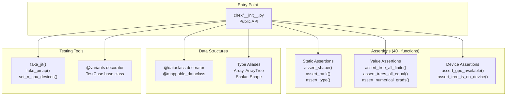
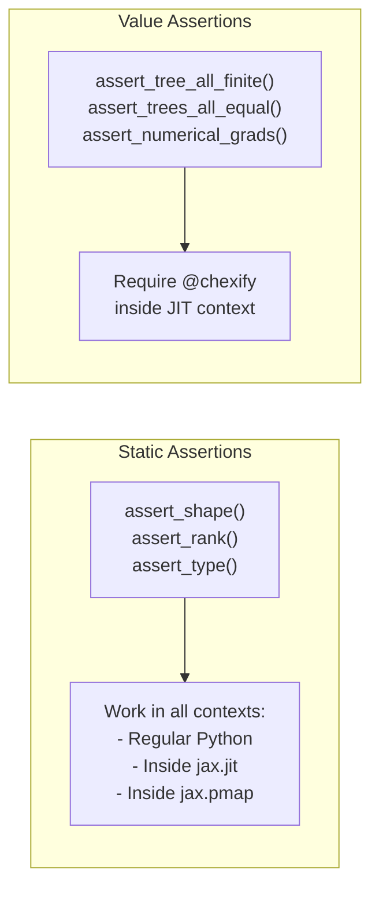
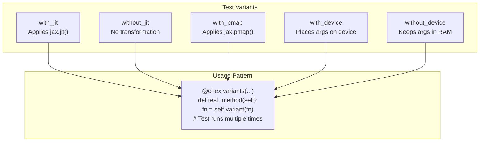
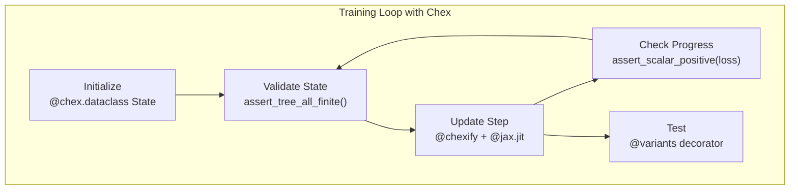

<!-- source: DeepWiki mcp.deepwiki.com · repo google-deepmind/chex · page 2 Getting Started · fetched 2026-10-26 -->

# Getting Started

<details>
<summary>Relevant source files</summary>

The following files were used as context for generating this wiki page:

- [README.md](README.md)
- [chex/__init__.py](chex/__init__.py)
- [chex/_src/asserts_test.py](chex/_src/asserts_test.py)

</details>


## Purpose and Scope

This page provides a quick-start guide to installing and using Chex's core features. It covers basic usage patterns for assertions, dataclasses, and testing utilities with simple examples. For comprehensive documentation on specific systems, see:
- Assertion System: [Assertion System](#3)
- Dataclass System: [Dataclass System](#4)
- Testing Infrastructure: [Testing Infrastructure](#6)
- Type System: [Type System (pytypes)](#5)

---

## Installation

Chex can be installed from PyPI or directly from the GitHub repository.

### Installing from PyPI

```bash
pip install chex
```

### Installing from GitHub (Latest Development Version)

```bash
pip install git+https://github.com/deepmind/chex.git
```

**Note**: Chex requires JAX to be installed. If not already present, pip will install it as a dependency.

Sources: [README.md:17-29]()

---

## Core Concepts

Chex provides three main categories of utilities for JAX development:

| Category | Purpose | Key Modules |
|----------|---------|-------------|
| **Assertions** | Validate array properties, shapes, types, and values | `asserts.py`, `asserts_chexify.py` |
| **Data Structures** | JAX-compatible dataclasses with PyTree registration | `dataclass.py`, `pytypes.py` |
| **Testing Tools** | Debug transformations and test across execution contexts | `fake.py`, `variants.py` |

### Chex Public API Structure



Sources: [chex/__init__.py:1-213]()

---

## Basic Usage: Assertions

Chex assertions validate array properties and help catch bugs early. They are divided into **static** assertions (work in all contexts) and **value** assertions (require concrete values).

### Static Assertions

Static assertions check metadata like shape, rank, and type without needing actual values:

```python
import chex
import jax.numpy as jnp

# Shape validation
x = jnp.zeros((3, 4, 5))
chex.assert_shape(x, (3, 4, 5))  # OK
chex.assert_rank(x, 3)           # OK

# Multiple arrays with different shapes
batch = jnp.zeros((32, 10))
logits = jnp.zeros((32, 100))
chex.assert_equal_shape([batch, logits], dims=0)  # Check first dimension matches

# Type validation
chex.assert_type(x, float)       # OK (x.dtype is floating point)
```

### Value Assertions

Value assertions inspect concrete array values and require special handling in JIT-compiled code:

```python
# Outside JIT - works normally
params = {'w': jnp.array([1.0, 2.0]), 'b': jnp.array(0.5)}
chex.assert_tree_all_finite(params)  # OK

# Inside JIT - requires @chexify decorator
@chex.chexify
@jax.jit
def safe_log(x):
    chex.assert_tree_all_finite(x)  # Now works inside JIT
    return jnp.log(x)

safe_log(jnp.array([1.0, 2.0]))     # OK
# safe_log(jnp.array([jnp.nan, 2.0])) would raise error
```

### Common Assertion Patterns

```python
# Validate shapes match
chex.assert_equal_shape([predictions, targets])

# Check multiple arrays have same rank
chex.assert_rank([x, y, z], 2)

# Verify tree structures match
chex.assert_trees_all_equal_structs(tree1, tree2)

# Compare trees with tolerance
chex.assert_trees_all_close(predictions, expected, rtol=1e-5)

# Ensure no NaN/Inf values
chex.assert_tree_all_finite(gradients)
```

### Static vs Value Assertions Comparison



Sources: [chex/__init__.py:17-68](), [README.md:86-193](), [chex/_src/asserts_test.py:240-283]()

---

## Basic Usage: Dataclasses

Chex provides `@dataclass` and `@mappable_dataclass` decorators that create JAX-compatible dataclasses registered as PyTrees.

### Simple Dataclass Example

```python
import chex
import jax
import jax.numpy as jnp

@chex.dataclass
class ModelParams:
    weights: chex.Array
    bias: chex.Array
    learning_rate: float

# Create instance (keyword arguments only)
params = ModelParams(
    weights=jnp.ones((10, 5)),
    bias=jnp.zeros(5),
    learning_rate=0.01
)

# Works with JAX tree operations
scaled_params = jax.tree_map(lambda x: 2.0 * x, params)

# Use in JAX transformations
@jax.jit
def update_params(params, gradient):
    return jax.tree_map(lambda p, g: p - 0.01 * g, params, gradient)
```

### Mappable Dataclass for dm-tree Compatibility

```python
import tree  # dm-tree library

@chex.mappable_dataclass
class State:
    step: int
    params: chex.Array
    optimizer_state: dict

state = State(
    step=0,
    params=jnp.ones(10),
    optimizer_state={'momentum': jnp.zeros(10)}
)

# Works with dm-tree operations
flat_values = tree.flatten(state)
structure = tree.structure(state)
```

### Dataclass Features

| Feature | Description | Example |
|---------|-------------|---------|
| **PyTree Registration** | Automatic registration with JAX tree utilities | `jax.tree_map(fn, dataclass_instance)` |
| **Immutability** | Frozen by default for functional programming | `frozen=True` (default) |
| **Mapping Interface** | Optional dict-like behavior | `@mappable_dataclass` |
| **Type Annotations** | Full support for Chex type hints | `weights: chex.ArrayDevice` |

**Important**: Chex dataclasses do not support positional arguments in constructors. Always use keyword arguments:

```python
# ❌ Wrong - raises ValueError
params = ModelParams(jnp.ones(10), jnp.zeros(5), 0.01)

# ✓ Correct
params = ModelParams(
    weights=jnp.ones(10),
    bias=jnp.zeros(5),
    learning_rate=0.01
)
```

Sources: [chex/__init__.py:73-75](), [README.md:33-84](), [chex/_src/dataclass.py]()

---

## Basic Usage: Testing Utilities

Chex provides tools to debug JAX code and test it across different execution contexts.

### Fake Transformations for Debugging

During debugging, JIT compilation and parallel mapping can obscure errors. Chex allows you to replace these transformations temporarily:

```python
import chex
import jax

# Temporarily disable JIT compilation
with chex.fake_jit():
    @jax.jit
    def compute(x):
        # This will NOT be JIT-compiled
        # You can use print(), debuggers, etc.
        print(f"Debug: x = {x}")
        return x ** 2
    
    result = compute(jnp.array([1.0, 2.0]))

# Replace pmap with vmap for single-device debugging
with chex.fake_pmap():
    @jax.pmap
    def parallel_compute(x):
        # This will be vmapped instead of pmapped
        return x * 2
```

### Test Variants

The `@variants` decorator runs tests across multiple JAX execution contexts automatically:

```python
import chex

class MyTest(chex.TestCase):
    
    @chex.variants(with_jit=True, without_jit=True)
    def test_function_behavior(self):
        @self.variant
        def add(x, y):
            return x + y
        
        # This test runs twice:
        # 1. With add = jax.jit(add)
        # 2. With add unchanged
        result = add(1, 2)
        self.assertEqual(result, 3)
```

### Test Variant Types



### Multi-Device Testing Simulation

For testing parallel code without actual multiple devices:

```python
# In your test file's setUpModule():
def setUpModule():
    chex.set_n_cpu_devices(8)  # Simulate 8 devices using CPU threads

# Run tests with: python test.py --chex_n_cpu_devices=8

class ParallelTest(chex.TestCase):
    
    @chex.variants(with_pmap=True)
    def test_parallel_computation(self):
        @self.variant
        def parallel_fn(x):
            return x * 2
        
        # Works with simulated 8 devices
        x = jnp.ones((8, 10))  # 8 replicas, 10 features each
        result = parallel_fn(x)
        self.assertEqual(result.shape, (8, 10))
```

Sources: [chex/__init__.py:77-80, 97-101](), [README.md:237-408](), [chex/_src/variants.py](), [chex/_src/fake.py]()

---

## Type Hints

Chex provides type aliases for better code documentation and IDE support:

```python
import chex

def process_batch(
    inputs: chex.Array,           # Any array (JAX or NumPy)
    targets: chex.ArrayDevice,    # JAX array on device
    config: dict
) -> chex.ArrayTree:              # Tree of arrays
    """Process a batch of data."""
    # Implementation
    pass

def compute_loss(
    predictions: chex.Array,
    targets: chex.Array
) -> chex.Scalar:                 # Single scalar value
    """Compute loss between predictions and targets."""
    return jnp.mean((predictions - targets) ** 2)
```

### Common Type Aliases

| Type | Description |
|------|-------------|
| `chex.Array` | Any array (JAX or NumPy) |
| `chex.ArrayDevice` | JAX array on device |
| `chex.ArrayNumpy` | NumPy array |
| `chex.ArrayTree` | PyTree of arrays |
| `chex.Scalar` | Scalar value (int, float, etc.) |
| `chex.Shape` | Shape tuple |
| `chex.PRNGKey` | JAX random key |

Sources: [chex/__init__.py:81-96](), [chex/_src/pytypes.py]()

---

## Common Patterns and Workflows

### Pattern 1: Safe Function with Assertions

```python
@chex.chexify
@jax.jit
def safe_normalize(x: chex.Array) -> chex.Array:
    """Normalize array with safety checks."""
    chex.assert_rank(x, 1)                    # Static: check rank
    chex.assert_tree_all_finite(x)            # Value: check for NaN/Inf
    
    norm = jnp.linalg.norm(x)
    chex.assert_scalar_positive(norm)         # Value: ensure non-zero
    
    return x / norm
```

### Pattern 2: Validated Dataclass State

```python
@chex.dataclass
class TrainingState:
    params: chex.ArrayTree
    opt_state: chex.ArrayTree
    step: int
    
    def __post_init__(self):
        """Validate state after initialization."""
        chex.assert_tree_all_finite(self.params)
        chex.assert_scalar_non_negative(self.step)
```

### Pattern 3: Comprehensive Test Coverage

```python
class ModelTest(chex.TestCase):
    
    @chex.variants(with_jit=True, without_jit=True, with_pmap=True)
    def test_forward_pass(self):
        """Test model forward pass in multiple contexts."""
        @self.variant
        def forward(params, x):
            return model.apply(params, x)
        
        # Test runs 3 times: JIT, non-JIT, and pmap
        x = jnp.ones((4, 10))
        params = init_params()
        output = forward(params, x)
        
        chex.assert_shape(output, (4, 5))
        chex.assert_tree_all_finite(output)
```

### Complete Example: Training Loop with Chex



```python
import chex
import jax
import jax.numpy as jnp

@chex.dataclass
class TrainingState:
    params: chex.ArrayTree
    step: int
    
@chex.chexify
@jax.jit
def train_step(state: TrainingState, batch: chex.Array) -> tuple:
    """Single training step with safety checks."""
    # Validate inputs
    chex.assert_tree_all_finite(state.params)
    chex.assert_tree_all_finite(batch)
    
    # Compute loss and gradients
    loss, grads = compute_loss_and_grads(state.params, batch)
    chex.assert_scalar_positive(loss)
    chex.assert_tree_all_finite(grads)
    
    # Update parameters
    new_params = jax.tree_map(
        lambda p, g: p - 0.01 * g,
        state.params,
        grads
    )
    
    new_state = state.replace(params=new_params, step=state.step + 1)
    return new_state, loss

class TrainingTest(chex.TestCase):
    
    @chex.variants(with_jit=True, without_jit=True)
    def test_train_step(self):
        """Test training step in JIT and non-JIT modes."""
        state = TrainingState(
            params={'w': jnp.ones(10)},
            step=0
        )
        batch = jnp.ones((32, 10))
        
        train_fn = self.variant(train_step)
        new_state, loss = train_fn(state, batch)
        
        chex.assert_shape(new_state.params['w'], (10,))
        chex.assert_scalar_positive(loss)
```

Sources: [chex/_src/asserts_test.py:68-236](), [README.md:145-189]()

---

## Disabling Assertions

For production deployment, you can globally disable assertions to reduce overhead:

```python
import chex

# Disable all assertions
chex.disable_asserts()

# Your code with assertions - they will be no-ops
chex.assert_shape(x, (10, 20))  # Does nothing

# Re-enable assertions
chex.enable_asserts()

# Now assertions work again
chex.assert_shape(x, (10, 20))  # Validates shape
```

Sources: [chex/__init__.py:66-67, 178-179](), [chex/_src/asserts_test.py:47-65]()

---

## Next Steps

Now that you understand Chex basics, explore detailed documentation:

- **[Assertion System](#3)**: Comprehensive guide to all 40+ assertions, static vs value assertions, and `@chexify` decorator
- **[Dataclass System](#4)**: Deep dive into PyTree registration, mappable dataclasses, and advanced features
- **[Testing Infrastructure](#6)**: Complete coverage of fake transformations, test variants, and multi-device testing
- **[Type System](#5)**: Full reference of Chex type aliases and their usage
- **[API Reference](#9)**: Complete API documentation for all public functions and classes

Sources: [README.md:1-474](), [chex/__init__.py:1-213]()

---

