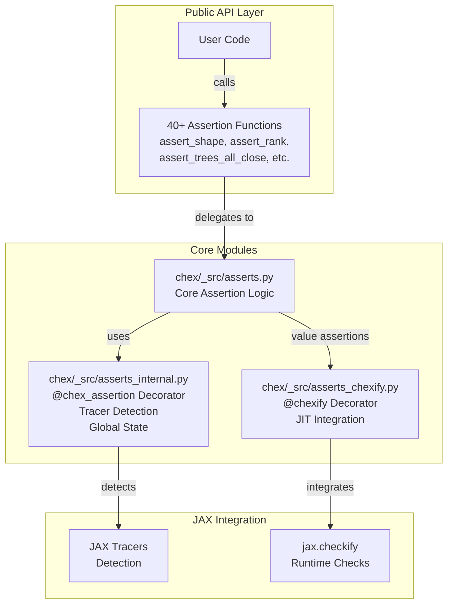
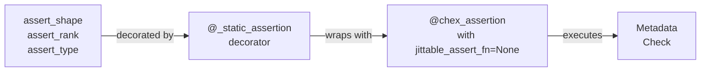
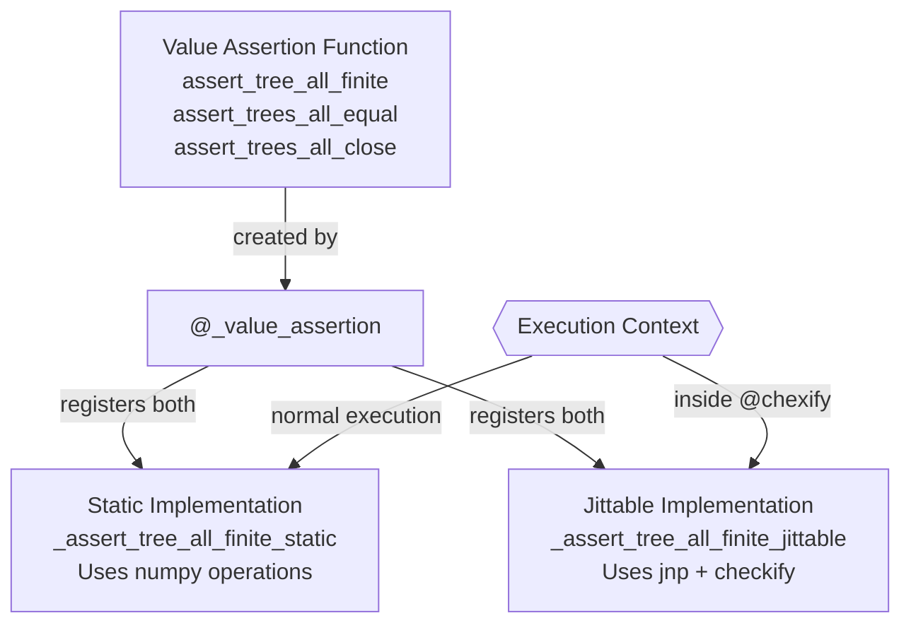
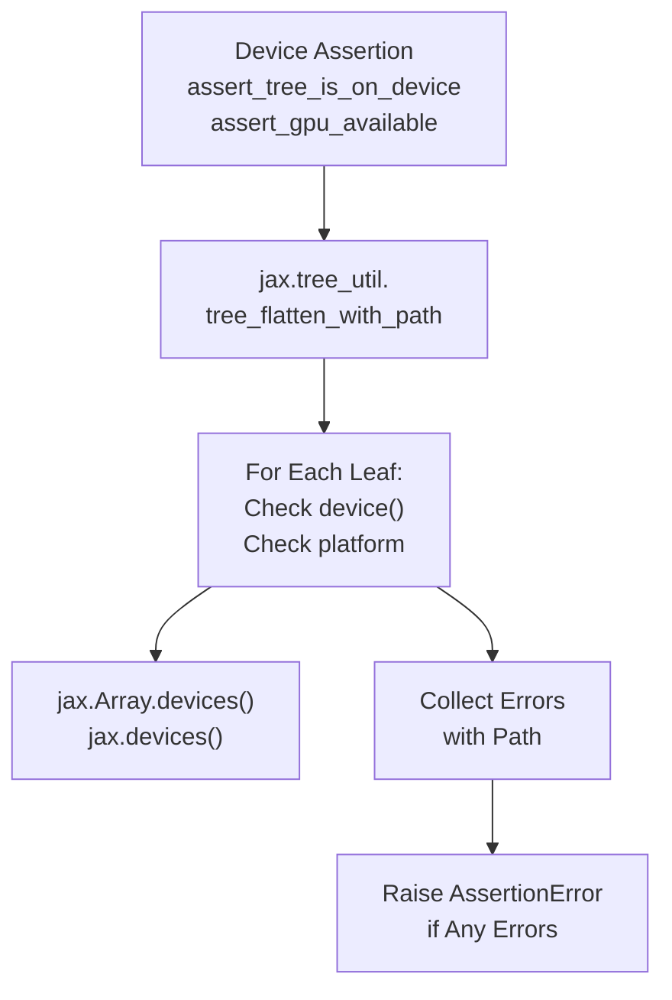
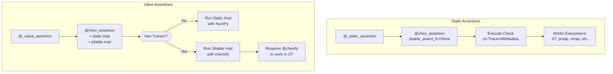
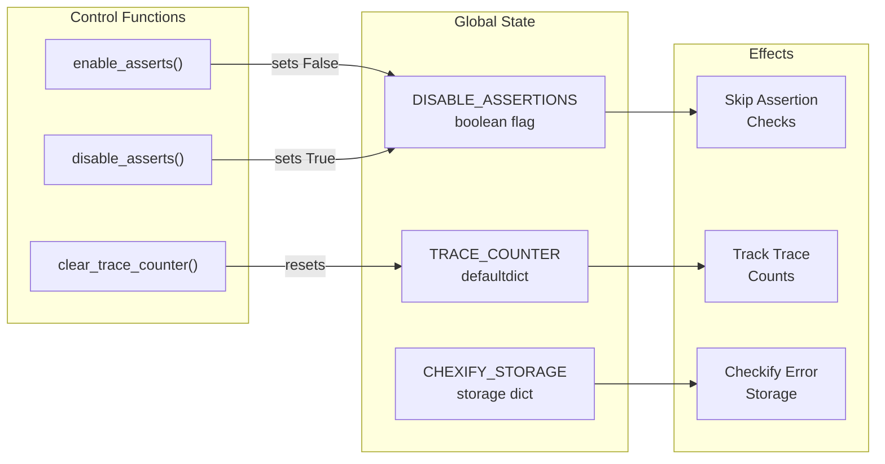
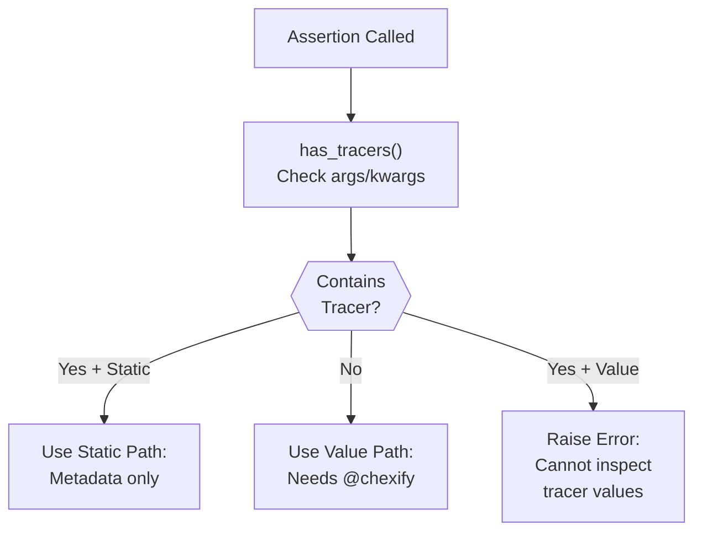
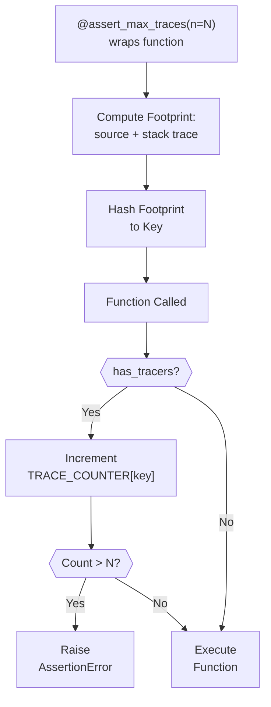

<!-- source: DeepWiki mcp.deepwiki.com · repo google-deepmind/chex · page 3 Assertion System · fetched 2026-10-26 -->

# Assertion System

<details>
<summary>Relevant source files</summary>

The following files were used as context for generating this wiki page:

- [chex/__init__.py](chex/__init__.py)
- [chex/_src/asserts.py](chex/_src/asserts.py)
- [chex/_src/asserts_test.py](chex/_src/asserts_test.py)

</details>


## Purpose and Scope

This document provides an overview of Chex's assertion system, which is the library's most important feature for validating JAX arrays, PyTrees, and execution contexts. The assertion system provides over 40 assertion functions organized into categories: static assertions that validate metadata, value assertions that inspect concrete values, tree assertions for PyTree validation, and device/tracing assertions for JAX-specific scenarios.

For specific details on individual assertion categories, see:
- [Static Assertions](#3.1) - Shape, rank, size, and type validation
- [Value Assertions](#3.2) - Concrete value inspection and comparisons
- [Tree Assertions](#3.3) - PyTree structure and content validation
- [Device and JAX-Specific Assertions](#3.4) - Device placement and tracing checks
- [Chexify](#3.5) - Making value assertions work inside JIT
- [Assertion Internals](#3.6) - Implementation details and decorator mechanics

## System Architecture

The assertion system consists of three main modules working together to provide comprehensive validation capabilities across different JAX execution contexts:

**Assertion System Components**



Sources: [chex/_src/asserts.py:1-100](), [chex/_src/asserts_internal.py:1-50](), [chex/_src/asserts_chexify.py:1-50](), [Diagram 2 from high-level architecture]

## Assertion Categories

The assertion system divides into four main categories based on what they validate and when they can be used:

**Assertion Category Matrix**

| Category | Works in JIT? | Validates | Example Functions |
|----------|---------------|-----------|-------------------|
| **Static** | ✓ Yes | Metadata (shape, rank, type) | `assert_shape`, `assert_rank`, `assert_type` |
| **Value** | ✗ No (use `@chexify`) | Concrete values | `assert_tree_all_finite`, `assert_trees_all_equal` |
| **Device** | ✓ Yes | Device placement | `assert_tree_is_on_device`, `assert_gpu_available` |
| **Tracing** | ✓ Yes | JAX tracing behavior | `assert_max_traces` |

Sources: [chex/_src/asserts.py:40-44](), [Diagram 2 from high-level architecture]

### Static Assertions

Static assertions validate array metadata without inspecting concrete values. They work in all contexts including JIT-compiled functions because they only examine tracer shapes and types:

```python
# Shape validation
chex.assert_shape(x, (batch_size, 128))  # Exact shape
chex.assert_shape(x, (None, 128))        # Any batch size
chex.assert_shape(x, (..., 128))         # Any rank ending in 128

# Rank validation  
chex.assert_rank(x, 2)                   # Must be rank-2
chex.assert_rank([x, y], {2, 3})         # Both must be rank-2 or rank-3

# Type validation
chex.assert_type(x, jnp.float32)         # Exact dtype
chex.assert_type(x, float)               # Any floating type
```

**Static Assertion Implementation Pattern**



Sources: [chex/_src/asserts.py:42-44](), [chex/_src/asserts.py:598-655](), [chex/_src/asserts.py:702-783](), [chex/_src/asserts.py:786-850]()

### Value Assertions

Value assertions inspect concrete array values and cannot run inside JIT-compiled code without using the `@chexify` decorator:

```python
# Finite value checks
chex.assert_tree_all_finite(params)

# Exact equality
chex.assert_trees_all_equal(tree1, tree2)

# Approximate equality
chex.assert_trees_all_close(expected, actual, rtol=1e-6)

# ULP-based equality (for bit-exact comparisons)
chex.assert_trees_all_close_ulp(tree1, tree2, maxulp=5)
```

**Value Assertion Dual Implementation**



Sources: [chex/_src/asserts.py:40-41](), [chex/_src/asserts.py:1550-1553](), [chex/_src/asserts.py:1637-1641](), [chex/_src/asserts.py:1702-1705]()

### Tree Assertions

Tree assertions validate PyTree structures and their contents. They check structural equality and per-leaf properties:

```python
# Structure validation
chex.assert_trees_all_equal_structs(tree1, tree2, tree3)

# Shape matching
chex.assert_trees_all_equal_shapes(tree1, tree2)
chex.assert_tree_shape(tree, (batch, None))
chex.assert_tree_shape_prefix(tree, (batch, seq_len))

# Content validation
chex.assert_tree_has_only_ndarrays(tree)
chex.assert_tree_no_nones(tree)

# Size and dtype
chex.assert_trees_all_equal_sizes(tree1, tree2)
chex.assert_trees_all_equal_dtypes(tree1, tree2)
```

Sources: [chex/_src/asserts.py:1373-1398](), [chex/_src/asserts.py:1485-1512](), [chex/_src/asserts.py:1262-1288](), [chex/_src/asserts.py:1011-1031](), [chex/_src/asserts.py:1034-1055]()

### Device and Tracing Assertions

Device assertions validate hardware availability and array placement:

```python
# Device availability
chex.assert_gpu_available()
chex.assert_devices_available(n=4, devtype='tpu')

# Array placement
chex.assert_tree_is_on_device(tree, platform='gpu')
chex.assert_tree_is_on_host(tree, allow_cpu_device=False)
chex.assert_tree_is_sharded(tree, devices=(dev1, dev2))

# Tracing behavior
@chex.assert_max_traces(n=1)
def expensive_function(x):
    return jnp.sum(x ** 2)
```

**Device Assertion Flow**



Sources: [chex/_src/asserts.py:164-217](), [chex/_src/asserts.py:1150-1212](), [chex/_src/asserts.py:1076-1148](), [chex/_src/asserts.py:1214-1260](), [chex/_src/asserts.py:78-162]()

## Static vs Value Assertions

The core distinction in Chex's assertion system is between static and value assertions, determined by whether they need to inspect concrete array values:

**Assertion Type Comparison**



Sources: [chex/_src/asserts.py:40-44](), [chex/_src/asserts_internal.py:50-150]()

**When Static Assertions Suffice**

Static assertions are preferred when possible because they:
- Work inside all JAX transformations without modification
- Have zero runtime overhead (compiled away after shape inference)
- Fail fast at trace time rather than execution time

```python
@jax.jit
def model_forward(x):
    chex.assert_shape(x, (None, 784))  # Static: OK in JIT
    chex.assert_type(x, jnp.float32)   # Static: OK in JIT
    return model(x)
```

**When Value Assertions Are Needed**

Value assertions are necessary when you need to inspect actual array contents:

```python
# Without @chexify - FAILS in JIT
@jax.jit
def compute(x):
    chex.assert_tree_all_finite(x)  # ERROR: needs concrete values
    return x + 1

# With @chexify - Works
@chex.chexify
@jax.jit  
def compute(x):
    chex.assert_tree_all_finite(x)  # OK: uses checkify
    return x + 1
```

Sources: [chex/_src/asserts.py:1517-1553](), [chex/_src/asserts_chexify.py:1-100]()

## Global Controls

The assertion system provides global switches to control assertion behavior across the entire program:

**Global State Management**



**Usage Examples**

```python
# Disable all assertions (e.g., for production)
chex.disable_asserts()
chex.assert_shape(x, (10,))  # Does nothing

# Re-enable assertions
chex.enable_asserts()
chex.assert_shape(x, (10,))  # Validates again

# Clear trace counter for testing
chex.clear_trace_counter()  # Reset for new test
```

Sources: [chex/_src/asserts.py:47-76](), [chex/_src/asserts_internal.py:30-50]()

**Conditional Assertions**

The `if_args_not_none` wrapper allows assertions only when arguments are not `None`:

```python
def validate_if_present(x, y):
    # Only runs if both x and y are not None
    chex.if_args_not_none(chex.assert_equal_shape, x, y)
```

Sources: [chex/_src/asserts.py:60-67]()

## Integration with JAX Transformations

**Tracer Detection**

The assertion system detects when code is being traced by JAX transformations:



**Assert Max Traces**

The `@assert_max_traces` decorator prevents excessive recompilation:

```python
@jax.jit
@chex.assert_max_traces(n=1)
def model_fn(x):
    # Fails if traced more than once
    return x + 1

# First call: traced once - OK
model_fn(jnp.zeros(10))

# Same shape: uses cached compiled version - OK  
model_fn(jnp.ones(10))

# Different shape: requires retracing - FAILS
model_fn(jnp.zeros(20))  # AssertionError!
```

**How It Works**



Sources: [chex/_src/asserts.py:78-162](), [chex/_src/asserts_internal.py:80-120]()

## Common Usage Patterns

**Shape Validation**

```python
def forward(batch, seq_len):
    # Multiple arrays with expected shapes
    chex.assert_shape([embeddings, mask], [(batch, seq_len, 768), (batch, seq_len)])
    
    # Flexible batch size
    chex.assert_shape(logits, (None, num_classes))
    
    # At least 2D, ending in feature_dim
    chex.assert_shape(features, (..., feature_dim))
```

**Tree Validation**

```python
def validate_params(params, target_params):
    # Same structure and shapes
    chex.assert_trees_all_equal_shapes(params, target_params)
    
    # All finite values
    chex.assert_tree_all_finite(params)
    
    # Approximate equality after training step
    chex.assert_trees_all_close(
        updated_params, 
        expected_params,
        rtol=1e-5,
        atol=1e-8
    )
```

**Device Assertions**

```python
def check_multi_device_setup():
    # Ensure multi-GPU setup
    chex.assert_devices_available(n=4, devtype='gpu')
    
    # Validate sharding
    sharded_data = jax.device_put_replicated(data, devices)
    chex.assert_tree_is_sharded(sharded_data, devices=devices)
```

Sources: [chex/_src/asserts_test.py:425-537](), [chex/_src/asserts_test.py:848-1156](), [chex/_src/asserts_test.py:1699-1763]()

## Error Messages and Debugging

Assertions provide detailed error messages with path information for nested structures:

```python
tree = {'model': {'layer1': jnp.zeros(10), 'layer2': jnp.zeros(20)}}
invalid_tree = {'model': {'layer1': jnp.zeros(10), 'layer2': jnp.zeros(15)}}

chex.assert_trees_all_equal_shapes(tree, invalid_tree)
# AssertionError: Trees 0 and 1 differ in leaves 'model/layer2': 
# shapes: (20,) != (15,)
```

**Error Message Components**

| Component | Purpose | Example |
|-----------|---------|---------|
| Tree indices | Identify which trees differ | `Trees 0 and 2` |
| Leaf paths | Pinpoint exact location | `'model/layer2'` or `'x/y/0'` |
| Expected vs actual | Show what was expected | `shapes: (20,) != (15,)` |
| Context | Type of check failed | `Error in shape compatibility check` |

Sources: [chex/_src/asserts.py:1400-1444](), [chex/_src/asserts_internal.py:150-250]()

## Public API Summary

The assertion system exports over 40 functions through `chex/__init__.py`. Key categories:

**Shape and Rank Assertions**
- `assert_shape`, `assert_rank`, `assert_size`
- `assert_equal_shape`, `assert_equal_rank`, `assert_equal_size`
- `assert_equal_shape_prefix`, `assert_equal_shape_suffix`
- `assert_axis_dimension`, `assert_axis_dimension_gt/lt/gteq/lteq`
- `assert_is_broadcastable`

**Type and Value Assertions**
- `assert_type`
- `assert_equal`
- `assert_scalar`, `assert_scalar_positive/negative/non_negative`
- `assert_scalar_in`
- `assert_is_divisible`

**Tree Assertions**
- `assert_tree_all_finite`, `assert_tree_no_nones`, `assert_tree_has_only_ndarrays`
- `assert_trees_all_equal`, `assert_trees_all_close`, `assert_trees_all_close_ulp`
- `assert_trees_all_equal_structs/shapes/dtypes/sizes`
- `assert_tree_shape`, `assert_tree_shape_prefix/suffix`

**Device Assertions**
- `assert_devices_available`, `assert_gpu_available`, `assert_tpu_available`
- `assert_tree_is_on_device`, `assert_tree_is_on_host`, `assert_tree_is_sharded`

**Tracing and Control**
- `assert_max_traces`, `clear_trace_counter`
- `enable_asserts`, `disable_asserts`
- `assert_numerical_grads`

**Utilities**
- `if_args_not_none`
- `assert_not_both_none`, `assert_exactly_one_is_none`

Sources: [chex/__init__.py:17-200]()

---

