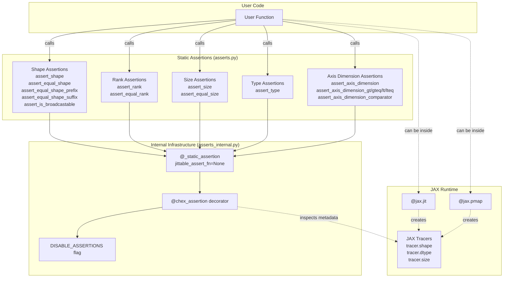
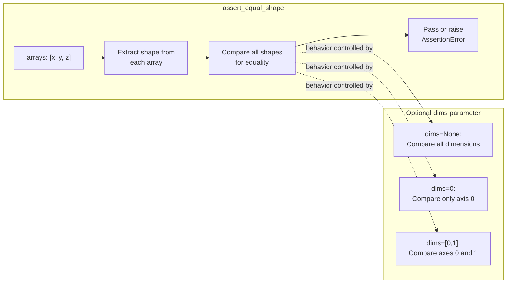
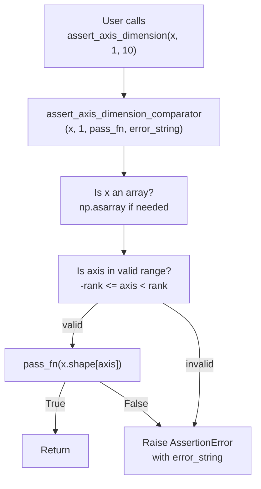

<!-- source: DeepWiki mcp.deepwiki.com · repo google-deepmind/chex · page 3.1 Static Assertions · fetched 2026-10-26 -->

# Static Assertions

<details>
<summary>Relevant source files</summary>

The following files were used as context for generating this wiki page:

- [chex/_src/asserts.py](chex/_src/asserts.py)
- [chex/_src/asserts_test.py](chex/_src/asserts_test.py)
- [docs/api.rst](docs/api.rst)

</details>


## Purpose and Scope

Static assertions validate array **metadata** (shape, rank, size, dtype, and axis dimensions) without requiring concrete values. These assertions work in all JAX contexts, including inside JIT-compiled and pmap'd functions, because they only inspect properties that are available at trace time. They are the most fundamental type of assertion in Chex's assertion system.

For assertions that inspect concrete array values (e.g., checking if values are finite or equal), see [Value Assertions](#3.2). For assertions that validate entire PyTree structures, see [Tree Assertions](#3.3). For device placement and JAX-specific assertions, see [Device and JAX-Specific Assertions](#3.4).

---

## What Are Static Assertions?

Static assertions are distinguished by their decorator `@_static_assertion`, which is defined as `functools.partial(_ai.chex_assertion, jittable_assert_fn=None)`. The key characteristic is that `jittable_assert_fn=None`, meaning these assertions have no special JIT-compatible implementation—they work the same way in all contexts because they only access metadata that JAX tracers expose.

**Key Properties:**
- **Work with tracers**: Can be called on JAX tracers inside `@jax.jit`, `@jax.pmap`, etc.
- **Check metadata only**: Only inspect `.shape`, `.dtype`, `.size`, `.ndim`—never actual values
- **No checkify needed**: Don't require `@chexify` decorator (unlike value assertions)
- **Fail at trace time**: Errors are raised during tracing, not at runtime

Sources: [chex/_src/asserts.py:42-44]()

---

## Architecture Overview

The following diagram shows how static assertions fit into Chex's broader assertion system:



Sources: [chex/_src/asserts.py:42-44](), [chex/_src/asserts_internal.py:31-54]()

---

## Shape Assertions

Shape assertions validate the shape (tuple of dimension sizes) of arrays. They support flexible matching patterns including exact values, `None` for wildcards, sets for alternatives, and `...` (ellipsis) for variable-length sequences.

### Core Functions

| Function | Purpose | Example |
|----------|---------|---------|
| `assert_shape` | Check array(s) match expected shape pattern | `assert_shape(x, (2, 3))` |
| `assert_equal_shape` | Check all arrays have identical shapes | `assert_equal_shape([x, y, z])` |
| `assert_equal_shape_prefix` | Check leading dimensions match | `assert_equal_shape_prefix([x, y], 2)` |
| `assert_equal_shape_suffix` | Check trailing dimensions match | `assert_equal_shape_suffix([x, y], 2)` |
| `assert_is_broadcastable` | Check if shape A broadcasts to shape B | `assert_is_broadcastable((3,), (2, 3))` |

### Shape Pattern Matching

The `assert_shape` function supports sophisticated pattern matching:

```python
# Exact shape
assert_shape(x, (2, 3))

# Wildcard dimension (any size allowed)
assert_shape(x, (2, None))

# Alternative dimensions (size must be in set)
assert_shape(x, (2, {1, 3, 5}))

# Prefix matching (rank >= 2, first dim is 2)
assert_shape(x, (2, ...))

# Suffix matching (rank >= 2, last dim is 3)
assert_shape(x, (..., 3))

# Inner matching (rank >= 3, first is 2, last is 4)
assert_shape(x, (2, ..., 4))

# Multiple arrays with different shapes
assert_shape([x, y], [(2, 3), (4, 5)])

# Multiple arrays with same shape
assert_shape([x, y, z], (2, 3))
```

**Implementation Details:**

The shape matching logic in `_shape_matches` handles ellipsis by splitting the expected shape into prefix and suffix components, then validating each part separately against the actual shape:

1. Split `expected_shape` at `...` into `expected_prefix` and `expected_suffix`
2. If no ellipsis, check exact match with `_unelided_shape_matches`
3. If ellipsis present, verify rank is sufficient, then check prefix and suffix independently

Sources: [chex/_src/asserts.py:597-654](), [chex/_src/asserts.py:557-594]()

### Comparing Multiple Arrays



The `assert_equal_shape` function can optionally check only specific dimensions using the `dims` parameter:

```python
# Check all dimensions match
assert_equal_shape([x, y, z])

# Check only first dimension matches
assert_equal_shape([x, y, z], dims=0)

# Check first two dimensions match
assert_equal_shape([x, y, z], dims=[0, 1])

# Check last dimension matches (negative indexing)
assert_equal_shape([x, y, z], dims=-1)
```

Sources: [chex/_src/asserts.py:451-496](), [chex/_src/asserts.py:498-517](), [chex/_src/asserts.py:519-537]()

---

## Rank Assertions

Rank assertions validate the number of dimensions (rank/ndim) of arrays.

### Core Functions

| Function | Purpose | Example |
|----------|---------|---------|
| `assert_rank` | Check array rank matches expected value(s) | `assert_rank(x, 2)` |
| `assert_equal_rank` | Check all arrays have same rank | `assert_equal_rank([x, y, z])` |

### Usage Patterns

```python
# Single array, exact rank
assert_rank(x, 2)  # x must be a matrix

# Single array, rank options
assert_rank(x, {0, 2})  # x is scalar or matrix

# Multiple arrays, same rank
assert_rank([x, y], 2)  # both must be matrices

# Multiple arrays, different ranks
assert_rank([x, y], [0, 2])  # x is scalar, y is matrix

# Multiple arrays, rank options per array
assert_rank([x, y], [{0, 1}, 2])  # x is scalar or vector, y is matrix
```

**Implementation Note:** The function accepts both integers and sets of integers for flexible rank checking. It correctly handles scalar values which have `shape = ()` and thus `rank = 0`.

Sources: [chex/_src/asserts.py:701-782](), [chex/_src/asserts.py:681-699]()

---

## Size Assertions

Size assertions validate the total number of elements in an array (the product of all dimension sizes).

### Core Functions

| Function | Purpose | Example |
|----------|---------|---------|
| `assert_size` | Check array size matches expected value(s) | `assert_size(x, 6)` |
| `assert_equal_size` | Check all arrays have same total size | `assert_equal_size([x, y, z])` |

### Usage Patterns

```python
# Single array
assert_size(x, 6)  # x.size == 6

# Size alternatives
assert_size(x, {4, 6, 8})  # x.size in {4, 6, 8}

# Wildcard (any size)
assert_size(x, None)  # any size allowed
assert_size(x, ...)   # same as None

# Multiple arrays, same size
assert_size([x, y], 6)

# Multiple arrays, different sizes
assert_size([x, y], [6, 12])
```

**Special Cases:**
- Scalars have `size = 1` by definition
- Empty arrays have `size = 0`
- For arrays with `shape = (2, 3, 4)`, size = 2 × 3 × 4 = 24

Sources: [chex/_src/asserts.py:388-449](), [chex/_src/asserts.py:370-386]()

---

## Type Assertions

Type assertions validate the data type (dtype) of arrays, supporting both Python built-in types and NumPy/JAX dtypes.

### Core Function

| Function | Purpose | Example |
|----------|---------|---------|
| `assert_type` | Check array dtype matches expected type | `assert_type(x, float)` |

### Supported Type Specifications

The `assert_type` function supports multiple ways to specify expected types:

| Type Specification | Matches | Example |
|--------------------|---------|---------|
| `int` | Any integer dtype | `assert_type(x, int)` |
| `float` | Any floating point dtype | `assert_type(x, float)` |
| `bool` | Boolean dtype | `assert_type(x, bool)` |
| `jnp.integer` | Any integer dtype (alias) | `assert_type(x, jnp.integer)` |
| `jnp.floating` | Any floating point dtype (alias) | `assert_type(x, jnp.floating)` |
| Concrete dtype | Exact dtype match | `assert_type(x, np.float32)` |

### Usage Patterns

```python
# Python scalar types
assert_type(7, int)
assert_type(7.1, float)
assert_type(False, bool)

# NumPy arrays with Python types
assert_type(np.array(7), int)
assert_type(np.array([1, 2, 3]), int)

# Concrete dtypes
assert_type(jnp.ones(3, dtype=jnp.float32), jnp.float32)
assert_type(jnp.zeros(5, dtype=np.int8), np.int8)
assert_type(jnp.array(1., dtype=jnp.bfloat16), jnp.bfloat16)

# Multiple arrays
assert_type([x, y], [float, int])
assert_type([x, y, z], float)  # all must be float
```

**Type Hierarchy Checking:**

The function uses `jnp.issubdtype` for abstract type checking:
- `float` and `jnp.floating` match `float32`, `float64`, `bfloat16`, etc.
- `int` and `jnp.integer` match `int8`, `int16`, `int32`, `int64`, `uint8`, etc.
- Concrete dtypes require exact match

Sources: [chex/_src/asserts.py:785-849]()

---

## Axis Dimension Assertions

Axis dimension assertions check the size of a specific dimension (axis) in an array. These are useful for validating that particular axes have expected sizes, especially when other dimensions can vary.

### Core Functions

| Function | Purpose | Example |
|----------|---------|---------|
| `assert_axis_dimension` | Check `array.shape[axis] == expected` | `assert_axis_dimension(x, 0, 10)` |
| `assert_axis_dimension_gt` | Check `array.shape[axis] > val` | `assert_axis_dimension_gt(x, 1, 5)` |
| `assert_axis_dimension_gteq` | Check `array.shape[axis] >= val` | `assert_axis_dimension_gteq(x, 1, 5)` |
| `assert_axis_dimension_lt` | Check `array.shape[axis] < val` | `assert_axis_dimension_lt(x, 2, 100)` |
| `assert_axis_dimension_lteq` | Check `array.shape[axis] <= val` | `assert_axis_dimension_lteq(x, 2, 100)` |
| `assert_axis_dimension_comparator` | Generic comparator for custom checks | See below |

### Implementation Pattern

All axis dimension assertions delegate to `assert_axis_dimension_comparator`, which implements the common logic:



### Usage Patterns

```python
# Basic equality check
tensor = jnp.ones((3, 2, 7, 2))
assert_axis_dimension(tensor, axis=0, expected=3)  # OK
assert_axis_dimension(tensor, axis=1, expected=2)  # OK
assert_axis_dimension(tensor, axis=-1, expected=2) # OK (negative indexing)

# Comparisons
assert_axis_dimension_gt(tensor, axis=2, val=5)    # 7 > 5 ✓
assert_axis_dimension_gteq(tensor, axis=2, val=7)  # 7 >= 7 ✓
assert_axis_dimension_lt(tensor, axis=1, val=10)   # 2 < 10 ✓
assert_axis_dimension_lteq(tensor, axis=3, val=2)  # 2 <= 2 ✓

# Custom comparator
assert_axis_dimension_comparator(
    tensor,
    axis=0,
    pass_fn=lambda dim: dim % 2 == 1,  # Check if odd
    error_string="odd"
)
```

**Special Handling:**
- Supports negative axis indexing (e.g., `-1` for last axis)
- Validates axis is in range before checking dimension
- Works with both JAX and NumPy arrays
- Even works with Python lists/strings via `np.asarray` conversion

Sources: [chex/_src/asserts.py:852-882](), [chex/_src/asserts.py:884-902](), [chex/_src/asserts.py:904-921](), [chex/_src/asserts.py:923-940](), [chex/_src/asserts.py:942-959](), [chex/_src/asserts.py:961-978]()

---

## Global Control

Static assertions (like all Chex assertions) can be globally disabled or enabled:

```python
import chex

# Disable all assertions (use sparingly!)
chex.disable_asserts()
chex.assert_shape(x, (999, 999))  # Does nothing

# Re-enable assertions
chex.enable_asserts()
chex.assert_shape(x, (999, 999))  # Raises AssertionError
```

This is controlled by the global flag `asserts_internal.DISABLE_ASSERTIONS`.

**Use Case:** Disabling assertions in production to avoid runtime overhead, though static assertions have minimal cost since they only check metadata.

Sources: [chex/_src/asserts.py:47-57](), [chex/_src/asserts_internal.py:48]()

---

## Testing and Examples

Static assertions are extensively tested in [chex/_src/asserts_test.py](). Key test patterns include:

### Shape Testing
- Tests exact, wildcard, set-based, and ellipsis matching
- Tests prefix/suffix/inner ellipsis patterns
- Tests multiple arrays with same or different shapes
- Tests invalid inputs and error messages

### Rank Testing
- Tests single and multiple arrays
- Tests exact values and sets of acceptable ranks
- Tests error handling for invalid rank specifications

### Size Testing
- Tests exact, wildcard, and set-based size matching
- Tests multiple arrays with same or different sizes
- Tests handling of scalars (size = 1)

### Type Testing
- Tests Python scalar types (int, float, bool)
- Tests NumPy and JAX array dtypes
- Tests abstract types (`jnp.floating`, `jnp.integer`)
- Tests concrete dtypes (`jnp.float32`, `jnp.bfloat16`, etc.)
- Tests mixed arrays (combining scalars and arrays)

### Axis Dimension Testing
- Tests equality, greater than, less than comparisons
- Tests negative axis indexing
- Tests invalid axis detection
- Tests custom comparator functions

Sources: [chex/_src/asserts_test.py:285-846]()

---

## Summary: When to Use Static Assertions

Use static assertions when you need to validate:

✅ **Array shapes** before operations that require specific dimensions  
✅ **Array ranks** to ensure correct dimensionality  
✅ **Array sizes** for memory or computation bounds  
✅ **Array dtypes** to ensure numeric precision requirements  
✅ **Specific axis dimensions** for batching or feature sizes  

Static assertions are ideal for:
- Input validation at function boundaries
- Catching shape mismatches early in development
- Documenting array shape expectations in code
- Working inside JIT-compiled functions (unlike value assertions)

For assertions that need to inspect actual values (e.g., checking for NaN, comparing values), use [Value Assertions](#3.2) with the `@chexify` decorator.

Sources: [chex/_src/asserts.py:42-978]()

---

