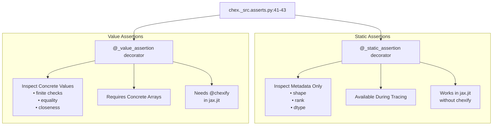
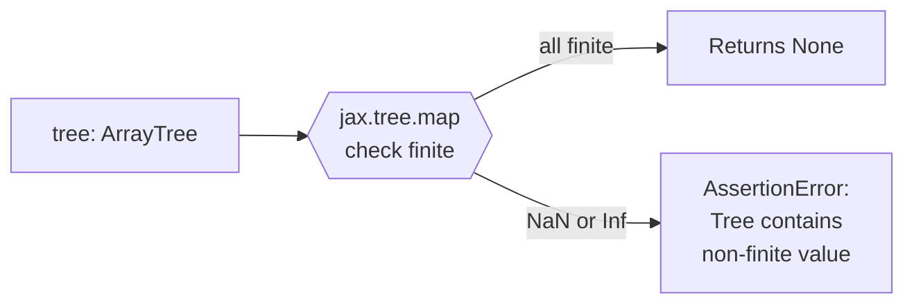
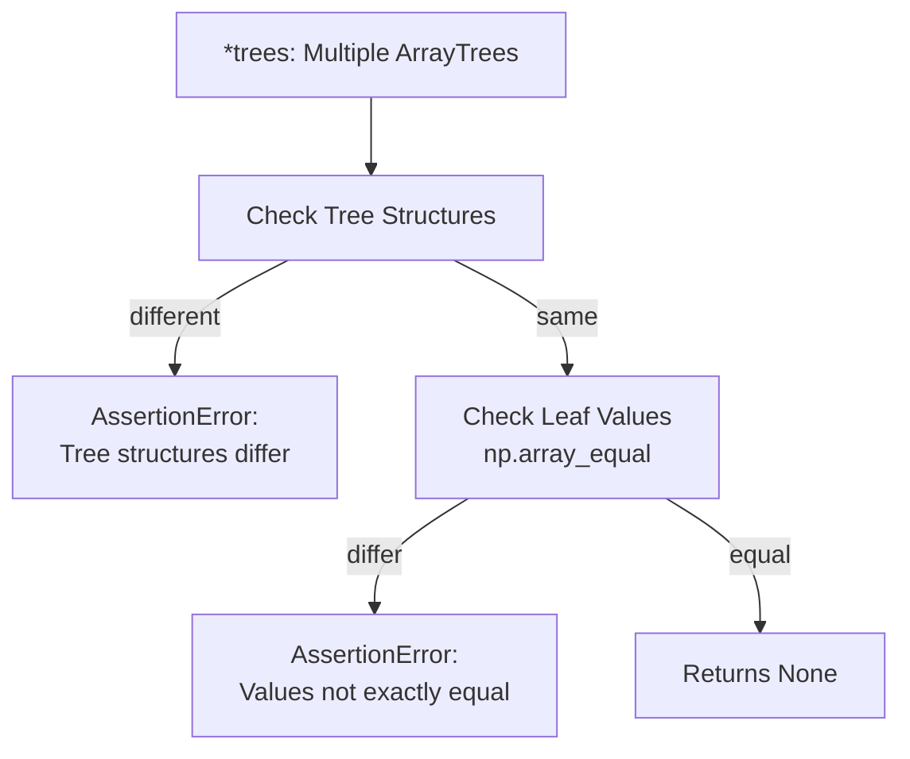
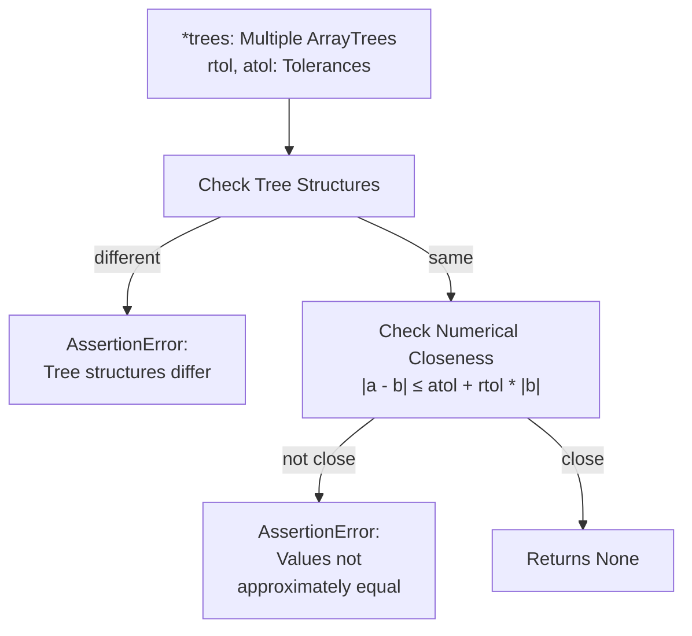
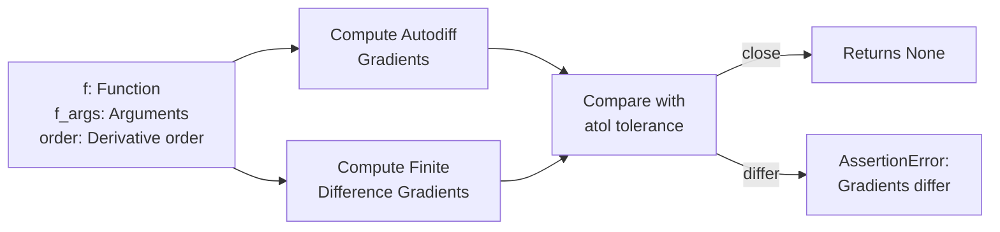
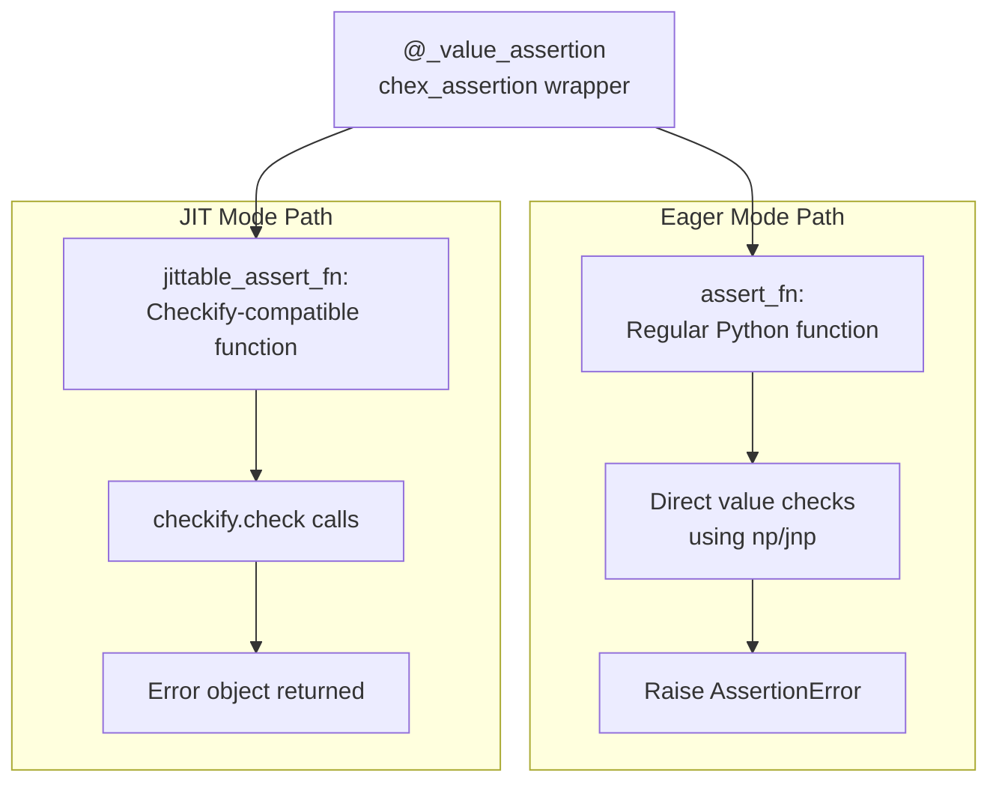
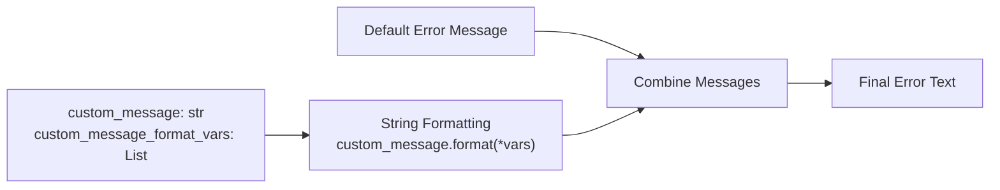

<!-- source: DeepWiki mcp.deepwiki.com · repo google-deepmind/chex · page 3.2 Value Assertions · fetched 2026-10-26 -->

# Value Assertions

<details>
<summary>Relevant source files</summary>

The following files were used as context for generating this wiki page:

- [chex/_src/asserts.py](chex/_src/asserts.py)
- [chex/_src/asserts_chexify.py](chex/_src/asserts_chexify.py)
- [chex/_src/asserts_chexify_test.py](chex/_src/asserts_chexify_test.py)
- [chex/_src/asserts_test.py](chex/_src/asserts_test.py)

</details>


Value assertions are Chex assertions that inspect concrete array values at runtime, such as checking for finiteness, equality, or numerical closeness. Unlike static assertions (see [Static Assertions](#3.1)) which validate metadata like shape or rank during tracing, value assertions require actual tensor values and therefore need special handling when used inside JAX transformations like `jax.jit` or `jax.pmap`.

For tree structure validation, see [Tree Assertions](#3.3). For using value assertions inside JIT-compiled code, see [Chexify: Assertions in JIT-Compiled Code](#3.5).

## Overview

Value assertions examine the concrete numerical content of arrays and trees. They answer questions like "does this array contain NaN or Inf?", "are these two arrays exactly equal?", or "are these values numerically close?". Because JAX tracing replaces concrete values with abstract tracers, these assertions cannot run during the tracing phase and require special treatment.

### Value vs Static Assertions



**Sources:** [chex/_src/asserts.py:41-43]()

The key implementation difference is that value assertions provide both a regular `assert_fn` and a `jittable_assert_fn` to the `@chex_assertion` decorator, while static assertions pass `jittable_assert_fn=None`.

## Core Value Assertion Functions

Chex provides five primary value assertion functions:

### Function Catalog

| Function | Purpose | Main Parameters | Jittable |
|----------|---------|-----------------|----------|
| `assert_tree_all_finite` | Check tree contains no NaN/Inf | `tree` | ✓ |
| `assert_trees_all_equal` | Check trees are exactly equal | `*trees`, `strict` | ✓ |
| `assert_trees_all_close` | Check trees are numerically close | `*trees`, `rtol`, `atol` | ✓ |
| `assert_trees_all_close_ulp` | Check closeness in ULP units | `*trees`, `maxulp` | ✗ |
| `assert_numerical_grads` | Check autodiff vs numerical grads | `f`, `f_args`, `order` | ✗ |

**Sources:** [chex/_src/asserts.py:1418-1765]()

### assert_tree_all_finite



**Sources:** [chex/_src/asserts.py:1418-1468]()

Validates that all arrays in a PyTree contain only finite values (no NaN or Inf). This is particularly useful for debugging numerical instabilities.

**Implementation:**
- Regular version [chex/_src/asserts.py:1418-1437](): Uses `jnp.all(jnp.isfinite(x))` on each leaf
- Jittable version [chex/_src/asserts.py:1440-1468](): Uses `checkify.check` for JIT compatibility

**Example Usage:**
```python
import chex
import jax.numpy as jnp

# Eager mode
tree = {'a': jnp.array([1.0, 2.0]), 'b': jnp.array([3.0, 4.0])}
chex.assert_tree_all_finite(tree)  # OK

tree_with_nan = {'a': jnp.array([1.0, jnp.nan])}
chex.assert_tree_all_finite(tree_with_nan)  # Raises AssertionError
```

**Sources:** [chex/_src/asserts.py:1418-1468](), [chex/_src/asserts_test.py:911-927]()

### assert_trees_all_equal



**Sources:** [chex/_src/asserts.py:1471-1549]()

Checks that multiple PyTrees have identical structure and that corresponding leaves are exactly equal element-wise. This is stricter than `assert_trees_all_close` as it requires bitwise equality.

**Key Parameters:**
- `*trees`: Variable number of trees to compare
- `strict`: If `True`, enforces that scalar vs array differences fail (default: `False`)
- `custom_message`: Optional error message template
- `custom_message_format_vars`: Values to format into custom message

**Implementation Details:**
- Validates tree structures match using `jax.tree_util.tree_structure`
- Compares leaves using `np.testing.assert_array_equal`
- Supports both eager and JIT execution modes
- Special handling for PRNG keys and scalar/array type mismatches

**Sources:** [chex/_src/asserts.py:1471-1549](), [chex/_src/asserts_test.py:928-984]()

### assert_trees_all_close



**Sources:** [chex/_src/asserts.py:1552-1638]()

Verifies that multiple PyTrees have numerically close values within specified relative and absolute tolerances. This is the most commonly used assertion for comparing floating-point computations.

**Key Parameters:**
- `*trees`: Variable number of trees to compare
- `rtol`: Relative tolerance (default: `1e-6`)
- `atol`: Absolute tolerance (default: `1e-6`)

**Tolerance Formula:**
The assertion passes if for all corresponding elements `a` and `b`:
```
|a - b| ≤ atol + rtol * |b|
```

**Special Cases:**
- Works with `bfloat16` by automatically converting to `float32` for comparison
- Handles both NumPy arrays and JAX arrays
- Supports nested PyTree structures

**Sources:** [chex/_src/asserts.py:1552-1638](), [chex/_src/asserts_test.py:985-1029](), [chex/_src/asserts_chexify_test.py:633-657]()

### assert_trees_all_close_ulp

Checks that PyTrees are close within a specified number of Units in the Last Place (ULP). This provides fine-grained control over floating-point comparison, especially useful for low-precision dtypes.

**Key Parameters:**
- `*trees`: Variable number of trees to compare
- `maxulp`: Maximum ULP distance (default: `1`)

**Limitations:**
- **Not JIT-compatible**: Cannot be used with `@chexify` decorator
- Raises `RuntimeError` if called from JIT context

**Use Cases:**
- Validating bit-level reproducibility
- Testing with reduced precision types (e.g., `bfloat16`)
- Ensuring deterministic floating-point operations

**Sources:** [chex/_src/asserts.py:1641-1765](), [chex/_src/asserts_test.py:1030-1155]()

### assert_numerical_grads



**Sources:** [chex/_src/asserts.py:980-1006]()

Validates that automatic differentiation gradients match numerically computed gradients using finite differences. This is useful for verifying custom gradient implementations.

**Key Parameters:**
- `f`: Function to test
- `f_args`: Arguments to pass to `f`
- `order`: Order of derivatives to check
- `atol`: Absolute tolerance (default: `0.01`)
- `**check_kwargs`: Additional arguments for `jax_test.check_grads`

**Special Behavior:**
- Mocks `jax.lax.stop_gradient` during testing since finite differences don't honor it
- Adjusts tolerance by input size to account for accumulation

**Limitations:**
- Not JIT-compatible
- Only works in eager mode
- Can be computationally expensive for high-order derivatives

**Sources:** [chex/_src/asserts.py:980-1006]()

## Behavior in Different Execution Contexts

Value assertions behave differently depending on the execution context:

```mermaid
graph TB
    subgraph "Eager Mode"
        E_CALL["Function Call"]
        E_ASSERT["Value Assertion"]
        E_CONCRETE["Access Concrete Values"]
        E_CHECK["Perform Check"]
        E_RESULT["Return or Raise"]
        
        E_CALL --> E_ASSERT
        E_ASSERT --> E_CONCRETE
        E_CONCRETE --> E_CHECK
        E_CHECK --> E_RESULT
    end
    
    subgraph "JIT Without @chexify"
        J_CALL["jax.jit(fn)"]
        J_TRACE["Tracing Phase"]
        J_ASSERT["Value Assertion"]
        J_ERROR["RuntimeError:<br/>Must use @chexify"]
        
        J_CALL --> J_TRACE
        J_TRACE --> J_ASSERT
        J_ASSERT --> J_ERROR
    end
    
    subgraph "JIT With @chexify"
        C_CALL["@chexify<br/>@jax.jit<br/>fn"]
        C_TRACE["Tracing Phase"]
        C_CHECK["checkify.check<br/>inserted"]
        C_EXEC["Execution Phase"]
        C_VERIFY["Verify Checks"]
        C_RESULT["Return or Raise"]
        
        C_CALL --> C_TRACE
        C_TRACE --> C_CHECK
        C_CHECK --> C_EXEC
        C_EXEC --> C_VERIFY
        C_VERIFY --> C_RESULT
    end
```



**Sources:** [chex/_src/asserts.py:41-43](), [chex/_src/asserts_internal.py](), [chex/_src/asserts_chexify.py:89-241]()

### Eager Execution

In eager mode, value assertions directly access concrete array values and perform checks immediately:

```python
# Works without any special handling
def compute(x):
    chex.assert_tree_all_finite(x)
    return x * 2

result = compute(jnp.array([1.0, 2.0]))  # OK
```

**Sources:** [chex/_src/asserts.py:1418-1765]()

### JIT Without Chexify

Attempting to use value assertions in JIT-compiled code without `@chexify` results in a runtime error:

```python
@jax.jit
def compute(x):
    chex.assert_tree_all_finite(x)  # RuntimeError!
    return x * 2
```

The error message guides users to wrap the function with `@chexify`:
```
RuntimeError: ... can only be called from functions wrapped with @chex.chexify
```

**Sources:** [chex/_src/asserts_internal.py](), [chex/_src/asserts_chexify_test.py:363-387]()

### JIT With Chexify

When properly wrapped with `@chexify`, value assertions are converted to `checkify.check` calls that execute during the compiled function's runtime:

```python
@chex.chexify
@jax.jit
def compute(x):
    chex.assert_tree_all_finite(x)  # Works!
    return x * 2

result = compute(jnp.array([1.0, 2.0]))  # OK
```

The `@chexify` decorator must be applied **on top** of JAX transformations. See [Chexify: Assertions in JIT-Compiled Code](#3.5) for detailed usage patterns.

**Sources:** [chex/_src/asserts_chexify.py:89-241](), [chex/_src/asserts_chexify_test.py:84-314]()

## Implementation Architecture

### Dual-Mode Assertion Pattern

Each value assertion follows a dual-mode implementation pattern:



**Sources:** [chex/_src/asserts.py:41-43](), [chex/_src/asserts_internal.py]()

### Example: assert_tree_all_finite Implementation

The implementation has two versions of the same logic:

**Eager Version** [chex/_src/asserts.py:1418-1437]():
```python
def _assert_tree_all_finite_impl(tree: ArrayTree) -> None:
    """Regular implementation using direct checks."""
    errors = []
    for path, leaf in jax.tree_util.tree_flatten_with_path(tree)[0]:
        if not jnp.all(jnp.isfinite(leaf)):
            errors.append(f"Tree leaf '{path}' contains non-finite value")
    if errors:
        raise AssertionError("\n".join(errors))
```

**Jittable Version** [chex/_src/asserts.py:1440-1468]():
```python
def _assert_tree_all_finite_jittable(tree: ArrayTree) -> bool:
    """JIT-compatible implementation using checkify."""
    pred = jnp.all(jnp.array([
        jnp.all(jnp.isfinite(x)) 
        for x in jax.tree_util.tree_leaves(tree)
    ]))
    checkify.check(pred, 'Tree contains non-finite value')
    return pred
```

Both are combined using the `@chex_assertion` decorator:
```python
assert_tree_all_finite = _value_assertion(
    assert_fn=_assert_tree_all_finite_impl,
    jittable_assert_fn=_assert_tree_all_finite_jittable,
    name='assert_tree_all_finite'
)
```

**Sources:** [chex/_src/asserts.py:1418-1468]()

## Custom Message Support

All value assertions support custom error messages through keyword arguments:



**Sources:** [chex/_src/asserts.py:1471-1765](), [chex/_src/asserts_chexify_test.py:658-685]()

**Usage Example:**
```python
@chex.chexify
@jax.jit
def process(x, y):
    total = x.sum() + y.sum()
    chex.assert_trees_all_equal(
        x, y,
        custom_message='Expected equal trees (sum(x)={}, sum(y)={})',
        custom_message_format_vars=[x.sum(), y.sum()]
    )
    return total
```

When the assertion fails, both the custom message and the default diagnostic information are included in the error.

**Sources:** [chex/_src/asserts_chexify_test.py:658-685]()

## Best Practices

### Choosing the Right Assertion

| Scenario | Recommended Assertion | Rationale |
|----------|----------------------|-----------|
| Checking for NaN/Inf | `assert_tree_all_finite` | Specialized, clear error messages |
| Comparing integer arrays | `assert_trees_all_equal` | No rounding concerns |
| Comparing floating-point results | `assert_trees_all_close` | Handles numerical precision |
| Testing low-precision dtypes | `assert_trees_all_close_ulp` | Fine-grained ULP control |
| Validating custom gradients | `assert_numerical_grads` | Compares autodiff vs finite diff |

**Sources:** [chex/_src/asserts.py:1418-1765]()

### Performance Considerations

Value assertions can impact performance, especially in tight loops:

1. **Disable in Production**: Use `chex.disable_asserts()` to turn off all assertions
2. **Limit Assertion Frequency**: Don't assert on every iteration; sample periodically
3. **Async Mode**: Use `@chexify(async_check=True)` to overlap checking with computation
4. **Minimize Custom Messages**: Complex format variables can add overhead in JIT

**Sources:** [chex/_src/asserts.py:47-57](), [chex/_src/asserts_chexify.py:89-241]()

### Common Pitfalls

**Pitfall 1: Wrong Decorator Order**
```python
# WRONG - @chexify must be outermost
@jax.jit
@chex.chexify
def fn(x):
    chex.assert_tree_all_finite(x)
    return x

# CORRECT
@chex.chexify
@jax.jit
def fn(x):
    chex.assert_tree_all_finite(x)
    return x
```

**Pitfall 2: Using ULP Assertion in JIT**
```python
# WRONG - assert_trees_all_close_ulp not JIT-compatible
@chex.chexify
@jax.jit
def fn(x, y):
    chex.assert_trees_all_close_ulp(x, y)  # RuntimeError!
    return x + y

# CORRECT - Use assert_trees_all_close instead
@chex.chexify
@jax.jit
def fn(x, y):
    chex.assert_trees_all_close(x, y, rtol=1e-6)
    return x + y
```

**Pitfall 3: Forgetting to Wait for Async Checks**
```python
# Async errors may not surface immediately
chexified_fn = chex.chexify(jax.jit(fn), async_check=True)
result = chexified_fn(bad_input)  # Returns immediately
# ... do other work ...
chexified_fn.wait_checks()  # Error surfaces here
```

**Sources:** [chex/_src/asserts_chexify.py:89-241](), [chex/_src/asserts_chexify_test.py:285-314]()

### Debugging Failed Assertions

When a value assertion fails in JIT mode, the error message includes:
1. The assertion name (e.g., `assert_tree_all_finite`)
2. The custom message (if provided)
3. A code pointer showing where the assertion was called

For detailed diagnostics with concrete values, run the same code in eager mode:

```python
# In JIT mode - shows line number but not concrete values
@chex.chexify
@jax.jit
def process(tree):
    chex.assert_tree_all_finite(tree)
    return jax.tree.map(jnp.sum, tree)

# For debugging - eager mode shows concrete values
def process_debug(tree):
    chex.assert_tree_all_finite(tree)  # Shows which leaves contain NaN
    return jax.tree.map(jnp.sum, tree)
```

**Sources:** [chex/_src/asserts_chexify.py:49-62](), [chex/_src/asserts_chexify_test.py:578-593]()

---

