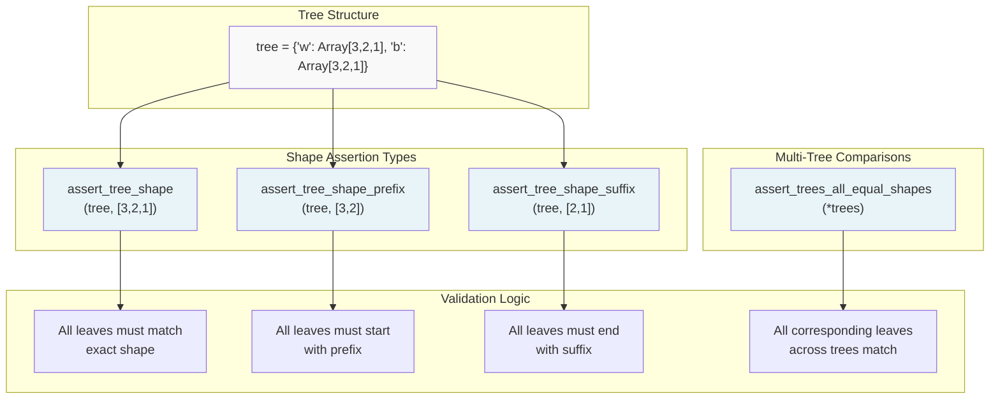
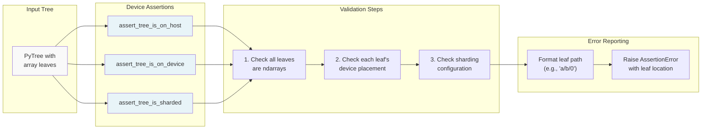
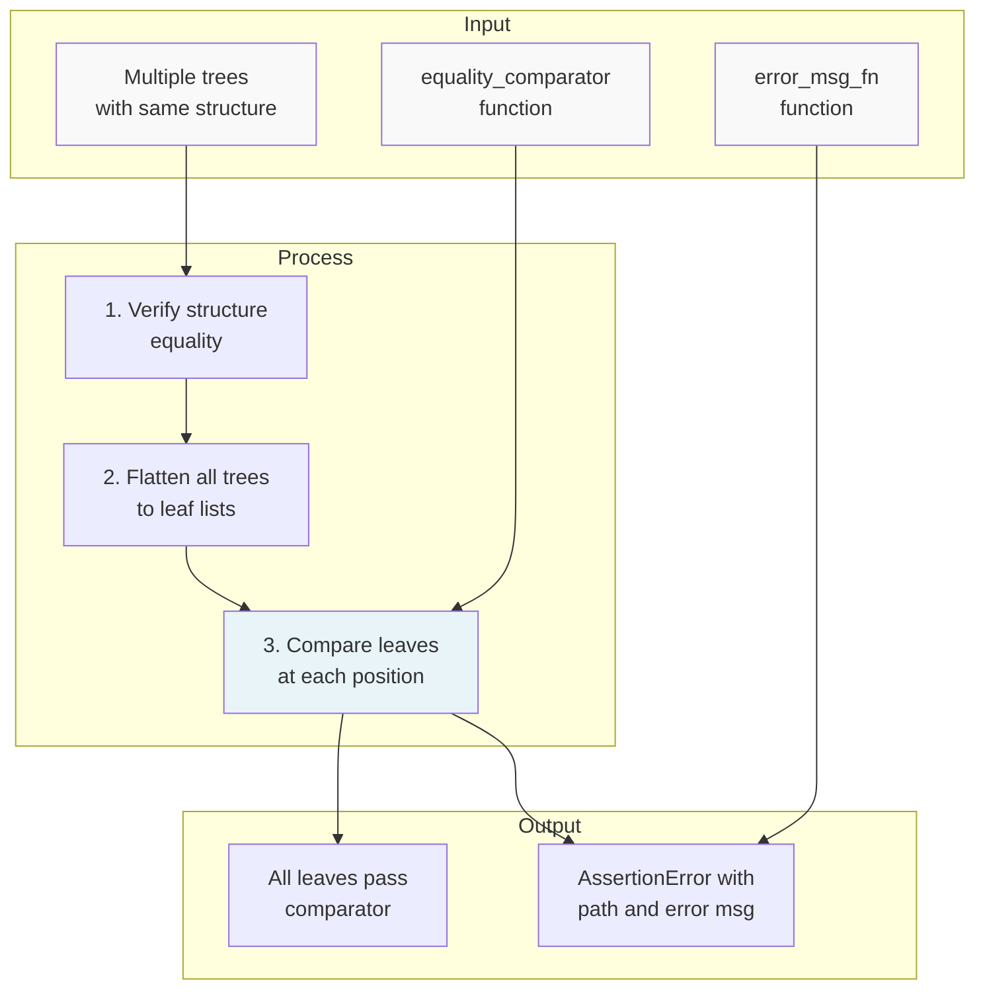

<!-- source: DeepWiki mcp.deepwiki.com · repo google-deepmind/chex · page 3.3 Tree Assertions · fetched 2026-10-26 -->

# Tree Assertions

<details>
<summary>Relevant source files</summary>

The following files were used as context for generating this wiki page:

- [chex/_src/asserts.py](chex/_src/asserts.py)
- [chex/_src/asserts_test.py](chex/_src/asserts_test.py)
- [chex/_src/pytypes.py](chex/_src/pytypes.py)

</details>


## Overview

Tree assertions validate properties of JAX PyTrees—nested data structures containing arrays, such as dictionaries, lists, and tuples commonly used for model parameters, gradients, and state. These assertions check structural consistency, shape compatibility, device placement, and value equality across entire tree hierarchies in a single call.

For assertions on individual arrays, see [Static Assertions](#3.1) and [Value Assertions](#3.2). For device-specific checks, see [Device and JAX-Specific Assertions](#3.4).

**Sources:** [chex/_src/asserts.py:1-50]()

## Tree Structure and Leaves

JAX PyTrees are hierarchical structures where:
- **Leaves** are arrays (`jax.Array`, `np.ndarray`) or scalars
- **Nodes** are containers (`dict`, `list`, `tuple`, `chex.dataclass`)
- **Structure** (tree definition) describes the container hierarchy
- **Path** identifies a leaf's location (e.g., `'a/b/0'` for `tree['a']['b'][0]`)

All tree assertions leverage `jax.tree_util` to traverse structures and validate leaves systematically.

**Sources:** [chex/_src/pytypes.py:44-50](), [chex/_src/asserts.py:1011-1053]()

## PyTree Structure Assertions

### assert_trees_all_equal_structs

```python
assert_trees_all_equal_structs(*trees: ArrayTree) -> None
```

Validates that multiple trees have identical structure (same container types, nesting, and number of leaves), regardless of leaf values.

**Usage:**
```python
tree1 = {'params': [np.zeros(3), np.ones(2)], 'state': np.array(1.0)}
tree2 = {'params': [np.ones(3), np.zeros(2)], 'state': np.array(2.0)}
tree3 = {'params': np.zeros(5), 'state': np.array(1.0)}

assert_trees_all_equal_structs(tree1, tree2)  # ✓ Same structure
assert_trees_all_equal_structs(tree1, tree3)  # ✗ Different structure
```

**Implementation:** Compares `jax.tree_util.tree_structure()` results for all trees [1374-1397]().

**Sources:** [chex/_src/asserts.py:1374-1397](), [chex/_src/asserts_test.py:1484-1492]()

### assert_tree_no_nones

```python
assert_tree_no_nones(tree: ArrayTree) -> None
```

Ensures no leaf in the tree is `None`, which can cause issues in JAX transformations.

**Usage:**
```python
tree_ok = {'a': np.zeros(3), 'b': {'c': np.ones(2)}}
tree_bad = {'a': np.zeros(3), 'b': None}

assert_tree_no_nones(tree_ok)   # ✓
assert_tree_no_nones(tree_bad)  # ✗ AssertionError: Tree contains `None`
```

**Sources:** [chex/_src/asserts.py:1011-1030](), [chex/_src/asserts_test.py:892-909]()

### assert_tree_has_only_ndarrays

```python
assert_tree_has_only_ndarrays(tree: ArrayTree) -> None
```

Verifies all leaves are NumPy or JAX arrays (excludes scalars, lists, or other types).

**Usage:**
```python
tree_ok = {'a': np.zeros(3), 'b': jnp.ones(2)}
tree_bad = {'a': np.zeros(3), 'b': 1}

assert_tree_has_only_ndarrays(tree_ok)   # ✓
assert_tree_has_only_ndarrays(tree_bad)  # ✗ 'b' is not an ndarray
```

**Sources:** [chex/_src/asserts.py:1034-1054](), [chex/_src/asserts_test.py:1156-1168]()

---

## Tree Shape Assertions

### Tree Shape Validation Diagram



**Sources:** [chex/_src/asserts.py:1263-1370]()

### assert_tree_shape

```python
assert_tree_shape(tree: ArrayTree, expected_shape: TShapeMatcher) -> None
```

Validates that all leaves in a tree have the same shape, matching the expected shape specification. Supports flexible matching with `None` (any dimension), sets `{2, 3}` (multiple options), and ellipsis `...` (variable-length prefix/suffix).

**Usage:**
```python
tree = {'w': np.zeros([3, 2, 1]), 'b': np.zeros([3, 2, 1])}

assert_tree_shape(tree, [3, 2, 1])        # ✓ Exact match
assert_tree_shape(tree, [3, None, 1])     # ✓ Any middle dimension
assert_tree_shape(tree, [3, {1, 2}, 1])   # ✓ Middle dim in {1, 2}
assert_tree_shape(tree, [3, 2, ...])      # ✓ Prefix match
assert_tree_shape(tree, [..., 2, 1])      # ✓ Suffix match
```

**Sources:** [chex/_src/asserts.py:1263-1287](), [chex/_src/asserts_test.py:1504-1542]()

### assert_tree_shape_prefix

```python
assert_tree_shape_prefix(tree: ArrayTree, shape_prefix: Sequence[int]) -> None
```

Ensures all leaves start with the specified shape prefix.

**Usage:**
```python
tree = {'x': np.zeros([3, 2]), 'y': np.zeros([3, 2, 1])}

assert_tree_shape_prefix(tree, [3, 2])  # ✓ Both start with [3, 2]
assert_tree_shape_prefix(tree, [3])     # ✓ Both start with [3]
assert_tree_shape_prefix(tree, [2])     # ✗ Prefix mismatch
```

**Sources:** [chex/_src/asserts.py:1291-1328](), [chex/_src/asserts_test.py:1549-1565]()

### assert_tree_shape_suffix

```python
assert_tree_shape_suffix(tree: ArrayTree, shape_suffix: Sequence[int]) -> None
```

Ensures all leaves end with the specified shape suffix.

**Usage:**
```python
tree = {'x': np.zeros([4, 2, 1]), 'y': np.zeros([2, 1])}

assert_tree_shape_suffix(tree, [2, 1])  # ✓ Both end with [2, 1]
assert_tree_shape_suffix(tree, [1])     # ✓ Both end with [1]
assert_tree_shape_suffix(tree, [2])     # ✗ Suffix mismatch
```

**Sources:** [chex/_src/asserts.py:1332-1370](), [chex/_src/asserts_test.py:1567-1615]()

### assert_trees_all_equal_shapes

```python
assert_trees_all_equal_shapes(*trees: ArrayTree) -> None
```

Validates that corresponding leaves across multiple trees have identical shapes.

**Usage:**
```python
tree1 = {'w': np.zeros([3, 2]), 'b': np.zeros([2])}
tree2 = {'w': np.ones([3, 2]), 'b': np.ones([2])}
tree3 = {'w': np.zeros([3, 3]), 'b': np.zeros([2])}

assert_trees_all_equal_shapes(tree1, tree2)  # ✓ Matching shapes
assert_trees_all_equal_shapes(tree1, tree3)  # ✗ 'w' shapes differ
```

**Sources:** [chex/_src/asserts.py:1486-1497](), [chex/_src/asserts_test.py:1460-1482]()

---

## Tree Device Placement Assertions

### Device Placement Validation Flow



**Sources:** [chex/_src/asserts.py:1077-1259]()

### assert_tree_is_on_host

```python
assert_tree_is_on_host(
    tree: ArrayTree,
    *,
    allow_cpu_device: bool = True,
    allow_sharded_arrays: bool = False
) -> None
```

Verifies all arrays reside in host (CPU) memory. Useful for ensuring data is ready for Python processing or saving to disk.

**Parameters:**
- `allow_cpu_device`: Accept JAX arrays on CPU devices (default: `True`)
- `allow_sharded_arrays`: Accept arrays sharded across CPU devices (default: `False`)

**Usage:**
```python
cpu_tree = {'a': np.zeros(3), 'b': np.ones(2)}
device_tree = {'a': jnp.zeros(3), 'b': np.ones(2)}  # JAX array on accelerator

assert_tree_is_on_host(cpu_tree)                      # ✓ All NumPy arrays
assert_tree_is_on_host(device_tree, allow_cpu_device=False)  # ✗ JAX array present
```

**Sources:** [chex/_src/asserts.py:1077-1147](), [chex/_src/asserts_test.py:1170-1239]()

### assert_tree_is_on_device

```python
assert_tree_is_on_device(
    tree: ArrayTree,
    *,
    platform: Union[Sequence[str], str] = ("gpu", "tpu"),
    device: Optional[Device] = None
) -> None
```

Ensures all arrays reside on accelerator devices (GPU/TPU). Excludes sharded arrays.

**Parameters:**
- `platform`: Expected platform(s) (`'gpu'`, `'tpu'`, or list)
- `device`: Specific device instance (overrides `platform`)

**Usage:**
```python
gpu_tree = jax.device_put({'a': np.zeros(3)}, jax.devices('gpu')[0])
cpu_tree = {'a': np.zeros(3)}

assert_tree_is_on_device(gpu_tree, platform='gpu')  # ✓
assert_tree_is_on_device(cpu_tree, platform='gpu')  # ✗ Array on CPU
```

**Sources:** [chex/_src/asserts.py:1151-1211](), [chex/_src/asserts_test.py:1241-1325]()

### assert_tree_is_sharded

```python
assert_tree_is_sharded(
    tree: ArrayTree,
    *,
    devices: Sequence[Device]
) -> None
```

Validates that arrays are sharded across the specified devices in the given order. Critical for multi-device parallelism verification.

**Usage:**
```python
devices = jax.devices('tpu')[:2]
tree = jax.device_put_replicated({'w': np.zeros(10)}, devices)

assert_tree_is_sharded(tree, devices=devices)           # ✓ Correct sharding
assert_tree_is_sharded(tree, devices=devices[::-1])     # ✗ Wrong device order
```

**Sources:** [chex/_src/asserts.py:1215-1259](), [chex/_src/asserts_test.py:1327-1419]()

---

## Tree Value Assertions

Value assertions require concrete (non-traced) values and support JIT compilation via `@chexify`. See [Chexify: Assertions in JIT-Compiled Code](#3.5) for details.

### assert_tree_all_finite

```python
assert_tree_all_finite(tree: ArrayTree) -> None
```

Checks that all leaf values are finite (no `NaN` or `Inf`). This is a **value assertion** that can be used inside `@jax.jit` with `@chexify`.

**Usage:**
```python
finite_tree = {'loss': jnp.array([1.0, 2.0]), 'grad': jnp.zeros(3)}
inf_tree = {'loss': jnp.array([1.0, jnp.inf]), 'grad': jnp.zeros(3)}

assert_tree_all_finite(finite_tree)  # ✓
assert_tree_all_finite(inf_tree)     # ✗ Tree contains non-finite value
```

**JIT-compatible version:**
```python
@chex.chexify
@jax.jit
def train_step(params, x):
    loss = compute_loss(params, x)
    grads = jax.grad(compute_loss)(params, x)
    chex.assert_tree_all_finite(grads)  # Works inside JIT
    return loss, grads
```

**Sources:** [chex/_src/asserts.py:1517-1553](), [chex/_src/asserts_test.py:911-926]()

### assert_trees_all_equal

```python
assert_trees_all_equal(*trees: ArrayTree, strict: bool = False) -> None
```

Verifies that corresponding leaves across trees have exactly equal values. This is a **value assertion**.

**Parameters:**
- `strict`: Disable NumPy's special scalar handling (default: `False`)

**Usage:**
```python
tree1 = {'w': jnp.array([1.0, 2.0]), 'b': jnp.array([0.0])}
tree2 = {'w': jnp.array([1.0, 2.0]), 'b': jnp.array([0.0])}
tree3 = {'w': jnp.array([1.0, 2.1]), 'b': jnp.array([0.0])}

assert_trees_all_equal(tree1, tree2)  # ✓ Exactly equal
assert_trees_all_equal(tree1, tree3)  # ✗ Values differ
```

**Sources:** [chex/_src/asserts.py:1557-1641](), [chex/_src/asserts_test.py:937-983]()

### assert_trees_all_close

```python
assert_trees_all_close(
    *trees: ArrayTree,
    rtol: float = 1e-06,
    atol: float = 0.0
) -> None
```

Checks that leaves are approximately equal within tolerance: `|a - b| ≤ atol + rtol * |b|`. This is a **value assertion**.

**Usage:**
```python
tree1 = {'loss': jnp.array([1.0])}
tree2 = {'loss': jnp.array([1.0 + 1e-7])}

assert_trees_all_close(tree1, tree2, rtol=1e-6)   # ✓ Within tolerance
assert_trees_all_close(tree1, tree2, rtol=1e-8)   # ✗ Exceeds tolerance
```

**Sources:** [chex/_src/asserts.py:1644-1705](), [chex/_src/asserts_test.py:985-1029]()

### assert_trees_all_close_ulp

```python
assert_trees_all_close_ulp(*trees: ArrayTree, maxulp: int = 1) -> None
```

Validates that leaves differ by at most `maxulp` Units in the Last Place. More precise than relative tolerance for verifying numerical reproducibility. **Not supported in JIT contexts.**

**Usage:**
```python
# For float32, at value 2^23, ULP spacing is 1.0
val = np.float32(1 << 23)
tree1 = {'x': jnp.array([val, val])}
tree2 = {'x': jnp.array([val, val + 1.0])}  # Exactly 1 ULP apart

assert_trees_all_close_ulp(tree1, tree2, maxulp=1)  # ✓
assert_trees_all_close_ulp(tree1, tree2, maxulp=0)  # ✗ Exceeds tolerance
```

**Sources:** [chex/_src/asserts.py:1722-1806](), [chex/_src/asserts_test.py:1030-1154]()

---

## Tree Type and Size Assertions

### assert_trees_all_equal_dtypes

```python
assert_trees_all_equal_dtypes(*trees: ArrayTree) -> None
```

Verifies that corresponding leaves have matching data types.

**Usage:**
```python
tree1 = {'x': np.zeros(3, dtype=np.float32), 'y': np.ones(2, dtype=np.int32)}
tree2 = {'x': np.zeros(5, dtype=np.float32), 'y': np.ones(4, dtype=np.int32)}
tree3 = {'x': np.zeros(3, dtype=np.float64), 'y': np.ones(2, dtype=np.int32)}

assert_trees_all_equal_dtypes(tree1, tree2)  # ✓ Same dtypes
assert_trees_all_equal_dtypes(tree1, tree3)  # ✗ 'x' dtypes differ
```

**Sources:** [chex/_src/asserts.py:1447-1467](), [chex/_src/asserts_test.py:1617-1646]()

### assert_trees_all_equal_sizes

```python
assert_trees_all_equal_sizes(*trees: ArrayTree) -> None
```

Checks that leaves have matching sizes (total element count).

**Usage:**
```python
tree1 = {'a': np.zeros([3, 2]), 'b': np.zeros([6])}  # sizes: 6, 6
tree2 = {'a': np.zeros([2, 3]), 'b': np.zeros([6])}  # sizes: 6, 6
tree3 = {'a': np.zeros([3, 3]), 'b': np.zeros([6])}  # sizes: 9, 6

assert_trees_all_equal_sizes(tree1, tree2)  # ✓ Same sizes
assert_trees_all_equal_sizes(tree1, tree3)  # ✗ 'a' sizes differ (6 vs 9)
```

**Sources:** [chex/_src/asserts.py:1471-1482](), [chex/_src/asserts_test.py:1436-1458]()

### assert_trees_all_equal_shapes_and_dtypes

```python
assert_trees_all_equal_shapes_and_dtypes(*trees: ArrayTree) -> None
```

Combined check for both shape and dtype equality. Convenience wrapper for common validation pattern.

**Usage:**
```python
tree1 = {'w': np.zeros([3, 2], dtype=np.float32)}
tree2 = {'w': np.ones([3, 2], dtype=np.float32)}
tree3 = {'w': np.zeros([3, 2], dtype=np.float64)}

assert_trees_all_equal_shapes_and_dtypes(tree1, tree2)  # ✓
assert_trees_all_equal_shapes_and_dtypes(tree1, tree3)  # ✗ dtypes differ
```

**Sources:** [chex/_src/asserts.py:1501-1511](), [chex/_src/asserts_test.py:1648-1669]()

---

## Implementation Details

### Tree Traversal and Path Formatting

All tree assertions use `jax.tree_util` for traversal:

1. **Structure extraction**: `jax.tree_util.tree_structure(tree)` obtains the PyTreeDef
2. **Leaf iteration**: `jax.tree_util.tree_flatten_with_path(tree)` yields `(path, leaf)` pairs
3. **Path conversion**: `_ai.convert_jax_path_to_dm_path(path)` formats paths like `'a/b/0'`
4. **Error reporting**: Failed leaves include their path in error messages

**Example internal flow:**
```python
# Simplified from assert_tree_shape implementation
for path, leaf in jax.tree_util.tree_flatten_with_path(tree)[0]:
    if not _shape_matches(leaf.shape, expected_shape):
        path_str = _ai.format_tree_path(_ai.convert_jax_path_to_dm_path(path))
        raise AssertionError(f"Tree leaf '{path_str}' has shape {leaf.shape}...")
```

**Sources:** [chex/_src/asserts.py:1277-1286](), [chex/_src/asserts_internal.py]()

### Comparator Pattern

Cross-tree comparisons use `assert_trees_all_equal_comparator`:



**Usage in specialized assertions:**
```python
# From assert_trees_all_equal_shapes [1486-1497]
cmp_fn = lambda arr_1, arr_2: arr_1.shape == arr_2.shape
err_msg_fn = lambda arr_1, arr_2: f"shapes: {arr_1.shape} != {arr_2.shape}"
assert_trees_all_equal_comparator(cmp_fn, err_msg_fn, *trees)

# From assert_trees_all_equal_dtypes [1447-1467]
cmp_fn = lambda arr_1, arr_2: arr_1.dtype == arr_2.dtype
err_msg_fn = lambda arr_1, arr_2: f"types: {arr_1.dtype} != {arr_2.dtype}"
assert_trees_all_equal_comparator(cmp_fn, err_msg_fn, *trees)
```

**Sources:** [chex/_src/asserts.py:1401-1443](), [chex/_src/asserts.py:1486-1497]()

### Static vs Value Tree Assertions

| Category | Assertions | JIT Support | Tracer Safe |
|----------|-----------|-------------|-------------|
| **Static** | `assert_tree_shape`, `assert_trees_all_equal_structs`, `assert_tree_is_on_device`, device placement assertions | ✓ Always works | ✓ Yes |
| **Value** | `assert_tree_all_finite`, `assert_trees_all_equal`, `assert_trees_all_close` | ✓ Via `@chexify` | ✗ No (requires concrete values) |

**Static assertions** are decorated with `@_static_assertion` [42-43](), which sets `jittable_assert_fn=None`.

**Value assertions** use `@_value_assertion` [41]() and provide both static and jittable implementations:
- Static implementation: Uses NumPy/Python for direct evaluation
- Jittable implementation: Uses JAX operations and `jax.checkify` for error handling

**Sources:** [chex/_src/asserts.py:40-44](), [chex/_src/asserts.py:1550-1553](), [chex/_src/asserts.py:1637-1641]()

---

## Common Patterns and Best Practices

### Validating Model Parameters

```python
def validate_params(params1, params2):
    """Ensure two parameter trees are compatible."""
    chex.assert_trees_all_equal_structs(params1, params2)
    chex.assert_trees_all_equal_shapes(params1, params2)
    chex.assert_trees_all_equal_dtypes(params1, params2)
```

### Checking Gradients After Training Step

```python
@chex.chexify
@jax.jit
def train_step(params, batch):
    loss, grads = jax.value_and_grad(loss_fn)(params, batch)
    chex.assert_tree_all_finite(grads)  # Detect gradient explosion
    chex.assert_trees_all_equal_shapes(params, grads)
    return loss, grads
```

### Verifying Distributed Arrays

```python
# After sharding model across devices
devices = jax.devices()
sharded_params = shard_fn(params, devices)

chex.assert_tree_is_sharded(sharded_params, devices=devices)
chex.assert_tree_shape_prefix(sharded_params, [batch_size])
```

**Sources:** [chex/_src/asserts_test.py:848-1670]()

---

