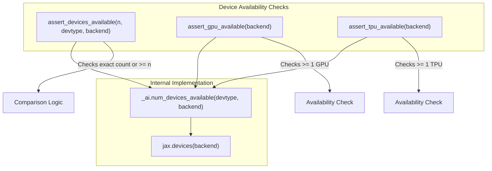
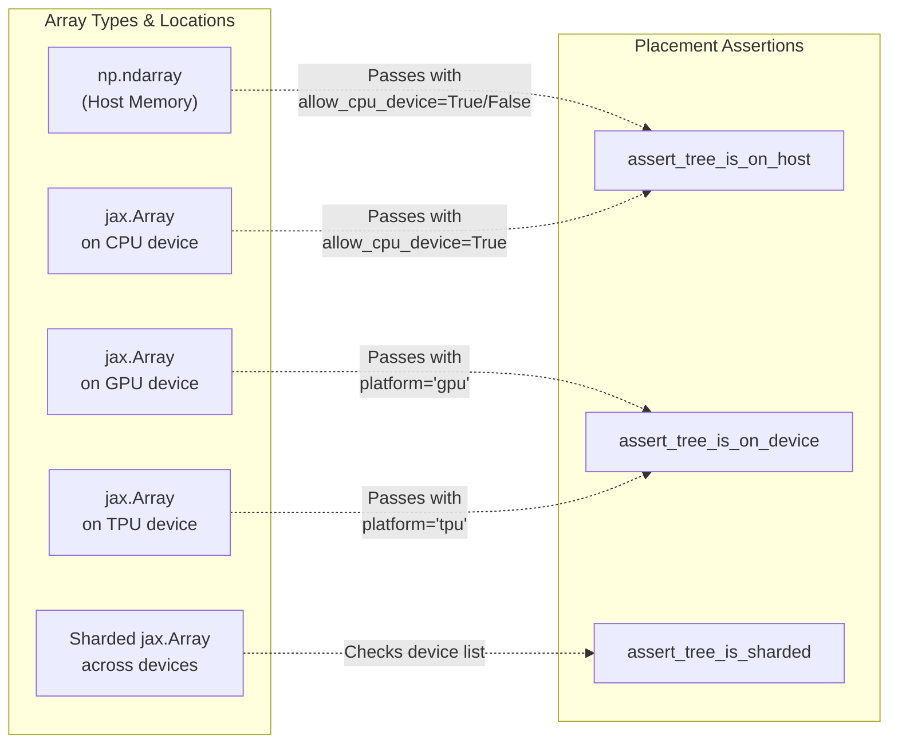
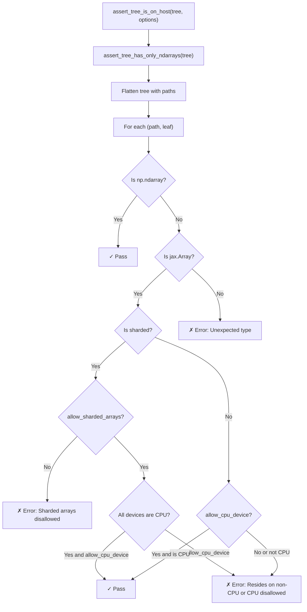
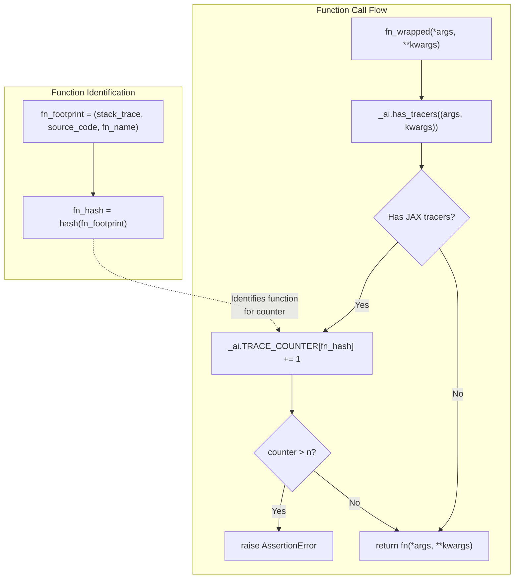

<!-- source: DeepWiki mcp.deepwiki.com · repo google-deepmind/chex · page 3.4 Device and JAX-Specific Assertions · fetched 2026-10-26 -->

# Device and JAX-Specific Assertions

<details>
<summary>Relevant source files</summary>

The following files were used as context for generating this wiki page:

- [chex/_src/asserts.py](chex/_src/asserts.py)
- [chex/_src/asserts_test.py](chex/_src/asserts_test.py)
- [chex/_src/fake.py](chex/_src/fake.py)
- [chex/_src/fake_test.py](chex/_src/fake_test.py)

</details>


This page documents Chex's assertions for checking JAX-specific runtime conditions: device availability, device placement of arrays, and function tracing behavior. These assertions help ensure code runs correctly across different hardware configurations and catches performance issues caused by excessive recompilation.

For general array assertions like shape and type checking, see [Static Assertions](#3.1). For assertions that check concrete array values, see [Value Assertions](#3.2). For tree-level assertions, see [Tree Assertions](#3.3).

## Overview

Device and JAX-specific assertions fall into three categories:

| Category | Assertions | Purpose |
|----------|-----------|---------|
| **Device Availability** | `assert_devices_available`<br/>`assert_gpu_available`<br/>`assert_tpu_available` | Check that required hardware is present |
| **Device Placement** | `assert_tree_is_on_host`<br/>`assert_tree_is_on_device`<br/>`assert_tree_is_sharded` | Verify arrays reside on expected devices |
| **Tracing Control** | `assert_max_traces`<br/>`clear_trace_counter` | Detect excessive JAX recompilation |

All device availability and placement assertions are static (decorated with `@_static_assertion`), meaning they work in all JAX contexts including inside JIT-compiled and pmapped functions. The tracing assertion `assert_max_traces` operates by wrapping functions and monitoring tracer arguments.

**Sources:** [chex/_src/asserts.py:40-44](), [chex/_src/asserts.py:164-217](), [chex/_src/asserts.py:78-162]()

## Device Availability Assertions

### Purpose and Use Cases

Device availability assertions verify that the runtime environment has the required hardware before executing code. This is essential for:

- **Testing:** Skip tests on machines without GPUs/TPUs
- **Production:** Fail fast with clear errors if hardware requirements aren't met
- **Development:** Document hardware dependencies explicitly



**Sources:** [chex/_src/asserts.py:164-217]()

### assert_devices_available

Checks that a specific number of devices of a given type are available.

```python
def assert_devices_available(
    n: int,
    devtype: str,  # 'cpu', 'gpu', or 'tpu'
    backend: Optional[str] = None,
    not_less_than: bool = False
) -> None
```

**Parameters:**
- `n`: Required number of devices
- `devtype`: Device type string: `'cpu'`, `'gpu'`, or `'tpu'`
- `backend`: Optional backend specification (uses JAX default if None)
- `not_less_than`: If True, checks `>= n` instead of `== n`

**Example Usage:**

```python
# Require exactly 8 TPUs
chex.assert_devices_available(8, 'tpu')

# Require at least 2 GPUs
chex.assert_devices_available(2, 'gpu', not_less_than=True)

# Check CPU devices on specific backend
chex.assert_devices_available(4, 'cpu', backend='cpu')
```

**Error Messages:**
- Exact match fails: `"No {n} {DEVTYPE}s available in {devices}"`
- Not less than fails: `"Only {n_available} < {n} {DEVTYPE}s available in {devices}"`

**Sources:** [chex/_src/asserts.py:164-189]()

### assert_gpu_available

Convenience function that checks for at least one GPU device.

```python
def assert_gpu_available(backend: Optional[str] = None) -> None
```

Equivalent to `assert_devices_available(1, 'gpu', backend, not_less_than=True)`.

**Example:**
```python
chex.assert_gpu_available()  # Skip test if no GPU
```

**Sources:** [chex/_src/asserts.py:205-217]()

### assert_tpu_available

Convenience function that checks for at least one TPU device.

```python
def assert_tpu_available(backend: Optional[str] = None) -> None
```

Equivalent to `assert_devices_available(1, 'tpu', backend, not_less_than=True)`.

**Example:**
```python
chex.assert_tpu_available()  # Fail if running on non-TPU machine
```

**Sources:** [chex/_src/asserts.py:191-203]()

## Device Placement Assertions

### Overview

Device placement assertions verify where array data physically resides in memory. In JAX, arrays can be:
- **Host arrays:** NumPy arrays in CPU RAM
- **Device arrays:** JAX arrays on CPU/GPU/TPU devices
- **Sharded arrays:** JAX arrays distributed across multiple devices



**Sources:** [chex/_src/asserts.py:1076-1260]()

### assert_tree_is_on_host

Verifies all arrays in a tree reside in host memory (CPU RAM).

```python
def assert_tree_is_on_host(
    tree: ArrayTree,
    *,
    allow_cpu_device: bool = True,
    allow_sharded_arrays: bool = False,
) -> None
```

**Parameters:**
- `tree`: PyTree to check (all leaves must be ndarrays)
- `allow_cpu_device`: Whether to accept JAX arrays on CPU devices (vs. only NumPy arrays)
- `allow_sharded_arrays`: Whether to accept sharded arrays (only if on CPU devices and `allow_cpu_device=True`)

**Behavior:**

| Array Type | `allow_cpu_device=True` | `allow_cpu_device=False` |
|------------|------------------------|--------------------------|
| `np.ndarray` | ✓ Pass | ✓ Pass |
| JAX array on CPU | ✓ Pass | ✗ Fail |
| JAX array on GPU/TPU | ✗ Fail | ✗ Fail |
| Sharded on CPUs | ✓ Pass (if `allow_sharded_arrays=True`) | ✗ Fail |
| Sharded on GPUs/TPUs | ✗ Fail | ✗ Fail |

**Example Usage:**

```python
# Check that model weights are in host memory
params = {'w': np.zeros((10, 10)), 'b': np.zeros(10)}
chex.assert_tree_is_on_host(params)

# Require pure NumPy arrays, reject CPU device arrays
cpu_array = jax.device_put(np.ones(5), jax.devices('cpu')[0])
chex.assert_tree_is_on_host({'x': cpu_array}, allow_cpu_device=False)
# AssertionError: Tree leaf 'x' resides on CPU_0 (CPU devices are disallowed)
```

**Internal Implementation Flow:**



**Sources:** [chex/_src/asserts.py:1076-1148](), [chex/_src/asserts_test.py:1170-1240]()

### assert_tree_is_on_device

Verifies all arrays in a tree reside on device memory (GPU/TPU HBM).

```python
def assert_tree_is_on_device(
    tree: ArrayTree,
    *,
    platform: Union[Sequence[str], str] = ("gpu", "tpu"),
    device: Optional[pytypes.Device] = None
) -> None
```

**Parameters:**
- `tree`: PyTree to check
- `platform`: Expected platform(s): `'cpu'`, `'gpu'`, `'tpu'`, or list of platforms
- `device`: Optional specific device; if provided, arrays must be on this exact device

**Behavior:**
- Disallows sharded arrays
- If `device` is specified, checks exact device match
- If only `platform` specified, checks platform but allows any device on that platform

**Example Usage:**

```python
# Ensure computation happens on GPU
gpu_array = jax.device_put(np.ones(100), jax.devices('gpu')[0])
chex.assert_tree_is_on_device({'x': gpu_array}, platform='gpu')

# Require specific device
tpu_0 = jax.devices('tpu')[0]
tpu_array = jax.device_put(np.ones(100), tpu_0)
chex.assert_tree_is_on_device({'x': tpu_array}, device=tpu_0)

# Fail: array is sharded
sharded = jax.device_put_sharded([np.ones(10), np.ones(10)], jax.devices()[:2])
chex.assert_tree_is_on_device({'x': sharded})
# AssertionError: Tree leaf 'x' is a ShardedDeviceArray which are disallowed
```

**Sources:** [chex/_src/asserts.py:1150-1212](), [chex/_src/asserts_test.py:1241-1300]()

### assert_tree_is_sharded

Verifies all arrays in a tree are sharded across specified devices.

```python
def assert_tree_is_sharded(
    tree: ArrayTree,
    *,
    devices: Sequence[pytypes.Device]
) -> None
```

**Parameters:**
- `tree`: PyTree to check
- `devices`: Ordered sequence of devices arrays should be sharded across

**Example Usage:**

```python
# Verify data parallel setup
devices = jax.devices()[:8]
data = jax.device_put_sharded(
    [np.ones((32, 10)) for _ in range(8)],
    devices
)
chex.assert_tree_is_sharded({'batch': data}, devices=devices)
```

**Implementation Details:**
- Checks `isinstance(leaf, jax.Array)` and presence of sharding
- Extracts devices from `leaf.addressable_shards`
- Compares as ordered tuple: `tuple(shard.device for shard in leaf.addressable_shards) == tuple(devices)`

**Sources:** [chex/_src/asserts.py:1214-1260]()

## JAX Tracing Assertions

### The Retracing Problem

JAX compiles functions when they're first called with a particular input structure. If the structure changes (different array shapes, different tree structures), JAX must retrace and recompile. Excessive retracing causes:

1. **Performance degradation:** Compilation time dominates runtime
2. **Memory leaks:** Each compilation stores a cached version
3. **Silent failures:** Performance issues are hard to detect

**Common Causes:**
- Creating JIT functions inside loops
- Varying input shapes
- Changing tree structures
- Dynamic control flow

### assert_max_traces

The `assert_max_traces` decorator detects retracing by counting how many times a function receives tracer arguments (indicating JAX is tracing it).

```python
def assert_max_traces(
    fn: Optional[Union[Callable[..., Any], int]] = None,
    n: Optional[Union[Callable[..., Any], int]] = None
) -> Callable
```

**Parameters:**
- `fn`: Function to wrap (must not be already transformed with jit/pmap/vmap)
- `n`: Maximum allowed number of traces

**Usage Patterns:**

```python
# Pattern 1: Decorator with argument
@jax.jit
@chex.assert_max_traces(n=1)
def compute(x, y):
    return x + y

# Pattern 2: Decorator without parentheses (defaults to n=0)
@jax.jit
@chex.assert_max_traces
def compute_no_retrace(x):
    return x * 2

# Pattern 3: Function call
def my_fn(x):
    return x + 1
monitored_fn = chex.assert_max_traces(my_fn, n=2)
jit_monitored = jax.jit(monitored_fn)
```

**Tracing Detection Mechanism:**



**Sources:** [chex/_src/asserts.py:78-162]()

### Decorator Ordering

**Critical Rule:** `@assert_max_traces` must wrap the function **before** JAX transformations.

```python
# ✓ CORRECT
@jax.jit
@chex.assert_max_traces(n=1)
def good(x):
    return x + 1

# ✗ WRONG - raises ValueError
@chex.assert_max_traces(n=1)
@jax.jit
def bad(x):
    return x + 1
# ValueError: @assert_max_traces must not wrap JAX-transformed function
```

**Rationale:** The wrapper needs to see the raw function to detect when tracers are passed to it. If `@assert_max_traces` wraps an already-transformed function, it receives the transformed function's output, not the original function's tracer inputs.

**Sources:** [chex/_src/asserts.py:127-132](), [chex/_src/asserts_test.py:165-190]()

### Common Pitfall: Functions Defined Inside Loops

A frequent cause of excessive retracing is defining JIT functions inside loops or other functions that are called multiple times:

```python
# ✗ ANTI-PATTERN
def outer_fn(x):
    @jax.jit
    @chex.assert_max_traces(n=3)
    def inner_fn(y):
        return y.sum()
    return inner_fn(2 * x)

outer_fn(1)  # Trace 1
outer_fn(2)  # Trace 2  
outer_fn(3)  # Trace 3
outer_fn(4)  # AssertionError: Function 'inner_fn' is traced > 3 times!
```

**Why this fails:** Each call to `outer_fn` creates a **new** `inner_fn` object with different identity, so JAX must retrace it every time.

**Solution:** Move nested functions to module level:

```python
# ✓ CORRECT
@jax.jit
@chex.assert_max_traces(n=1)
def inner_fn(y):
    return y.sum()

def outer_fn(x):
    return inner_fn(2 * x)
```

**Sources:** [chex/_src/asserts.py:148-157](), [chex/_src/asserts_test.py:192-220]()

### clear_trace_counter

Resets the global trace counter. Essential for test isolation, especially with parameterized tests.

```python
def clear_trace_counter() -> None
```

**Usage in Tests:**

```python
class MyTest(parameterized.TestCase):
    def setUp(self):
        super().setUp()
        chex.clear_trace_counter()  # Isolate each test case
    
    @parameterized.parameters(1, 2, 3)
    def test_with_max_traces(self, param):
        @jax.jit
        @chex.assert_max_traces(n=1)
        def fn(x):
            return x + param
        
        fn(jnp.zeros(10))  # Each parameter gets its own clean counter
```

**Sources:** [chex/_src/asserts.py:69-76](), [chex/_src/asserts_test.py:70-72]()

### Function Identity and Footprinting

The trace counter uses a "footprint" to identify functions uniquely:

```python
fn_footprint = (
    tuple(frame.name for frame in traceback.extract_stack()[:-1]) +  # Call stack
    (inspect.getsource(fn), fn.__name__)  # Source code + name
)
fn_hash = hash(fn_footprint)
```

This approach:
- **Distinguishes:** Different functions even with the same name
- **Persists:** Across test runs in the same process (unless `clear_trace_counter` is called)
- **Handles:** Functions in loops (each instantiation has different call stack)

**Sources:** [chex/_src/asserts.py:137-141]()

## Multi-Device Testing with set_n_cpu_devices

While not strictly an assertion, `set_n_cpu_devices` from the `fake` module enables testing device placement and sharding assertions on single-device machines.

```python
def set_n_cpu_devices(n: Optional[int] = None) -> None
```

**Purpose:** Forces JAX to treat multiple CPU threads as separate devices, enabling:
- Testing `jax.pmap` on laptops
- Testing sharding logic without GPUs/TPUs
- CI/CD testing of multi-device code

**Usage:**

```python
# In test setup (before any JAX operations)
chex.set_n_cpu_devices(8)

# Now can test multi-device code
devices = jax.devices()  # Returns 8 CPU devices
assert len(devices) == 8

# Test sharding
sharded_data = jax.device_put_sharded(
    [np.ones(10) for _ in range(8)],
    devices
)
chex.assert_tree_is_sharded({'x': sharded_data}, devices=devices)
```

**Critical Timing:** Must be called **before** any JAX operation initializes the XLA backend. Once initialized, devices cannot be changed.

```python
# ✓ CORRECT
chex.set_n_cpu_devices(4)
jax.devices()  # OK

# ✗ WRONG
jax.devices()  # Backend initialized
chex.set_n_cpu_devices(4)  # RuntimeError!
```

**Implementation:** Sets the `XLA_FLAGS` environment variable with `--xla_force_host_platform_device_count={n}`.

**Sources:** [chex/_src/fake.py:54-83](), [chex/_src/fake_test.py:32-34]()

## Summary Table

| Assertion | Category | Works in JIT? | Primary Use Case |
|-----------|----------|---------------|------------------|
| `assert_devices_available` | Device Availability | ✓ | Check hardware requirements |
| `assert_gpu_available` | Device Availability | ✓ | Require GPU presence |
| `assert_tpu_available` | Device Availability | ✓ | Require TPU presence |
| `assert_tree_is_on_host` | Device Placement | ✓ | Verify host memory placement |
| `assert_tree_is_on_device` | Device Placement | ✓ | Verify device memory placement |
| `assert_tree_is_sharded` | Device Placement | ✓ | Verify sharding configuration |
| `assert_max_traces` | Tracing Control | ✗ (decorator) | Detect excessive recompilation |
| `clear_trace_counter` | Tracing Control | N/A | Reset trace counts for testing |

**Sources:** [chex/_src/asserts.py:40-44](), [chex/_src/asserts.py:164-1260]()

---

