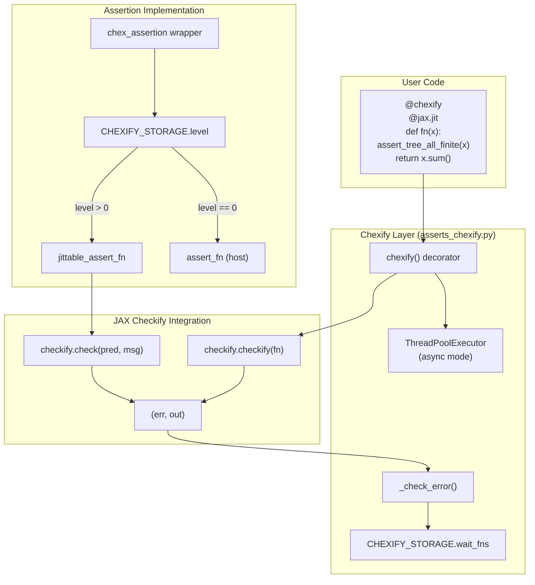
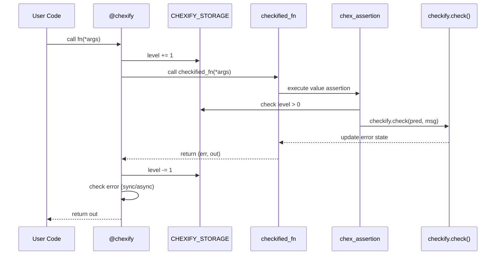
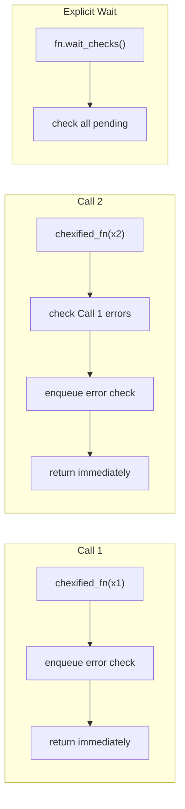
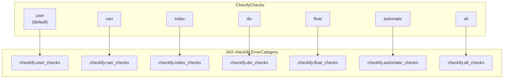
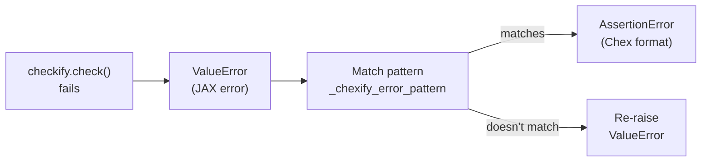

<!-- source: DeepWiki mcp.deepwiki.com · repo google-deepmind/chex · page 3.5 Chexify: Assertions in JIT-Compiled Code · fetched 2026-10-26 -->

# Chexify: Assertions in JIT-Compiled Code

<details>
<summary>Relevant source files</summary>

The following files were used as context for generating this wiki page:

- [chex/_src/asserts.py](chex/_src/asserts.py)
- [chex/_src/asserts_chexify.py](chex/_src/asserts_chexify.py)
- [chex/_src/asserts_chexify_test.py](chex/_src/asserts_chexify_test.py)
- [chex/_src/asserts_internal.py](chex/_src/asserts_internal.py)
- [chex/_src/asserts_internal_test.py](chex/_src/asserts_internal_test.py)

</details>


This page explains how the `@chexify` decorator enables value assertions inside JAX-transformed functions (jit, pmap, vmap). Value assertions inspect concrete array values, which are unavailable during JAX tracing. For static assertions that check only metadata (shape, rank, dtype), see [Static Assertions](#3.1). For the internal implementation details of the assertion system, see [Assertion Internals](#3.6).

---

## Overview

JAX transformations like `jax.jit` and `jax.pmap` trace functions to compile them, replacing concrete array values with abstract tracers. This prevents value assertions like `assert_tree_all_finite` from executing, as they require concrete values to check. The `@chexify` decorator solves this by integrating with JAX's `checkify` transformation, which functionalizes assertions so they can be compiled into the traced computation.

**Key Components:**
- **chexify decorator**: Wraps transformed functions to enable value assertions
- **checkify integration**: Uses JAX's checkification to make assertions compilable
- **ChexifyChecks**: Configurable error categories (user, nan, div, index, float)
- **Async/sync modes**: Control when errors are checked

Sources: [chex/_src/asserts_chexify.py:89-163]()

---

## The Problem: Value Assertions in Traced Code

### Static vs Value Assertions

Chex distinguishes between two types of assertions:

| Assertion Type | Examples | Requires Concrete Values | Works in JIT |
|---------------|----------|--------------------------|--------------|
| **Static** | `assert_shape`, `assert_rank`, `assert_type` | No (only metadata) | Yes, without @chexify |
| **Value** | `assert_tree_all_finite`, `assert_trees_all_equal`, `assert_trees_all_close` | Yes (array contents) | Only with @chexify |

Static assertions are decorated with `@_static_assertion` and set `jittable_assert_fn=None`, while value assertions use `@_value_assertion` with a jittable predicate function.

Sources: [chex/_src/asserts.py:40-44](), [chex/_src/asserts_internal.py:202-296]()

### What Happens Without Chexify

When a value assertion is called inside a jitted function without `@chexify`, it detects tracers and raises a `RuntimeError`:

```
RuntimeError: Value assertions can only be called from functions wrapped 
with `@chex.chexify`. See the docs.
```

This check occurs at [chex/_src/asserts_internal.py:240-244]().

Sources: [chex/_src/asserts_internal.py:240-244](), [chex/_src/asserts_chexify_test.py:363-368]()

---

## How Chexify Works

### Architecture Diagram



Sources: [chex/_src/asserts_chexify.py:89-242](), [chex/_src/asserts_internal.py:202-296]()

### Execution Flow



Sources: [chex/_src/asserts_chexify.py:186-223](), [chex/_src/asserts_internal.py:232-276]()

### Key Mechanisms

1. **Level Tracking**: `CHEXIFY_STORAGE.level` tracks nesting depth. When `level > 0`, assertions use jittable predicates.

2. **Check Injection**: Value assertions temporarily replace `checkify.check` to inject custom error messages with stack traces and custom messages [chex/_src/asserts_internal.py:246-270]().

3. **Error Collection**: `checkify.checkify()` returns `(err, out)` where `err` contains all failed checks.

4. **Error Translation**: `_check_error()` converts JAX `ValueError` exceptions to formatted `AssertionError` messages [chex/_src/asserts_chexify.py:49-62]().

Sources: [chex/_src/asserts_chexify.py:49-62](), [chex/_src/asserts_internal.py:63-76](), [chex/_src/asserts_internal.py:232-276]()

---

## Using @chexify

### Basic Usage

The `@chexify` decorator must be applied on top of all JAX transformations:

```python
@chex.chexify
@jax.jit
def safe_log(x):
    chex.assert_tree_all_finite(x)
    return jnp.log(jnp.abs(x) + 1)

safe_log(jnp.ones(2))  # OK
safe_log(jnp.array([jnp.nan, 3]))  # Raises AssertionError
```

**Critical Rule**: `@chexify` must wrap the outermost function, not internal ones. Wrong ordering triggers `RuntimeError` [chex/_src/asserts_chexify.py:192-200]().

Sources: [chex/_src/asserts_chexify.py:89-163](), [chex/_src/asserts_chexify_test.py:208-222]()

### Correct Wrapping Patterns

| Pattern | Status | Reason |
|---------|--------|--------|
| `@chexify` `@jax.jit` `def fn()` | ✅ Correct | Chexify on top |
| `@chexify` `@jax.pmap` `def fn()` | ✅ Correct | Chexify on top |
| `@jax.jit` `@chexify` `def fn()` | ❌ Wrong | Chexify below jit |
| Nested `@chexify` | ❌ Wrong | Nesting disallowed |

Sources: [chex/_src/asserts_chexify.py:187-200](), [chex/_src/asserts_chexify_test.py:285-314]()

### Nested Transformations

For nested JIT calls, only chexify the outermost function:

```python
@chex.chexify
@jax.jit
def outer(x):
    # Inner jit is OK - it's called, not wrapped by @chexify
    inner_result = jax.jit(inner_fn)(x)
    chex.assert_tree_all_finite(inner_result)
    return inner_result

def inner_fn(x):
    chex.assert_tree_all_finite(x)  # This assertion works
    return jnp.square(x)
```

Sources: [chex/_src/asserts_chexify_test.py:498-523]()

---

## Async vs Synchronous Error Checking

### Comparison Table

| Mode | Parameter | When Errors Checked | Performance | Use Case |
|------|-----------|---------------------|-------------|----------|
| **Async** | `async_check=True` (default) | On next call or explicit wait | Fast, non-blocking | Production, performance-critical |
| **Sync** | `async_check=False` | Immediately | Slower, blocks | Development, debugging |

Sources: [chex/_src/asserts_chexify.py:91-92](), [chex/_src/asserts_chexify_test.py:140-176]()

### Asynchronous Mode

In async mode, error checking is deferred to avoid blocking on device-to-host transfers:



**Key Features:**
- Uses `ThreadPoolExecutor` with 1 thread per chexified function [chex/_src/asserts_chexify.py:178]()
- Errors checked with 30-minute timeout [chex/_src/asserts_chexify.py:168]()
- Completed futures checked on next call [chex/_src/asserts_chexify.py:203-205]()
- Uninspected errors caught at program exit [chex/_src/asserts_chexify.py:74-82]()

Sources: [chex/_src/asserts_chexify.py:168-178](), [chex/_src/asserts_chexify.py:202-218]()

### Waiting for Checks

Three ways to wait for async checks:

| Method | Scope | Code Location |
|--------|-------|---------------|
| `fn.wait_checks()` | Single function | [chex/_src/asserts_chexify.py:225-236]() |
| `chex.block_until_chexify_assertions_complete()` | All functions | [chex/_src/asserts_chexify.py:65-71]() |
| `atexit` handler | Automatic at exit | [chex/_src/asserts_chexify.py:74-82]() |

Sources: [chex/_src/asserts_chexify.py:65-71](), [chex/_src/asserts_chexify.py:225-236](), [chex/_src/asserts_chexify_test.py:166-175]()

### Synchronous Mode

In sync mode, errors are checked immediately after each call:

```python
@chex.chexify(async_check=False)
@jax.jit
def safe_fn(x):
    chex.assert_tree_all_finite(x)
    return x.sum()

# Error raised immediately
safe_fn(jnp.array([jnp.nan]))  # Raises AssertionError
```

Sources: [chex/_src/asserts_chexify.py:219-221](), [chex/_src/asserts_chexify_test.py:150-154]()

---

## Checkify Error Categories

### ChexifyChecks Enumeration

The `errors` parameter configures which types of runtime checks are enabled:



Sources: [chex/_src/asserts_chexify.py:31-42]()

### Error Category Details

| Category | Checks | Example |
|----------|--------|---------|
| `user` | Explicit `checkify.check()` calls (chex assertions) | `assert_tree_all_finite` |
| `nan` | NaN detection | Array operations producing NaN |
| `index` | Out-of-bounds indexing | `arr[10]` on length-2 array |
| `div` | Division by zero | `x / 0` |
| `float` | All floating-point errors (nan + div) | Combined float issues |
| `automatic` | All automatic checks (nan + index + div) | Runtime safety |
| `all` | Everything | Maximum checking |

Sources: [chex/_src/asserts_chexify.py:31-42]()

### Combining Error Categories

Use set operations to combine categories:

```python
# Check both user assertions and division by zero
@chex.chexify(
    errors=ChexifyChecks.user | ChexifyChecks.div
)
@jax.jit
def safe_divide(x, y):
    chex.assert_tree_all_finite(x)
    return x / y  # Also checks div-by-0
```

Sources: [chex/_src/asserts_chexify.py:92](), [chex/_src/asserts_chexify_test.py:243-268]()

### Practical Example

```python
@jax.jit
def compute(x, i, y):
    return x[i] / y

# Only user assertions (default)
compute_user = chex.chexify(compute)
compute_user(jnp.ones(2), 10, 2)  # OOB undetected ❌

# Check index + div errors
compute_safe = chex.chexify(
    compute,
    errors=ChexifyChecks.index | ChexifyChecks.div
)
compute_safe(jnp.ones(2), 10, 2)  # Raises JaxRuntimeError: out-of-bounds ✅
compute_safe(jnp.ones(2), 1, 0)   # Raises JaxRuntimeError: division by zero ✅
```

Sources: [chex/_src/asserts_chexify_test.py:224-268]()

---

## Error Messages and Debugging

### Error Message Format

Chexify error messages follow this structure:

```
[Chex] chexify assertion '{assertion_name}' failed: {detailed_message}
 Custom message: {custom_message}.
 [failed at: {file}:{line}]
```

Components:
- **Chex prefix**: `[Chex]` identifier
- **Assertion name**: Name from `chex_assertion` decorator
- **Detailed message**: From the jittable assert function
- **Custom message**: Optional user-provided context
- **Location**: File and line number of assertion callsite

Sources: [chex/_src/asserts_internal.py:134-136](), [chex/_src/asserts_internal.py:246-265]()

### Custom Messages

Add debugging context with `custom_message`:

```python
@chex.chexify
@jax.jit
def process(x, y):
    chex.assert_trees_all_equal(
        x, y,
        custom_message='Expected matching inputs',
    )
    return x + y
```

With format variables:

```python
@chex.chexify
@jax.jit
def process(x, y):
    total = sum(l.sum() for l in jax.tree_util.tree_leaves(x))
    chex.assert_trees_all_equal(
        x, y,
        custom_message='sum(x)={}',
        custom_message_format_vars=[total],
    )
    return x + y
```

Sources: [chex/_src/asserts_chexify_test.py:658-685](), [chex/_src/asserts_internal.py:252-256]()

### Error Type Conversion



The `_check_error()` function converts JAX's `ValueError` to formatted `AssertionError` for chex assertions, while preserving other checkify errors.

Sources: [chex/_src/asserts_chexify.py:44-62]()

### Debugging Tips

1. **Use sync mode for development**: `async_check=False` gives immediate feedback
2. **Add custom messages**: Provide context about what was being computed
3. **Run unjitted version**: For detailed tensor values, run without JIT
4. **Check stack traces**: Error messages include callsite location
5. **Use wait_checks()**: Ensure all async errors are surfaced

Sources: [chex/_src/asserts_chexify.py:121-127]()

---

## Advanced Usage Patterns

### Threading Support

Chexify works correctly in threaded contexts with thread-local storage:

```python
def run_in_thread():
    @chex.chexify
    @jax.jit
    def fn(x):
        chex.assert_tree_all_finite(x)
        return x.sum()
    
    return fn(jnp.ones(5))

thread = threading.Thread(target=run_in_thread)
thread.start()
thread.join()
```

Thread safety provided by `_ChexifyStorage(threading.local)` [chex/_src/asserts_internal.py:63-66]().

Sources: [chex/_src/asserts_internal.py:63-76](), [chex/_src/asserts_chexify_test.py:423-442]()

### Partial Functions

Chexify supports `functools.partial`:

```python
def fn(x, y):
    chex.assert_trees_all_equal(x, y)
    return x + y

partial_fn = functools.partial(fn, y=jnp.array([1]))
chexified_fn = chex.chexify(partial_fn)
chexified_fn(jnp.array([1]))  # OK
```

Sources: [chex/_src/asserts_chexify.py:171-174](), [chex/_src/asserts_chexify_test.py:269-284]()

### Pmap and Vmap

Chexify works with all JAX transformations:

```python
# With pmap
@chex.chexify
@jax.pmap
def pmapped_fn(x):
    chex.assert_tree_all_finite(x)
    return jax.lax.pmean(x, axis_name='i')

# With vmap
@chex.chexify
@jax.jit
@jax.vmap
def vmapped_fn(x):
    chex.assert_tree_all_finite(x)
    return x.sum()
```

Sources: [chex/_src/asserts_chexify_test.py:525-548](), [chex/_src/asserts_chexify_test.py:550-573]()

---

## Restrictions and Best Practices

### Ordering Requirements

```mermaid
graph TB
    subgraph "Correct Order ✅"
        C1["@chex.chexify"]
        C2["@jax.jit/@jax.pmap"]
        C3["def fn()"]
        C1 --> C2 --> C3
    end
    
    subgraph "Wrong Order ❌"
        W1["@jax.jit"]
        W2["@chex.chexify"]
        W3["def fn()"]
        W1 --> W2 --> W3
        WERR["RuntimeError: must be<br/>applied on top"]
        W3 -.-> WERR
    end
    
    subgraph "Nested Chexify ❌"
        N1["@chex.chexify (outer)"]
        N2["def outer()"]
        N3["@chex.chexify (inner)"]
        N4["def inner()"]
        N1 --> N2 --> N3 --> N4
        NERR["RuntimeError: Nested<br/>wrapping disallowed"]
        N4 -.-> NERR
    end
```



Sources: [chex/_src/asserts_chexify.py:187-200](), [chex/_src/asserts_chexify_test.py:119-138]()

### Key Restrictions

1. **No nested @chexify**: Apply only to outermost function [chex/_src/asserts_chexify.py:187-190]()
2. **Must wrap transformations**: `@chexify` goes above `@jax.jit` [chex/_src/asserts_chexify.py:192-200]()
3. **Cannot chexify already-traced**: Don't apply to functions that already have tracers [chex/_src/asserts_chexify.py:192-200]()
4. **One chexify per function**: Multiple chexifications are not allowed

Sources: [chex/_src/asserts_chexify.py:187-200]()

### Performance Considerations

| Aspect | Impact | Mitigation |
|--------|--------|------------|
| Compilation time | Increases due to checkification | Accept for safety-critical code |
| Runtime overhead | Minimal when assertions pass | Use `async_check=True` |
| Memory usage | Additional error state storage | Usually negligible |
| Async dispatch delay | Blocks on `jax.device_get(err)` | Only in async mode on error |

See JAX checkify limitations: https://jax.readthedocs.io/en/latest/debugging/checkify_guide.html#limitations

Sources: [chex/_src/asserts_chexify.py:138-139]()

### Best Practices

1. **Default to async mode**: Use `async_check=True` in production
2. **Chexify sparingly**: Only wrap outermost functions that need value assertions
3. **Use static assertions when possible**: They work without chexify and are faster
4. **Call wait_checks()**: Explicitly wait before critical operations
5. **Test with sync mode**: Use `async_check=False` during development
6. **Combine error categories**: Enable relevant automatic checks (index, div)

Sources: [chex/_src/asserts_chexify.py:89-163]()

---

## Summary

The `@chexify` decorator enables value assertions in JIT-compiled JAX code by:
- Integrating with JAX's `checkify` transformation
- Providing async and sync error checking modes
- Supporting configurable error categories beyond user assertions
- Maintaining detailed error messages with stack traces
- Working seamlessly with all JAX transformations (jit, pmap, vmap)

For more information on specific assertion types, see:
- [Value Assertions](#3.2) - Concrete value checks
- [Tree Assertions](#3.3) - PyTree validation
- [Assertion Internals](#3.6) - Implementation details

Sources: [chex/_src/asserts_chexify.py:1-248](), [chex/_src/asserts_internal.py:202-296]()

---

