<!-- source: DeepWiki mcp.deepwiki.com · repo google-deepmind/chex · page 3.6 Assertion Internals · fetched 2026-10-26 -->

# Assertion Internals

<details>
<summary>Relevant source files</summary>

The following files were used as context for generating this wiki page:

- [chex/_src/asserts.py](chex/_src/asserts.py)
- [chex/_src/asserts_internal.py](chex/_src/asserts_internal.py)
- [chex/_src/asserts_internal_test.py](chex/_src/asserts_internal_test.py)
- [chex/_src/asserts_test.py](chex/_src/asserts_test.py)

</details>


This page documents the internal implementation of Chex's assertion system, including the core decorator infrastructure, global state management, tracer detection, and error formatting mechanisms. For usage of assertions, see:
- [Static Assertions](#3.1) - Shape, rank, type checking
- [Value Assertions](#3.2) - Concrete value inspections
- [Chexify: Assertions in JIT-Compiled Code](#3.5) - Using assertions inside `@jax.jit`

The assertion internals provide the foundation that makes all Chex assertions work consistently across different execution contexts (host Python, JIT-compiled, pmap, etc.).

---

## Core Architecture

The assertion system is built around two key components: the `@chex_assertion` decorator that wraps all assertions, and a set of global state variables that control assertion behavior.

### High-Level Component Structure

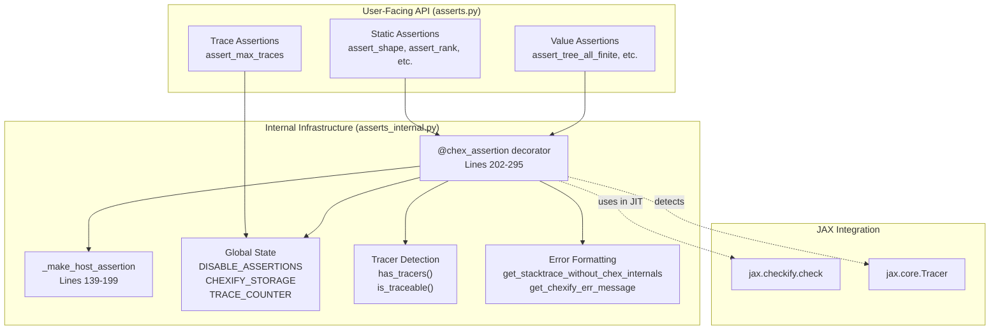

**Sources:** [chex/_src/asserts_internal.py:1-480](), [chex/_src/asserts.py:41-44]()

---

## The @chex_assertion Decorator

The `@chex_assertion` decorator is the central mechanism that wraps all Chex assertions. It provides unified behavior for error handling, custom messages, and context-aware execution (host vs. JIT).

### Function Signature and Types

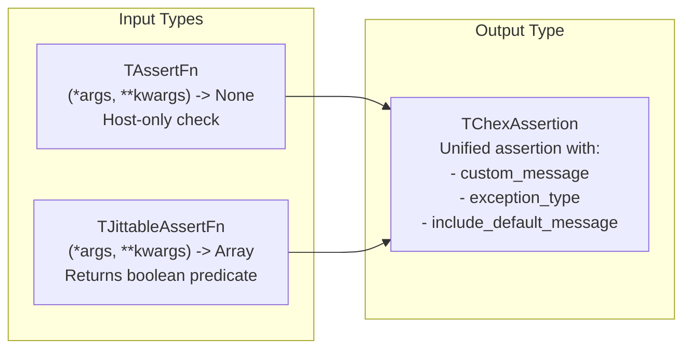

**Sources:** [chex/_src/asserts_internal.py:46-56](), [chex/_src/asserts_internal.py:202-225]()

### Execution Flow

The decorator chooses between two execution paths based on whether tracers are present in the arguments:

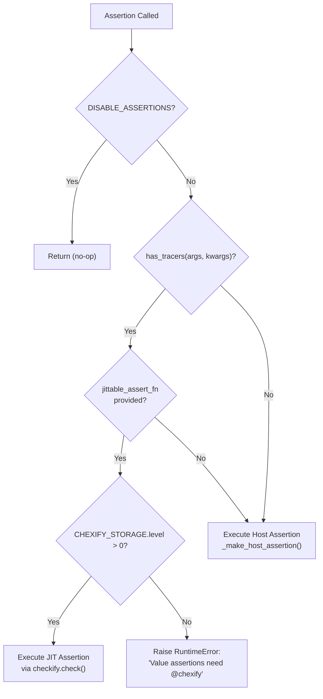

**Sources:** [chex/_src/asserts_internal.py:232-291]()

### Key Implementation Details

| Aspect | Implementation | Location |
|--------|---------------|----------|
| Tracer Detection | `has_tracers((args, kwargs))` | [asserts_internal.py:240]() |
| Global Disable | Checks `DISABLE_ASSERTIONS` flag | [asserts_internal.py:238-239]() |
| Error Wrapping | Injects `ERR_PREFIX` and stacktrace | [asserts_internal.py:178-197]() |
| Custom Messages | Formatted via `custom_message_format_vars` | [asserts_internal.py:192-195]() |
| Chexify Integration | Mocks `checkify.check` during execution | [asserts_internal.py:247-270]() |

**Sources:** [chex/_src/asserts_internal.py:202-295]()

---

## Creating Static vs. Value Assertions

The distinction between static and value assertions is established at decoration time in `asserts.py`:

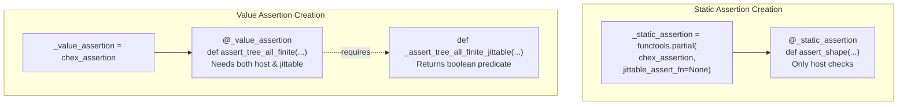

**Key distinction:**
- **Static assertions** have `jittable_assert_fn=None`, so they work in JIT but cannot check concrete values
- **Value assertions** provide both `assert_fn` and `jittable_assert_fn`, enabling value checks via `checkify`

**Sources:** [chex/_src/asserts.py:41-44](), [chex/_src/asserts_internal.py:218-220]()

---

## Global State Management

Chex maintains three global state variables that control assertion behavior:

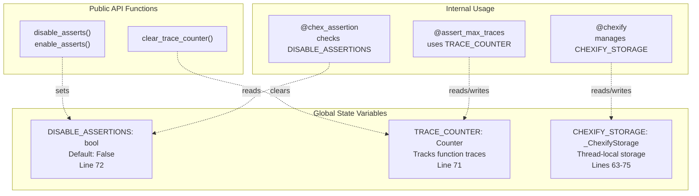

**Sources:** [chex/_src/asserts_internal.py:63-75](), [chex/_src/asserts.py:47-75]()

### _ChexifyStorage: Thread-Local State

The `_ChexifyStorage` class provides thread-safe storage for chexify-related state:

| Field | Type | Purpose |
|-------|------|---------|
| `wait_fns` | `List` | Accumulates async wait functions for error handling |
| `level` | `int` | Tracks nesting depth of `@chexify` decorators |

This enables proper detection of whether code is running inside a `@chexify` context and supports nested transformations.

**Sources:** [chex/_src/asserts_internal.py:63-66]()

### TRACE_COUNTER Usage

The `TRACE_COUNTER` is a `collections.Counter` that maps function hashes to trace counts:

```python
# Simplified from assert_max_traces implementation
fn_hash = hash(fn_footprint)
TRACE_COUNTER[fn_hash] += int(has_tracers_in_args)
if TRACE_COUNTER[fn_hash] > n:
    raise AssertionError(f"Function traced > {n} times!")
```

**Sources:** [chex/_src/asserts.py:137-157]()

---

## Tracer Detection

Chex provides two mechanisms to detect JAX tracing contexts:

### has_tracers: Detecting Active Tracers

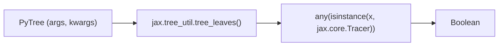

The `has_tracers` function inspects all leaves in a PyTree and returns `True` if any are `jax.core.Tracer` instances. This indicates that the code is currently being traced by JAX.

**Sources:** [chex/_src/asserts_internal.py:324-327]()

### is_traceable: Detecting Wrapped Functions

The `is_traceable` function determines if a function is wrapped with JAX transformations (`@jit`, `@pmap`, `@vmap`, etc.) by pattern-matching on:

| Pattern Type | Patterns | What It Detects |
|--------------|----------|-----------------|
| String tokens | `".reraise_with_filtered_traceback"`, `"CompiledFunction"`, `"pmap."`, `"PmapFunction"`, `"vmap."`, `"_python_pjit"`, `"_cpp_pjit"` | Function string representation |
| Type tokens | `"PmapFunction"`, `"PjitFunction"` | Type string representation |
| Attributes | `__wrapped__`, `__globals__["__name__"] == "jax.api"`, `"api_boundary"` | Wrapper metadata |

The function unwraps nested wrappers using `__wrapped__` and checks each level.

**Sources:** [chex/_src/asserts_internal.py:330-384]()

### Usage in assert_max_traces

The `@assert_max_traces` decorator uses both mechanisms:

1. **Pre-check with `is_traceable`**: Ensures the decorator wraps the function *before* JAX transformations
2. **Runtime check with `has_tracers`**: Counts actual traces based on tracer presence in arguments

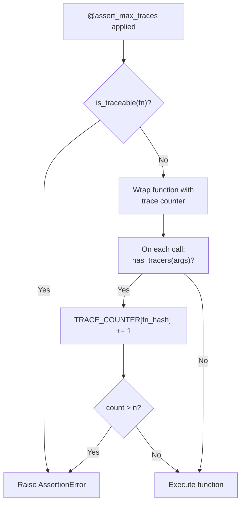

**Sources:** [chex/_src/asserts.py:128-161](), [chex/_src/asserts_internal.py:324-384]()

---

## Error Formatting and Message Construction

Chex provides sophisticated error message formatting to help users debug assertion failures.

### Error Message Structure

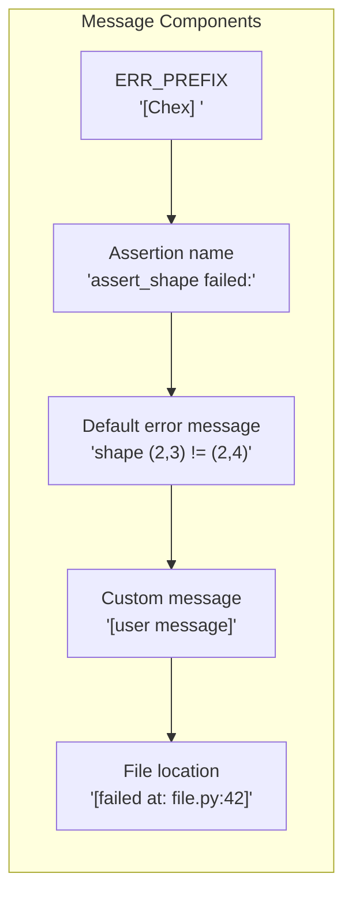

**Sources:** [chex/_src/asserts_internal.py:178-197]()

### Key Functions

| Function | Purpose | Location |
|----------|---------|----------|
| `get_err_regex(message)` | Creates regex for testing error messages | [asserts_internal.py:121-131]() |
| `get_chexify_err_message(name, msg)` | Constructs chexify-specific error prefix | [asserts_internal.py:134-136]() |
| `get_stacktrace_without_chex_internals()` | Filters stacktrace to show user code only | [asserts_internal.py:104-118]() |
| `format_tree_path(path)` | Formats PyTree paths as strings | [asserts_internal.py:298-299]() |
| `format_shape_matcher(shape)` | Formats shape matchers for display | [asserts_internal.py:302-303]() |

### Stacktrace Filtering

The `get_stacktrace_without_chex_internals` function removes Chex's internal frames from error stacktraces:

```python
# Simplified algorithm
stacktrace = list(traceback.extract_stack())
for i in reversed(range(len(stacktrace))):
    if "/chex/" not in stacktrace[i].filename or "_test.py" in stacktrace[i].filename:
        return stacktrace[:i+1]  # Return up to first non-chex frame
```

This ensures that error messages point to the user's code rather than Chex internals.

**Sources:** [chex/_src/asserts_internal.py:104-118]()

### Custom Message Integration

The `@chex_assertion` decorator supports custom messages through auxiliary kwargs:

| Kwarg | Type | Purpose |
|-------|------|---------|
| `custom_message` | `Optional[str]` | User-provided message to append |
| `custom_message_format_vars` | `Sequence[Any]` | Variables for `.format()` call |
| `include_default_message` | `bool` | Whether to include Chex's default message |
| `exception_type` | `Type[Exception]` | Exception class to raise (default: `AssertionError`) |

**Sources:** [chex/_src/asserts_internal.py:209-215](), [chex/_src/asserts_internal.py:232-237]()

---

## Host Assertion Wrapper

The `_make_host_assertion` function wraps assertion functions for host execution:

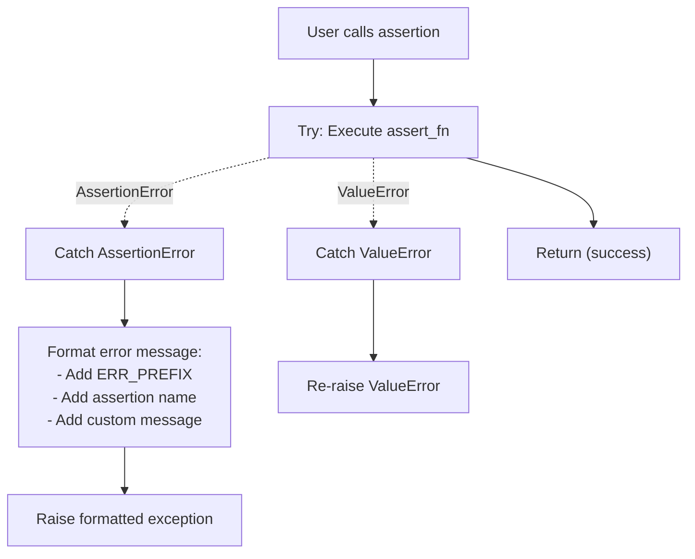

Key behaviors:
- **AssertionError**: Caught, formatted, and re-raised with Chex prefix and context
- **ValueError**: Re-raised as-is (used by some assertions for invalid arguments)
- **Nested assertions**: Only the outermost assertion name is included in the error message

**Sources:** [chex/_src/asserts_internal.py:139-199]()

---

## JIT-Compatible Assertion Execution

When tracers are detected and `jittable_assert_fn` is provided, Chex integrates with JAX's `checkify` system:

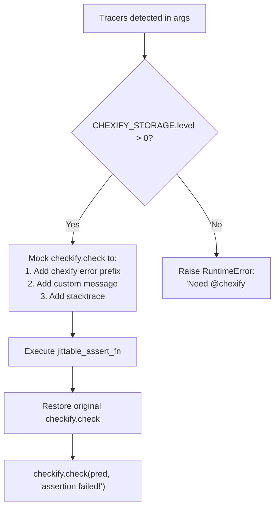

**Sources:** [chex/_src/asserts_internal.py:240-276]()

### Checkify Integration Details

The integration mocks `checkify.check` to inject additional context:

```python
# Simplified from actual implementation
original_check = checkify.check

def _check(pred, msg, *fmt_args, **fmt_kwargs):
    msg = get_chexify_err_message(name, msg)
    if custom_message:
        msg += f" Custom message: {custom_message}."
    stacktrace = get_stacktrace_without_chex_internals()
    msg += f" [failed at: {stacktrace[-1].filename}:{stacktrace[-1].lineno}]"
    original_check(pred, msg, *fmt_args, **fmt_kwargs)

checkify.check = _check
pred = jittable_assert_fn(*args, **kwargs)
checkify.check = original_check
```

**Sources:** [chex/_src/asserts_internal.py:247-270]()

---

## Tree Comparison Infrastructure

For tree assertions, Chex provides reusable comparison infrastructure:

### assert_trees_all_eq_comparator_jittable

This function enables JIT-compatible tree comparisons with custom equality functions:

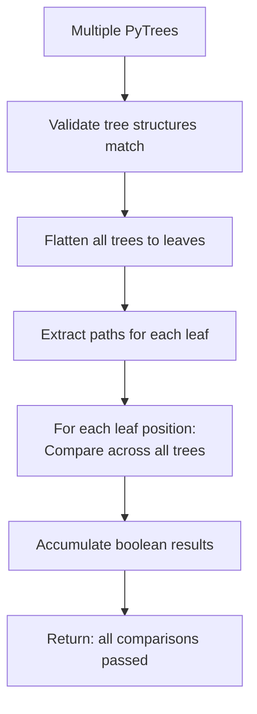

**Inputs:**
- `equality_comparator`: Custom comparison function `(leaf1, leaf2) -> bool`
- `error_msg_template`: Template for error messages
- `*trees`: Multiple trees to compare

**Output:** Boolean array indicating whether all comparisons passed

**Sources:** [chex/_src/asserts_internal.py:398-445]()

### Path Conversion

JAX and dm-tree use different path representations. Chex provides `convert_jax_path_to_dm_path` to translate:

| JAX Path Type | Converted To | Example |
|--------------|--------------|---------|
| `int` | `int` | Array index |
| `str` | `str` | Dict key (string) |
| `SequenceKey(idx=i)` | `int` | Sequence index |
| `DictKey(key=k)` | `Hashable` | Dict key (any type) |
| `FlattenedIndexKey(key=i)` | `int` | Flattened index |
| `GetAttrKey(name=n)` | `str` | Attribute name |

**Sources:** [chex/_src/asserts_internal.py:459-479]()

---

## Utility Functions

### Collection Validation

```python
def assert_collection_of_arrays(inputs: Sequence[pytypes.Array]):
    """Checks if inputs is a collection of arrays."""
    if not isinstance(inputs, collections.abc.Collection):
        raise ValueError(f"`inputs` is not a collection of arrays: {inputs}.")
```

Used by shape/rank assertions to validate inputs before processing.

**Sources:** [chex/_src/asserts_internal.py:78-81]()

### Array Type Conversion

```python
def jnp_to_np_array(arr: pytypes.Array) -> np.ndarray:
    """Converts jnp.ndarray to np.ndarray."""
    if getattr(arr, "dtype", None) == jnp.bfloat16:
        arr = arr.astype(jnp.float32)  # Numpy doesn't support bfloat16
    return jax.device_get(arr)
```

Handles the special case of bfloat16 arrays, which NumPy doesn't support natively.

**Sources:** [chex/_src/asserts_internal.py:84-89]()

### Device Utilities

```python
def num_devices_available(devtype: str, backend: Optional[str] = None) -> int:
    """Returns the number of available devices of the given type."""
    devtype = devtype.lower()
    return sum(d.platform == devtype for d in jax.devices(backend))
```

Used by device assertions like `assert_gpu_available` and `assert_tpu_available`.

**Sources:** [chex/_src/asserts_internal.py:306-314]()

---

## Type Definitions

The module defines several type aliases for clarity:

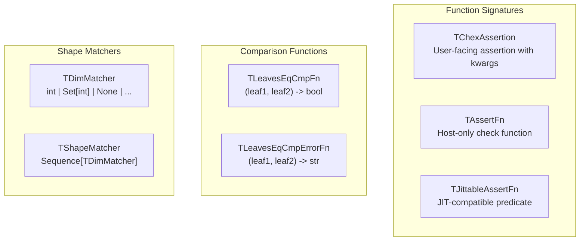

**Sources:** [chex/_src/asserts_internal.py:42-60]()

---

## Implementation Patterns

### Pattern 1: Decorator Application

```python
# Creating a static assertion
@_static_assertion
def assert_shape(inputs, expected_shapes):
    # Implementation that doesn't check values
    pass

# Creating a value assertion
@_value_assertion
def assert_tree_all_finite(tree):
    # Host implementation
    pass

def _assert_tree_all_finite_jittable(tree):
    # JIT-compatible implementation returning boolean
    return jnp.all(jnp.isfinite(...))
```

**Sources:** [chex/_src/asserts.py:41-44](), [chex/_src/asserts.py:164-189]()

### Pattern 2: Custom Error Messages

```python
# User code
chex.assert_shape(x, (2, 3), 
    custom_message="Expected input shape for layer {}", 
    custom_message_format_vars=["conv1"])

# Results in error:
# [Chex] Assertion assert_shape failed: input 0 has shape (2, 4) but expected (2, 3) 
#        [Expected input shape for layer conv1]
```

**Sources:** [chex/_src/asserts_internal.py:192-195]()

### Pattern 3: Conditional Execution

```python
# User can disable all assertions
chex.disable_asserts()
chex.assert_shape(x, (2, 3))  # No-op, doesn't execute

chex.enable_asserts()
chex.assert_shape(x, (2, 3))  # Executes normally
```

**Sources:** [chex/_src/asserts.py:47-57]()

---

## Testing Infrastructure

The assertion internals are thoroughly tested in `asserts_internal_test.py`:

| Test Class | Focus | Key Tests |
|------------|-------|-----------|
| `IsTraceableTest` | `is_traceable` function | Detection of `@jit`, `@pmap` wrappers |
| `ExceptionMessageFormatTest` | Error message formatting | Custom messages, exception types, nested assertions |
| `JitCompatibleTest` | JAX compatibility | Static vs value assertions in JIT contexts |

**Sources:** [chex/_src/asserts_internal_test.py:1-152]()

---

## Summary

The assertion internals provide a sophisticated infrastructure that:

1. **Unifies behavior** across all assertions via `@chex_assertion`
2. **Detects execution context** using tracer inspection and function introspection
3. **Provides clear error messages** with stacktrace filtering and custom message support
4. **Integrates with JAX** through `checkify` for JIT-compatible value checks
5. **Manages global state** for disabling assertions and tracking traces
6. **Supports tree operations** with reusable comparison infrastructure

This infrastructure enables Chex to provide over 40 assertion functions that work seamlessly across different JAX execution contexts while maintaining clear, actionable error messages.

---

