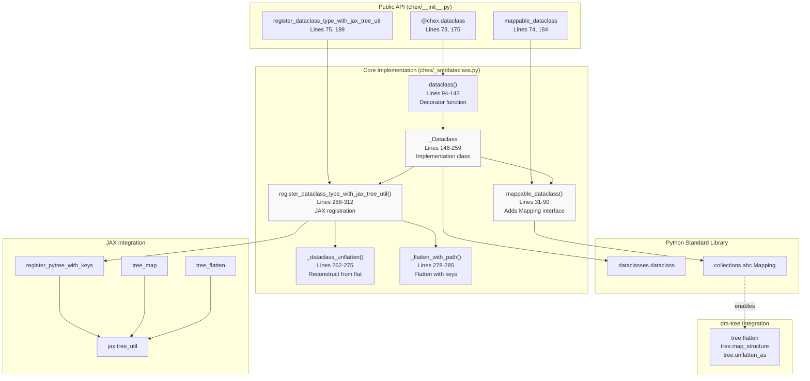
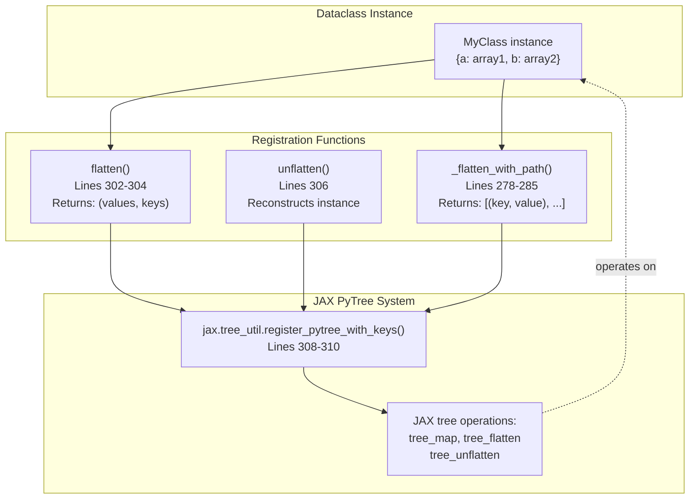

<!-- source: DeepWiki mcp.deepwiki.com · repo google-deepmind/chex · page 4 Dataclass System · fetched 2026-10-26 -->

# Dataclass System

<details>
<summary>Relevant source files</summary>

The following files were used as context for generating this wiki page:

- [chex/__init__.py](chex/__init__.py)
- [chex/_src/dataclass.py](chex/_src/dataclass.py)
- [chex/_src/dataclass_test.py](chex/_src/dataclass_test.py)

</details>


This document provides a comprehensive guide to Chex's dataclass system, which extends Python's standard dataclasses with JAX integration and enhanced functionality. The system automatically registers dataclasses as JAX PyTrees, optionally implements the `Mapping` interface for dm-tree compatibility, and provides utility methods for functional programming patterns.

For type definitions used with dataclasses, see [Type System (pytypes)](#5). For assertions on dataclass instances, see [Tree Assertions](#3.3).

**Scope**: This page covers the overall architecture, key components, and integration patterns. For detailed usage examples, see [Dataclass Basics](#4.1). For dm-tree integration specifics, see [Mappable Dataclasses and dm-tree Integration](#4.2). For advanced features like inheritance and serialization, see [Dataclass Advanced Features](#4.3).

## Purpose and Key Features

The Chex dataclass system solves three primary problems when using dataclasses with JAX:

1. **JAX PyTree Integration**: Automatically registers dataclasses so JAX transformations like `jax.tree_util.tree_map` and `jax.tree_util.tree_flatten` work correctly
2. **Functional Updates**: Provides a `replace` method for immutable (frozen) dataclasses
3. **dm-tree Compatibility**: Optionally implements `collections.abc.Mapping` interface so dataclasses work with dm-tree and TensorFlow nest utilities

The system wraps Python's standard `dataclasses.dataclass` decorator while preserving all standard functionality and adding JAX-specific enhancements.

**Sources**: [chex/_src/dataclass.py:1-15](), [chex/_src/dataclass.py:106-134]()

## System Architecture

### Component Overview



**Sources**: [chex/_src/dataclass.py:31-313](), [chex/__init__.py:73-75]()

### Decorator Flow and Transformations

```mermaid
graph LR
    subgraph "User Code"
        USER_CLASS["@chex.dataclass<br/>class MyClass:<br/>  field: int"]
    end
    
    subgraph "Transformation Pipeline"
        DATACLASS_WRAPPER["dataclass()<br/>Line 94"]
        DCLS_INSTANCE["_Dataclass.__call__()<br/>Lines 169-259"]
        STD_APPLY["dataclasses.dataclass()<br/>Lines 184-193"]
        MAPPABLE_APPLY["mappable_dataclass()<br/>Lines 202-203"]
        ADD_METHODS["Add utility methods:<br/>from_tuple, to_tuple<br/>replace<br/>Lines 205-213"]
        REGISTER_JAX["register_dataclass_type_with_jax_tree_util()<br/>Lines 236, 240, 249"]
        PATCH_INIT["Patch __init__<br/>Lines 247-250"]
        PATCH_STATE["Patch __setstate__<br/>Lines 238-241"]
    end
    
    subgraph "Output"
        ENHANCED_CLASS["Enhanced dataclass:<br/>- JAX PyTree registered<br/>- Mapping interface<br/>- Utility methods<br/>- Serialization hooks"]
    end
    
    USER_CLASS --> DATACLASS_WRAPPER
    DATACLASS_WRAPPER --> DCLS_INSTANCE
    DCLS_INSTANCE --> STD_APPLY
    STD_APPLY --> MAPPABLE_APPLY
    MAPPABLE_APPLY --> ADD_METHODS
    ADD_METHODS --> REGISTER_JAX
    REGISTER_JAX --> PATCH_INIT
    PATCH_INIT --> PATCH_STATE
    PATCH_STATE --> ENHANCED_CLASS
```



**Sources**: [chex/_src/dataclass.py:94-143](), [chex/_src/dataclass.py:169-259]()

## Core Components

### The `@chex.dataclass` Decorator

The main entry point is the `dataclass()` function at [chex/_src/dataclass.py:94-143](). It accepts the same parameters as Python's standard `dataclasses.dataclass`, plus one additional parameter:

| Parameter | Type | Default | Description |
|-----------|------|---------|-------------|
| `init` | bool | `True` | Generate `__init__` method |
| `repr` | bool | `True` | Generate `__repr__` method |
| `eq` | bool | `True` | Generate `__eq__` method |
| `order` | bool | `False` | Generate comparison methods |
| `unsafe_hash` | bool | `False` | Force generation of `__hash__` |
| `frozen` | bool | `False` | Make instances immutable |
| `kw_only` | bool | `False` | All fields keyword-only (Python ≥3.10) |
| `mappable_dataclass` | bool | `True` | Add `Mapping` interface |

The decorator can be used with or without arguments:

```python
# Without arguments
@chex.dataclass
class MyClass:
    field: int

# With arguments
@chex.dataclass(frozen=True, mappable_dataclass=False)
class ImmutableClass:
    value: float
```

**Sources**: [chex/_src/dataclass.py:94-143]()

### The `_Dataclass` Implementation Class

The actual transformation logic resides in the `_Dataclass` class at [chex/_src/dataclass.py:146-259](). When called, it:

1. **Validates inheritance**: Ensures non-frozen dataclasses don't inherit from frozen ones [chex/_src/dataclass.py:173-176]()
2. **Applies standard dataclass decorator**: Creates the base dataclass [chex/_src/dataclass.py:184-193]()
3. **Validates field names**: Checks for reserved names (`from_tuple`, `to_tuple`, `replace`) [chex/_src/dataclass.py:196-200]()
4. **Optionally applies mappable transformation**: If `mappable_dataclass=True` [chex/_src/dataclass.py:202-203]()
5. **Adds utility methods**: `from_tuple`, `to_tuple`, `replace` [chex/_src/dataclass.py:205-213]()
6. **Registers with JAX**: Multiple registration points for robustness [chex/_src/dataclass.py:235-249]()
7. **Patches lifecycle methods**: `__init__` and `__setstate__` for registration [chex/_src/dataclass.py:238-257]()

**Sources**: [chex/_src/dataclass.py:146-259]()

## JAX PyTree Registration

### Registration Mechanism

The `register_dataclass_type_with_jax_tree_util()` function at [chex/_src/dataclass.py:288-312]() integrates dataclasses with JAX's PyTree system. This enables JAX transformations to traverse dataclass fields automatically.



**Sources**: [chex/_src/dataclass.py:288-312](), [chex/_src/dataclass.py:278-285](), [chex/_src/dataclass.py:262-275]()

### Flatten and Unflatten Operations

The flatten operation at [chex/_src/dataclass.py:302-304]() extracts field values and keys:

```python
def flatten(d):
    if d.__dict__:
        return tuple(zip(*sorted(d.__dict__.items())))[::-1]
    return ((), ())
```

This returns `(values_tuple, keys_tuple)` where:
- `values_tuple`: The actual field values (JAX will traverse these)
- `keys_tuple`: Field names (metadata for reconstruction)

The unflatten operation at [chex/_src/dataclass.py:262-275]() reconstructs the dataclass:
- Creates new instance with `__new__` (bypasses `__init__`)
- Sets attributes directly with `object.__setattr__`
- Calls `__post_init__` if defined
- Preserves field order from `__dataclass_fields__`

**Sources**: [chex/_src/dataclass.py:262-275](), [chex/_src/dataclass.py:302-306]()

### Path-Based Flattening

The `_flatten_with_path()` function at [chex/_src/dataclass.py:278-285]() provides structured access to nested fields:

```python
def _flatten_with_path(dcls):
    path = []
    keys = []
    for k, v in sorted(dcls.__dict__.items()):
        keys.append(k)
        k = jax.tree_util.GetAttrKey(k)
        path.append((k, v))
    return path, tuple(keys)
```

This returns paths like `[(GetAttrKey('field_a'), value_a), ...]`, enabling JAX operations like `tree_map_with_path` to know the full path to each leaf.

**Sources**: [chex/_src/dataclass.py:278-285]()

## Mappable Dataclass Interface

### Purpose and Functionality

The `mappable_dataclass()` function at [chex/_src/dataclass.py:31-90]() transforms a dataclass to implement the `collections.abc.Mapping` interface. This makes the dataclass compatible with:

- **dm-tree library**: `tree.flatten()`, `tree.map_structure()`, `tree.unflatten_as()`
- **TensorFlow nest utilities**: `tf.nest.*` functions
- **Standard dict-like operations**: `keys()`, `values()`, `items()`, `__getitem__`, `__len__`, `__iter__`

**Sources**: [chex/_src/dataclass.py:31-44]()

### Mapping Interface Implementation

The function adds six methods to implement `collections.abc.Mapping`:

| Method | Implementation | Line Reference |
|--------|----------------|----------------|
| `__getitem__` | `lambda self, x: self.__dict__[x]` | [49]() |
| `__len__` | `lambda self: len(self.__dict__)` | [50]() |
| `__iter__` | `lambda self: iter(self.__dict__)` | [51]() |
| `keys` | `lambda self: self.__dict__.keys()` | [55]() |
| `values` | `lambda self: self.__dict__.values()` | [56]() |
| `items` | `lambda self: self.__dict__.items()` | [57]() |

The explicit `keys()`, `values()`, and `items()` overrides ensure clean visualization instead of showing full `repr(instance)`.

**Sources**: [chex/_src/dataclass.py:48-57]()

### Constructor Transformation

The mappable transformation changes the constructor to dict-style at [chex/_src/dataclass.py:59-79]():

**Before (standard dataclass)**:
```python
MyClass(value1, value2, kwarg=value3)  # Positional args allowed
```

**After (mappable dataclass)**:
```python
MyClass(field1=value1, field2=value2)  # Keywords only
MyClass({'field1': value1, 'field2': value2})  # Dict-style
MyClass(generator_expression)  # From iterables
```

This restriction is enforced at [chex/_src/dataclass.py:66-69]():
```python
if (orig_args and orig_kwargs) or len(orig_args) > 1:
    raise ValueError(
        "Mappable dataclass constructor doesn't support positional args."
        "(it has the same constructor as python dict)")
```

**Sources**: [chex/_src/dataclass.py:59-79]()

### Base Class Modification

At [chex/_src/dataclass.py:81-89](), the function modifies the class hierarchy:

```python
bases = tuple(b for b in cls.__bases__ if b != object)
cls = type(cls.__name__, bases + (collections.abc.Mapping,), dct)
```

This:
1. Removes `object` from base classes to avoid MRO conflicts
2. Adds `collections.abc.Mapping` to base classes
3. Reconstructs the class with `type()`

**Sources**: [chex/_src/dataclass.py:81-90]()

## Utility Methods

### The `replace()` Method

Added at [chex/_src/dataclass.py:211-212](), this method enables functional updates on frozen dataclasses:

```python
def _replace(self, **kwargs):
    return dataclasses.replace(self, **kwargs)
```

This wraps Python's `dataclasses.replace()` to create modified copies without mutating the original:

```python
@chex.dataclass(frozen=True)
class Config:
    learning_rate: float
    batch_size: int

config = Config(learning_rate=0.001, batch_size=32)
new_config = config.replace(learning_rate=0.0001)  # Creates new instance
```

**Sources**: [chex/_src/dataclass.py:211-212]()

### Tuple Conversion Methods

Two methods enable conversion between dataclass instances and tuples:

**`from_tuple()` class method** at [chex/_src/dataclass.py:205-206]():
```python
def _from_tuple(args):
    return dcls(zip(dcls.__dataclass_fields__.keys(), args))
```

**`to_tuple()` instance method** at [chex/_src/dataclass.py:208-209]():
```python
def _to_tuple(self):
    return tuple(getattr(self, k) for k in self.__dataclass_fields__.keys())
```

These maintain field order as defined in `__dataclass_fields__`:

```python
@chex.dataclass
class Point:
    x: float
    y: float

point = Point(x=1.0, y=2.0)
point.to_tuple()  # Returns (1.0, 2.0)
Point.from_tuple((3.0, 4.0))  # Returns Point(x=3.0, y=4.0)
```

**Sources**: [chex/_src/dataclass.py:205-209]()

## Serialization and Lifecycle Hooks

### Pickle Support

The system patches `__getstate__` and `__setstate__` for proper serialization:

**`__getstate__`** at [chex/_src/dataclass.py:214-215]():
```python
def _getstate(self):
    return self.__dict__
```

**`__setstate__`** at [chex/_src/dataclass.py:238-241]():
```python
def _setstate(self, state):
    register_dataclass_type_with_jax_tree_util(dcls)
    self.__dict__.update(state)
```

The `__setstate__` hook ensures PyTree registration happens on deserialization, critical for pickled dataclasses.

**Sources**: [chex/_src/dataclass.py:214-215](), [chex/_src/dataclass.py:238-241]()

### Registration Strategy

The system employs a multi-point registration strategy for robustness:

1. **Definition-time registration** at [chex/_src/dataclass.py:235-236]():
   - Registers when decorator is applied
   - Works for modules outside `__main__`

2. **Instantiation-time registration** at [chex/_src/dataclass.py:247-250]():
   - Patches `__init__` to register on creation
   - Handles dataclasses defined in `__main__`

3. **Deserialization-time registration** at [chex/_src/dataclass.py:238-241]():
   - Patches `__setstate__` to register on unpickling
   - Ensures PyTree registry is available after deserialization

The `@functools.cache` decorator on `register_dataclass_type_with_jax_tree_util()` at [chex/_src/dataclass.py:288]() ensures each class is registered only once, making multiple registration calls safe.

**Sources**: [chex/_src/dataclass.py:217-257](), [chex/_src/dataclass.py:288]()

## Integration Patterns

### JAX Transformations

Once registered, dataclasses work seamlessly with all JAX tree operations:

```python
@chex.dataclass
class Params:
    weights: jax.Array
    bias: jax.Array

params = Params(weights=jnp.ones((3, 3)), bias=jnp.zeros(3))

# Tree mapping
scaled = jax.tree_util.tree_map(lambda x: x * 2, params)

# Tree flattening
leaves, treedef = jax.tree_util.tree_flatten(params)

# Tree unflattening
restored = jax.tree_util.tree_unflatten(treedef, leaves)

# With paths
keys_and_values, _ = jax.tree_util.tree_flatten_with_path(params)
```

**Sources**: [chex/_src/dataclass_test.py:360-406]()

### dm-tree Operations

When `mappable_dataclass=True` (the default), dm-tree operations work automatically:

```python
import tree

@chex.dataclass
class Config:
    nested: dict
    value: int

config = Config(nested={'a': 1, 'b': 2}, value=3)

# Flatten
flat = tree.flatten(config)  # [1, 2, 3]

# Map structure
incremented = tree.map_structure(lambda x: x + 1, config)

# Unflatten
restored = tree.unflatten_as(config, flat)
```

**Sources**: [chex/_src/dataclass_test.py:218-232](), [chex/_src/dataclass_test.py:263-274]()

### Field Order Preservation

The system carefully preserves field definition order throughout all operations:

- **Flattening**: Uses `sorted(d.__dict__.items())` at [chex/_src/dataclass.py:281]()
- **Unflattening**: Iterates `__dataclass_fields__.values()` at [chex/_src/dataclass.py:269]()
- **Tuple conversion**: Uses `__dataclass_fields__.keys()` at [chex/_src/dataclass.py:209]()

This ensures consistent ordering even when:
- Dataclasses have different field orders ([chex/_src/dataclass_test.py:62-65]())
- Serializing and deserializing ([chex/_src/dataclass_test.py:722-728]())
- Using with JAX transformations ([chex/_src/dataclass_test.py:407-417]())

**Sources**: [chex/_src/dataclass.py:269-271](), [chex/_src/dataclass.py:278-285](), [chex/_src/dataclass_test.py:407-417]()

## Reserved Field Names

The system prohibits certain field names that would conflict with added utility methods:

- `from_tuple`
- `to_tuple`
- `replace`

These are checked at [chex/_src/dataclass.py:196-200]():

```python
fields_names = set(f.name for f in dataclasses.fields(dcls))
invalid_fields = fields_names.intersection(_RESERVED_DCLS_FIELD_NAMES)
if invalid_fields:
    raise ValueError(f"The following dataclass fields are disallowed: "
                     f"{invalid_fields} ({dcls}).")
```

For mappable dataclasses, additional Mapping method names are also reserved (enforced at the `collections.abc.Mapping` level).

**Sources**: [chex/_src/dataclass.py:28](), [chex/_src/dataclass.py:196-200](), [chex/_src/dataclass_test.py:588-607]()

## Common Patterns

### Frozen Dataclasses for Configuration

```python
@chex.dataclass(frozen=True)
class TrainingConfig:
    learning_rate: float
    num_epochs: int
    batch_size: int

config = TrainingConfig(learning_rate=0.001, num_epochs=100, batch_size=32)
# config.learning_rate = 0.01  # Raises FrozenInstanceError
new_config = config.replace(learning_rate=0.01)  # Works
```

**Sources**: [chex/_src/dataclass_test.py:74-77](), [chex/_src/dataclass_test.py:483-489]()

### Nested Dataclasses

```python
@chex.dataclass
class Layer:
    weights: jax.Array
    bias: jax.Array

@chex.dataclass
class Network:
    layer1: Layer
    layer2: Layer

# All JAX operations traverse nested structure
network = Network(
    layer1=Layer(weights=..., bias=...),
    layer2=Layer(weights=..., bias=...)
)
scaled = jax.tree_util.tree_map(lambda x: x * 0.1, network)
```

**Sources**: [chex/_src/dataclass_test.py:47-72]()

### Non-Mappable Dataclasses

When dm-tree compatibility is not needed, disable the Mapping interface for cleaner behavior:

```python
@chex.dataclass(mappable_dataclass=False)
class SimpleData:
    value: int

data = SimpleData(10)  # Positional args still not allowed by default
# But no Mapping interface, so no keys()/values()/items() methods
```

**Sources**: [chex/_src/dataclass_test.py:444-458]()

## Error Handling

### Common Errors and Solutions

| Error | Cause | Solution |
|-------|-------|----------|
| `ValueError: Mappable dataclass constructor doesn't support positional args` | Using positional arguments with mappable dataclass | Use keyword arguments or set `mappable_dataclass=False` |
| `ValueError: __init__() got unexpected kwargs` | Passing field names that don't exist | Check field names or use fields with `init=False` |
| `TypeError: cannot inherit non-frozen dataclass from a frozen one` | Inheriting mutable from frozen | Make child also frozen or make parent non-frozen |
| `ValueError: The following dataclass fields are disallowed` | Using reserved names like `replace` | Rename the field |

**Sources**: [chex/_src/dataclass.py:66-73](), [chex/_src/dataclass.py:172-176](), [chex/_src/dataclass.py:196-200](), [chex/_src/dataclass_test.py:430-442]()

## Summary of Key Files

| File | Purpose | Key Elements |
|------|---------|--------------|
| `chex/_src/dataclass.py` | Core implementation | `dataclass()`, `_Dataclass`, `mappable_dataclass()`, `register_dataclass_type_with_jax_tree_util()` |
| `chex/_src/dataclass_test.py` | Test suite | Usage examples, edge cases, integration tests |
| `chex/__init__.py` | Public API | Exports `dataclass`, `mappable_dataclass`, `register_dataclass_type_with_jax_tree_util` |

**Sources**: [chex/_src/dataclass.py:1-313](), [chex/_src/dataclass_test.py:1-763](), [chex/__init__.py:73-75]()

---

