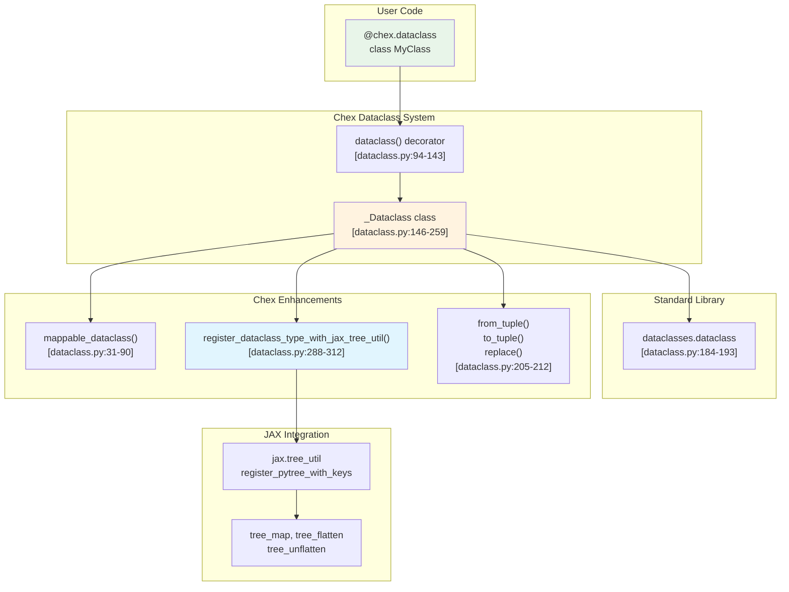
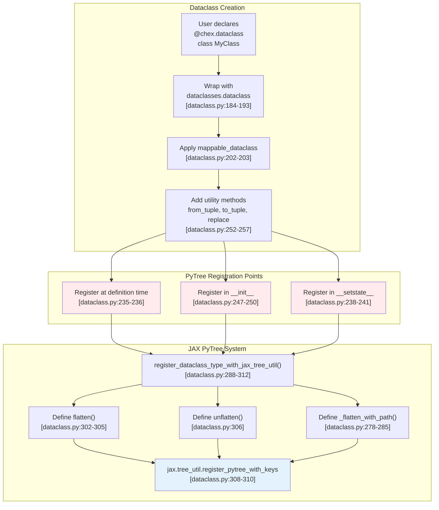
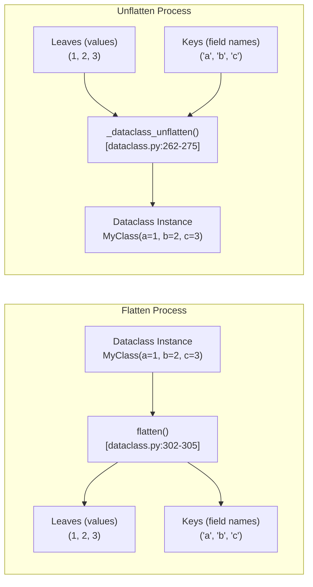

<!-- source: DeepWiki mcp.deepwiki.com · repo google-deepmind/chex · page 4.1 Dataclass Basics · fetched 2026-10-26 -->

# Dataclass Basics

<details>
<summary>Relevant source files</summary>

The following files were used as context for generating this wiki page:

- [README.md](README.md)
- [chex/_src/dataclass.py](chex/_src/dataclass.py)
- [chex/_src/dataclass_test.py](chex/_src/dataclass_test.py)

</details>


## Purpose and Scope

This page covers the fundamental usage of `@chex.dataclass`, a JAX-compatible dataclass implementation that enables dataclasses to work seamlessly with JAX transformations and tree utilities. This page focuses on basic usage patterns, constructor behavior, and PyTree registration mechanics.

For information about the Mapping interface and dm-tree integration, see [Mappable Dataclasses and dm-tree Integration](#4.2). For advanced features like serialization and inheritance, see [Dataclass Advanced Features](#4.3). For type definitions used with dataclasses, see [Type System (pytypes)](#5).

## What is `@chex.dataclass`?

The `@chex.dataclass` decorator is a JAX-friendly wrapper around Python's standard `dataclasses.dataclass` that solves a critical compatibility issue: standard Python dataclasses are not recognized as JAX PyTrees out of the box, making them incompatible with JAX tree utilities like `jax.tree_util.tree_map()`.

### The Problem with Standard Dataclasses

```python
# Standard dataclass - DOES NOT WORK with JAX tree utilities
import dataclasses
import jax

@dataclasses.dataclass
class Parameters:
    x: jnp.ndarray
    y: jnp.ndarray

params = Parameters(x=jnp.ones(3), y=jnp.zeros(2))
# jax.tree_util.tree_map(lambda t: t * 2, params)  # This fails!
```

### The Solution: `@chex.dataclass`

The `@chex.dataclass` decorator automatically registers dataclasses with JAX's PyTree system, enabling them to work with all JAX transformations:

```python
import chex
import jax

@chex.dataclass
class Parameters:
    x: chex.ArrayDevice
    y: chex.ArrayDevice

params = Parameters(x=jnp.ones(3), y=jnp.zeros(2))
# Now this works!
jax.tree_util.tree_map(lambda t: t * 2, params)
```

**Sources:** [chex/_src/dataclass.py:15-16](), [README.md:33-77]()

## Dataclass Decorator Architecture



**Sources:** [chex/_src/dataclass.py:94-259](), [chex/_src/dataclass.py:288-312]()

## Key Differences from Standard Dataclasses

### Comparison Table

| Feature | Standard `@dataclasses.dataclass` | `@chex.dataclass` |
|---------|-----------------------------------|-------------------|
| **Positional Arguments** | Supported by default | NOT supported by default (raises `ValueError`) |
| **JAX PyTree Registration** | Manual registration required | Automatic registration |
| **Mapping Interface** | Not a `Mapping` | Implements `collections.abc.Mapping` by default |
| **Tree Operations** | Incompatible | Works with `jax.tree_util.*` and dm-tree |
| **Utility Methods** | None | `replace()`, `to_tuple()`, `from_tuple()` |
| **Constructor Style** | `Class(arg1, arg2)` | `Class(field1=val1, field2=val2)` (dict-style) |

**Sources:** [chex/_src/dataclass.py:59-79](), [chex/_src/dataclass_test.py:430-442](), [README.md:72-84]()

### Constructor Behavior

By default, `@chex.dataclass` instances **must be constructed using keyword arguments only**, similar to Python dictionary construction:

```python
@chex.dataclass
class Point:
    x: float
    y: float

# CORRECT - keyword arguments
point = Point(x=1.0, y=2.0)

# CORRECT - dict-style construction
point = Point({'x': 1.0, 'y': 2.0})

# WRONG - positional arguments
# point = Point(1.0, 2.0)  # Raises ValueError!
```

This restriction comes from the `mappable_dataclass` wrapper, which makes dataclasses behave like dictionaries to enable dm-tree compatibility.

**Sources:** [chex/_src/dataclass.py:64-79](), [chex/_src/dataclass_test.py:430-442]()

## Basic Usage Patterns

### Simple Dataclass

```python
import chex
import jax.numpy as jnp

@chex.dataclass
class ModelState:
    params: chex.ArrayDevice
    optimizer_state: chex.ArrayDevice
    step: int

# Create instance
state = ModelState(
    params=jnp.ones((10, 5)),
    optimizer_state=jnp.zeros((10, 5)),
    step=0
)

# Works with JAX tree utilities
scaled_state = jax.tree_util.tree_map(
    lambda x: x * 2 if isinstance(x, jnp.ndarray) else x,
    state
)
```

### Nested Dataclasses

```python
@chex.dataclass
class NetworkParams:
    weights: chex.ArrayDevice
    biases: chex.ArrayDevice

@chex.dataclass
class FullState:
    network: NetworkParams
    learning_rate: float

# Create nested structure
state = FullState(
    network=NetworkParams(
        weights=jnp.ones((5, 3)),
        biases=jnp.zeros(3)
    ),
    learning_rate=0.01
)

# Tree operations work on nested structures
leaves = jax.tree_util.tree_leaves(state)  # Gets all leaf values
```

**Sources:** [chex/_src/dataclass_test.py:46-86](), [chex/_src/dataclass_test.py:360-370]()

### Frozen (Immutable) Dataclasses

```python
@chex.dataclass(frozen=True)
class Config:
    batch_size: int
    learning_rate: float

config = Config(batch_size=32, learning_rate=0.001)

# Cannot modify frozen dataclasses
# config.batch_size = 64  # Raises FrozenInstanceError!

# Use replace() instead
new_config = config.replace(batch_size=64)
```

**Sources:** [chex/_src/dataclass.py:94-105](), [chex/_src/dataclass_test.py:74-78](), [chex/_src/dataclass_test.py:483-489]()

## PyTree Registration Mechanics

### Registration Flow



**Sources:** [chex/_src/dataclass.py:217-257](), [chex/_src/dataclass.py:288-312]()

### Three Registration Points

Chex registers dataclasses with JAX at three different points to handle various usage scenarios:

1. **At Definition Time** [dataclass.py:235-236]() - When the class is defined (except for `__main__` module)
2. **At Construction Time** [dataclass.py:247-250]() - When an instance is created via `__init__`
3. **At Deserialization Time** [dataclass.py:238-241]() - When an instance is unpickled via `__setstate__`

This multi-point registration strategy ensures dataclasses work correctly even when serialized/deserialized across different processes.

**Sources:** [chex/_src/dataclass.py:217-250]()

### Flatten and Unflatten Operations

PyTree registration requires defining how to flatten (decompose) and unflatten (reconstruct) a dataclass:



**Implementation Details:**

| Function | Location | Purpose |
|----------|----------|---------|
| `flatten()` | [dataclass.py:302-305]() | Extracts field values and names from dataclass instance |
| `_dataclass_unflatten()` | [dataclass.py:262-275]() | Reconstructs dataclass from field values and names |
| `_flatten_with_path()` | [dataclass.py:278-285]() | Provides path information for nested structures |

The flatten operation converts a dataclass to `(values, keys)` tuples, and unflatten reconstructs the dataclass from these tuples. This enables JAX to treat dataclasses as first-class PyTree nodes.

**Sources:** [chex/_src/dataclass.py:262-285](), [chex/_src/dataclass.py:302-310]()

## Utility Methods

Every `@chex.dataclass` automatically gains three utility methods:

### `replace()` - Immutable Updates

```python
@chex.dataclass(frozen=True)
class State:
    x: int
    y: int

state = State(x=1, y=2)
new_state = state.replace(x=10)  # State(x=10, y=2)
```

The `replace()` method wraps `dataclasses.replace()` and is especially useful for frozen dataclasses where direct field assignment is prohibited.

**Sources:** [chex/_src/dataclass.py:211-212](), [chex/_src/dataclass_test.py:419-428]()

### `to_tuple()` and `from_tuple()` - Tuple Conversion

```python
@chex.dataclass
class Point:
    x: float
    y: float

point = Point(x=3.0, y=4.0)

# Convert to tuple (preserves field order)
tup = point.to_tuple()  # (3.0, 4.0)

# Reconstruct from tuple
point2 = Point.from_tuple((3.0, 4.0))  # Point(x=3.0, y=4.0)
```

These methods are useful when you need to interface with code that expects tuples or when you need positional argument semantics.

**Sources:** [chex/_src/dataclass.py:205-209](), [chex/_src/dataclass_test.py:518-541]()

## Reserved Field Names

Chex reserves certain field names that conflict with utility methods. The following field names **cannot be used** in `@chex.dataclass`:

- `from_tuple`
- `replace`
- `to_tuple`

Additionally, when using `mappable_dataclass=True` (the default), standard `Mapping` method names are also reserved:
- `get`, `keys`, `values`, `items`, etc.

Attempting to use reserved names will raise a `ValueError`:

```python
@chex.dataclass
class Invalid:
    from_tuple: int  # Raises ValueError!
```

**Sources:** [chex/_src/dataclass.py:28](), [chex/_src/dataclass.py:196-200](), [chex/_src/dataclass_test.py:588-607]()

## Working with JAX Transformations

### Tree Map Operations

```python
@chex.dataclass
class Tensors:
    weights: chex.ArrayDevice
    biases: chex.ArrayDevice

tensors = Tensors(
    weights=jnp.ones((3, 3)),
    biases=jnp.zeros(3)
)

# Scale all arrays by 2
scaled = jax.tree_util.tree_map(lambda x: x * 2, tensors)

# Count leaves
num_leaves = len(jax.tree_util.tree_leaves(tensors))  # 2
```

**Sources:** [chex/_src/dataclass_test.py:365-370](), [chex/_src/dataclass_test.py:372-385]()

### Tree Flatten with Path

```python
@chex.dataclass
class Nested:
    a: chex.ArrayDevice
    b: chex.ArrayDevice

obj = Nested(a=jnp.array([1, 2]), b=jnp.array([3, 4]))

# Get paths to all leaves
keys_and_leaves, treedef = jax.tree_util.tree_flatten_with_path(obj)

# keys_and_leaves contains:
# [(GetAttrKey('a'), array([1, 2])), 
#  (GetAttrKey('b'), array([3, 4]))]
```

The path information is useful for debugging and understanding the structure of nested dataclasses.

**Sources:** [chex/_src/dataclass.py:278-285](), [chex/_src/dataclass_test.py:372-385]()

## Disabling Mappable Behavior

If you don't need dm-tree compatibility and want to use positional arguments, you can disable the mappable behavior:

```python
@chex.dataclass(mappable_dataclass=False)
class Point:
    x: float
    y: float

# Now positional arguments work
point = Point(3.0, 4.0)  # OK!

# But no longer a Mapping
isinstance(point, collections.abc.Mapping)  # False
```

**Note:** With `mappable_dataclass=False`, you lose dm-tree compatibility but gain the ability to use positional arguments.

**Sources:** [chex/_src/dataclass.py:104](), [chex/_src/dataclass.py:121-130](), [chex/_src/dataclass_test.py:444-458]()

## Common Patterns

### Pattern: Model State Container

```python
@chex.dataclass
class TrainingState:
    params: chex.ArrayTree
    opt_state: chex.ArrayTree
    step: int
    rng_key: chex.PRNGKey

def train_step(state: TrainingState, batch):
    # Use state.params, state.opt_state, etc.
    new_params = update_params(state.params, batch)
    return state.replace(
        params=new_params,
        step=state.step + 1
    )
```

### Pattern: Configuration Objects

```python
@chex.dataclass(frozen=True)
class Config:
    batch_size: int = 32
    learning_rate: float = 0.001
    num_layers: int = 3
    hidden_size: int = 128

# Frozen configs prevent accidental modification
config = Config()
# config.batch_size = 64  # Error!
```

### Pattern: Nested Hierarchies

```python
@chex.dataclass
class LayerParams:
    weights: chex.ArrayDevice
    biases: chex.ArrayDevice

@chex.dataclass
class NetworkParams:
    layer1: LayerParams
    layer2: LayerParams
    layer3: LayerParams

# Tree operations work on entire hierarchy
all_params = NetworkParams(...)
scaled_params = jax.tree_util.tree_map(lambda x: x * 0.1, all_params)
```

**Sources:** [chex/_src/dataclass_test.py:46-86](), [README.md:54-70]()

## Summary

Key takeaways for using `@chex.dataclass`:

1. **Always use keyword arguments** when constructing dataclass instances (unless `mappable_dataclass=False`)
2. **PyTree registration is automatic** - dataclasses work with all JAX tree utilities
3. **Use `frozen=True` for immutable configs** and the `replace()` method for updates
4. **Nested dataclasses are fully supported** - tree operations work recursively
5. **Reserved field names** (`from_tuple`, `replace`, `to_tuple`) cannot be used
6. **Registration happens at three points** - definition, construction, and deserialization

For more details on the Mapping interface and dm-tree compatibility, see [Mappable Dataclasses and dm-tree Integration](#4.2). For advanced topics like serialization and inheritance, see [Dataclass Advanced Features](#4.3).

**Sources:** [chex/_src/dataclass.py:1-313](), [chex/_src/dataclass_test.py:1-762](), [README.md:33-77]()

---

