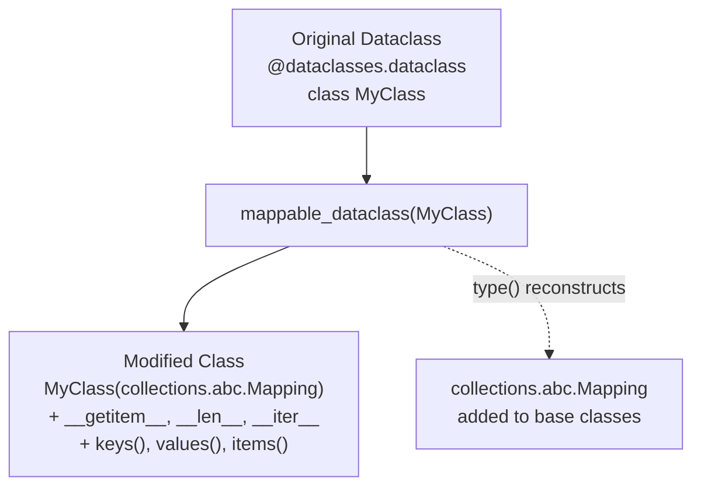
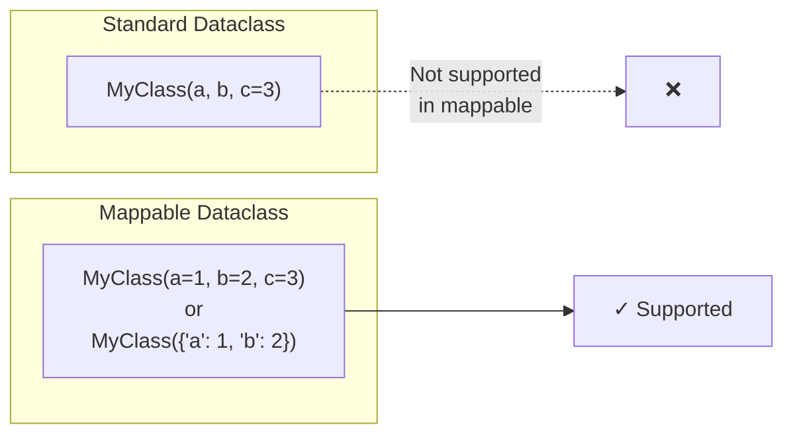
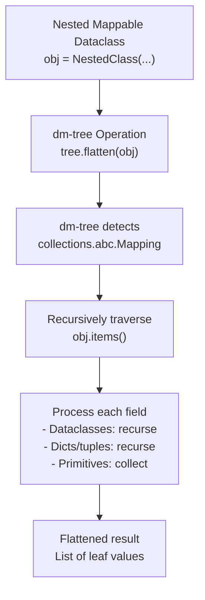
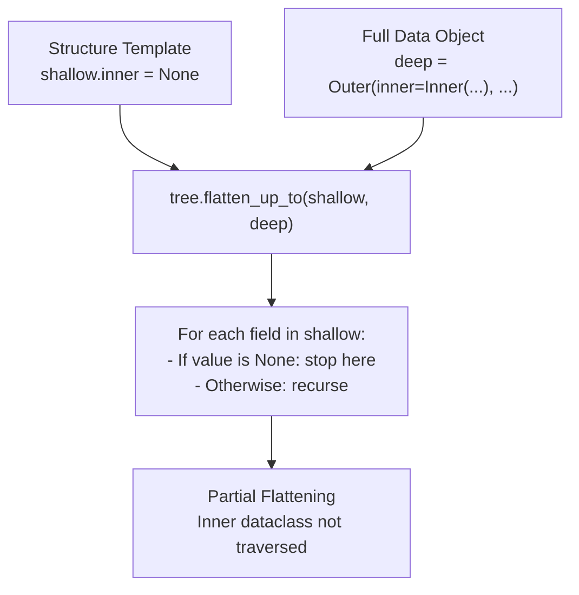
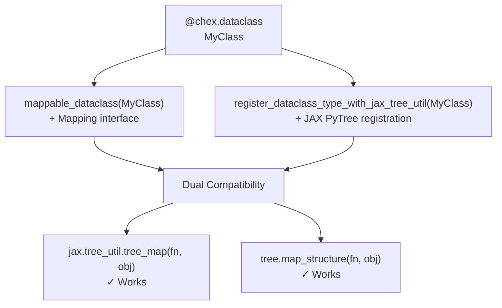
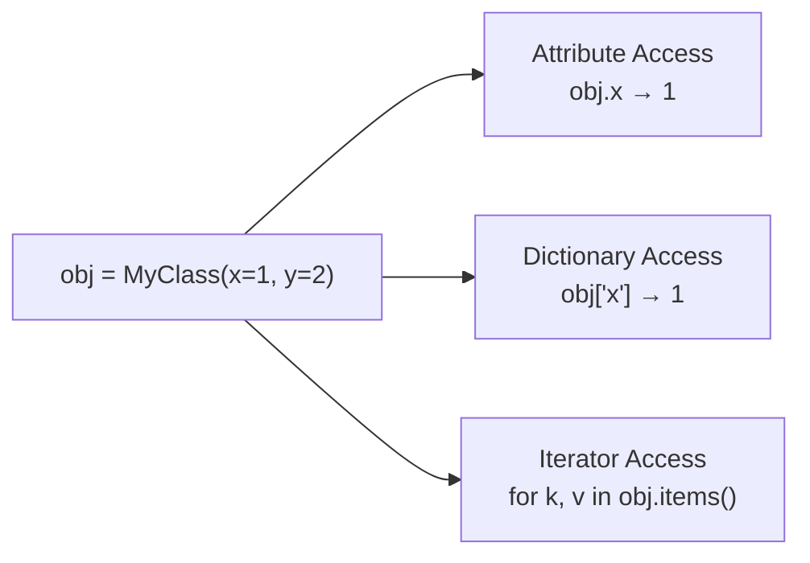

<!-- source: DeepWiki mcp.deepwiki.com · repo google-deepmind/chex · page 4.2 Mappable Dataclasses and dm-tree Integration · fetched 2026-10-26 -->

# Mappable Dataclasses and dm-tree Integration

<details>
<summary>Relevant source files</summary>

The following files were used as context for generating this wiki page:

- [chex/_src/dataclass.py](chex/_src/dataclass.py)
- [chex/_src/dataclass_test.py](chex/_src/dataclass_test.py)
- [chex/_src/pytypes.py](chex/_src/pytypes.py)

</details>


## Purpose and Scope

This page documents the `mappable_dataclass` decorator and its role in making Chex dataclasses compatible with the `dm-tree` library and other tree traversal systems. It covers the `Mapping` interface implementation, constructor modifications, and integration patterns with dm-tree operations.

For basic dataclass usage and JAX PyTree registration, see [Dataclass Basics](#4.1). For advanced features like serialization and inheritance, see [Dataclass Advanced Features](#4.3).

## Overview

The `mappable_dataclass` decorator transforms a standard dataclass into a `collections.abc.Mapping` descendant, enabling compatibility with the `dm-tree` library and similar tree traversal utilities. By default, all `@chex.dataclass` instances are mappable unless explicitly disabled with `mappable_dataclass=False`.

**Sources:** [chex/_src/dataclass.py:31-90](), [chex/_src/dataclass.py:104]()

## Mapping Interface Implementation

### Core Modifications

The `mappable_dataclass` function adds or modifies the following methods to expose dataclass fields as a mapping:

| Method | Implementation | Purpose |
|--------|---------------|---------|
| `__getitem__` | `lambda self, x: self.__dict__[x]` | Access field by name |
| `__len__` | `lambda self: len(self.__dict__)` | Count number of fields |
| `__iter__` | `lambda self: iter(self.__dict__)` | Iterate over field names |
| `keys()` | `lambda self: self.__dict__.keys()` | Get field names |
| `values()` | `lambda self: self.__dict__.values()` | Get field values |
| `items()` | `lambda self: self.__dict__.items()` | Get field name-value pairs |

These methods delegate to the instance's `__dict__`, making the dataclass behave like a dictionary while maintaining its dataclass structure.

**Sources:** [chex/_src/dataclass.py:48-57]()

### Class Hierarchy Modification



**Diagram: Class Transformation Process**

The function uses `type()` to reconstruct the class with `collections.abc.Mapping` added to its base classes, while preserving all original class attributes and methods.

**Sources:** [chex/_src/dataclass.py:81-90]()

## Constructor Changes

### Dict-Style Constructor

Mappable dataclasses replace the standard dataclass constructor with a dict-style constructor that only accepts keyword arguments:



**Diagram: Constructor Style Comparison**

### Implementation Details

The modified constructor:

1. **Rejects positional arguments** - Raises `ValueError` if both positional and keyword arguments are provided, or if more than one positional argument is supplied
2. **Accepts dict-like input** - Can be called with a single dictionary or iterable of key-value pairs: `MyClass({'a': 1, 'b': 2})`
3. **Validates field names** - Raises `ValueError` for unknown keyword arguments
4. **Filters init fields** - Only passes fields with `init=True` to the original constructor

**Sources:** [chex/_src/dataclass.py:59-79]()

### Example Usage Pattern

```python
# This works
@chex.dataclass
class Config:
    learning_rate: float
    batch_size: int

config = Config(learning_rate=0.01, batch_size=32)

# This also works - dict constructor
config = Config({'learning_rate': 0.01, 'batch_size': 32})

# This raises ValueError
config = Config(0.01, 32)  # Positional args not supported
```

**Sources:** [chex/_src/dataclass_test.py:430-442]()

## dm-tree Integration

### Supported Operations

Mappable dataclasses work seamlessly with all dm-tree operations:

| Operation | Function | Description |
|-----------|----------|-------------|
| Flatten | `tree.flatten(obj)` | Recursively flattens nested structure to leaf values |
| Unflatten | `tree.unflatten_as(structure, flat)` | Reconstructs structure from flattened values |
| Flatten Up To | `tree.flatten_up_to(shallow, deep)` | Partial flattening controlled by structure |
| Map Structure | `tree.map_structure(fn, obj)` | Applies function to all leaves |
| Map Up To | `tree.map_structure_up_to(shallow, fn, deep)` | Partial mapping |
| Traverse | `tree.traverse(fn, obj)` | Visits all nodes in tree |
| With Path | `tree.flatten_with_path(obj)` | Includes key paths with values |

**Sources:** [chex/_src/dataclass_test.py:218-345]()

### Tree Traversal Flow



**Diagram: dm-tree Traversal Process**

**Sources:** [chex/_src/dataclass.py:32-34]()

### Flattening Example

Consider a nested mappable dataclass structure:

```python
@chex.dataclass
class Inner:
    x: int
    y: int

@chex.dataclass
class Outer:
    inner: Inner
    z: int
    data: dict

obj = Outer(
    inner=Inner(x=1, y=2),
    z=3,
    data={'a': 4, 'b': 5}
)
```

**Flattening behavior:**
- `tree.flatten(obj)` → `[4, 5, 1, 2, 3]` (all leaf values)
- Keys are traversed in sorted order within each mapping
- Nested dataclasses are recursively flattened
- Regular dicts are also flattened

**Sources:** [chex/_src/dataclass_test.py:218-232]()

### Selective Flattening

The `flatten_up_to` and `map_structure_up_to` operations enable partial traversal:



**Diagram: Selective Flattening with flatten_up_to**

This allows controlling traversal depth by using a structure template that marks stopping points.

**Sources:** [chex/_src/dataclass_test.py:235-241](), [chex/_src/dataclass_test.py:276-292]()

### Path-Aware Operations

Operations ending in `_with_path` provide the key path to each leaf:

```python
tree.flatten_with_path(obj)
# Returns: [
#   (('inner', 'x'), 1),
#   (('inner', 'y'), 2),
#   (('z',), 3),
#   ...
# ]
```

This is useful for debugging and understanding nested structure traversal.

**Sources:** [chex/_src/dataclass_test.py:244-260]()

## Interaction with JAX PyTrees

Mappable dataclasses remain fully compatible with JAX's PyTree system:



**Diagram: Dual PyTree System Compatibility**

The same dataclass instance can be used with both:
- **JAX operations**: `jax.tree_util.tree_map`, `tree_flatten`, etc.
- **dm-tree operations**: `tree.map_structure`, `tree.flatten`, etc.

**Sources:** [chex/_src/dataclass.py:236](), [chex/_src/dataclass.py:289-312]()

## Mappable vs Non-Mappable Comparison

### Feature Matrix

| Feature | `mappable_dataclass=True` (default) | `mappable_dataclass=False` |
|---------|-------------------------------------|----------------------------|
| Positional constructor args | ❌ Not supported | ✓ Supported |
| Dict-style constructor | ✓ Supported | ❌ Not supported |
| `obj['field']` syntax | ✓ Supported | ❌ Not supported |
| `obj.keys()`, `obj.values()` | ✓ Supported | ❌ Not supported |
| `isinstance(obj, Mapping)` | ✓ True | ❌ False |
| dm-tree compatibility | ✓ Full support | ❌ Not supported |
| JAX PyTree compatibility | ✓ Supported | ✓ Supported |

**Sources:** [chex/_src/dataclass.py:104](), [chex/_src/dataclass_test.py:444-458]()

### When to Disable Mappable

Disable `mappable_dataclass` when:

1. **Positional arguments required** - Need to construct with positional args for compatibility with existing code
2. **Performance critical paths** - Minimal overhead but extra method dispatch
3. **No dm-tree integration needed** - Only using JAX PyTree operations

```python
@chex.dataclass(mappable_dataclass=False)
class NonMappable:
    a: int
    b: int

# Positional args work
obj = NonMappable(1, 2)

# But mapping interface unavailable
# obj['a']  # Would raise AttributeError
```

**Sources:** [chex/_src/dataclass_test.py:444-458]()

## Field Access Patterns

### Multiple Access Methods

Mappable dataclasses support three field access patterns:



**Diagram: Field Access Methods**

All three methods access the same underlying `__dict__`, ensuring consistency.

**Sources:** [chex/_src/dataclass.py:49-57]()

### Reserved Field Names

Certain field names are disallowed to prevent conflicts with utility methods:

- `from_tuple` - Reserved for tuple conversion utility
- `to_tuple` - Reserved for tuple conversion utility
- `replace` - Reserved for immutable update utility

Attempting to define fields with these names raises `ValueError`.

**Sources:** [chex/_src/dataclass.py:28](), [chex/_src/dataclass.py:196-200](), [chex/_src/dataclass_test.py:588-607]()

## Post-Initialization Behavior

Mappable dataclasses preserve `__post_init__` semantics:

```python
@chex.dataclass
class ValidatedConfig:
    learning_rate: float
    
    def __post_init__(self):
        if self.learning_rate <= 0:
            raise ValueError("learning_rate must be positive")
```

The modified constructor still calls the original `__init__`, which in turn calls `__post_init__` if defined. This works with dm-tree operations as well - `tree.map_structure` will trigger `__post_init__` on reconstructed instances.

**Sources:** [chex/_src/dataclass_test.py:53-59](), [chex/_src/dataclass_test.py:263-273](), [chex/_src/dataclass.py:273-274]()

## Implementation Details

### Type Reconstruction

The `mappable_dataclass` function uses `type()` to rebuild the class:

1. **Extract class dict** - Copy all attributes from original class
2. **Filter problematic entries** - Remove `__dict__` to avoid self-references
3. **Update base classes** - Remove `object`, add `collections.abc.Mapping`
4. **Reconstruct** - Create new class with `type(name, bases, dict)`

This approach preserves all methods, class attributes, and metadata while changing the inheritance hierarchy.

**Sources:** [chex/_src/dataclass.py:81-90]()

### Compatibility Notes

The Mapping interface makes dataclasses compatible with:

- **dm-tree library** - All tree traversal and manipulation functions
- **TensorFlow nest utilities** - `tensorflow.python.util.nest` operations
- **JAX tree utilities** - Standard JAX PyTree operations (via separate registration)

However, it changes behavior of some operations:

- **np.testing.assert_array_equal** - Only checks field names, not content (use `chex.assert_tree_*` instead)

**Sources:** [chex/_src/dataclass.py:126-130]()

## Testing Examples

### Test Structure

The test suite includes parameterized tests for both `chex.dataclass` and `mappable_dataclass(dataclasses.dataclass)` to ensure identical behavior:

```python
@parameterized.named_parameters(
    ('_original', 'original'),  # mappable_dataclass(orig_dataclass(...))
    ('_chex', 'chex')            # chex.dataclass(mappable_dataclass=True)
)
class MappableDataclassTest(parameterized.TestCase):
    def testFlattenAndUnflatten(self, test_type):
        # Test both approaches
        ...
```

This verifies that `mappable_dataclass` works identically whether applied to a standard dataclass or used via `@chex.dataclass`.

**Sources:** [chex/_src/dataclass_test.py:152-153]()

### Non-Init Fields

Mappable dataclasses handle fields with `init=False` correctly:

- Such fields appear in `__dict__` and the Mapping interface
- They are not required in constructor calls
- They are included in dm-tree traversals
- Factory defaults and `__post_init__` assignments work as expected

**Sources:** [chex/_src/dataclass_test.py:128-138](), [chex/_src/dataclass.py:60-77]()

## Summary

The `mappable_dataclass` decorator provides seamless integration between Chex dataclasses and the dm-tree library ecosystem by implementing the `collections.abc.Mapping` interface. Key takeaways:

1. **Enabled by default** - All `@chex.dataclass` instances are mappable unless explicitly disabled
2. **Dict-style constructor** - Only keyword arguments supported, but enables dict/iterable construction
3. **Full dm-tree support** - All tree operations work transparently with mappable dataclasses
4. **JAX compatibility preserved** - Works with both dm-tree and JAX PyTree systems simultaneously
5. **Minimal overhead** - Simple method delegation to `__dict__` with no significant performance cost

For controlling whether a dataclass is mappable, use the `mappable_dataclass` parameter in the `@chex.dataclass` decorator.

**Sources:** [chex/_src/dataclass.py:31-144](), [chex/_src/dataclass_test.py:152-355]()

---

