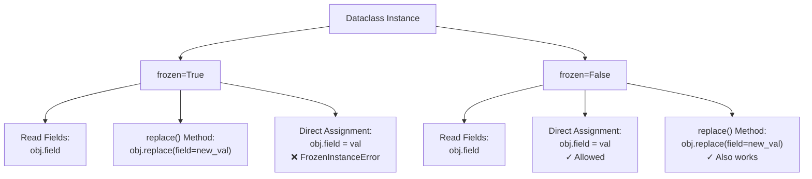
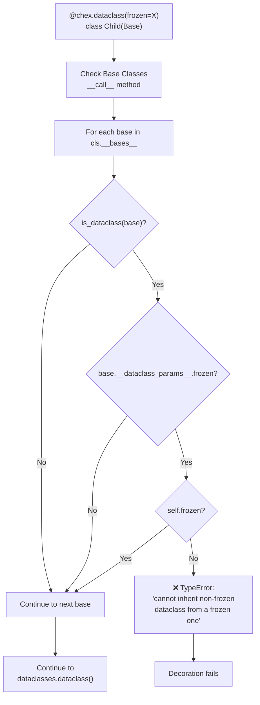
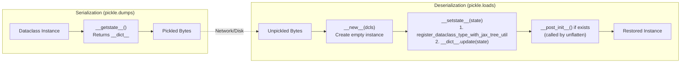
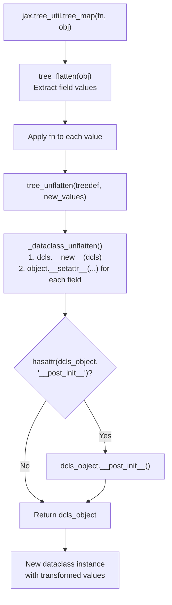
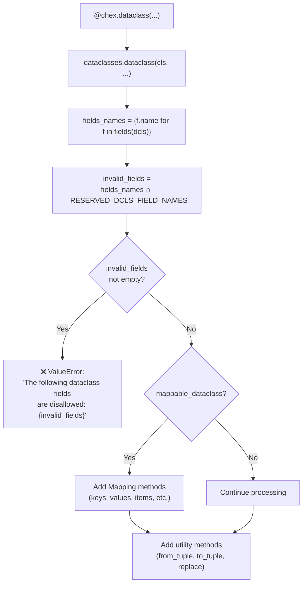
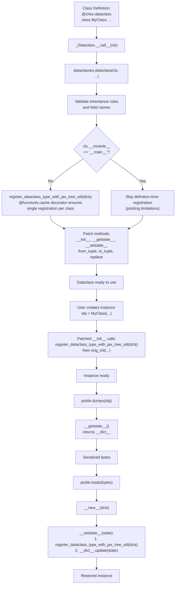

<!-- source: DeepWiki mcp.deepwiki.com · repo google-deepmind/chex · page 4.3 Dataclass Advanced Features · fetched 2026-10-26 -->

# Dataclass Advanced Features

<details>
<summary>Relevant source files</summary>

The following files were used as context for generating this wiki page:

- [chex/_src/dataclass.py](chex/_src/dataclass.py)
- [chex/_src/dataclass_test.py](chex/_src/dataclass_test.py)
- [docs/api.rst](docs/api.rst)

</details>


## Purpose and Scope

This document covers advanced features and constraints of `@chex.dataclass`, including serialization, inheritance patterns, frozen dataclasses, generic types, post-initialization hooks, and lifecycle management. For basic usage and PyTree registration, see [Dataclass Basics](#4.1). For `mappable_dataclass` and dm-tree integration, see [Mappable Dataclasses and dm-tree Integration](#4.2).

## Frozen Dataclasses

### Immutability with `frozen=True`

Frozen dataclasses create immutable instances that prevent field assignment after construction. Use the `replace` method to create modified copies:

```python
@chex.dataclass(frozen=True)
class Config:
  learning_rate: float
  batch_size: int

config = Config(learning_rate=0.001, batch_size=32)
# config.learning_rate = 0.01  # Raises FrozenInstanceError
new_config = config.replace(learning_rate=0.01)  # Creates new instance
```

The `frozen` parameter is passed through to Python's `dataclasses.dataclass`, which enforces immutability by raising `FrozenInstanceError` on field assignment attempts [chex/_src/dataclass.py:27](), [chex/_src/dataclass.py:119](), [chex/_src/dataclass.py:165]().

### Frozen vs. Mutable Behavior

**Diagram: Frozen Dataclass Field Access Patterns**



Sources: [chex/_src/dataclass.py:102](), [chex/_src/dataclass_test.py:474-489]()

### Nested Frozen Behavior

**Important:** When a frozen dataclass contains a mutable nested dataclass, only the outer dataclass is immutable. Nested objects can still be modified:

```python
@chex.dataclass(frozen=False)
class Inner:
  value: int

@chex.dataclass(frozen=True)
class Outer:
  inner: Inner
  constant: int

obj = Outer(inner=Inner(value=1), constant=2)
obj.inner.value = 5  # ✓ Allowed - inner is mutable
# obj.constant = 3   # ❌ FrozenInstanceError - outer is frozen
```

Sources: [chex/_src/dataclass_test.py:483-489]()

## Inheritance

### Inheritance Rules

Chex dataclasses support inheritance with specific constraints enforced by [chex/_src/dataclass.py:172-176]():

| Base Class | Derived Class | Allowed | Rationale |
|------------|---------------|---------|-----------|
| `frozen=True` | `frozen=True` | ✓ | Consistent immutability |
| `frozen=True` | `frozen=False` | ❌ | Cannot relax immutability constraint |
| `frozen=False` | `frozen=False` | ✓ | Consistent mutability |
| `frozen=False` | `frozen=True` | ✓ | Can add immutability constraint |

The constraint preventing non-frozen dataclasses from inheriting frozen ones is enforced before standard dataclass processing completes [chex/_src/dataclass.py:172-176]().

**Diagram: Inheritance Constraint Validation Flow**



Sources: [chex/_src/dataclass.py:172-176](), [chex/_src/dataclass_test.py:565-586]()

### Inheritance with `kw_only` (Python ≥3.10)

Starting with Python 3.10, use `kw_only=True` to enable inheritance when derived classes add non-default fields:

```python
@chex.dataclass(kw_only=True)
class Base:
  default: int = 1

@chex.dataclass(kw_only=True)
class Child(Base):
  non_default: int  # Would fail without kw_only

obj = Child(non_default=2)  # Uses keyword arguments only
```

The `kw_only` parameter is conditionally passed based on Python version [chex/_src/dataclass.py:178-182]().

Sources: [chex/_src/dataclass.py:103](), [chex/_src/dataclass.py:120](), [chex/_src/dataclass.py:178-182](), [chex/_src/dataclass_test.py:460-472]()

## Serialization and Deserialization

### Pickling Support

Chex dataclasses implement `__getstate__` and `__setstate__` for serialization compatibility with `pickle` and `cloudpickle`.

**Diagram: Serialization/Deserialization Lifecycle**



Sources: [chex/_src/dataclass.py:214-241](), [chex/_src/dataclass.py:262-275](), [chex/_src/dataclass_test.py:701-719]()

### Implementation Details

The serialization methods are defined at [chex/_src/dataclass.py:214-257]():

- **`__getstate__`** [chex/_src/dataclass.py:214-215](): Returns `self.__dict__` containing all field values
- **`__setstate__`** [chex/_src/dataclass.py:239-241](): Re-registers the dataclass with JAX tree utilities and restores field values
- **`__init__` patching** [chex/_src/dataclass.py:243-250](): Ensures registration on construction for `__main__` module cases

### Registration and `__main__` Module

Dataclasses defined in the `__main__` module require special handling during unpickling. The implementation uses three registration points [chex/_src/dataclass.py:217-236]():

1. **At definition** [chex/_src/dataclass.py:235-236](): Automatic registration (skipped for `__main__`)
2. **At construction** [chex/_src/dataclass.py:248-250](): `__init__` wrapper calls registration
3. **At deserialization** [chex/_src/dataclass.py:239-241](): `__setstate__` calls registration

This ensures dataclasses work correctly across process boundaries, especially when using multiprocessing or distributed computing.

Sources: [chex/_src/dataclass.py:217-236](), [chex/_src/dataclass_test.py:701-719]()

## Generic Dataclasses

Chex dataclasses support Python generics using `TypeVar` and `Generic`:

```python
from typing import Generic, TypeVar

T = TypeVar('T')

@chex.dataclass
class Container(Generic[T]):
  value: T
  metadata: str

int_container = Container(value=42, metadata="integer")
array_container = Container(value=np.array([1.0, 2.0]), metadata="array")
```

Generic dataclasses work with both `mappable_dataclass=True` and `mappable_dataclass=False` modes [chex/_src/dataclass_test.py:668-676]().

### Type Variable Constraints

Type variables can have constraints or bounds:

```python
from typing import TypeVar

NumericType = TypeVar('NumericType', int, float, np.ndarray)

@chex.dataclass
class NumericContainer(Generic[NumericType]):
  data: NumericType
```

Sources: [chex/_src/dataclass_test.py:668-676]()

## Post-Initialization Hooks

### `__post_init__` Method

Dataclasses can define `__post_init__` for custom initialization logic after fields are set. This method is automatically called in two contexts:

1. **Regular construction** via `__init__`
2. **Tree unflatten operations** [chex/_src/dataclass.py:272-274]()

```python
@chex.dataclass
class ValidatedConfig:
  learning_rate: float
  
  def __post_init__(self):
    if self.learning_rate <= 0:
      raise ValueError('learning_rate must be positive')

config = ValidatedConfig(learning_rate=0.001)  # ✓ Valid
# ValidatedConfig(learning_rate=-0.1)  # ❌ Raises ValueError
```

Sources: [chex/_src/dataclass_test.py:53-58](), [chex/_src/dataclass.py:272-274]()

### `__post_init__` with `InitVar`

Use `dataclasses.InitVar` for initialization-only parameters:

```python
import dataclasses

@chex.dataclass
class ProcessedData:
  result: int
  multiplier: dataclasses.InitVar[int] = 10
  
  def __post_init__(self, multiplier):
    object.__setattr__(self, 'result', self.result * multiplier)

data = ProcessedData(result=5, multiplier=3)
# data.result == 15, multiplier not stored as field
```

The test suite demonstrates `InitVar` usage at [chex/_src/dataclass_test.py:132-138]().

### Post-Init in Tree Operations

**Diagram: Post-Init Execution in JAX Tree Operations**



Sources: [chex/_src/dataclass.py:262-275](), [chex/_src/dataclass_test.py:729-732]()

**Important:** When using `tree_map` or similar operations, `__post_init__` validates the transformed data, potentially raising errors if the transformation produces invalid values.

## Reserved Field Names

### Disallowed Field Names

Chex dataclasses reserve specific field names for utility methods [chex/_src/dataclass.py:28]():

| Reserved Name | Purpose | Defined At |
|---------------|---------|------------|
| `from_tuple` | Class method for tuple construction | [chex/_src/dataclass.py:205-206]() |
| `to_tuple` | Instance method for tuple conversion | [chex/_src/dataclass.py:208-209]() |
| `replace` | Instance method for creating modified copies | [chex/_src/dataclass.py:211-212]() |

Additionally, `mappable_dataclass=True` (the default) adds methods that may conflict with field names:

| Method | Purpose | Defined At |
|--------|---------|------------|
| `__getitem__` | Dictionary-style access | [chex/_src/dataclass.py:49]() |
| `__len__` | Number of fields | [chex/_src/dataclass.py:50]() |
| `__iter__` | Iterate over field names | [chex/_src/dataclass.py:51]() |
| `keys` | Field names | [chex/_src/dataclass.py:55]() |
| `values` | Field values | [chex/_src/dataclass.py:56]() |
| `items` | Field name-value pairs | [chex/_src/dataclass.py:57]() |

**Diagram: Reserved Name Validation**



Sources: [chex/_src/dataclass.py:28](), [chex/_src/dataclass.py:196-200](), [chex/_src/dataclass_test.py:588-607]()

### Field Name Conflicts with Mappable

When `mappable_dataclass=False`, only the core reserved names are disallowed. You can use names like `keys`, `values`, or `items` as fields:

```python
@chex.dataclass(mappable_dataclass=False)
class NonMappableClass:
  keys: int  # ✓ Allowed
  from_tuple: int  # ❌ Still disallowed
```

Sources: [chex/_src/dataclass_test.py:588-607](), [chex/_src/dataclass_test.py:747-758]()

## Lifecycle Management

### Registration with JAX Tree Utilities

**Diagram: Dataclass Lifecycle and JAX Registration**



Sources: [chex/_src/dataclass.py:169-259](), [chex/_src/dataclass.py:288-312]()

### The `@functools.cache` Decorator

The `register_dataclass_type_with_jax_tree_util` function uses `@functools.cache` [chex/_src/dataclass.py:288]() to ensure each dataclass type is registered exactly once with JAX's PyTree system, even when called multiple times during construction or deserialization.

### Custom Flatten/Unflatten Functions

Chex provides custom flatten and unflatten functions for JAX tree utilities [chex/_src/dataclass.py:302-310]():

- **`flatten`** [chex/_src/dataclass.py:302-305](): Extracts sorted field values and keys
- **`_flatten_with_path`** [chex/_src/dataclass.py:278-285](): Extracts field paths using `GetAttrKey`
- **`_dataclass_unflatten`** [chex/_src/dataclass.py:262-275](): Reconstructs instances, respecting field order and calling `__post_init__`

The unflatten implementation uses `__new__` to create instances without calling `__init__`, then manually sets attributes and invokes `__post_init__` if present.

Sources: [chex/_src/dataclass.py:262-275](), [chex/_src/dataclass.py:278-285](), [chex/_src/dataclass.py:302-310]()

## Field Ordering and Traversal

### Consistent Field Ordering

Chex dataclasses preserve field definition order across all operations. This is critical for tree operations, serialization, and tuple conversions.

**Comparison Table: Field Order Preservation**

| Operation | Source of Ordering | Implementation |
|-----------|-------------------|----------------|
| `to_tuple()` | `__dataclass_fields__.keys()` | [chex/_src/dataclass.py:208-209]() |
| `from_tuple()` | `__dataclass_fields__.keys()` | [chex/_src/dataclass.py:205-206]() |
| `flatten()` | `sorted(d.__dict__.items())` | [chex/_src/dataclass.py:302-304]() |
| `_flatten_with_path()` | `sorted(dcls.__dict__.items())` | [chex/_src/dataclass.py:280-285]() |
| `_dataclass_unflatten()` | `__dataclass_fields__.values()` | [chex/_src/dataclass.py:267-271]() |
| Tree traversal | Sorted field order | [chex/_src/dataclass_test.py:407-416]() |

### Pseudo-Fields Handling

When unflattening, the implementation filters pseudo-fields (fields with `init=False`) to match the flatten representation [chex/_src/dataclass.py:267-271]():

```python
for field in dcls.__dataclass_fields__.values():
  if field.name in attribute_dict:  # Filter pseudo-fields
    object.__setattr__(dcls_object, field.name, attribute_dict[field.name])
```

This ensures consistency between flattened and unflattened representations, particularly important for fields with `init=False` or `InitVar` types.

Sources: [chex/_src/dataclass.py:267-271](), [chex/_src/dataclass_test.py:89-96](), [chex/_src/dataclass_test.py:721-727]()

## Best Practices

### When to Use `frozen=True`

Use frozen dataclasses for:
- Configuration objects that shouldn't change
- Data passed across JAX function boundaries
- Values used as dictionary keys (requires `frozen=True, unsafe_hash=True`)

### When to Use `mappable_dataclass=False`

Use `mappable_dataclass=False` when:
- You need field names that conflict with `Mapping` methods (`keys`, `values`, `items`, `get`)
- You don't need dm-tree compatibility
- You want positional argument support in constructors

### Handling Complex Post-Init Logic

For complex validation or derived fields:

```python
@chex.dataclass
class ComplexConfig:
  raw_data: np.ndarray
  processed_data: np.ndarray = dataclasses.field(init=False)
  
  def __post_init__(self):
    # Compute derived field
    object.__setattr__(self, 'processed_data', 
                      self.raw_data * 2 + 1)
    # Validate
    if not np.all(np.isfinite(self.processed_data)):
      raise ValueError('Processed data contains non-finite values')
```

Remember that `__post_init__` executes during both construction and tree unflatten operations.

### Serialization Across Process Boundaries

When serializing dataclasses for multiprocessing or distributed computing:
- Define dataclasses in module files, not in `__main__`
- Test pickle/unpickle round-trips
- Verify JAX tree operations work after deserialization

Sources: [chex/_src/dataclass.py:217-236](), [chex/_src/dataclass_test.py:701-719]()

---

