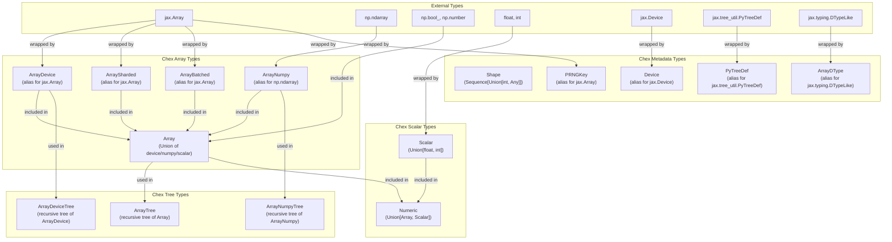
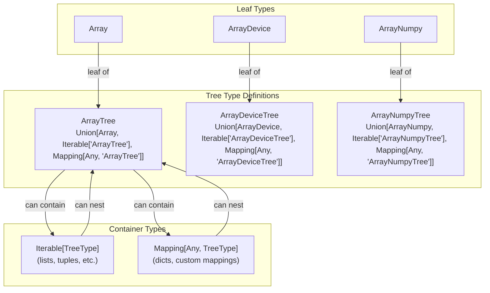
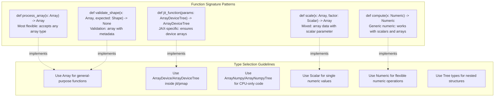

<!-- source: DeepWiki mcp.deepwiki.com · repo google-deepmind/chex · page 5 Type System (pytypes) · fetched 2026-10-26 -->

# Type System (pytypes)

<details>
<summary>Relevant source files</summary>

The following files were used as context for generating this wiki page:

- [chex/__init__.py](chex/__init__.py)
- [chex/_src/pytypes.py](chex/_src/pytypes.py)
- [docs/api.rst](docs/api.rst)

</details>


The Chex type system provides a comprehensive set of type aliases for annotating JAX and NumPy code. These types improve code readability, enable better static type checking, and establish clear contracts for functions operating on arrays and tree structures. All type definitions are located in [chex/_src/pytypes.py]() and are exported through the public API in [chex/__init__.py:81-95]().

This page documents the type definitions themselves. For information about assertions that validate types, see [Assertion System](#3). For dataclass-related types and structures, see [Dataclass System](#4).

## Overview

Chex's type system is organized into four categories:

| Category | Purpose | Primary Types |
|----------|---------|---------------|
| **Array Types** | Distinguish between device arrays, NumPy arrays, and generic arrays | `ArrayDevice`, `ArrayNumpy`, `Array`, `ArraySharded`, `ArrayBatched` |
| **Tree Types** | Represent nested structures containing arrays | `ArrayTree`, `ArrayDeviceTree`, `ArrayNumpyTree` |
| **Scalar Types** | Represent single numeric values and combinations with arrays | `Scalar`, `Numeric` |
| **Metadata Types** | Represent array metadata and JAX constructs | `Shape`, `Device`, `PyTreeDef`, `ArrayDType`, `PRNGKey` |

All types are implemented as type aliases using Python's `Union`, `Sequence`, `Iterable`, and `Mapping` constructs, making them compatible with static type checkers while having zero runtime overhead.

**Sources:** [chex/_src/pytypes.py:1-66](), [docs/api.rst:209-231]()

## Type System Architecture

The following diagram shows how Chex types wrap and extend JAX and NumPy types:



**Sources:** [chex/_src/pytypes.py:23-58]()

## Array Types

Array types distinguish between different array representations and provide semantic clarity about which array implementations are expected.

### ArrayNumpy

```python
ArrayNumpy = np.ndarray
```

Direct alias for NumPy's `ndarray` type. Used when a function specifically requires or returns a NumPy array on CPU.

**Definition:** [chex/_src/pytypes.py:23]()

**Common usage:**
- Functions that perform CPU-only operations
- Pre-processing or post-processing steps that don't benefit from acceleration
- Interfacing with libraries that expect NumPy arrays

### ArrayDevice

```python
ArrayDevice = jax.Array
```

Direct alias for `jax.Array`, the unified array type introduced in JAX 0.4.1. Represents arrays that reside on accelerator devices (GPU/TPU) or CPU.

**Definition:** [chex/_src/pytypes.py:26]()

**Note:** For runtime instance checking, use `isinstance(x, jax.Array)` rather than type annotations.

### ArraySharded and ArrayBatched

```python
ArraySharded = jax.Array
ArrayBatched = jax.Array
```

Legacy type aliases maintained for backward compatibility. Both are now aliases for `jax.Array` since JAX unified its array types.

**Definitions:** [chex/_src/pytypes.py:29-30]()

**Historical context:** These types previously distinguished between sharded arrays (distributed across devices) and batched arrays (with batch dimensions). The unified `jax.Array` now handles both cases internally.

### Array (Generic)

```python
Array = Union[
    ArrayDevice,
    ArrayBatched,
    ArraySharded,  # JAX array types
    ArrayNumpy,     # NumPy array type
    np.bool_,
    np.number,      # NumPy scalar types
]
```

The most flexible array type, accepting any array-like object including JAX arrays, NumPy arrays, and NumPy scalar types. This is the primary type to use when a function should accept arrays from any source.

**Definition:** [chex/_src/pytypes.py:34-41]()

**Comparison with JAX's ArrayLike:** `Array` is similar to `jax.typing.ArrayLike` but explicitly excludes Python scalar types (`float`, `int`). This provides stricter type checking for functions that require actual array objects.

**Sources:** [chex/_src/pytypes.py:23-41]()

## Tree Types

Tree types represent nested structures (PyTrees) containing arrays. JAX's PyTree system treats lists, tuples, dicts, and registered custom types as containers that can be nested arbitrarily.

### Type Hierarchy Diagram



### ArrayTree

```python
ArrayTree = Union[Array, Iterable['ArrayTree'], Mapping[Any, 'ArrayTree']]
```

The most general tree type, representing nested structures where leaves are `Array` instances. This recursive type definition allows arbitrary nesting of lists, tuples, dictionaries, and custom containers.

**Definition:** [chex/_src/pytypes.py:44]()

**Examples of valid ArrayTree structures:**
- Single array: `jnp.array([1, 2, 3])`
- List of arrays: `[array1, array2, array3]`
- Nested structure: `{"model": {"weights": array1, "biases": array2}, "optimizer": {"state": [array3, array4]}}`
- Custom dataclass containing arrays (if registered as PyTree)

### ArrayDeviceTree

```python
ArrayDeviceTree = Union[
    ArrayDevice, Iterable['ArrayDeviceTree'], Mapping[Any, 'ArrayDeviceTree']
]
```

Represents trees where all leaf arrays must be `ArrayDevice` (JAX arrays). Used when a function requires device-resident data throughout the entire tree structure.

**Definition:** [chex/_src/pytypes.py:45-47]()

**Common usage:**
- Function inputs/outputs for JIT-compiled functions
- Model parameters and optimizer states
- Gradient trees

### ArrayNumpyTree

```python
ArrayNumpyTree = Union[
    ArrayNumpy, Iterable['ArrayNumpyTree'], Mapping[Any, 'ArrayNumpyTree']
]
```

Represents trees where all leaf arrays must be NumPy arrays. Used when CPU-side operations are required throughout the structure.

**Definition:** [chex/_src/pytypes.py:48-50]()

**Common usage:**
- Data loading and preprocessing
- Logging and checkpointing
- Interfacing with non-JAX libraries

**Sources:** [chex/_src/pytypes.py:44-50]()

## Scalar and Numeric Types

These types represent numeric values that are not necessarily arrays.

### Scalar

```python
Scalar = Union[float, int]
```

Represents Python scalar types. Used for single numeric values such as learning rates, thresholds, or scalar hyperparameters.

**Definition:** [chex/_src/pytypes.py:53]()

### Numeric

```python
Numeric = Union[Array, Scalar]
```

The union of `Array` and `Scalar`, representing any numeric value whether it's an array or a Python scalar. This is the most flexible numeric type.

**Definition:** [chex/_src/pytypes.py:54]()

**Common usage:**
- Mathematical operations that should work with both scalars and arrays
- Configuration parameters that might be scalar or array-valued
- Function arguments that accept either scalar constants or array inputs

**Sources:** [chex/_src/pytypes.py:53-54]()

## Metadata Types

Metadata types represent auxiliary information about arrays and JAX constructs.

### Shape

```python
Shape = Sequence[Union[int, Any]]
```

Represents array shape specifications. The `Any` union allows for symbolic dimensions (e.g., when using `None` or custom dimension objects like `Dimensions`).

**Definition:** [chex/_src/pytypes.py:55]()

**Examples:**
- Concrete shape: `(32, 64, 128)`
- Shape with symbolic dimension: `(None, 64, 128)` (batch dimension unknown)
- Shape with dimension object: `(Dimensions(batch=32), 64, 128)`

### Device

```python
Device = jax.Device
```

Direct alias for `jax.Device`, representing a physical or logical compute device.

**Definition:** [chex/_src/pytypes.py:58]()

**Common usage:**
- Device placement specifications
- Assertions about array locations (see [Device and JAX-Specific Assertions](#3.4))
- Multi-device programming

### PyTreeDef

```python
PyTreeDef = jax.tree_util.PyTreeDef
```

Represents the structure (tree definition) of a PyTree, independent of its leaf values. Returned by `jax.tree_util.tree_flatten` and used by `jax.tree_util.tree_unflatten`.

**Definition:** [chex/_src/pytypes.py:57]()

**Common usage:**
- Storing tree structures separately from values
- Reconstructing trees with different leaf values
- Tree structure validation

### ArrayDType

```python
# JAX version 0.4.19 or newer
ArrayDType = jax.typing.DTypeLike

# Older JAX versions
ArrayDType = Any
```

Represents array data type specifications. Conditionally defined based on JAX version for backward compatibility.

**Definition:** [chex/_src/pytypes.py:61-65]()

**Accepted values:**
- NumPy dtype objects: `np.float32`, `np.int64`
- String specifications: `"float32"`, `"int64"`
- Python types: `float`, `int`

### PRNGKey

```python
PRNGKey = jax.Array
```

Represents JAX's pseudo-random number generator keys. While technically an alias for `jax.Array`, using `PRNGKey` provides semantic clarity that the array is used for random number generation.

**Definition:** [chex/_src/pytypes.py:56]()

**Common usage:**
- Function arguments that accept random keys
- Random state management in models
- Stochastic operation implementations

**Sources:** [chex/_src/pytypes.py:55-65]()

## Type Usage Patterns

The following diagram illustrates common patterns for using these types in function signatures:



### Guidelines by Context

| Context | Recommended Type | Rationale |
|---------|-----------------|-----------|
| JIT-compiled functions | `ArrayDevice`, `ArrayDeviceTree` | Ensures device placement, avoids host-device transfers |
| pmap/vmap functions | `ArrayDevice`, `ArrayDeviceTree` | Required for parallel operations across devices |
| CPU-only preprocessing | `ArrayNumpy`, `ArrayNumpyTree` | Explicit CPU requirement, interfaces with NumPy ecosystem |
| General library functions | `Array`, `ArrayTree` | Flexibility to accept any array source |
| Hyperparameters | `Scalar` or `Numeric` | Clear semantic intent, accepts scalars or broadcastable arrays |
| Shape specifications | `Shape` | Supports concrete and symbolic dimensions |
| Type validation | Any appropriate type with assertions | Combine with `assert_type` (see [Static Assertions](#3.1)) |

**Sources:** [chex/_src/pytypes.py:1-66](), [docs/api.rst:209-231]()

## Integration with Chex Assertions

Chex types work seamlessly with the assertion system. The `assert_type` function validates that arrays match expected types:

```python
# Example pattern (conceptual, not actual code)
def process_data(x: Array, device: Device) -> ArrayDevice:
    """Process data and ensure it's on the specified device."""
    # Validate input type
    chex.assert_type(x, Array)
    
    # Process...
    result = jax.device_put(x, device)
    
    # Validate output type
    chex.assert_type(result, ArrayDevice)
    return result
```

For detailed information about type assertions, see [Static Assertions](#3.1).

**Sources:** [chex/_src/pytypes.py](), [chex/_src/asserts.py]()

## Export and Public API

All type definitions are exported through the public API and available via the `chex` module:

| Type | Export Location |
|------|----------------|
| `Array`, `ArrayDevice`, `ArrayNumpy`, `ArraySharded`, `ArrayBatched` | [chex/__init__.py:81-88]() |
| `ArrayTree`, `ArrayDeviceTree`, `ArrayNumpyTree` | [chex/__init__.py:84,87,89]() |
| `Scalar`, `Numeric` | [chex/__init__.py:91,94]() |
| `Shape`, `Device`, `PyTreeDef`, `ArrayDType`, `PRNGKey` | [chex/__init__.py:90,92,93,85,95]() |

All types are listed in the `__all__` export list at [chex/__init__.py:110-200]() and documented in the API reference at [docs/api.rst:209-231]().

**Sources:** [chex/__init__.py:81-95](), [docs/api.rst:209-231]()

## Backward Compatibility

The type system maintains backward compatibility across JAX versions:

1. **ArraySharded and ArrayBatched**: Maintained as aliases to `jax.Array` for codebases that used these legacy types
2. **ArrayDType**: Conditionally defined based on JAX version (0.4.19+), falling back to `Any` for older versions
3. **ArrayDevice**: Alias for the unified `jax.Array` type (replaced older `DeviceArray` in JAX 0.4.1+)

These compatibility measures ensure that code using Chex types continues to work across JAX version upgrades without requiring immediate refactoring.

**Sources:** [chex/_src/pytypes.py:28-30,60-65]()

---

