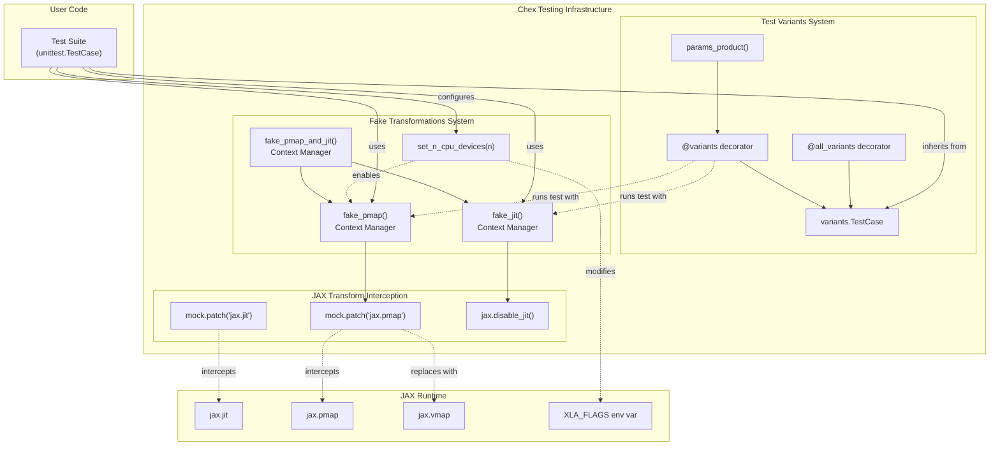
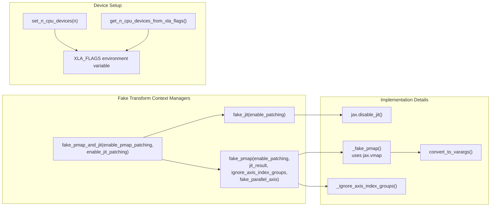
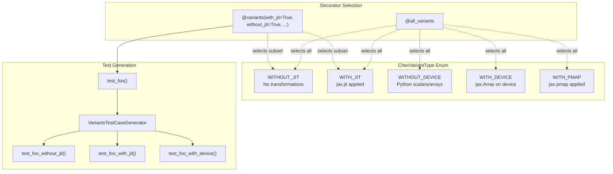
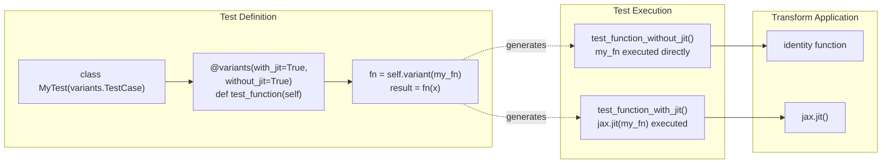
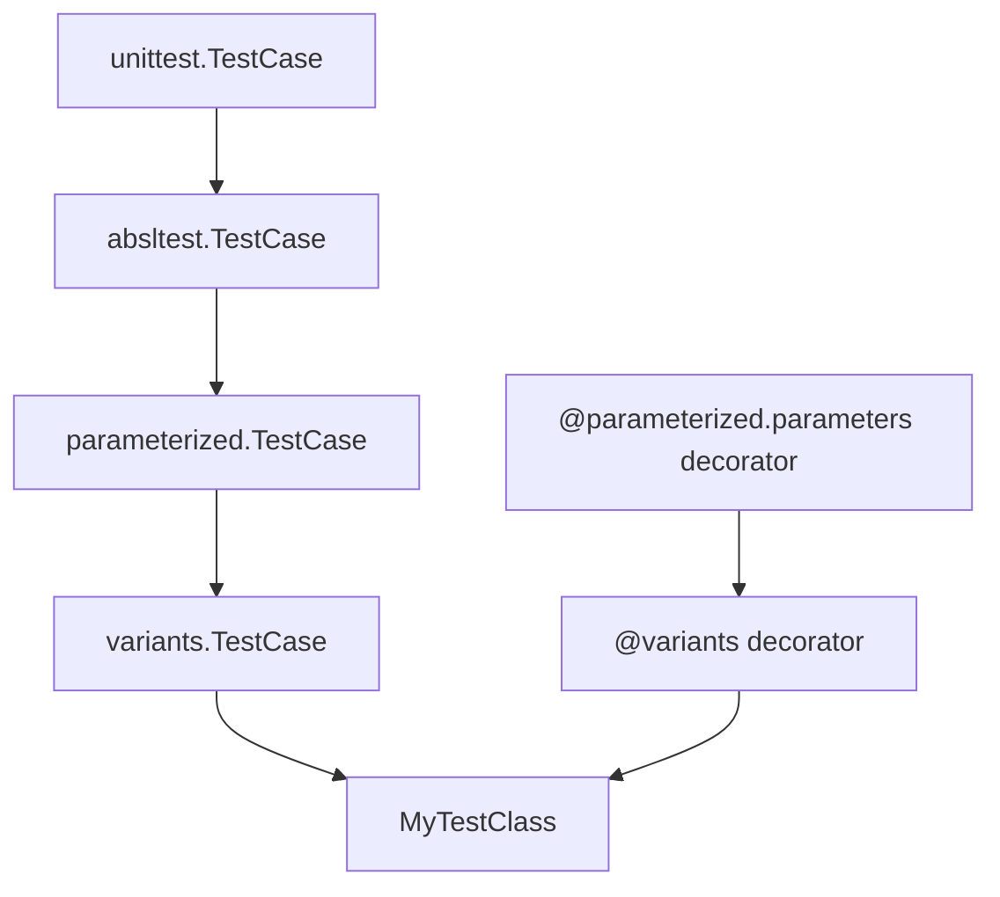
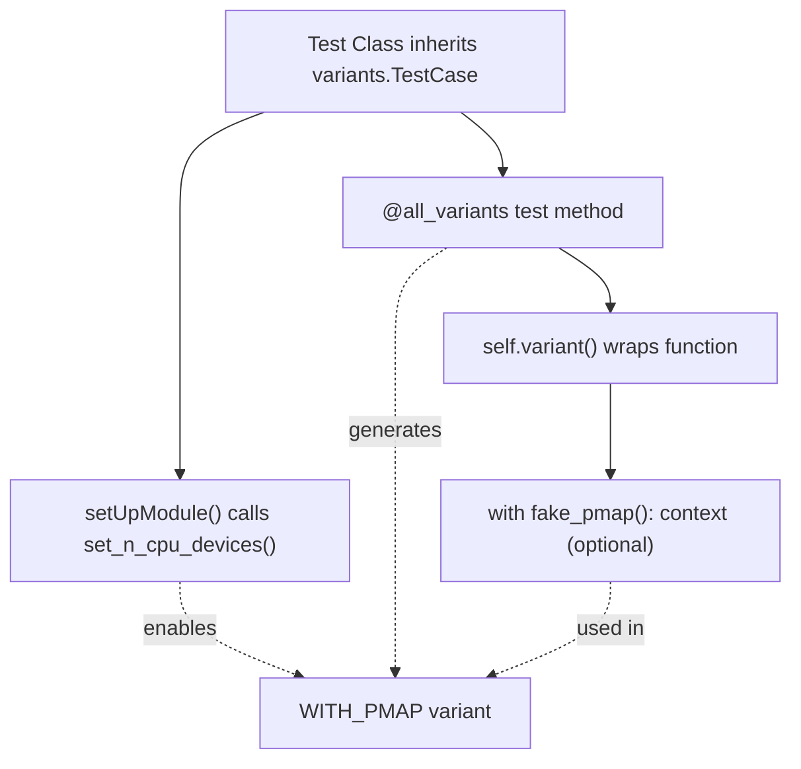
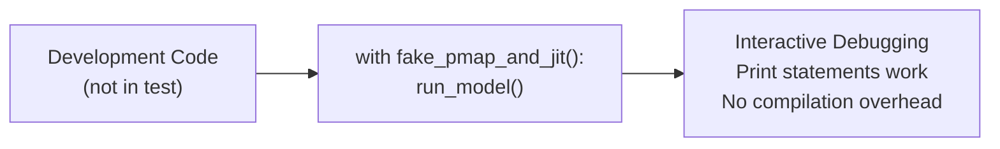
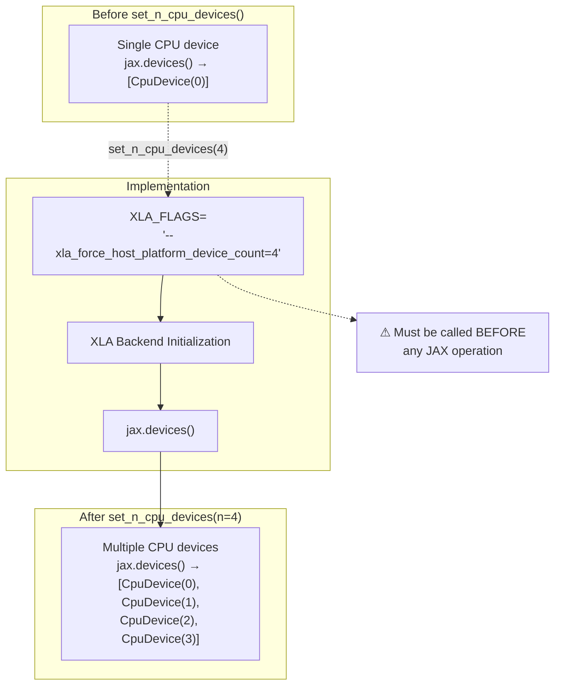

<!-- source: DeepWiki mcp.deepwiki.com · repo google-deepmind/chex · page 6 Testing Infrastructure · fetched 2026-10-26 -->

# Testing Infrastructure

<details>
<summary>Relevant source files</summary>

The following files were used as context for generating this wiki page:

- [chex/__init__.py](chex/__init__.py)
- [chex/_src/fake.py](chex/_src/fake.py)
- [chex/_src/fake_test.py](chex/_src/fake_test.py)
- [chex/_src/variants_test.py](chex/_src/variants_test.py)

</details>


## Purpose and Scope

This page provides an overview of Chex's testing infrastructure, which consists of two complementary systems for testing and debugging JAX code:

1. **Fake Transformations** - Replace JAX transformations (`jax.jit`, `jax.pmap`) with simpler equivalents for debugging
2. **Test Variants** - Automatically run tests across different JAX execution contexts (with/without JIT, with/without device placement, with pmap)

For detailed information about fake transformations, see [Fake Transformations](#6.1). For the test variants framework, see [Test Variants Framework](#6.2). For assertion utilities used in testing, see [Assertion System](#3).

**Sources:** [chex/__init__.py:77-101](), [chex/_src/fake.py:1-424]()

---

## Overview

Testing JAX code presents unique challenges because code behavior can differ significantly depending on execution context:

- **JIT compilation** changes how Python side effects execute
- **Device placement** affects array types and computation locations  
- **Parallel execution** (`pmap`) requires multiple devices and introduces collective operations

Chex's testing infrastructure addresses these challenges through two mechanisms:

| System | Purpose | Key Exports |
|--------|---------|-------------|
| Fake Transformations | Replace expensive JAX transforms for debugging | `fake_jit()`, `fake_pmap()`, `fake_pmap_and_jit()`, `set_n_cpu_devices()` |
| Test Variants | Run tests across execution contexts | `@variants`, `TestCase`, `params_product()`, `all_variants` |

**Sources:** [chex/__init__.py:77-102](), [chex/_src/fake.py:15-21]()

---

## Testing Infrastructure Architecture



**Diagram: Testing Infrastructure Components and Dependencies**

This architecture shows how the two testing systems integrate with JAX. The Fake Transformations system uses `unittest.mock.patch` to intercept JAX functions, while the Test Variants system generates multiple test executions across different configurations. Both systems can be used independently or together.

**Sources:** [chex/_src/fake.py:219-258](), [chex/_src/fake.py:260-328](), [chex/_src/variants.py]() (referenced), [chex/_src/fake_test.py:52-199]()

---

## Fake Transformations System

The fake transformations system provides context managers that replace JAX's compilation and parallelization primitives with simpler alternatives. This enables:

- **Interactive debugging** - Remove JIT compilation to enable print statements and debuggers
- **Faster iteration** - Skip expensive compilation during development
- **Single-device testing** - Test `pmap` code without multiple physical devices

### Core Functions



**Diagram: Fake Transformation Functions and Implementation**

**Sources:** [chex/_src/fake.py:219-258](), [chex/_src/fake.py:260-328](), [chex/_src/fake.py:330-353](), [chex/_src/fake.py:54-83]()

### Usage Patterns

| Pattern | Code | When to Use |
|---------|------|-------------|
| Context Manager | `with fake_jit():`<br/>`  @jax.jit`<br/>`  def f(x): ...` | Temporarily disable JIT for a code block |
| Start/Stop | `ctx = fake_jit()`<br/>`ctx.start()`<br/>`...`<br/>`ctx.stop()` | Manual control over fake scope |
| Test Setup | `def setUpModule():`<br/>`  fake.set_n_cpu_devices()` | Configure multi-device simulation for entire test module |
| Combined | `with fake_pmap_and_jit():`<br/>`  test_code()` | Disable both JIT and pmap |

**Sources:** [chex/_src/fake.py:219-258](), [chex/_src/fake_test.py:101-128](), [chex/_src/fake_test.py:33-34]()

### Key Implementation Details

The fake transformations work by intercepting JAX functions at runtime:

- **`fake_jit()`** - Calls `jax.disable_jit()` which makes JIT functions behave like identity functions [chex/_src/fake.py:255-257]()
- **`fake_pmap()`** - Uses `unittest.mock.patch` to replace `jax.pmap` with `_fake_pmap()`, which internally uses `jax.vmap` [chex/_src/fake.py:313]()
- **`_fake_pmap()`** - Converts pmap arguments to vmap-compatible form, handling `static_broadcasted_argnums` and `axis_name` [chex/_src/fake.py:124-203]()
- **`set_n_cpu_devices()`** - Modifies the `XLA_FLAGS` environment variable before XLA initialization to create virtual CPU devices [chex/_src/fake.py:54-83]()

**Sources:** [chex/_src/fake.py:219-258](), [chex/_src/fake.py:260-328](), [chex/_src/fake.py:124-203](), [chex/_src/fake.py:54-83]()

For detailed documentation of fake transformations, see [Fake Transformations](#6.1).

---

## Test Variants System

The test variants system automatically generates multiple test executions across different JAX execution contexts. Instead of writing separate tests for each configuration, you write one test and decorate it with `@variants`.

### Variant Types



**Diagram: Variant Types and Test Generation**

**Sources:** [chex/_src/variants.py]() (referenced from [chex/__init__.py:98-101]()), [chex/_src/variants_test.py:470-496]()

### Core Components

| Component | Type | Purpose |
|-----------|------|---------|
| `variants.TestCase` | Base Class | Extends `unittest.TestCase` with `self.variant` method |
| `@variants` | Decorator | Decorates test methods, specifies which variants to run |
| `@all_variants` | Decorator | Shorthand for all variant types |
| `self.variant` | Method | Wraps test functions with appropriate transformations |
| `params_product()` | Function | Generates parameter combinations for parameterized tests |

**Sources:** [chex/__init__.py:97-101](), [chex/_src/variants_test.py:62-200]()

### Usage Example



**Diagram: Test Variants Execution Flow**

**Sources:** [chex/_src/variants_test.py:587-599](), [chex/_src/variants_test.py:111-117]()

### Integration with absltest and parameterized

The variants system integrates with `absltest.TestCase` and `parameterized.TestCase`:



**Diagram: Test Class Inheritance and Decorator Order**

**Important:** The `@variants` decorator must be applied **before** `@parameterized.parameters` or `@parameterized.named_parameters`. The correct order is:
```python
@variants(...)
@parameterized.parameters(...)
def test_method(self, param):
    ...
```

**Sources:** [chex/_src/variants_test.py:327-358](), [chex/_src/variants_test.py:379-416](), [chex/_src/variants_test.py:360-377]()

For detailed documentation of the variants framework, see [Test Variants Framework](#6.2).

---

## Integration Patterns

The fake transformations and variants systems can be used together or independently:

### Pattern 1: Variants with Fake Transformations in Tests



**Diagram: Combined Usage Pattern**

This pattern is common when you want comprehensive testing:
1. Use `set_n_cpu_devices()` in module setup to enable multi-device simulation
2. Use `@all_variants` to test all execution modes
3. Optionally use `fake_pmap()` within specific tests for additional debugging

**Sources:** [chex/_src/fake_test.py:33-35](), [chex/_src/variants_test.py:52-56](), [chex/_src/fake_test.py:184-199]()

### Pattern 2: Fake Transformations for Interactive Development



Use fake transformations directly in scripts or notebooks to debug JAX code without writing formal tests.

**Sources:** [chex/_src/fake.py:222-253](), [chex/_src/fake.py:266-304]()

### Pattern 3: Conditional Faking

Both systems support conditional enabling:

```python
# Fake transformations
enable_fake = FLAGS.debug_mode
with fake_jit(enable_patching=enable_fake):
    ...

# Variants can be combined
@variants(with_jit=True)
@variants(without_jit=use_python_mode)
def test_method(self):
    ...
```

**Sources:** [chex/_src/fake.py:248-249](), [chex/_src/variants_test.py:519-524]()

---

## Multi-Device Testing Setup

Testing parallel JAX code (`jax.pmap`) typically requires multiple physical devices (GPUs/TPUs). Chex provides `set_n_cpu_devices()` to simulate multiple devices using CPU threads:



**Diagram: Multi-Device Setup Process**

### Critical Timing Constraint

`set_n_cpu_devices()` **must** be called before any JAX operation, including:
- `jax.devices()`
- Any JAX computation
- Importing modules that use JAX

The function modifies the `XLA_FLAGS` environment variable, which is only read during XLA backend initialization. After initialization, the function will raise a `RuntimeError`.

**Sources:** [chex/_src/fake.py:54-83](), [chex/_src/fake.py:72-77]()

### Common Setup Pattern

```python
# At module level in test file
from chex._src import fake

def setUpModule():
    """Called once before any tests in this module."""
    fake.set_n_cpu_devices()  # Uses FLAGS.chex_n_cpu_devices (default: 1)
```

This pattern ensures multi-device simulation is configured before test execution begins.

**Sources:** [chex/_src/fake_test.py:33-35](), [chex/_src/variants_test.py:52-56]()

### Flags for Device Configuration

```python
# Command-line flags
--chex_n_cpu_devices=4  # Number of CPU devices to create
--chex_assert_multiple_cpu_devices  # Fail if < 2 devices available
```

**Sources:** [chex/_src/fake.py:36-39]()

---

## Parallel Operations Compatibility

When using `fake_pmap()`, parallel operations behave differently than under true `pmap`:

```mermaid
graph TB
    subgraph "Real jax.pmap"
        PMAP_REAL["jax.pmap(fn, axis_name='i')"]
        PARALLEL_REAL["Parallel Operations<br/>jax.lax.psum(x, 'i')<br/>jax.lax.all_gather(x, 'i', axis_index_groups=[...])"]
        DEVICES_REAL["Executes on multiple<br/>physical devices"]
        
        PMAP_REAL --> PARALLEL_REAL
        PARALLEL_REAL --> DEVICES_REAL
    end
    
    subgraph "fake_pmap()"
        PMAP_FAKE["fake_pmap() → jax.vmap"]
        PARALLEL_FAKE["Parallel Operations<br/>jax.lax.psum(x, 'i') ✓<br/>jax.lax.all_gather(x, 'i', axis_index_groups=None) ✓"]
        DEVICES_FAKE["Executes on single device<br/>with vmap"]
        
        PMAP_FAKE --> PARALLEL_FAKE
        PARALLEL_FAKE --> DEVICES_FAKE
    end
    
    subgraph "Compatibility Option"
        IGNORE["fake_pmap(<br/>ignore_axis_index_groups=True)"]
        FORCED["axis_index_groups forced to None"]
        WARNING["⚠ Different results than pmap"]
        
        IGNORE --> FORCED
        FORCED --> WARNING
    end
```



**Diagram: Parallel Operations Under fake_pmap**

The `axis_index_groups` parameter is not supported in `vmap`. If your code uses this parameter, you must pass `ignore_axis_index_groups=True` to `fake_pmap()`, which patches parallel operations to ignore this parameter. **Note:** This produces different results than real `pmap`.

**Sources:** [chex/_src/fake.py:91-120](), [chex/_src/fake.py:295-299](), [chex/_src/fake.py:315-323]()

---

## Summary

Chex's testing infrastructure provides two complementary tools:

| System | Primary Use Case | Key Benefits |
|--------|------------------|--------------|
| **Fake Transformations** | Debugging and development | Remove compilation overhead, enable print debugging, test pmap on single device |
| **Test Variants** | Comprehensive test coverage | Automatically test code across execution modes, catch mode-specific bugs |

Both systems integrate seamlessly with standard Python testing frameworks (`unittest`, `absltest`, `parameterized`) and can be used independently or together depending on testing needs.

**Sources:** [chex/_src/fake.py:1-424](), [chex/__init__.py:77-101]()

---

