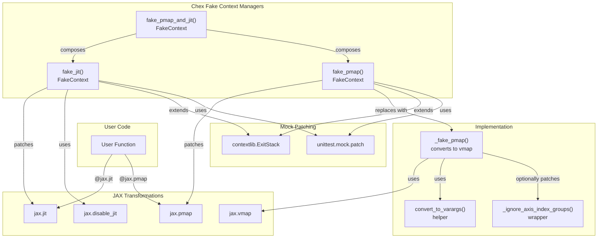
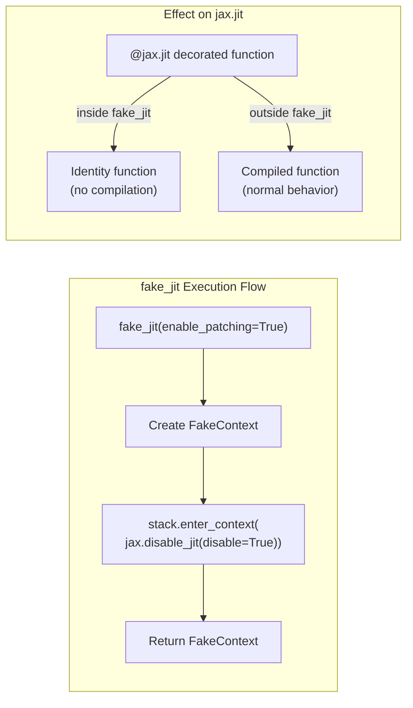
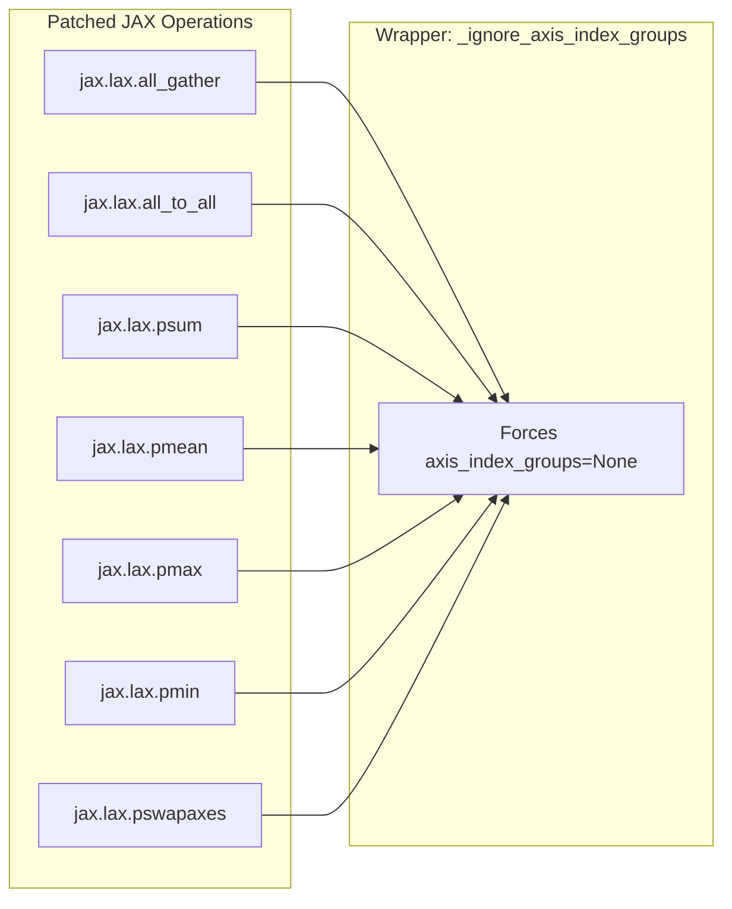
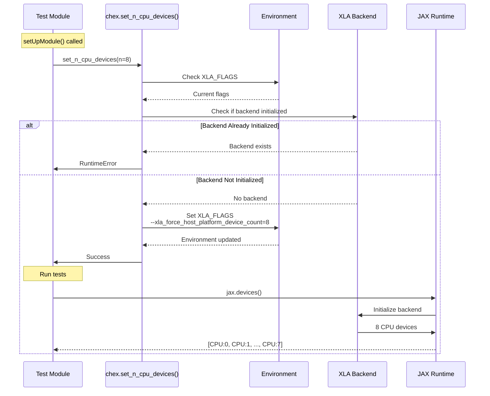
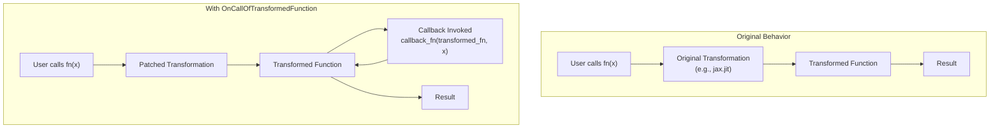
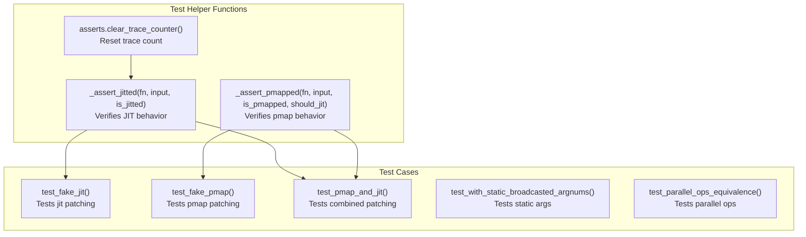

<!-- source: DeepWiki mcp.deepwiki.com · repo google-deepmind/chex · page 6.1 Fake Transformations · fetched 2026-10-26 -->

# Fake Transformations

<details>
<summary>Relevant source files</summary>

The following files were used as context for generating this wiki page:

- [README.md](README.md)
- [chex/_src/asserts_test.py](chex/_src/asserts_test.py)
- [chex/_src/fake.py](chex/_src/fake.py)
- [chex/_src/fake_test.py](chex/_src/fake_test.py)

</details>


## Purpose and Scope

This page documents Chex's fake transformation utilities, which replace expensive JAX transformations (`jax.jit`, `jax.pmap`) with simpler equivalents for debugging purposes. These tools allow developers to disable compilation and parallalization temporarily, making it easier to inspect code behavior, trace execution, and debug issues that are obscured by JAX's optimizations.

For information about testing variants that exercise code with and without transformations, see [Test Variants Framework](#6.2). For using assertions within JIT-compiled code, see [Chexify: Assertions in JIT-Compiled Code](#3.5).

**Sources:** [chex/_src/fake.py:1-424](), [README.md:345-381]()

---

## System Overview

Fake transformations work by patching JAX's transformation functions at runtime using Python's `unittest.mock` module. When enabled, calls to `jax.jit` and `jax.pmap` are intercepted and replaced with debugging-friendly alternatives.

### Fake Transformation Architecture



**Sources:** [chex/_src/fake.py:207-352](), [chex/_src/fake.py:23-33]()

---

## FakeContext: Base Context Manager

The `FakeContext` class provides a common interface for all fake transformation context managers. It extends `contextlib.ExitStack` to manage multiple context managers simultaneously.

### FakeContext Implementation

| Method | Description |
|--------|-------------|
| `start()` | Manually enter the context (alternative to `with` statement) |
| `stop()` | Manually exit the context |
| `__enter__()` | Standard context manager entry (inherited from ExitStack) |
| `__exit__()` | Standard context manager exit (inherited from ExitStack) |

**Sources:** [chex/_src/fake.py:207-216]()

---

## Fake JIT (`fake_jit`)

The `fake_jit()` function creates a context where `jax.jit` is replaced with an identity transformation, effectively disabling JIT compilation. This is implemented by calling `jax.disable_jit()` internally.

### Function Signature

```python
def fake_jit(enable_patching: bool = True) -> FakeContext
```

### Parameters

- `enable_patching`: Whether to actually patch `jax.jit` (default: `True`)

### Usage Patterns

**As Context Manager:**
```python
with chex.fake_jit():
    @jax.jit
    def foo(x):
        return x * 2  # Runs without compilation
    
    result = foo(input)
```

**With Start/Stop:**
```python
fake_jit_context = chex.fake_jit()
fake_jit_context.start()

@jax.jit
def foo(x):
    return x * 2  # Runs without compilation

fake_jit_context.stop()
```

### Implementation Details



**Sources:** [chex/_src/fake.py:219-258]()

---

## Fake PMap (`fake_pmap`)

The `fake_pmap()` function replaces `jax.pmap` with a non-parallel `jax.vmap` transformation. This allows debugging code intended for multi-device execution on a single device.

### Function Signature

```python
def fake_pmap(
    enable_patching: bool = True,
    jit_result: bool = False,
    ignore_axis_index_groups: bool = False,
    fake_parallel_axis: bool = False,
) -> FakeContext
```

### Parameters

| Parameter | Type | Default | Description |
|-----------|------|---------|-------------|
| `enable_patching` | `bool` | `True` | Whether to patch `jax.pmap` |
| `jit_result` | `bool` | `False` | Whether to JIT the vmapped result |
| `ignore_axis_index_groups` | `bool` | `False` | Force `axis_index_groups=None` in parallel ops (compatibility option) |
| `fake_parallel_axis` | `bool` | `False` | Add/remove a fake parallel axis dimension |

### Transformation: pmap → vmap

```mermaid
graph TB
    subgraph "Normal: jax.pmap"
        PMAP_IN["Input: [devices, ...]"]
        PMAP_FN["Function pmapped<br/>across devices"]
        PMAP_OUT["Output: ShardedArray<br/>[devices, ...]"]
        
        PMAP_IN --> PMAP_FN
        PMAP_FN --> PMAP_OUT
    end
    
    subgraph "Fake: _fake_pmap using vmap"
        VMAP_IN["Input: [batch, ...]"]
        VMAP_FN["Function vmapped<br/>across batch dimension"]
        VMAP_OUT["Output: Array<br/>[batch, ...]"]
        
        VMAP_IN --> VMAP_FN
        VMAP_FN --> VMAP_OUT
    end
    
    subgraph "Implementation Steps"
        CONVERT["convert_to_varargs()<br/>Convert kwargs to args"]
        HANDLE_STATIC["Handle<br/>static_broadcasted_argnums"]
        APPLY_VMAP["Apply jax.vmap"]
        OPT_JIT["Optionally apply jax.jit"]
        
        CONVERT --> HANDLE_STATIC
        HANDLE_STATIC --> APPLY_VMAP
        APPLY_VMAP --> OPT_JIT
    end
```



### Static Broadcasted Arguments

The `fake_pmap` implementation correctly handles `static_broadcasted_argnums`, which are arguments that should not be mapped over. The implementation:

1. Captures original static arguments before `vmap` transformation
2. Replaces static arguments with dummy constants during `vmap` to prevent them from becoming tracers
3. Injects original static argument values back into the function

**Sources:** [chex/_src/fake.py:123-203](), [chex/_src/fake.py:260-328]()

---

## Parallel Operations Patching

When `ignore_axis_index_groups=True`, `fake_pmap` also patches JAX's parallel operations to ensure compatibility with `vmap` (which doesn't support `axis_index_groups`).

### Patched Operations



**Warning:** When `ignore_axis_index_groups=True`, results will differ from running under actual `jax.pmap` if the original code uses `axis_index_groups`.

**Sources:** [chex/_src/fake.py:91-120](), [chex/_src/fake.py:315-322]()

---

## Combined Fake (`fake_pmap_and_jit`)

The `fake_pmap_and_jit()` function provides a convenient way to patch both `jax.jit` and `jax.pmap` simultaneously.

### Function Signature

```python
def fake_pmap_and_jit(
    enable_pmap_patching: bool = True,
    enable_jit_patching: bool = True
) -> FakeContext
```

### Usage Example

```python
with chex.fake_pmap_and_jit():
    @jax.pmap
    @jax.jit
    def foo(x):
        return x * 2
    
    # Function runs as vmap without compilation
    result = foo(inputs)
```

**Note:** Calling real `jax.pmap` compiles the function implicitly, so faking only `jax.jit` won't prevent compilation in that case.

**Sources:** [chex/_src/fake.py:330-352]()

---

## Multi-Device Simulation (`set_n_cpu_devices`)

The `set_n_cpu_devices()` function allows testing multi-device code on a single CPU by forcing XLA to treat CPU threads as separate devices.

### Function Signature

```python
def set_n_cpu_devices(n: Optional[int] = None) -> None
```

### Parameters

- `n`: Number of CPU devices to create (defaults to `FLAGS.chex_n_cpu_devices`)

### Multi-Device Setup Flow



### Important Constraints

1. **Must be called before any JAX operations** - Once XLA backends are initialized, the device count cannot be changed
2. **Call in `setUpModule()`** - For test modules, define this function:

```python
def setUpModule():
    chex.set_n_cpu_devices(n=8)
```

3. **Command-line control** - Can be controlled via flag:
```bash
python test.py --chex_n_cpu_devices=8
```

### Associated Flags

| Flag | Type | Default | Description |
|------|------|---------|-------------|
| `--chex_n_cpu_devices` | `int` | `1` | Number of CPU threads to use as devices |
| `--chex_assert_multiple_cpu_devices` | `bool` | `False` | Fail if CPU devices < 2 |

**Sources:** [chex/_src/fake.py:54-83](), [chex/_src/fake.py:36-43](), [README.md:383-408]()

---

## Advanced: OnCallOfTransformedFunction

The `OnCallOfTransformedFunction` class injects a callback into any transformed function, useful for debugging, profiling, or monitoring.

### Class Structure

```python
class OnCallOfTransformedFunction:
    def __init__(self, fn_transformation: str, callback_fn: Callable[..., Any])
    def __enter__(self)
    def __exit__(self, *unused_args)
```

### Usage Example

**Print all JIT-compiled function calls:**
```python
with chex.OnCallOfTransformedFunction('jax.jit', print):
    # Any jax.jit calls within this block will be printed
    @jax.jit
    def foo(x):
        return x * 2
    
    foo(jnp.ones(5))  # Prints function info
```

**Profile first call of JIT functions:**
```python
class ProfileOnce:
    def __init__(self):
        self._first_call = True
    
    def __call__(self, fn, *args, **kwargs):
        if self._first_call:
            self._first_call = False
            print(profile_from_HLO(fn.lower(*args, **kwargs)))

with chex.OnCallOfTransformedFunction('jax.jit', ProfileOnce()):
    # Code that calls jitted functions
    pass
```

### Implementation Mechanism



**Sources:** [chex/_src/fake.py:355-423]()

---

## Complete API Reference

### Main Functions

| Function | Return Type | Description |
|----------|-------------|-------------|
| `fake_jit(enable_patching)` | `FakeContext` | Disable JIT compilation |
| `fake_pmap(enable_patching, jit_result, ignore_axis_index_groups, fake_parallel_axis)` | `FakeContext` | Replace pmap with vmap |
| `fake_pmap_and_jit(enable_pmap_patching, enable_jit_patching)` | `FakeContext` | Disable both JIT and pmap |
| `set_n_cpu_devices(n)` | `None` | Create multiple CPU devices for testing |

### Helper Functions

| Function | Purpose |
|----------|---------|
| `convert_to_varargs(sig, *args, **kwargs)` | Convert function arguments to positional-only form |
| `get_n_cpu_devices_from_xla_flags()` | Parse CPU device count from XLA_FLAGS environment variable |
| `_ignore_axis_index_groups(fn)` | Wrapper forcing `axis_index_groups=None` |

### Internal Implementation

| Function | Description |
|----------|-------------|
| `_fake_pmap(fn, axis_name, in_axes, static_broadcasted_argnums, jit_result, fake_parallel_axis, **unused_kwargs)` | Core implementation replacing pmap with vmap |

**Sources:** [chex/_src/fake.py:1-424]()

---

## Common Usage Patterns

### Pattern 1: Debugging JIT Compilation Issues

```python
# Problem: Can't inspect intermediate values in jitted code
with chex.fake_jit():
    @jax.jit
    def debug_fn(x):
        # Now you can add print statements
        print(f"Intermediate value: {x.shape}")
        return x * 2
    
    result = debug_fn(inputs)
```

### Pattern 2: Testing PMap Code Without Multiple Devices

```python
def setUpModule():
    # Simulate 4 devices on single CPU
    chex.set_n_cpu_devices(4)

class MyTest(chex.TestCase):
    def test_parallel_computation(self):
        @jax.pmap
        def parallel_fn(x):
            return x * 2
        
        # Test with 4 devices
        inputs = jnp.ones((4, 10))
        results = parallel_fn(inputs)
```

### Pattern 3: Debugging PMap with Fake

```python
with chex.fake_pmap():
    # pmap is replaced with vmap
    @jax.pmap
    def debug_parallel(x):
        # Can now use debugger, print, etc.
        return jax.lax.psum(x, axis_name='i')
    
    result = debug_parallel(inputs)
```

### Pattern 4: Profiling JIT-Compiled Functions

```python
call_count = 0

def profile_callback(transformed_fn, *args, **kwargs):
    global call_count
    call_count += 1
    print(f"Call {call_count}: {transformed_fn.__name__}")

with chex.OnCallOfTransformedFunction('jax.jit', profile_callback):
    # All jax.jit calls in this block are tracked
    run_model_training()
```

**Sources:** [chex/_src/fake_test.py:37-454](), [README.md:345-381]()

---

## Testing with Fake Transformations

The `fake_test.py` module demonstrates comprehensive testing patterns:

### Key Test Utilities



### Verification Strategy

Tests verify fake behavior by:
1. **Trace counting** - Use `assert_max_traces` to detect if functions are compiled
2. **Output type inspection** - Check if results are `ShardedArray` (real pmap) vs `Array` (fake pmap)
3. **Functional equivalence** - Verify fake results match real results on single device

**Sources:** [chex/_src/fake_test.py:1-454]()

---

