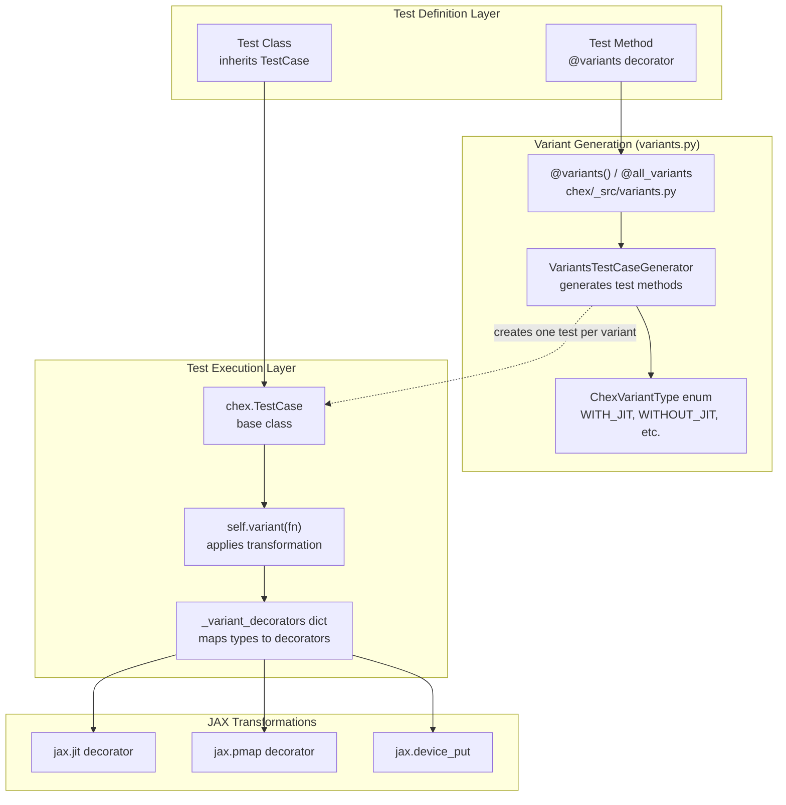
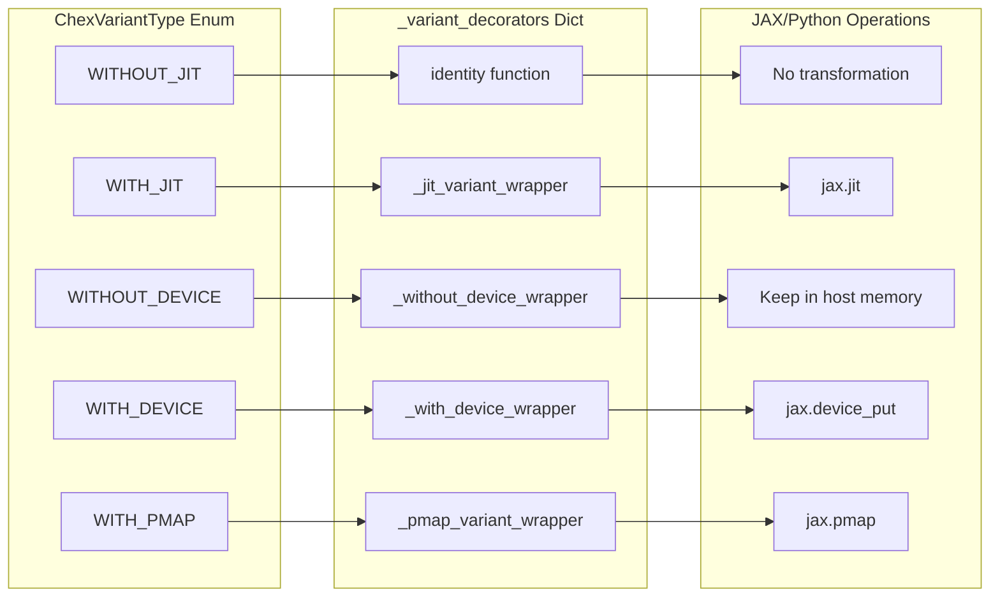
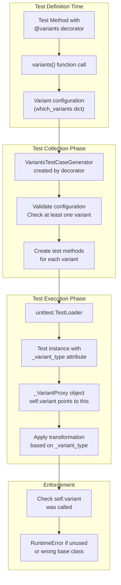
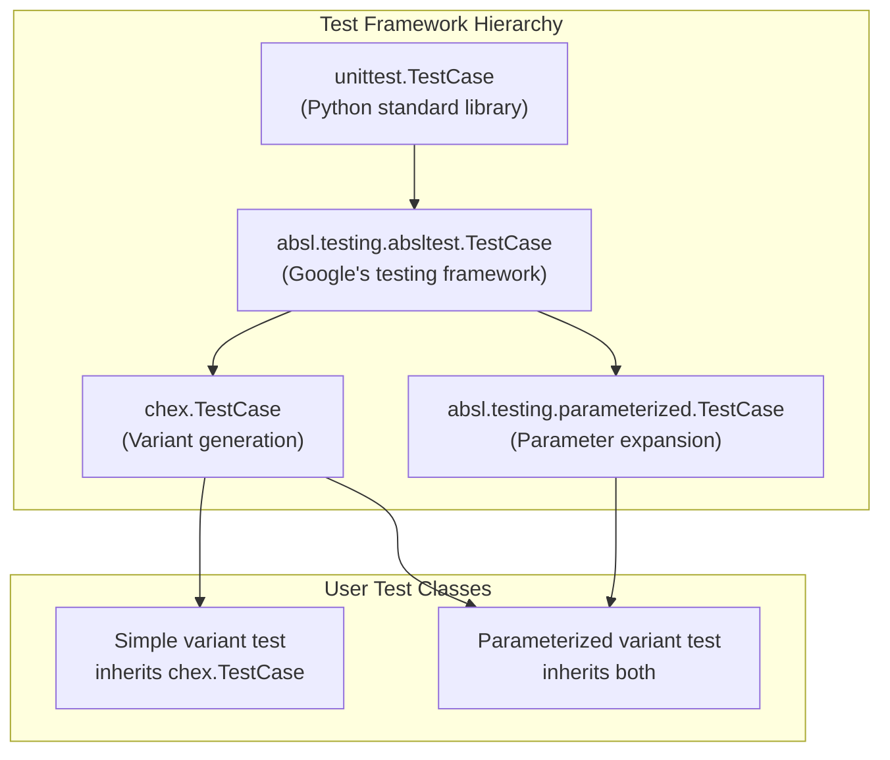

<!-- source: DeepWiki mcp.deepwiki.com · repo google-deepmind/chex · page 6.2 Test Variants Framework · fetched 2026-10-26 -->

# Test Variants Framework

<details>
<summary>Relevant source files</summary>

The following files were used as context for generating this wiki page:

- [README.md](README.md)
- [chex/__init__.py](chex/__init__.py)
- [chex/_src/variants_test.py](chex/_src/variants_test.py)

</details>


## Purpose and Scope

The Test Variants Framework enables comprehensive testing of JAX code across different execution contexts (JIT-compiled, pmapped, device-placed) by automatically generating multiple test cases from a single test method. This system ensures that functions behave correctly under all JAX transformations they may encounter in production.

For information about debugging JAX transformations with fake replacements, see [Fake Transformations](#6.1). For assertions that work across different JAX contexts, see [Assertion System](#3).

**Sources:** [README.md:237-319](), [chex/__init__.py:97-101]()

---

## Core Concepts

### Why Variants Matter

JAX code can behave differently under various transformations:
- **Without JIT:** Functions execute as normal Python, values are concrete
- **With JIT:** Functions are traced once, operations become XLA computations
- **With Device:** Arrays live in device memory (GPU/TPU)
- **Without Device:** Arrays remain in host memory
- **With pmap:** Functions execute in parallel across multiple devices

Testing only one configuration can miss bugs that manifest under different transformations. The variants framework automates testing across all relevant configurations.

**Sources:** [README.md:239-245]()

### Architecture Overview



**Sources:** [chex/_src/variants_test.py:1-948](), [chex/__init__.py:97-101]()

---

## Basic Usage

### TestCase Base Class

All tests using variants **must** inherit from `chex.TestCase`. This base class provides the test generation machinery and the `self.variant` method.

```python
import chex

class MyTest(chex.TestCase):
    # Test methods go here
    pass
```

The test runner will detect `@variants` decorators and generate separate test methods for each variant.

**Sources:** [README.md:322-325](), [chex/_src/variants_test.py:249-258]()

### @variants Decorator

The `@variants` decorator specifies which execution contexts to test. It accepts boolean keyword arguments for each variant type:

```python
@chex.variants(with_jit=True, without_jit=True)
def test_my_function(self):
    # This test will run twice:
    # 1. test_my_function__with_jit
    # 2. test_my_function__without_jit
    pass
```

**Available Variant Arguments:**

| Argument | Description | Transformation Applied |
|----------|-------------|----------------------|
| `with_jit` | Apply JIT compilation | `jax.jit()` |
| `without_jit` | No transformation (identity) | None |
| `with_device` | Place arguments on device | `jax.device_put()` |
| `without_device` | Keep arguments in host memory | None |
| `with_pmap` | Parallel map across devices | `jax.pmap()` |

**Sources:** [README.md:309-317](), [chex/__init__.py:97-101]()

### self.variant() Method

Inside a test method decorated with `@variants`, use `self.variant(fn)` to apply the current variant's transformation:

```python
class ExampleTest(chex.TestCase):
    
    @chex.variants(with_jit=True, without_jit=True)
    def test_addition(self):
        def add(x, y):
            return x + y
        
        # Apply the current variant's transformation
        var_add = self.variant(add)
        
        # Test the transformed function
        result = var_add(1, 2)
        self.assertEqual(result, 3)
```

The `self.variant` method can also be used as a decorator:

```python
@chex.variants(with_jit=True, without_jit=True)
def test_with_decorator(self):
    @self.variant
    def multiply(x, y):
        return x * y
    
    self.assertEqual(multiply(3, 4), 12)
```

**Important:** Every test method with `@variants` **must** call `self.variant` at least once, or a `RuntimeError` will be raised.

**Sources:** [README.md:251-268](), [chex/_src/variants_test.py:111-126]()

---

## Variant Types

### Variant Type Mapping



**Sources:** [chex/_src/variants_test.py:470-495]()

### with_jit / without_jit

**`with_jit=True`:** Applies `jax.jit()` to the function. This tests that the function works correctly when compiled to XLA.

**`without_jit=True`:** Applies no transformation. The function executes as normal Python code.

**Key Difference:** JIT compilation traces the function once and caches the compiled version. Side effects during tracing (like incrementing counters) execute only once, while without JIT they execute every call.

```python
@chex.variants(with_jit=True, without_jit=True)
def test_jit_behavior(self):
    execution_count = [0]
    
    @self.variant
    def fn(x):
        execution_count[0] += 1
        return x + 1
    
    fn(5)
    fn(5)
    
    # with_jit: execution_count[0] == 1 (traced once)
    # without_jit: execution_count[0] == 2 (executed twice)
```

**Configuration Options for `with_jit`:**
- `static_argnums`: Tuple of argument positions to treat as static
- `static_argnames`: String or tuple of keyword argument names to treat as static

**Sources:** [chex/_src/variants_test.py:595-656](), [chex/_src/variants_test.py:83-108]()

### with_device / without_device

**`with_device=True`:** Places all function arguments (except those in `ignore_argnums`) on device using `jax.device_put()` before calling the function.

**`without_device=True`:** Keeps arguments in host memory. Ensures they are NOT `jax.Array` instances.

```python
@chex.variants(with_device=True, without_device=True)
def test_device_placement(self):
    @self.variant
    def check_type(x):
        # with_device: x is jax.Array
        # without_device: x is not jax.Array
        return x + 1
    
    result = check_type(42)
```

**Configuration Options for `with_device`:**
- `ignore_argnums`: Tuple of argument positions to NOT place on device

**Sources:** [chex/_src/variants_test.py:658-715](), [README.md:313-315]()

### with_pmap

**`with_pmap=True`:** Applies `jax.pmap()` to the function, testing parallel execution across devices.

**Special Behavior:**
- Skipped by default when only 1 device is available (since pmap reduces to jit in single-device)
- Use `--chex_skip_pmap_variant_if_single_device=false` to disable skipping
- Arguments are broadcast to all devices by default
- Results have an extra leading dimension for device count

**Configuration Options:**
- `n_devices`: Number of devices to use (defaults to all available)
- `backend`: Backend to use ('cpu', 'gpu', 'tpu')
- `axis_name`: Name for the pmap axis (default: 'i')
- `reduce_fn`: Function to reduce across devices (default: `jnp.sum`)
- `broadcast_args_to_devices`: Whether to broadcast args (default: True)
- `in_axes`: Input axis specifications (like `jax.pmap`)
- `static_argnums`: Tuple of static argument positions

```python
@chex.variants(with_pmap=True)
def test_pmap_parallel(self):
    @self.variant(n_devices=2, backend='cpu')
    def parallel_sum(x):
        # x is distributed across devices
        return jax.lax.psum(x, axis_name='i')
    
    result = parallel_sum(jnp.ones(5))
    # result shape: (2, 5) - one copy per device
```

**Sources:** [README.md:334-343](), [chex/_src/variants_test.py:717-943]()

---

## Advanced Usage Patterns

### Combining with Parameterized Tests

The variants framework integrates seamlessly with `absl.testing.parameterized`:

```python
from absl.testing import parameterized

class ParameterizedVariantTest(parameterized.TestCase):
    
    @chex.variants(with_jit=True, without_jit=True)
    @parameterized.named_parameters(
        ('positive', 1, 2, 3),
        ('negative', -1, -2, -3),
    )
    def test_addition(self, a, b, expected):
        @self.variant
        def add(x, y):
            return x + y
        
        self.assertEqual(add(a, b), expected)
```

**Critical Ordering:** The `@chex.variants` decorator **must** come before `@parameterized` decorators. Incorrect ordering raises a `RuntimeError`.

**Generated Test Count:** With 2 variants and 2 parameter sets, this generates 4 tests:
- `test_addition__with_jit__positive`
- `test_addition__with_jit__negative`
- `test_addition__without_jit__positive`
- `test_addition__without_jit__negative`

**Sources:** [chex/_src/variants_test.py:286-307](), [chex/_src/variants_test.py:379-416](), [README.md:286-307]()

### @all_variants

The `@all_variants` decorator is a shorthand for enabling all supported variants:

```python
@chex.all_variants  # Can omit parentheses
def test_all_contexts(self):
    @self.variant
    def fn(x):
        return x * 2
    
    self.assertEqual(fn(21), 42)
```

This is equivalent to:
```python
@chex.variants(
    with_jit=True,
    without_jit=True,
    with_device=True,
    without_device=True,
    with_pmap=True
)
```

**Note:** The `with_pmap` variant is included but may be skipped if only one device is available.

**Configuration:** You can pass keyword arguments to disable specific variants:
```python
@chex.all_variants(with_pmap=False)  # All except pmap
```

**Sources:** [chex/__init__.py:111](), [chex/_src/variants_test.py:546-556]()

### Stacking Multiple @variants Decorators

Multiple `@variants` decorators can be stacked to test combinations:

```python
@chex.variants(with_jit=True)
@chex.variants(without_jit=False)  # Explicitly disable
@chex.variants(with_device=True)
@chex.variants(without_device=False)
def test_stacked(self):
    # Generates 2 tests:
    # - with_jit + with_device
    # - with_jit + without_device
    pass
```

Setting a variant to `False` explicitly disables it.

**Sources:** [chex/_src/variants_test.py:515-535]()

### params_product Utility

The `params_product` function generates Cartesian products of parameter sets:

```python
param_set_1 = (('x1', 1, 10), ('x2', 2, 20))
param_set_2 = (('y1', 3), ('y2', 4))

# Product generates all combinations
product = chex.params_product(param_set_1, param_set_2, named=True)
# Yields:
# ('x1_y1', 1, 10, 3)
# ('x1_y2', 1, 10, 4)
# ('x2_y1', 2, 20, 3)
# ('x2_y2', 2, 20, 4)
```

This is useful for combining variant tests with multiple parameter dimensions.

**Sources:** [chex/_src/variants_test.py:203-243](), [chex/__init__.py:99]()

---

## Implementation Architecture

### Test Generation Flow



**Sources:** [chex/_src/variants_test.py:246-325]()

### Key Implementation Components

| Component | Purpose | Location |
|-----------|---------|----------|
| `variants()` | Decorator function that creates test generators | Exported from variants.py |
| `TestCase` | Base class providing variant machinery | chex._src.variants |
| `ChexVariantType` | Enum of available variant types | chex._src.variants |
| `_variant_decorators` | Dict mapping variant types to decorators | Internal to variants.py |
| `VariantsTestCaseGenerator` | Generator class that creates test methods | Internal to variants.py |
| `_VariantProxy` | Wrapper object that applies transformations | Internal to variants.py |

**Sources:** [chex/__init__.py:97-101]()

### Variant Type Access

Inside a variant test, you can access the current variant type:

```python
@chex.all_variants
def test_variant_info(self):
    fn = self.variant(lambda x: x)
    
    # Access the variant type
    variant_type = self.variant.type
    
    # variant_type is a ChexVariantType enum member
    # e.g., ChexVariantType.WITH_JIT
```

**Sources:** [chex/_src/variants_test.py:470-487]()

---

## Multi-Device Testing

### Setting Up CPU Devices

For testing pmap variants without access to multiple physical devices, Chex can simulate multiple devices using CPU threads:

```python
def setUpModule():
    """Module-level setup for multi-device tests."""
    chex.set_n_cpu_devices()
```

This function reads the `--chex_n_cpu_devices=N` flag and configures XLA to use N CPU threads as separate devices.

**Usage:**
```bash
python my_test.py --chex_n_cpu_devices=4
```

All tests in the module will have access to 4 simulated devices.

**Sources:** [chex/_src/variants_test.py:52-56](), [README.md:396-407]()

### Device-Aware Test Configuration

```python
@chex.variants(with_pmap=True)
def test_multi_device(self):
    n_devices = jax.device_count()
    
    @self.variant(n_devices=n_devices, backend='cpu')
    def parallel_fn(x):
        return jax.lax.psum(x, axis_name='i')
    
    # x will be broadcast to all devices
    result = parallel_fn(jnp.ones(10))
    # result shape: (n_devices, 10)
```

**Sources:** [chex/_src/variants_test.py:735-778]()

---

## Best Practices and Common Pitfalls

### Must Inherit from chex.TestCase

**Problem:** Using `@variants` with `absltest.TestCase` or `unittest.TestCase` directly.

```python
# WRONG - Will raise RuntimeError
class MyTest(absltest.TestCase):
    @chex.all_variants
    def test_something(self):
        pass
```

**Solution:** Inherit from `chex.TestCase`:
```python
# CORRECT
class MyTest(chex.TestCase):
    @chex.all_variants
    def test_something(self):
        pass
```

**Sources:** [chex/_src/variants_test.py:307-325]()

### Must Call self.variant

**Problem:** Decorating a test with `@variants` but never calling `self.variant()`.

```python
@chex.variants(with_jit=True)
def test_forgot_variant(self):
    result = my_function(42)  # Should use self.variant(my_function)
    self.assertEqual(result, 84)
# RuntimeError: Test is wrapped with @variants but never calls self.variant
```

**Solution:** Always apply the variant transformation:
```python
@chex.variants(with_jit=True)
def test_correct(self):
    var_fn = self.variant(my_function)
    result = var_fn(42)
    self.assertEqual(result, 84)
```

**Sources:** [chex/_src/variants_test.py:419-436]()

### Decorator Ordering with Parameterized Tests

**Problem:** Placing `@parameterized` before `@variants`.

```python
# WRONG - Raises RuntimeError
@parameterized.parameters(...)
@chex.variants(with_jit=True)
def test_wrong_order(self, param):
    pass
```

**Solution:** Always place `@variants` first:
```python
# CORRECT
@chex.variants(with_jit=True)
@parameterized.parameters(...)
def test_correct_order(self, param):
    pass
```

**Sources:** [chex/_src/variants_test.py:379-416]()

### pmap Variant Skipping

**Behavior:** The `with_pmap` variant is skipped by default when `jax.device_count() == 1`.

**Rationale:** In single-device environments, `pmap` functionally reduces to `jit`, making the test redundant.

**Override:** To test pmap behavior even with one device:
```bash
python test.py --chex_skip_pmap_variant_if_single_device=false
```

**Sources:** [README.md:334-343]()

### Variant Test Naming

Generated test names include the variant type in the name:
```
test_my_function__with_jit
test_my_function__without_jit__case_positive
test_my_function__with_device__case_negative
```

This naming helps identify which variant failed when a test fails.

**Sources:** [chex/_src/variants_test.py:266-276]()

---

## Error Messages and Diagnostics

### Common Runtime Errors

| Error | Cause | Solution |
|-------|-------|----------|
| `RuntimeError: make sure the test class inherits from chex.TestCase` | Test class doesn't inherit from `chex.TestCase` | Change base class to `chex.TestCase` |
| `RuntimeError: Test is wrapped with @variants but never calls self.variant` | Test method decorated with `@variants` but `self.variant()` never called | Add `self.variant()` call in test |
| `ValueError: No variants selected` | All variant arguments are `False` or omitted | Enable at least one variant |
| `RuntimeError: VariantsTestCaseGenerator attempts to access __name__` | Wrong decorator ordering | Put `@variants` before `@parameterized` |
| `Unknown arguments in variant()` | Passing unsupported kwargs to `self.variant()` | Check variant documentation for supported kwargs |

**Sources:** [chex/_src/variants_test.py:246-468]()

### Debugging Variant Tests

**Check variant type at runtime:**
```python
@chex.all_variants
def test_debug(self):
    fn = self.variant(lambda x: x)
    print(f"Current variant: {self.variant.type}")
    # Output: Current variant: ChexVariantType.WITH_JIT
```

**Count test executions:**
Use side effects to verify JIT behavior:
```python
@chex.variants(with_jit=True, without_jit=True)
def test_trace_count(self):
    call_count = [0]
    
    @self.variant
    def fn(x):
        call_count[0] += 1
        return x
    
    fn(1)
    fn(1)
    # with_jit: call_count[0] <= 1 (traced once or reused)
    # without_jit: call_count[0] == 2 (executed twice)
```

**Sources:** [chex/_src/variants_test.py:83-108]()

---

## Integration with Base Test Classes

### Compatible Base Classes

The variants framework works with multiple base class configurations:

```python
# Option 1: chex.TestCase only
class Test1(chex.TestCase):
    pass

# Option 2: parameterized.TestCase only
class Test2(parameterized.TestCase):
    pass

# Option 3: Both (recommended for parameterized variant tests)
class Test3(chex.TestCase, parameterized.TestCase):
    pass
```

All three approaches work. `chex.TestCase` provides the variant machinery, while `parameterized.TestCase` provides parameter expansion.

**Sources:** [chex/_src/variants_test.py:327-358]()

### Test Class Hierarchy



**Sources:** [chex/_src/variants_test.py:327-358]()

---

