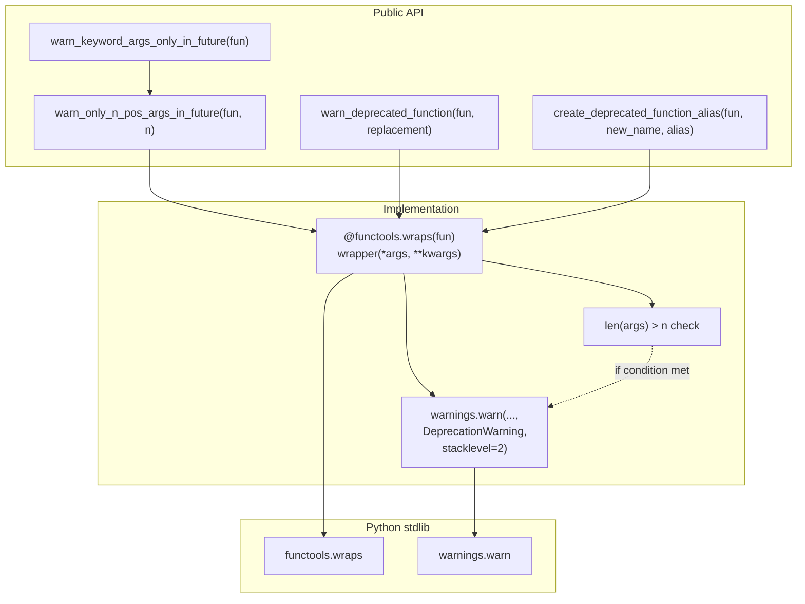
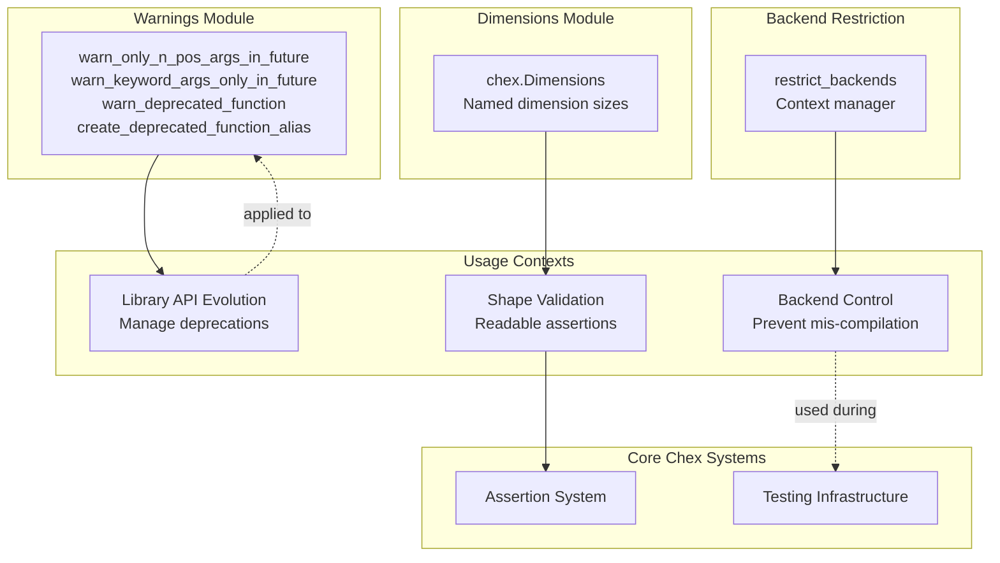

<!-- source: DeepWiki mcp.deepwiki.com · repo google-deepmind/chex · page 7 Utilities · fetched 2026-10-26 -->

# Utilities

<details>
<summary>Relevant source files</summary>

The following files were used as context for generating this wiki page:

- [README.md](README.md)
- [chex/__init__.py](chex/__init__.py)
- [chex/_src/warnings.py](chex/_src/warnings.py)
- [chex/_src/warnings_test.py](chex/_src/warnings_test.py)

</details>


This page documents supporting utilities provided by Chex that don't fall into the main categories of assertions, dataclasses, or testing infrastructure. These utilities include deprecation warning helpers, named dimension specifications, and backend restriction mechanisms.

For core assertions, see [Assertion System](#3). For testing utilities like fake transformations and test variants, see [Testing Infrastructure](#6).

---

## Overview

Chex provides three categories of utility functions:

| Utility Category | Purpose | Primary Module |
|------------------|---------|----------------|
| **Warnings** | Emit deprecation warnings and enforce API evolution | `chex._src.warnings` |
| **Dimensions** | Named dimension specifications for shape assertions | `chex._src.dimensions` |
| **Backend Restriction** | Control which JAX backends can be used | `chex._src.restrict_backends` |

**Sources:** [chex/__init__.py:1-213](), [README.md:232-459]()

---

## Warnings Utilities

Chex provides a set of decorator functions to help library authors manage API evolution by emitting standardized deprecation warnings. These utilities make it easier to guide users away from deprecated functions and enforce restrictions on positional arguments.

### Available Warning Functions

The warnings module exports four public functions:

```python
# Warn about excessive positional arguments
chex.warn_only_n_pos_args_in_future(fun, n)

# Shortcut: warn about any positional arguments
chex.warn_keyword_args_only_in_future(fun)

# Mark a function as deprecated
chex.warn_deprecated_function(fun, replacement=None)

# Create a deprecated alias for a function
chex.create_deprecated_function_alias(fun, new_name, deprecated_alias)
```

**Sources:** [chex/_src/warnings.py:1-117](), [chex/__init__.py:102-105]()

---

### Function Reference

#### `warn_only_n_pos_args_in_future`

**Purpose:** Emits a `DeprecationWarning` if more than `n` positional arguments are passed to the wrapped function. Used to migrate APIs toward keyword-only arguments.

**Signature:**
```python
def warn_only_n_pos_args_in_future(fun, n)
```

**Implementation:** [chex/_src/warnings.py:22-53]()

**Usage Pattern:**
```python
@functools.partial(chex.warn_only_n_pos_args_in_future, n=1)
def f(a, b, c=1):
    return a + b + c

# OK: f(1, b=2, c=3)
# Warns: f(1, 2, 3)  # Two positional args when only 1 is allowed
# Warns: f(1, 2, c=3)  # Also warns
```

The decorator checks the number of positional arguments passed at runtime and emits a warning if it exceeds `n`. The warning message states: `"only the first {n} arguments can be passed positionally additional args will become keyword-only soon"`.

**Sources:** [chex/_src/warnings.py:22-53](), [chex/_src/warnings_test.py:23-52]()

---

#### `warn_keyword_args_only_in_future`

**Purpose:** Convenience wrapper that warns if *any* positional arguments are passed. Equivalent to `warn_only_n_pos_args_in_future(fun, n=0)`.

**Implementation:** [chex/_src/warnings.py:56-58]()

This is simply defined as:
```python
warn_keyword_args_only_in_future = functools.partial(
    warn_only_n_pos_args_in_future, n=0
)
```

**Sources:** [chex/_src/warnings.py:56-58]()

---

#### `warn_deprecated_function`

**Purpose:** Marks a function definition as deprecated, emitting a warning on every call. Optionally specifies a replacement function.

**Signature:**
```python
def warn_deprecated_function(
    fun: Callable[..., Any], 
    replacement: Optional[str] = None
) -> Callable[..., Any]
```

**Implementation:** [chex/_src/warnings.py:61-90]()

**Usage Pattern:**
```python
@functools.partial(chex.warn_deprecated_function, replacement='new_function')
def old_function(a, b):
    return a + b

# Warns: "The function old_function is deprecated. Please use new_function instead."
result = old_function(1, 2)
```

The decorator extracts the function name from `fun.__name__` if available, and constructs a warning message. If `replacement` is provided, it's included in the message.

**Sources:** [chex/_src/warnings.py:61-90](), [chex/_src/warnings_test.py:28-71]()

---

#### `create_deprecated_function_alias`

**Purpose:** Creates a new function that wraps an existing function, emitting a deprecation warning. Used to maintain old function names while guiding users to new names.

**Signature:**
```python
def create_deprecated_function_alias(fun, new_name, deprecated_alias)
```

**Implementation:** [chex/_src/warnings.py:93-116]()

**Usage Pattern:**
```python
def my_function(a, b, c):
    return a + b + c

# Create alias with deprecation warning
old_function = chex.create_deprecated_function_alias(
    my_function, 
    'module.my_function', 
    'module.old_function'
)

# Warns: "The function module.old_function is deprecated, please use module.my_function instead."
result = old_function(1, 2, 3)
```

Unlike `warn_deprecated_function`, this function is designed to be called explicitly to create aliases, rather than used as a decorator.

**Sources:** [chex/_src/warnings.py:93-116](), [chex/_src/warnings_test.py:38-74]()

---

### Warning Implementation Details

All warning decorators use Python's `functools.wraps` to preserve the original function's metadata and use `warnings.warn` with `DeprecationWarning` category. The `stacklevel=2` parameter ensures the warning points to the caller's code, not the decorator implementation.

**Diagram: Warnings Module Architecture**



**Sources:** [chex/_src/warnings.py:1-117]()

---

## Dimensions (Named Dimension Sizes)

The `Dimensions` class provides a convenient way to specify and reuse dimension sizes by name, making shape assertions more readable and maintainable.

### Basic Concept

Instead of writing:
```python
chex.assert_shape(embeddings, (batch_size, seq_len, embedding_dim))
chex.assert_shape(attention, (batch_size, seq_len, seq_len))
```

You can write:
```python
dims = chex.Dimensions(B=batch_size, T=seq_len, E=embedding_dim)
chex.assert_shape(embeddings, dims['BTE'])
chex.assert_shape(attention, dims['BTT'])
```

**Sources:** [README.md:430-459]()

---

### Usage Patterns

#### String Indexing

The `Dimensions` object translates string lookups into integer tuples based on registered dimension names:

```python
dims = chex.Dimensions(B=3, T=5, E=7)

# Single dimension
dims['B']      # Returns: (3,)
dims['T']      # Returns: (5,)

# Multiple dimensions
dims['BTE']    # Returns: (3, 5, 7)
dims['BTT']    # Returns: (3, 5, 5)

# Repeated dimensions
dims['TTBEE']  # Returns: (5, 5, 3, 7, 7)
```

Each character in the lookup string corresponds to a named dimension. The order of characters determines the order of dimensions in the returned tuple.

**Sources:** [README.md:441-449]()

---

#### Dynamic Assignment

Dimension sizes can be set after initialization:

```python
dims = chex.Dimensions()

# Assign multiple dimensions from shape
dims['XY'] = some_matrix.shape  # Sets X and Y from shape tuple

# Assign single dimension
dims.Z = 13  # Attribute-style assignment

# Now use them
chex.assert_shape(tensor, dims['XYZ'])
```

This allows dimensions to be extracted from existing arrays and reused for validation.

**Sources:** [README.md:451-456]()

---

### Integration with Assertions

The primary use case for `Dimensions` is with shape assertions:

```python
dims = chex.Dimensions(B=batch_size, H=num_heads, D=head_dim, T=seq_len)

# Validate query, key, value shapes
chex.assert_shape(query, dims['BTHD'])
chex.assert_shape(key, dims['BTHD'])
chex.assert_shape(value, dims['BTHD'])

# Validate attention weights
chex.assert_shape(attention_weights, dims['BHTT'])

# Validate output
chex.assert_shape(output, dims['BTHD'])
```

The `Dimensions` object makes it easy to maintain consistency across multiple shape checks and improves code readability.

**Sources:** [README.md:435-458]()

---

## Backend Restriction

The `restrict_backends` context manager prevents JAX code from compiling for specified backends, helping detect cases where code accidentally runs on unintended hardware.

### Purpose

In environments where accelerators are present but reserved for other purposes, it's important to ensure that certain code paths only run on CPU. While `jax.jit(..., backend='cpu')` can be used to specify the backend explicitly, it's hard to verify manually that this has been applied consistently throughout a large subsystem.

**Sources:** [README.md:410-418]()

---

### Usage

The `restrict_backends` function is a context manager that accepts either `allowed` or `forbidden` backend lists:

```python
# Ensure code only runs on CPU
with chex.restrict_backends(allowed=['cpu']):
    call_some_jax_subsystem_that_must_only_run_on_cpu()

# Ensure code avoids TPU
with chex.restrict_backends(forbidden=['tpu']):
    call_some_other_subsystem_that_must_not_touch_any_tpu()
```

When JAX attempts to compile for a restricted backend within the context, `restrict_backends` raises an exception.

**Sources:** [README.md:422-428]()

---

### Typical Use Cases

| Scenario | Configuration | Purpose |
|----------|---------------|---------|
| **CPU-only execution** | `allowed=['cpu']` | Prevent accidental GPU/TPU usage in debugging code |
| **Avoid reserved TPU** | `forbidden=['tpu']` | Keep code away from TPU reserved for training |
| **GPU-only execution** | `allowed=['gpu']` | Ensure code uses available GPU acceleration |
| **Multi-backend testing** | Multiple contexts | Verify backend-specific behavior |

**Sources:** [README.md:410-428]()

---

### Implementation Location

The `restrict_backends` function is implemented in [chex/_src/restrict_backends.py]() and exported via [chex/__init__.py:96]().

**Sources:** [chex/__init__.py:96]()

---

## Summary

**Diagram: Utilities Module Integration**



**Sources:** [chex/__init__.py:1-213](), [README.md:232-459]()

---

### Quick Reference Table

| Utility | Module | Primary Use Case | Key Feature |
|---------|--------|------------------|-------------|
| `warn_only_n_pos_args_in_future` | `warnings` | API migration | Enforce keyword arguments |
| `warn_keyword_args_only_in_future` | `warnings` | API migration | Require all keyword args |
| `warn_deprecated_function` | `warnings` | API migration | Mark functions deprecated |
| `create_deprecated_function_alias` | `warnings` | API migration | Create deprecated aliases |
| `Dimensions` | `dimensions` | Shape validation | Named dimension specifications |
| `restrict_backends` | `restrict_backends` | Backend control | Prevent unwanted compilation |

**Sources:** [chex/__init__.py:76-105]()

---

### Export Locations

All utilities are exported through the main Chex public API:

- Warnings utilities: [chex/__init__.py:102-105]()
- Dimensions: [chex/__init__.py:76]()
- Backend restriction: [chex/__init__.py:96]()

These utilities are designed to be lightweight helpers that complement Chex's core assertion and testing infrastructure without introducing complex dependencies.

**Sources:** [chex/__init__.py:1-213]()

---

