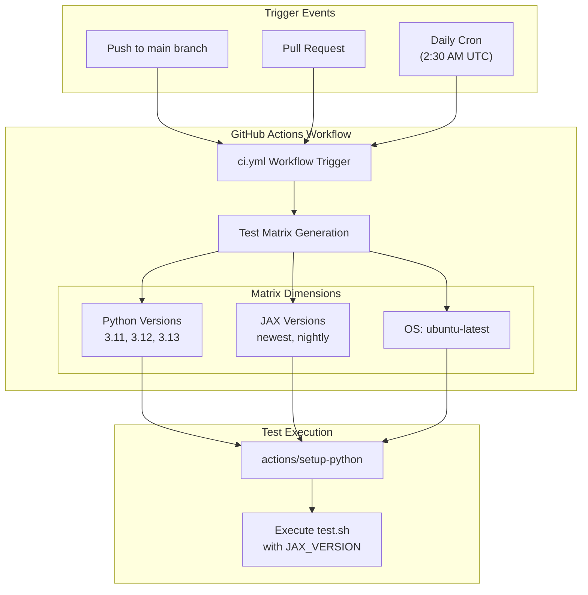
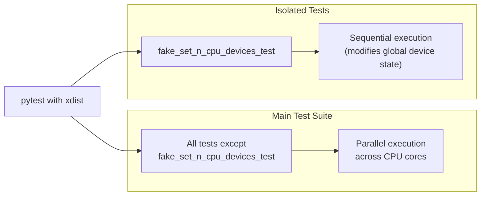
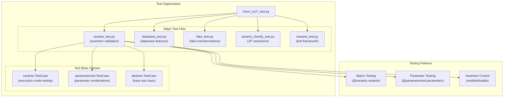
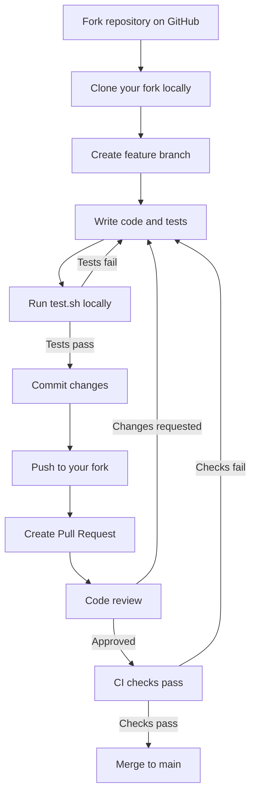

<!-- source: DeepWiki mcp.deepwiki.com · repo google-deepmind/chex · page 8 Development and Contributing · fetched 2026-10-26 -->

# Development and Contributing

<details>
<summary>Relevant source files</summary>

The following files were used as context for generating this wiki page:

- [.github/workflows/ci.yml](.github/workflows/ci.yml)
- [chex/_src/asserts_test.py](chex/_src/asserts_test.py)
- [test.sh](test.sh)

</details>


This document provides guidance for developers who want to contribute to Chex or understand its development infrastructure. It covers the CI/CD pipeline, test execution workflow, code quality standards, and contribution guidelines.

For information about using Chex's testing utilities in your own code, see [Testing Infrastructure](#6). This page focuses on developing Chex itself.

## Overview

Chex uses a comprehensive automated testing and quality control system to ensure code correctness across multiple Python and JAX versions. The development workflow is orchestrated by GitHub Actions CI and a test runner script that performs linting, type checking, testing, and documentation building.

**Key Components:**
- **CI Pipeline**: GitHub Actions workflow that runs on push, PR, and daily schedule
- **Test Runner**: Bash script ([test.sh]()) that executes all quality checks
- **Test Suite**: Comprehensive test coverage using pytest and chex.variants
- **Code Quality**: Automated linting (flake8, pylint) and type checking (pytype)
- **Documentation**: Sphinx-based documentation with coverage verification

Sources: [.github/workflows/ci.yml](), [test.sh]()

## CI/CD Pipeline Architecture



**CI Pipeline: Trigger and Matrix Strategy**

The GitHub Actions workflow implements a matrix strategy to test Chex across multiple configurations. The workflow is triggered by three events and uses concurrency control to cancel outdated runs.

| Configuration | Values | Notes |
|--------------|--------|-------|
| Python Versions | 3.11, 3.12, 3.13 | All supported Python versions |
| JAX Versions | newest, nightly | Tests latest stable and development JAX |
| Operating System | ubuntu-latest | Linux-only testing |
| Total Combinations | 4 | (3 Python × 1 JAX) + (1 Python × 1 nightly JAX) |

**Concurrency Control:**
- Groups runs by workflow + branch/PR
- Cancels in-progress runs when new commits are pushed
- Prevents resource waste on outdated code

Sources: [.github/workflows/ci.yml:1-42]()

## Test Runner Workflow

```mermaid
graph TB
    START["test.sh execution"]
    
    subgraph "Stage 1: Environment Setup"
        CLEAN["Clean _testing and .pytype"]
        VENV["Create virtual environment"]
        DEPS["Install dependencies:<br/>pip, uv, flake8, pytest-xdist,<br/>pylint, build"]
        INSTALL["Install chex in editable mode"]
        JAX["Install JAX version<br/>(newest/nightly/specific)"]
        UNINSTALL["Uninstall any conflicting<br/>chex installations"]
    end
    
    subgraph "Stage 2: Code Quality Checks"
        FLAKE8["flake8 linting<br/>(syntax errors only)"]
        PYLINT_DL["Download Google<br/>pylint config"]
        PYLINT_MOD["pylint modules<br/>(chex/*.py)"]
        PYLINT_TEST["pylint tests<br/>(*_test.py)"]
    end
    
    subgraph "Stage 3: Build & Install"
        BUILD["Build package<br/>(python -m build)"]
        WHEEL["Create wheel"]
        INSTALL_PKG["Install built package"]
    end
    
    subgraph "Stage 4: Type Checking"
        PYTYPE_CHECK["Python version < 3.11?"]
        PYTYPE["Run pytype<br/>(type checking)"]
    end
    
    subgraph "Stage 5: Test Execution"
        CD["cd _testing"]
        PYTEST_MAIN["pytest main tests<br/>(parallel with xdist)"]
        PYTEST_ISO["pytest isolated tests<br/>(fake_set_n_cpu_devices)"]
    end
    
    subgraph "Stage 6: Documentation"
        SPHINX_COV["Sphinx coverage check"]
        SPHINX_HTML["Build HTML docs"]
    end
    
    CLEANUP["Cleanup _testing and<br/>deactivate venv"]
    
    START --> CLEAN
    CLEAN --> VENV
    VENV --> DEPS
    DEPS --> INSTALL
    INSTALL --> JAX
    JAX --> UNINSTALL
    
    UNINSTALL --> FLAKE8
    FLAKE8 --> PYLINT_DL
    PYLINT_DL --> PYLINT_MOD
    PYLINT_MOD --> PYLINT_TEST
    
    PYLINT_TEST --> BUILD
    BUILD --> WHEEL
    WHEEL --> INSTALL_PKG
    
    INSTALL_PKG --> PYTYPE_CHECK
    PYTYPE_CHECK -->|"Yes"| PYTYPE
    PYTYPE_CHECK -->|"No"| CD
    PYTYPE --> CD
    
    CD --> PYTEST_MAIN
    PYTEST_MAIN --> PYTEST_ISO
    
    PYTEST_ISO --> SPHINX_COV
    SPHINX_COV --> SPHINX_HTML
    
    SPHINX_HTML --> CLEANUP
```



**Test Runner: Multi-Stage Quality Pipeline**

The test runner script ([test.sh]()) executes a comprehensive six-stage pipeline that validates code quality, correctness, and documentation.

Sources: [test.sh:1-108]()

### Stage 1: Environment Setup

The environment setup stage creates an isolated testing environment and installs all dependencies.

**Key Steps:**
1. **Clean Previous Artifacts**: Remove `_testing/` and `.pytype/` directories to ensure clean state
2. **Virtual Environment**: Create temporary venv in `_testing/chex-env.XXXXXXXX` with unique suffix
3. **Package Manager**: Install `uv` (fast Python package installer) alongside pip
4. **Dependencies**: Install development tools and test dependencies from `[test]` extras
5. **JAX Version Selection**: Install requested JAX version based on `JAX_VERSION` environment variable:
   - Empty string: Use version from requirements
   - `"newest"`: Install latest stable JAX (`pip install -U jax jaxlib`)
   - `"nightly"`: Install nightly builds from Google's artifact registry
   - Specific version: Install exact version (e.g., `"jax==0.4.13"`)
6. **Conflict Resolution**: Uninstall any system-installed chex to ensure tests run against the local build

Sources: [test.sh:19-49]()

### Stage 2: Code Quality Checks

Code quality is enforced through two complementary linting tools with different focuses.

**Flake8 Linting** ([test.sh:52]()):
```bash
flake8 `find chex -name '*.py' | xargs` --count --select=E9,F63,F7,F82,E225,E251
```

| Error Code | Category | Description |
|-----------|----------|-------------|
| E9 | Runtime | Syntax errors (SyntaxError, IndentationError) |
| F63 | Validity | Invalid comparison, format string |
| F7 | Syntax | Syntax errors in statements |
| F82 | Name | Undefined names |
| E225, E251 | Whitespace | Missing whitespace around operators |

**Pylint Linting** ([test.sh:54-67]()):
- Downloads Google's pylint style guide as base configuration
- Enforces two-space indentation (modified from Google default)
- Adds project-specific exceptions: `disable=unnecessary-lambda-assignment,use-dict-literal`
- **Module Linting**: Strict checks for `chex/*.py` (non-test files)
  - Disabled: `E1102` (not-callable false positives with JAX)
- **Test Linting**: Relaxed checks for `*_test.py` files
  - Disabled: `W0212` (protected-access - tests need internal access)
  - Disabled: `E1130`, `E1102`, `E1120` (JAX-related false positives)
- Uses `pylint-exit` to convert exit codes to CI-friendly format with `PYLINT_ARGS="-efail -wfail -cfail -rfail"`

Sources: [test.sh:51-67]()

### Stage 3: Build and Install

The package is built and installed from the wheel to ensure it can be properly distributed.

**Build Process** ([test.sh:69-73]()):
1. **Build Package**: `python -m build` creates source distribution and wheel in `dist/`
2. **Create Wheel**: `python -m pip wheel dist/chex-*.tar.gz` ensures wheel is properly formed
3. **Install Wheel**: `python -m pip install chex-*.whl` installs the built package

This validates that:
- The package metadata is correct
- All dependencies are properly declared
- The package can be installed from PyPI-like distribution

Sources: [test.sh:69-73]()

### Stage 4: Type Checking

Type checking is performed using pytype for Python versions that support it.

**Pytype Configuration** ([test.sh:75-82]()):
```bash
if [ `python -c 'import sys; print(sys.version_info.minor)'` -lt 11 ]; then
  python -m pytype "chex" -j auto --keep-going --disable import-error
fi
```

| Parameter | Value | Purpose |
|-----------|-------|---------|
| `-j auto` | Auto-detect CPU cores | Parallel type checking for speed |
| `--keep-going` | Continue on errors | Report all errors, not just first |
| `--disable import-error` | Skip import errors | Avoid false positives from test imports |

**Python Version Limitation**: Pytype does not support Python 3.11+ as of this writing, so type checking is skipped for newer Python versions. This limitation is tracked in the pytype project.

Sources: [test.sh:75-82]()

### Stage 5: Test Execution

Tests are run using pytest with parallel execution and special isolation for device tests.



**Test Execution: Parallel and Isolated Runs**

**Main Test Suite** ([test.sh:89]()):
```bash
pytest --numprocesses auto --pyargs chex -k "not fake_set_n_cpu_devices_test"
```
- Uses `pytest-xdist` for parallel execution across all CPU cores
- Excludes tests that modify global device state
- Runs from `_testing/` directory to avoid importing from repo root

**Isolated Tests** ([test.sh:92]()):
```bash
pytest --numprocesses auto --pyargs chex -k "fake_set_n_cpu_devices_test"
```
- Tests that use `chex.set_n_cpu_devices()` must run separately
- These tests modify JAX's global device configuration
- Running them in isolation prevents cross-test contamination

Sources: [test.sh:84-93]()

### Stage 6: Documentation Building

Sphinx documentation is built with coverage verification to ensure all public APIs are documented.

**Documentation Steps** ([test.sh:96-100]()):
1. Install documentation dependencies: `pip install --editable ".[docs]"`
2. Run coverage check: `make coverage_check` verifies all public symbols have docstrings
3. Build HTML documentation: `make html` generates documentation website

This ensures that:
- All public functions, classes, and methods are documented
- Documentation can be built without errors
- Examples in docstrings are valid

Sources: [test.sh:96-100]()

## Test Suite Structure



**Test Suite: Structure and Patterns**

Chex's test suite uses a combination of testing frameworks and patterns to achieve comprehensive coverage across different execution contexts.

Sources: [chex/_src/asserts_test.py:1-28]()

### Test Base Classes

Tests inherit from one or more base classes depending on their needs:

| Base Class | Purpose | Example Usage |
|-----------|---------|---------------|
| `absltest.TestCase` | Standard unit testing | Basic test cases without special features |
| `parameterized.TestCase` | Parameter combinations | Testing multiple input variations with `@parameterized.named_parameters` |
| `variants.TestCase` | Execution mode testing | Testing with/without JIT, pmap, devices using `@variants.variants` |

**Example**: `AssertsSwitchTest` ([chex/_src/asserts_test.py:47-66]()):
```python
class AssertsSwitchTest(parameterized.TestCase):
  """Tests for enable/disable_asserts."""
  
  def test_enable_disable_asserts(self):
    # Test that assertions can be toggled
    asserts.enable_asserts()
    with self.assertRaisesRegex(AssertionError, ...):
      asserts.assert_scalar('test')
    
    asserts.disable_asserts()
    asserts.assert_scalar('test')  # Should not raise
```

Sources: [chex/_src/asserts_test.py:47-66]()

### Test Patterns

**1. Matrix Testing with Variants**

The `@variants.variants` decorator runs tests across different JAX execution modes:

```python
@variants.variants(with_jit=True, with_pmap=True)
@parameterized.named_parameters(
    variants.params_product(
        (('type1', 't1'), ('type2', 't2')),
        (('args', False), ('kwargs', True)),
        (('max_traces_0', 0), ('max_traces_1', 1)),
        named=True
    )
)
def test_assert(self, init_type, kwargs, max_traces):
  # Test runs with all combinations of parameters
  # AND with both jit and pmap variants
  ...
```

This creates a test matrix with:
- 2 execution modes (jit, pmap)
- 2 initialization types × 2 argument styles × 2 max_traces values
- Total: 2 × 2 × 2 × 2 = 16 test combinations

Sources: [chex/_src/asserts_test.py:120-142]()

**2. Parameterized Testing**

The `@parameterized.named_parameters` decorator runs the same test logic with different inputs:

```python
@parameterized.named_parameters(
    ('wrong_rank', [1], (1,)),
    ('wrong_shape', [1, 2], (1, 3)),
    ('some_wrong_shape', [[1, 2], [3, 4]], [(1, 2), (1, 3)]),
)
def test_shape_should_fail(self, arrays, shapes):
  arrays = as_arrays(arrays)
  with self.assertRaisesRegex(AssertionError, ...):
    asserts.assert_shape(arrays, shapes)
```

Each named parameter creates a separate test case with descriptive names like:
- `test_shape_should_fail_wrong_rank`
- `test_shape_should_fail_wrong_shape`
- `test_shape_should_fail_some_wrong_shape`

Sources: [chex/_src/asserts_test.py:427-446]()

**3. Assertion State Management**

Tests verify that assertion enabling/disabling works correctly:

```python
def test_enable_disable_asserts(self):
  asserts.enable_asserts()
  with self.assertRaisesRegex(AssertionError, ...):
    asserts.assert_scalar('test')  # Should fail
  
  asserts.disable_asserts()
  asserts.assert_scalar('test')  # Should pass (no-op)
  
  asserts.enable_asserts()  # Re-enable for other tests
```

This pattern is critical because Chex maintains global state for assertion control that affects all tests.

Sources: [chex/_src/asserts_test.py:50-65]()

## Code Quality Standards

Chex enforces strict code quality standards through automated tooling. All contributions must pass these checks.

### Linting Rules

**Flake8 Configuration:**
```bash
# Only check for critical errors
flake8 --select=E9,F63,F7,F82,E225,E251 --show-source --statistics
```

**Pylint Configuration:**
```bash
# Base: Google Python Style Guide
# Modifications:
#   - Two-space indentation (not four)
#   - Disable: unnecessary-lambda-assignment, use-dict-literal
#   - Test files: Allow protected access (W0212)
```

**Common Violations to Avoid:**

| Category | Error | Description | Fix |
|----------|-------|-------------|-----|
| Syntax | E9, F7 | Syntax/indentation errors | Use an IDE with Python support |
| Names | F82 | Undefined name | Ensure all imports and definitions |
| Whitespace | E225, E251 | Missing whitespace | Format with autopep8 or black |
| Style | C0103 | Invalid name | Use snake_case for functions/variables |
| Protected | W0212 | Protected access | Avoid in non-test code; OK in tests |

### Type Checking Standards

**Type Hints Required For:**
- All public function parameters
- All public function return values
- Class attributes that aren't obvious from `__init__`

**Type Hints Not Required:**
- Private functions (prefixed with `_`)
- Test functions
- Lambda functions with obvious types

**Example** (from [chex/_src/asserts.py]()):
```python
def assert_shape(
    inputs: Union[Array, Sequence[Array]],
    expected_shapes: Union[Shape, Sequence[Shape]],
) -> None:
  """Asserts that input arrays have expected shapes."""
  ...
```

### Documentation Standards

**Docstring Format**: Google Style

**Required Documentation:**
- All public modules (module-level docstring)
- All public functions and classes
- All public methods (except obvious ones like `__init__`)

**Docstring Sections:**
```python
def example_function(param1: int, param2: str) -> bool:
  """Brief one-line description.
  
  Longer description explaining behavior, edge cases, and usage patterns.
  Can span multiple paragraphs.
  
  Args:
    param1: Description of first parameter.
    param2: Description of second parameter.
  
  Returns:
    Description of return value.
  
  Raises:
    ValueError: When and why this is raised.
  
  Example:
    >>> example_function(1, "test")
    True
  """
  ...
```

Sources: Implicit from [test.sh:96-100]() documentation build requirements

## Running Tests Locally

### Prerequisites

- Python 3.11, 3.12, or 3.13
- Git (to clone the repository)
- 8GB+ RAM recommended (for parallel test execution)

### Quick Start

```bash
# Clone repository
git clone https://github.com/google-deepmind/chex.git
cd chex

# Run full test suite (installs newest JAX by default)
bash test.sh

# Run with specific JAX version
JAX_VERSION="newest" bash test.sh    # Latest stable
JAX_VERSION="nightly" bash test.sh   # Nightly builds
JAX_VERSION="0.4.13" bash test.sh    # Specific version
```

### Selective Testing

For faster iteration during development, you can run individual stages:

```bash
# Just linting (fast - seconds)
python -m flake8 chex --select=E9,F63,F7,F82,E225,E251

# Just tests (medium - minutes)
pip install -e ".[test]"
pytest chex

# Just one test file (fast - seconds)
pytest chex/_src/asserts_test.py

# Just one test function (very fast)
pytest chex/_src/asserts_test.py::ScalarAssertTest::test_scalar

# With verbose output
pytest -v chex/_src/asserts_test.py

# Without parallel execution (for debugging)
pytest chex  # Omit --numprocesses flag
```

### Debugging Test Failures

**Strategy 1: Isolate the Failing Test**
```bash
# Run just the failing test class
pytest chex/_src/asserts_test.py::TreeAssertionsTest

# Run just the failing test method
pytest chex/_src/asserts_test.py::TreeAssertionsTest::test_assert_trees_all_close_bfloat16
```

**Strategy 2: Add Print Debugging**
```python
def test_example(self):
  result = some_function()
  print(f"DEBUG: result = {result}")  # Add temporary print
  assert result == expected
```
Run with `pytest -s` to see print output (normally captured).

**Strategy 3: Use Python Debugger**
```python
def test_example(self):
  import pdb; pdb.set_trace()  # Add breakpoint
  result = some_function()
  assert result == expected
```

**Strategy 4: Check Assertion State**
```python
def test_example(self):
  # Assertions might be disabled from previous test
  chex.enable_asserts()
  chex.assert_scalar(value)
```

Sources: [test.sh:84-93](), [chex/_src/asserts_test.py:50-65]()

## Contributing Guidelines

### Contribution Workflow



**Contribution Workflow: From Fork to Merge**

### Step-by-Step Process

**1. Fork and Clone**
```bash
# Fork on GitHub, then:
git clone https://github.com/YOUR_USERNAME/chex.git
cd chex
git remote add upstream https://github.com/google-deepmind/chex.git
```

**2. Create Feature Branch**
```bash
git checkout -b feature/add-new-assertion
# or
git checkout -b fix/assertion-error-message
```

Branch naming convention:
- `feature/` - New functionality
- `fix/` - Bug fixes
- `docs/` - Documentation improvements
- `refactor/` - Code restructuring

**3. Write Code and Tests**

For new features:
- Add implementation in appropriate `chex/_src/*.py` file
- Add tests in corresponding `chex/_src/*_test.py` file
- Add docstrings with examples
- Update relevant documentation

For bug fixes:
- Add a test that reproduces the bug (should fail initially)
- Fix the bug
- Verify the test now passes

**4. Run Tests Locally**
```bash
# Full test suite (recommended before PR)
bash test.sh

# Quick feedback loop during development
pytest chex/_src/your_test.py
```

**5. Commit and Push**
```bash
git add .
git commit -m "Add assert_custom_shape for flexible shape matching"
git push origin feature/add-new-assertion
```

Commit message guidelines:
- First line: Brief summary (<50 characters)
- Blank line
- Detailed explanation if needed
- Reference issues: "Fixes #123"

**6. Create Pull Request**
- Navigate to your fork on GitHub
- Click "Pull Request"
- Select base: `google-deepmind/chex:main`
- Fill out PR template (if present)
- Link related issues

**7. Address Review Feedback**
- Respond to reviewer comments
- Make requested changes
- Push updates (they appear automatically in PR)
- Mark conversations as resolved

### What to Include in Your PR

**Required:**
- [ ] Tests for new functionality or bug fixes
- [ ] Docstrings for new public functions/classes
- [ ] Updated documentation if changing public API
- [ ] All tests pass locally (`bash test.sh`)

**Optional but Helpful:**
- [ ] Examples demonstrating new features
- [ ] Performance benchmarks for optimization PRs
- [ ] Migration guide for breaking changes

### PR Review Checklist

Before submitting, verify:

| Category | Check |
|----------|-------|
| **Functionality** | Does it solve the stated problem? |
| **Tests** | Are all code paths tested? |
| **Documentation** | Are public APIs documented? |
| **Style** | Does it follow existing code style? |
| **Backwards Compatibility** | Will it break existing code? |
| **Performance** | Does it introduce performance regressions? |

### Common Review Feedback

**"Add type hints"**
```python
# Before (no types)
def assert_custom(inputs, expected):
  ...

# After (with types)
def assert_custom(
    inputs: Union[Array, Sequence[Array]],
    expected: Shape,
) -> None:
  ...
```

**"Add tests for edge cases"**
```python
# Don't just test the happy path
def test_assert_custom_valid(self):
  assert_custom([1, 2, 3], (3,))  # Happy path

# Also test error cases
def test_assert_custom_wrong_shape(self):
  with self.assertRaises(AssertionError):
    assert_custom([1, 2, 3], (4,))

def test_assert_custom_empty_array(self):
  assert_custom([], (0,))

def test_assert_custom_none_shape(self):
  assert_custom([1, 2], None)  # If None is valid
```

**"Update documentation"**
```python
# Add usage examples to docstring
def assert_custom(inputs, expected):
  """Asserts custom shape property.
  
  Example:
    >>> arr = jnp.ones((3, 4))
    >>> assert_custom(arr, (3, 4))  # Passes
    >>> assert_custom(arr, (4, 3))  # Raises AssertionError
  """
  ...
```

Sources: [.github/workflows/ci.yml:1-42](), [test.sh:1-108]()

## Testing Best Practices

### Writing Effective Tests

**1. Test One Thing Per Test**
```python
# Bad: Tests multiple unrelated things
def test_assertions(self):
  assert_shape(arr, (3,))
  assert_type(arr, float)
  assert_rank(arr, 1)

# Good: Separate tests
def test_assert_shape_vector(self):
  assert_shape(arr, (3,))

def test_assert_type_float(self):
  assert_type(arr, float)

def test_assert_rank_one(self):
  assert_rank(arr, 1)
```

**2. Use Descriptive Test Names**
```python
# Bad: Vague names
def test_shape(self):
  ...

# Good: Descriptive names
def test_assert_shape_should_pass_with_matching_shape(self):
  ...

def test_assert_shape_should_fail_with_wrong_shape(self):
  ...
```

**3. Use Parameterized Tests for Input Variations**
```python
@parameterized.named_parameters(
    ('scalar', 1, 0),
    ('vector', [1, 2, 3], 1),
    ('matrix', [[1, 2], [3, 4]], 2),
)
def test_assert_rank_should_pass(self, array, expected_rank):
  asserts.assert_rank(array, expected_rank)
```

**4. Use Variants for JAX Execution Modes**
```python
class MyTest(variants.TestCase):
  
  @variants.variants(with_jit=True, with_pmap=True)
  def test_works_in_all_modes(self):
    # This test runs with jit, pmap, and without either
    result = self.variant(my_function)(input)
    self.assertEqual(result, expected)
```

**5. Test Error Messages**
```python
# Don't just check that it raises
with self.assertRaises(AssertionError):
  assert_shape(arr, (4,))

# Check the error message is helpful
with self.assertRaisesRegex(
    AssertionError,
    'input .+ has shape .+ but expected .+'):
  assert_shape(arr, (4,))
```

### Test Organization

**File Structure:**
```
chex/_src/
├── asserts.py              # Implementation
├── asserts_test.py         # Tests
├── asserts_internal.py     # Internal utilities
└── asserts_chexify.py      # JIT integration
```

**Test Class Organization:**
```python
# Group related tests in classes
class ScalarAssertTest(parameterized.TestCase):
  """Tests for scalar assertion functions."""
  
  def test_scalar(self): ...
  def test_scalar_positive(self): ...
  def test_scalar_negative(self): ...

class ShapeAssertTest(parameterized.TestCase):
  """Tests for shape assertion functions."""
  
  def test_shape_should_pass(self): ...
  def test_shape_should_fail(self): ...
```

Sources: [chex/_src/asserts_test.py:47-283](), [chex/_src/asserts_test.py:425-537]()

## Common Development Tasks

### Adding a New Assertion

**1. Implement in [chex/_src/asserts.py]()**
```python
@asserts_internal.chex_assertion
def assert_new_feature(
    inputs: Array,
    expected_value: int,
    custom_message: str = '',
) -> None:
  """Asserts that input has expected feature.
  
  Args:
    inputs: Array to check.
    expected_value: Expected feature value.
    custom_message: Optional custom error message.
  
  Raises:
    AssertionError: If assertion fails.
  """
  actual = compute_feature(inputs)
  if actual != expected_value:
    raise AssertionError(
        f"Expected feature {expected_value}, got {actual}. "
        f"{custom_message}"
    )
```

**2. Add Tests in [chex/_src/asserts_test.py]()**
```python
class NewFeatureAssertTest(parameterized.TestCase):
  
  @parameterized.named_parameters(
      ('valid_case', np.array([1, 2, 3]), 6),
      ('another_valid', np.array([1]), 1),
  )
  def test_assert_new_feature_should_pass(self, arr, expected):
    asserts.assert_new_feature(arr, expected)
  
  @parameterized.named_parameters(
      ('wrong_value', np.array([1, 2, 3]), 5),
  )
  def test_assert_new_feature_should_fail(self, arr, expected):
    with self.assertRaisesRegex(AssertionError, 'Expected feature'):
      asserts.assert_new_feature(arr, expected)
```

**3. Export in [chex/__init__.py]()**
```python
from chex._src.asserts import assert_new_feature
```

**4. Document in API reference**
Add entry to appropriate documentation page.

### Adding Support for a New JAX Version

**1. Update CI Matrix** ([.github/workflows/ci.yml]()):
```yaml
matrix:
  python-version: ["3.11", "3.12", "3.13"]
  jax-version: ["newest"]
  include:
    - python-version: "3.13"
      jax-version: "nightly"
    # Add new version:
    - python-version: "3.13"
      jax-version: "0.5.0"  # New JAX version
```

**2. Test Locally**
```bash
JAX_VERSION="0.5.0" bash test.sh
```

**3. Fix Compatibility Issues**
- Check for deprecated JAX APIs
- Update version constraints in `setup.py`
- Update documentation if behavior changes

### Updating Dependencies

**1. Update [setup.py]()**
```python
install_requires=[
    'jax>=0.4.0',  # Update minimum version
    'numpy>=1.20',
    # ...
]
```

**2. Test with Multiple Versions**
```bash
# Test minimum supported version
JAX_VERSION="0.4.0" bash test.sh

# Test latest version
JAX_VERSION="newest" bash test.sh

# Test nightly (future version)
JAX_VERSION="nightly" bash test.sh
```

**3. Update CI Matrix** (if needed)
Update [.github/workflows/ci.yml]() to test new version combinations.

Sources: [.github/workflows/ci.yml:24-33](), [test.sh:36-44]()

## Troubleshooting

### Common Issues and Solutions

**Issue: Tests fail with "Module not found"**
```
ModuleNotFoundError: No module named 'chex'
```
**Solution**: Install in editable mode:
```bash
pip install -e .
```

**Issue: Type checking fails on Python 3.11+**
```
pytype: command not found
```
**Solution**: This is expected. Pytype doesn't support Python 3.11+. The test script skips type checking automatically for these versions.

**Issue: Tests fail with "GPU not available"**
```
AssertionError: GPU device is not available
```
**Solution**: These tests are skipped automatically when GPU is not detected. If you need to test GPU-specific code, use a machine with GPU or use `fake.set_n_cpu_devices()` to simulate multi-device scenarios.

**Issue: Parallel tests hang or crash**
```
pytest --numprocesses auto  # Hangs indefinitely
```
**Solution**: Run without parallelization for debugging:
```bash
pytest chex  # No --numprocesses flag
```

**Issue: Import errors during tests**
```
ImportError: cannot import name 'assert_custom' from 'chex'
```
**Solution**: Ensure you've exported the function in `chex/__init__.py` and reinstalled:
```bash
pip install -e .
```

**Issue: Linting fails with "pylintrc not found"**
```
pylint: Cannot open configuration file
```
**Solution**: Run from repository root, or let `test.sh` download the config automatically.

**Issue: Tests pass locally but fail in CI**
```
Local: All tests passed
CI: Tests failed with assertion error
```
**Solution**: Check for:
- **Platform differences**: CI runs on Linux only
- **JAX version**: CI tests multiple JAX versions
- **Global state**: Tests may interact if they modify global settings
- **Timing issues**: Parallel execution can expose race conditions

Run with the same JAX version as CI:
```bash
JAX_VERSION="newest" bash test.sh
```

Sources: [test.sh:46-49](), [test.sh:75-82](), [test.sh:89-92]()

## Summary

This document covered the complete development workflow for contributing to Chex:

| Stage | Key Tools | Duration |
|-------|-----------|----------|
| Environment Setup | venv, pip, uv | 1-2 minutes |
| Linting | flake8, pylint | 10-30 seconds |
| Type Checking | pytype (Python <3.11) | 30-60 seconds |
| Testing | pytest, pytest-xdist | 2-5 minutes |
| Documentation | Sphinx | 30-60 seconds |
| **Total** | **test.sh** | **~5-10 minutes** |

**Key Takeaways:**
1. **Comprehensive Testing**: Chex uses a multi-stage pipeline that validates code quality, correctness, and documentation
2. **Matrix Testing**: Tests run across multiple Python versions (3.11-3.13) and JAX versions (newest, nightly)
3. **Parallel Execution**: Most tests run in parallel for speed, with special isolation for device-modifying tests
4. **Strict Standards**: Code must pass linting, type checking, and have complete documentation
5. **Local Development**: Contributors can run the full test suite locally before submitting PRs

**Next Steps:**
- For using Chex's testing utilities, see [Testing Infrastructure](#6)
- For API details, see [API Reference](#9)
- For examples of specific features, see the relevant feature pages ([Assertions](#3), [Dataclasses](#4), etc.)

Sources: [.github/workflows/ci.yml:1-42](), [test.sh:1-108](), [chex/_src/asserts_test.py:1-100]()

---

