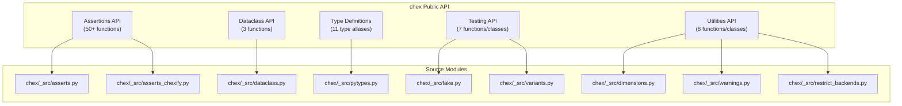
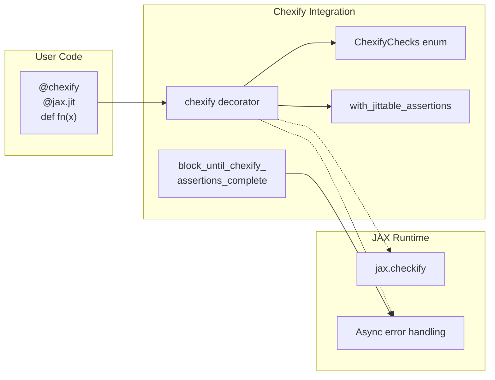
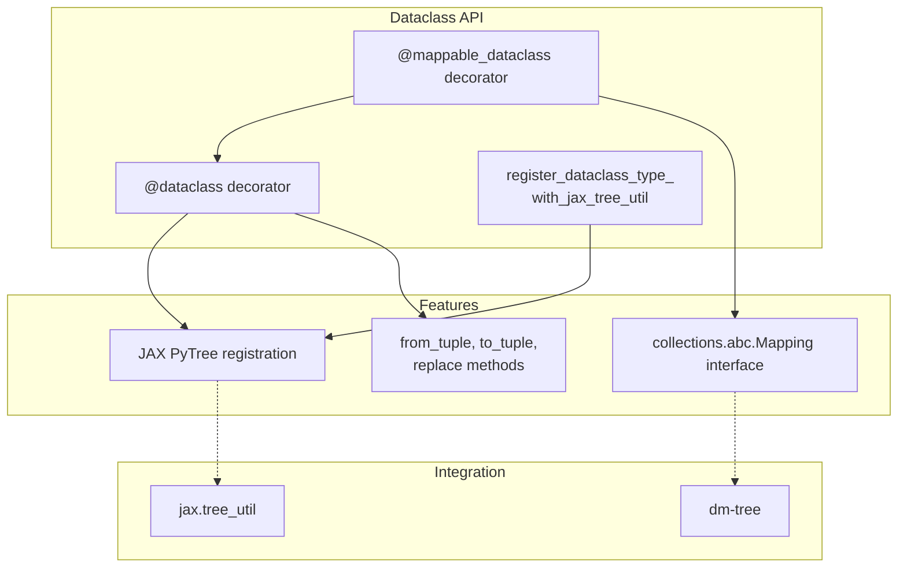
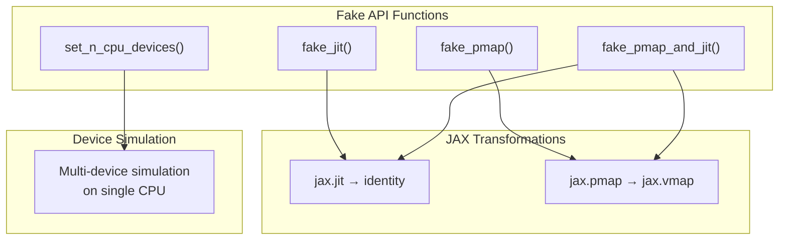
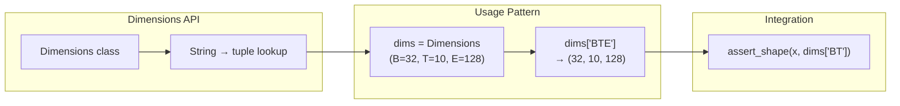

<!-- source: DeepWiki mcp.deepwiki.com · repo google-deepmind/chex · page 9 API Reference · fetched 2026-10-26 -->

# API Reference

Relevant source files

The following files were used as context for generating this wiki page:

- [README.md](README.md)
- [chex/__init__.py](chex/__init__.py)
- [docs/api.rst](docs/api.rst)

This page provides a complete reference of Chex's public API, organized by module. Each entry includes the function/class name, a brief description, and the module it belongs to. For detailed usage examples and conceptual explanations, see the module-specific pages: [Assertion System](#3), [Dataclass System](#4), [Type System](#5), [Testing Infrastructure](#6), and [Utilities](#7).

All public API symbols are exported from the top-level `chex` module and can be accessed as `chex.<symbol_name>`.

**Sources:** [chex/__init__.py:1-213]()

---

## Module Organization

The following diagram maps the major API categories to their source modules:

**Sources:** [chex/__init__.py:17-105](), [README.md:31-460]()

---

## Assertions Module

The assertions module provides comprehensive validation functions for JAX arrays and PyTrees. Assertions are divided into categories based on their behavior and purpose.

### Static Assertions

Static assertions check array metadata without requiring concrete values. They work in all JAX contexts including inside `jax.jit`.

| Function | Description | Module |
|----------|-------------|--------|
| `assert_shape` | Assert array(s) have specific shape(s) | `asserts.py` |
| `assert_rank` | Assert array(s) have specific rank(s) | `asserts.py` |
| `assert_type` | Assert array(s) have specific dtype(s) | `asserts.py` |
| `assert_equal_shape` | Assert all arrays have the same shape | `asserts.py` |
| `assert_equal_shape_prefix` | Assert arrays share common shape prefix | `asserts.py` |
| `assert_equal_shape_suffix` | Assert arrays share common shape suffix | `asserts.py` |
| `assert_equal_rank` | Assert arrays have the same rank | `asserts.py` |
| `assert_equal_size` | Assert arrays have the same total size | `asserts.py` |
| `assert_size` | Assert array(s) have specific size(s) | `asserts.py` |
| `assert_axis_dimension` | Assert specific axis has expected size | `asserts.py` |
| `assert_axis_dimension_comparator` | Assert axis size satisfies comparator | `asserts.py` |
| `assert_axis_dimension_gt` | Assert axis size is greater than value | `asserts.py` |
| `assert_axis_dimension_gteq` | Assert axis size is ≥ value | `asserts.py` |
| `assert_axis_dimension_lt` | Assert axis size is less than value | `asserts.py` |
| `assert_axis_dimension_lteq` | Assert axis size is ≤ value | `asserts.py` |
| `assert_is_broadcastable` | Assert shapes are broadcastable | `asserts.py` |
| `assert_is_divisible` | Assert one value divides another | `asserts.py` |
| `assert_scalar` | Assert value(s) are scalar | `asserts.py` |

**Sources:** [chex/__init__.py:17-44](), [docs/api.rst:8-64]()

### Value (Runtime) Assertions

Value assertions require concrete array values and need special handling inside JIT-compiled code via `@chexify`.

| Function | Description | Module |
|----------|-------------|--------|
| `assert_tree_all_finite` | Assert all tree leaves contain finite values | `asserts.py` |
| `assert_equal` | Assert values are equal | `asserts.py` |
| `assert_scalar_positive` | Assert scalar is positive | `asserts.py` |
| `assert_scalar_negative` | Assert scalar is negative | `asserts.py` |
| `assert_scalar_non_negative` | Assert scalar is ≥ 0 | `asserts.py` |
| `assert_scalar_in` | Assert scalar is in specified range | `asserts.py` |
| `assert_numerical_grads` | Assert gradients match numerical approximation | `asserts.py` |
| `assert_trees_all_close` | Assert tree leaves are numerically close | `asserts.py` |
| `assert_trees_all_close_ulp` | Assert tree leaves are close (ULP comparison) | `asserts.py` |
| `assert_trees_all_equal` | Assert tree values are exactly equal | `asserts.py` |
| `assert_trees_all_equal_comparator` | Assert trees equal via custom comparator | `asserts.py` |

**Sources:** [chex/__init__.py:24-63](), [docs/api.rst:76-82]()

### Tree Structure Assertions

These assertions validate PyTree structure, shapes, and metadata.

| Function | Description | Module |
|----------|-------------|--------|
| `assert_tree_shape` | Assert tree leaves have specific shapes | `asserts.py` |
| `assert_tree_shape_prefix` | Assert tree shapes share prefix | `asserts.py` |
| `assert_tree_shape_suffix` | Assert tree shapes share suffix | `asserts.py` |
| `assert_trees_all_equal_structs` | Assert trees have identical structure | `asserts.py` |
| `assert_trees_all_equal_shapes` | Assert corresponding leaves have same shapes | `asserts.py` |
| `assert_trees_all_equal_dtypes` | Assert corresponding leaves have same dtypes | `asserts.py` |
| `assert_trees_all_equal_shapes_and_dtypes` | Assert shapes and dtypes match | `asserts.py` |
| `assert_trees_all_equal_sizes` | Assert corresponding leaves have same sizes | `asserts.py` |
| `assert_tree_has_only_ndarrays` | Assert all leaves are ndarrays | `asserts.py` |
| `assert_tree_no_nones` | Assert tree contains no None values | `asserts.py` |

**Sources:** [chex/__init__.py:46-63](), [docs/api.rst:85-106]()

### Device and JAX-Specific Assertions

| Function | Description | Module |
|----------|-------------|--------|
| `assert_devices_available` | Assert N devices of specified type are available | `asserts.py` |
| `assert_gpu_available` | Assert at least one GPU is available | `asserts.py` |
| `assert_tpu_available` | Assert at least one TPU is available | `asserts.py` |
| `assert_tree_is_on_device` | Assert tree arrays are on specified device | `asserts.py` |
| `assert_tree_is_on_host` | Assert tree arrays are on host (CPU RAM) | `asserts.py` |
| `assert_tree_is_sharded` | Assert tree arrays are sharded | `asserts.py` |
| `assert_max_traces` | Decorator to limit function trace count | `asserts.py` |

**Sources:** [chex/__init__.py:23-51](), [docs/api.rst:68-74]()

### Null Checking Utilities

| Function | Description | Module |
|----------|-------------|--------|
| `assert_not_both_none` | Assert at least one argument is not None | `asserts.py` |
| `assert_exactly_one_is_none` | Assert exactly one argument is None | `asserts.py` |
| `if_args_not_none` | Decorator to skip assertions if args are None | `asserts.py` |

**Sources:** [chex/__init__.py:30-68]()

### Chexify: JIT-Compatible Value Assertions

| Symbol | Type | Description | Module |
|--------|------|-------------|--------|
| `chexify` | Decorator | Enables value assertions in JIT-compiled code | `asserts_chexify.py` |
| `ChexifyChecks` | Enum | Configures which runtime checks to enable | `asserts_chexify.py` |
| `with_jittable_assertions` | Context Manager | Temporarily enable jittable assertions | `asserts_chexify.py` |
| `block_until_chexify_assertions_complete` | Function | Wait for async assertion checks to complete | `asserts_chexify.py` |

**Sources:** [chex/__init__.py:69-72](), [docs/api.rst:79-82](), [README.md:173-193]()

### Assertion Control

| Function | Description | Module |
|----------|-------------|--------|
| `enable_asserts` | Re-enable assertions globally | `asserts.py` |
| `disable_asserts` | Disable assertions globally | `asserts.py` |
| `clear_trace_counter` | Reset trace counter for `@assert_max_traces` | `asserts.py` |

**Sources:** [chex/__init__.py:65-67](), [docs/api.rst:148-151]()

---

## Dataclass Module

The dataclass module provides JAX-compatible dataclasses that integrate with JAX's PyTree system and dm-tree.

| Symbol | Type | Description | Module |
|--------|------|-------------|--------|
| `dataclass` | Decorator | Creates JAX-compatible dataclass (PyTree) | `dataclass.py` |
| `mappable_dataclass` | Decorator | Creates dataclass with Mapping interface | `dataclass.py` |
| `register_dataclass_type_with_jax_tree_util` | Function | Manually registers dataclass as PyTree | `dataclass.py` |

**Sources:** [chex/__init__.py:73-75](), [docs/api.rst:173-181](), [README.md:33-85]()

---

## Type System (pytypes)

Chex provides comprehensive type definitions for JAX and NumPy arrays. For detailed documentation, see [Type System](#5).

### Array Type Aliases

| Type | Description | Module |
|------|-------------|--------|
| `Array` | Generic array type (JAX or NumPy) | `pytypes.py` |
| `ArrayDevice` | Array on accelerator device | `pytypes.py` |
| `ArrayNumpy` | NumPy ndarray | `pytypes.py` |
| `ArraySharded` | Sharded JAX array | `pytypes.py` |
| `ArrayBatched` | Batched array (from vmap) | `pytypes.py` |

### Tree Type Aliases

| Type | Description | Module |
|------|-------------|--------|
| `ArrayTree` | PyTree with array leaves | `pytypes.py` |
| `ArrayDeviceTree` | PyTree with device array leaves | `pytypes.py` |
| `ArrayNumpyTree` | PyTree with NumPy array leaves | `pytypes.py` |

### Scalar and Metadata Types

| Type | Description | Module |
|------|-------------|--------|
| `Scalar` | Scalar numeric value | `pytypes.py` |
| `Numeric` | Numeric type (scalar or array) | `pytypes.py` |
| `Shape` | Tuple of integers representing shape | `pytypes.py` |
| `ArrayDType` | NumPy dtype | `pytypes.py` |
| `Device` | JAX device object | `pytypes.py` |
| `PRNGKey` | JAX PRNG key | `pytypes.py` |
| `PyTreeDef` | JAX PyTree definition | `pytypes.py` |

**Sources:** [chex/__init__.py:81-95](), [docs/api.rst:209-231]()

---

## Testing Infrastructure

### Fake Transformations

Fake transformations replace JAX transformations with simpler equivalents for debugging.

| Function | Description | Return Type | Module |
|----------|-------------|-------------|--------|
| `fake_jit` | Replace `jax.jit` with identity function | Context Manager | `fake.py` |
| `fake_pmap` | Replace `jax.pmap` with `jax.vmap` | Context Manager | `fake.py` |
| `fake_pmap_and_jit` | Apply both fake_jit and fake_pmap | Context Manager | `fake.py` |
| `set_n_cpu_devices` | Simulate N devices using CPU threads | Function | `fake.py` |

**Sources:** [chex/__init__.py:77-80](), [docs/api.rst:184-207](), [README.md:345-408]()

### Test Variants Framework

The variants framework enables testing functions across different JAX execution contexts.

| Symbol | Type | Description | Module |
|--------|------|-------------|--------|
| `TestCase` | Class | Base class for tests using variants | `variants.py` |
| `variants` | Decorator | Parametrize test across execution contexts | `variants.py` |
| `all_variants` | Decorator | Apply all supported variants | `variants.py` |
| `ChexVariantType` | Enum | Enum of variant types (with_jit, etc.) | `variants.py` |
| `params_product` | Function | Generate parameter combinations | `variants.py` |

**Supported Variant Types:**
- `with_jit`: Apply `jax.jit` transformation
- `without_jit`: No transformation (identity)
- `with_device`: Place arguments in device memory
- `without_device`: Keep arguments in host memory
- `with_pmap`: Apply `jax.pmap` transformation

**Sources:** [chex/__init__.py:97-101](), [docs/api.rst:234-243](), [README.md:237-344]()

---

## Utilities

### Named Dimensions

| Class/Function | Description | Module |
|----------------|-------------|--------|
| `Dimensions` | Package dimension sizes with named lookup | `dimensions.py` |

The `Dimensions` class allows packaging collections of dimension sizes into a single object with string-based lookup. For example, `dims = Dimensions(B=32, T=10)` allows accessing `dims['BT']` to get `(32, 10)`.

**Sources:** [chex/__init__.py:76](), [docs/api.rst:142-143](), [README.md:430-459]()

### Deprecation Warnings

| Function | Description | Module |
|----------|-------------|--------|
| `warn_deprecated_function` | Emit deprecation warning for function | `warnings.py` |
| `create_deprecated_function_alias` | Create deprecated alias with warning | `warnings.py` |
| `warn_keyword_args_only_in_future` | Warn about future keyword-only args | `warnings.py` |
| `warn_only_n_pos_args_in_future` | Warn about reduced positional args | `warnings.py` |

**Sources:** [chex/__init__.py:102-105](), [docs/api.rst:154-163]()

### Backend Restriction

| Function | Description | Module |
|----------|-------------|--------|
| `restrict_backends` | Context manager to restrict allowed JAX backends | `restrict_backends.py` |

The `restrict_backends` context manager allows specifying allowed or forbidden JAX compilation backends (CPU, GPU, TPU) to detect accidental usage of wrong devices.

**Sources:** [chex/__init__.py:96](), [docs/api.rst:165-171](), [README.md:410-428]()

---

## Complete API Index

The following table provides a complete alphabetical index of all public symbols in Chex:

| Symbol | Category | Module | Page Reference |
|--------|----------|--------|----------------|
| `all_variants` | Testing | `variants.py` | [#6.2](#6.2) |
| `Array` | Types | `pytypes.py` | [#5](#5) |
| `ArrayBatched` | Types | `pytypes.py` | [#5](#5) |
| `ArrayDevice` | Types | `pytypes.py` | [#5](#5) |
| `ArrayDeviceTree` | Types | `pytypes.py` | [#5](#5) |
| `ArrayDType` | Types | `pytypes.py` | [#5](#5) |
| `ArrayNumpy` | Types | `pytypes.py` | [#5](#5) |
| `ArrayNumpyTree` | Types | `pytypes.py` | [#5](#5) |
| `ArraySharded` | Types | `pytypes.py` | [#5](#5) |
| `ArrayTree` | Types | `pytypes.py` | [#5](#5) |
| `assert_axis_dimension` | Assertions | `asserts.py` | [#3.1](#3.1) |
| `assert_axis_dimension_comparator` | Assertions | `asserts.py` | [#3.1](#3.1) |
| `assert_axis_dimension_gt` | Assertions | `asserts.py` | [#3.1](#3.1) |
| `assert_axis_dimension_gteq` | Assertions | `asserts.py` | [#3.1](#3.1) |
| `assert_axis_dimension_lt` | Assertions | `asserts.py` | [#3.1](#3.1) |
| `assert_axis_dimension_lteq` | Assertions | `asserts.py` | [#3.1](#3.1) |
| `assert_devices_available` | Assertions | `asserts.py` | [#3.4](#3.4) |
| `assert_equal` | Assertions | `asserts.py` | [#3.2](#3.2) |
| `assert_equal_rank` | Assertions | `asserts.py` | [#3.1](#3.1) |
| `assert_equal_shape` | Assertions | `asserts.py` | [#3.1](#3.1) |
| `assert_equal_shape_prefix` | Assertions | `asserts.py` | [#3.1](#3.1) |
| `assert_equal_shape_suffix` | Assertions | `asserts.py` | [#3.1](#3.1) |
| `assert_equal_size` | Assertions | `asserts.py` | [#3.1](#3.1) |
| `assert_exactly_one_is_none` | Assertions | `asserts.py` | [#3](#3) |
| `assert_gpu_available` | Assertions | `asserts.py` | [#3.4](#3.4) |
| `assert_is_broadcastable` | Assertions | `asserts.py` | [#3.1](#3.1) |
| `assert_is_divisible` | Assertions | `asserts.py` | [#3.1](#3.1) |
| `assert_max_traces` | Assertions | `asserts.py` | [#3.4](#3.4) |
| `assert_not_both_none` | Assertions | `asserts.py` | [#3](#3) |
| `assert_numerical_grads` | Assertions | `asserts.py` | [#3.2](#3.2) |
| `assert_rank` | Assertions | `asserts.py` | [#3.1](#3.1) |
| `assert_scalar` | Assertions | `asserts.py` | [#3.1](#3.1) |
| `assert_scalar_in` | Assertions | `asserts.py` | [#3.2](#3.2) |
| `assert_scalar_negative` | Assertions | `asserts.py` | [#3.2](#3.2) |
| `assert_scalar_non_negative` | Assertions | `asserts.py` | [#3.2](#3.2) |
| `assert_scalar_positive` | Assertions | `asserts.py` | [#3.2](#3.2) |
| `assert_shape` | Assertions | `asserts.py` | [#3.1](#3.1) |
| `assert_size` | Assertions | `asserts.py` | [#3.1](#3.1) |
| `assert_tpu_available` | Assertions | `asserts.py` | [#3.4](#3.4) |
| `assert_tree_all_finite` | Assertions | `asserts.py` | [#3.2](#3.2) |
| `assert_tree_has_only_ndarrays` | Assertions | `asserts.py` | [#3.3](#3.3) |
| `assert_tree_is_on_device` | Assertions | `asserts.py` | [#3.4](#3.4) |
| `assert_tree_is_on_host` | Assertions | `asserts.py` | [#3.4](#3.4) |
| `assert_tree_is_sharded` | Assertions | `asserts.py` | [#3.4](#3.4) |
| `assert_tree_no_nones` | Assertions | `asserts.py` | [#3.3](#3.3) |
| `assert_tree_shape` | Assertions | `asserts.py` | [#3.3](#3.3) |
| `assert_tree_shape_prefix` | Assertions | `asserts.py` | [#3.3](#3.3) |
| `assert_tree_shape_suffix` | Assertions | `asserts.py` | [#3.3](#3.3) |
| `assert_trees_all_close` | Assertions | `asserts.py` | [#3.2](#3.2) |
| `assert_trees_all_close_ulp` | Assertions | `asserts.py` | [#3.2](#3.2) |
| `assert_trees_all_equal` | Assertions | `asserts.py` | [#3.2](#3.2) |
| `assert_trees_all_equal_comparator` | Assertions | `asserts.py` | [#3.2](#3.2) |
| `assert_trees_all_equal_dtypes` | Assertions | `asserts.py` | [#3.3](#3.3) |
| `assert_trees_all_equal_shapes` | Assertions | `asserts.py` | [#3.3](#3.3) |
| `assert_trees_all_equal_shapes_and_dtypes` | Assertions | `asserts.py` | [#3.3](#3.3) |
| `assert_trees_all_equal_sizes` | Assertions | `asserts.py` | [#3.3](#3.3) |
| `assert_trees_all_equal_structs` | Assertions | `asserts.py` | [#3.3](#3.3) |
| `assert_type` | Assertions | `asserts.py` | [#3.1](#3.1) |
| `block_until_chexify_assertions_complete` | Assertions | `asserts_chexify.py` | [#3.5](#3.5) |
| `chexify` | Assertions | `asserts_chexify.py` | [#3.5](#3.5) |
| `ChexifyChecks` | Assertions | `asserts_chexify.py` | [#3.5](#3.5) |
| `ChexVariantType` | Testing | `variants.py` | [#6.2](#6.2) |
| `clear_trace_counter` | Assertions | `asserts.py` | [#3.4](#3.4) |
| `create_deprecated_function_alias` | Utilities | `warnings.py` | [#7](#7) |
| `dataclass` | Dataclass | `dataclass.py` | [#4](#4) |
| `Device` | Types | `pytypes.py` | [#5](#5) |
| `Dimensions` | Utilities | `dimensions.py` | [#7](#7) |
| `disable_asserts` | Assertions | `asserts.py` | [#3](#3) |
| `enable_asserts` | Assertions | `asserts.py` | [#3](#3) |
| `fake_jit` | Testing | `fake.py` | [#6.1](#6.1) |
| `fake_pmap` | Testing | `fake.py` | [#6.1](#6.1) |
| `fake_pmap_and_jit` | Testing | `fake.py` | [#6.1](#6.1) |
| `if_args_not_none` | Assertions | `asserts.py` | [#3](#3) |
| `mappable_dataclass` | Dataclass | `dataclass.py` | [#4.2](#4.2) |
| `Numeric` | Types | `pytypes.py` | [#5](#5) |
| `params_product` | Testing | `variants.py` | [#6.2](#6.2) |
| `PRNGKey` | Types | `pytypes.py` | [#5](#5) |
| `PyTreeDef` | Types | `pytypes.py` | [#5](#5) |
| `register_dataclass_type_with_jax_tree_util` | Dataclass | `dataclass.py` | [#4](#4) |
| `restrict_backends` | Utilities | `restrict_backends.py` | [#7](#7) |
| `Scalar` | Types | `pytypes.py` | [#5](#5) |
| `set_n_cpu_devices` | Testing | `fake.py` | [#6.1](#6.1) |
| `Shape` | Types | `pytypes.py` | [#5](#5) |
| `TestCase` | Testing | `variants.py` | [#6.2](#6.2) |
| `variants` | Testing | `variants.py` | [#6.2](#6.2) |
| `warn_deprecated_function` | Utilities | `warnings.py` | [#7](#7) |
| `warn_keyword_args_only_in_future` | Utilities | `warnings.py` | [#7](#7) |
| `warn_only_n_pos_args_in_future` | Utilities | `warnings.py` | [#7](#7) |
| `with_jittable_assertions` | Assertions | `asserts_chexify.py` | [#3.5](#3.5) |

**Sources:** [chex/__init__.py:110-200]()