# Page: Overview

# Overview

<details>
<summary>Relevant source files</summary>

The following files were used as context for generating this wiki page:

- [README.md](README.md)
- [chex/__init__.py](chex/__init__.py)
- [docs/api.rst](docs/api.rst)

</details>


This document provides a high-level introduction to the Chex library, its architecture, and its primary capabilities. Chex is a testing and debugging utility library designed specifically for JAX code, providing robust assertions, dataclass support, and testing infrastructure.

For installation instructions and basic usage examples, see [Getting Started](#2). For detailed documentation of specific subsystems, see [Assertion System](#3), [Dataclass System](#4), [Type System](#5), [Testing Infrastructure](#6), and [Utilities](#7).

**Sources:** [chex/__init__.py:1-213](), [README.md:1-474]()

## What is Chex?

Chex is a library that addresses three fundamental challenges when working with JAX:

1. **Validation and Instrumentation**: JAX's type system cannot express array shapes, ranks, or dtypes. Chex provides 40+ assertion functions to validate these properties both statically and at runtime.

2. **JAX-Compatible Data Structures**: Standard Python dataclasses are incompatible with JAX transformations. Chex provides `@chex.dataclass` decorator that registers dataclasses as JAX PyTrees while maintaining compatibility with dm-tree.

3. **Testing Across Execution Modes**: JAX code behaves differently under `jax.jit`, `jax.pmap`, and eager execution. Chex provides testing variants that automatically run tests across all these modes, plus debugging tools like `fake_jit` and `fake_pmap` to simplify development.

**Sources:** [README.md:9-16](), [chex/__init__.py:15]()

## Core Capabilities

### Assertion System (179.37 Combined Importance)

The assertion system is Chex's most important feature, divided into:

- **Static Assertions**: Validate array metadata without requiring concrete values (e.g., `assert_shape`, `assert_rank`, `assert_type`)
- **Value Assertions**: Check actual array values, enabled inside JIT-compiled functions via `@chexify` decorator (e.g., `assert_tree_all_finite`, `assert_trees_all_close`)
- **Tree Assertions**: Validate JAX PyTree structures and their contents (e.g., `assert_trees_all_equal_shapes`, `assert_tree_is_on_device`)
- **JAX-Specific Assertions**: Monitor JAX behavior like tracing frequency (`assert_max_traces`) and device availability

For detailed coverage, see [Assertion System](#3).

**Sources:** [chex/__init__.py:17-68](), [README.md:86-231]()

### Dataclass System (76.76 Combined Importance)

The `@chex.dataclass` decorator extends Python's standard dataclasses with JAX compatibility:

```python
@chex.dataclass
class Parameters:
  x: chex.ArrayDevice
  y: chex.ArrayDevice

# Works with JAX transformations
jax.tree_util.tree_map(lambda x: 2.0 * x, parameters)

# Compatible with dm-tree
tree.flatten(parameters)
```

For implementation details, see [Dataclass System](#4).

**Sources:** [chex/__init__.py:73-75](), [README.md:33-85]()

### Testing Infrastructure (47.06 Importance for fake.py)

Chex provides two complementary testing approaches:

- **Fake Transformations**: Replace expensive JAX transformations with simpler equivalents for debugging (`fake_jit`, `fake_pmap`, `set_n_cpu_devices`)
- **Test Variants**: Automatically run the same test across multiple JAX execution contexts (`@variants` decorator with `with_jit`, `with_pmap`, `with_device` options)

For comprehensive documentation, see [Testing Infrastructure](#6).

**Sources:** [chex/__init__.py:77-101](), [README.md:237-408]()

## Module Architecture

### Public API Entry Point

The entire Chex public API is aggregated in [chex/__init__.py:1-213](), which imports and re-exports functionality from internal `_src` modules. The module exposes 100 public symbols organized into seven categories:

| Category | Symbol Count | Key Exports |
|----------|--------------|-------------|
| Assertions | 40 | `assert_shape`, `assert_rank`, `assert_tree_all_finite` |
| Chexify | 4 | `chexify`, `ChexifyChecks`, `block_until_chexify_assertions_complete` |
| Dataclasses | 3 | `dataclass`, `mappable_dataclass`, `register_dataclass_type_with_jax_tree_util` |
| Type Definitions | 14 | `Array`, `ArrayTree`, `ArrayDevice`, `Scalar`, `Shape` |
| Testing | 8 | `fake_jit`, `fake_pmap`, `variants`, `TestCase`, `params_product` |
| Utilities | 4 | `Dimensions`, `restrict_backends`, `disable_asserts`, `enable_asserts` |
| Warnings | 4 | `warn_deprecated_function`, `create_deprecated_function_alias` |

**Sources:** [chex/__init__.py:110-200]()

### Module Dependency Graph

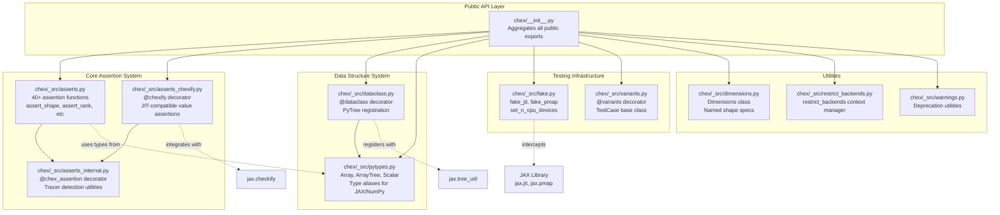

**Sources:** [chex/__init__.py:1-213]()

## Core Subsystems

### 1. Assertion System Architecture

The assertion system operates in three layers:

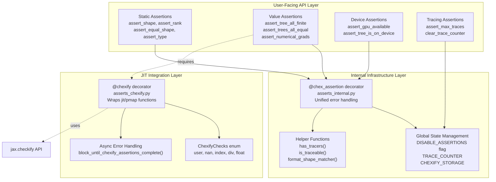

**Key Components:**

- **`chex/_src/asserts.py`**: Contains all 40+ user-facing assertion functions
- **`chex/_src/asserts_internal.py`**: Provides `@chex_assertion` decorator that unifies all assertions with common error handling, tracer detection, and global state management
- **`chex/_src/asserts_chexify.py`**: Implements `@chexify` decorator that integrates with `jax.checkify` to enable value assertions inside JIT-compiled code

**Sources:** [chex/__init__.py:17-68](), [README.md:159-194]()

### 2. Data Structure System

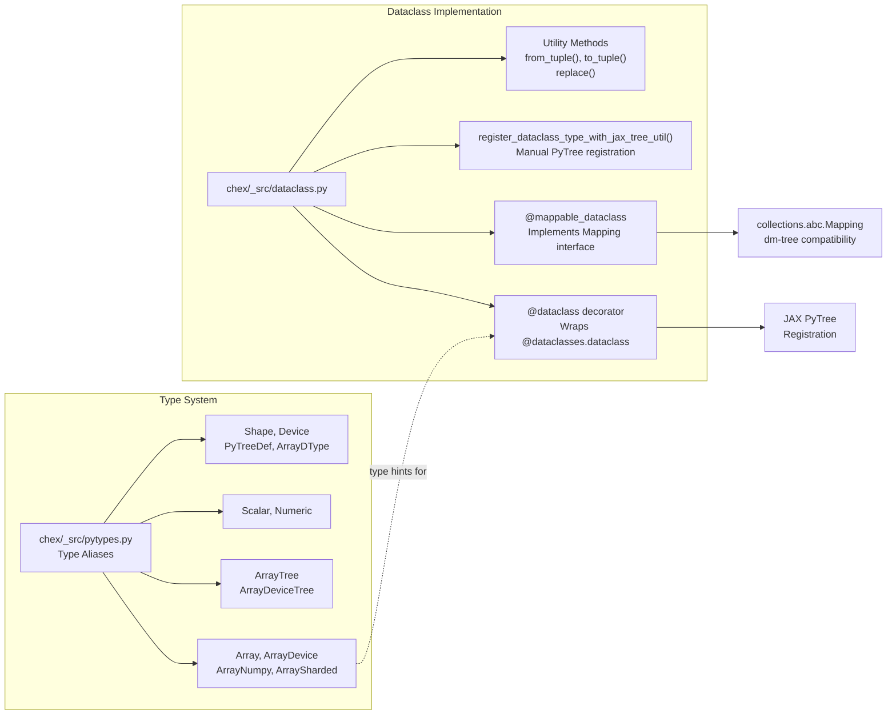

**Key Components:**

- **`chex/_src/pytypes.py`**: Defines comprehensive type aliases for arrays, trees, scalars, and metadata
- **`chex/_src/dataclass.py`**: Provides `@dataclass` decorator that automatically registers dataclasses as JAX PyTrees and optionally exposes them as `Mapping` instances

**Sources:** [chex/__init__.py:73-75,81-95](), [README.md:33-85]()

### 3. Testing Infrastructure System

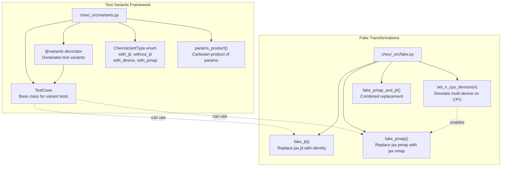

**Key Components:**

- **`chex/_src/fake.py`**: Provides debugging utilities that replace expensive JAX transformations with simpler equivalents
- **`chex/_src/variants.py`**: Implements test variant framework that automatically generates and runs tests across different JAX execution contexts

**Sources:** [chex/__init__.py:77-101](), [README.md:237-408]()

## Usage Pattern Overview

The following diagram illustrates how user code interacts with Chex's primary APIs:

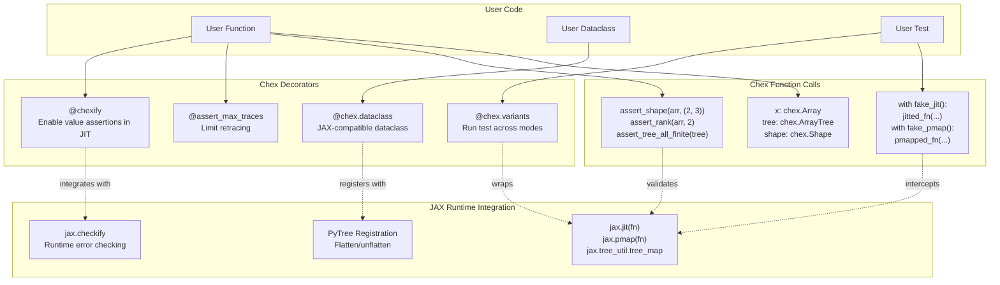

**Common Patterns:**

1. **Assertion Pattern**: Call assertion functions directly in code to validate array properties
2. **Chexify Pattern**: Wrap JIT-compiled functions with `@chexify` to enable value assertions
3. **Dataclass Pattern**: Use `@chex.dataclass` decorator to create JAX-compatible dataclasses
4. **Testing Pattern**: Inherit from `chex.TestCase` and use `@chex.variants` to test across execution modes
5. **Debugging Pattern**: Use `fake_jit()` or `fake_pmap()` context managers to simplify debugging

**Sources:** [README.md:52-307](), [chex/__init__.py:1-213]()

## Key Design Patterns

### 1. Decorator-Based API

Chex uses decorators extensively to modify behavior:

- `@chex.dataclass`: Extends dataclass with PyTree registration
- `@chexify`: Enables value assertions in JIT context
- `@variants`: Generates test variants
- `@assert_max_traces`: Monitors function retracing

**Sources:** [chex/__init__.py:70-75,97-102]()

### 2. Context Manager Pattern

Debugging utilities use context managers for temporary state changes:

- `fake_jit()`: Temporarily disables JIT compilation
- `fake_pmap()`: Replaces pmap with vmap
- `restrict_backends()`: Restricts JAX to specific backends

**Sources:** [chex/__init__.py:77-80,96]()

### 3. Global State Management

Assertions support global configuration via module-level state:

- `disable_asserts()` / `enable_asserts()`: Toggle all assertions
- `clear_trace_counter()`: Reset trace counter for `assert_max_traces`
- `CHEXIFY_STORAGE`: Stores checkified function versions

**Sources:** [chex/__init__.py:66-67]()

### 4. Type Alias System

Chex provides descriptive type aliases for better code documentation:

- `Array`, `ArrayDevice`, `ArrayNumpy`: Different array types
- `ArrayTree`, `ArrayDeviceTree`: Nested structures
- `Scalar`, `Numeric`, `Shape`: Metadata types

**Sources:** [chex/__init__.py:81-95]()

## Project Statistics

| Metric | Value |
|--------|-------|
| Current Version | 0.1.91 |
| Public API Symbols | 100 |
| Assertion Functions | 40+ |
| Test Variant Types | 5 |
| Core Modules | 10 |
| External Dependencies | JAX, NumPy, dm-tree |

**Sources:** [chex/__init__.py:108,110-200]()

## Next Steps

- For installation and quick start examples, see [Getting Started](#2)
- For detailed assertion documentation, see [Assertion System](#3)
- For dataclass usage patterns, see [Dataclass System](#4)
- For testing utilities, see [Testing Infrastructure](#6)
- For complete API reference, see [API Reference](#9)

---

# Page: Getting Started

# Getting Started

<details>
<summary>Relevant source files</summary>

The following files were used as context for generating this wiki page:

- [README.md](README.md)
- [chex/__init__.py](chex/__init__.py)
- [chex/_src/asserts_test.py](chex/_src/asserts_test.py)

</details>


## Purpose and Scope

This page provides a quick-start guide to installing and using Chex's core features. It covers basic usage patterns for assertions, dataclasses, and testing utilities with simple examples. For comprehensive documentation on specific systems, see:
- Assertion System: [Assertion System](#3)
- Dataclass System: [Dataclass System](#4)
- Testing Infrastructure: [Testing Infrastructure](#6)
- Type System: [Type System (pytypes)](#5)

---

## Installation

Chex can be installed from PyPI or directly from the GitHub repository.

### Installing from PyPI

```bash
pip install chex
```

### Installing from GitHub (Latest Development Version)

```bash
pip install git+https://github.com/deepmind/chex.git
```

**Note**: Chex requires JAX to be installed. If not already present, pip will install it as a dependency.

Sources: [README.md:17-29]()

---

## Core Concepts

Chex provides three main categories of utilities for JAX development:

| Category | Purpose | Key Modules |
|----------|---------|-------------|
| **Assertions** | Validate array properties, shapes, types, and values | `asserts.py`, `asserts_chexify.py` |
| **Data Structures** | JAX-compatible dataclasses with PyTree registration | `dataclass.py`, `pytypes.py` |
| **Testing Tools** | Debug transformations and test across execution contexts | `fake.py`, `variants.py` |

### Chex Public API Structure

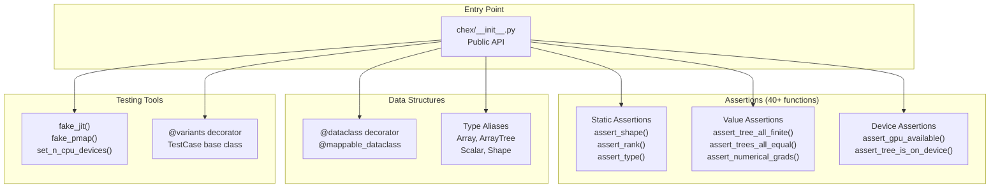

Sources: [chex/__init__.py:1-213]()

---

## Basic Usage: Assertions

Chex assertions validate array properties and help catch bugs early. They are divided into **static** assertions (work in all contexts) and **value** assertions (require concrete values).

### Static Assertions

Static assertions check metadata like shape, rank, and type without needing actual values:

```python
import chex
import jax.numpy as jnp

# Shape validation
x = jnp.zeros((3, 4, 5))
chex.assert_shape(x, (3, 4, 5))  # OK
chex.assert_rank(x, 3)           # OK

# Multiple arrays with different shapes
batch = jnp.zeros((32, 10))
logits = jnp.zeros((32, 100))
chex.assert_equal_shape([batch, logits], dims=0)  # Check first dimension matches

# Type validation
chex.assert_type(x, float)       # OK (x.dtype is floating point)
```

### Value Assertions

Value assertions inspect concrete array values and require special handling in JIT-compiled code:

```python
# Outside JIT - works normally
params = {'w': jnp.array([1.0, 2.0]), 'b': jnp.array(0.5)}
chex.assert_tree_all_finite(params)  # OK

# Inside JIT - requires @chexify decorator
@chex.chexify
@jax.jit
def safe_log(x):
    chex.assert_tree_all_finite(x)  # Now works inside JIT
    return jnp.log(x)

safe_log(jnp.array([1.0, 2.0]))     # OK
# safe_log(jnp.array([jnp.nan, 2.0])) would raise error
```

### Common Assertion Patterns

```python
# Validate shapes match
chex.assert_equal_shape([predictions, targets])

# Check multiple arrays have same rank
chex.assert_rank([x, y, z], 2)

# Verify tree structures match
chex.assert_trees_all_equal_structs(tree1, tree2)

# Compare trees with tolerance
chex.assert_trees_all_close(predictions, expected, rtol=1e-5)

# Ensure no NaN/Inf values
chex.assert_tree_all_finite(gradients)
```

### Static vs Value Assertions Comparison

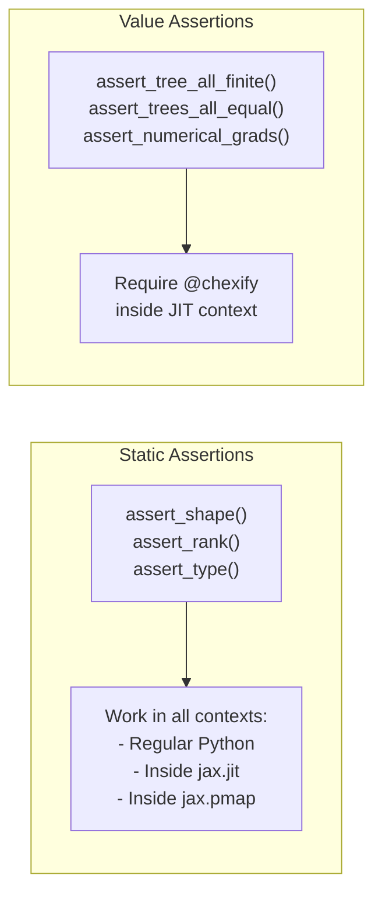

Sources: [chex/__init__.py:17-68](), [README.md:86-193](), [chex/_src/asserts_test.py:240-283]()

---

## Basic Usage: Dataclasses

Chex provides `@dataclass` and `@mappable_dataclass` decorators that create JAX-compatible dataclasses registered as PyTrees.

### Simple Dataclass Example

```python
import chex
import jax
import jax.numpy as jnp

@chex.dataclass
class ModelParams:
    weights: chex.Array
    bias: chex.Array
    learning_rate: float

# Create instance (keyword arguments only)
params = ModelParams(
    weights=jnp.ones((10, 5)),
    bias=jnp.zeros(5),
    learning_rate=0.01
)

# Works with JAX tree operations
scaled_params = jax.tree_map(lambda x: 2.0 * x, params)

# Use in JAX transformations
@jax.jit
def update_params(params, gradient):
    return jax.tree_map(lambda p, g: p - 0.01 * g, params, gradient)
```

### Mappable Dataclass for dm-tree Compatibility

```python
import tree  # dm-tree library

@chex.mappable_dataclass
class State:
    step: int
    params: chex.Array
    optimizer_state: dict

state = State(
    step=0,
    params=jnp.ones(10),
    optimizer_state={'momentum': jnp.zeros(10)}
)

# Works with dm-tree operations
flat_values = tree.flatten(state)
structure = tree.structure(state)
```

### Dataclass Features

| Feature | Description | Example |
|---------|-------------|---------|
| **PyTree Registration** | Automatic registration with JAX tree utilities | `jax.tree_map(fn, dataclass_instance)` |
| **Immutability** | Frozen by default for functional programming | `frozen=True` (default) |
| **Mapping Interface** | Optional dict-like behavior | `@mappable_dataclass` |
| **Type Annotations** | Full support for Chex type hints | `weights: chex.ArrayDevice` |

**Important**: Chex dataclasses do not support positional arguments in constructors. Always use keyword arguments:

```python
# ❌ Wrong - raises ValueError
params = ModelParams(jnp.ones(10), jnp.zeros(5), 0.01)

# ✓ Correct
params = ModelParams(
    weights=jnp.ones(10),
    bias=jnp.zeros(5),
    learning_rate=0.01
)
```

Sources: [chex/__init__.py:73-75](), [README.md:33-84](), [chex/_src/dataclass.py]()

---

## Basic Usage: Testing Utilities

Chex provides tools to debug JAX code and test it across different execution contexts.

### Fake Transformations for Debugging

During debugging, JIT compilation and parallel mapping can obscure errors. Chex allows you to replace these transformations temporarily:

```python
import chex
import jax

# Temporarily disable JIT compilation
with chex.fake_jit():
    @jax.jit
    def compute(x):
        # This will NOT be JIT-compiled
        # You can use print(), debuggers, etc.
        print(f"Debug: x = {x}")
        return x ** 2
    
    result = compute(jnp.array([1.0, 2.0]))

# Replace pmap with vmap for single-device debugging
with chex.fake_pmap():
    @jax.pmap
    def parallel_compute(x):
        # This will be vmapped instead of pmapped
        return x * 2
```

### Test Variants

The `@variants` decorator runs tests across multiple JAX execution contexts automatically:

```python
import chex

class MyTest(chex.TestCase):
    
    @chex.variants(with_jit=True, without_jit=True)
    def test_function_behavior(self):
        @self.variant
        def add(x, y):
            return x + y
        
        # This test runs twice:
        # 1. With add = jax.jit(add)
        # 2. With add unchanged
        result = add(1, 2)
        self.assertEqual(result, 3)
```

### Test Variant Types

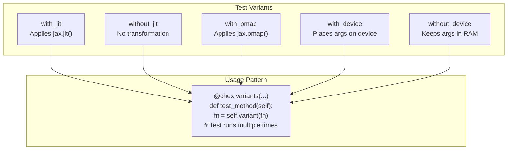

### Multi-Device Testing Simulation

For testing parallel code without actual multiple devices:

```python
# In your test file's setUpModule():
def setUpModule():
    chex.set_n_cpu_devices(8)  # Simulate 8 devices using CPU threads

# Run tests with: python test.py --chex_n_cpu_devices=8

class ParallelTest(chex.TestCase):
    
    @chex.variants(with_pmap=True)
    def test_parallel_computation(self):
        @self.variant
        def parallel_fn(x):
            return x * 2
        
        # Works with simulated 8 devices
        x = jnp.ones((8, 10))  # 8 replicas, 10 features each
        result = parallel_fn(x)
        self.assertEqual(result.shape, (8, 10))
```

Sources: [chex/__init__.py:77-80, 97-101](), [README.md:237-408](), [chex/_src/variants.py](), [chex/_src/fake.py]()

---

## Type Hints

Chex provides type aliases for better code documentation and IDE support:

```python
import chex

def process_batch(
    inputs: chex.Array,           # Any array (JAX or NumPy)
    targets: chex.ArrayDevice,    # JAX array on device
    config: dict
) -> chex.ArrayTree:              # Tree of arrays
    """Process a batch of data."""
    # Implementation
    pass

def compute_loss(
    predictions: chex.Array,
    targets: chex.Array
) -> chex.Scalar:                 # Single scalar value
    """Compute loss between predictions and targets."""
    return jnp.mean((predictions - targets) ** 2)
```

### Common Type Aliases

| Type | Description |
|------|-------------|
| `chex.Array` | Any array (JAX or NumPy) |
| `chex.ArrayDevice` | JAX array on device |
| `chex.ArrayNumpy` | NumPy array |
| `chex.ArrayTree` | PyTree of arrays |
| `chex.Scalar` | Scalar value (int, float, etc.) |
| `chex.Shape` | Shape tuple |
| `chex.PRNGKey` | JAX random key |

Sources: [chex/__init__.py:81-96](), [chex/_src/pytypes.py]()

---

## Common Patterns and Workflows

### Pattern 1: Safe Function with Assertions

```python
@chex.chexify
@jax.jit
def safe_normalize(x: chex.Array) -> chex.Array:
    """Normalize array with safety checks."""
    chex.assert_rank(x, 1)                    # Static: check rank
    chex.assert_tree_all_finite(x)            # Value: check for NaN/Inf
    
    norm = jnp.linalg.norm(x)
    chex.assert_scalar_positive(norm)         # Value: ensure non-zero
    
    return x / norm
```

### Pattern 2: Validated Dataclass State

```python
@chex.dataclass
class TrainingState:
    params: chex.ArrayTree
    opt_state: chex.ArrayTree
    step: int
    
    def __post_init__(self):
        """Validate state after initialization."""
        chex.assert_tree_all_finite(self.params)
        chex.assert_scalar_non_negative(self.step)
```

### Pattern 3: Comprehensive Test Coverage

```python
class ModelTest(chex.TestCase):
    
    @chex.variants(with_jit=True, without_jit=True, with_pmap=True)
    def test_forward_pass(self):
        """Test model forward pass in multiple contexts."""
        @self.variant
        def forward(params, x):
            return model.apply(params, x)
        
        # Test runs 3 times: JIT, non-JIT, and pmap
        x = jnp.ones((4, 10))
        params = init_params()
        output = forward(params, x)
        
        chex.assert_shape(output, (4, 5))
        chex.assert_tree_all_finite(output)
```

### Complete Example: Training Loop with Chex

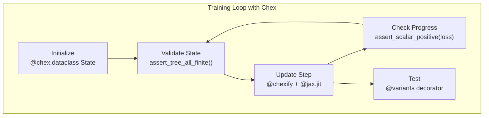

```python
import chex
import jax
import jax.numpy as jnp

@chex.dataclass
class TrainingState:
    params: chex.ArrayTree
    step: int
    
@chex.chexify
@jax.jit
def train_step(state: TrainingState, batch: chex.Array) -> tuple:
    """Single training step with safety checks."""
    # Validate inputs
    chex.assert_tree_all_finite(state.params)
    chex.assert_tree_all_finite(batch)
    
    # Compute loss and gradients
    loss, grads = compute_loss_and_grads(state.params, batch)
    chex.assert_scalar_positive(loss)
    chex.assert_tree_all_finite(grads)
    
    # Update parameters
    new_params = jax.tree_map(
        lambda p, g: p - 0.01 * g,
        state.params,
        grads
    )
    
    new_state = state.replace(params=new_params, step=state.step + 1)
    return new_state, loss

class TrainingTest(chex.TestCase):
    
    @chex.variants(with_jit=True, without_jit=True)
    def test_train_step(self):
        """Test training step in JIT and non-JIT modes."""
        state = TrainingState(
            params={'w': jnp.ones(10)},
            step=0
        )
        batch = jnp.ones((32, 10))
        
        train_fn = self.variant(train_step)
        new_state, loss = train_fn(state, batch)
        
        chex.assert_shape(new_state.params['w'], (10,))
        chex.assert_scalar_positive(loss)
```

Sources: [chex/_src/asserts_test.py:68-236](), [README.md:145-189]()

---

## Disabling Assertions

For production deployment, you can globally disable assertions to reduce overhead:

```python
import chex

# Disable all assertions
chex.disable_asserts()

# Your code with assertions - they will be no-ops
chex.assert_shape(x, (10, 20))  # Does nothing

# Re-enable assertions
chex.enable_asserts()

# Now assertions work again
chex.assert_shape(x, (10, 20))  # Validates shape
```

Sources: [chex/__init__.py:66-67, 178-179](), [chex/_src/asserts_test.py:47-65]()

---

## Next Steps

Now that you understand Chex basics, explore detailed documentation:

- **[Assertion System](#3)**: Comprehensive guide to all 40+ assertions, static vs value assertions, and `@chexify` decorator
- **[Dataclass System](#4)**: Deep dive into PyTree registration, mappable dataclasses, and advanced features
- **[Testing Infrastructure](#6)**: Complete coverage of fake transformations, test variants, and multi-device testing
- **[Type System](#5)**: Full reference of Chex type aliases and their usage
- **[API Reference](#9)**: Complete API documentation for all public functions and classes

Sources: [README.md:1-474](), [chex/__init__.py:1-213]()

---

# Page: Assertion System

# Assertion System

<details>
<summary>Relevant source files</summary>

The following files were used as context for generating this wiki page:

- [chex/__init__.py](chex/__init__.py)
- [chex/_src/asserts.py](chex/_src/asserts.py)
- [chex/_src/asserts_test.py](chex/_src/asserts_test.py)

</details>


## Purpose and Scope

This document provides an overview of Chex's assertion system, which is the library's most important feature for validating JAX arrays, PyTrees, and execution contexts. The assertion system provides over 40 assertion functions organized into categories: static assertions that validate metadata, value assertions that inspect concrete values, tree assertions for PyTree validation, and device/tracing assertions for JAX-specific scenarios.

For specific details on individual assertion categories, see:
- [Static Assertions](#3.1) - Shape, rank, size, and type validation
- [Value Assertions](#3.2) - Concrete value inspection and comparisons
- [Tree Assertions](#3.3) - PyTree structure and content validation
- [Device and JAX-Specific Assertions](#3.4) - Device placement and tracing checks
- [Chexify](#3.5) - Making value assertions work inside JIT
- [Assertion Internals](#3.6) - Implementation details and decorator mechanics

## System Architecture

The assertion system consists of three main modules working together to provide comprehensive validation capabilities across different JAX execution contexts:

**Assertion System Components**

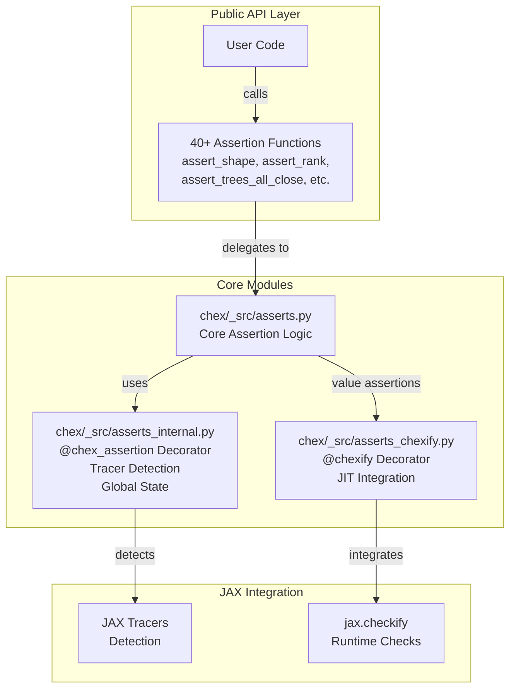

Sources: [chex/_src/asserts.py:1-100](), [chex/_src/asserts_internal.py:1-50](), [chex/_src/asserts_chexify.py:1-50](), [Diagram 2 from high-level architecture]

## Assertion Categories

The assertion system divides into four main categories based on what they validate and when they can be used:

**Assertion Category Matrix**

| Category | Works in JIT? | Validates | Example Functions |
|----------|---------------|-----------|-------------------|
| **Static** | ✓ Yes | Metadata (shape, rank, type) | `assert_shape`, `assert_rank`, `assert_type` |
| **Value** | ✗ No (use `@chexify`) | Concrete values | `assert_tree_all_finite`, `assert_trees_all_equal` |
| **Device** | ✓ Yes | Device placement | `assert_tree_is_on_device`, `assert_gpu_available` |
| **Tracing** | ✓ Yes | JAX tracing behavior | `assert_max_traces` |

Sources: [chex/_src/asserts.py:40-44](), [Diagram 2 from high-level architecture]

### Static Assertions

Static assertions validate array metadata without inspecting concrete values. They work in all contexts including JIT-compiled functions because they only examine tracer shapes and types:

```python
# Shape validation
chex.assert_shape(x, (batch_size, 128))  # Exact shape
chex.assert_shape(x, (None, 128))        # Any batch size
chex.assert_shape(x, (..., 128))         # Any rank ending in 128

# Rank validation  
chex.assert_rank(x, 2)                   # Must be rank-2
chex.assert_rank([x, y], {2, 3})         # Both must be rank-2 or rank-3

# Type validation
chex.assert_type(x, jnp.float32)         # Exact dtype
chex.assert_type(x, float)               # Any floating type
```

**Static Assertion Implementation Pattern**

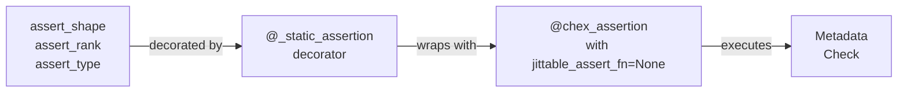

Sources: [chex/_src/asserts.py:42-44](), [chex/_src/asserts.py:598-655](), [chex/_src/asserts.py:702-783](), [chex/_src/asserts.py:786-850]()

### Value Assertions

Value assertions inspect concrete array values and cannot run inside JIT-compiled code without using the `@chexify` decorator:

```python
# Finite value checks
chex.assert_tree_all_finite(params)

# Exact equality
chex.assert_trees_all_equal(tree1, tree2)

# Approximate equality
chex.assert_trees_all_close(expected, actual, rtol=1e-6)

# ULP-based equality (for bit-exact comparisons)
chex.assert_trees_all_close_ulp(tree1, tree2, maxulp=5)
```

**Value Assertion Dual Implementation**

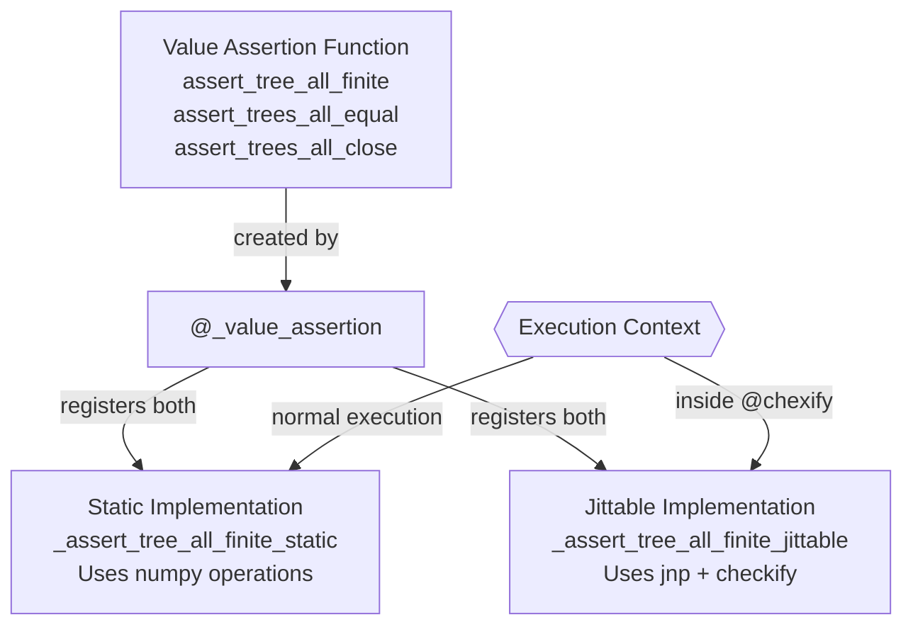

Sources: [chex/_src/asserts.py:40-41](), [chex/_src/asserts.py:1550-1553](), [chex/_src/asserts.py:1637-1641](), [chex/_src/asserts.py:1702-1705]()

### Tree Assertions

Tree assertions validate PyTree structures and their contents. They check structural equality and per-leaf properties:

```python
# Structure validation
chex.assert_trees_all_equal_structs(tree1, tree2, tree3)

# Shape matching
chex.assert_trees_all_equal_shapes(tree1, tree2)
chex.assert_tree_shape(tree, (batch, None))
chex.assert_tree_shape_prefix(tree, (batch, seq_len))

# Content validation
chex.assert_tree_has_only_ndarrays(tree)
chex.assert_tree_no_nones(tree)

# Size and dtype
chex.assert_trees_all_equal_sizes(tree1, tree2)
chex.assert_trees_all_equal_dtypes(tree1, tree2)
```

Sources: [chex/_src/asserts.py:1373-1398](), [chex/_src/asserts.py:1485-1512](), [chex/_src/asserts.py:1262-1288](), [chex/_src/asserts.py:1011-1031](), [chex/_src/asserts.py:1034-1055]()

### Device and Tracing Assertions

Device assertions validate hardware availability and array placement:

```python
# Device availability
chex.assert_gpu_available()
chex.assert_devices_available(n=4, devtype='tpu')

# Array placement
chex.assert_tree_is_on_device(tree, platform='gpu')
chex.assert_tree_is_on_host(tree, allow_cpu_device=False)
chex.assert_tree_is_sharded(tree, devices=(dev1, dev2))

# Tracing behavior
@chex.assert_max_traces(n=1)
def expensive_function(x):
    return jnp.sum(x ** 2)
```

**Device Assertion Flow**

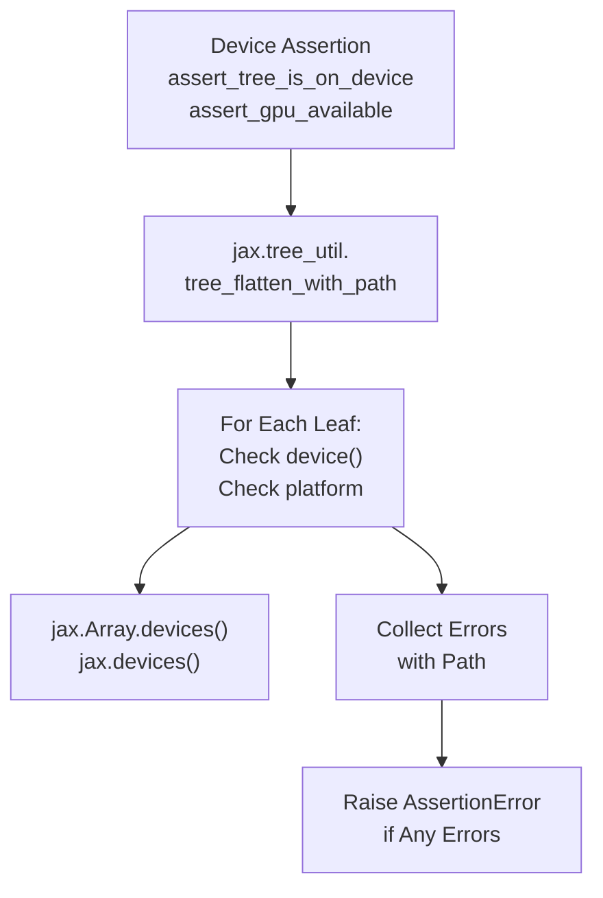

Sources: [chex/_src/asserts.py:164-217](), [chex/_src/asserts.py:1150-1212](), [chex/_src/asserts.py:1076-1148](), [chex/_src/asserts.py:1214-1260](), [chex/_src/asserts.py:78-162]()

## Static vs Value Assertions

The core distinction in Chex's assertion system is between static and value assertions, determined by whether they need to inspect concrete array values:

**Assertion Type Comparison**

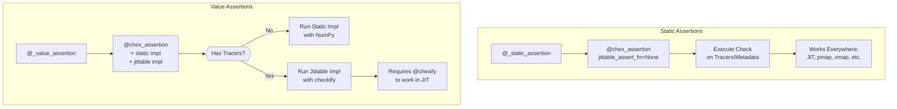

Sources: [chex/_src/asserts.py:40-44](), [chex/_src/asserts_internal.py:50-150]()

**When Static Assertions Suffice**

Static assertions are preferred when possible because they:
- Work inside all JAX transformations without modification
- Have zero runtime overhead (compiled away after shape inference)
- Fail fast at trace time rather than execution time

```python
@jax.jit
def model_forward(x):
    chex.assert_shape(x, (None, 784))  # Static: OK in JIT
    chex.assert_type(x, jnp.float32)   # Static: OK in JIT
    return model(x)
```

**When Value Assertions Are Needed**

Value assertions are necessary when you need to inspect actual array contents:

```python
# Without @chexify - FAILS in JIT
@jax.jit
def compute(x):
    chex.assert_tree_all_finite(x)  # ERROR: needs concrete values
    return x + 1

# With @chexify - Works
@chex.chexify
@jax.jit  
def compute(x):
    chex.assert_tree_all_finite(x)  # OK: uses checkify
    return x + 1
```

Sources: [chex/_src/asserts.py:1517-1553](), [chex/_src/asserts_chexify.py:1-100]()

## Global Controls

The assertion system provides global switches to control assertion behavior across the entire program:

**Global State Management**

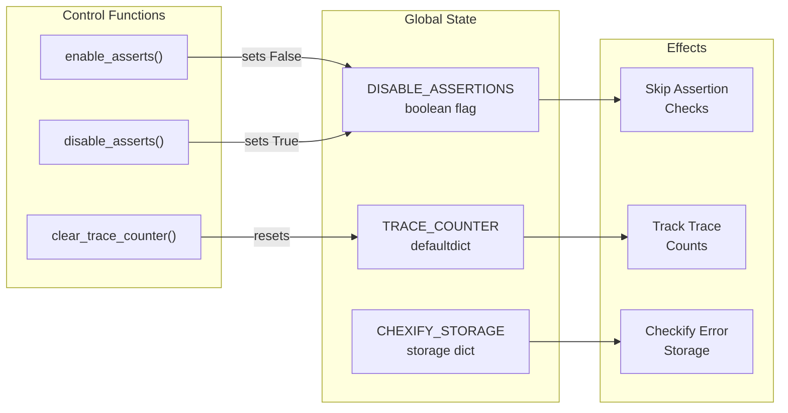

**Usage Examples**

```python
# Disable all assertions (e.g., for production)
chex.disable_asserts()
chex.assert_shape(x, (10,))  # Does nothing

# Re-enable assertions
chex.enable_asserts()
chex.assert_shape(x, (10,))  # Validates again

# Clear trace counter for testing
chex.clear_trace_counter()  # Reset for new test
```

Sources: [chex/_src/asserts.py:47-76](), [chex/_src/asserts_internal.py:30-50]()

**Conditional Assertions**

The `if_args_not_none` wrapper allows assertions only when arguments are not `None`:

```python
def validate_if_present(x, y):
    # Only runs if both x and y are not None
    chex.if_args_not_none(chex.assert_equal_shape, x, y)
```

Sources: [chex/_src/asserts.py:60-67]()

## Integration with JAX Transformations

**Tracer Detection**

The assertion system detects when code is being traced by JAX transformations:

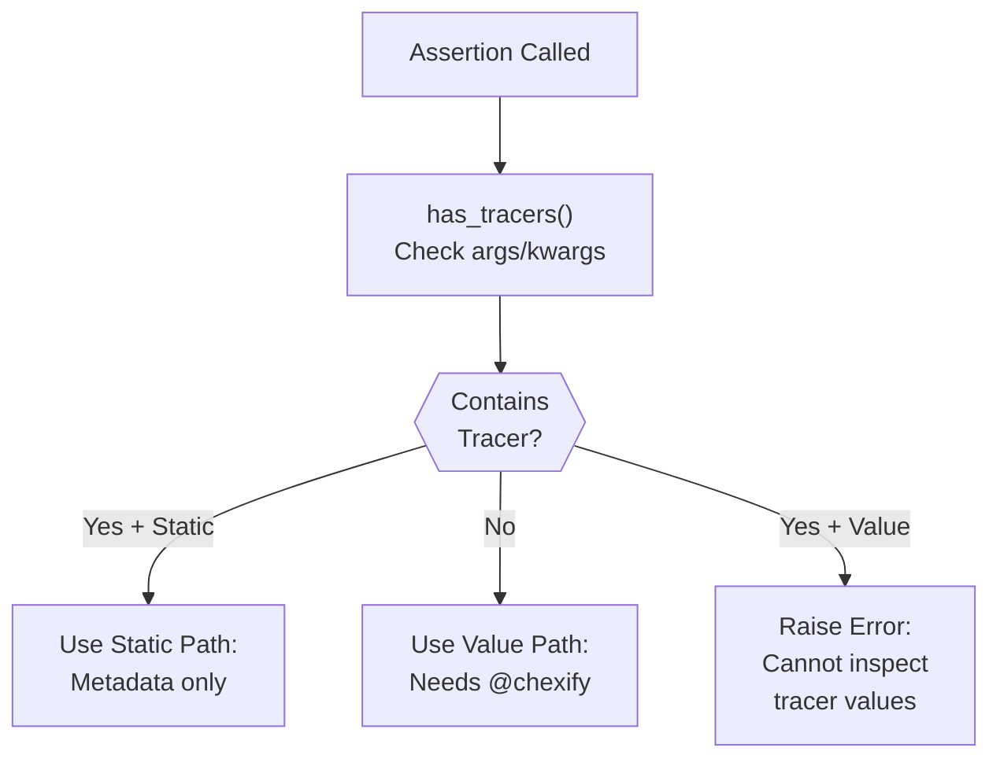

**Assert Max Traces**

The `@assert_max_traces` decorator prevents excessive recompilation:

```python
@jax.jit
@chex.assert_max_traces(n=1)
def model_fn(x):
    # Fails if traced more than once
    return x + 1

# First call: traced once - OK
model_fn(jnp.zeros(10))

# Same shape: uses cached compiled version - OK  
model_fn(jnp.ones(10))

# Different shape: requires retracing - FAILS
model_fn(jnp.zeros(20))  # AssertionError!
```

**How It Works**

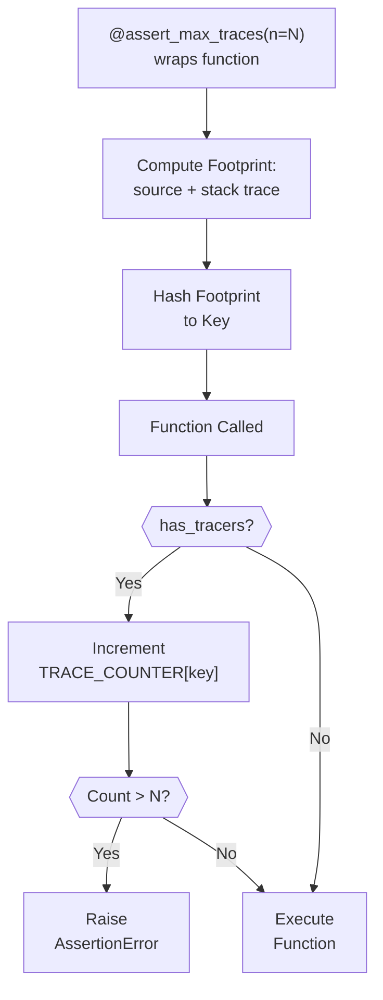

Sources: [chex/_src/asserts.py:78-162](), [chex/_src/asserts_internal.py:80-120]()

## Common Usage Patterns

**Shape Validation**

```python
def forward(batch, seq_len):
    # Multiple arrays with expected shapes
    chex.assert_shape([embeddings, mask], [(batch, seq_len, 768), (batch, seq_len)])
    
    # Flexible batch size
    chex.assert_shape(logits, (None, num_classes))
    
    # At least 2D, ending in feature_dim
    chex.assert_shape(features, (..., feature_dim))
```

**Tree Validation**

```python
def validate_params(params, target_params):
    # Same structure and shapes
    chex.assert_trees_all_equal_shapes(params, target_params)
    
    # All finite values
    chex.assert_tree_all_finite(params)
    
    # Approximate equality after training step
    chex.assert_trees_all_close(
        updated_params, 
        expected_params,
        rtol=1e-5,
        atol=1e-8
    )
```

**Device Assertions**

```python
def check_multi_device_setup():
    # Ensure multi-GPU setup
    chex.assert_devices_available(n=4, devtype='gpu')
    
    # Validate sharding
    sharded_data = jax.device_put_replicated(data, devices)
    chex.assert_tree_is_sharded(sharded_data, devices=devices)
```

Sources: [chex/_src/asserts_test.py:425-537](), [chex/_src/asserts_test.py:848-1156](), [chex/_src/asserts_test.py:1699-1763]()

## Error Messages and Debugging

Assertions provide detailed error messages with path information for nested structures:

```python
tree = {'model': {'layer1': jnp.zeros(10), 'layer2': jnp.zeros(20)}}
invalid_tree = {'model': {'layer1': jnp.zeros(10), 'layer2': jnp.zeros(15)}}

chex.assert_trees_all_equal_shapes(tree, invalid_tree)
# AssertionError: Trees 0 and 1 differ in leaves 'model/layer2': 
# shapes: (20,) != (15,)
```

**Error Message Components**

| Component | Purpose | Example |
|-----------|---------|---------|
| Tree indices | Identify which trees differ | `Trees 0 and 2` |
| Leaf paths | Pinpoint exact location | `'model/layer2'` or `'x/y/0'` |
| Expected vs actual | Show what was expected | `shapes: (20,) != (15,)` |
| Context | Type of check failed | `Error in shape compatibility check` |

Sources: [chex/_src/asserts.py:1400-1444](), [chex/_src/asserts_internal.py:150-250]()

## Public API Summary

The assertion system exports over 40 functions through `chex/__init__.py`. Key categories:

**Shape and Rank Assertions**
- `assert_shape`, `assert_rank`, `assert_size`
- `assert_equal_shape`, `assert_equal_rank`, `assert_equal_size`
- `assert_equal_shape_prefix`, `assert_equal_shape_suffix`
- `assert_axis_dimension`, `assert_axis_dimension_gt/lt/gteq/lteq`
- `assert_is_broadcastable`

**Type and Value Assertions**
- `assert_type`
- `assert_equal`
- `assert_scalar`, `assert_scalar_positive/negative/non_negative`
- `assert_scalar_in`
- `assert_is_divisible`

**Tree Assertions**
- `assert_tree_all_finite`, `assert_tree_no_nones`, `assert_tree_has_only_ndarrays`
- `assert_trees_all_equal`, `assert_trees_all_close`, `assert_trees_all_close_ulp`
- `assert_trees_all_equal_structs/shapes/dtypes/sizes`
- `assert_tree_shape`, `assert_tree_shape_prefix/suffix`

**Device Assertions**
- `assert_devices_available`, `assert_gpu_available`, `assert_tpu_available`
- `assert_tree_is_on_device`, `assert_tree_is_on_host`, `assert_tree_is_sharded`

**Tracing and Control**
- `assert_max_traces`, `clear_trace_counter`
- `enable_asserts`, `disable_asserts`
- `assert_numerical_grads`

**Utilities**
- `if_args_not_none`
- `assert_not_both_none`, `assert_exactly_one_is_none`

Sources: [chex/__init__.py:17-200]()

---

# Page: Static Assertions

# Static Assertions

<details>
<summary>Relevant source files</summary>

The following files were used as context for generating this wiki page:

- [chex/_src/asserts.py](chex/_src/asserts.py)
- [chex/_src/asserts_test.py](chex/_src/asserts_test.py)
- [docs/api.rst](docs/api.rst)

</details>


## Purpose and Scope

Static assertions validate array **metadata** (shape, rank, size, dtype, and axis dimensions) without requiring concrete values. These assertions work in all JAX contexts, including inside JIT-compiled and pmap'd functions, because they only inspect properties that are available at trace time. They are the most fundamental type of assertion in Chex's assertion system.

For assertions that inspect concrete array values (e.g., checking if values are finite or equal), see [Value Assertions](#3.2). For assertions that validate entire PyTree structures, see [Tree Assertions](#3.3). For device placement and JAX-specific assertions, see [Device and JAX-Specific Assertions](#3.4).

---

## What Are Static Assertions?

Static assertions are distinguished by their decorator `@_static_assertion`, which is defined as `functools.partial(_ai.chex_assertion, jittable_assert_fn=None)`. The key characteristic is that `jittable_assert_fn=None`, meaning these assertions have no special JIT-compatible implementation—they work the same way in all contexts because they only access metadata that JAX tracers expose.

**Key Properties:**
- **Work with tracers**: Can be called on JAX tracers inside `@jax.jit`, `@jax.pmap`, etc.
- **Check metadata only**: Only inspect `.shape`, `.dtype`, `.size`, `.ndim`—never actual values
- **No checkify needed**: Don't require `@chexify` decorator (unlike value assertions)
- **Fail at trace time**: Errors are raised during tracing, not at runtime

Sources: [chex/_src/asserts.py:42-44]()

---

## Architecture Overview

The following diagram shows how static assertions fit into Chex's broader assertion system:

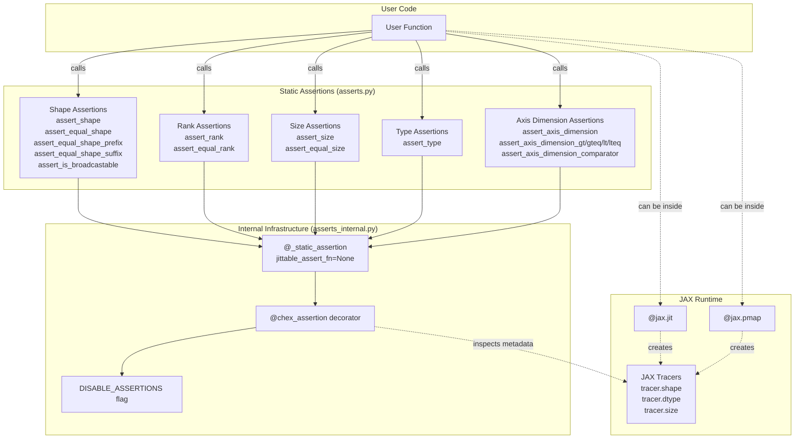

Sources: [chex/_src/asserts.py:42-44](), [chex/_src/asserts_internal.py:31-54]()

---

## Shape Assertions

Shape assertions validate the shape (tuple of dimension sizes) of arrays. They support flexible matching patterns including exact values, `None` for wildcards, sets for alternatives, and `...` (ellipsis) for variable-length sequences.

### Core Functions

| Function | Purpose | Example |
|----------|---------|---------|
| `assert_shape` | Check array(s) match expected shape pattern | `assert_shape(x, (2, 3))` |
| `assert_equal_shape` | Check all arrays have identical shapes | `assert_equal_shape([x, y, z])` |
| `assert_equal_shape_prefix` | Check leading dimensions match | `assert_equal_shape_prefix([x, y], 2)` |
| `assert_equal_shape_suffix` | Check trailing dimensions match | `assert_equal_shape_suffix([x, y], 2)` |
| `assert_is_broadcastable` | Check if shape A broadcasts to shape B | `assert_is_broadcastable((3,), (2, 3))` |

### Shape Pattern Matching

The `assert_shape` function supports sophisticated pattern matching:

```python
# Exact shape
assert_shape(x, (2, 3))

# Wildcard dimension (any size allowed)
assert_shape(x, (2, None))

# Alternative dimensions (size must be in set)
assert_shape(x, (2, {1, 3, 5}))

# Prefix matching (rank >= 2, first dim is 2)
assert_shape(x, (2, ...))

# Suffix matching (rank >= 2, last dim is 3)
assert_shape(x, (..., 3))

# Inner matching (rank >= 3, first is 2, last is 4)
assert_shape(x, (2, ..., 4))

# Multiple arrays with different shapes
assert_shape([x, y], [(2, 3), (4, 5)])

# Multiple arrays with same shape
assert_shape([x, y, z], (2, 3))
```

**Implementation Details:**

The shape matching logic in `_shape_matches` handles ellipsis by splitting the expected shape into prefix and suffix components, then validating each part separately against the actual shape:

1. Split `expected_shape` at `...` into `expected_prefix` and `expected_suffix`
2. If no ellipsis, check exact match with `_unelided_shape_matches`
3. If ellipsis present, verify rank is sufficient, then check prefix and suffix independently

Sources: [chex/_src/asserts.py:597-654](), [chex/_src/asserts.py:557-594]()

### Comparing Multiple Arrays

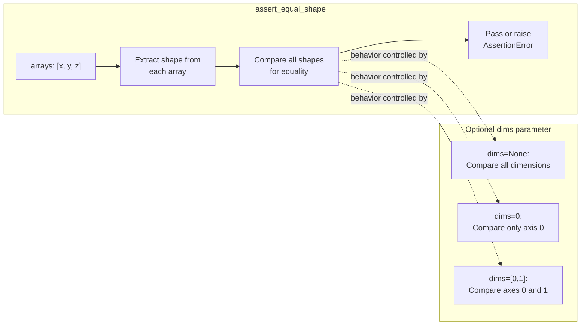

The `assert_equal_shape` function can optionally check only specific dimensions using the `dims` parameter:

```python
# Check all dimensions match
assert_equal_shape([x, y, z])

# Check only first dimension matches
assert_equal_shape([x, y, z], dims=0)

# Check first two dimensions match
assert_equal_shape([x, y, z], dims=[0, 1])

# Check last dimension matches (negative indexing)
assert_equal_shape([x, y, z], dims=-1)
```

Sources: [chex/_src/asserts.py:451-496](), [chex/_src/asserts.py:498-517](), [chex/_src/asserts.py:519-537]()

---

## Rank Assertions

Rank assertions validate the number of dimensions (rank/ndim) of arrays.

### Core Functions

| Function | Purpose | Example |
|----------|---------|---------|
| `assert_rank` | Check array rank matches expected value(s) | `assert_rank(x, 2)` |
| `assert_equal_rank` | Check all arrays have same rank | `assert_equal_rank([x, y, z])` |

### Usage Patterns

```python
# Single array, exact rank
assert_rank(x, 2)  # x must be a matrix

# Single array, rank options
assert_rank(x, {0, 2})  # x is scalar or matrix

# Multiple arrays, same rank
assert_rank([x, y], 2)  # both must be matrices

# Multiple arrays, different ranks
assert_rank([x, y], [0, 2])  # x is scalar, y is matrix

# Multiple arrays, rank options per array
assert_rank([x, y], [{0, 1}, 2])  # x is scalar or vector, y is matrix
```

**Implementation Note:** The function accepts both integers and sets of integers for flexible rank checking. It correctly handles scalar values which have `shape = ()` and thus `rank = 0`.

Sources: [chex/_src/asserts.py:701-782](), [chex/_src/asserts.py:681-699]()

---

## Size Assertions

Size assertions validate the total number of elements in an array (the product of all dimension sizes).

### Core Functions

| Function | Purpose | Example |
|----------|---------|---------|
| `assert_size` | Check array size matches expected value(s) | `assert_size(x, 6)` |
| `assert_equal_size` | Check all arrays have same total size | `assert_equal_size([x, y, z])` |

### Usage Patterns

```python
# Single array
assert_size(x, 6)  # x.size == 6

# Size alternatives
assert_size(x, {4, 6, 8})  # x.size in {4, 6, 8}

# Wildcard (any size)
assert_size(x, None)  # any size allowed
assert_size(x, ...)   # same as None

# Multiple arrays, same size
assert_size([x, y], 6)

# Multiple arrays, different sizes
assert_size([x, y], [6, 12])
```

**Special Cases:**
- Scalars have `size = 1` by definition
- Empty arrays have `size = 0`
- For arrays with `shape = (2, 3, 4)`, size = 2 × 3 × 4 = 24

Sources: [chex/_src/asserts.py:388-449](), [chex/_src/asserts.py:370-386]()

---

## Type Assertions

Type assertions validate the data type (dtype) of arrays, supporting both Python built-in types and NumPy/JAX dtypes.

### Core Function

| Function | Purpose | Example |
|----------|---------|---------|
| `assert_type` | Check array dtype matches expected type | `assert_type(x, float)` |

### Supported Type Specifications

The `assert_type` function supports multiple ways to specify expected types:

| Type Specification | Matches | Example |
|--------------------|---------|---------|
| `int` | Any integer dtype | `assert_type(x, int)` |
| `float` | Any floating point dtype | `assert_type(x, float)` |
| `bool` | Boolean dtype | `assert_type(x, bool)` |
| `jnp.integer` | Any integer dtype (alias) | `assert_type(x, jnp.integer)` |
| `jnp.floating` | Any floating point dtype (alias) | `assert_type(x, jnp.floating)` |
| Concrete dtype | Exact dtype match | `assert_type(x, np.float32)` |

### Usage Patterns

```python
# Python scalar types
assert_type(7, int)
assert_type(7.1, float)
assert_type(False, bool)

# NumPy arrays with Python types
assert_type(np.array(7), int)
assert_type(np.array([1, 2, 3]), int)

# Concrete dtypes
assert_type(jnp.ones(3, dtype=jnp.float32), jnp.float32)
assert_type(jnp.zeros(5, dtype=np.int8), np.int8)
assert_type(jnp.array(1., dtype=jnp.bfloat16), jnp.bfloat16)

# Multiple arrays
assert_type([x, y], [float, int])
assert_type([x, y, z], float)  # all must be float
```

**Type Hierarchy Checking:**

The function uses `jnp.issubdtype` for abstract type checking:
- `float` and `jnp.floating` match `float32`, `float64`, `bfloat16`, etc.
- `int` and `jnp.integer` match `int8`, `int16`, `int32`, `int64`, `uint8`, etc.
- Concrete dtypes require exact match

Sources: [chex/_src/asserts.py:785-849]()

---

## Axis Dimension Assertions

Axis dimension assertions check the size of a specific dimension (axis) in an array. These are useful for validating that particular axes have expected sizes, especially when other dimensions can vary.

### Core Functions

| Function | Purpose | Example |
|----------|---------|---------|
| `assert_axis_dimension` | Check `array.shape[axis] == expected` | `assert_axis_dimension(x, 0, 10)` |
| `assert_axis_dimension_gt` | Check `array.shape[axis] > val` | `assert_axis_dimension_gt(x, 1, 5)` |
| `assert_axis_dimension_gteq` | Check `array.shape[axis] >= val` | `assert_axis_dimension_gteq(x, 1, 5)` |
| `assert_axis_dimension_lt` | Check `array.shape[axis] < val` | `assert_axis_dimension_lt(x, 2, 100)` |
| `assert_axis_dimension_lteq` | Check `array.shape[axis] <= val` | `assert_axis_dimension_lteq(x, 2, 100)` |
| `assert_axis_dimension_comparator` | Generic comparator for custom checks | See below |

### Implementation Pattern

All axis dimension assertions delegate to `assert_axis_dimension_comparator`, which implements the common logic:

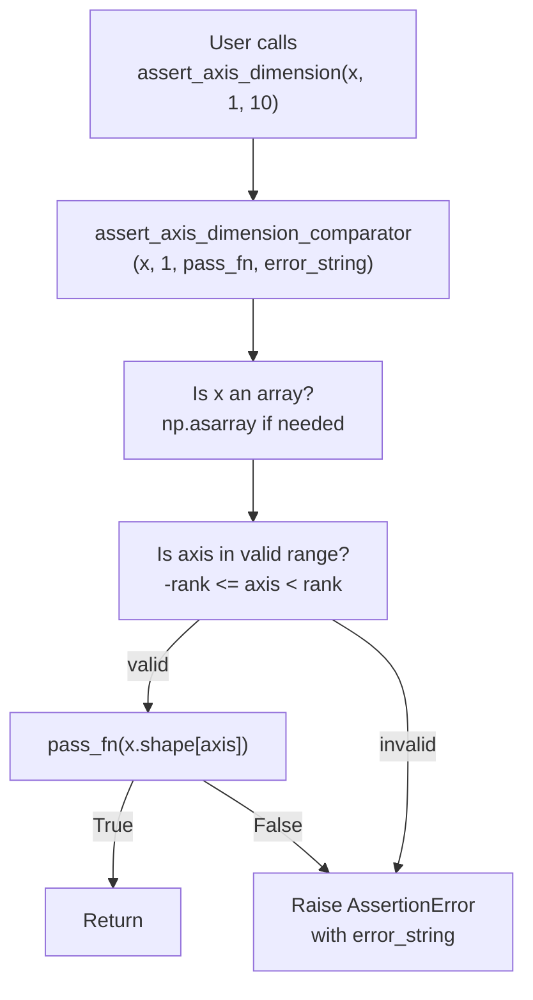

### Usage Patterns

```python
# Basic equality check
tensor = jnp.ones((3, 2, 7, 2))
assert_axis_dimension(tensor, axis=0, expected=3)  # OK
assert_axis_dimension(tensor, axis=1, expected=2)  # OK
assert_axis_dimension(tensor, axis=-1, expected=2) # OK (negative indexing)

# Comparisons
assert_axis_dimension_gt(tensor, axis=2, val=5)    # 7 > 5 ✓
assert_axis_dimension_gteq(tensor, axis=2, val=7)  # 7 >= 7 ✓
assert_axis_dimension_lt(tensor, axis=1, val=10)   # 2 < 10 ✓
assert_axis_dimension_lteq(tensor, axis=3, val=2)  # 2 <= 2 ✓

# Custom comparator
assert_axis_dimension_comparator(
    tensor,
    axis=0,
    pass_fn=lambda dim: dim % 2 == 1,  # Check if odd
    error_string="odd"
)
```

**Special Handling:**
- Supports negative axis indexing (e.g., `-1` for last axis)
- Validates axis is in range before checking dimension
- Works with both JAX and NumPy arrays
- Even works with Python lists/strings via `np.asarray` conversion

Sources: [chex/_src/asserts.py:852-882](), [chex/_src/asserts.py:884-902](), [chex/_src/asserts.py:904-921](), [chex/_src/asserts.py:923-940](), [chex/_src/asserts.py:942-959](), [chex/_src/asserts.py:961-978]()

---

## Global Control

Static assertions (like all Chex assertions) can be globally disabled or enabled:

```python
import chex

# Disable all assertions (use sparingly!)
chex.disable_asserts()
chex.assert_shape(x, (999, 999))  # Does nothing

# Re-enable assertions
chex.enable_asserts()
chex.assert_shape(x, (999, 999))  # Raises AssertionError
```

This is controlled by the global flag `asserts_internal.DISABLE_ASSERTIONS`.

**Use Case:** Disabling assertions in production to avoid runtime overhead, though static assertions have minimal cost since they only check metadata.

Sources: [chex/_src/asserts.py:47-57](), [chex/_src/asserts_internal.py:48]()

---

## Testing and Examples

Static assertions are extensively tested in [chex/_src/asserts_test.py](). Key test patterns include:

### Shape Testing
- Tests exact, wildcard, set-based, and ellipsis matching
- Tests prefix/suffix/inner ellipsis patterns
- Tests multiple arrays with same or different shapes
- Tests invalid inputs and error messages

### Rank Testing
- Tests single and multiple arrays
- Tests exact values and sets of acceptable ranks
- Tests error handling for invalid rank specifications

### Size Testing
- Tests exact, wildcard, and set-based size matching
- Tests multiple arrays with same or different sizes
- Tests handling of scalars (size = 1)

### Type Testing
- Tests Python scalar types (int, float, bool)
- Tests NumPy and JAX array dtypes
- Tests abstract types (`jnp.floating`, `jnp.integer`)
- Tests concrete dtypes (`jnp.float32`, `jnp.bfloat16`, etc.)
- Tests mixed arrays (combining scalars and arrays)

### Axis Dimension Testing
- Tests equality, greater than, less than comparisons
- Tests negative axis indexing
- Tests invalid axis detection
- Tests custom comparator functions

Sources: [chex/_src/asserts_test.py:285-846]()

---

## Summary: When to Use Static Assertions

Use static assertions when you need to validate:

✅ **Array shapes** before operations that require specific dimensions  
✅ **Array ranks** to ensure correct dimensionality  
✅ **Array sizes** for memory or computation bounds  
✅ **Array dtypes** to ensure numeric precision requirements  
✅ **Specific axis dimensions** for batching or feature sizes  

Static assertions are ideal for:
- Input validation at function boundaries
- Catching shape mismatches early in development
- Documenting array shape expectations in code
- Working inside JIT-compiled functions (unlike value assertions)

For assertions that need to inspect actual values (e.g., checking for NaN, comparing values), use [Value Assertions](#3.2) with the `@chexify` decorator.

Sources: [chex/_src/asserts.py:42-978]()

---

# Page: Value Assertions

# Value Assertions

<details>
<summary>Relevant source files</summary>

The following files were used as context for generating this wiki page:

- [chex/_src/asserts.py](chex/_src/asserts.py)
- [chex/_src/asserts_chexify.py](chex/_src/asserts_chexify.py)
- [chex/_src/asserts_chexify_test.py](chex/_src/asserts_chexify_test.py)
- [chex/_src/asserts_test.py](chex/_src/asserts_test.py)

</details>


Value assertions are Chex assertions that inspect concrete array values at runtime, such as checking for finiteness, equality, or numerical closeness. Unlike static assertions (see [Static Assertions](#3.1)) which validate metadata like shape or rank during tracing, value assertions require actual tensor values and therefore need special handling when used inside JAX transformations like `jax.jit` or `jax.pmap`.

For tree structure validation, see [Tree Assertions](#3.3). For using value assertions inside JIT-compiled code, see [Chexify: Assertions in JIT-Compiled Code](#3.5).

## Overview

Value assertions examine the concrete numerical content of arrays and trees. They answer questions like "does this array contain NaN or Inf?", "are these two arrays exactly equal?", or "are these values numerically close?". Because JAX tracing replaces concrete values with abstract tracers, these assertions cannot run during the tracing phase and require special treatment.

### Value vs Static Assertions

```mermaid
graph TB
    subgraph "Static Assertions"
        SA["@_static_assertion decorator"]
        SA_META["Inspect Metadata Only<br/>• shape<br/>• rank<br/>• dtype"]
        SA_TRACE["Available During Tracing"]
        SA_JIT["Works in jax.jit<br/>without chexify"]
        
        SA --> SA_META
        SA --> SA_TRACE
        SA --> SA_JIT
    end
    
    subgraph "Value Assertions"
        VA["@_value_assertion decorator"]
        VA_VAL["Inspect Concrete Values<br/>• finite checks<br/>• equality<br/>• closeness"]
        VA_CONCRETE["Requires Concrete Arrays"]
        VA_CHEX["Needs @chexify<br/>in jax.jit"]
        
        VA --> VA_VAL
        VA --> VA_CONCRETE
        VA --> VA_CHEX
    end
    
    CODE["chex._src.asserts.py:41-43"]
    CODE --> SA
    CODE --> VA
```

**Sources:** [chex/_src/asserts.py:41-43]()

The key implementation difference is that value assertions provide both a regular `assert_fn` and a `jittable_assert_fn` to the `@chex_assertion` decorator, while static assertions pass `jittable_assert_fn=None`.

## Core Value Assertion Functions

Chex provides five primary value assertion functions:

### Function Catalog

| Function | Purpose | Main Parameters | Jittable |
|----------|---------|-----------------|----------|
| `assert_tree_all_finite` | Check tree contains no NaN/Inf | `tree` | ✓ |
| `assert_trees_all_equal` | Check trees are exactly equal | `*trees`, `strict` | ✓ |
| `assert_trees_all_close` | Check trees are numerically close | `*trees`, `rtol`, `atol` | ✓ |
| `assert_trees_all_close_ulp` | Check closeness in ULP units | `*trees`, `maxulp` | ✗ |
| `assert_numerical_grads` | Check autodiff vs numerical grads | `f`, `f_args`, `order` | ✗ |

**Sources:** [chex/_src/asserts.py:1418-1765]()

### assert_tree_all_finite

```mermaid
graph LR
    INPUT["tree: ArrayTree"]
    CHECK{{"jax.tree.map<br/>check finite"}}
    PASS["Returns None"]
    FAIL["AssertionError:<br/>Tree contains<br/>non-finite value"]
    
    INPUT --> CHECK
    CHECK -->|"all finite"| PASS
    CHECK -->|"NaN or Inf"| FAIL
```

**Sources:** [chex/_src/asserts.py:1418-1468]()

Validates that all arrays in a PyTree contain only finite values (no NaN or Inf). This is particularly useful for debugging numerical instabilities.

**Implementation:**
- Regular version [chex/_src/asserts.py:1418-1437](): Uses `jnp.all(jnp.isfinite(x))` on each leaf
- Jittable version [chex/_src/asserts.py:1440-1468](): Uses `checkify.check` for JIT compatibility

**Example Usage:**
```python
import chex
import jax.numpy as jnp

# Eager mode
tree = {'a': jnp.array([1.0, 2.0]), 'b': jnp.array([3.0, 4.0])}
chex.assert_tree_all_finite(tree)  # OK

tree_with_nan = {'a': jnp.array([1.0, jnp.nan])}
chex.assert_tree_all_finite(tree_with_nan)  # Raises AssertionError
```

**Sources:** [chex/_src/asserts.py:1418-1468](), [chex/_src/asserts_test.py:911-927]()

### assert_trees_all_equal

```mermaid
graph TB
    INPUTS["*trees: Multiple ArrayTrees"]
    STRUCT["Check Tree Structures"]
    STRUCT_FAIL["AssertionError:<br/>Tree structures differ"]
    VALUES["Check Leaf Values<br/>np.array_equal"]
    VALUES_FAIL["AssertionError:<br/>Values not exactly equal"]
    SUCCESS["Returns None"]
    
    INPUTS --> STRUCT
    STRUCT -->|"different"| STRUCT_FAIL
    STRUCT -->|"same"| VALUES
    VALUES -->|"differ"| VALUES_FAIL
    VALUES -->|"equal"| SUCCESS
```

**Sources:** [chex/_src/asserts.py:1471-1549]()

Checks that multiple PyTrees have identical structure and that corresponding leaves are exactly equal element-wise. This is stricter than `assert_trees_all_close` as it requires bitwise equality.

**Key Parameters:**
- `*trees`: Variable number of trees to compare
- `strict`: If `True`, enforces that scalar vs array differences fail (default: `False`)
- `custom_message`: Optional error message template
- `custom_message_format_vars`: Values to format into custom message

**Implementation Details:**
- Validates tree structures match using `jax.tree_util.tree_structure`
- Compares leaves using `np.testing.assert_array_equal`
- Supports both eager and JIT execution modes
- Special handling for PRNG keys and scalar/array type mismatches

**Sources:** [chex/_src/asserts.py:1471-1549](), [chex/_src/asserts_test.py:928-984]()

### assert_trees_all_close

```mermaid
graph TB
    INPUTS["*trees: Multiple ArrayTrees<br/>rtol, atol: Tolerances"]
    STRUCT["Check Tree Structures"]
    STRUCT_FAIL["AssertionError:<br/>Tree structures differ"]
    CLOSE["Check Numerical Closeness<br/>|a - b| ≤ atol + rtol * |b|"]
    CLOSE_FAIL["AssertionError:<br/>Values not<br/>approximately equal"]
    SUCCESS["Returns None"]
    
    INPUTS --> STRUCT
    STRUCT -->|"different"| STRUCT_FAIL
    STRUCT -->|"same"| CLOSE
    CLOSE -->|"not close"| CLOSE_FAIL
    CLOSE -->|"close"| SUCCESS
```

**Sources:** [chex/_src/asserts.py:1552-1638]()

Verifies that multiple PyTrees have numerically close values within specified relative and absolute tolerances. This is the most commonly used assertion for comparing floating-point computations.

**Key Parameters:**
- `*trees`: Variable number of trees to compare
- `rtol`: Relative tolerance (default: `1e-6`)
- `atol`: Absolute tolerance (default: `1e-6`)

**Tolerance Formula:**
The assertion passes if for all corresponding elements `a` and `b`:
```
|a - b| ≤ atol + rtol * |b|
```

**Special Cases:**
- Works with `bfloat16` by automatically converting to `float32` for comparison
- Handles both NumPy arrays and JAX arrays
- Supports nested PyTree structures

**Sources:** [chex/_src/asserts.py:1552-1638](), [chex/_src/asserts_test.py:985-1029](), [chex/_src/asserts_chexify_test.py:633-657]()

### assert_trees_all_close_ulp

Checks that PyTrees are close within a specified number of Units in the Last Place (ULP). This provides fine-grained control over floating-point comparison, especially useful for low-precision dtypes.

**Key Parameters:**
- `*trees`: Variable number of trees to compare
- `maxulp`: Maximum ULP distance (default: `1`)

**Limitations:**
- **Not JIT-compatible**: Cannot be used with `@chexify` decorator
- Raises `RuntimeError` if called from JIT context

**Use Cases:**
- Validating bit-level reproducibility
- Testing with reduced precision types (e.g., `bfloat16`)
- Ensuring deterministic floating-point operations

**Sources:** [chex/_src/asserts.py:1641-1765](), [chex/_src/asserts_test.py:1030-1155]()

### assert_numerical_grads

```mermaid
graph LR
    INPUTS["f: Function<br/>f_args: Arguments<br/>order: Derivative order"]
    AUTO["Compute Autodiff<br/>Gradients"]
    FINITE["Compute Finite<br/>Difference Gradients"]
    COMPARE["Compare with<br/>atol tolerance"]
    PASS["Returns None"]
    FAIL["AssertionError:<br/>Gradients differ"]
    
    INPUTS --> AUTO
    INPUTS --> FINITE
    AUTO --> COMPARE
    FINITE --> COMPARE
    COMPARE -->|"close"| PASS
    COMPARE -->|"differ"| FAIL
```

**Sources:** [chex/_src/asserts.py:980-1006]()

Validates that automatic differentiation gradients match numerically computed gradients using finite differences. This is useful for verifying custom gradient implementations.

**Key Parameters:**
- `f`: Function to test
- `f_args`: Arguments to pass to `f`
- `order`: Order of derivatives to check
- `atol`: Absolute tolerance (default: `0.01`)
- `**check_kwargs`: Additional arguments for `jax_test.check_grads`

**Special Behavior:**
- Mocks `jax.lax.stop_gradient` during testing since finite differences don't honor it
- Adjusts tolerance by input size to account for accumulation

**Limitations:**
- Not JIT-compatible
- Only works in eager mode
- Can be computationally expensive for high-order derivatives

**Sources:** [chex/_src/asserts.py:980-1006]()

## Behavior in Different Execution Contexts

Value assertions behave differently depending on the execution context:

```mermaid
graph TB
    subgraph "Eager Mode"
        E_CALL["Function Call"]
        E_ASSERT["Value Assertion"]
        E_CONCRETE["Access Concrete Values"]
        E_CHECK["Perform Check"]
        E_RESULT["Return or Raise"]
        
        E_CALL --> E_ASSERT
        E_ASSERT --> E_CONCRETE
        E_CONCRETE --> E_CHECK
        E_CHECK --> E_RESULT
    end
    
    subgraph "JIT Without @chexify"
        J_CALL["jax.jit(fn)"]
        J_TRACE["Tracing Phase"]
        J_ASSERT["Value Assertion"]
        J_ERROR["RuntimeError:<br/>Must use @chexify"]
        
        J_CALL --> J_TRACE
        J_TRACE --> J_ASSERT
        J_ASSERT --> J_ERROR
    end
    
    subgraph "JIT With @chexify"
        C_CALL["@chexify<br/>@jax.jit<br/>fn"]
        C_TRACE["Tracing Phase"]
        C_CHECK["checkify.check<br/>inserted"]
        C_EXEC["Execution Phase"]
        C_VERIFY["Verify Checks"]
        C_RESULT["Return or Raise"]
        
        C_CALL --> C_TRACE
        C_TRACE --> C_CHECK
        C_CHECK --> C_EXEC
        C_EXEC --> C_VERIFY
        C_VERIFY --> C_RESULT
    end
```

**Sources:** [chex/_src/asserts.py:41-43](), [chex/_src/asserts_internal.py](), [chex/_src/asserts_chexify.py:89-241]()

### Eager Execution

In eager mode, value assertions directly access concrete array values and perform checks immediately:

```python
# Works without any special handling
def compute(x):
    chex.assert_tree_all_finite(x)
    return x * 2

result = compute(jnp.array([1.0, 2.0]))  # OK
```

**Sources:** [chex/_src/asserts.py:1418-1765]()

### JIT Without Chexify

Attempting to use value assertions in JIT-compiled code without `@chexify` results in a runtime error:

```python
@jax.jit
def compute(x):
    chex.assert_tree_all_finite(x)  # RuntimeError!
    return x * 2
```

The error message guides users to wrap the function with `@chexify`:
```
RuntimeError: ... can only be called from functions wrapped with @chex.chexify
```

**Sources:** [chex/_src/asserts_internal.py](), [chex/_src/asserts_chexify_test.py:363-387]()

### JIT With Chexify

When properly wrapped with `@chexify`, value assertions are converted to `checkify.check` calls that execute during the compiled function's runtime:

```python
@chex.chexify
@jax.jit
def compute(x):
    chex.assert_tree_all_finite(x)  # Works!
    return x * 2

result = compute(jnp.array([1.0, 2.0]))  # OK
```

The `@chexify` decorator must be applied **on top** of JAX transformations. See [Chexify: Assertions in JIT-Compiled Code](#3.5) for detailed usage patterns.

**Sources:** [chex/_src/asserts_chexify.py:89-241](), [chex/_src/asserts_chexify_test.py:84-314]()

## Implementation Architecture

### Dual-Mode Assertion Pattern

Each value assertion follows a dual-mode implementation pattern:

```mermaid
graph TB
    DECORATOR["@_value_assertion<br/>chex_assertion wrapper"]
    
    subgraph "Eager Mode Path"
        EAGER_FN["assert_fn:<br/>Regular Python function"]
        EAGER_CHECK["Direct value checks<br/>using np/jnp"]
        EAGER_RAISE["Raise AssertionError"]
    end
    
    subgraph "JIT Mode Path"
        JIT_FN["jittable_assert_fn:<br/>Checkify-compatible function"]
        JIT_CHECK["checkify.check calls"]
        JIT_ERROR["Error object returned"]
    end
    
    DECORATOR --> EAGER_FN
    DECORATOR --> JIT_FN
    EAGER_FN --> EAGER_CHECK
    EAGER_CHECK --> EAGER_RAISE
    JIT_FN --> JIT_CHECK
    JIT_CHECK --> JIT_ERROR
```

**Sources:** [chex/_src/asserts.py:41-43](), [chex/_src/asserts_internal.py]()

### Example: assert_tree_all_finite Implementation

The implementation has two versions of the same logic:

**Eager Version** [chex/_src/asserts.py:1418-1437]():
```python
def _assert_tree_all_finite_impl(tree: ArrayTree) -> None:
    """Regular implementation using direct checks."""
    errors = []
    for path, leaf in jax.tree_util.tree_flatten_with_path(tree)[0]:
        if not jnp.all(jnp.isfinite(leaf)):
            errors.append(f"Tree leaf '{path}' contains non-finite value")
    if errors:
        raise AssertionError("\n".join(errors))
```

**Jittable Version** [chex/_src/asserts.py:1440-1468]():
```python
def _assert_tree_all_finite_jittable(tree: ArrayTree) -> bool:
    """JIT-compatible implementation using checkify."""
    pred = jnp.all(jnp.array([
        jnp.all(jnp.isfinite(x)) 
        for x in jax.tree_util.tree_leaves(tree)
    ]))
    checkify.check(pred, 'Tree contains non-finite value')
    return pred
```

Both are combined using the `@chex_assertion` decorator:
```python
assert_tree_all_finite = _value_assertion(
    assert_fn=_assert_tree_all_finite_impl,
    jittable_assert_fn=_assert_tree_all_finite_jittable,
    name='assert_tree_all_finite'
)
```

**Sources:** [chex/_src/asserts.py:1418-1468]()

## Custom Message Support

All value assertions support custom error messages through keyword arguments:

```mermaid
graph LR
    PARAMS["custom_message: str<br/>custom_message_format_vars: List"]
    FORMAT["String Formatting<br/>custom_message.format(*vars)"]
    DEFAULT["Default Error Message"]
    COMBINE["Combine Messages"]
    OUTPUT["Final Error Text"]
    
    PARAMS --> FORMAT
    DEFAULT --> COMBINE
    FORMAT --> COMBINE
    COMBINE --> OUTPUT
```

**Sources:** [chex/_src/asserts.py:1471-1765](), [chex/_src/asserts_chexify_test.py:658-685]()

**Usage Example:**
```python
@chex.chexify
@jax.jit
def process(x, y):
    total = x.sum() + y.sum()
    chex.assert_trees_all_equal(
        x, y,
        custom_message='Expected equal trees (sum(x)={}, sum(y)={})',
        custom_message_format_vars=[x.sum(), y.sum()]
    )
    return total
```

When the assertion fails, both the custom message and the default diagnostic information are included in the error.

**Sources:** [chex/_src/asserts_chexify_test.py:658-685]()

## Best Practices

### Choosing the Right Assertion

| Scenario | Recommended Assertion | Rationale |
|----------|----------------------|-----------|
| Checking for NaN/Inf | `assert_tree_all_finite` | Specialized, clear error messages |
| Comparing integer arrays | `assert_trees_all_equal` | No rounding concerns |
| Comparing floating-point results | `assert_trees_all_close` | Handles numerical precision |
| Testing low-precision dtypes | `assert_trees_all_close_ulp` | Fine-grained ULP control |
| Validating custom gradients | `assert_numerical_grads` | Compares autodiff vs finite diff |

**Sources:** [chex/_src/asserts.py:1418-1765]()

### Performance Considerations

Value assertions can impact performance, especially in tight loops:

1. **Disable in Production**: Use `chex.disable_asserts()` to turn off all assertions
2. **Limit Assertion Frequency**: Don't assert on every iteration; sample periodically
3. **Async Mode**: Use `@chexify(async_check=True)` to overlap checking with computation
4. **Minimize Custom Messages**: Complex format variables can add overhead in JIT

**Sources:** [chex/_src/asserts.py:47-57](), [chex/_src/asserts_chexify.py:89-241]()

### Common Pitfalls

**Pitfall 1: Wrong Decorator Order**
```python
# WRONG - @chexify must be outermost
@jax.jit
@chex.chexify
def fn(x):
    chex.assert_tree_all_finite(x)
    return x

# CORRECT
@chex.chexify
@jax.jit
def fn(x):
    chex.assert_tree_all_finite(x)
    return x
```

**Pitfall 2: Using ULP Assertion in JIT**
```python
# WRONG - assert_trees_all_close_ulp not JIT-compatible
@chex.chexify
@jax.jit
def fn(x, y):
    chex.assert_trees_all_close_ulp(x, y)  # RuntimeError!
    return x + y

# CORRECT - Use assert_trees_all_close instead
@chex.chexify
@jax.jit
def fn(x, y):
    chex.assert_trees_all_close(x, y, rtol=1e-6)
    return x + y
```

**Pitfall 3: Forgetting to Wait for Async Checks**
```python
# Async errors may not surface immediately
chexified_fn = chex.chexify(jax.jit(fn), async_check=True)
result = chexified_fn(bad_input)  # Returns immediately
# ... do other work ...
chexified_fn.wait_checks()  # Error surfaces here
```

**Sources:** [chex/_src/asserts_chexify.py:89-241](), [chex/_src/asserts_chexify_test.py:285-314]()

### Debugging Failed Assertions

When a value assertion fails in JIT mode, the error message includes:
1. The assertion name (e.g., `assert_tree_all_finite`)
2. The custom message (if provided)
3. A code pointer showing where the assertion was called

For detailed diagnostics with concrete values, run the same code in eager mode:

```python
# In JIT mode - shows line number but not concrete values
@chex.chexify
@jax.jit
def process(tree):
    chex.assert_tree_all_finite(tree)
    return jax.tree.map(jnp.sum, tree)

# For debugging - eager mode shows concrete values
def process_debug(tree):
    chex.assert_tree_all_finite(tree)  # Shows which leaves contain NaN
    return jax.tree.map(jnp.sum, tree)
```

**Sources:** [chex/_src/asserts_chexify.py:49-62](), [chex/_src/asserts_chexify_test.py:578-593]()

---

# Page: Tree Assertions

# Tree Assertions

<details>
<summary>Relevant source files</summary>

The following files were used as context for generating this wiki page:

- [chex/_src/asserts.py](chex/_src/asserts.py)
- [chex/_src/asserts_test.py](chex/_src/asserts_test.py)
- [chex/_src/pytypes.py](chex/_src/pytypes.py)

</details>


## Overview

Tree assertions validate properties of JAX PyTrees—nested data structures containing arrays, such as dictionaries, lists, and tuples commonly used for model parameters, gradients, and state. These assertions check structural consistency, shape compatibility, device placement, and value equality across entire tree hierarchies in a single call.

For assertions on individual arrays, see [Static Assertions](#3.1) and [Value Assertions](#3.2). For device-specific checks, see [Device and JAX-Specific Assertions](#3.4).

**Sources:** [chex/_src/asserts.py:1-50]()

## Tree Structure and Leaves

JAX PyTrees are hierarchical structures where:
- **Leaves** are arrays (`jax.Array`, `np.ndarray`) or scalars
- **Nodes** are containers (`dict`, `list`, `tuple`, `chex.dataclass`)
- **Structure** (tree definition) describes the container hierarchy
- **Path** identifies a leaf's location (e.g., `'a/b/0'` for `tree['a']['b'][0]`)

All tree assertions leverage `jax.tree_util` to traverse structures and validate leaves systematically.

**Sources:** [chex/_src/pytypes.py:44-50](), [chex/_src/asserts.py:1011-1053]()

## PyTree Structure Assertions

### assert_trees_all_equal_structs

```python
assert_trees_all_equal_structs(*trees: ArrayTree) -> None
```

Validates that multiple trees have identical structure (same container types, nesting, and number of leaves), regardless of leaf values.

**Usage:**
```python
tree1 = {'params': [np.zeros(3), np.ones(2)], 'state': np.array(1.0)}
tree2 = {'params': [np.ones(3), np.zeros(2)], 'state': np.array(2.0)}
tree3 = {'params': np.zeros(5), 'state': np.array(1.0)}

assert_trees_all_equal_structs(tree1, tree2)  # ✓ Same structure
assert_trees_all_equal_structs(tree1, tree3)  # ✗ Different structure
```

**Implementation:** Compares `jax.tree_util.tree_structure()` results for all trees [1374-1397]().

**Sources:** [chex/_src/asserts.py:1374-1397](), [chex/_src/asserts_test.py:1484-1492]()

### assert_tree_no_nones

```python
assert_tree_no_nones(tree: ArrayTree) -> None
```

Ensures no leaf in the tree is `None`, which can cause issues in JAX transformations.

**Usage:**
```python
tree_ok = {'a': np.zeros(3), 'b': {'c': np.ones(2)}}
tree_bad = {'a': np.zeros(3), 'b': None}

assert_tree_no_nones(tree_ok)   # ✓
assert_tree_no_nones(tree_bad)  # ✗ AssertionError: Tree contains `None`
```

**Sources:** [chex/_src/asserts.py:1011-1030](), [chex/_src/asserts_test.py:892-909]()

### assert_tree_has_only_ndarrays

```python
assert_tree_has_only_ndarrays(tree: ArrayTree) -> None
```

Verifies all leaves are NumPy or JAX arrays (excludes scalars, lists, or other types).

**Usage:**
```python
tree_ok = {'a': np.zeros(3), 'b': jnp.ones(2)}
tree_bad = {'a': np.zeros(3), 'b': 1}

assert_tree_has_only_ndarrays(tree_ok)   # ✓
assert_tree_has_only_ndarrays(tree_bad)  # ✗ 'b' is not an ndarray
```

**Sources:** [chex/_src/asserts.py:1034-1054](), [chex/_src/asserts_test.py:1156-1168]()

---

## Tree Shape Assertions

### Tree Shape Validation Diagram

```mermaid
graph TB
    subgraph "Tree Structure"
        T["tree = {'w': Array[3,2,1], 'b': Array[3,2,1]}"]
    end
    
    subgraph "Shape Assertion Types"
        AST["assert_tree_shape<br/>(tree, [3,2,1])"]
        ASTP["assert_tree_shape_prefix<br/>(tree, [3,2])"]
        ASTS["assert_tree_shape_suffix<br/>(tree, [2,1])"]
    end
    
    subgraph "Multi-Tree Comparisons"
        ATES["assert_trees_all_equal_shapes<br/>(*trees)"]
    end
    
    subgraph "Validation Logic"
        FULL["All leaves must match<br/>exact shape"]
        PREFIX["All leaves must start<br/>with prefix"]
        SUFFIX["All leaves must end<br/>with suffix"]
        CROSS["All corresponding leaves<br/>across trees match"]
    end
    
    T --> AST
    T --> ASTP
    T --> ASTS
    AST --> FULL
    ASTP --> PREFIX
    ASTS --> SUFFIX
    ATES --> CROSS
    
    style T fill:#f9f9f9
    style AST fill:#e8f4f8
    style ASTP fill:#e8f4f8
    style ASTS fill:#e8f4f8
    style ATES fill:#e8f4f8
```

**Sources:** [chex/_src/asserts.py:1263-1370]()

### assert_tree_shape

```python
assert_tree_shape(tree: ArrayTree, expected_shape: TShapeMatcher) -> None
```

Validates that all leaves in a tree have the same shape, matching the expected shape specification. Supports flexible matching with `None` (any dimension), sets `{2, 3}` (multiple options), and ellipsis `...` (variable-length prefix/suffix).

**Usage:**
```python
tree = {'w': np.zeros([3, 2, 1]), 'b': np.zeros([3, 2, 1])}

assert_tree_shape(tree, [3, 2, 1])        # ✓ Exact match
assert_tree_shape(tree, [3, None, 1])     # ✓ Any middle dimension
assert_tree_shape(tree, [3, {1, 2}, 1])   # ✓ Middle dim in {1, 2}
assert_tree_shape(tree, [3, 2, ...])      # ✓ Prefix match
assert_tree_shape(tree, [..., 2, 1])      # ✓ Suffix match
```

**Sources:** [chex/_src/asserts.py:1263-1287](), [chex/_src/asserts_test.py:1504-1542]()

### assert_tree_shape_prefix

```python
assert_tree_shape_prefix(tree: ArrayTree, shape_prefix: Sequence[int]) -> None
```

Ensures all leaves start with the specified shape prefix.

**Usage:**
```python
tree = {'x': np.zeros([3, 2]), 'y': np.zeros([3, 2, 1])}

assert_tree_shape_prefix(tree, [3, 2])  # ✓ Both start with [3, 2]
assert_tree_shape_prefix(tree, [3])     # ✓ Both start with [3]
assert_tree_shape_prefix(tree, [2])     # ✗ Prefix mismatch
```

**Sources:** [chex/_src/asserts.py:1291-1328](), [chex/_src/asserts_test.py:1549-1565]()

### assert_tree_shape_suffix

```python
assert_tree_shape_suffix(tree: ArrayTree, shape_suffix: Sequence[int]) -> None
```

Ensures all leaves end with the specified shape suffix.

**Usage:**
```python
tree = {'x': np.zeros([4, 2, 1]), 'y': np.zeros([2, 1])}

assert_tree_shape_suffix(tree, [2, 1])  # ✓ Both end with [2, 1]
assert_tree_shape_suffix(tree, [1])     # ✓ Both end with [1]
assert_tree_shape_suffix(tree, [2])     # ✗ Suffix mismatch
```

**Sources:** [chex/_src/asserts.py:1332-1370](), [chex/_src/asserts_test.py:1567-1615]()

### assert_trees_all_equal_shapes

```python
assert_trees_all_equal_shapes(*trees: ArrayTree) -> None
```

Validates that corresponding leaves across multiple trees have identical shapes.

**Usage:**
```python
tree1 = {'w': np.zeros([3, 2]), 'b': np.zeros([2])}
tree2 = {'w': np.ones([3, 2]), 'b': np.ones([2])}
tree3 = {'w': np.zeros([3, 3]), 'b': np.zeros([2])}

assert_trees_all_equal_shapes(tree1, tree2)  # ✓ Matching shapes
assert_trees_all_equal_shapes(tree1, tree3)  # ✗ 'w' shapes differ
```

**Sources:** [chex/_src/asserts.py:1486-1497](), [chex/_src/asserts_test.py:1460-1482]()

---

## Tree Device Placement Assertions

### Device Placement Validation Flow

```mermaid
graph LR
    subgraph "Input Tree"
        TREE["PyTree with<br/>array leaves"]
    end
    
    subgraph "Device Assertions"
        HOST["assert_tree_is_on_host"]
        DEVICE["assert_tree_is_on_device"]
        SHARDED["assert_tree_is_sharded"]
    end
    
    subgraph "Validation Steps"
        CHECK_NDARRAY["1. Check all leaves<br/>are ndarrays"]
        CHECK_DEVICE["2. Check each leaf's<br/>device placement"]
        CHECK_SHARDING["3. Check sharding<br/>configuration"]
    end
    
    subgraph "Error Reporting"
        PATH["Format leaf path<br/>(e.g., 'a/b/0')"]
        ERROR["Raise AssertionError<br/>with leaf location"]
    end
    
    TREE --> HOST
    TREE --> DEVICE
    TREE --> SHARDED
    
    HOST --> CHECK_NDARRAY
    DEVICE --> CHECK_NDARRAY
    SHARDED --> CHECK_NDARRAY
    
    CHECK_NDARRAY --> CHECK_DEVICE
    CHECK_DEVICE --> CHECK_SHARDING
    CHECK_SHARDING --> PATH
    PATH --> ERROR
    
    style TREE fill:#f9f9f9
    style HOST fill:#e8f4f8
    style DEVICE fill:#e8f4f8
    style SHARDED fill:#e8f4f8
```

**Sources:** [chex/_src/asserts.py:1077-1259]()

### assert_tree_is_on_host

```python
assert_tree_is_on_host(
    tree: ArrayTree,
    *,
    allow_cpu_device: bool = True,
    allow_sharded_arrays: bool = False
) -> None
```

Verifies all arrays reside in host (CPU) memory. Useful for ensuring data is ready for Python processing or saving to disk.

**Parameters:**
- `allow_cpu_device`: Accept JAX arrays on CPU devices (default: `True`)
- `allow_sharded_arrays`: Accept arrays sharded across CPU devices (default: `False`)

**Usage:**
```python
cpu_tree = {'a': np.zeros(3), 'b': np.ones(2)}
device_tree = {'a': jnp.zeros(3), 'b': np.ones(2)}  # JAX array on accelerator

assert_tree_is_on_host(cpu_tree)                      # ✓ All NumPy arrays
assert_tree_is_on_host(device_tree, allow_cpu_device=False)  # ✗ JAX array present
```

**Sources:** [chex/_src/asserts.py:1077-1147](), [chex/_src/asserts_test.py:1170-1239]()

### assert_tree_is_on_device

```python
assert_tree_is_on_device(
    tree: ArrayTree,
    *,
    platform: Union[Sequence[str], str] = ("gpu", "tpu"),
    device: Optional[Device] = None
) -> None
```

Ensures all arrays reside on accelerator devices (GPU/TPU). Excludes sharded arrays.

**Parameters:**
- `platform`: Expected platform(s) (`'gpu'`, `'tpu'`, or list)
- `device`: Specific device instance (overrides `platform`)

**Usage:**
```python
gpu_tree = jax.device_put({'a': np.zeros(3)}, jax.devices('gpu')[0])
cpu_tree = {'a': np.zeros(3)}

assert_tree_is_on_device(gpu_tree, platform='gpu')  # ✓
assert_tree_is_on_device(cpu_tree, platform='gpu')  # ✗ Array on CPU
```

**Sources:** [chex/_src/asserts.py:1151-1211](), [chex/_src/asserts_test.py:1241-1325]()

### assert_tree_is_sharded

```python
assert_tree_is_sharded(
    tree: ArrayTree,
    *,
    devices: Sequence[Device]
) -> None
```

Validates that arrays are sharded across the specified devices in the given order. Critical for multi-device parallelism verification.

**Usage:**
```python
devices = jax.devices('tpu')[:2]
tree = jax.device_put_replicated({'w': np.zeros(10)}, devices)

assert_tree_is_sharded(tree, devices=devices)           # ✓ Correct sharding
assert_tree_is_sharded(tree, devices=devices[::-1])     # ✗ Wrong device order
```

**Sources:** [chex/_src/asserts.py:1215-1259](), [chex/_src/asserts_test.py:1327-1419]()

---

## Tree Value Assertions

Value assertions require concrete (non-traced) values and support JIT compilation via `@chexify`. See [Chexify: Assertions in JIT-Compiled Code](#3.5) for details.

### assert_tree_all_finite

```python
assert_tree_all_finite(tree: ArrayTree) -> None
```

Checks that all leaf values are finite (no `NaN` or `Inf`). This is a **value assertion** that can be used inside `@jax.jit` with `@chexify`.

**Usage:**
```python
finite_tree = {'loss': jnp.array([1.0, 2.0]), 'grad': jnp.zeros(3)}
inf_tree = {'loss': jnp.array([1.0, jnp.inf]), 'grad': jnp.zeros(3)}

assert_tree_all_finite(finite_tree)  # ✓
assert_tree_all_finite(inf_tree)     # ✗ Tree contains non-finite value
```

**JIT-compatible version:**
```python
@chex.chexify
@jax.jit
def train_step(params, x):
    loss = compute_loss(params, x)
    grads = jax.grad(compute_loss)(params, x)
    chex.assert_tree_all_finite(grads)  # Works inside JIT
    return loss, grads
```

**Sources:** [chex/_src/asserts.py:1517-1553](), [chex/_src/asserts_test.py:911-926]()

### assert_trees_all_equal

```python
assert_trees_all_equal(*trees: ArrayTree, strict: bool = False) -> None
```

Verifies that corresponding leaves across trees have exactly equal values. This is a **value assertion**.

**Parameters:**
- `strict`: Disable NumPy's special scalar handling (default: `False`)

**Usage:**
```python
tree1 = {'w': jnp.array([1.0, 2.0]), 'b': jnp.array([0.0])}
tree2 = {'w': jnp.array([1.0, 2.0]), 'b': jnp.array([0.0])}
tree3 = {'w': jnp.array([1.0, 2.1]), 'b': jnp.array([0.0])}

assert_trees_all_equal(tree1, tree2)  # ✓ Exactly equal
assert_trees_all_equal(tree1, tree3)  # ✗ Values differ
```

**Sources:** [chex/_src/asserts.py:1557-1641](), [chex/_src/asserts_test.py:937-983]()

### assert_trees_all_close

```python
assert_trees_all_close(
    *trees: ArrayTree,
    rtol: float = 1e-06,
    atol: float = 0.0
) -> None
```

Checks that leaves are approximately equal within tolerance: `|a - b| ≤ atol + rtol * |b|`. This is a **value assertion**.

**Usage:**
```python
tree1 = {'loss': jnp.array([1.0])}
tree2 = {'loss': jnp.array([1.0 + 1e-7])}

assert_trees_all_close(tree1, tree2, rtol=1e-6)   # ✓ Within tolerance
assert_trees_all_close(tree1, tree2, rtol=1e-8)   # ✗ Exceeds tolerance
```

**Sources:** [chex/_src/asserts.py:1644-1705](), [chex/_src/asserts_test.py:985-1029]()

### assert_trees_all_close_ulp

```python
assert_trees_all_close_ulp(*trees: ArrayTree, maxulp: int = 1) -> None
```

Validates that leaves differ by at most `maxulp` Units in the Last Place. More precise than relative tolerance for verifying numerical reproducibility. **Not supported in JIT contexts.**

**Usage:**
```python
# For float32, at value 2^23, ULP spacing is 1.0
val = np.float32(1 << 23)
tree1 = {'x': jnp.array([val, val])}
tree2 = {'x': jnp.array([val, val + 1.0])}  # Exactly 1 ULP apart

assert_trees_all_close_ulp(tree1, tree2, maxulp=1)  # ✓
assert_trees_all_close_ulp(tree1, tree2, maxulp=0)  # ✗ Exceeds tolerance
```

**Sources:** [chex/_src/asserts.py:1722-1806](), [chex/_src/asserts_test.py:1030-1154]()

---

## Tree Type and Size Assertions

### assert_trees_all_equal_dtypes

```python
assert_trees_all_equal_dtypes(*trees: ArrayTree) -> None
```

Verifies that corresponding leaves have matching data types.

**Usage:**
```python
tree1 = {'x': np.zeros(3, dtype=np.float32), 'y': np.ones(2, dtype=np.int32)}
tree2 = {'x': np.zeros(5, dtype=np.float32), 'y': np.ones(4, dtype=np.int32)}
tree3 = {'x': np.zeros(3, dtype=np.float64), 'y': np.ones(2, dtype=np.int32)}

assert_trees_all_equal_dtypes(tree1, tree2)  # ✓ Same dtypes
assert_trees_all_equal_dtypes(tree1, tree3)  # ✗ 'x' dtypes differ
```

**Sources:** [chex/_src/asserts.py:1447-1467](), [chex/_src/asserts_test.py:1617-1646]()

### assert_trees_all_equal_sizes

```python
assert_trees_all_equal_sizes(*trees: ArrayTree) -> None
```

Checks that leaves have matching sizes (total element count).

**Usage:**
```python
tree1 = {'a': np.zeros([3, 2]), 'b': np.zeros([6])}  # sizes: 6, 6
tree2 = {'a': np.zeros([2, 3]), 'b': np.zeros([6])}  # sizes: 6, 6
tree3 = {'a': np.zeros([3, 3]), 'b': np.zeros([6])}  # sizes: 9, 6

assert_trees_all_equal_sizes(tree1, tree2)  # ✓ Same sizes
assert_trees_all_equal_sizes(tree1, tree3)  # ✗ 'a' sizes differ (6 vs 9)
```

**Sources:** [chex/_src/asserts.py:1471-1482](), [chex/_src/asserts_test.py:1436-1458]()

### assert_trees_all_equal_shapes_and_dtypes

```python
assert_trees_all_equal_shapes_and_dtypes(*trees: ArrayTree) -> None
```

Combined check for both shape and dtype equality. Convenience wrapper for common validation pattern.

**Usage:**
```python
tree1 = {'w': np.zeros([3, 2], dtype=np.float32)}
tree2 = {'w': np.ones([3, 2], dtype=np.float32)}
tree3 = {'w': np.zeros([3, 2], dtype=np.float64)}

assert_trees_all_equal_shapes_and_dtypes(tree1, tree2)  # ✓
assert_trees_all_equal_shapes_and_dtypes(tree1, tree3)  # ✗ dtypes differ
```

**Sources:** [chex/_src/asserts.py:1501-1511](), [chex/_src/asserts_test.py:1648-1669]()

---

## Implementation Details

### Tree Traversal and Path Formatting

All tree assertions use `jax.tree_util` for traversal:

1. **Structure extraction**: `jax.tree_util.tree_structure(tree)` obtains the PyTreeDef
2. **Leaf iteration**: `jax.tree_util.tree_flatten_with_path(tree)` yields `(path, leaf)` pairs
3. **Path conversion**: `_ai.convert_jax_path_to_dm_path(path)` formats paths like `'a/b/0'`
4. **Error reporting**: Failed leaves include their path in error messages

**Example internal flow:**
```python
# Simplified from assert_tree_shape implementation
for path, leaf in jax.tree_util.tree_flatten_with_path(tree)[0]:
    if not _shape_matches(leaf.shape, expected_shape):
        path_str = _ai.format_tree_path(_ai.convert_jax_path_to_dm_path(path))
        raise AssertionError(f"Tree leaf '{path_str}' has shape {leaf.shape}...")
```

**Sources:** [chex/_src/asserts.py:1277-1286](), [chex/_src/asserts_internal.py]()

### Comparator Pattern

Cross-tree comparisons use `assert_trees_all_equal_comparator`:

```mermaid
graph TB
    subgraph "Input"
        TREES["Multiple trees<br/>with same structure"]
        CMP["equality_comparator<br/>function"]
        ERR["error_msg_fn<br/>function"]
    end
    
    subgraph "Process"
        STRUCT["1. Verify structure<br/>equality"]
        FLATTEN["2. Flatten all trees<br/>to leaf lists"]
        COMPARE["3. Compare leaves<br/>at each position"]
    end
    
    subgraph "Output"
        SUCCESS["All leaves pass<br/>comparator"]
        FAIL["AssertionError with<br/>path and error msg"]
    end
    
    TREES --> STRUCT
    CMP --> COMPARE
    ERR --> FAIL
    STRUCT --> FLATTEN
    FLATTEN --> COMPARE
    COMPARE --> SUCCESS
    COMPARE --> FAIL
    
    style TREES fill:#f9f9f9
    style CMP fill:#f9f9f9
    style ERR fill:#f9f9f9
    style COMPARE fill:#e8f4f8
```

**Usage in specialized assertions:**
```python
# From assert_trees_all_equal_shapes [1486-1497]
cmp_fn = lambda arr_1, arr_2: arr_1.shape == arr_2.shape
err_msg_fn = lambda arr_1, arr_2: f"shapes: {arr_1.shape} != {arr_2.shape}"
assert_trees_all_equal_comparator(cmp_fn, err_msg_fn, *trees)

# From assert_trees_all_equal_dtypes [1447-1467]
cmp_fn = lambda arr_1, arr_2: arr_1.dtype == arr_2.dtype
err_msg_fn = lambda arr_1, arr_2: f"types: {arr_1.dtype} != {arr_2.dtype}"
assert_trees_all_equal_comparator(cmp_fn, err_msg_fn, *trees)
```

**Sources:** [chex/_src/asserts.py:1401-1443](), [chex/_src/asserts.py:1486-1497]()

### Static vs Value Tree Assertions

| Category | Assertions | JIT Support | Tracer Safe |
|----------|-----------|-------------|-------------|
| **Static** | `assert_tree_shape`, `assert_trees_all_equal_structs`, `assert_tree_is_on_device`, device placement assertions | ✓ Always works | ✓ Yes |
| **Value** | `assert_tree_all_finite`, `assert_trees_all_equal`, `assert_trees_all_close` | ✓ Via `@chexify` | ✗ No (requires concrete values) |

**Static assertions** are decorated with `@_static_assertion` [42-43](), which sets `jittable_assert_fn=None`.

**Value assertions** use `@_value_assertion` [41]() and provide both static and jittable implementations:
- Static implementation: Uses NumPy/Python for direct evaluation
- Jittable implementation: Uses JAX operations and `jax.checkify` for error handling

**Sources:** [chex/_src/asserts.py:40-44](), [chex/_src/asserts.py:1550-1553](), [chex/_src/asserts.py:1637-1641]()

---

## Common Patterns and Best Practices

### Validating Model Parameters

```python
def validate_params(params1, params2):
    """Ensure two parameter trees are compatible."""
    chex.assert_trees_all_equal_structs(params1, params2)
    chex.assert_trees_all_equal_shapes(params1, params2)
    chex.assert_trees_all_equal_dtypes(params1, params2)
```

### Checking Gradients After Training Step

```python
@chex.chexify
@jax.jit
def train_step(params, batch):
    loss, grads = jax.value_and_grad(loss_fn)(params, batch)
    chex.assert_tree_all_finite(grads)  # Detect gradient explosion
    chex.assert_trees_all_equal_shapes(params, grads)
    return loss, grads
```

### Verifying Distributed Arrays

```python
# After sharding model across devices
devices = jax.devices()
sharded_params = shard_fn(params, devices)

chex.assert_tree_is_sharded(sharded_params, devices=devices)
chex.assert_tree_shape_prefix(sharded_params, [batch_size])
```

**Sources:** [chex/_src/asserts_test.py:848-1670]()

---

# Page: Device and JAX-Specific Assertions

# Device and JAX-Specific Assertions

<details>
<summary>Relevant source files</summary>

The following files were used as context for generating this wiki page:

- [chex/_src/asserts.py](chex/_src/asserts.py)
- [chex/_src/asserts_test.py](chex/_src/asserts_test.py)
- [chex/_src/fake.py](chex/_src/fake.py)
- [chex/_src/fake_test.py](chex/_src/fake_test.py)

</details>


This page documents Chex's assertions for checking JAX-specific runtime conditions: device availability, device placement of arrays, and function tracing behavior. These assertions help ensure code runs correctly across different hardware configurations and catches performance issues caused by excessive recompilation.

For general array assertions like shape and type checking, see [Static Assertions](#3.1). For assertions that check concrete array values, see [Value Assertions](#3.2). For tree-level assertions, see [Tree Assertions](#3.3).

## Overview

Device and JAX-specific assertions fall into three categories:

| Category | Assertions | Purpose |
|----------|-----------|---------|
| **Device Availability** | `assert_devices_available`<br/>`assert_gpu_available`<br/>`assert_tpu_available` | Check that required hardware is present |
| **Device Placement** | `assert_tree_is_on_host`<br/>`assert_tree_is_on_device`<br/>`assert_tree_is_sharded` | Verify arrays reside on expected devices |
| **Tracing Control** | `assert_max_traces`<br/>`clear_trace_counter` | Detect excessive JAX recompilation |

All device availability and placement assertions are static (decorated with `@_static_assertion`), meaning they work in all JAX contexts including inside JIT-compiled and pmapped functions. The tracing assertion `assert_max_traces` operates by wrapping functions and monitoring tracer arguments.

**Sources:** [chex/_src/asserts.py:40-44](), [chex/_src/asserts.py:164-217](), [chex/_src/asserts.py:78-162]()

## Device Availability Assertions

### Purpose and Use Cases

Device availability assertions verify that the runtime environment has the required hardware before executing code. This is essential for:

- **Testing:** Skip tests on machines without GPUs/TPUs
- **Production:** Fail fast with clear errors if hardware requirements aren't met
- **Development:** Document hardware dependencies explicitly

```mermaid
graph TB
    subgraph "Device Availability Checks"
        AAD["assert_devices_available(n, devtype, backend)"]
        AGU["assert_gpu_available(backend)"]
        ATU["assert_tpu_available(backend)"]
    end
    
    subgraph "Internal Implementation"
        NAD["_ai.num_devices_available(devtype, backend)"]
        JD["jax.devices(backend)"]
    end
    
    AAD --> NAD
    AGU --> NAD
    ATU --> NAD
    NAD --> JD
    
    AAD --> |"Checks exact count or >= n"| CHK1["Comparison Logic"]
    AGU --> |"Checks >= 1 GPU"| CHK2["Availability Check"]
    ATU --> |"Checks >= 1 TPU"| CHK3["Availability Check"]
```

**Sources:** [chex/_src/asserts.py:164-217]()

### assert_devices_available

Checks that a specific number of devices of a given type are available.

```python
def assert_devices_available(
    n: int,
    devtype: str,  # 'cpu', 'gpu', or 'tpu'
    backend: Optional[str] = None,
    not_less_than: bool = False
) -> None
```

**Parameters:**
- `n`: Required number of devices
- `devtype`: Device type string: `'cpu'`, `'gpu'`, or `'tpu'`
- `backend`: Optional backend specification (uses JAX default if None)
- `not_less_than`: If True, checks `>= n` instead of `== n`

**Example Usage:**

```python
# Require exactly 8 TPUs
chex.assert_devices_available(8, 'tpu')

# Require at least 2 GPUs
chex.assert_devices_available(2, 'gpu', not_less_than=True)

# Check CPU devices on specific backend
chex.assert_devices_available(4, 'cpu', backend='cpu')
```

**Error Messages:**
- Exact match fails: `"No {n} {DEVTYPE}s available in {devices}"`
- Not less than fails: `"Only {n_available} < {n} {DEVTYPE}s available in {devices}"`

**Sources:** [chex/_src/asserts.py:164-189]()

### assert_gpu_available

Convenience function that checks for at least one GPU device.

```python
def assert_gpu_available(backend: Optional[str] = None) -> None
```

Equivalent to `assert_devices_available(1, 'gpu', backend, not_less_than=True)`.

**Example:**
```python
chex.assert_gpu_available()  # Skip test if no GPU
```

**Sources:** [chex/_src/asserts.py:205-217]()

### assert_tpu_available

Convenience function that checks for at least one TPU device.

```python
def assert_tpu_available(backend: Optional[str] = None) -> None
```

Equivalent to `assert_devices_available(1, 'tpu', backend, not_less_than=True)`.

**Example:**
```python
chex.assert_tpu_available()  # Fail if running on non-TPU machine
```

**Sources:** [chex/_src/asserts.py:191-203]()

## Device Placement Assertions

### Overview

Device placement assertions verify where array data physically resides in memory. In JAX, arrays can be:
- **Host arrays:** NumPy arrays in CPU RAM
- **Device arrays:** JAX arrays on CPU/GPU/TPU devices
- **Sharded arrays:** JAX arrays distributed across multiple devices

```mermaid
graph LR
    subgraph "Array Types & Locations"
        NP["np.ndarray<br/>(Host Memory)"]
        CPUDEV["jax.Array<br/>on CPU device"]
        GPUDEV["jax.Array<br/>on GPU device"]
        TPUDEV["jax.Array<br/>on TPU device"]
        SHARD["Sharded jax.Array<br/>across devices"]
    end
    
    subgraph "Placement Assertions"
        HOST["assert_tree_is_on_host"]
        DEV["assert_tree_is_on_device"]
        SHRD["assert_tree_is_sharded"]
    end
    
    NP -.->|"Passes with<br/>allow_cpu_device=True/False"| HOST
    CPUDEV -.->|"Passes with<br/>allow_cpu_device=True"| HOST
    GPUDEV -.->|"Passes with<br/>platform='gpu'"| DEV
    TPUDEV -.->|"Passes with<br/>platform='tpu'"| DEV
    SHARD -.->|"Checks device list"| SHRD
```

**Sources:** [chex/_src/asserts.py:1076-1260]()

### assert_tree_is_on_host

Verifies all arrays in a tree reside in host memory (CPU RAM).

```python
def assert_tree_is_on_host(
    tree: ArrayTree,
    *,
    allow_cpu_device: bool = True,
    allow_sharded_arrays: bool = False,
) -> None
```

**Parameters:**
- `tree`: PyTree to check (all leaves must be ndarrays)
- `allow_cpu_device`: Whether to accept JAX arrays on CPU devices (vs. only NumPy arrays)
- `allow_sharded_arrays`: Whether to accept sharded arrays (only if on CPU devices and `allow_cpu_device=True`)

**Behavior:**

| Array Type | `allow_cpu_device=True` | `allow_cpu_device=False` |
|------------|------------------------|--------------------------|
| `np.ndarray` | ✓ Pass | ✓ Pass |
| JAX array on CPU | ✓ Pass | ✗ Fail |
| JAX array on GPU/TPU | ✗ Fail | ✗ Fail |
| Sharded on CPUs | ✓ Pass (if `allow_sharded_arrays=True`) | ✗ Fail |
| Sharded on GPUs/TPUs | ✗ Fail | ✗ Fail |

**Example Usage:**

```python
# Check that model weights are in host memory
params = {'w': np.zeros((10, 10)), 'b': np.zeros(10)}
chex.assert_tree_is_on_host(params)

# Require pure NumPy arrays, reject CPU device arrays
cpu_array = jax.device_put(np.ones(5), jax.devices('cpu')[0])
chex.assert_tree_is_on_host({'x': cpu_array}, allow_cpu_device=False)
# AssertionError: Tree leaf 'x' resides on CPU_0 (CPU devices are disallowed)
```

**Internal Implementation Flow:**

```mermaid
graph TD
    START["assert_tree_is_on_host(tree, options)"]
    VALIDATE["assert_tree_has_only_ndarrays(tree)"]
    FLATTEN["Flatten tree with paths"]
    
    LOOP["For each (path, leaf)"]
    ISNP{"Is np.ndarray?"}
    PASS1["✓ Pass"]
    
    ISJAX{"Is jax.Array?"}
    ISSHARDED{"Is sharded?"}
    
    ALLOWSHARD{"allow_sharded_arrays?"}
    ERRSHARD["✗ Error: Sharded arrays disallowed"]
    
    CHECKCPU{"All devices are CPU?"}
    ALLOWCPU{"allow_cpu_device?"}
    ERRCPU["✗ Error: Resides on non-CPU or CPU disallowed"]
    PASS2["✓ Pass"]
    
    ERRTYPE["✗ Error: Unexpected type"]
    
    START --> VALIDATE
    VALIDATE --> FLATTEN
    FLATTEN --> LOOP
    
    LOOP --> ISNP
    ISNP -->|Yes| PASS1
    ISNP -->|No| ISJAX
    
    ISJAX -->|Yes| ISSHARDED
    ISJAX -->|No| ERRTYPE
    
    ISSHARDED -->|Yes| ALLOWSHARD
    ISSHARDED -->|No| ALLOWCPU
    
    ALLOWSHARD -->|No| ERRSHARD
    ALLOWSHARD -->|Yes| CHECKCPU
    
    CHECKCPU -->|Yes and allow_cpu_device| PASS2
    CHECKCPU -->|No or !allow_cpu_device| ERRCPU
    
    ALLOWCPU -->|Yes and is CPU| PASS2
    ALLOWCPU -->|No or not CPU| ERRCPU
```

**Sources:** [chex/_src/asserts.py:1076-1148](), [chex/_src/asserts_test.py:1170-1240]()

### assert_tree_is_on_device

Verifies all arrays in a tree reside on device memory (GPU/TPU HBM).

```python
def assert_tree_is_on_device(
    tree: ArrayTree,
    *,
    platform: Union[Sequence[str], str] = ("gpu", "tpu"),
    device: Optional[pytypes.Device] = None
) -> None
```

**Parameters:**
- `tree`: PyTree to check
- `platform`: Expected platform(s): `'cpu'`, `'gpu'`, `'tpu'`, or list of platforms
- `device`: Optional specific device; if provided, arrays must be on this exact device

**Behavior:**
- Disallows sharded arrays
- If `device` is specified, checks exact device match
- If only `platform` specified, checks platform but allows any device on that platform

**Example Usage:**

```python
# Ensure computation happens on GPU
gpu_array = jax.device_put(np.ones(100), jax.devices('gpu')[0])
chex.assert_tree_is_on_device({'x': gpu_array}, platform='gpu')

# Require specific device
tpu_0 = jax.devices('tpu')[0]
tpu_array = jax.device_put(np.ones(100), tpu_0)
chex.assert_tree_is_on_device({'x': tpu_array}, device=tpu_0)

# Fail: array is sharded
sharded = jax.device_put_sharded([np.ones(10), np.ones(10)], jax.devices()[:2])
chex.assert_tree_is_on_device({'x': sharded})
# AssertionError: Tree leaf 'x' is a ShardedDeviceArray which are disallowed
```

**Sources:** [chex/_src/asserts.py:1150-1212](), [chex/_src/asserts_test.py:1241-1300]()

### assert_tree_is_sharded

Verifies all arrays in a tree are sharded across specified devices.

```python
def assert_tree_is_sharded(
    tree: ArrayTree,
    *,
    devices: Sequence[pytypes.Device]
) -> None
```

**Parameters:**
- `tree`: PyTree to check
- `devices`: Ordered sequence of devices arrays should be sharded across

**Example Usage:**

```python
# Verify data parallel setup
devices = jax.devices()[:8]
data = jax.device_put_sharded(
    [np.ones((32, 10)) for _ in range(8)],
    devices
)
chex.assert_tree_is_sharded({'batch': data}, devices=devices)
```

**Implementation Details:**
- Checks `isinstance(leaf, jax.Array)` and presence of sharding
- Extracts devices from `leaf.addressable_shards`
- Compares as ordered tuple: `tuple(shard.device for shard in leaf.addressable_shards) == tuple(devices)`

**Sources:** [chex/_src/asserts.py:1214-1260]()

## JAX Tracing Assertions

### The Retracing Problem

JAX compiles functions when they're first called with a particular input structure. If the structure changes (different array shapes, different tree structures), JAX must retrace and recompile. Excessive retracing causes:

1. **Performance degradation:** Compilation time dominates runtime
2. **Memory leaks:** Each compilation stores a cached version
3. **Silent failures:** Performance issues are hard to detect

**Common Causes:**
- Creating JIT functions inside loops
- Varying input shapes
- Changing tree structures
- Dynamic control flow

### assert_max_traces

The `assert_max_traces` decorator detects retracing by counting how many times a function receives tracer arguments (indicating JAX is tracing it).

```python
def assert_max_traces(
    fn: Optional[Union[Callable[..., Any], int]] = None,
    n: Optional[Union[Callable[..., Any], int]] = None
) -> Callable
```

**Parameters:**
- `fn`: Function to wrap (must not be already transformed with jit/pmap/vmap)
- `n`: Maximum allowed number of traces

**Usage Patterns:**

```python
# Pattern 1: Decorator with argument
@jax.jit
@chex.assert_max_traces(n=1)
def compute(x, y):
    return x + y

# Pattern 2: Decorator without parentheses (defaults to n=0)
@jax.jit
@chex.assert_max_traces
def compute_no_retrace(x):
    return x * 2

# Pattern 3: Function call
def my_fn(x):
    return x + 1
monitored_fn = chex.assert_max_traces(my_fn, n=2)
jit_monitored = jax.jit(monitored_fn)
```

**Tracing Detection Mechanism:**

```mermaid
graph TB
    subgraph "Function Call Flow"
        CALL["fn_wrapped(*args, **kwargs)"]
        CHECK["_ai.has_tracers((args, kwargs))"]
        TRACERS{"Has JAX tracers?"}
        INCREMENT["_ai.TRACE_COUNTER[fn_hash] += 1"]
        COMPARE{"counter > n?"}
        ERROR["raise AssertionError"]
        EXECUTE["return fn(*args, **kwargs)"]
    end
    
    subgraph "Function Identification"
        FOOTPRINT["fn_footprint = (stack_trace, source_code, fn_name)"]
        HASH["fn_hash = hash(fn_footprint)"]
    end
    
    CALL --> CHECK
    CHECK --> TRACERS
    TRACERS -->|Yes| INCREMENT
    TRACERS -->|No| EXECUTE
    INCREMENT --> COMPARE
    COMPARE -->|Yes| ERROR
    COMPARE -->|No| EXECUTE
    
    FOOTPRINT --> HASH
    HASH -.->|"Identifies function<br/>for counter"| INCREMENT
```

**Sources:** [chex/_src/asserts.py:78-162]()

### Decorator Ordering

**Critical Rule:** `@assert_max_traces` must wrap the function **before** JAX transformations.

```python
# ✓ CORRECT
@jax.jit
@chex.assert_max_traces(n=1)
def good(x):
    return x + 1

# ✗ WRONG - raises ValueError
@chex.assert_max_traces(n=1)
@jax.jit
def bad(x):
    return x + 1
# ValueError: @assert_max_traces must not wrap JAX-transformed function
```

**Rationale:** The wrapper needs to see the raw function to detect when tracers are passed to it. If `@assert_max_traces` wraps an already-transformed function, it receives the transformed function's output, not the original function's tracer inputs.

**Sources:** [chex/_src/asserts.py:127-132](), [chex/_src/asserts_test.py:165-190]()

### Common Pitfall: Functions Defined Inside Loops

A frequent cause of excessive retracing is defining JIT functions inside loops or other functions that are called multiple times:

```python
# ✗ ANTI-PATTERN
def outer_fn(x):
    @jax.jit
    @chex.assert_max_traces(n=3)
    def inner_fn(y):
        return y.sum()
    return inner_fn(2 * x)

outer_fn(1)  # Trace 1
outer_fn(2)  # Trace 2  
outer_fn(3)  # Trace 3
outer_fn(4)  # AssertionError: Function 'inner_fn' is traced > 3 times!
```

**Why this fails:** Each call to `outer_fn` creates a **new** `inner_fn` object with different identity, so JAX must retrace it every time.

**Solution:** Move nested functions to module level:

```python
# ✓ CORRECT
@jax.jit
@chex.assert_max_traces(n=1)
def inner_fn(y):
    return y.sum()

def outer_fn(x):
    return inner_fn(2 * x)
```

**Sources:** [chex/_src/asserts.py:148-157](), [chex/_src/asserts_test.py:192-220]()

### clear_trace_counter

Resets the global trace counter. Essential for test isolation, especially with parameterized tests.

```python
def clear_trace_counter() -> None
```

**Usage in Tests:**

```python
class MyTest(parameterized.TestCase):
    def setUp(self):
        super().setUp()
        chex.clear_trace_counter()  # Isolate each test case
    
    @parameterized.parameters(1, 2, 3)
    def test_with_max_traces(self, param):
        @jax.jit
        @chex.assert_max_traces(n=1)
        def fn(x):
            return x + param
        
        fn(jnp.zeros(10))  # Each parameter gets its own clean counter
```

**Sources:** [chex/_src/asserts.py:69-76](), [chex/_src/asserts_test.py:70-72]()

### Function Identity and Footprinting

The trace counter uses a "footprint" to identify functions uniquely:

```python
fn_footprint = (
    tuple(frame.name for frame in traceback.extract_stack()[:-1]) +  # Call stack
    (inspect.getsource(fn), fn.__name__)  # Source code + name
)
fn_hash = hash(fn_footprint)
```

This approach:
- **Distinguishes:** Different functions even with the same name
- **Persists:** Across test runs in the same process (unless `clear_trace_counter` is called)
- **Handles:** Functions in loops (each instantiation has different call stack)

**Sources:** [chex/_src/asserts.py:137-141]()

## Multi-Device Testing with set_n_cpu_devices

While not strictly an assertion, `set_n_cpu_devices` from the `fake` module enables testing device placement and sharding assertions on single-device machines.

```python
def set_n_cpu_devices(n: Optional[int] = None) -> None
```

**Purpose:** Forces JAX to treat multiple CPU threads as separate devices, enabling:
- Testing `jax.pmap` on laptops
- Testing sharding logic without GPUs/TPUs
- CI/CD testing of multi-device code

**Usage:**

```python
# In test setup (before any JAX operations)
chex.set_n_cpu_devices(8)

# Now can test multi-device code
devices = jax.devices()  # Returns 8 CPU devices
assert len(devices) == 8

# Test sharding
sharded_data = jax.device_put_sharded(
    [np.ones(10) for _ in range(8)],
    devices
)
chex.assert_tree_is_sharded({'x': sharded_data}, devices=devices)
```

**Critical Timing:** Must be called **before** any JAX operation initializes the XLA backend. Once initialized, devices cannot be changed.

```python
# ✓ CORRECT
chex.set_n_cpu_devices(4)
jax.devices()  # OK

# ✗ WRONG
jax.devices()  # Backend initialized
chex.set_n_cpu_devices(4)  # RuntimeError!
```

**Implementation:** Sets the `XLA_FLAGS` environment variable with `--xla_force_host_platform_device_count={n}`.

**Sources:** [chex/_src/fake.py:54-83](), [chex/_src/fake_test.py:32-34]()

## Summary Table

| Assertion | Category | Works in JIT? | Primary Use Case |
|-----------|----------|---------------|------------------|
| `assert_devices_available` | Device Availability | ✓ | Check hardware requirements |
| `assert_gpu_available` | Device Availability | ✓ | Require GPU presence |
| `assert_tpu_available` | Device Availability | ✓ | Require TPU presence |
| `assert_tree_is_on_host` | Device Placement | ✓ | Verify host memory placement |
| `assert_tree_is_on_device` | Device Placement | ✓ | Verify device memory placement |
| `assert_tree_is_sharded` | Device Placement | ✓ | Verify sharding configuration |
| `assert_max_traces` | Tracing Control | ✗ (decorator) | Detect excessive recompilation |
| `clear_trace_counter` | Tracing Control | N/A | Reset trace counts for testing |

**Sources:** [chex/_src/asserts.py:40-44](), [chex/_src/asserts.py:164-1260]()

---

# Page: Chexify: Assertions in JIT-Compiled Code

# Chexify: Assertions in JIT-Compiled Code

<details>
<summary>Relevant source files</summary>

The following files were used as context for generating this wiki page:

- [chex/_src/asserts.py](chex/_src/asserts.py)
- [chex/_src/asserts_chexify.py](chex/_src/asserts_chexify.py)
- [chex/_src/asserts_chexify_test.py](chex/_src/asserts_chexify_test.py)
- [chex/_src/asserts_internal.py](chex/_src/asserts_internal.py)
- [chex/_src/asserts_internal_test.py](chex/_src/asserts_internal_test.py)

</details>


This page explains how the `@chexify` decorator enables value assertions inside JAX-transformed functions (jit, pmap, vmap). Value assertions inspect concrete array values, which are unavailable during JAX tracing. For static assertions that check only metadata (shape, rank, dtype), see [Static Assertions](#3.1). For the internal implementation details of the assertion system, see [Assertion Internals](#3.6).

---

## Overview

JAX transformations like `jax.jit` and `jax.pmap` trace functions to compile them, replacing concrete array values with abstract tracers. This prevents value assertions like `assert_tree_all_finite` from executing, as they require concrete values to check. The `@chexify` decorator solves this by integrating with JAX's `checkify` transformation, which functionalizes assertions so they can be compiled into the traced computation.

**Key Components:**
- **chexify decorator**: Wraps transformed functions to enable value assertions
- **checkify integration**: Uses JAX's checkification to make assertions compilable
- **ChexifyChecks**: Configurable error categories (user, nan, div, index, float)
- **Async/sync modes**: Control when errors are checked

Sources: [chex/_src/asserts_chexify.py:89-163]()

---

## The Problem: Value Assertions in Traced Code

### Static vs Value Assertions

Chex distinguishes between two types of assertions:

| Assertion Type | Examples | Requires Concrete Values | Works in JIT |
|---------------|----------|--------------------------|--------------|
| **Static** | `assert_shape`, `assert_rank`, `assert_type` | No (only metadata) | Yes, without @chexify |
| **Value** | `assert_tree_all_finite`, `assert_trees_all_equal`, `assert_trees_all_close` | Yes (array contents) | Only with @chexify |

Static assertions are decorated with `@_static_assertion` and set `jittable_assert_fn=None`, while value assertions use `@_value_assertion` with a jittable predicate function.

Sources: [chex/_src/asserts.py:40-44](), [chex/_src/asserts_internal.py:202-296]()

### What Happens Without Chexify

When a value assertion is called inside a jitted function without `@chexify`, it detects tracers and raises a `RuntimeError`:

```
RuntimeError: Value assertions can only be called from functions wrapped 
with `@chex.chexify`. See the docs.
```

This check occurs at [chex/_src/asserts_internal.py:240-244]().

Sources: [chex/_src/asserts_internal.py:240-244](), [chex/_src/asserts_chexify_test.py:363-368]()

---

## How Chexify Works

### Architecture Diagram

```mermaid
graph TB
    subgraph "User Code"
        USER_FN["@chexify<br/>@jax.jit<br/>def fn(x):<br/>  assert_tree_all_finite(x)<br/>  return x.sum()"]
    end
    
    subgraph "Chexify Layer (asserts_chexify.py)"
        CHEXIFY_DEC["chexify() decorator"]
        CHECK_ERR["_check_error()"]
        WAIT_FNS["CHEXIFY_STORAGE.wait_fns"]
        THREAD_POOL["ThreadPoolExecutor<br/>(async mode)"]
    end
    
    subgraph "JAX Checkify Integration"
        CHECKIFIED["checkify.checkify(fn)"]
        CHECK_CALL["checkify.check(pred, msg)"]
        ERR_RESULT["(err, out)"]
    end
    
    subgraph "Assertion Implementation"
        CHEX_ASSERT["chex_assertion wrapper"]
        JITTABLE_FN["jittable_assert_fn"]
        ASSERT_FN["assert_fn (host)"]
        STORAGE_LEVEL["CHEXIFY_STORAGE.level"]
    end
    
    USER_FN --> CHEXIFY_DEC
    CHEXIFY_DEC --> CHECKIFIED
    CHECKIFIED --> ERR_RESULT
    ERR_RESULT --> CHECK_ERR
    CHECK_ERR --> WAIT_FNS
    CHEXIFY_DEC --> THREAD_POOL
    
    CHEX_ASSERT --> STORAGE_LEVEL
    STORAGE_LEVEL -->|"level > 0"| JITTABLE_FN
    STORAGE_LEVEL -->|"level == 0"| ASSERT_FN
    JITTABLE_FN --> CHECK_CALL
    CHECK_CALL --> ERR_RESULT
```

Sources: [chex/_src/asserts_chexify.py:89-242](), [chex/_src/asserts_internal.py:202-296]()

### Execution Flow

```mermaid
sequenceDiagram
    participant User as User Code
    participant Chexify as @chexify
    participant Storage as CHEXIFY_STORAGE
    participant Checkified as checkified_fn
    participant Assertion as chex_assertion
    participant CheckifyCheck as checkify.check()
    
    User->>Chexify: call fn(*args)
    Chexify->>Storage: level += 1
    Chexify->>Checkified: call checkified_fn(*args)
    Checkified->>Assertion: execute value assertion
    Assertion->>Storage: check level > 0
    Assertion->>CheckifyCheck: checkify.check(pred, msg)
    CheckifyCheck-->>Checkified: update error state
    Checkified-->>Chexify: return (err, out)
    Chexify->>Storage: level -= 1
    Chexify->>Chexify: check error (sync/async)
    Chexify-->>User: return out
```

Sources: [chex/_src/asserts_chexify.py:186-223](), [chex/_src/asserts_internal.py:232-276]()

### Key Mechanisms

1. **Level Tracking**: `CHEXIFY_STORAGE.level` tracks nesting depth. When `level > 0`, assertions use jittable predicates.

2. **Check Injection**: Value assertions temporarily replace `checkify.check` to inject custom error messages with stack traces and custom messages [chex/_src/asserts_internal.py:246-270]().

3. **Error Collection**: `checkify.checkify()` returns `(err, out)` where `err` contains all failed checks.

4. **Error Translation**: `_check_error()` converts JAX `ValueError` exceptions to formatted `AssertionError` messages [chex/_src/asserts_chexify.py:49-62]().

Sources: [chex/_src/asserts_chexify.py:49-62](), [chex/_src/asserts_internal.py:63-76](), [chex/_src/asserts_internal.py:232-276]()

---

## Using @chexify

### Basic Usage

The `@chexify` decorator must be applied on top of all JAX transformations:

```python
@chex.chexify
@jax.jit
def safe_log(x):
    chex.assert_tree_all_finite(x)
    return jnp.log(jnp.abs(x) + 1)

safe_log(jnp.ones(2))  # OK
safe_log(jnp.array([jnp.nan, 3]))  # Raises AssertionError
```

**Critical Rule**: `@chexify` must wrap the outermost function, not internal ones. Wrong ordering triggers `RuntimeError` [chex/_src/asserts_chexify.py:192-200]().

Sources: [chex/_src/asserts_chexify.py:89-163](), [chex/_src/asserts_chexify_test.py:208-222]()

### Correct Wrapping Patterns

| Pattern | Status | Reason |
|---------|--------|--------|
| `@chexify` `@jax.jit` `def fn()` | ✅ Correct | Chexify on top |
| `@chexify` `@jax.pmap` `def fn()` | ✅ Correct | Chexify on top |
| `@jax.jit` `@chexify` `def fn()` | ❌ Wrong | Chexify below jit |
| Nested `@chexify` | ❌ Wrong | Nesting disallowed |

Sources: [chex/_src/asserts_chexify.py:187-200](), [chex/_src/asserts_chexify_test.py:285-314]()

### Nested Transformations

For nested JIT calls, only chexify the outermost function:

```python
@chex.chexify
@jax.jit
def outer(x):
    # Inner jit is OK - it's called, not wrapped by @chexify
    inner_result = jax.jit(inner_fn)(x)
    chex.assert_tree_all_finite(inner_result)
    return inner_result

def inner_fn(x):
    chex.assert_tree_all_finite(x)  # This assertion works
    return jnp.square(x)
```

Sources: [chex/_src/asserts_chexify_test.py:498-523]()

---

## Async vs Synchronous Error Checking

### Comparison Table

| Mode | Parameter | When Errors Checked | Performance | Use Case |
|------|-----------|---------------------|-------------|----------|
| **Async** | `async_check=True` (default) | On next call or explicit wait | Fast, non-blocking | Production, performance-critical |
| **Sync** | `async_check=False` | Immediately | Slower, blocks | Development, debugging |

Sources: [chex/_src/asserts_chexify.py:91-92](), [chex/_src/asserts_chexify_test.py:140-176]()

### Asynchronous Mode

In async mode, error checking is deferred to avoid blocking on device-to-host transfers:

```mermaid
graph LR
    subgraph "Call 1"
        C1["chexified_fn(x1)"]
        E1["enqueue error check"]
        R1["return immediately"]
    end
    
    subgraph "Call 2"
        C2["chexified_fn(x2)"]
        CHK1["check Call 1 errors"]
        E2["enqueue error check"]
        R2["return immediately"]
    end
    
    subgraph "Explicit Wait"
        WAIT["fn.wait_checks()"]
        CHK2["check all pending"]
    end
    
    C1 --> E1 --> R1
    C2 --> CHK1 --> E2 --> R2
    WAIT --> CHK2
```

**Key Features:**
- Uses `ThreadPoolExecutor` with 1 thread per chexified function [chex/_src/asserts_chexify.py:178]()
- Errors checked with 30-minute timeout [chex/_src/asserts_chexify.py:168]()
- Completed futures checked on next call [chex/_src/asserts_chexify.py:203-205]()
- Uninspected errors caught at program exit [chex/_src/asserts_chexify.py:74-82]()

Sources: [chex/_src/asserts_chexify.py:168-178](), [chex/_src/asserts_chexify.py:202-218]()

### Waiting for Checks

Three ways to wait for async checks:

| Method | Scope | Code Location |
|--------|-------|---------------|
| `fn.wait_checks()` | Single function | [chex/_src/asserts_chexify.py:225-236]() |
| `chex.block_until_chexify_assertions_complete()` | All functions | [chex/_src/asserts_chexify.py:65-71]() |
| `atexit` handler | Automatic at exit | [chex/_src/asserts_chexify.py:74-82]() |

Sources: [chex/_src/asserts_chexify.py:65-71](), [chex/_src/asserts_chexify.py:225-236](), [chex/_src/asserts_chexify_test.py:166-175]()

### Synchronous Mode

In sync mode, errors are checked immediately after each call:

```python
@chex.chexify(async_check=False)
@jax.jit
def safe_fn(x):
    chex.assert_tree_all_finite(x)
    return x.sum()

# Error raised immediately
safe_fn(jnp.array([jnp.nan]))  # Raises AssertionError
```

Sources: [chex/_src/asserts_chexify.py:219-221](), [chex/_src/asserts_chexify_test.py:150-154]()

---

## Checkify Error Categories

### ChexifyChecks Enumeration

The `errors` parameter configures which types of runtime checks are enabled:

```mermaid
graph TB
    subgraph "ChexifyChecks"
        USER["user<br/>(default)"]
        NAN["nan"]
        INDEX["index"]
        DIV["div"]
        FLOAT["float"]
        AUTO["automatic"]
        ALL["all"]
    end
    
    subgraph "JAX checkify.ErrorCategory"
        USER_CHECKS["checkify.user_checks"]
        NAN_CHECKS["checkify.nan_checks"]
        INDEX_CHECKS["checkify.index_checks"]
        DIV_CHECKS["checkify.div_checks"]
        FLOAT_CHECKS["checkify.float_checks"]
        AUTO_CHECKS["checkify.automatic_checks"]
        ALL_CHECKS["checkify.all_checks"]
    end
    
    USER --> USER_CHECKS
    NAN --> NAN_CHECKS
    INDEX --> INDEX_CHECKS
    DIV --> DIV_CHECKS
    FLOAT --> FLOAT_CHECKS
    AUTO --> AUTO_CHECKS
    ALL --> ALL_CHECKS
```

Sources: [chex/_src/asserts_chexify.py:31-42]()

### Error Category Details

| Category | Checks | Example |
|----------|--------|---------|
| `user` | Explicit `checkify.check()` calls (chex assertions) | `assert_tree_all_finite` |
| `nan` | NaN detection | Array operations producing NaN |
| `index` | Out-of-bounds indexing | `arr[10]` on length-2 array |
| `div` | Division by zero | `x / 0` |
| `float` | All floating-point errors (nan + div) | Combined float issues |
| `automatic` | All automatic checks (nan + index + div) | Runtime safety |
| `all` | Everything | Maximum checking |

Sources: [chex/_src/asserts_chexify.py:31-42]()

### Combining Error Categories

Use set operations to combine categories:

```python
# Check both user assertions and division by zero
@chex.chexify(
    errors=ChexifyChecks.user | ChexifyChecks.div
)
@jax.jit
def safe_divide(x, y):
    chex.assert_tree_all_finite(x)
    return x / y  # Also checks div-by-0
```

Sources: [chex/_src/asserts_chexify.py:92](), [chex/_src/asserts_chexify_test.py:243-268]()

### Practical Example

```python
@jax.jit
def compute(x, i, y):
    return x[i] / y

# Only user assertions (default)
compute_user = chex.chexify(compute)
compute_user(jnp.ones(2), 10, 2)  # OOB undetected ❌

# Check index + div errors
compute_safe = chex.chexify(
    compute,
    errors=ChexifyChecks.index | ChexifyChecks.div
)
compute_safe(jnp.ones(2), 10, 2)  # Raises JaxRuntimeError: out-of-bounds ✅
compute_safe(jnp.ones(2), 1, 0)   # Raises JaxRuntimeError: division by zero ✅
```

Sources: [chex/_src/asserts_chexify_test.py:224-268]()

---

## Error Messages and Debugging

### Error Message Format

Chexify error messages follow this structure:

```
[Chex] chexify assertion '{assertion_name}' failed: {detailed_message}
 Custom message: {custom_message}.
 [failed at: {file}:{line}]
```

Components:
- **Chex prefix**: `[Chex]` identifier
- **Assertion name**: Name from `chex_assertion` decorator
- **Detailed message**: From the jittable assert function
- **Custom message**: Optional user-provided context
- **Location**: File and line number of assertion callsite

Sources: [chex/_src/asserts_internal.py:134-136](), [chex/_src/asserts_internal.py:246-265]()

### Custom Messages

Add debugging context with `custom_message`:

```python
@chex.chexify
@jax.jit
def process(x, y):
    chex.assert_trees_all_equal(
        x, y,
        custom_message='Expected matching inputs',
    )
    return x + y
```

With format variables:

```python
@chex.chexify
@jax.jit
def process(x, y):
    total = sum(l.sum() for l in jax.tree_util.tree_leaves(x))
    chex.assert_trees_all_equal(
        x, y,
        custom_message='sum(x)={}',
        custom_message_format_vars=[total],
    )
    return x + y
```

Sources: [chex/_src/asserts_chexify_test.py:658-685](), [chex/_src/asserts_internal.py:252-256]()

### Error Type Conversion

```mermaid
graph LR
    CHECK["checkify.check()<br/>fails"]
    VAL_ERR["ValueError<br/>(JAX error)"]
    PATTERN["Match pattern<br/>_chexify_error_pattern"]
    ASSERT["AssertionError<br/>(Chex format)"]
    RERAISE["Re-raise<br/>ValueError"]
    
    CHECK --> VAL_ERR
    VAL_ERR --> PATTERN
    PATTERN -->|"matches"| ASSERT
    PATTERN -->|"doesn't match"| RERAISE
```

The `_check_error()` function converts JAX's `ValueError` to formatted `AssertionError` for chex assertions, while preserving other checkify errors.

Sources: [chex/_src/asserts_chexify.py:44-62]()

### Debugging Tips

1. **Use sync mode for development**: `async_check=False` gives immediate feedback
2. **Add custom messages**: Provide context about what was being computed
3. **Run unjitted version**: For detailed tensor values, run without JIT
4. **Check stack traces**: Error messages include callsite location
5. **Use wait_checks()**: Ensure all async errors are surfaced

Sources: [chex/_src/asserts_chexify.py:121-127]()

---

## Advanced Usage Patterns

### Threading Support

Chexify works correctly in threaded contexts with thread-local storage:

```python
def run_in_thread():
    @chex.chexify
    @jax.jit
    def fn(x):
        chex.assert_tree_all_finite(x)
        return x.sum()
    
    return fn(jnp.ones(5))

thread = threading.Thread(target=run_in_thread)
thread.start()
thread.join()
```

Thread safety provided by `_ChexifyStorage(threading.local)` [chex/_src/asserts_internal.py:63-66]().

Sources: [chex/_src/asserts_internal.py:63-76](), [chex/_src/asserts_chexify_test.py:423-442]()

### Partial Functions

Chexify supports `functools.partial`:

```python
def fn(x, y):
    chex.assert_trees_all_equal(x, y)
    return x + y

partial_fn = functools.partial(fn, y=jnp.array([1]))
chexified_fn = chex.chexify(partial_fn)
chexified_fn(jnp.array([1]))  # OK
```

Sources: [chex/_src/asserts_chexify.py:171-174](), [chex/_src/asserts_chexify_test.py:269-284]()

### Pmap and Vmap

Chexify works with all JAX transformations:

```python
# With pmap
@chex.chexify
@jax.pmap
def pmapped_fn(x):
    chex.assert_tree_all_finite(x)
    return jax.lax.pmean(x, axis_name='i')

# With vmap
@chex.chexify
@jax.jit
@jax.vmap
def vmapped_fn(x):
    chex.assert_tree_all_finite(x)
    return x.sum()
```

Sources: [chex/_src/asserts_chexify_test.py:525-548](), [chex/_src/asserts_chexify_test.py:550-573]()

---

## Restrictions and Best Practices

### Ordering Requirements

```mermaid
graph TB
    subgraph "Correct Order ✅"
        C1["@chex.chexify"]
        C2["@jax.jit/@jax.pmap"]
        C3["def fn()"]
        C1 --> C2 --> C3
    end
    
    subgraph "Wrong Order ❌"
        W1["@jax.jit"]
        W2["@chex.chexify"]
        W3["def fn()"]
        W1 --> W2 --> W3
        WERR["RuntimeError: must be<br/>applied on top"]
        W3 -.-> WERR
    end
    
    subgraph "Nested Chexify ❌"
        N1["@chex.chexify (outer)"]
        N2["def outer()"]
        N3["@chex.chexify (inner)"]
        N4["def inner()"]
        N1 --> N2 --> N3 --> N4
        NERR["RuntimeError: Nested<br/>wrapping disallowed"]
        N4 -.-> NERR
    end
```

Sources: [chex/_src/asserts_chexify.py:187-200](), [chex/_src/asserts_chexify_test.py:119-138]()

### Key Restrictions

1. **No nested @chexify**: Apply only to outermost function [chex/_src/asserts_chexify.py:187-190]()
2. **Must wrap transformations**: `@chexify` goes above `@jax.jit` [chex/_src/asserts_chexify.py:192-200]()
3. **Cannot chexify already-traced**: Don't apply to functions that already have tracers [chex/_src/asserts_chexify.py:192-200]()
4. **One chexify per function**: Multiple chexifications are not allowed

Sources: [chex/_src/asserts_chexify.py:187-200]()

### Performance Considerations

| Aspect | Impact | Mitigation |
|--------|--------|------------|
| Compilation time | Increases due to checkification | Accept for safety-critical code |
| Runtime overhead | Minimal when assertions pass | Use `async_check=True` |
| Memory usage | Additional error state storage | Usually negligible |
| Async dispatch delay | Blocks on `jax.device_get(err)` | Only in async mode on error |

See JAX checkify limitations: https://jax.readthedocs.io/en/latest/debugging/checkify_guide.html#limitations

Sources: [chex/_src/asserts_chexify.py:138-139]()

### Best Practices

1. **Default to async mode**: Use `async_check=True` in production
2. **Chexify sparingly**: Only wrap outermost functions that need value assertions
3. **Use static assertions when possible**: They work without chexify and are faster
4. **Call wait_checks()**: Explicitly wait before critical operations
5. **Test with sync mode**: Use `async_check=False` during development
6. **Combine error categories**: Enable relevant automatic checks (index, div)

Sources: [chex/_src/asserts_chexify.py:89-163]()

---

## Summary

The `@chexify` decorator enables value assertions in JIT-compiled JAX code by:
- Integrating with JAX's `checkify` transformation
- Providing async and sync error checking modes
- Supporting configurable error categories beyond user assertions
- Maintaining detailed error messages with stack traces
- Working seamlessly with all JAX transformations (jit, pmap, vmap)

For more information on specific assertion types, see:
- [Value Assertions](#3.2) - Concrete value checks
- [Tree Assertions](#3.3) - PyTree validation
- [Assertion Internals](#3.6) - Implementation details

Sources: [chex/_src/asserts_chexify.py:1-248](), [chex/_src/asserts_internal.py:202-296]()

---

# Page: Assertion Internals

# Assertion Internals

<details>
<summary>Relevant source files</summary>

The following files were used as context for generating this wiki page:

- [chex/_src/asserts.py](chex/_src/asserts.py)
- [chex/_src/asserts_internal.py](chex/_src/asserts_internal.py)
- [chex/_src/asserts_internal_test.py](chex/_src/asserts_internal_test.py)
- [chex/_src/asserts_test.py](chex/_src/asserts_test.py)

</details>


This page documents the internal implementation of Chex's assertion system, including the core decorator infrastructure, global state management, tracer detection, and error formatting mechanisms. For usage of assertions, see:
- [Static Assertions](#3.1) - Shape, rank, type checking
- [Value Assertions](#3.2) - Concrete value inspections
- [Chexify: Assertions in JIT-Compiled Code](#3.5) - Using assertions inside `@jax.jit`

The assertion internals provide the foundation that makes all Chex assertions work consistently across different execution contexts (host Python, JIT-compiled, pmap, etc.).

---

## Core Architecture

The assertion system is built around two key components: the `@chex_assertion` decorator that wraps all assertions, and a set of global state variables that control assertion behavior.

### High-Level Component Structure

```mermaid
graph TB
    subgraph "User-Facing API (asserts.py)"
        StaticAsserts["Static Assertions<br/>assert_shape, assert_rank, etc."]
        ValueAsserts["Value Assertions<br/>assert_tree_all_finite, etc."]
        TraceAsserts["Trace Assertions<br/>assert_max_traces"]
    end
    
    subgraph "Internal Infrastructure (asserts_internal.py)"
        ChexAssertion["@chex_assertion decorator<br/>Lines 202-295"]
        HostAssertion["_make_host_assertion<br/>Lines 139-199"]
        GlobalState["Global State<br/>DISABLE_ASSERTIONS<br/>CHEXIFY_STORAGE<br/>TRACE_COUNTER"]
        TracerDetection["Tracer Detection<br/>has_tracers()<br/>is_traceable()"]
        ErrorFormat["Error Formatting<br/>get_stacktrace_without_chex_internals<br/>get_chexify_err_message"]
    end
    
    subgraph "JAX Integration"
        JaxCheckify["jax.checkify.check"]
        JaxTracers["jax.core.Tracer"]
    end
    
    StaticAsserts --> ChexAssertion
    ValueAsserts --> ChexAssertion
    TraceAsserts --> GlobalState
    
    ChexAssertion --> HostAssertion
    ChexAssertion --> GlobalState
    ChexAssertion --> TracerDetection
    ChexAssertion --> ErrorFormat
    
    ChexAssertion -.->|"detects"| JaxTracers
    ChexAssertion -.->|"uses in JIT"| JaxCheckify
```

**Sources:** [chex/_src/asserts_internal.py:1-480](), [chex/_src/asserts.py:41-44]()

---

## The @chex_assertion Decorator

The `@chex_assertion` decorator is the central mechanism that wraps all Chex assertions. It provides unified behavior for error handling, custom messages, and context-aware execution (host vs. JIT).

### Function Signature and Types

```mermaid
graph LR
    subgraph "Input Types"
        AssertFn["TAssertFn<br/>(*args, **kwargs) -> None<br/>Host-only check"]
        JittableAssertFn["TJittableAssertFn<br/>(*args, **kwargs) -> Array<br/>Returns boolean predicate"]
    end
    
    subgraph "Output Type"
        ChexAssertion["TChexAssertion<br/>Unified assertion with:<br/>- custom_message<br/>- exception_type<br/>- include_default_message"]
    end
    
    AssertFn --> ChexAssertion
    JittableAssertFn --> ChexAssertion
```

**Sources:** [chex/_src/asserts_internal.py:46-56](), [chex/_src/asserts_internal.py:202-225]()

### Execution Flow

The decorator chooses between two execution paths based on whether tracers are present in the arguments:

```mermaid
graph TB
    Start["Assertion Called"]
    CheckDisabled{"DISABLE_ASSERTIONS?"}
    CheckTracers{"has_tracers(args, kwargs)?"}
    CheckJittable{"jittable_assert_fn<br/>provided?"}
    CheckChexifyLevel{"CHEXIFY_STORAGE.level > 0?"}
    
    HostExec["Execute Host Assertion<br/>_make_host_assertion()"]
    JitExec["Execute JIT Assertion<br/>via checkify.check()"]
    RaiseError["Raise RuntimeError:<br/>'Value assertions need @chexify'"]
    Return["Return (no-op)"]
    
    Start --> CheckDisabled
    CheckDisabled -->|Yes| Return
    CheckDisabled -->|No| CheckTracers
    
    CheckTracers -->|Yes| CheckJittable
    CheckTracers -->|No| HostExec
    
    CheckJittable -->|Yes| CheckChexifyLevel
    CheckJittable -->|No| HostExec
    
    CheckChexifyLevel -->|Yes| JitExec
    CheckChexifyLevel -->|No| RaiseError
```

**Sources:** [chex/_src/asserts_internal.py:232-291]()

### Key Implementation Details

| Aspect | Implementation | Location |
|--------|---------------|----------|
| Tracer Detection | `has_tracers((args, kwargs))` | [asserts_internal.py:240]() |
| Global Disable | Checks `DISABLE_ASSERTIONS` flag | [asserts_internal.py:238-239]() |
| Error Wrapping | Injects `ERR_PREFIX` and stacktrace | [asserts_internal.py:178-197]() |
| Custom Messages | Formatted via `custom_message_format_vars` | [asserts_internal.py:192-195]() |
| Chexify Integration | Mocks `checkify.check` during execution | [asserts_internal.py:247-270]() |

**Sources:** [chex/_src/asserts_internal.py:202-295]()

---

## Creating Static vs. Value Assertions

The distinction between static and value assertions is established at decoration time in `asserts.py`:

```mermaid
graph TB
    subgraph "Static Assertion Creation"
        StaticDeco["_static_assertion = functools.partial(<br/>chex_assertion,<br/>jittable_assert_fn=None)"]
        StaticExample["@_static_assertion<br/>def assert_shape(...)<br/>Only host checks"]
    end
    
    subgraph "Value Assertion Creation"
        ValueDeco["_value_assertion = chex_assertion"]
        ValueExample["@_value_assertion<br/>def assert_tree_all_finite(...)<br/>Needs both host & jittable"]
        JittableImpl["def _assert_tree_all_finite_jittable(...)<br/>Returns boolean predicate"]
    end
    
    StaticDeco --> StaticExample
    ValueDeco --> ValueExample
    ValueExample -.->|"requires"| JittableImpl
```

**Key distinction:**
- **Static assertions** have `jittable_assert_fn=None`, so they work in JIT but cannot check concrete values
- **Value assertions** provide both `assert_fn` and `jittable_assert_fn`, enabling value checks via `checkify`

**Sources:** [chex/_src/asserts.py:41-44](), [chex/_src/asserts_internal.py:218-220]()

---

## Global State Management

Chex maintains three global state variables that control assertion behavior:

```mermaid
graph TB
    subgraph "Global State Variables"
        DisableFlag["DISABLE_ASSERTIONS: bool<br/>Default: False<br/>Line 72"]
        TraceCounter["TRACE_COUNTER: Counter<br/>Tracks function traces<br/>Line 71"]
        ChexifyStorage["CHEXIFY_STORAGE: _ChexifyStorage<br/>Thread-local storage<br/>Lines 63-75"]
    end
    
    subgraph "Public API Functions"
        DisableAPI["disable_asserts()<br/>enable_asserts()"]
        ClearAPI["clear_trace_counter()"]
    end
    
    subgraph "Internal Usage"
        ChexAssert["@chex_assertion<br/>checks DISABLE_ASSERTIONS"]
        MaxTraces["@assert_max_traces<br/>uses TRACE_COUNTER"]
        Chexify["@chexify<br/>manages CHEXIFY_STORAGE"]
    end
    
    DisableAPI -.->|"sets"| DisableFlag
    ClearAPI -.->|"clears"| TraceCounter
    
    ChexAssert -.->|"reads"| DisableFlag
    MaxTraces -.->|"reads/writes"| TraceCounter
    Chexify -.->|"reads/writes"| ChexifyStorage
```

**Sources:** [chex/_src/asserts_internal.py:63-75](), [chex/_src/asserts.py:47-75]()

### _ChexifyStorage: Thread-Local State

The `_ChexifyStorage` class provides thread-safe storage for chexify-related state:

| Field | Type | Purpose |
|-------|------|---------|
| `wait_fns` | `List` | Accumulates async wait functions for error handling |
| `level` | `int` | Tracks nesting depth of `@chexify` decorators |

This enables proper detection of whether code is running inside a `@chexify` context and supports nested transformations.

**Sources:** [chex/_src/asserts_internal.py:63-66]()

### TRACE_COUNTER Usage

The `TRACE_COUNTER` is a `collections.Counter` that maps function hashes to trace counts:

```python
# Simplified from assert_max_traces implementation
fn_hash = hash(fn_footprint)
TRACE_COUNTER[fn_hash] += int(has_tracers_in_args)
if TRACE_COUNTER[fn_hash] > n:
    raise AssertionError(f"Function traced > {n} times!")
```

**Sources:** [chex/_src/asserts.py:137-157]()

---

## Tracer Detection

Chex provides two mechanisms to detect JAX tracing contexts:

### has_tracers: Detecting Active Tracers

```mermaid
graph LR
    Tree["PyTree (args, kwargs)"]
    Flatten["jax.tree_util.tree_leaves()"]
    Check["any(isinstance(x, jax.core.Tracer))"]
    Result["Boolean"]
    
    Tree --> Flatten --> Check --> Result
```

The `has_tracers` function inspects all leaves in a PyTree and returns `True` if any are `jax.core.Tracer` instances. This indicates that the code is currently being traced by JAX.

**Sources:** [chex/_src/asserts_internal.py:324-327]()

### is_traceable: Detecting Wrapped Functions

The `is_traceable` function determines if a function is wrapped with JAX transformations (`@jit`, `@pmap`, `@vmap`, etc.) by pattern-matching on:

| Pattern Type | Patterns | What It Detects |
|--------------|----------|-----------------|
| String tokens | `".reraise_with_filtered_traceback"`, `"CompiledFunction"`, `"pmap."`, `"PmapFunction"`, `"vmap."`, `"_python_pjit"`, `"_cpp_pjit"` | Function string representation |
| Type tokens | `"PmapFunction"`, `"PjitFunction"` | Type string representation |
| Attributes | `__wrapped__`, `__globals__["__name__"] == "jax.api"`, `"api_boundary"` | Wrapper metadata |

The function unwraps nested wrappers using `__wrapped__` and checks each level.

**Sources:** [chex/_src/asserts_internal.py:330-384]()

### Usage in assert_max_traces

The `@assert_max_traces` decorator uses both mechanisms:

1. **Pre-check with `is_traceable`**: Ensures the decorator wraps the function *before* JAX transformations
2. **Runtime check with `has_tracers`**: Counts actual traces based on tracer presence in arguments

```mermaid
graph TB
    DecoratorApplied["@assert_max_traces applied"]
    CheckOrder{"is_traceable(fn)?"}
    WrapFunction["Wrap function with<br/>trace counter"]
    RuntimeCheck["On each call:<br/>has_tracers(args)?"]
    IncrementCounter["TRACE_COUNTER[fn_hash] += 1"]
    CheckLimit{"count > n?"}
    RaiseError["Raise AssertionError"]
    Execute["Execute function"]
    
    DecoratorApplied --> CheckOrder
    CheckOrder -->|Yes| RaiseError
    CheckOrder -->|No| WrapFunction
    WrapFunction --> RuntimeCheck
    RuntimeCheck -->|Yes| IncrementCounter
    RuntimeCheck -->|No| Execute
    IncrementCounter --> CheckLimit
    CheckLimit -->|Yes| RaiseError
    CheckLimit -->|No| Execute
```

**Sources:** [chex/_src/asserts.py:128-161](), [chex/_src/asserts_internal.py:324-384]()

---

## Error Formatting and Message Construction

Chex provides sophisticated error message formatting to help users debug assertion failures.

### Error Message Structure

```mermaid
graph LR
    subgraph "Message Components"
        Prefix["ERR_PREFIX<br/>'[Chex] '"]
        AssertName["Assertion name<br/>'assert_shape failed:'"]
        DefaultMsg["Default error message<br/>'shape (2,3) != (2,4)'"]
        CustomMsg["Custom message<br/>'[user message]'"]
        Stacktrace["File location<br/>'[failed at: file.py:42]'"]
    end
    
    Prefix --> AssertName
    AssertName --> DefaultMsg
    DefaultMsg --> CustomMsg
    CustomMsg --> Stacktrace
```

**Sources:** [chex/_src/asserts_internal.py:178-197]()

### Key Functions

| Function | Purpose | Location |
|----------|---------|----------|
| `get_err_regex(message)` | Creates regex for testing error messages | [asserts_internal.py:121-131]() |
| `get_chexify_err_message(name, msg)` | Constructs chexify-specific error prefix | [asserts_internal.py:134-136]() |
| `get_stacktrace_without_chex_internals()` | Filters stacktrace to show user code only | [asserts_internal.py:104-118]() |
| `format_tree_path(path)` | Formats PyTree paths as strings | [asserts_internal.py:298-299]() |
| `format_shape_matcher(shape)` | Formats shape matchers for display | [asserts_internal.py:302-303]() |

### Stacktrace Filtering

The `get_stacktrace_without_chex_internals` function removes Chex's internal frames from error stacktraces:

```python
# Simplified algorithm
stacktrace = list(traceback.extract_stack())
for i in reversed(range(len(stacktrace))):
    if "/chex/" not in stacktrace[i].filename or "_test.py" in stacktrace[i].filename:
        return stacktrace[:i+1]  # Return up to first non-chex frame
```

This ensures that error messages point to the user's code rather than Chex internals.

**Sources:** [chex/_src/asserts_internal.py:104-118]()

### Custom Message Integration

The `@chex_assertion` decorator supports custom messages through auxiliary kwargs:

| Kwarg | Type | Purpose |
|-------|------|---------|
| `custom_message` | `Optional[str]` | User-provided message to append |
| `custom_message_format_vars` | `Sequence[Any]` | Variables for `.format()` call |
| `include_default_message` | `bool` | Whether to include Chex's default message |
| `exception_type` | `Type[Exception]` | Exception class to raise (default: `AssertionError`) |

**Sources:** [chex/_src/asserts_internal.py:209-215](), [chex/_src/asserts_internal.py:232-237]()

---

## Host Assertion Wrapper

The `_make_host_assertion` function wraps assertion functions for host execution:

```mermaid
graph TB
    UserCall["User calls assertion"]
    TryBlock["Try: Execute assert_fn"]
    CatchAssertion["Catch AssertionError"]
    CatchValue["Catch ValueError"]
    FormatError["Format error message:<br/>- Add ERR_PREFIX<br/>- Add assertion name<br/>- Add custom message"]
    RaiseFormatted["Raise formatted exception"]
    RaiseValue["Re-raise ValueError"]
    Success["Return (success)"]
    
    UserCall --> TryBlock
    TryBlock --> Success
    TryBlock -.->|"AssertionError"| CatchAssertion
    TryBlock -.->|"ValueError"| CatchValue
    
    CatchAssertion --> FormatError
    FormatError --> RaiseFormatted
    
    CatchValue --> RaiseValue
```

Key behaviors:
- **AssertionError**: Caught, formatted, and re-raised with Chex prefix and context
- **ValueError**: Re-raised as-is (used by some assertions for invalid arguments)
- **Nested assertions**: Only the outermost assertion name is included in the error message

**Sources:** [chex/_src/asserts_internal.py:139-199]()

---

## JIT-Compatible Assertion Execution

When tracers are detected and `jittable_assert_fn` is provided, Chex integrates with JAX's `checkify` system:

```mermaid
graph TB
    DetectTracers["Tracers detected in args"]
    CheckChexify{"CHEXIFY_STORAGE.level > 0?"}
    MockCheck["Mock checkify.check to:<br/>1. Add chexify error prefix<br/>2. Add custom message<br/>3. Add stacktrace"]
    ExecuteJittable["Execute jittable_assert_fn"]
    RestoreCheck["Restore original checkify.check"]
    SafeguardCheck["checkify.check(pred, 'assertion failed!')"]
    RaiseError["Raise RuntimeError:<br/>'Need @chexify'"]
    
    DetectTracers --> CheckChexify
    CheckChexify -->|Yes| MockCheck
    CheckChexify -->|No| RaiseError
    
    MockCheck --> ExecuteJittable
    ExecuteJittable --> RestoreCheck
    RestoreCheck --> SafeguardCheck
```

**Sources:** [chex/_src/asserts_internal.py:240-276]()

### Checkify Integration Details

The integration mocks `checkify.check` to inject additional context:

```python
# Simplified from actual implementation
original_check = checkify.check

def _check(pred, msg, *fmt_args, **fmt_kwargs):
    msg = get_chexify_err_message(name, msg)
    if custom_message:
        msg += f" Custom message: {custom_message}."
    stacktrace = get_stacktrace_without_chex_internals()
    msg += f" [failed at: {stacktrace[-1].filename}:{stacktrace[-1].lineno}]"
    original_check(pred, msg, *fmt_args, **fmt_kwargs)

checkify.check = _check
pred = jittable_assert_fn(*args, **kwargs)
checkify.check = original_check
```

**Sources:** [chex/_src/asserts_internal.py:247-270]()

---

## Tree Comparison Infrastructure

For tree assertions, Chex provides reusable comparison infrastructure:

### assert_trees_all_eq_comparator_jittable

This function enables JIT-compatible tree comparisons with custom equality functions:

```mermaid
graph TB
    MultipleTrees["Multiple PyTrees"]
    ValidateStructure["Validate tree structures match"]
    FlattenTrees["Flatten all trees to leaves"]
    ExtractPaths["Extract paths for each leaf"]
    CompareLeaves["For each leaf position:<br/>Compare across all trees"]
    Accumulate["Accumulate boolean results"]
    Return["Return: all comparisons passed"]
    
    MultipleTrees --> ValidateStructure
    ValidateStructure --> FlattenTrees
    FlattenTrees --> ExtractPaths
    ExtractPaths --> CompareLeaves
    CompareLeaves --> Accumulate
    Accumulate --> Return
```

**Inputs:**
- `equality_comparator`: Custom comparison function `(leaf1, leaf2) -> bool`
- `error_msg_template`: Template for error messages
- `*trees`: Multiple trees to compare

**Output:** Boolean array indicating whether all comparisons passed

**Sources:** [chex/_src/asserts_internal.py:398-445]()

### Path Conversion

JAX and dm-tree use different path representations. Chex provides `convert_jax_path_to_dm_path` to translate:

| JAX Path Type | Converted To | Example |
|--------------|--------------|---------|
| `int` | `int` | Array index |
| `str` | `str` | Dict key (string) |
| `SequenceKey(idx=i)` | `int` | Sequence index |
| `DictKey(key=k)` | `Hashable` | Dict key (any type) |
| `FlattenedIndexKey(key=i)` | `int` | Flattened index |
| `GetAttrKey(name=n)` | `str` | Attribute name |

**Sources:** [chex/_src/asserts_internal.py:459-479]()

---

## Utility Functions

### Collection Validation

```python
def assert_collection_of_arrays(inputs: Sequence[pytypes.Array]):
    """Checks if inputs is a collection of arrays."""
    if not isinstance(inputs, collections.abc.Collection):
        raise ValueError(f"`inputs` is not a collection of arrays: {inputs}.")
```

Used by shape/rank assertions to validate inputs before processing.

**Sources:** [chex/_src/asserts_internal.py:78-81]()

### Array Type Conversion

```python
def jnp_to_np_array(arr: pytypes.Array) -> np.ndarray:
    """Converts jnp.ndarray to np.ndarray."""
    if getattr(arr, "dtype", None) == jnp.bfloat16:
        arr = arr.astype(jnp.float32)  # Numpy doesn't support bfloat16
    return jax.device_get(arr)
```

Handles the special case of bfloat16 arrays, which NumPy doesn't support natively.

**Sources:** [chex/_src/asserts_internal.py:84-89]()

### Device Utilities

```python
def num_devices_available(devtype: str, backend: Optional[str] = None) -> int:
    """Returns the number of available devices of the given type."""
    devtype = devtype.lower()
    return sum(d.platform == devtype for d in jax.devices(backend))
```

Used by device assertions like `assert_gpu_available` and `assert_tpu_available`.

**Sources:** [chex/_src/asserts_internal.py:306-314]()

---

## Type Definitions

The module defines several type aliases for clarity:

```mermaid
graph TB
    subgraph "Function Signatures"
        TChexAssertion["TChexAssertion<br/>User-facing assertion with kwargs"]
        TAssertFn["TAssertFn<br/>Host-only check function"]
        TJittableAssertFn["TJittableAssertFn<br/>JIT-compatible predicate"]
    end
    
    subgraph "Comparison Functions"
        TLeavesEqCmpFn["TLeavesEqCmpFn<br/>(leaf1, leaf2) -> bool"]
        TLeavesEqCmpErrorFn["TLeavesEqCmpErrorFn<br/>(leaf1, leaf2) -> str"]
    end
    
    subgraph "Shape Matchers"
        TDimMatcher["TDimMatcher<br/>int | Set[int] | None | ..."]
        TShapeMatcher["TShapeMatcher<br/>Sequence[TDimMatcher]"]
    end
```

**Sources:** [chex/_src/asserts_internal.py:42-60]()

---

## Implementation Patterns

### Pattern 1: Decorator Application

```python
# Creating a static assertion
@_static_assertion
def assert_shape(inputs, expected_shapes):
    # Implementation that doesn't check values
    pass

# Creating a value assertion
@_value_assertion
def assert_tree_all_finite(tree):
    # Host implementation
    pass

def _assert_tree_all_finite_jittable(tree):
    # JIT-compatible implementation returning boolean
    return jnp.all(jnp.isfinite(...))
```

**Sources:** [chex/_src/asserts.py:41-44](), [chex/_src/asserts.py:164-189]()

### Pattern 2: Custom Error Messages

```python
# User code
chex.assert_shape(x, (2, 3), 
    custom_message="Expected input shape for layer {}", 
    custom_message_format_vars=["conv1"])

# Results in error:
# [Chex] Assertion assert_shape failed: input 0 has shape (2, 4) but expected (2, 3) 
#        [Expected input shape for layer conv1]
```

**Sources:** [chex/_src/asserts_internal.py:192-195]()

### Pattern 3: Conditional Execution

```python
# User can disable all assertions
chex.disable_asserts()
chex.assert_shape(x, (2, 3))  # No-op, doesn't execute

chex.enable_asserts()
chex.assert_shape(x, (2, 3))  # Executes normally
```

**Sources:** [chex/_src/asserts.py:47-57]()

---

## Testing Infrastructure

The assertion internals are thoroughly tested in `asserts_internal_test.py`:

| Test Class | Focus | Key Tests |
|------------|-------|-----------|
| `IsTraceableTest` | `is_traceable` function | Detection of `@jit`, `@pmap` wrappers |
| `ExceptionMessageFormatTest` | Error message formatting | Custom messages, exception types, nested assertions |
| `JitCompatibleTest` | JAX compatibility | Static vs value assertions in JIT contexts |

**Sources:** [chex/_src/asserts_internal_test.py:1-152]()

---

## Summary

The assertion internals provide a sophisticated infrastructure that:

1. **Unifies behavior** across all assertions via `@chex_assertion`
2. **Detects execution context** using tracer inspection and function introspection
3. **Provides clear error messages** with stacktrace filtering and custom message support
4. **Integrates with JAX** through `checkify` for JIT-compatible value checks
5. **Manages global state** for disabling assertions and tracking traces
6. **Supports tree operations** with reusable comparison infrastructure

This infrastructure enables Chex to provide over 40 assertion functions that work seamlessly across different JAX execution contexts while maintaining clear, actionable error messages.

---

# Page: Dataclass System

# Dataclass System

<details>
<summary>Relevant source files</summary>

The following files were used as context for generating this wiki page:

- [chex/__init__.py](chex/__init__.py)
- [chex/_src/dataclass.py](chex/_src/dataclass.py)
- [chex/_src/dataclass_test.py](chex/_src/dataclass_test.py)

</details>


This document provides a comprehensive guide to Chex's dataclass system, which extends Python's standard dataclasses with JAX integration and enhanced functionality. The system automatically registers dataclasses as JAX PyTrees, optionally implements the `Mapping` interface for dm-tree compatibility, and provides utility methods for functional programming patterns.

For type definitions used with dataclasses, see [Type System (pytypes)](#5). For assertions on dataclass instances, see [Tree Assertions](#3.3).

**Scope**: This page covers the overall architecture, key components, and integration patterns. For detailed usage examples, see [Dataclass Basics](#4.1). For dm-tree integration specifics, see [Mappable Dataclasses and dm-tree Integration](#4.2). For advanced features like inheritance and serialization, see [Dataclass Advanced Features](#4.3).

## Purpose and Key Features

The Chex dataclass system solves three primary problems when using dataclasses with JAX:

1. **JAX PyTree Integration**: Automatically registers dataclasses so JAX transformations like `jax.tree_util.tree_map` and `jax.tree_util.tree_flatten` work correctly
2. **Functional Updates**: Provides a `replace` method for immutable (frozen) dataclasses
3. **dm-tree Compatibility**: Optionally implements `collections.abc.Mapping` interface so dataclasses work with dm-tree and TensorFlow nest utilities

The system wraps Python's standard `dataclasses.dataclass` decorator while preserving all standard functionality and adding JAX-specific enhancements.

**Sources**: [chex/_src/dataclass.py:1-15](), [chex/_src/dataclass.py:106-134]()

## System Architecture

### Component Overview

```mermaid
graph TB
    subgraph "Public API (chex/__init__.py)"
        DATACLASS_EXPORT["@chex.dataclass<br/>Lines 73, 175"]
        MAPPABLE_EXPORT["mappable_dataclass<br/>Lines 74, 184"]
        REGISTER_EXPORT["register_dataclass_type_with_jax_tree_util<br/>Lines 75, 189"]
    end
    
    subgraph "Core Implementation (chex/_src/dataclass.py)"
        DATACLASS_FUNC["dataclass()<br/>Lines 94-143<br/>Decorator function"]
        DATACLASS_CLASS["_Dataclass<br/>Lines 146-259<br/>Implementation class"]
        MAPPABLE_FUNC["mappable_dataclass()<br/>Lines 31-90<br/>Adds Mapping interface"]
        REGISTER_FUNC["register_dataclass_type_with_jax_tree_util()<br/>Lines 288-312<br/>JAX registration"]
        UNFLATTEN["_dataclass_unflatten()<br/>Lines 262-275<br/>Reconstruct from flat"]
        FLATTEN_PATH["_flatten_with_path()<br/>Lines 278-285<br/>Flatten with keys"]
    end
    
    subgraph "Python Standard Library"
        STD_DATACLASS["dataclasses.dataclass"]
        ABC_MAPPING["collections.abc.Mapping"]
    end
    
    subgraph "JAX Integration"
        JAX_TREE["jax.tree_util"]
        REGISTER_PYTREE["register_pytree_with_keys"]
        TREE_MAP["tree_map"]
        TREE_FLATTEN["tree_flatten"]
    end
    
    subgraph "dm-tree Integration"
        DM_TREE["tree.flatten<br/>tree.map_structure<br/>tree.unflatten_as"]
    end
    
    DATACLASS_EXPORT --> DATACLASS_FUNC
    MAPPABLE_EXPORT --> MAPPABLE_FUNC
    REGISTER_EXPORT --> REGISTER_FUNC
    
    DATACLASS_FUNC --> DATACLASS_CLASS
    DATACLASS_CLASS --> STD_DATACLASS
    DATACLASS_CLASS --> MAPPABLE_FUNC
    DATACLASS_CLASS --> REGISTER_FUNC
    
    MAPPABLE_FUNC --> ABC_MAPPING
    
    REGISTER_FUNC --> REGISTER_PYTREE
    REGISTER_FUNC --> UNFLATTEN
    REGISTER_FUNC --> FLATTEN_PATH
    
    REGISTER_PYTREE --> JAX_TREE
    TREE_MAP --> JAX_TREE
    TREE_FLATTEN --> JAX_TREE
    
    ABC_MAPPING -.->|enables| DM_TREE
    
    style DATACLASS_CLASS fill:#f9f9f9
    style REGISTER_FUNC fill:#f9f9f9
    style MAPPABLE_FUNC fill:#f9f9f9
```

**Sources**: [chex/_src/dataclass.py:31-313](), [chex/__init__.py:73-75]()

### Decorator Flow and Transformations

```mermaid
graph LR
    subgraph "User Code"
        USER_CLASS["@chex.dataclass<br/>class MyClass:<br/>  field: int"]
    end
    
    subgraph "Transformation Pipeline"
        DATACLASS_WRAPPER["dataclass()<br/>Line 94"]
        DCLS_INSTANCE["_Dataclass.__call__()<br/>Lines 169-259"]
        STD_APPLY["dataclasses.dataclass()<br/>Lines 184-193"]
        MAPPABLE_APPLY["mappable_dataclass()<br/>Lines 202-203"]
        ADD_METHODS["Add utility methods:<br/>from_tuple, to_tuple<br/>replace<br/>Lines 205-213"]
        REGISTER_JAX["register_dataclass_type_with_jax_tree_util()<br/>Lines 236, 240, 249"]
        PATCH_INIT["Patch __init__<br/>Lines 247-250"]
        PATCH_STATE["Patch __setstate__<br/>Lines 238-241"]
    end
    
    subgraph "Output"
        ENHANCED_CLASS["Enhanced dataclass:<br/>- JAX PyTree registered<br/>- Mapping interface<br/>- Utility methods<br/>- Serialization hooks"]
    end
    
    USER_CLASS --> DATACLASS_WRAPPER
    DATACLASS_WRAPPER --> DCLS_INSTANCE
    DCLS_INSTANCE --> STD_APPLY
    STD_APPLY --> MAPPABLE_APPLY
    MAPPABLE_APPLY --> ADD_METHODS
    ADD_METHODS --> REGISTER_JAX
    REGISTER_JAX --> PATCH_INIT
    PATCH_INIT --> PATCH_STATE
    PATCH_STATE --> ENHANCED_CLASS
```

**Sources**: [chex/_src/dataclass.py:94-143](), [chex/_src/dataclass.py:169-259]()

## Core Components

### The `@chex.dataclass` Decorator

The main entry point is the `dataclass()` function at [chex/_src/dataclass.py:94-143](). It accepts the same parameters as Python's standard `dataclasses.dataclass`, plus one additional parameter:

| Parameter | Type | Default | Description |
|-----------|------|---------|-------------|
| `init` | bool | `True` | Generate `__init__` method |
| `repr` | bool | `True` | Generate `__repr__` method |
| `eq` | bool | `True` | Generate `__eq__` method |
| `order` | bool | `False` | Generate comparison methods |
| `unsafe_hash` | bool | `False` | Force generation of `__hash__` |
| `frozen` | bool | `False` | Make instances immutable |
| `kw_only` | bool | `False` | All fields keyword-only (Python ≥3.10) |
| `mappable_dataclass` | bool | `True` | Add `Mapping` interface |

The decorator can be used with or without arguments:

```python
# Without arguments
@chex.dataclass
class MyClass:
    field: int

# With arguments
@chex.dataclass(frozen=True, mappable_dataclass=False)
class ImmutableClass:
    value: float
```

**Sources**: [chex/_src/dataclass.py:94-143]()

### The `_Dataclass` Implementation Class

The actual transformation logic resides in the `_Dataclass` class at [chex/_src/dataclass.py:146-259](). When called, it:

1. **Validates inheritance**: Ensures non-frozen dataclasses don't inherit from frozen ones [chex/_src/dataclass.py:173-176]()
2. **Applies standard dataclass decorator**: Creates the base dataclass [chex/_src/dataclass.py:184-193]()
3. **Validates field names**: Checks for reserved names (`from_tuple`, `to_tuple`, `replace`) [chex/_src/dataclass.py:196-200]()
4. **Optionally applies mappable transformation**: If `mappable_dataclass=True` [chex/_src/dataclass.py:202-203]()
5. **Adds utility methods**: `from_tuple`, `to_tuple`, `replace` [chex/_src/dataclass.py:205-213]()
6. **Registers with JAX**: Multiple registration points for robustness [chex/_src/dataclass.py:235-249]()
7. **Patches lifecycle methods**: `__init__` and `__setstate__` for registration [chex/_src/dataclass.py:238-257]()

**Sources**: [chex/_src/dataclass.py:146-259]()

## JAX PyTree Registration

### Registration Mechanism

The `register_dataclass_type_with_jax_tree_util()` function at [chex/_src/dataclass.py:288-312]() integrates dataclasses with JAX's PyTree system. This enables JAX transformations to traverse dataclass fields automatically.

```mermaid
graph TB
    subgraph "Dataclass Instance"
        INSTANCE["MyClass instance<br/>{a: array1, b: array2}"]
    end
    
    subgraph "Registration Functions"
        FLATTEN["flatten()<br/>Lines 302-304<br/>Returns: (values, keys)"]
        UNFLATTEN["unflatten()<br/>Lines 306<br/>Reconstructs instance"]
        FLATTEN_KEYS["_flatten_with_path()<br/>Lines 278-285<br/>Returns: [(key, value), ...]"]
    end
    
    subgraph "JAX PyTree System"
        REGISTER["jax.tree_util.register_pytree_with_keys()<br/>Lines 308-310"]
        TREE_OPS["JAX tree operations:<br/>tree_map, tree_flatten<br/>tree_unflatten"]
    end
    
    INSTANCE --> FLATTEN
    INSTANCE --> FLATTEN_KEYS
    
    FLATTEN --> REGISTER
    UNFLATTEN --> REGISTER
    FLATTEN_KEYS --> REGISTER
    
    REGISTER --> TREE_OPS
    TREE_OPS -.->|operates on| INSTANCE
```

**Sources**: [chex/_src/dataclass.py:288-312](), [chex/_src/dataclass.py:278-285](), [chex/_src/dataclass.py:262-275]()

### Flatten and Unflatten Operations

The flatten operation at [chex/_src/dataclass.py:302-304]() extracts field values and keys:

```python
def flatten(d):
    if d.__dict__:
        return tuple(zip(*sorted(d.__dict__.items())))[::-1]
    return ((), ())
```

This returns `(values_tuple, keys_tuple)` where:
- `values_tuple`: The actual field values (JAX will traverse these)
- `keys_tuple`: Field names (metadata for reconstruction)

The unflatten operation at [chex/_src/dataclass.py:262-275]() reconstructs the dataclass:
- Creates new instance with `__new__` (bypasses `__init__`)
- Sets attributes directly with `object.__setattr__`
- Calls `__post_init__` if defined
- Preserves field order from `__dataclass_fields__`

**Sources**: [chex/_src/dataclass.py:262-275](), [chex/_src/dataclass.py:302-306]()

### Path-Based Flattening

The `_flatten_with_path()` function at [chex/_src/dataclass.py:278-285]() provides structured access to nested fields:

```python
def _flatten_with_path(dcls):
    path = []
    keys = []
    for k, v in sorted(dcls.__dict__.items()):
        keys.append(k)
        k = jax.tree_util.GetAttrKey(k)
        path.append((k, v))
    return path, tuple(keys)
```

This returns paths like `[(GetAttrKey('field_a'), value_a), ...]`, enabling JAX operations like `tree_map_with_path` to know the full path to each leaf.

**Sources**: [chex/_src/dataclass.py:278-285]()

## Mappable Dataclass Interface

### Purpose and Functionality

The `mappable_dataclass()` function at [chex/_src/dataclass.py:31-90]() transforms a dataclass to implement the `collections.abc.Mapping` interface. This makes the dataclass compatible with:

- **dm-tree library**: `tree.flatten()`, `tree.map_structure()`, `tree.unflatten_as()`
- **TensorFlow nest utilities**: `tf.nest.*` functions
- **Standard dict-like operations**: `keys()`, `values()`, `items()`, `__getitem__`, `__len__`, `__iter__`

**Sources**: [chex/_src/dataclass.py:31-44]()

### Mapping Interface Implementation

The function adds six methods to implement `collections.abc.Mapping`:

| Method | Implementation | Line Reference |
|--------|----------------|----------------|
| `__getitem__` | `lambda self, x: self.__dict__[x]` | [49]() |
| `__len__` | `lambda self: len(self.__dict__)` | [50]() |
| `__iter__` | `lambda self: iter(self.__dict__)` | [51]() |
| `keys` | `lambda self: self.__dict__.keys()` | [55]() |
| `values` | `lambda self: self.__dict__.values()` | [56]() |
| `items` | `lambda self: self.__dict__.items()` | [57]() |

The explicit `keys()`, `values()`, and `items()` overrides ensure clean visualization instead of showing full `repr(instance)`.

**Sources**: [chex/_src/dataclass.py:48-57]()

### Constructor Transformation

The mappable transformation changes the constructor to dict-style at [chex/_src/dataclass.py:59-79]():

**Before (standard dataclass)**:
```python
MyClass(value1, value2, kwarg=value3)  # Positional args allowed
```

**After (mappable dataclass)**:
```python
MyClass(field1=value1, field2=value2)  # Keywords only
MyClass({'field1': value1, 'field2': value2})  # Dict-style
MyClass(generator_expression)  # From iterables
```

This restriction is enforced at [chex/_src/dataclass.py:66-69]():
```python
if (orig_args and orig_kwargs) or len(orig_args) > 1:
    raise ValueError(
        "Mappable dataclass constructor doesn't support positional args."
        "(it has the same constructor as python dict)")
```

**Sources**: [chex/_src/dataclass.py:59-79]()

### Base Class Modification

At [chex/_src/dataclass.py:81-89](), the function modifies the class hierarchy:

```python
bases = tuple(b for b in cls.__bases__ if b != object)
cls = type(cls.__name__, bases + (collections.abc.Mapping,), dct)
```

This:
1. Removes `object` from base classes to avoid MRO conflicts
2. Adds `collections.abc.Mapping` to base classes
3. Reconstructs the class with `type()`

**Sources**: [chex/_src/dataclass.py:81-90]()

## Utility Methods

### The `replace()` Method

Added at [chex/_src/dataclass.py:211-212](), this method enables functional updates on frozen dataclasses:

```python
def _replace(self, **kwargs):
    return dataclasses.replace(self, **kwargs)
```

This wraps Python's `dataclasses.replace()` to create modified copies without mutating the original:

```python
@chex.dataclass(frozen=True)
class Config:
    learning_rate: float
    batch_size: int

config = Config(learning_rate=0.001, batch_size=32)
new_config = config.replace(learning_rate=0.0001)  # Creates new instance
```

**Sources**: [chex/_src/dataclass.py:211-212]()

### Tuple Conversion Methods

Two methods enable conversion between dataclass instances and tuples:

**`from_tuple()` class method** at [chex/_src/dataclass.py:205-206]():
```python
def _from_tuple(args):
    return dcls(zip(dcls.__dataclass_fields__.keys(), args))
```

**`to_tuple()` instance method** at [chex/_src/dataclass.py:208-209]():
```python
def _to_tuple(self):
    return tuple(getattr(self, k) for k in self.__dataclass_fields__.keys())
```

These maintain field order as defined in `__dataclass_fields__`:

```python
@chex.dataclass
class Point:
    x: float
    y: float

point = Point(x=1.0, y=2.0)
point.to_tuple()  # Returns (1.0, 2.0)
Point.from_tuple((3.0, 4.0))  # Returns Point(x=3.0, y=4.0)
```

**Sources**: [chex/_src/dataclass.py:205-209]()

## Serialization and Lifecycle Hooks

### Pickle Support

The system patches `__getstate__` and `__setstate__` for proper serialization:

**`__getstate__`** at [chex/_src/dataclass.py:214-215]():
```python
def _getstate(self):
    return self.__dict__
```

**`__setstate__`** at [chex/_src/dataclass.py:238-241]():
```python
def _setstate(self, state):
    register_dataclass_type_with_jax_tree_util(dcls)
    self.__dict__.update(state)
```

The `__setstate__` hook ensures PyTree registration happens on deserialization, critical for pickled dataclasses.

**Sources**: [chex/_src/dataclass.py:214-215](), [chex/_src/dataclass.py:238-241]()

### Registration Strategy

The system employs a multi-point registration strategy for robustness:

1. **Definition-time registration** at [chex/_src/dataclass.py:235-236]():
   - Registers when decorator is applied
   - Works for modules outside `__main__`

2. **Instantiation-time registration** at [chex/_src/dataclass.py:247-250]():
   - Patches `__init__` to register on creation
   - Handles dataclasses defined in `__main__`

3. **Deserialization-time registration** at [chex/_src/dataclass.py:238-241]():
   - Patches `__setstate__` to register on unpickling
   - Ensures PyTree registry is available after deserialization

The `@functools.cache` decorator on `register_dataclass_type_with_jax_tree_util()` at [chex/_src/dataclass.py:288]() ensures each class is registered only once, making multiple registration calls safe.

**Sources**: [chex/_src/dataclass.py:217-257](), [chex/_src/dataclass.py:288]()

## Integration Patterns

### JAX Transformations

Once registered, dataclasses work seamlessly with all JAX tree operations:

```python
@chex.dataclass
class Params:
    weights: jax.Array
    bias: jax.Array

params = Params(weights=jnp.ones((3, 3)), bias=jnp.zeros(3))

# Tree mapping
scaled = jax.tree_util.tree_map(lambda x: x * 2, params)

# Tree flattening
leaves, treedef = jax.tree_util.tree_flatten(params)

# Tree unflattening
restored = jax.tree_util.tree_unflatten(treedef, leaves)

# With paths
keys_and_values, _ = jax.tree_util.tree_flatten_with_path(params)
```

**Sources**: [chex/_src/dataclass_test.py:360-406]()

### dm-tree Operations

When `mappable_dataclass=True` (the default), dm-tree operations work automatically:

```python
import tree

@chex.dataclass
class Config:
    nested: dict
    value: int

config = Config(nested={'a': 1, 'b': 2}, value=3)

# Flatten
flat = tree.flatten(config)  # [1, 2, 3]

# Map structure
incremented = tree.map_structure(lambda x: x + 1, config)

# Unflatten
restored = tree.unflatten_as(config, flat)
```

**Sources**: [chex/_src/dataclass_test.py:218-232](), [chex/_src/dataclass_test.py:263-274]()

### Field Order Preservation

The system carefully preserves field definition order throughout all operations:

- **Flattening**: Uses `sorted(d.__dict__.items())` at [chex/_src/dataclass.py:281]()
- **Unflattening**: Iterates `__dataclass_fields__.values()` at [chex/_src/dataclass.py:269]()
- **Tuple conversion**: Uses `__dataclass_fields__.keys()` at [chex/_src/dataclass.py:209]()

This ensures consistent ordering even when:
- Dataclasses have different field orders ([chex/_src/dataclass_test.py:62-65]())
- Serializing and deserializing ([chex/_src/dataclass_test.py:722-728]())
- Using with JAX transformations ([chex/_src/dataclass_test.py:407-417]())

**Sources**: [chex/_src/dataclass.py:269-271](), [chex/_src/dataclass.py:278-285](), [chex/_src/dataclass_test.py:407-417]()

## Reserved Field Names

The system prohibits certain field names that would conflict with added utility methods:

- `from_tuple`
- `to_tuple`
- `replace`

These are checked at [chex/_src/dataclass.py:196-200]():

```python
fields_names = set(f.name for f in dataclasses.fields(dcls))
invalid_fields = fields_names.intersection(_RESERVED_DCLS_FIELD_NAMES)
if invalid_fields:
    raise ValueError(f"The following dataclass fields are disallowed: "
                     f"{invalid_fields} ({dcls}).")
```

For mappable dataclasses, additional Mapping method names are also reserved (enforced at the `collections.abc.Mapping` level).

**Sources**: [chex/_src/dataclass.py:28](), [chex/_src/dataclass.py:196-200](), [chex/_src/dataclass_test.py:588-607]()

## Common Patterns

### Frozen Dataclasses for Configuration

```python
@chex.dataclass(frozen=True)
class TrainingConfig:
    learning_rate: float
    num_epochs: int
    batch_size: int

config = TrainingConfig(learning_rate=0.001, num_epochs=100, batch_size=32)
# config.learning_rate = 0.01  # Raises FrozenInstanceError
new_config = config.replace(learning_rate=0.01)  # Works
```

**Sources**: [chex/_src/dataclass_test.py:74-77](), [chex/_src/dataclass_test.py:483-489]()

### Nested Dataclasses

```python
@chex.dataclass
class Layer:
    weights: jax.Array
    bias: jax.Array

@chex.dataclass
class Network:
    layer1: Layer
    layer2: Layer

# All JAX operations traverse nested structure
network = Network(
    layer1=Layer(weights=..., bias=...),
    layer2=Layer(weights=..., bias=...)
)
scaled = jax.tree_util.tree_map(lambda x: x * 0.1, network)
```

**Sources**: [chex/_src/dataclass_test.py:47-72]()

### Non-Mappable Dataclasses

When dm-tree compatibility is not needed, disable the Mapping interface for cleaner behavior:

```python
@chex.dataclass(mappable_dataclass=False)
class SimpleData:
    value: int

data = SimpleData(10)  # Positional args still not allowed by default
# But no Mapping interface, so no keys()/values()/items() methods
```

**Sources**: [chex/_src/dataclass_test.py:444-458]()

## Error Handling

### Common Errors and Solutions

| Error | Cause | Solution |
|-------|-------|----------|
| `ValueError: Mappable dataclass constructor doesn't support positional args` | Using positional arguments with mappable dataclass | Use keyword arguments or set `mappable_dataclass=False` |
| `ValueError: __init__() got unexpected kwargs` | Passing field names that don't exist | Check field names or use fields with `init=False` |
| `TypeError: cannot inherit non-frozen dataclass from a frozen one` | Inheriting mutable from frozen | Make child also frozen or make parent non-frozen |
| `ValueError: The following dataclass fields are disallowed` | Using reserved names like `replace` | Rename the field |

**Sources**: [chex/_src/dataclass.py:66-73](), [chex/_src/dataclass.py:172-176](), [chex/_src/dataclass.py:196-200](), [chex/_src/dataclass_test.py:430-442]()

## Summary of Key Files

| File | Purpose | Key Elements |
|------|---------|--------------|
| `chex/_src/dataclass.py` | Core implementation | `dataclass()`, `_Dataclass`, `mappable_dataclass()`, `register_dataclass_type_with_jax_tree_util()` |
| `chex/_src/dataclass_test.py` | Test suite | Usage examples, edge cases, integration tests |
| `chex/__init__.py` | Public API | Exports `dataclass`, `mappable_dataclass`, `register_dataclass_type_with_jax_tree_util` |

**Sources**: [chex/_src/dataclass.py:1-313](), [chex/_src/dataclass_test.py:1-763](), [chex/__init__.py:73-75]()

---

# Page: Dataclass Basics

# Dataclass Basics

<details>
<summary>Relevant source files</summary>

The following files were used as context for generating this wiki page:

- [README.md](README.md)
- [chex/_src/dataclass.py](chex/_src/dataclass.py)
- [chex/_src/dataclass_test.py](chex/_src/dataclass_test.py)

</details>


## Purpose and Scope

This page covers the fundamental usage of `@chex.dataclass`, a JAX-compatible dataclass implementation that enables dataclasses to work seamlessly with JAX transformations and tree utilities. This page focuses on basic usage patterns, constructor behavior, and PyTree registration mechanics.

For information about the Mapping interface and dm-tree integration, see [Mappable Dataclasses and dm-tree Integration](#4.2). For advanced features like serialization and inheritance, see [Dataclass Advanced Features](#4.3). For type definitions used with dataclasses, see [Type System (pytypes)](#5).

## What is `@chex.dataclass`?

The `@chex.dataclass` decorator is a JAX-friendly wrapper around Python's standard `dataclasses.dataclass` that solves a critical compatibility issue: standard Python dataclasses are not recognized as JAX PyTrees out of the box, making them incompatible with JAX tree utilities like `jax.tree_util.tree_map()`.

### The Problem with Standard Dataclasses

```python
# Standard dataclass - DOES NOT WORK with JAX tree utilities
import dataclasses
import jax

@dataclasses.dataclass
class Parameters:
    x: jnp.ndarray
    y: jnp.ndarray

params = Parameters(x=jnp.ones(3), y=jnp.zeros(2))
# jax.tree_util.tree_map(lambda t: t * 2, params)  # This fails!
```

### The Solution: `@chex.dataclass`

The `@chex.dataclass` decorator automatically registers dataclasses with JAX's PyTree system, enabling them to work with all JAX transformations:

```python
import chex
import jax

@chex.dataclass
class Parameters:
    x: chex.ArrayDevice
    y: chex.ArrayDevice

params = Parameters(x=jnp.ones(3), y=jnp.zeros(2))
# Now this works!
jax.tree_util.tree_map(lambda t: t * 2, params)
```

**Sources:** [chex/_src/dataclass.py:15-16](), [README.md:33-77]()

## Dataclass Decorator Architecture

```mermaid
graph TB
    subgraph "User Code"
        UserClass["@chex.dataclass<br/>class MyClass"]
    end
    
    subgraph "Chex Dataclass System"
        DataclassDec["dataclass() decorator<br/>[dataclass.py:94-143]"]
        DataclassImpl["_Dataclass class<br/>[dataclass.py:146-259]"]
    end
    
    subgraph "Standard Library"
        StdDataclass["dataclasses.dataclass<br/>[dataclass.py:184-193]"]
    end
    
    subgraph "Chex Enhancements"
        MappableDC["mappable_dataclass()<br/>[dataclass.py:31-90]"]
        RegisterPyTree["register_dataclass_type_with_jax_tree_util()<br/>[dataclass.py:288-312]"]
        UtilityMethods["from_tuple()<br/>to_tuple()<br/>replace()<br/>[dataclass.py:205-212]"]
    end
    
    subgraph "JAX Integration"
        JAXPyTree["jax.tree_util<br/>register_pytree_with_keys"]
        TreeOps["tree_map, tree_flatten<br/>tree_unflatten"]
    end
    
    UserClass --> DataclassDec
    DataclassDec --> DataclassImpl
    DataclassImpl --> StdDataclass
    DataclassImpl --> MappableDC
    DataclassImpl --> RegisterPyTree
    DataclassImpl --> UtilityMethods
    
    RegisterPyTree --> JAXPyTree
    JAXPyTree --> TreeOps
    
    style UserClass fill:#e8f5e9
    style DataclassImpl fill:#fff3e0
    style RegisterPyTree fill:#e1f5fe
```

**Sources:** [chex/_src/dataclass.py:94-259](), [chex/_src/dataclass.py:288-312]()

## Key Differences from Standard Dataclasses

### Comparison Table

| Feature | Standard `@dataclasses.dataclass` | `@chex.dataclass` |
|---------|-----------------------------------|-------------------|
| **Positional Arguments** | Supported by default | NOT supported by default (raises `ValueError`) |
| **JAX PyTree Registration** | Manual registration required | Automatic registration |
| **Mapping Interface** | Not a `Mapping` | Implements `collections.abc.Mapping` by default |
| **Tree Operations** | Incompatible | Works with `jax.tree_util.*` and dm-tree |
| **Utility Methods** | None | `replace()`, `to_tuple()`, `from_tuple()` |
| **Constructor Style** | `Class(arg1, arg2)` | `Class(field1=val1, field2=val2)` (dict-style) |

**Sources:** [chex/_src/dataclass.py:59-79](), [chex/_src/dataclass_test.py:430-442](), [README.md:72-84]()

### Constructor Behavior

By default, `@chex.dataclass` instances **must be constructed using keyword arguments only**, similar to Python dictionary construction:

```python
@chex.dataclass
class Point:
    x: float
    y: float

# CORRECT - keyword arguments
point = Point(x=1.0, y=2.0)

# CORRECT - dict-style construction
point = Point({'x': 1.0, 'y': 2.0})

# WRONG - positional arguments
# point = Point(1.0, 2.0)  # Raises ValueError!
```

This restriction comes from the `mappable_dataclass` wrapper, which makes dataclasses behave like dictionaries to enable dm-tree compatibility.

**Sources:** [chex/_src/dataclass.py:64-79](), [chex/_src/dataclass_test.py:430-442]()

## Basic Usage Patterns

### Simple Dataclass

```python
import chex
import jax.numpy as jnp

@chex.dataclass
class ModelState:
    params: chex.ArrayDevice
    optimizer_state: chex.ArrayDevice
    step: int

# Create instance
state = ModelState(
    params=jnp.ones((10, 5)),
    optimizer_state=jnp.zeros((10, 5)),
    step=0
)

# Works with JAX tree utilities
scaled_state = jax.tree_util.tree_map(
    lambda x: x * 2 if isinstance(x, jnp.ndarray) else x,
    state
)
```

### Nested Dataclasses

```python
@chex.dataclass
class NetworkParams:
    weights: chex.ArrayDevice
    biases: chex.ArrayDevice

@chex.dataclass
class FullState:
    network: NetworkParams
    learning_rate: float

# Create nested structure
state = FullState(
    network=NetworkParams(
        weights=jnp.ones((5, 3)),
        biases=jnp.zeros(3)
    ),
    learning_rate=0.01
)

# Tree operations work on nested structures
leaves = jax.tree_util.tree_leaves(state)  # Gets all leaf values
```

**Sources:** [chex/_src/dataclass_test.py:46-86](), [chex/_src/dataclass_test.py:360-370]()

### Frozen (Immutable) Dataclasses

```python
@chex.dataclass(frozen=True)
class Config:
    batch_size: int
    learning_rate: float

config = Config(batch_size=32, learning_rate=0.001)

# Cannot modify frozen dataclasses
# config.batch_size = 64  # Raises FrozenInstanceError!

# Use replace() instead
new_config = config.replace(batch_size=64)
```

**Sources:** [chex/_src/dataclass.py:94-105](), [chex/_src/dataclass_test.py:74-78](), [chex/_src/dataclass_test.py:483-489]()

## PyTree Registration Mechanics

### Registration Flow

```mermaid
graph TB
    subgraph "Dataclass Creation"
        DeclareClass["User declares<br/>@chex.dataclass<br/>class MyClass"]
        WrapStd["Wrap with<br/>dataclasses.dataclass<br/>[dataclass.py:184-193]"]
        ApplyMappable["Apply mappable_dataclass<br/>[dataclass.py:202-203]"]
        AddMethods["Add utility methods<br/>from_tuple, to_tuple, replace<br/>[dataclass.py:252-257]"]
    end
    
    subgraph "PyTree Registration Points"
        RegDefTime["Register at definition time<br/>[dataclass.py:235-236]"]
        RegInit["Register in __init__<br/>[dataclass.py:247-250]"]
        RegSetstate["Register in __setstate__<br/>[dataclass.py:238-241]"]
    end
    
    subgraph "JAX PyTree System"
        RegFunc["register_dataclass_type_with_jax_tree_util()<br/>[dataclass.py:288-312]"]
        DefFlatten["Define flatten()<br/>[dataclass.py:302-305]"]
        DefUnflatten["Define unflatten()<br/>[dataclass.py:306]"]
        DefFlattenPath["Define _flatten_with_path()<br/>[dataclass.py:278-285]"]
        JAXReg["jax.tree_util.register_pytree_with_keys<br/>[dataclass.py:308-310]"]
    end
    
    DeclareClass --> WrapStd
    WrapStd --> ApplyMappable
    ApplyMappable --> AddMethods
    AddMethods --> RegDefTime
    AddMethods --> RegInit
    AddMethods --> RegSetstate
    
    RegDefTime --> RegFunc
    RegInit --> RegFunc
    RegSetstate --> RegFunc
    
    RegFunc --> DefFlatten
    RegFunc --> DefUnflatten
    RegFunc --> DefFlattenPath
    DefFlatten --> JAXReg
    DefUnflatten --> JAXReg
    DefFlattenPath --> JAXReg
    
    style RegDefTime fill:#ffebee
    style RegInit fill:#ffebee
    style RegSetstate fill:#ffebee
    style JAXReg fill:#e3f2fd
```

**Sources:** [chex/_src/dataclass.py:217-257](), [chex/_src/dataclass.py:288-312]()

### Three Registration Points

Chex registers dataclasses with JAX at three different points to handle various usage scenarios:

1. **At Definition Time** [dataclass.py:235-236]() - When the class is defined (except for `__main__` module)
2. **At Construction Time** [dataclass.py:247-250]() - When an instance is created via `__init__`
3. **At Deserialization Time** [dataclass.py:238-241]() - When an instance is unpickled via `__setstate__`

This multi-point registration strategy ensures dataclasses work correctly even when serialized/deserialized across different processes.

**Sources:** [chex/_src/dataclass.py:217-250]()

### Flatten and Unflatten Operations

PyTree registration requires defining how to flatten (decompose) and unflatten (reconstruct) a dataclass:

```mermaid
graph LR
    subgraph "Flatten Process"
        DC1["Dataclass Instance<br/>MyClass(a=1, b=2, c=3)"]
        Flatten["flatten()<br/>[dataclass.py:302-305]"]
        Leaves["Leaves (values)<br/>(1, 2, 3)"]
        Keys["Keys (field names)<br/>('a', 'b', 'c')"]
    end
    
    subgraph "Unflatten Process"
        Leaves2["Leaves (values)<br/>(1, 2, 3)"]
        Keys2["Keys (field names)<br/>('a', 'b', 'c')"]
        Unflatten["_dataclass_unflatten()<br/>[dataclass.py:262-275]"]
        DC2["Dataclass Instance<br/>MyClass(a=1, b=2, c=3)"]
    end
    
    DC1 --> Flatten
    Flatten --> Leaves
    Flatten --> Keys
    
    Leaves2 --> Unflatten
    Keys2 --> Unflatten
    Unflatten --> DC2
```

**Implementation Details:**

| Function | Location | Purpose |
|----------|----------|---------|
| `flatten()` | [dataclass.py:302-305]() | Extracts field values and names from dataclass instance |
| `_dataclass_unflatten()` | [dataclass.py:262-275]() | Reconstructs dataclass from field values and names |
| `_flatten_with_path()` | [dataclass.py:278-285]() | Provides path information for nested structures |

The flatten operation converts a dataclass to `(values, keys)` tuples, and unflatten reconstructs the dataclass from these tuples. This enables JAX to treat dataclasses as first-class PyTree nodes.

**Sources:** [chex/_src/dataclass.py:262-285](), [chex/_src/dataclass.py:302-310]()

## Utility Methods

Every `@chex.dataclass` automatically gains three utility methods:

### `replace()` - Immutable Updates

```python
@chex.dataclass(frozen=True)
class State:
    x: int
    y: int

state = State(x=1, y=2)
new_state = state.replace(x=10)  # State(x=10, y=2)
```

The `replace()` method wraps `dataclasses.replace()` and is especially useful for frozen dataclasses where direct field assignment is prohibited.

**Sources:** [chex/_src/dataclass.py:211-212](), [chex/_src/dataclass_test.py:419-428]()

### `to_tuple()` and `from_tuple()` - Tuple Conversion

```python
@chex.dataclass
class Point:
    x: float
    y: float

point = Point(x=3.0, y=4.0)

# Convert to tuple (preserves field order)
tup = point.to_tuple()  # (3.0, 4.0)

# Reconstruct from tuple
point2 = Point.from_tuple((3.0, 4.0))  # Point(x=3.0, y=4.0)
```

These methods are useful when you need to interface with code that expects tuples or when you need positional argument semantics.

**Sources:** [chex/_src/dataclass.py:205-209](), [chex/_src/dataclass_test.py:518-541]()

## Reserved Field Names

Chex reserves certain field names that conflict with utility methods. The following field names **cannot be used** in `@chex.dataclass`:

- `from_tuple`
- `replace`
- `to_tuple`

Additionally, when using `mappable_dataclass=True` (the default), standard `Mapping` method names are also reserved:
- `get`, `keys`, `values`, `items`, etc.

Attempting to use reserved names will raise a `ValueError`:

```python
@chex.dataclass
class Invalid:
    from_tuple: int  # Raises ValueError!
```

**Sources:** [chex/_src/dataclass.py:28](), [chex/_src/dataclass.py:196-200](), [chex/_src/dataclass_test.py:588-607]()

## Working with JAX Transformations

### Tree Map Operations

```python
@chex.dataclass
class Tensors:
    weights: chex.ArrayDevice
    biases: chex.ArrayDevice

tensors = Tensors(
    weights=jnp.ones((3, 3)),
    biases=jnp.zeros(3)
)

# Scale all arrays by 2
scaled = jax.tree_util.tree_map(lambda x: x * 2, tensors)

# Count leaves
num_leaves = len(jax.tree_util.tree_leaves(tensors))  # 2
```

**Sources:** [chex/_src/dataclass_test.py:365-370](), [chex/_src/dataclass_test.py:372-385]()

### Tree Flatten with Path

```python
@chex.dataclass
class Nested:
    a: chex.ArrayDevice
    b: chex.ArrayDevice

obj = Nested(a=jnp.array([1, 2]), b=jnp.array([3, 4]))

# Get paths to all leaves
keys_and_leaves, treedef = jax.tree_util.tree_flatten_with_path(obj)

# keys_and_leaves contains:
# [(GetAttrKey('a'), array([1, 2])), 
#  (GetAttrKey('b'), array([3, 4]))]
```

The path information is useful for debugging and understanding the structure of nested dataclasses.

**Sources:** [chex/_src/dataclass.py:278-285](), [chex/_src/dataclass_test.py:372-385]()

## Disabling Mappable Behavior

If you don't need dm-tree compatibility and want to use positional arguments, you can disable the mappable behavior:

```python
@chex.dataclass(mappable_dataclass=False)
class Point:
    x: float
    y: float

# Now positional arguments work
point = Point(3.0, 4.0)  # OK!

# But no longer a Mapping
isinstance(point, collections.abc.Mapping)  # False
```

**Note:** With `mappable_dataclass=False`, you lose dm-tree compatibility but gain the ability to use positional arguments.

**Sources:** [chex/_src/dataclass.py:104](), [chex/_src/dataclass.py:121-130](), [chex/_src/dataclass_test.py:444-458]()

## Common Patterns

### Pattern: Model State Container

```python
@chex.dataclass
class TrainingState:
    params: chex.ArrayTree
    opt_state: chex.ArrayTree
    step: int
    rng_key: chex.PRNGKey

def train_step(state: TrainingState, batch):
    # Use state.params, state.opt_state, etc.
    new_params = update_params(state.params, batch)
    return state.replace(
        params=new_params,
        step=state.step + 1
    )
```

### Pattern: Configuration Objects

```python
@chex.dataclass(frozen=True)
class Config:
    batch_size: int = 32
    learning_rate: float = 0.001
    num_layers: int = 3
    hidden_size: int = 128

# Frozen configs prevent accidental modification
config = Config()
# config.batch_size = 64  # Error!
```

### Pattern: Nested Hierarchies

```python
@chex.dataclass
class LayerParams:
    weights: chex.ArrayDevice
    biases: chex.ArrayDevice

@chex.dataclass
class NetworkParams:
    layer1: LayerParams
    layer2: LayerParams
    layer3: LayerParams

# Tree operations work on entire hierarchy
all_params = NetworkParams(...)
scaled_params = jax.tree_util.tree_map(lambda x: x * 0.1, all_params)
```

**Sources:** [chex/_src/dataclass_test.py:46-86](), [README.md:54-70]()

## Summary

Key takeaways for using `@chex.dataclass`:

1. **Always use keyword arguments** when constructing dataclass instances (unless `mappable_dataclass=False`)
2. **PyTree registration is automatic** - dataclasses work with all JAX tree utilities
3. **Use `frozen=True` for immutable configs** and the `replace()` method for updates
4. **Nested dataclasses are fully supported** - tree operations work recursively
5. **Reserved field names** (`from_tuple`, `replace`, `to_tuple`) cannot be used
6. **Registration happens at three points** - definition, construction, and deserialization

For more details on the Mapping interface and dm-tree compatibility, see [Mappable Dataclasses and dm-tree Integration](#4.2). For advanced topics like serialization and inheritance, see [Dataclass Advanced Features](#4.3).

**Sources:** [chex/_src/dataclass.py:1-313](), [chex/_src/dataclass_test.py:1-762](), [README.md:33-77]()

---

# Page: Mappable Dataclasses and dm-tree Integration

# Mappable Dataclasses and dm-tree Integration

<details>
<summary>Relevant source files</summary>

The following files were used as context for generating this wiki page:

- [chex/_src/dataclass.py](chex/_src/dataclass.py)
- [chex/_src/dataclass_test.py](chex/_src/dataclass_test.py)
- [chex/_src/pytypes.py](chex/_src/pytypes.py)

</details>


## Purpose and Scope

This page documents the `mappable_dataclass` decorator and its role in making Chex dataclasses compatible with the `dm-tree` library and other tree traversal systems. It covers the `Mapping` interface implementation, constructor modifications, and integration patterns with dm-tree operations.

For basic dataclass usage and JAX PyTree registration, see [Dataclass Basics](#4.1). For advanced features like serialization and inheritance, see [Dataclass Advanced Features](#4.3).

## Overview

The `mappable_dataclass` decorator transforms a standard dataclass into a `collections.abc.Mapping` descendant, enabling compatibility with the `dm-tree` library and similar tree traversal utilities. By default, all `@chex.dataclass` instances are mappable unless explicitly disabled with `mappable_dataclass=False`.

**Sources:** [chex/_src/dataclass.py:31-90](), [chex/_src/dataclass.py:104]()

## Mapping Interface Implementation

### Core Modifications

The `mappable_dataclass` function adds or modifies the following methods to expose dataclass fields as a mapping:

| Method | Implementation | Purpose |
|--------|---------------|---------|
| `__getitem__` | `lambda self, x: self.__dict__[x]` | Access field by name |
| `__len__` | `lambda self: len(self.__dict__)` | Count number of fields |
| `__iter__` | `lambda self: iter(self.__dict__)` | Iterate over field names |
| `keys()` | `lambda self: self.__dict__.keys()` | Get field names |
| `values()` | `lambda self: self.__dict__.values()` | Get field values |
| `items()` | `lambda self: self.__dict__.items()` | Get field name-value pairs |

These methods delegate to the instance's `__dict__`, making the dataclass behave like a dictionary while maintaining its dataclass structure.

**Sources:** [chex/_src/dataclass.py:48-57]()

### Class Hierarchy Modification

```mermaid
graph TB
    Original["Original Dataclass<br/>@dataclasses.dataclass<br/>class MyClass"]
    
    Apply["mappable_dataclass(MyClass)"]
    
    Modified["Modified Class<br/>MyClass(collections.abc.Mapping)<br/>+ __getitem__, __len__, __iter__<br/>+ keys(), values(), items()"]
    
    Original --> Apply
    Apply --> Modified
    
    Note["collections.abc.Mapping<br/>added to base classes"]
    Apply -.->|"type() reconstructs"| Note
```

**Diagram: Class Transformation Process**

The function uses `type()` to reconstruct the class with `collections.abc.Mapping` added to its base classes, while preserving all original class attributes and methods.

**Sources:** [chex/_src/dataclass.py:81-90]()

## Constructor Changes

### Dict-Style Constructor

Mappable dataclasses replace the standard dataclass constructor with a dict-style constructor that only accepts keyword arguments:

```mermaid
graph LR
    subgraph "Standard Dataclass"
        A["MyClass(a, b, c=3)"]
    end
    
    subgraph "Mappable Dataclass"
        B["MyClass(a=1, b=2, c=3)<br/>or<br/>MyClass({'a': 1, 'b': 2})"]
    end
    
    A -.->|"Not supported<br/>in mappable"| X["❌"]
    B --> OK["✓ Supported"]
```

**Diagram: Constructor Style Comparison**

### Implementation Details

The modified constructor:

1. **Rejects positional arguments** - Raises `ValueError` if both positional and keyword arguments are provided, or if more than one positional argument is supplied
2. **Accepts dict-like input** - Can be called with a single dictionary or iterable of key-value pairs: `MyClass({'a': 1, 'b': 2})`
3. **Validates field names** - Raises `ValueError` for unknown keyword arguments
4. **Filters init fields** - Only passes fields with `init=True` to the original constructor

**Sources:** [chex/_src/dataclass.py:59-79]()

### Example Usage Pattern

```python
# This works
@chex.dataclass
class Config:
    learning_rate: float
    batch_size: int

config = Config(learning_rate=0.01, batch_size=32)

# This also works - dict constructor
config = Config({'learning_rate': 0.01, 'batch_size': 32})

# This raises ValueError
config = Config(0.01, 32)  # Positional args not supported
```

**Sources:** [chex/_src/dataclass_test.py:430-442]()

## dm-tree Integration

### Supported Operations

Mappable dataclasses work seamlessly with all dm-tree operations:

| Operation | Function | Description |
|-----------|----------|-------------|
| Flatten | `tree.flatten(obj)` | Recursively flattens nested structure to leaf values |
| Unflatten | `tree.unflatten_as(structure, flat)` | Reconstructs structure from flattened values |
| Flatten Up To | `tree.flatten_up_to(shallow, deep)` | Partial flattening controlled by structure |
| Map Structure | `tree.map_structure(fn, obj)` | Applies function to all leaves |
| Map Up To | `tree.map_structure_up_to(shallow, fn, deep)` | Partial mapping |
| Traverse | `tree.traverse(fn, obj)` | Visits all nodes in tree |
| With Path | `tree.flatten_with_path(obj)` | Includes key paths with values |

**Sources:** [chex/_src/dataclass_test.py:218-345]()

### Tree Traversal Flow

```mermaid
graph TB
    Input["Nested Mappable Dataclass<br/>obj = NestedClass(...)"]
    
    TreeOp["dm-tree Operation<br/>tree.flatten(obj)"]
    
    Detect["dm-tree detects<br/>collections.abc.Mapping"]
    
    Recurse["Recursively traverse<br/>obj.items()"]
    
    Process["Process each field<br/>- Dataclasses: recurse<br/>- Dicts/tuples: recurse<br/>- Primitives: collect"]
    
    Output["Flattened result<br/>List of leaf values"]
    
    Input --> TreeOp
    TreeOp --> Detect
    Detect --> Recurse
    Recurse --> Process
    Process --> Output
```

**Diagram: dm-tree Traversal Process**

**Sources:** [chex/_src/dataclass.py:32-34]()

### Flattening Example

Consider a nested mappable dataclass structure:

```python
@chex.dataclass
class Inner:
    x: int
    y: int

@chex.dataclass
class Outer:
    inner: Inner
    z: int
    data: dict

obj = Outer(
    inner=Inner(x=1, y=2),
    z=3,
    data={'a': 4, 'b': 5}
)
```

**Flattening behavior:**
- `tree.flatten(obj)` → `[4, 5, 1, 2, 3]` (all leaf values)
- Keys are traversed in sorted order within each mapping
- Nested dataclasses are recursively flattened
- Regular dicts are also flattened

**Sources:** [chex/_src/dataclass_test.py:218-232]()

### Selective Flattening

The `flatten_up_to` and `map_structure_up_to` operations enable partial traversal:

```mermaid
graph TB
    Structure["Structure Template<br/>shallow.inner = None"]
    
    Data["Full Data Object<br/>deep = Outer(inner=Inner(...), ...)"]
    
    Operation["tree.flatten_up_to(shallow, deep)"]
    
    Check["For each field in shallow:<br/>- If value is None: stop here<br/>- Otherwise: recurse"]
    
    Result["Partial Flattening<br/>Inner dataclass not traversed"]
    
    Structure --> Operation
    Data --> Operation
    Operation --> Check
    Check --> Result
```

**Diagram: Selective Flattening with flatten_up_to**

This allows controlling traversal depth by using a structure template that marks stopping points.

**Sources:** [chex/_src/dataclass_test.py:235-241](), [chex/_src/dataclass_test.py:276-292]()

### Path-Aware Operations

Operations ending in `_with_path` provide the key path to each leaf:

```python
tree.flatten_with_path(obj)
# Returns: [
#   (('inner', 'x'), 1),
#   (('inner', 'y'), 2),
#   (('z',), 3),
#   ...
# ]
```

This is useful for debugging and understanding nested structure traversal.

**Sources:** [chex/_src/dataclass_test.py:244-260]()

## Interaction with JAX PyTrees

Mappable dataclasses remain fully compatible with JAX's PyTree system:

```mermaid
graph TB
    Dataclass["@chex.dataclass<br/>MyClass"]
    
    Mappable["mappable_dataclass(MyClass)<br/>+ Mapping interface"]
    
    Register["register_dataclass_type_with_jax_tree_util(MyClass)<br/>+ JAX PyTree registration"]
    
    Both["Dual Compatibility"]
    
    JAX["jax.tree_util.tree_map(fn, obj)<br/>✓ Works"]
    DMTree["tree.map_structure(fn, obj)<br/>✓ Works"]
    
    Dataclass --> Mappable
    Dataclass --> Register
    Mappable --> Both
    Register --> Both
    Both --> JAX
    Both --> DMTree
```

**Diagram: Dual PyTree System Compatibility**

The same dataclass instance can be used with both:
- **JAX operations**: `jax.tree_util.tree_map`, `tree_flatten`, etc.
- **dm-tree operations**: `tree.map_structure`, `tree.flatten`, etc.

**Sources:** [chex/_src/dataclass.py:236](), [chex/_src/dataclass.py:289-312]()

## Mappable vs Non-Mappable Comparison

### Feature Matrix

| Feature | `mappable_dataclass=True` (default) | `mappable_dataclass=False` |
|---------|-------------------------------------|----------------------------|
| Positional constructor args | ❌ Not supported | ✓ Supported |
| Dict-style constructor | ✓ Supported | ❌ Not supported |
| `obj['field']` syntax | ✓ Supported | ❌ Not supported |
| `obj.keys()`, `obj.values()` | ✓ Supported | ❌ Not supported |
| `isinstance(obj, Mapping)` | ✓ True | ❌ False |
| dm-tree compatibility | ✓ Full support | ❌ Not supported |
| JAX PyTree compatibility | ✓ Supported | ✓ Supported |

**Sources:** [chex/_src/dataclass.py:104](), [chex/_src/dataclass_test.py:444-458]()

### When to Disable Mappable

Disable `mappable_dataclass` when:

1. **Positional arguments required** - Need to construct with positional args for compatibility with existing code
2. **Performance critical paths** - Minimal overhead but extra method dispatch
3. **No dm-tree integration needed** - Only using JAX PyTree operations

```python
@chex.dataclass(mappable_dataclass=False)
class NonMappable:
    a: int
    b: int

# Positional args work
obj = NonMappable(1, 2)

# But mapping interface unavailable
# obj['a']  # Would raise AttributeError
```

**Sources:** [chex/_src/dataclass_test.py:444-458]()

## Field Access Patterns

### Multiple Access Methods

Mappable dataclasses support three field access patterns:

```mermaid
graph LR
    Object["obj = MyClass(x=1, y=2)"]
    
    Attr["Attribute Access<br/>obj.x → 1"]
    Dict["Dictionary Access<br/>obj['x'] → 1"]
    Items["Iterator Access<br/>for k, v in obj.items()"]
    
    Object --> Attr
    Object --> Dict
    Object --> Items
```

**Diagram: Field Access Methods**

All three methods access the same underlying `__dict__`, ensuring consistency.

**Sources:** [chex/_src/dataclass.py:49-57]()

### Reserved Field Names

Certain field names are disallowed to prevent conflicts with utility methods:

- `from_tuple` - Reserved for tuple conversion utility
- `to_tuple` - Reserved for tuple conversion utility
- `replace` - Reserved for immutable update utility

Attempting to define fields with these names raises `ValueError`.

**Sources:** [chex/_src/dataclass.py:28](), [chex/_src/dataclass.py:196-200](), [chex/_src/dataclass_test.py:588-607]()

## Post-Initialization Behavior

Mappable dataclasses preserve `__post_init__` semantics:

```python
@chex.dataclass
class ValidatedConfig:
    learning_rate: float
    
    def __post_init__(self):
        if self.learning_rate <= 0:
            raise ValueError("learning_rate must be positive")
```

The modified constructor still calls the original `__init__`, which in turn calls `__post_init__` if defined. This works with dm-tree operations as well - `tree.map_structure` will trigger `__post_init__` on reconstructed instances.

**Sources:** [chex/_src/dataclass_test.py:53-59](), [chex/_src/dataclass_test.py:263-273](), [chex/_src/dataclass.py:273-274]()

## Implementation Details

### Type Reconstruction

The `mappable_dataclass` function uses `type()` to rebuild the class:

1. **Extract class dict** - Copy all attributes from original class
2. **Filter problematic entries** - Remove `__dict__` to avoid self-references
3. **Update base classes** - Remove `object`, add `collections.abc.Mapping`
4. **Reconstruct** - Create new class with `type(name, bases, dict)`

This approach preserves all methods, class attributes, and metadata while changing the inheritance hierarchy.

**Sources:** [chex/_src/dataclass.py:81-90]()

### Compatibility Notes

The Mapping interface makes dataclasses compatible with:

- **dm-tree library** - All tree traversal and manipulation functions
- **TensorFlow nest utilities** - `tensorflow.python.util.nest` operations
- **JAX tree utilities** - Standard JAX PyTree operations (via separate registration)

However, it changes behavior of some operations:

- **np.testing.assert_array_equal** - Only checks field names, not content (use `chex.assert_tree_*` instead)

**Sources:** [chex/_src/dataclass.py:126-130]()

## Testing Examples

### Test Structure

The test suite includes parameterized tests for both `chex.dataclass` and `mappable_dataclass(dataclasses.dataclass)` to ensure identical behavior:

```python
@parameterized.named_parameters(
    ('_original', 'original'),  # mappable_dataclass(orig_dataclass(...))
    ('_chex', 'chex')            # chex.dataclass(mappable_dataclass=True)
)
class MappableDataclassTest(parameterized.TestCase):
    def testFlattenAndUnflatten(self, test_type):
        # Test both approaches
        ...
```

This verifies that `mappable_dataclass` works identically whether applied to a standard dataclass or used via `@chex.dataclass`.

**Sources:** [chex/_src/dataclass_test.py:152-153]()

### Non-Init Fields

Mappable dataclasses handle fields with `init=False` correctly:

- Such fields appear in `__dict__` and the Mapping interface
- They are not required in constructor calls
- They are included in dm-tree traversals
- Factory defaults and `__post_init__` assignments work as expected

**Sources:** [chex/_src/dataclass_test.py:128-138](), [chex/_src/dataclass.py:60-77]()

## Summary

The `mappable_dataclass` decorator provides seamless integration between Chex dataclasses and the dm-tree library ecosystem by implementing the `collections.abc.Mapping` interface. Key takeaways:

1. **Enabled by default** - All `@chex.dataclass` instances are mappable unless explicitly disabled
2. **Dict-style constructor** - Only keyword arguments supported, but enables dict/iterable construction
3. **Full dm-tree support** - All tree operations work transparently with mappable dataclasses
4. **JAX compatibility preserved** - Works with both dm-tree and JAX PyTree systems simultaneously
5. **Minimal overhead** - Simple method delegation to `__dict__` with no significant performance cost

For controlling whether a dataclass is mappable, use the `mappable_dataclass` parameter in the `@chex.dataclass` decorator.

**Sources:** [chex/_src/dataclass.py:31-144](), [chex/_src/dataclass_test.py:152-355]()

---

# Page: Dataclass Advanced Features

# Dataclass Advanced Features

<details>
<summary>Relevant source files</summary>

The following files were used as context for generating this wiki page:

- [chex/_src/dataclass.py](chex/_src/dataclass.py)
- [chex/_src/dataclass_test.py](chex/_src/dataclass_test.py)
- [docs/api.rst](docs/api.rst)

</details>


## Purpose and Scope

This document covers advanced features and constraints of `@chex.dataclass`, including serialization, inheritance patterns, frozen dataclasses, generic types, post-initialization hooks, and lifecycle management. For basic usage and PyTree registration, see [Dataclass Basics](#4.1). For `mappable_dataclass` and dm-tree integration, see [Mappable Dataclasses and dm-tree Integration](#4.2).

## Frozen Dataclasses

### Immutability with `frozen=True`

Frozen dataclasses create immutable instances that prevent field assignment after construction. Use the `replace` method to create modified copies:

```python
@chex.dataclass(frozen=True)
class Config:
  learning_rate: float
  batch_size: int

config = Config(learning_rate=0.001, batch_size=32)
# config.learning_rate = 0.01  # Raises FrozenInstanceError
new_config = config.replace(learning_rate=0.01)  # Creates new instance
```

The `frozen` parameter is passed through to Python's `dataclasses.dataclass`, which enforces immutability by raising `FrozenInstanceError` on field assignment attempts [chex/_src/dataclass.py:27](), [chex/_src/dataclass.py:119](), [chex/_src/dataclass.py:165]().

### Frozen vs. Mutable Behavior

**Diagram: Frozen Dataclass Field Access Patterns**

```mermaid
graph TB
    DC["Dataclass Instance"]
    FR["frozen=True"]
    MU["frozen=False"]
    
    DC --> FR
    DC --> MU
    
    FR --> RD["Read Fields:<br/>obj.field"]
    FR --> RP["replace() Method:<br/>obj.replace(field=new_val)"]
    FR --> ER["Direct Assignment:<br/>obj.field = val<br/>❌ FrozenInstanceError"]
    
    MU --> RD2["Read Fields:<br/>obj.field"]
    MU --> WR["Direct Assignment:<br/>obj.field = val<br/>✓ Allowed"]
    MU --> RP2["replace() Method:<br/>obj.replace(field=new_val)<br/>✓ Also works"]
```

Sources: [chex/_src/dataclass.py:102](), [chex/_src/dataclass_test.py:474-489]()

### Nested Frozen Behavior

**Important:** When a frozen dataclass contains a mutable nested dataclass, only the outer dataclass is immutable. Nested objects can still be modified:

```python
@chex.dataclass(frozen=False)
class Inner:
  value: int

@chex.dataclass(frozen=True)
class Outer:
  inner: Inner
  constant: int

obj = Outer(inner=Inner(value=1), constant=2)
obj.inner.value = 5  # ✓ Allowed - inner is mutable
# obj.constant = 3   # ❌ FrozenInstanceError - outer is frozen
```

Sources: [chex/_src/dataclass_test.py:483-489]()

## Inheritance

### Inheritance Rules

Chex dataclasses support inheritance with specific constraints enforced by [chex/_src/dataclass.py:172-176]():

| Base Class | Derived Class | Allowed | Rationale |
|------------|---------------|---------|-----------|
| `frozen=True` | `frozen=True` | ✓ | Consistent immutability |
| `frozen=True` | `frozen=False` | ❌ | Cannot relax immutability constraint |
| `frozen=False` | `frozen=False` | ✓ | Consistent mutability |
| `frozen=False` | `frozen=True` | ✓ | Can add immutability constraint |

The constraint preventing non-frozen dataclasses from inheriting frozen ones is enforced before standard dataclass processing completes [chex/_src/dataclass.py:172-176]().

**Diagram: Inheritance Constraint Validation Flow**

```mermaid
graph TB
    DECORATE["@chex.dataclass(frozen=X)<br/>class Child(Base)"]
    
    DECORATE --> CHECK["Check Base Classes<br/>__call__ method"]
    
    CHECK --> ITER["For each base in cls.__bases__"]
    
    ITER --> ISDCLS{"is_dataclass(base)?"}
    
    ISDCLS -->|No| NEXT["Continue to next base"]
    ISDCLS -->|Yes| FROZEN{"base.__dataclass_params__.frozen?"}
    
    FROZEN -->|No| NEXT
    FROZEN -->|Yes| DERIVED{"self.frozen?"}
    
    DERIVED -->|Yes| NEXT
    DERIVED -->|No| ERROR["❌ TypeError:<br/>'cannot inherit non-frozen<br/>dataclass from a frozen one'"]
    
    NEXT --> CONTINUE["Continue to<br/>dataclasses.dataclass()"]
    ERROR --> FAIL["Decoration fails"]
```

Sources: [chex/_src/dataclass.py:172-176](), [chex/_src/dataclass_test.py:565-586]()

### Inheritance with `kw_only` (Python ≥3.10)

Starting with Python 3.10, use `kw_only=True` to enable inheritance when derived classes add non-default fields:

```python
@chex.dataclass(kw_only=True)
class Base:
  default: int = 1

@chex.dataclass(kw_only=True)
class Child(Base):
  non_default: int  # Would fail without kw_only

obj = Child(non_default=2)  # Uses keyword arguments only
```

The `kw_only` parameter is conditionally passed based on Python version [chex/_src/dataclass.py:178-182]().

Sources: [chex/_src/dataclass.py:103](), [chex/_src/dataclass.py:120](), [chex/_src/dataclass.py:178-182](), [chex/_src/dataclass_test.py:460-472]()

## Serialization and Deserialization

### Pickling Support

Chex dataclasses implement `__getstate__` and `__setstate__` for serialization compatibility with `pickle` and `cloudpickle`.

**Diagram: Serialization/Deserialization Lifecycle**

```mermaid
graph LR
    subgraph "Serialization (pickle.dumps)"
        OBJ["Dataclass Instance"]
        GETSTATE["__getstate__()<br/>Returns __dict__"]
        PICKLE["Pickled Bytes"]
        
        OBJ --> GETSTATE
        GETSTATE --> PICKLE
    end
    
    subgraph "Deserialization (pickle.loads)"
        UNPICKLE["Unpickled Bytes"]
        NEWOBJ["__new__(dcls)<br/>Create empty instance"]
        SETSTATE["__setstate__(state)<br/>1. register_dataclass_type_with_jax_tree_util<br/>2. __dict__.update(state)"]
        POSTINIT["__post_init__() if exists<br/>(called by unflatten)"]
        RESTORED["Restored Instance"]
        
        UNPICKLE --> NEWOBJ
        NEWOBJ --> SETSTATE
        SETSTATE --> POSTINIT
        POSTINIT --> RESTORED
    end
    
    PICKLE -.->|Network/Disk| UNPICKLE
```

Sources: [chex/_src/dataclass.py:214-241](), [chex/_src/dataclass.py:262-275](), [chex/_src/dataclass_test.py:701-719]()

### Implementation Details

The serialization methods are defined at [chex/_src/dataclass.py:214-257]():

- **`__getstate__`** [chex/_src/dataclass.py:214-215](): Returns `self.__dict__` containing all field values
- **`__setstate__`** [chex/_src/dataclass.py:239-241](): Re-registers the dataclass with JAX tree utilities and restores field values
- **`__init__` patching** [chex/_src/dataclass.py:243-250](): Ensures registration on construction for `__main__` module cases

### Registration and `__main__` Module

Dataclasses defined in the `__main__` module require special handling during unpickling. The implementation uses three registration points [chex/_src/dataclass.py:217-236]():

1. **At definition** [chex/_src/dataclass.py:235-236](): Automatic registration (skipped for `__main__`)
2. **At construction** [chex/_src/dataclass.py:248-250](): `__init__` wrapper calls registration
3. **At deserialization** [chex/_src/dataclass.py:239-241](): `__setstate__` calls registration

This ensures dataclasses work correctly across process boundaries, especially when using multiprocessing or distributed computing.

Sources: [chex/_src/dataclass.py:217-236](), [chex/_src/dataclass_test.py:701-719]()

## Generic Dataclasses

Chex dataclasses support Python generics using `TypeVar` and `Generic`:

```python
from typing import Generic, TypeVar

T = TypeVar('T')

@chex.dataclass
class Container(Generic[T]):
  value: T
  metadata: str

int_container = Container(value=42, metadata="integer")
array_container = Container(value=np.array([1.0, 2.0]), metadata="array")
```

Generic dataclasses work with both `mappable_dataclass=True` and `mappable_dataclass=False` modes [chex/_src/dataclass_test.py:668-676]().

### Type Variable Constraints

Type variables can have constraints or bounds:

```python
from typing import TypeVar

NumericType = TypeVar('NumericType', int, float, np.ndarray)

@chex.dataclass
class NumericContainer(Generic[NumericType]):
  data: NumericType
```

Sources: [chex/_src/dataclass_test.py:668-676]()

## Post-Initialization Hooks

### `__post_init__` Method

Dataclasses can define `__post_init__` for custom initialization logic after fields are set. This method is automatically called in two contexts:

1. **Regular construction** via `__init__`
2. **Tree unflatten operations** [chex/_src/dataclass.py:272-274]()

```python
@chex.dataclass
class ValidatedConfig:
  learning_rate: float
  
  def __post_init__(self):
    if self.learning_rate <= 0:
      raise ValueError('learning_rate must be positive')

config = ValidatedConfig(learning_rate=0.001)  # ✓ Valid
# ValidatedConfig(learning_rate=-0.1)  # ❌ Raises ValueError
```

Sources: [chex/_src/dataclass_test.py:53-58](), [chex/_src/dataclass.py:272-274]()

### `__post_init__` with `InitVar`

Use `dataclasses.InitVar` for initialization-only parameters:

```python
import dataclasses

@chex.dataclass
class ProcessedData:
  result: int
  multiplier: dataclasses.InitVar[int] = 10
  
  def __post_init__(self, multiplier):
    object.__setattr__(self, 'result', self.result * multiplier)

data = ProcessedData(result=5, multiplier=3)
# data.result == 15, multiplier not stored as field
```

The test suite demonstrates `InitVar` usage at [chex/_src/dataclass_test.py:132-138]().

### Post-Init in Tree Operations

**Diagram: Post-Init Execution in JAX Tree Operations**

```mermaid
graph TB
    TREEMAP["jax.tree_util.tree_map(fn, obj)"]
    
    TREEMAP --> FLATTEN["tree_flatten(obj)<br/>Extract field values"]
    
    FLATTEN --> MAPVALS["Apply fn to each value"]
    
    MAPVALS --> UNFLATTEN["tree_unflatten(treedef, new_values)"]
    
    UNFLATTEN --> CREATE["_dataclass_unflatten()<br/>1. dcls.__new__(dcls)<br/>2. object.__setattr__(...) for each field"]
    
    CREATE --> CHECKPOST{"hasattr(dcls_object,<br/>'__post_init__')?"}
    
    CHECKPOST -->|Yes| CALLPOST["dcls_object.__post_init__()"]
    CHECKPOST -->|No| RETURN["Return dcls_object"]
    
    CALLPOST --> RETURN
    
    RETURN --> RESULT["New dataclass instance<br/>with transformed values"]
```

Sources: [chex/_src/dataclass.py:262-275](), [chex/_src/dataclass_test.py:729-732]()

**Important:** When using `tree_map` or similar operations, `__post_init__` validates the transformed data, potentially raising errors if the transformation produces invalid values.

## Reserved Field Names

### Disallowed Field Names

Chex dataclasses reserve specific field names for utility methods [chex/_src/dataclass.py:28]():

| Reserved Name | Purpose | Defined At |
|---------------|---------|------------|
| `from_tuple` | Class method for tuple construction | [chex/_src/dataclass.py:205-206]() |
| `to_tuple` | Instance method for tuple conversion | [chex/_src/dataclass.py:208-209]() |
| `replace` | Instance method for creating modified copies | [chex/_src/dataclass.py:211-212]() |

Additionally, `mappable_dataclass=True` (the default) adds methods that may conflict with field names:

| Method | Purpose | Defined At |
|--------|---------|------------|
| `__getitem__` | Dictionary-style access | [chex/_src/dataclass.py:49]() |
| `__len__` | Number of fields | [chex/_src/dataclass.py:50]() |
| `__iter__` | Iterate over field names | [chex/_src/dataclass.py:51]() |
| `keys` | Field names | [chex/_src/dataclass.py:55]() |
| `values` | Field values | [chex/_src/dataclass.py:56]() |
| `items` | Field name-value pairs | [chex/_src/dataclass.py:57]() |

**Diagram: Reserved Name Validation**

```mermaid
graph TB
    DATACLASS["@chex.dataclass(...)"]
    
    DATACLASS --> CONVERT["dataclasses.dataclass(cls, ...)"]
    
    CONVERT --> EXTRACT["fields_names = {f.name for f in fields(dcls)}"]
    
    EXTRACT --> CHECK["invalid_fields =<br/>fields_names ∩ _RESERVED_DCLS_FIELD_NAMES"]
    
    CHECK --> HASINVALID{"invalid_fields<br/>not empty?"}
    
    HASINVALID -->|Yes| ERROR["❌ ValueError:<br/>'The following dataclass fields<br/>are disallowed: {invalid_fields}'"]
    
    HASINVALID -->|No| MAPPABLE{"mappable_dataclass?"}
    
    MAPPABLE -->|Yes| ADDMAP["Add Mapping methods<br/>(keys, values, items, etc.)"]
    MAPPABLE -->|No| CONTINUE["Continue processing"]
    
    ADDMAP --> ADDMETHODS["Add utility methods<br/>(from_tuple, to_tuple, replace)"]
    CONTINUE --> ADDMETHODS
```

Sources: [chex/_src/dataclass.py:28](), [chex/_src/dataclass.py:196-200](), [chex/_src/dataclass_test.py:588-607]()

### Field Name Conflicts with Mappable

When `mappable_dataclass=False`, only the core reserved names are disallowed. You can use names like `keys`, `values`, or `items` as fields:

```python
@chex.dataclass(mappable_dataclass=False)
class NonMappableClass:
  keys: int  # ✓ Allowed
  from_tuple: int  # ❌ Still disallowed
```

Sources: [chex/_src/dataclass_test.py:588-607](), [chex/_src/dataclass_test.py:747-758]()

## Lifecycle Management

### Registration with JAX Tree Utilities

**Diagram: Dataclass Lifecycle and JAX Registration**

```mermaid
graph TB
    DEFINE["Class Definition:<br/>@chex.dataclass<br/>class MyClass: ..."]
    
    DEFINE --> CALL["_Dataclass.__call__(cls)"]
    
    CALL --> STDDC["dataclasses.dataclass(cls, ...)"]
    
    STDDC --> VALIDATE["Validate inheritance rules<br/>and field names"]
    
    VALIDATE --> CHECKMAIN{"cls.__module__<br/>== '__main__'?"}
    
    CHECKMAIN -->|No| REGDEF["register_dataclass_type_with_jax_tree_util(dcls)<br/>@functools.cache decorator ensures<br/>single registration per class"]
    
    CHECKMAIN -->|Yes| SKIPREG["Skip definition-time registration<br/>(pickling limitations)"]
    
    REGDEF --> PATCH["Patch methods:<br/>__init__, __getstate__, __setstate__<br/>from_tuple, to_tuple, replace"]
    SKIPREG --> PATCH
    
    PATCH --> READY["Dataclass ready to use"]
    
    READY --> CONSTRUCT["User creates instance:<br/>obj = MyClass(...)"]
    
    CONSTRUCT --> INIT["Patched __init__ calls:<br/>register_dataclass_type_with_jax_tree_util(dcls)<br/>then orig_init(...)"]
    
    INIT --> INSTANCE["Instance ready"]
    
    INSTANCE --> PICKLE["pickle.dumps(obj)"]
    PICKLE --> GETSTATE["__getstate__()<br/>returns __dict__"]
    
    GETSTATE --> BYTES["Serialized bytes"]
    
    BYTES --> UNPICKLE["pickle.loads(bytes)"]
    UNPICKLE --> NEW["__new__(dcls)"]
    NEW --> SETSTATE["__setstate__(state):<br/>1. register_dataclass_type_with_jax_tree_util(dcls)<br/>2. __dict__.update(state)"]
    
    SETSTATE --> RESTORED["Restored instance"]
```

Sources: [chex/_src/dataclass.py:169-259](), [chex/_src/dataclass.py:288-312]()

### The `@functools.cache` Decorator

The `register_dataclass_type_with_jax_tree_util` function uses `@functools.cache` [chex/_src/dataclass.py:288]() to ensure each dataclass type is registered exactly once with JAX's PyTree system, even when called multiple times during construction or deserialization.

### Custom Flatten/Unflatten Functions

Chex provides custom flatten and unflatten functions for JAX tree utilities [chex/_src/dataclass.py:302-310]():

- **`flatten`** [chex/_src/dataclass.py:302-305](): Extracts sorted field values and keys
- **`_flatten_with_path`** [chex/_src/dataclass.py:278-285](): Extracts field paths using `GetAttrKey`
- **`_dataclass_unflatten`** [chex/_src/dataclass.py:262-275](): Reconstructs instances, respecting field order and calling `__post_init__`

The unflatten implementation uses `__new__` to create instances without calling `__init__`, then manually sets attributes and invokes `__post_init__` if present.

Sources: [chex/_src/dataclass.py:262-275](), [chex/_src/dataclass.py:278-285](), [chex/_src/dataclass.py:302-310]()

## Field Ordering and Traversal

### Consistent Field Ordering

Chex dataclasses preserve field definition order across all operations. This is critical for tree operations, serialization, and tuple conversions.

**Comparison Table: Field Order Preservation**

| Operation | Source of Ordering | Implementation |
|-----------|-------------------|----------------|
| `to_tuple()` | `__dataclass_fields__.keys()` | [chex/_src/dataclass.py:208-209]() |
| `from_tuple()` | `__dataclass_fields__.keys()` | [chex/_src/dataclass.py:205-206]() |
| `flatten()` | `sorted(d.__dict__.items())` | [chex/_src/dataclass.py:302-304]() |
| `_flatten_with_path()` | `sorted(dcls.__dict__.items())` | [chex/_src/dataclass.py:280-285]() |
| `_dataclass_unflatten()` | `__dataclass_fields__.values()` | [chex/_src/dataclass.py:267-271]() |
| Tree traversal | Sorted field order | [chex/_src/dataclass_test.py:407-416]() |

### Pseudo-Fields Handling

When unflattening, the implementation filters pseudo-fields (fields with `init=False`) to match the flatten representation [chex/_src/dataclass.py:267-271]():

```python
for field in dcls.__dataclass_fields__.values():
  if field.name in attribute_dict:  # Filter pseudo-fields
    object.__setattr__(dcls_object, field.name, attribute_dict[field.name])
```

This ensures consistency between flattened and unflattened representations, particularly important for fields with `init=False` or `InitVar` types.

Sources: [chex/_src/dataclass.py:267-271](), [chex/_src/dataclass_test.py:89-96](), [chex/_src/dataclass_test.py:721-727]()

## Best Practices

### When to Use `frozen=True`

Use frozen dataclasses for:
- Configuration objects that shouldn't change
- Data passed across JAX function boundaries
- Values used as dictionary keys (requires `frozen=True, unsafe_hash=True`)

### When to Use `mappable_dataclass=False`

Use `mappable_dataclass=False` when:
- You need field names that conflict with `Mapping` methods (`keys`, `values`, `items`, `get`)
- You don't need dm-tree compatibility
- You want positional argument support in constructors

### Handling Complex Post-Init Logic

For complex validation or derived fields:

```python
@chex.dataclass
class ComplexConfig:
  raw_data: np.ndarray
  processed_data: np.ndarray = dataclasses.field(init=False)
  
  def __post_init__(self):
    # Compute derived field
    object.__setattr__(self, 'processed_data', 
                      self.raw_data * 2 + 1)
    # Validate
    if not np.all(np.isfinite(self.processed_data)):
      raise ValueError('Processed data contains non-finite values')
```

Remember that `__post_init__` executes during both construction and tree unflatten operations.

### Serialization Across Process Boundaries

When serializing dataclasses for multiprocessing or distributed computing:
- Define dataclasses in module files, not in `__main__`
- Test pickle/unpickle round-trips
- Verify JAX tree operations work after deserialization

Sources: [chex/_src/dataclass.py:217-236](), [chex/_src/dataclass_test.py:701-719]()

---

# Page: Type System (pytypes)

# Type System (pytypes)

<details>
<summary>Relevant source files</summary>

The following files were used as context for generating this wiki page:

- [chex/__init__.py](chex/__init__.py)
- [chex/_src/pytypes.py](chex/_src/pytypes.py)
- [docs/api.rst](docs/api.rst)

</details>


The Chex type system provides a comprehensive set of type aliases for annotating JAX and NumPy code. These types improve code readability, enable better static type checking, and establish clear contracts for functions operating on arrays and tree structures. All type definitions are located in [chex/_src/pytypes.py]() and are exported through the public API in [chex/__init__.py:81-95]().

This page documents the type definitions themselves. For information about assertions that validate types, see [Assertion System](#3). For dataclass-related types and structures, see [Dataclass System](#4).

## Overview

Chex's type system is organized into four categories:

| Category | Purpose | Primary Types |
|----------|---------|---------------|
| **Array Types** | Distinguish between device arrays, NumPy arrays, and generic arrays | `ArrayDevice`, `ArrayNumpy`, `Array`, `ArraySharded`, `ArrayBatched` |
| **Tree Types** | Represent nested structures containing arrays | `ArrayTree`, `ArrayDeviceTree`, `ArrayNumpyTree` |
| **Scalar Types** | Represent single numeric values and combinations with arrays | `Scalar`, `Numeric` |
| **Metadata Types** | Represent array metadata and JAX constructs | `Shape`, `Device`, `PyTreeDef`, `ArrayDType`, `PRNGKey` |

All types are implemented as type aliases using Python's `Union`, `Sequence`, `Iterable`, and `Mapping` constructs, making them compatible with static type checkers while having zero runtime overhead.

**Sources:** [chex/_src/pytypes.py:1-66](), [docs/api.rst:209-231]()

## Type System Architecture

The following diagram shows how Chex types wrap and extend JAX and NumPy types:

```mermaid
graph TB
    subgraph "External Types"
        JAX_ARRAY["jax.Array"]
        NP_NDARRAY["np.ndarray"]
        NP_SCALAR["np.bool_, np.number"]
        PYTHON_SCALAR["float, int"]
        JAX_DEVICE["jax.Device"]
        JAX_PYTREEDEF["jax.tree_util.PyTreeDef"]
        JAX_DTYPELIKE["jax.typing.DTypeLike"]
    end
    
    subgraph "Chex Array Types"
        ARRAY_DEVICE["ArrayDevice<br/>(alias for jax.Array)"]
        ARRAY_NUMPY["ArrayNumpy<br/>(alias for np.ndarray)"]
        ARRAY_SHARDED["ArraySharded<br/>(alias for jax.Array)"]
        ARRAY_BATCHED["ArrayBatched<br/>(alias for jax.Array)"]
        ARRAY["Array<br/>(Union of device/numpy/scalar)"]
    end
    
    subgraph "Chex Tree Types"
        ARRAY_TREE["ArrayTree<br/>(recursive tree of Array)"]
        ARRAY_DEVICE_TREE["ArrayDeviceTree<br/>(recursive tree of ArrayDevice)"]
        ARRAY_NUMPY_TREE["ArrayNumpyTree<br/>(recursive tree of ArrayNumpy)"]
    end
    
    subgraph "Chex Scalar Types"
        SCALAR["Scalar<br/>(Union[float, int])"]
        NUMERIC["Numeric<br/>(Union[Array, Scalar])"]
    end
    
    subgraph "Chex Metadata Types"
        SHAPE["Shape<br/>(Sequence[Union[int, Any]])"]
        DEVICE["Device<br/>(alias for jax.Device)"]
        PYTREEDEF["PyTreeDef<br/>(alias for jax.tree_util.PyTreeDef)"]
        ARRAYDTYPE["ArrayDType<br/>(alias for jax.typing.DTypeLike)"]
        PRNGKEY["PRNGKey<br/>(alias for jax.Array)"]
    end
    
    JAX_ARRAY -->|"wrapped by"| ARRAY_DEVICE
    JAX_ARRAY -->|"wrapped by"| ARRAY_SHARDED
    JAX_ARRAY -->|"wrapped by"| ARRAY_BATCHED
    JAX_ARRAY -->|"wrapped by"| PRNGKEY
    NP_NDARRAY -->|"wrapped by"| ARRAY_NUMPY
    
    ARRAY_DEVICE -->|"included in"| ARRAY
    ARRAY_NUMPY -->|"included in"| ARRAY
    NP_SCALAR -->|"included in"| ARRAY
    ARRAY_SHARDED -->|"included in"| ARRAY
    ARRAY_BATCHED -->|"included in"| ARRAY
    
    ARRAY -->|"used in"| ARRAY_TREE
    ARRAY_DEVICE -->|"used in"| ARRAY_DEVICE_TREE
    ARRAY_NUMPY -->|"used in"| ARRAY_NUMPY_TREE
    
    PYTHON_SCALAR -->|"wrapped by"| SCALAR
    ARRAY -->|"included in"| NUMERIC
    SCALAR -->|"included in"| NUMERIC
    
    JAX_DEVICE -->|"wrapped by"| DEVICE
    JAX_PYTREEDEF -->|"wrapped by"| PYTREEDEF
    JAX_DTYPELIKE -->|"wrapped by"| ARRAYDTYPE
```

**Sources:** [chex/_src/pytypes.py:23-58]()

## Array Types

Array types distinguish between different array representations and provide semantic clarity about which array implementations are expected.

### ArrayNumpy

```python
ArrayNumpy = np.ndarray
```

Direct alias for NumPy's `ndarray` type. Used when a function specifically requires or returns a NumPy array on CPU.

**Definition:** [chex/_src/pytypes.py:23]()

**Common usage:**
- Functions that perform CPU-only operations
- Pre-processing or post-processing steps that don't benefit from acceleration
- Interfacing with libraries that expect NumPy arrays

### ArrayDevice

```python
ArrayDevice = jax.Array
```

Direct alias for `jax.Array`, the unified array type introduced in JAX 0.4.1. Represents arrays that reside on accelerator devices (GPU/TPU) or CPU.

**Definition:** [chex/_src/pytypes.py:26]()

**Note:** For runtime instance checking, use `isinstance(x, jax.Array)` rather than type annotations.

### ArraySharded and ArrayBatched

```python
ArraySharded = jax.Array
ArrayBatched = jax.Array
```

Legacy type aliases maintained for backward compatibility. Both are now aliases for `jax.Array` since JAX unified its array types.

**Definitions:** [chex/_src/pytypes.py:29-30]()

**Historical context:** These types previously distinguished between sharded arrays (distributed across devices) and batched arrays (with batch dimensions). The unified `jax.Array` now handles both cases internally.

### Array (Generic)

```python
Array = Union[
    ArrayDevice,
    ArrayBatched,
    ArraySharded,  # JAX array types
    ArrayNumpy,     # NumPy array type
    np.bool_,
    np.number,      # NumPy scalar types
]
```

The most flexible array type, accepting any array-like object including JAX arrays, NumPy arrays, and NumPy scalar types. This is the primary type to use when a function should accept arrays from any source.

**Definition:** [chex/_src/pytypes.py:34-41]()

**Comparison with JAX's ArrayLike:** `Array` is similar to `jax.typing.ArrayLike` but explicitly excludes Python scalar types (`float`, `int`). This provides stricter type checking for functions that require actual array objects.

**Sources:** [chex/_src/pytypes.py:23-41]()

## Tree Types

Tree types represent nested structures (PyTrees) containing arrays. JAX's PyTree system treats lists, tuples, dicts, and registered custom types as containers that can be nested arbitrarily.

### Type Hierarchy Diagram

```mermaid
graph TB
    subgraph "Tree Type Definitions"
        ARRAY_TREE["ArrayTree<br/>Union[Array, Iterable['ArrayTree'], Mapping[Any, 'ArrayTree']]"]
        ARRAY_DEVICE_TREE["ArrayDeviceTree<br/>Union[ArrayDevice, Iterable['ArrayDeviceTree'], Mapping[Any, 'ArrayDeviceTree']]"]
        ARRAY_NUMPY_TREE["ArrayNumpyTree<br/>Union[ArrayNumpy, Iterable['ArrayNumpyTree'], Mapping[Any, 'ArrayNumpyTree']]"]
    end
    
    subgraph "Leaf Types"
        ARRAY["Array"]
        ARRAY_DEVICE["ArrayDevice"]
        ARRAY_NUMPY["ArrayNumpy"]
    end
    
    subgraph "Container Types"
        ITERABLE["Iterable[TreeType]<br/>(lists, tuples, etc.)"]
        MAPPING["Mapping[Any, TreeType]<br/>(dicts, custom mappings)"]
    end
    
    ARRAY -->|"leaf of"| ARRAY_TREE
    ARRAY_DEVICE -->|"leaf of"| ARRAY_DEVICE_TREE
    ARRAY_NUMPY -->|"leaf of"| ARRAY_NUMPY_TREE
    
    ARRAY_TREE -->|"can contain"| ITERABLE
    ARRAY_TREE -->|"can contain"| MAPPING
    ITERABLE -->|"can nest"| ARRAY_TREE
    MAPPING -->|"can nest"| ARRAY_TREE
```

### ArrayTree

```python
ArrayTree = Union[Array, Iterable['ArrayTree'], Mapping[Any, 'ArrayTree']]
```

The most general tree type, representing nested structures where leaves are `Array` instances. This recursive type definition allows arbitrary nesting of lists, tuples, dictionaries, and custom containers.

**Definition:** [chex/_src/pytypes.py:44]()

**Examples of valid ArrayTree structures:**
- Single array: `jnp.array([1, 2, 3])`
- List of arrays: `[array1, array2, array3]`
- Nested structure: `{"model": {"weights": array1, "biases": array2}, "optimizer": {"state": [array3, array4]}}`
- Custom dataclass containing arrays (if registered as PyTree)

### ArrayDeviceTree

```python
ArrayDeviceTree = Union[
    ArrayDevice, Iterable['ArrayDeviceTree'], Mapping[Any, 'ArrayDeviceTree']
]
```

Represents trees where all leaf arrays must be `ArrayDevice` (JAX arrays). Used when a function requires device-resident data throughout the entire tree structure.

**Definition:** [chex/_src/pytypes.py:45-47]()

**Common usage:**
- Function inputs/outputs for JIT-compiled functions
- Model parameters and optimizer states
- Gradient trees

### ArrayNumpyTree

```python
ArrayNumpyTree = Union[
    ArrayNumpy, Iterable['ArrayNumpyTree'], Mapping[Any, 'ArrayNumpyTree']
]
```

Represents trees where all leaf arrays must be NumPy arrays. Used when CPU-side operations are required throughout the structure.

**Definition:** [chex/_src/pytypes.py:48-50]()

**Common usage:**
- Data loading and preprocessing
- Logging and checkpointing
- Interfacing with non-JAX libraries

**Sources:** [chex/_src/pytypes.py:44-50]()

## Scalar and Numeric Types

These types represent numeric values that are not necessarily arrays.

### Scalar

```python
Scalar = Union[float, int]
```

Represents Python scalar types. Used for single numeric values such as learning rates, thresholds, or scalar hyperparameters.

**Definition:** [chex/_src/pytypes.py:53]()

### Numeric

```python
Numeric = Union[Array, Scalar]
```

The union of `Array` and `Scalar`, representing any numeric value whether it's an array or a Python scalar. This is the most flexible numeric type.

**Definition:** [chex/_src/pytypes.py:54]()

**Common usage:**
- Mathematical operations that should work with both scalars and arrays
- Configuration parameters that might be scalar or array-valued
- Function arguments that accept either scalar constants or array inputs

**Sources:** [chex/_src/pytypes.py:53-54]()

## Metadata Types

Metadata types represent auxiliary information about arrays and JAX constructs.

### Shape

```python
Shape = Sequence[Union[int, Any]]
```

Represents array shape specifications. The `Any` union allows for symbolic dimensions (e.g., when using `None` or custom dimension objects like `Dimensions`).

**Definition:** [chex/_src/pytypes.py:55]()

**Examples:**
- Concrete shape: `(32, 64, 128)`
- Shape with symbolic dimension: `(None, 64, 128)` (batch dimension unknown)
- Shape with dimension object: `(Dimensions(batch=32), 64, 128)`

### Device

```python
Device = jax.Device
```

Direct alias for `jax.Device`, representing a physical or logical compute device.

**Definition:** [chex/_src/pytypes.py:58]()

**Common usage:**
- Device placement specifications
- Assertions about array locations (see [Device and JAX-Specific Assertions](#3.4))
- Multi-device programming

### PyTreeDef

```python
PyTreeDef = jax.tree_util.PyTreeDef
```

Represents the structure (tree definition) of a PyTree, independent of its leaf values. Returned by `jax.tree_util.tree_flatten` and used by `jax.tree_util.tree_unflatten`.

**Definition:** [chex/_src/pytypes.py:57]()

**Common usage:**
- Storing tree structures separately from values
- Reconstructing trees with different leaf values
- Tree structure validation

### ArrayDType

```python
# JAX version 0.4.19 or newer
ArrayDType = jax.typing.DTypeLike

# Older JAX versions
ArrayDType = Any
```

Represents array data type specifications. Conditionally defined based on JAX version for backward compatibility.

**Definition:** [chex/_src/pytypes.py:61-65]()

**Accepted values:**
- NumPy dtype objects: `np.float32`, `np.int64`
- String specifications: `"float32"`, `"int64"`
- Python types: `float`, `int`

### PRNGKey

```python
PRNGKey = jax.Array
```

Represents JAX's pseudo-random number generator keys. While technically an alias for `jax.Array`, using `PRNGKey` provides semantic clarity that the array is used for random number generation.

**Definition:** [chex/_src/pytypes.py:56]()

**Common usage:**
- Function arguments that accept random keys
- Random state management in models
- Stochastic operation implementations

**Sources:** [chex/_src/pytypes.py:55-65]()

## Type Usage Patterns

The following diagram illustrates common patterns for using these types in function signatures:

```mermaid
graph TB
    subgraph "Function Signature Patterns"
        PATTERN1["def process_array(x: Array) -> Array<br/>Most flexible: accepts any array type"]
        PATTERN2["def jit_function(params: ArrayDeviceTree) -> ArrayDeviceTree<br/>JAX-specific: ensures device arrays"]
        PATTERN3["def scale(x: Array, factor: Scalar) -> Array<br/>Mixed: array data with scalar parameter"]
        PATTERN4["def compute(x: Numeric) -> Numeric<br/>Generic numeric: works with scalars and arrays"]
        PATTERN5["def validate_shape(x: Array, expected: Shape) -> None<br/>Validation: array with metadata"]
    end
    
    subgraph "Type Selection Guidelines"
        GUIDELINE1["Use Array for general-purpose functions"]
        GUIDELINE2["Use ArrayDevice/ArrayDeviceTree inside jit/pmap"]
        GUIDELINE3["Use ArrayNumpy/ArrayNumpyTree for CPU-only code"]
        GUIDELINE4["Use Scalar for single numeric values"]
        GUIDELINE5["Use Numeric for flexible numeric operations"]
        GUIDELINE6["Use Tree types for nested structures"]
    end
    
    PATTERN1 -.->|"implements"| GUIDELINE1
    PATTERN2 -.->|"implements"| GUIDELINE2
    PATTERN3 -.->|"implements"| GUIDELINE4
    PATTERN4 -.->|"implements"| GUIDELINE5
    PATTERN5 -.->|"implements"| GUIDELINE1
```

### Guidelines by Context

| Context | Recommended Type | Rationale |
|---------|-----------------|-----------|
| JIT-compiled functions | `ArrayDevice`, `ArrayDeviceTree` | Ensures device placement, avoids host-device transfers |
| pmap/vmap functions | `ArrayDevice`, `ArrayDeviceTree` | Required for parallel operations across devices |
| CPU-only preprocessing | `ArrayNumpy`, `ArrayNumpyTree` | Explicit CPU requirement, interfaces with NumPy ecosystem |
| General library functions | `Array`, `ArrayTree` | Flexibility to accept any array source |
| Hyperparameters | `Scalar` or `Numeric` | Clear semantic intent, accepts scalars or broadcastable arrays |
| Shape specifications | `Shape` | Supports concrete and symbolic dimensions |
| Type validation | Any appropriate type with assertions | Combine with `assert_type` (see [Static Assertions](#3.1)) |

**Sources:** [chex/_src/pytypes.py:1-66](), [docs/api.rst:209-231]()

## Integration with Chex Assertions

Chex types work seamlessly with the assertion system. The `assert_type` function validates that arrays match expected types:

```python
# Example pattern (conceptual, not actual code)
def process_data(x: Array, device: Device) -> ArrayDevice:
    """Process data and ensure it's on the specified device."""
    # Validate input type
    chex.assert_type(x, Array)
    
    # Process...
    result = jax.device_put(x, device)
    
    # Validate output type
    chex.assert_type(result, ArrayDevice)
    return result
```

For detailed information about type assertions, see [Static Assertions](#3.1).

**Sources:** [chex/_src/pytypes.py](), [chex/_src/asserts.py]()

## Export and Public API

All type definitions are exported through the public API and available via the `chex` module:

| Type | Export Location |
|------|----------------|
| `Array`, `ArrayDevice`, `ArrayNumpy`, `ArraySharded`, `ArrayBatched` | [chex/__init__.py:81-88]() |
| `ArrayTree`, `ArrayDeviceTree`, `ArrayNumpyTree` | [chex/__init__.py:84,87,89]() |
| `Scalar`, `Numeric` | [chex/__init__.py:91,94]() |
| `Shape`, `Device`, `PyTreeDef`, `ArrayDType`, `PRNGKey` | [chex/__init__.py:90,92,93,85,95]() |

All types are listed in the `__all__` export list at [chex/__init__.py:110-200]() and documented in the API reference at [docs/api.rst:209-231]().

**Sources:** [chex/__init__.py:81-95](), [docs/api.rst:209-231]()

## Backward Compatibility

The type system maintains backward compatibility across JAX versions:

1. **ArraySharded and ArrayBatched**: Maintained as aliases to `jax.Array` for codebases that used these legacy types
2. **ArrayDType**: Conditionally defined based on JAX version (0.4.19+), falling back to `Any` for older versions
3. **ArrayDevice**: Alias for the unified `jax.Array` type (replaced older `DeviceArray` in JAX 0.4.1+)

These compatibility measures ensure that code using Chex types continues to work across JAX version upgrades without requiring immediate refactoring.

**Sources:** [chex/_src/pytypes.py:28-30,60-65]()

---

# Page: Testing Infrastructure

# Testing Infrastructure

<details>
<summary>Relevant source files</summary>

The following files were used as context for generating this wiki page:

- [chex/__init__.py](chex/__init__.py)
- [chex/_src/fake.py](chex/_src/fake.py)
- [chex/_src/fake_test.py](chex/_src/fake_test.py)
- [chex/_src/variants_test.py](chex/_src/variants_test.py)

</details>


## Purpose and Scope

This page provides an overview of Chex's testing infrastructure, which consists of two complementary systems for testing and debugging JAX code:

1. **Fake Transformations** - Replace JAX transformations (`jax.jit`, `jax.pmap`) with simpler equivalents for debugging
2. **Test Variants** - Automatically run tests across different JAX execution contexts (with/without JIT, with/without device placement, with pmap)

For detailed information about fake transformations, see [Fake Transformations](#6.1). For the test variants framework, see [Test Variants Framework](#6.2). For assertion utilities used in testing, see [Assertion System](#3).

**Sources:** [chex/__init__.py:77-101](), [chex/_src/fake.py:1-424]()

---

## Overview

Testing JAX code presents unique challenges because code behavior can differ significantly depending on execution context:

- **JIT compilation** changes how Python side effects execute
- **Device placement** affects array types and computation locations  
- **Parallel execution** (`pmap`) requires multiple devices and introduces collective operations

Chex's testing infrastructure addresses these challenges through two mechanisms:

| System | Purpose | Key Exports |
|--------|---------|-------------|
| Fake Transformations | Replace expensive JAX transforms for debugging | `fake_jit()`, `fake_pmap()`, `fake_pmap_and_jit()`, `set_n_cpu_devices()` |
| Test Variants | Run tests across execution contexts | `@variants`, `TestCase`, `params_product()`, `all_variants` |

**Sources:** [chex/__init__.py:77-102](), [chex/_src/fake.py:15-21]()

---

## Testing Infrastructure Architecture

```mermaid
graph TB
    subgraph "User Code"
        TEST["Test Suite<br/>(unittest.TestCase)"]
    end
    
    subgraph "Chex Testing Infrastructure"
        direction TB
        
        subgraph "Test Variants System"
            TESTCASE["variants.TestCase"]
            VARIANTS["@variants decorator"]
            ALL_VAR["@all_variants decorator"]
            PARAMS["params_product()"]
            
            VARIANTS --> TESTCASE
            ALL_VAR --> TESTCASE
            PARAMS --> VARIANTS
        end
        
        subgraph "Fake Transformations System"
            FAKE_JIT["fake_jit()<br/>Context Manager"]
            FAKE_PMAP["fake_pmap()<br/>Context Manager"]
            FAKE_BOTH["fake_pmap_and_jit()<br/>Context Manager"]
            SET_CPU["set_n_cpu_devices(n)"]
            
            FAKE_BOTH --> FAKE_JIT
            FAKE_BOTH --> FAKE_PMAP
            SET_CPU -.->|"enables"| FAKE_PMAP
        end
        
        subgraph "JAX Transform Interception"
            MOCK_JIT["mock.patch('jax.jit')"]
            MOCK_PMAP["mock.patch('jax.pmap')"]
            DISABLE["jax.disable_jit()"]
            
            FAKE_JIT --> DISABLE
            FAKE_PMAP --> MOCK_PMAP
        end
    end
    
    subgraph "JAX Runtime"
        JAX_JIT["jax.jit"]
        JAX_PMAP["jax.pmap"]
        JAX_VMAP["jax.vmap"]
        XLA_FLAGS["XLA_FLAGS env var"]
    end
    
    TEST -->|"inherits from"| TESTCASE
    TEST -->|"uses"| FAKE_JIT
    TEST -->|"uses"| FAKE_PMAP
    TEST -->|"configures"| SET_CPU
    
    MOCK_JIT -.->|"intercepts"| JAX_JIT
    MOCK_PMAP -.->|"intercepts"| JAX_PMAP
    MOCK_PMAP -.->|"replaces with"| JAX_VMAP
    SET_CPU -.->|"modifies"| XLA_FLAGS
    
    VARIANTS -.->|"runs test with"| FAKE_JIT
    VARIANTS -.->|"runs test with"| FAKE_PMAP
```

**Diagram: Testing Infrastructure Components and Dependencies**

This architecture shows how the two testing systems integrate with JAX. The Fake Transformations system uses `unittest.mock.patch` to intercept JAX functions, while the Test Variants system generates multiple test executions across different configurations. Both systems can be used independently or together.

**Sources:** [chex/_src/fake.py:219-258](), [chex/_src/fake.py:260-328](), [chex/_src/variants.py]() (referenced), [chex/_src/fake_test.py:52-199]()

---

## Fake Transformations System

The fake transformations system provides context managers that replace JAX's compilation and parallelization primitives with simpler alternatives. This enables:

- **Interactive debugging** - Remove JIT compilation to enable print statements and debuggers
- **Faster iteration** - Skip expensive compilation during development
- **Single-device testing** - Test `pmap` code without multiple physical devices

### Core Functions

```mermaid
graph LR
    subgraph "Fake Transform Context Managers"
        FAKE_JIT["fake_jit(enable_patching)"]
        FAKE_PMAP["fake_pmap(enable_patching,<br/>jit_result, ignore_axis_index_groups,<br/>fake_parallel_axis)"]
        FAKE_BOTH["fake_pmap_and_jit(enable_pmap_patching,<br/>enable_jit_patching)"]
    end
    
    subgraph "Implementation Details"
        IDENTITY["jax.disable_jit()"]
        VMAP["_fake_pmap()<br/>uses jax.vmap"]
        CONVERT["convert_to_varargs()"]
        IGNORE["_ignore_axis_index_groups()"]
    end
    
    subgraph "Device Setup"
        SET_N["set_n_cpu_devices(n)"]
        GET_N["get_n_cpu_devices_from_xla_flags()"]
        FLAGS_ENV["XLA_FLAGS environment variable"]
    end
    
    FAKE_JIT --> IDENTITY
    FAKE_PMAP --> VMAP
    FAKE_PMAP --> IGNORE
    FAKE_BOTH --> FAKE_JIT
    FAKE_BOTH --> FAKE_PMAP
    
    VMAP --> CONVERT
    
    SET_N --> FLAGS_ENV
    GET_N --> FLAGS_ENV
```

**Diagram: Fake Transformation Functions and Implementation**

**Sources:** [chex/_src/fake.py:219-258](), [chex/_src/fake.py:260-328](), [chex/_src/fake.py:330-353](), [chex/_src/fake.py:54-83]()

### Usage Patterns

| Pattern | Code | When to Use |
|---------|------|-------------|
| Context Manager | `with fake_jit():`<br/>`  @jax.jit`<br/>`  def f(x): ...` | Temporarily disable JIT for a code block |
| Start/Stop | `ctx = fake_jit()`<br/>`ctx.start()`<br/>`...`<br/>`ctx.stop()` | Manual control over fake scope |
| Test Setup | `def setUpModule():`<br/>`  fake.set_n_cpu_devices()` | Configure multi-device simulation for entire test module |
| Combined | `with fake_pmap_and_jit():`<br/>`  test_code()` | Disable both JIT and pmap |

**Sources:** [chex/_src/fake.py:219-258](), [chex/_src/fake_test.py:101-128](), [chex/_src/fake_test.py:33-34]()

### Key Implementation Details

The fake transformations work by intercepting JAX functions at runtime:

- **`fake_jit()`** - Calls `jax.disable_jit()` which makes JIT functions behave like identity functions [chex/_src/fake.py:255-257]()
- **`fake_pmap()`** - Uses `unittest.mock.patch` to replace `jax.pmap` with `_fake_pmap()`, which internally uses `jax.vmap` [chex/_src/fake.py:313]()
- **`_fake_pmap()`** - Converts pmap arguments to vmap-compatible form, handling `static_broadcasted_argnums` and `axis_name` [chex/_src/fake.py:124-203]()
- **`set_n_cpu_devices()`** - Modifies the `XLA_FLAGS` environment variable before XLA initialization to create virtual CPU devices [chex/_src/fake.py:54-83]()

**Sources:** [chex/_src/fake.py:219-258](), [chex/_src/fake.py:260-328](), [chex/_src/fake.py:124-203](), [chex/_src/fake.py:54-83]()

For detailed documentation of fake transformations, see [Fake Transformations](#6.1).

---

## Test Variants System

The test variants system automatically generates multiple test executions across different JAX execution contexts. Instead of writing separate tests for each configuration, you write one test and decorate it with `@variants`.

### Variant Types

```mermaid
graph TB
    subgraph "ChexVariantType Enum"
        WITHOUT_JIT["WITHOUT_JIT<br/>No transformations"]
        WITH_JIT["WITH_JIT<br/>jax.jit applied"]
        WITHOUT_DEVICE["WITHOUT_DEVICE<br/>Python scalars/arrays"]
        WITH_DEVICE["WITH_DEVICE<br/>jax.Array on device"]
        WITH_PMAP["WITH_PMAP<br/>jax.pmap applied"]
    end
    
    subgraph "Decorator Selection"
        VARIANTS["@variants(with_jit=True,<br/>without_jit=True, ...)"]
        ALL_VARIANTS["@all_variants"]
        
        ALL_VARIANTS -.->|"selects all"| WITHOUT_JIT
        ALL_VARIANTS -.->|"selects all"| WITH_JIT
        ALL_VARIANTS -.->|"selects all"| WITHOUT_DEVICE
        ALL_VARIANTS -.->|"selects all"| WITH_DEVICE
        ALL_VARIANTS -.->|"selects all"| WITH_PMAP
        
        VARIANTS -.->|"selects subset"| WITHOUT_JIT
        VARIANTS -.->|"selects subset"| WITH_JIT
    end
    
    subgraph "Test Generation"
        TEST_METHOD["test_foo()"]
        GEN["VariantsTestCaseGenerator"]
        TEST_1["test_foo_without_jit()"]
        TEST_2["test_foo_with_jit()"]
        TEST_3["test_foo_with_device()"]
        
        VARIANTS --> TEST_METHOD
        TEST_METHOD --> GEN
        GEN --> TEST_1
        GEN --> TEST_2
        GEN --> TEST_3
    end
```

**Diagram: Variant Types and Test Generation**

**Sources:** [chex/_src/variants.py]() (referenced from [chex/__init__.py:98-101]()), [chex/_src/variants_test.py:470-496]()

### Core Components

| Component | Type | Purpose |
|-----------|------|---------|
| `variants.TestCase` | Base Class | Extends `unittest.TestCase` with `self.variant` method |
| `@variants` | Decorator | Decorates test methods, specifies which variants to run |
| `@all_variants` | Decorator | Shorthand for all variant types |
| `self.variant` | Method | Wraps test functions with appropriate transformations |
| `params_product()` | Function | Generates parameter combinations for parameterized tests |

**Sources:** [chex/__init__.py:97-101](), [chex/_src/variants_test.py:62-200]()

### Usage Example

```mermaid
graph LR
    subgraph "Test Definition"
        TEST_CLASS["class MyTest(variants.TestCase)"]
        TEST_METHOD["@variants(with_jit=True,<br/>without_jit=True)<br/>def test_function(self)"]
        VARIANT_CALL["fn = self.variant(my_fn)<br/>result = fn(x)"]
        
        TEST_CLASS --> TEST_METHOD
        TEST_METHOD --> VARIANT_CALL
    end
    
    subgraph "Test Execution"
        RUN_1["test_function_without_jit()<br/>my_fn executed directly"]
        RUN_2["test_function_with_jit()<br/>jax.jit(my_fn) executed"]
        
        VARIANT_CALL -.->|"generates"| RUN_1
        VARIANT_CALL -.->|"generates"| RUN_2
    end
    
    subgraph "Transform Application"
        IDENTITY["identity function"]
        JIT["jax.jit()"]
        
        RUN_1 --> IDENTITY
        RUN_2 --> JIT
    end
```

**Diagram: Test Variants Execution Flow**

**Sources:** [chex/_src/variants_test.py:587-599](), [chex/_src/variants_test.py:111-117]()

### Integration with absltest and parameterized

The variants system integrates with `absltest.TestCase` and `parameterized.TestCase`:

```mermaid
graph TB
    BASE_1["unittest.TestCase"]
    BASE_2["absltest.TestCase"]
    BASE_3["parameterized.TestCase"]
    CHEX["variants.TestCase"]
    USER["MyTestClass"]
    
    BASE_1 --> BASE_2
    BASE_2 --> BASE_3
    BASE_3 --> CHEX
    CHEX --> USER
    
    DECORATOR_1["@variants decorator"]
    DECORATOR_2["@parameterized.parameters decorator"]
    
    DECORATOR_2 --> DECORATOR_1
    DECORATOR_1 --> USER
```

**Diagram: Test Class Inheritance and Decorator Order**

**Important:** The `@variants` decorator must be applied **before** `@parameterized.parameters` or `@parameterized.named_parameters`. The correct order is:
```python
@variants(...)
@parameterized.parameters(...)
def test_method(self, param):
    ...
```

**Sources:** [chex/_src/variants_test.py:327-358](), [chex/_src/variants_test.py:379-416](), [chex/_src/variants_test.py:360-377]()

For detailed documentation of the variants framework, see [Test Variants Framework](#6.2).

---

## Integration Patterns

The fake transformations and variants systems can be used together or independently:

### Pattern 1: Variants with Fake Transformations in Tests

```mermaid
graph TB
    TEST["Test Class inherits variants.TestCase"]
    SETUP["setUpModule() calls set_n_cpu_devices()"]
    METHOD["@all_variants test method"]
    VARIANT["self.variant() wraps function"]
    FAKE["with fake_pmap(): context (optional)"]
    
    TEST --> SETUP
    TEST --> METHOD
    METHOD --> VARIANT
    VARIANT --> FAKE
    
    SETUP -.->|"enables"| PMAP_VARIANT["WITH_PMAP variant"]
    METHOD -.->|"generates"| PMAP_VARIANT
    FAKE -.->|"used in"| PMAP_VARIANT
```

**Diagram: Combined Usage Pattern**

This pattern is common when you want comprehensive testing:
1. Use `set_n_cpu_devices()` in module setup to enable multi-device simulation
2. Use `@all_variants` to test all execution modes
3. Optionally use `fake_pmap()` within specific tests for additional debugging

**Sources:** [chex/_src/fake_test.py:33-35](), [chex/_src/variants_test.py:52-56](), [chex/_src/fake_test.py:184-199]()

### Pattern 2: Fake Transformations for Interactive Development

```mermaid
graph LR
    DEVELOP["Development Code<br/>(not in test)"]
    FAKE_CTX["with fake_pmap_and_jit():<br/>  run_model()"]
    DEBUG["Interactive Debugging<br/>Print statements work<br/>No compilation overhead"]
    
    DEVELOP --> FAKE_CTX
    FAKE_CTX --> DEBUG
```

Use fake transformations directly in scripts or notebooks to debug JAX code without writing formal tests.

**Sources:** [chex/_src/fake.py:222-253](), [chex/_src/fake.py:266-304]()

### Pattern 3: Conditional Faking

Both systems support conditional enabling:

```python
# Fake transformations
enable_fake = FLAGS.debug_mode
with fake_jit(enable_patching=enable_fake):
    ...

# Variants can be combined
@variants(with_jit=True)
@variants(without_jit=use_python_mode)
def test_method(self):
    ...
```

**Sources:** [chex/_src/fake.py:248-249](), [chex/_src/variants_test.py:519-524]()

---

## Multi-Device Testing Setup

Testing parallel JAX code (`jax.pmap`) typically requires multiple physical devices (GPUs/TPUs). Chex provides `set_n_cpu_devices()` to simulate multiple devices using CPU threads:

```mermaid
graph TB
    subgraph "Before set_n_cpu_devices()"
        SINGLE["Single CPU device<br/>jax.devices() → [CpuDevice(0)]"]
    end
    
    subgraph "After set_n_cpu_devices(n=4)"
        MULTI["Multiple CPU devices<br/>jax.devices() → [CpuDevice(0), CpuDevice(1),<br/>CpuDevice(2), CpuDevice(3)]"]
    end
    
    subgraph "Implementation"
        ENV["XLA_FLAGS=<br/>'--xla_force_host_platform_device_count=4'"]
        XLA_INIT["XLA Backend Initialization"]
        JAX_DEV["jax.devices()"]
    end
    
    SINGLE -.->|"set_n_cpu_devices(4)"| ENV
    ENV --> XLA_INIT
    XLA_INIT --> JAX_DEV
    JAX_DEV --> MULTI
    
    WARNING["⚠ Must be called BEFORE<br/>any JAX operation"]
    ENV -.-> WARNING
```

**Diagram: Multi-Device Setup Process**

### Critical Timing Constraint

`set_n_cpu_devices()` **must** be called before any JAX operation, including:
- `jax.devices()`
- Any JAX computation
- Importing modules that use JAX

The function modifies the `XLA_FLAGS` environment variable, which is only read during XLA backend initialization. After initialization, the function will raise a `RuntimeError`.

**Sources:** [chex/_src/fake.py:54-83](), [chex/_src/fake.py:72-77]()

### Common Setup Pattern

```python
# At module level in test file
from chex._src import fake

def setUpModule():
    """Called once before any tests in this module."""
    fake.set_n_cpu_devices()  # Uses FLAGS.chex_n_cpu_devices (default: 1)
```

This pattern ensures multi-device simulation is configured before test execution begins.

**Sources:** [chex/_src/fake_test.py:33-35](), [chex/_src/variants_test.py:52-56]()

### Flags for Device Configuration

```python
# Command-line flags
--chex_n_cpu_devices=4  # Number of CPU devices to create
--chex_assert_multiple_cpu_devices  # Fail if < 2 devices available
```

**Sources:** [chex/_src/fake.py:36-39]()

---

## Parallel Operations Compatibility

When using `fake_pmap()`, parallel operations behave differently than under true `pmap`:

```mermaid
graph TB
    subgraph "Real jax.pmap"
        PMAP_REAL["jax.pmap(fn, axis_name='i')"]
        PARALLEL_REAL["Parallel Operations<br/>jax.lax.psum(x, 'i')<br/>jax.lax.all_gather(x, 'i', axis_index_groups=[...])"]
        DEVICES_REAL["Executes on multiple<br/>physical devices"]
        
        PMAP_REAL --> PARALLEL_REAL
        PARALLEL_REAL --> DEVICES_REAL
    end
    
    subgraph "fake_pmap()"
        PMAP_FAKE["fake_pmap() → jax.vmap"]
        PARALLEL_FAKE["Parallel Operations<br/>jax.lax.psum(x, 'i') ✓<br/>jax.lax.all_gather(x, 'i', axis_index_groups=None) ✓"]
        DEVICES_FAKE["Executes on single device<br/>with vmap"]
        
        PMAP_FAKE --> PARALLEL_FAKE
        PARALLEL_FAKE --> DEVICES_FAKE
    end
    
    subgraph "Compatibility Option"
        IGNORE["fake_pmap(<br/>ignore_axis_index_groups=True)"]
        FORCED["axis_index_groups forced to None"]
        WARNING["⚠ Different results than pmap"]
        
        IGNORE --> FORCED
        FORCED --> WARNING
    end
```

**Diagram: Parallel Operations Under fake_pmap**

The `axis_index_groups` parameter is not supported in `vmap`. If your code uses this parameter, you must pass `ignore_axis_index_groups=True` to `fake_pmap()`, which patches parallel operations to ignore this parameter. **Note:** This produces different results than real `pmap`.

**Sources:** [chex/_src/fake.py:91-120](), [chex/_src/fake.py:295-299](), [chex/_src/fake.py:315-323]()

---

## Summary

Chex's testing infrastructure provides two complementary tools:

| System | Primary Use Case | Key Benefits |
|--------|------------------|--------------|
| **Fake Transformations** | Debugging and development | Remove compilation overhead, enable print debugging, test pmap on single device |
| **Test Variants** | Comprehensive test coverage | Automatically test code across execution modes, catch mode-specific bugs |

Both systems integrate seamlessly with standard Python testing frameworks (`unittest`, `absltest`, `parameterized`) and can be used independently or together depending on testing needs.

**Sources:** [chex/_src/fake.py:1-424](), [chex/__init__.py:77-101]()

---

# Page: Fake Transformations

# Fake Transformations

<details>
<summary>Relevant source files</summary>

The following files were used as context for generating this wiki page:

- [README.md](README.md)
- [chex/_src/asserts_test.py](chex/_src/asserts_test.py)
- [chex/_src/fake.py](chex/_src/fake.py)
- [chex/_src/fake_test.py](chex/_src/fake_test.py)

</details>


## Purpose and Scope

This page documents Chex's fake transformation utilities, which replace expensive JAX transformations (`jax.jit`, `jax.pmap`) with simpler equivalents for debugging purposes. These tools allow developers to disable compilation and parallalization temporarily, making it easier to inspect code behavior, trace execution, and debug issues that are obscured by JAX's optimizations.

For information about testing variants that exercise code with and without transformations, see [Test Variants Framework](#6.2). For using assertions within JIT-compiled code, see [Chexify: Assertions in JIT-Compiled Code](#3.5).

**Sources:** [chex/_src/fake.py:1-424](), [README.md:345-381]()

---

## System Overview

Fake transformations work by patching JAX's transformation functions at runtime using Python's `unittest.mock` module. When enabled, calls to `jax.jit` and `jax.pmap` are intercepted and replaced with debugging-friendly alternatives.

### Fake Transformation Architecture

```mermaid
graph TB
    subgraph "User Code"
        UC["User Function"]
    end
    
    subgraph "JAX Transformations"
        JIT["jax.jit"]
        PMAP["jax.pmap"]
        DISABLE_JIT["jax.disable_jit"]
        VMAP["jax.vmap"]
    end
    
    subgraph "Chex Fake Context Managers"
        FAKE_JIT["fake_jit()<br/>FakeContext"]
        FAKE_PMAP["fake_pmap()<br/>FakeContext"]
        FAKE_BOTH["fake_pmap_and_jit()<br/>FakeContext"]
    end
    
    subgraph "Implementation"
        FAKE_PMAP_IMPL["_fake_pmap()<br/>converts to vmap"]
        CONVERT["convert_to_varargs()<br/>helper"]
        IGNORE["_ignore_axis_index_groups()<br/>wrapper"]
    end
    
    subgraph "Mock Patching"
        MOCK["unittest.mock.patch"]
        STACK["contextlib.ExitStack"]
    end
    
    UC -->|"@jax.jit"| JIT
    UC -->|"@jax.pmap"| PMAP
    
    FAKE_JIT -->|patches| JIT
    FAKE_JIT -->|uses| DISABLE_JIT
    FAKE_JIT -->|extends| STACK
    FAKE_JIT -->|uses| MOCK
    
    FAKE_PMAP -->|patches| PMAP
    FAKE_PMAP -->|replaces with| FAKE_PMAP_IMPL
    FAKE_PMAP -->|extends| STACK
    FAKE_PMAP -->|uses| MOCK
    
    FAKE_PMAP_IMPL -->|uses| VMAP
    FAKE_PMAP_IMPL -->|uses| CONVERT
    FAKE_PMAP_IMPL -->|optionally patches| IGNORE
    
    FAKE_BOTH -->|composes| FAKE_JIT
    FAKE_BOTH -->|composes| FAKE_PMAP
```

**Sources:** [chex/_src/fake.py:207-352](), [chex/_src/fake.py:23-33]()

---

## FakeContext: Base Context Manager

The `FakeContext` class provides a common interface for all fake transformation context managers. It extends `contextlib.ExitStack` to manage multiple context managers simultaneously.

### FakeContext Implementation

| Method | Description |
|--------|-------------|
| `start()` | Manually enter the context (alternative to `with` statement) |
| `stop()` | Manually exit the context |
| `__enter__()` | Standard context manager entry (inherited from ExitStack) |
| `__exit__()` | Standard context manager exit (inherited from ExitStack) |

**Sources:** [chex/_src/fake.py:207-216]()

---

## Fake JIT (`fake_jit`)

The `fake_jit()` function creates a context where `jax.jit` is replaced with an identity transformation, effectively disabling JIT compilation. This is implemented by calling `jax.disable_jit()` internally.

### Function Signature

```python
def fake_jit(enable_patching: bool = True) -> FakeContext
```

### Parameters

- `enable_patching`: Whether to actually patch `jax.jit` (default: `True`)

### Usage Patterns

**As Context Manager:**
```python
with chex.fake_jit():
    @jax.jit
    def foo(x):
        return x * 2  # Runs without compilation
    
    result = foo(input)
```

**With Start/Stop:**
```python
fake_jit_context = chex.fake_jit()
fake_jit_context.start()

@jax.jit
def foo(x):
    return x * 2  # Runs without compilation

fake_jit_context.stop()
```

### Implementation Details

```mermaid
graph LR
    subgraph "fake_jit Execution Flow"
        START["fake_jit(enable_patching=True)"]
        CREATE["Create FakeContext"]
        DISABLE["stack.enter_context(<br/>jax.disable_jit(disable=True))"]
        RETURN["Return FakeContext"]
        
        START --> CREATE
        CREATE --> DISABLE
        DISABLE --> RETURN
    end
    
    subgraph "Effect on jax.jit"
        JIT_CALL["@jax.jit decorated function"]
        IDENTITY["Identity function<br/>(no compilation)"]
        COMPILED["Compiled function<br/>(normal behavior)"]
        
        JIT_CALL -->|"inside fake_jit"| IDENTITY
        JIT_CALL -->|"outside fake_jit"| COMPILED
    end
```

**Sources:** [chex/_src/fake.py:219-258]()

---

## Fake PMap (`fake_pmap`)

The `fake_pmap()` function replaces `jax.pmap` with a non-parallel `jax.vmap` transformation. This allows debugging code intended for multi-device execution on a single device.

### Function Signature

```python
def fake_pmap(
    enable_patching: bool = True,
    jit_result: bool = False,
    ignore_axis_index_groups: bool = False,
    fake_parallel_axis: bool = False,
) -> FakeContext
```

### Parameters

| Parameter | Type | Default | Description |
|-----------|------|---------|-------------|
| `enable_patching` | `bool` | `True` | Whether to patch `jax.pmap` |
| `jit_result` | `bool` | `False` | Whether to JIT the vmapped result |
| `ignore_axis_index_groups` | `bool` | `False` | Force `axis_index_groups=None` in parallel ops (compatibility option) |
| `fake_parallel_axis` | `bool` | `False` | Add/remove a fake parallel axis dimension |

### Transformation: pmap → vmap

```mermaid
graph TB
    subgraph "Normal: jax.pmap"
        PMAP_IN["Input: [devices, ...]"]
        PMAP_FN["Function pmapped<br/>across devices"]
        PMAP_OUT["Output: ShardedArray<br/>[devices, ...]"]
        
        PMAP_IN --> PMAP_FN
        PMAP_FN --> PMAP_OUT
    end
    
    subgraph "Fake: _fake_pmap using vmap"
        VMAP_IN["Input: [batch, ...]"]
        VMAP_FN["Function vmapped<br/>across batch dimension"]
        VMAP_OUT["Output: Array<br/>[batch, ...]"]
        
        VMAP_IN --> VMAP_FN
        VMAP_FN --> VMAP_OUT
    end
    
    subgraph "Implementation Steps"
        CONVERT["convert_to_varargs()<br/>Convert kwargs to args"]
        HANDLE_STATIC["Handle<br/>static_broadcasted_argnums"]
        APPLY_VMAP["Apply jax.vmap"]
        OPT_JIT["Optionally apply jax.jit"]
        
        CONVERT --> HANDLE_STATIC
        HANDLE_STATIC --> APPLY_VMAP
        APPLY_VMAP --> OPT_JIT
    end
```

### Static Broadcasted Arguments

The `fake_pmap` implementation correctly handles `static_broadcasted_argnums`, which are arguments that should not be mapped over. The implementation:

1. Captures original static arguments before `vmap` transformation
2. Replaces static arguments with dummy constants during `vmap` to prevent them from becoming tracers
3. Injects original static argument values back into the function

**Sources:** [chex/_src/fake.py:123-203](), [chex/_src/fake.py:260-328]()

---

## Parallel Operations Patching

When `ignore_axis_index_groups=True`, `fake_pmap` also patches JAX's parallel operations to ensure compatibility with `vmap` (which doesn't support `axis_index_groups`).

### Patched Operations

```mermaid
graph LR
    subgraph "Patched JAX Operations"
        ALL_GATHER["jax.lax.all_gather"]
        ALL_TO_ALL["jax.lax.all_to_all"]
        PSUM["jax.lax.psum"]
        PMEAN["jax.lax.pmean"]
        PMAX["jax.lax.pmax"]
        PMIN["jax.lax.pmin"]
        PSWAPAXES["jax.lax.pswapaxes"]
    end
    
    subgraph "Wrapper: _ignore_axis_index_groups"
        WRAPPER["Forces axis_index_groups=None"]
    end
    
    ALL_GATHER --> WRAPPER
    ALL_TO_ALL --> WRAPPER
    PSUM --> WRAPPER
    PMEAN --> WRAPPER
    PMAX --> WRAPPER
    PMIN --> WRAPPER
    PSWAPAXES --> WRAPPER
```

**Warning:** When `ignore_axis_index_groups=True`, results will differ from running under actual `jax.pmap` if the original code uses `axis_index_groups`.

**Sources:** [chex/_src/fake.py:91-120](), [chex/_src/fake.py:315-322]()

---

## Combined Fake (`fake_pmap_and_jit`)

The `fake_pmap_and_jit()` function provides a convenient way to patch both `jax.jit` and `jax.pmap` simultaneously.

### Function Signature

```python
def fake_pmap_and_jit(
    enable_pmap_patching: bool = True,
    enable_jit_patching: bool = True
) -> FakeContext
```

### Usage Example

```python
with chex.fake_pmap_and_jit():
    @jax.pmap
    @jax.jit
    def foo(x):
        return x * 2
    
    # Function runs as vmap without compilation
    result = foo(inputs)
```

**Note:** Calling real `jax.pmap` compiles the function implicitly, so faking only `jax.jit` won't prevent compilation in that case.

**Sources:** [chex/_src/fake.py:330-352]()

---

## Multi-Device Simulation (`set_n_cpu_devices`)

The `set_n_cpu_devices()` function allows testing multi-device code on a single CPU by forcing XLA to treat CPU threads as separate devices.

### Function Signature

```python
def set_n_cpu_devices(n: Optional[int] = None) -> None
```

### Parameters

- `n`: Number of CPU devices to create (defaults to `FLAGS.chex_n_cpu_devices`)

### Multi-Device Setup Flow

```mermaid
sequenceDiagram
    participant Test as Test Module
    participant Chex as chex.set_n_cpu_devices()
    participant Env as Environment
    participant XLA as XLA Backend
    participant JAX as JAX Runtime
    
    Note over Test: setUpModule() called
    Test->>Chex: set_n_cpu_devices(n=8)
    
    Chex->>Env: Check XLA_FLAGS
    Env-->>Chex: Current flags
    
    Chex->>XLA: Check if backend initialized
    
    alt Backend Already Initialized
        XLA-->>Chex: Backend exists
        Chex->>Test: RuntimeError
    else Backend Not Initialized
        XLA-->>Chex: No backend
        Chex->>Env: Set XLA_FLAGS<br/>--xla_force_host_platform_device_count=8
        Env-->>Chex: Environment updated
        Chex->>Test: Success
        
        Note over Test: Run tests
        Test->>JAX: jax.devices()
        JAX->>XLA: Initialize backend
        XLA->>JAX: 8 CPU devices
        JAX-->>Test: [CPU:0, CPU:1, ..., CPU:7]
    end
```

### Important Constraints

1. **Must be called before any JAX operations** - Once XLA backends are initialized, the device count cannot be changed
2. **Call in `setUpModule()`** - For test modules, define this function:

```python
def setUpModule():
    chex.set_n_cpu_devices(n=8)
```

3. **Command-line control** - Can be controlled via flag:
```bash
python test.py --chex_n_cpu_devices=8
```

### Associated Flags

| Flag | Type | Default | Description |
|------|------|---------|-------------|
| `--chex_n_cpu_devices` | `int` | `1` | Number of CPU threads to use as devices |
| `--chex_assert_multiple_cpu_devices` | `bool` | `False` | Fail if CPU devices < 2 |

**Sources:** [chex/_src/fake.py:54-83](), [chex/_src/fake.py:36-43](), [README.md:383-408]()

---

## Advanced: OnCallOfTransformedFunction

The `OnCallOfTransformedFunction` class injects a callback into any transformed function, useful for debugging, profiling, or monitoring.

### Class Structure

```python
class OnCallOfTransformedFunction:
    def __init__(self, fn_transformation: str, callback_fn: Callable[..., Any])
    def __enter__(self)
    def __exit__(self, *unused_args)
```

### Usage Example

**Print all JIT-compiled function calls:**
```python
with chex.OnCallOfTransformedFunction('jax.jit', print):
    # Any jax.jit calls within this block will be printed
    @jax.jit
    def foo(x):
        return x * 2
    
    foo(jnp.ones(5))  # Prints function info
```

**Profile first call of JIT functions:**
```python
class ProfileOnce:
    def __init__(self):
        self._first_call = True
    
    def __call__(self, fn, *args, **kwargs):
        if self._first_call:
            self._first_call = False
            print(profile_from_HLO(fn.lower(*args, **kwargs)))

with chex.OnCallOfTransformedFunction('jax.jit', ProfileOnce()):
    # Code that calls jitted functions
    pass
```

### Implementation Mechanism

```mermaid
graph TB
    subgraph "Original Behavior"
        USER1["User calls fn(x)"]
        ORIG_TRANS["Original Transformation<br/>(e.g., jax.jit)"]
        ORIG_FN["Transformed Function"]
        RESULT1["Result"]
        
        USER1 --> ORIG_TRANS
        ORIG_TRANS --> ORIG_FN
        ORIG_FN --> RESULT1
    end
    
    subgraph "With OnCallOfTransformedFunction"
        USER2["User calls fn(x)"]
        NEW_TRANS["Patched Transformation"]
        CALLBACK["Callback Invoked<br/>callback_fn(transformed_fn, x)"]
        NEW_FN["Transformed Function"]
        RESULT2["Result"]
        
        USER2 --> NEW_TRANS
        NEW_TRANS --> NEW_FN
        NEW_FN --> CALLBACK
        CALLBACK --> NEW_FN
        NEW_FN --> RESULT2
    end
```

**Sources:** [chex/_src/fake.py:355-423]()

---

## Complete API Reference

### Main Functions

| Function | Return Type | Description |
|----------|-------------|-------------|
| `fake_jit(enable_patching)` | `FakeContext` | Disable JIT compilation |
| `fake_pmap(enable_patching, jit_result, ignore_axis_index_groups, fake_parallel_axis)` | `FakeContext` | Replace pmap with vmap |
| `fake_pmap_and_jit(enable_pmap_patching, enable_jit_patching)` | `FakeContext` | Disable both JIT and pmap |
| `set_n_cpu_devices(n)` | `None` | Create multiple CPU devices for testing |

### Helper Functions

| Function | Purpose |
|----------|---------|
| `convert_to_varargs(sig, *args, **kwargs)` | Convert function arguments to positional-only form |
| `get_n_cpu_devices_from_xla_flags()` | Parse CPU device count from XLA_FLAGS environment variable |
| `_ignore_axis_index_groups(fn)` | Wrapper forcing `axis_index_groups=None` |

### Internal Implementation

| Function | Description |
|----------|-------------|
| `_fake_pmap(fn, axis_name, in_axes, static_broadcasted_argnums, jit_result, fake_parallel_axis, **unused_kwargs)` | Core implementation replacing pmap with vmap |

**Sources:** [chex/_src/fake.py:1-424]()

---

## Common Usage Patterns

### Pattern 1: Debugging JIT Compilation Issues

```python
# Problem: Can't inspect intermediate values in jitted code
with chex.fake_jit():
    @jax.jit
    def debug_fn(x):
        # Now you can add print statements
        print(f"Intermediate value: {x.shape}")
        return x * 2
    
    result = debug_fn(inputs)
```

### Pattern 2: Testing PMap Code Without Multiple Devices

```python
def setUpModule():
    # Simulate 4 devices on single CPU
    chex.set_n_cpu_devices(4)

class MyTest(chex.TestCase):
    def test_parallel_computation(self):
        @jax.pmap
        def parallel_fn(x):
            return x * 2
        
        # Test with 4 devices
        inputs = jnp.ones((4, 10))
        results = parallel_fn(inputs)
```

### Pattern 3: Debugging PMap with Fake

```python
with chex.fake_pmap():
    # pmap is replaced with vmap
    @jax.pmap
    def debug_parallel(x):
        # Can now use debugger, print, etc.
        return jax.lax.psum(x, axis_name='i')
    
    result = debug_parallel(inputs)
```

### Pattern 4: Profiling JIT-Compiled Functions

```python
call_count = 0

def profile_callback(transformed_fn, *args, **kwargs):
    global call_count
    call_count += 1
    print(f"Call {call_count}: {transformed_fn.__name__}")

with chex.OnCallOfTransformedFunction('jax.jit', profile_callback):
    # All jax.jit calls in this block are tracked
    run_model_training()
```

**Sources:** [chex/_src/fake_test.py:37-454](), [README.md:345-381]()

---

## Testing with Fake Transformations

The `fake_test.py` module demonstrates comprehensive testing patterns:

### Key Test Utilities

```mermaid
graph TB
    subgraph "Test Helper Functions"
        ASSERT_JITTED["_assert_jitted(fn, input, is_jitted)<br/>Verifies JIT behavior"]
        ASSERT_PMAPPED["_assert_pmapped(fn, input, is_pmapped, should_jit)<br/>Verifies pmap behavior"]
        CLEAR["asserts.clear_trace_counter()<br/>Reset trace count"]
    end
    
    subgraph "Test Cases"
        JIT_TEST["test_fake_jit()<br/>Tests jit patching"]
        PMAP_TEST["test_fake_pmap()<br/>Tests pmap patching"]
        COMBINED_TEST["test_pmap_and_jit()<br/>Tests combined patching"]
        STATIC_TEST["test_with_static_broadcasted_argnums()<br/>Tests static args"]
        PARALLEL_TEST["test_parallel_ops_equivalence()<br/>Tests parallel ops"]
    end
    
    ASSERT_JITTED --> JIT_TEST
    ASSERT_JITTED --> COMBINED_TEST
    ASSERT_PMAPPED --> PMAP_TEST
    ASSERT_PMAPPED --> COMBINED_TEST
    CLEAR --> ASSERT_JITTED
```

### Verification Strategy

Tests verify fake behavior by:
1. **Trace counting** - Use `assert_max_traces` to detect if functions are compiled
2. **Output type inspection** - Check if results are `ShardedArray` (real pmap) vs `Array` (fake pmap)
3. **Functional equivalence** - Verify fake results match real results on single device

**Sources:** [chex/_src/fake_test.py:1-454]()

---

# Page: Test Variants Framework

# Test Variants Framework

<details>
<summary>Relevant source files</summary>

The following files were used as context for generating this wiki page:

- [README.md](README.md)
- [chex/__init__.py](chex/__init__.py)
- [chex/_src/variants_test.py](chex/_src/variants_test.py)

</details>


## Purpose and Scope

The Test Variants Framework enables comprehensive testing of JAX code across different execution contexts (JIT-compiled, pmapped, device-placed) by automatically generating multiple test cases from a single test method. This system ensures that functions behave correctly under all JAX transformations they may encounter in production.

For information about debugging JAX transformations with fake replacements, see [Fake Transformations](#6.1). For assertions that work across different JAX contexts, see [Assertion System](#3).

**Sources:** [README.md:237-319](), [chex/__init__.py:97-101]()

---

## Core Concepts

### Why Variants Matter

JAX code can behave differently under various transformations:
- **Without JIT:** Functions execute as normal Python, values are concrete
- **With JIT:** Functions are traced once, operations become XLA computations
- **With Device:** Arrays live in device memory (GPU/TPU)
- **Without Device:** Arrays remain in host memory
- **With pmap:** Functions execute in parallel across multiple devices

Testing only one configuration can miss bugs that manifest under different transformations. The variants framework automates testing across all relevant configurations.

**Sources:** [README.md:239-245]()

### Architecture Overview

```mermaid
graph TB
    subgraph "Test Definition Layer"
        TestMethod["Test Method<br/>@variants decorator"]
        TestClass["Test Class<br/>inherits TestCase"]
    end
    
    subgraph "Variant Generation (variants.py)"
        VariantsDecorator["@variants() / @all_variants<br/>chex/_src/variants.py"]
        Generator["VariantsTestCaseGenerator<br/>generates test methods"]
        VariantTypes["ChexVariantType enum<br/>WITH_JIT, WITHOUT_JIT, etc."]
    end
    
    subgraph "Test Execution Layer"
        TestCaseBase["chex.TestCase<br/>base class"]
        VariantMethod["self.variant(fn)<br/>applies transformation"]
        DecoratorMap["_variant_decorators dict<br/>maps types to decorators"]
    end
    
    subgraph "JAX Transformations"
        JitDec["jax.jit decorator"]
        PmapDec["jax.pmap decorator"]
        DevicePlace["jax.device_put"]
    end
    
    TestMethod --> VariantsDecorator
    TestClass --> TestCaseBase
    VariantsDecorator --> Generator
    Generator --> VariantTypes
    Generator -.->|"creates one test per variant"| TestCaseBase
    TestCaseBase --> VariantMethod
    VariantMethod --> DecoratorMap
    DecoratorMap --> JitDec
    DecoratorMap --> PmapDec
    DecoratorMap --> DevicePlace
```

**Sources:** [chex/_src/variants_test.py:1-948](), [chex/__init__.py:97-101]()

---

## Basic Usage

### TestCase Base Class

All tests using variants **must** inherit from `chex.TestCase`. This base class provides the test generation machinery and the `self.variant` method.

```python
import chex

class MyTest(chex.TestCase):
    # Test methods go here
    pass
```

The test runner will detect `@variants` decorators and generate separate test methods for each variant.

**Sources:** [README.md:322-325](), [chex/_src/variants_test.py:249-258]()

### @variants Decorator

The `@variants` decorator specifies which execution contexts to test. It accepts boolean keyword arguments for each variant type:

```python
@chex.variants(with_jit=True, without_jit=True)
def test_my_function(self):
    # This test will run twice:
    # 1. test_my_function__with_jit
    # 2. test_my_function__without_jit
    pass
```

**Available Variant Arguments:**

| Argument | Description | Transformation Applied |
|----------|-------------|----------------------|
| `with_jit` | Apply JIT compilation | `jax.jit()` |
| `without_jit` | No transformation (identity) | None |
| `with_device` | Place arguments on device | `jax.device_put()` |
| `without_device` | Keep arguments in host memory | None |
| `with_pmap` | Parallel map across devices | `jax.pmap()` |

**Sources:** [README.md:309-317](), [chex/__init__.py:97-101]()

### self.variant() Method

Inside a test method decorated with `@variants`, use `self.variant(fn)` to apply the current variant's transformation:

```python
class ExampleTest(chex.TestCase):
    
    @chex.variants(with_jit=True, without_jit=True)
    def test_addition(self):
        def add(x, y):
            return x + y
        
        # Apply the current variant's transformation
        var_add = self.variant(add)
        
        # Test the transformed function
        result = var_add(1, 2)
        self.assertEqual(result, 3)
```

The `self.variant` method can also be used as a decorator:

```python
@chex.variants(with_jit=True, without_jit=True)
def test_with_decorator(self):
    @self.variant
    def multiply(x, y):
        return x * y
    
    self.assertEqual(multiply(3, 4), 12)
```

**Important:** Every test method with `@variants` **must** call `self.variant` at least once, or a `RuntimeError` will be raised.

**Sources:** [README.md:251-268](), [chex/_src/variants_test.py:111-126]()

---

## Variant Types

### Variant Type Mapping

```mermaid
graph LR
    subgraph "ChexVariantType Enum"
        WITHOUT_JIT["WITHOUT_JIT"]
        WITH_JIT["WITH_JIT"]
        WITHOUT_DEVICE["WITHOUT_DEVICE"]
        WITH_DEVICE["WITH_DEVICE"]
        WITH_PMAP["WITH_PMAP"]
    end
    
    subgraph "_variant_decorators Dict"
        IdentityDec["identity function"]
        JitWrapper["_jit_variant_wrapper"]
        DeviceRemove["_without_device_wrapper"]
        DeviceAdd["_with_device_wrapper"]
        PmapWrapper["_pmap_variant_wrapper"]
    end
    
    subgraph "JAX/Python Operations"
        NoOp["No transformation"]
        JaxJit["jax.jit"]
        HostKeep["Keep in host memory"]
        DevicePut["jax.device_put"]
        JaxPmap["jax.pmap"]
    end
    
    WITHOUT_JIT --> IdentityDec --> NoOp
    WITH_JIT --> JitWrapper --> JaxJit
    WITHOUT_DEVICE --> DeviceRemove --> HostKeep
    WITH_DEVICE --> DeviceAdd --> DevicePut
    WITH_PMAP --> PmapWrapper --> JaxPmap
```

**Sources:** [chex/_src/variants_test.py:470-495]()

### with_jit / without_jit

**`with_jit=True`:** Applies `jax.jit()` to the function. This tests that the function works correctly when compiled to XLA.

**`without_jit=True`:** Applies no transformation. The function executes as normal Python code.

**Key Difference:** JIT compilation traces the function once and caches the compiled version. Side effects during tracing (like incrementing counters) execute only once, while without JIT they execute every call.

```python
@chex.variants(with_jit=True, without_jit=True)
def test_jit_behavior(self):
    execution_count = [0]
    
    @self.variant
    def fn(x):
        execution_count[0] += 1
        return x + 1
    
    fn(5)
    fn(5)
    
    # with_jit: execution_count[0] == 1 (traced once)
    # without_jit: execution_count[0] == 2 (executed twice)
```

**Configuration Options for `with_jit`:**
- `static_argnums`: Tuple of argument positions to treat as static
- `static_argnames`: String or tuple of keyword argument names to treat as static

**Sources:** [chex/_src/variants_test.py:595-656](), [chex/_src/variants_test.py:83-108]()

### with_device / without_device

**`with_device=True`:** Places all function arguments (except those in `ignore_argnums`) on device using `jax.device_put()` before calling the function.

**`without_device=True`:** Keeps arguments in host memory. Ensures they are NOT `jax.Array` instances.

```python
@chex.variants(with_device=True, without_device=True)
def test_device_placement(self):
    @self.variant
    def check_type(x):
        # with_device: x is jax.Array
        # without_device: x is not jax.Array
        return x + 1
    
    result = check_type(42)
```

**Configuration Options for `with_device`:**
- `ignore_argnums`: Tuple of argument positions to NOT place on device

**Sources:** [chex/_src/variants_test.py:658-715](), [README.md:313-315]()

### with_pmap

**`with_pmap=True`:** Applies `jax.pmap()` to the function, testing parallel execution across devices.

**Special Behavior:**
- Skipped by default when only 1 device is available (since pmap reduces to jit in single-device)
- Use `--chex_skip_pmap_variant_if_single_device=false` to disable skipping
- Arguments are broadcast to all devices by default
- Results have an extra leading dimension for device count

**Configuration Options:**
- `n_devices`: Number of devices to use (defaults to all available)
- `backend`: Backend to use ('cpu', 'gpu', 'tpu')
- `axis_name`: Name for the pmap axis (default: 'i')
- `reduce_fn`: Function to reduce across devices (default: `jnp.sum`)
- `broadcast_args_to_devices`: Whether to broadcast args (default: True)
- `in_axes`: Input axis specifications (like `jax.pmap`)
- `static_argnums`: Tuple of static argument positions

```python
@chex.variants(with_pmap=True)
def test_pmap_parallel(self):
    @self.variant(n_devices=2, backend='cpu')
    def parallel_sum(x):
        # x is distributed across devices
        return jax.lax.psum(x, axis_name='i')
    
    result = parallel_sum(jnp.ones(5))
    # result shape: (2, 5) - one copy per device
```

**Sources:** [README.md:334-343](), [chex/_src/variants_test.py:717-943]()

---

## Advanced Usage Patterns

### Combining with Parameterized Tests

The variants framework integrates seamlessly with `absl.testing.parameterized`:

```python
from absl.testing import parameterized

class ParameterizedVariantTest(parameterized.TestCase):
    
    @chex.variants(with_jit=True, without_jit=True)
    @parameterized.named_parameters(
        ('positive', 1, 2, 3),
        ('negative', -1, -2, -3),
    )
    def test_addition(self, a, b, expected):
        @self.variant
        def add(x, y):
            return x + y
        
        self.assertEqual(add(a, b), expected)
```

**Critical Ordering:** The `@chex.variants` decorator **must** come before `@parameterized` decorators. Incorrect ordering raises a `RuntimeError`.

**Generated Test Count:** With 2 variants and 2 parameter sets, this generates 4 tests:
- `test_addition__with_jit__positive`
- `test_addition__with_jit__negative`
- `test_addition__without_jit__positive`
- `test_addition__without_jit__negative`

**Sources:** [chex/_src/variants_test.py:286-307](), [chex/_src/variants_test.py:379-416](), [README.md:286-307]()

### @all_variants

The `@all_variants` decorator is a shorthand for enabling all supported variants:

```python
@chex.all_variants  # Can omit parentheses
def test_all_contexts(self):
    @self.variant
    def fn(x):
        return x * 2
    
    self.assertEqual(fn(21), 42)
```

This is equivalent to:
```python
@chex.variants(
    with_jit=True,
    without_jit=True,
    with_device=True,
    without_device=True,
    with_pmap=True
)
```

**Note:** The `with_pmap` variant is included but may be skipped if only one device is available.

**Configuration:** You can pass keyword arguments to disable specific variants:
```python
@chex.all_variants(with_pmap=False)  # All except pmap
```

**Sources:** [chex/__init__.py:111](), [chex/_src/variants_test.py:546-556]()

### Stacking Multiple @variants Decorators

Multiple `@variants` decorators can be stacked to test combinations:

```python
@chex.variants(with_jit=True)
@chex.variants(without_jit=False)  # Explicitly disable
@chex.variants(with_device=True)
@chex.variants(without_device=False)
def test_stacked(self):
    # Generates 2 tests:
    # - with_jit + with_device
    # - with_jit + without_device
    pass
```

Setting a variant to `False` explicitly disables it.

**Sources:** [chex/_src/variants_test.py:515-535]()

### params_product Utility

The `params_product` function generates Cartesian products of parameter sets:

```python
param_set_1 = (('x1', 1, 10), ('x2', 2, 20))
param_set_2 = (('y1', 3), ('y2', 4))

# Product generates all combinations
product = chex.params_product(param_set_1, param_set_2, named=True)
# Yields:
# ('x1_y1', 1, 10, 3)
# ('x1_y2', 1, 10, 4)
# ('x2_y1', 2, 20, 3)
# ('x2_y2', 2, 20, 4)
```

This is useful for combining variant tests with multiple parameter dimensions.

**Sources:** [chex/_src/variants_test.py:203-243](), [chex/__init__.py:99]()

---

## Implementation Architecture

### Test Generation Flow

```mermaid
graph TB
    subgraph "Test Definition Time"
        UserTest["Test Method with<br/>@variants decorator"]
        DecoratorCall["variants() function call"]
        VariantConfig["Variant configuration<br/>(which_variants dict)"]
    end
    
    subgraph "Test Collection Phase"
        Generator["VariantsTestCaseGenerator<br/>created by decorator"]
        Validation["Validate configuration<br/>Check at least one variant"]
        CreateTests["Create test methods<br/>for each variant"]
    end
    
    subgraph "Test Execution Phase"
        TestRunner["unittest.TestLoader"]
        TestInstance["Test instance with<br/>_variant_type attribute"]
        VariantProxy["_VariantProxy object<br/>self.variant points to this"]
        Transform["Apply transformation<br/>based on _variant_type"]
    end
    
    subgraph "Enforcement"
        UsageCheck["Check self.variant<br/>was called"]
        ErrorReport["RuntimeError if unused<br/>or wrong base class"]
    end
    
    UserTest --> DecoratorCall
    DecoratorCall --> VariantConfig
    VariantConfig --> Generator
    Generator --> Validation
    Validation --> CreateTests
    CreateTests --> TestRunner
    TestRunner --> TestInstance
    TestInstance --> VariantProxy
    VariantProxy --> Transform
    Transform --> UsageCheck
    UsageCheck --> ErrorReport
```

**Sources:** [chex/_src/variants_test.py:246-325]()

### Key Implementation Components

| Component | Purpose | Location |
|-----------|---------|----------|
| `variants()` | Decorator function that creates test generators | Exported from variants.py |
| `TestCase` | Base class providing variant machinery | chex._src.variants |
| `ChexVariantType` | Enum of available variant types | chex._src.variants |
| `_variant_decorators` | Dict mapping variant types to decorators | Internal to variants.py |
| `VariantsTestCaseGenerator` | Generator class that creates test methods | Internal to variants.py |
| `_VariantProxy` | Wrapper object that applies transformations | Internal to variants.py |

**Sources:** [chex/__init__.py:97-101]()

### Variant Type Access

Inside a variant test, you can access the current variant type:

```python
@chex.all_variants
def test_variant_info(self):
    fn = self.variant(lambda x: x)
    
    # Access the variant type
    variant_type = self.variant.type
    
    # variant_type is a ChexVariantType enum member
    # e.g., ChexVariantType.WITH_JIT
```

**Sources:** [chex/_src/variants_test.py:470-487]()

---

## Multi-Device Testing

### Setting Up CPU Devices

For testing pmap variants without access to multiple physical devices, Chex can simulate multiple devices using CPU threads:

```python
def setUpModule():
    """Module-level setup for multi-device tests."""
    chex.set_n_cpu_devices()
```

This function reads the `--chex_n_cpu_devices=N` flag and configures XLA to use N CPU threads as separate devices.

**Usage:**
```bash
python my_test.py --chex_n_cpu_devices=4
```

All tests in the module will have access to 4 simulated devices.

**Sources:** [chex/_src/variants_test.py:52-56](), [README.md:396-407]()

### Device-Aware Test Configuration

```python
@chex.variants(with_pmap=True)
def test_multi_device(self):
    n_devices = jax.device_count()
    
    @self.variant(n_devices=n_devices, backend='cpu')
    def parallel_fn(x):
        return jax.lax.psum(x, axis_name='i')
    
    # x will be broadcast to all devices
    result = parallel_fn(jnp.ones(10))
    # result shape: (n_devices, 10)
```

**Sources:** [chex/_src/variants_test.py:735-778]()

---

## Best Practices and Common Pitfalls

### Must Inherit from chex.TestCase

**Problem:** Using `@variants` with `absltest.TestCase` or `unittest.TestCase` directly.

```python
# WRONG - Will raise RuntimeError
class MyTest(absltest.TestCase):
    @chex.all_variants
    def test_something(self):
        pass
```

**Solution:** Inherit from `chex.TestCase`:
```python
# CORRECT
class MyTest(chex.TestCase):
    @chex.all_variants
    def test_something(self):
        pass
```

**Sources:** [chex/_src/variants_test.py:307-325]()

### Must Call self.variant

**Problem:** Decorating a test with `@variants` but never calling `self.variant()`.

```python
@chex.variants(with_jit=True)
def test_forgot_variant(self):
    result = my_function(42)  # Should use self.variant(my_function)
    self.assertEqual(result, 84)
# RuntimeError: Test is wrapped with @variants but never calls self.variant
```

**Solution:** Always apply the variant transformation:
```python
@chex.variants(with_jit=True)
def test_correct(self):
    var_fn = self.variant(my_function)
    result = var_fn(42)
    self.assertEqual(result, 84)
```

**Sources:** [chex/_src/variants_test.py:419-436]()

### Decorator Ordering with Parameterized Tests

**Problem:** Placing `@parameterized` before `@variants`.

```python
# WRONG - Raises RuntimeError
@parameterized.parameters(...)
@chex.variants(with_jit=True)
def test_wrong_order(self, param):
    pass
```

**Solution:** Always place `@variants` first:
```python
# CORRECT
@chex.variants(with_jit=True)
@parameterized.parameters(...)
def test_correct_order(self, param):
    pass
```

**Sources:** [chex/_src/variants_test.py:379-416]()

### pmap Variant Skipping

**Behavior:** The `with_pmap` variant is skipped by default when `jax.device_count() == 1`.

**Rationale:** In single-device environments, `pmap` functionally reduces to `jit`, making the test redundant.

**Override:** To test pmap behavior even with one device:
```bash
python test.py --chex_skip_pmap_variant_if_single_device=false
```

**Sources:** [README.md:334-343]()

### Variant Test Naming

Generated test names include the variant type in the name:
```
test_my_function__with_jit
test_my_function__without_jit__case_positive
test_my_function__with_device__case_negative
```

This naming helps identify which variant failed when a test fails.

**Sources:** [chex/_src/variants_test.py:266-276]()

---

## Error Messages and Diagnostics

### Common Runtime Errors

| Error | Cause | Solution |
|-------|-------|----------|
| `RuntimeError: make sure the test class inherits from chex.TestCase` | Test class doesn't inherit from `chex.TestCase` | Change base class to `chex.TestCase` |
| `RuntimeError: Test is wrapped with @variants but never calls self.variant` | Test method decorated with `@variants` but `self.variant()` never called | Add `self.variant()` call in test |
| `ValueError: No variants selected` | All variant arguments are `False` or omitted | Enable at least one variant |
| `RuntimeError: VariantsTestCaseGenerator attempts to access __name__` | Wrong decorator ordering | Put `@variants` before `@parameterized` |
| `Unknown arguments in variant()` | Passing unsupported kwargs to `self.variant()` | Check variant documentation for supported kwargs |

**Sources:** [chex/_src/variants_test.py:246-468]()

### Debugging Variant Tests

**Check variant type at runtime:**
```python
@chex.all_variants
def test_debug(self):
    fn = self.variant(lambda x: x)
    print(f"Current variant: {self.variant.type}")
    # Output: Current variant: ChexVariantType.WITH_JIT
```

**Count test executions:**
Use side effects to verify JIT behavior:
```python
@chex.variants(with_jit=True, without_jit=True)
def test_trace_count(self):
    call_count = [0]
    
    @self.variant
    def fn(x):
        call_count[0] += 1
        return x
    
    fn(1)
    fn(1)
    # with_jit: call_count[0] <= 1 (traced once or reused)
    # without_jit: call_count[0] == 2 (executed twice)
```

**Sources:** [chex/_src/variants_test.py:83-108]()

---

## Integration with Base Test Classes

### Compatible Base Classes

The variants framework works with multiple base class configurations:

```python
# Option 1: chex.TestCase only
class Test1(chex.TestCase):
    pass

# Option 2: parameterized.TestCase only
class Test2(parameterized.TestCase):
    pass

# Option 3: Both (recommended for parameterized variant tests)
class Test3(chex.TestCase, parameterized.TestCase):
    pass
```

All three approaches work. `chex.TestCase` provides the variant machinery, while `parameterized.TestCase` provides parameter expansion.

**Sources:** [chex/_src/variants_test.py:327-358]()

### Test Class Hierarchy

```mermaid
graph TB
    subgraph "Test Framework Hierarchy"
        UnitTest["unittest.TestCase<br/>(Python standard library)"]
        AbslTest["absl.testing.absltest.TestCase<br/>(Google's testing framework)"]
        ParamTest["absl.testing.parameterized.TestCase<br/>(Parameter expansion)"]
        ChexTest["chex.TestCase<br/>(Variant generation)"]
    end
    
    subgraph "User Test Classes"
        UserSimple["Simple variant test<br/>inherits chex.TestCase"]
        UserParam["Parameterized variant test<br/>inherits both"]
    end
    
    UnitTest --> AbslTest
    AbslTest --> ParamTest
    AbslTest --> ChexTest
    
    ChexTest --> UserSimple
    ChexTest --> UserParam
    ParamTest --> UserParam
```

**Sources:** [chex/_src/variants_test.py:327-358]()

---

# Page: Utilities

# Utilities

<details>
<summary>Relevant source files</summary>

The following files were used as context for generating this wiki page:

- [README.md](README.md)
- [chex/__init__.py](chex/__init__.py)
- [chex/_src/warnings.py](chex/_src/warnings.py)
- [chex/_src/warnings_test.py](chex/_src/warnings_test.py)

</details>


This page documents supporting utilities provided by Chex that don't fall into the main categories of assertions, dataclasses, or testing infrastructure. These utilities include deprecation warning helpers, named dimension specifications, and backend restriction mechanisms.

For core assertions, see [Assertion System](#3). For testing utilities like fake transformations and test variants, see [Testing Infrastructure](#6).

---

## Overview

Chex provides three categories of utility functions:

| Utility Category | Purpose | Primary Module |
|------------------|---------|----------------|
| **Warnings** | Emit deprecation warnings and enforce API evolution | `chex._src.warnings` |
| **Dimensions** | Named dimension specifications for shape assertions | `chex._src.dimensions` |
| **Backend Restriction** | Control which JAX backends can be used | `chex._src.restrict_backends` |

**Sources:** [chex/__init__.py:1-213](), [README.md:232-459]()

---

## Warnings Utilities

Chex provides a set of decorator functions to help library authors manage API evolution by emitting standardized deprecation warnings. These utilities make it easier to guide users away from deprecated functions and enforce restrictions on positional arguments.

### Available Warning Functions

The warnings module exports four public functions:

```python
# Warn about excessive positional arguments
chex.warn_only_n_pos_args_in_future(fun, n)

# Shortcut: warn about any positional arguments
chex.warn_keyword_args_only_in_future(fun)

# Mark a function as deprecated
chex.warn_deprecated_function(fun, replacement=None)

# Create a deprecated alias for a function
chex.create_deprecated_function_alias(fun, new_name, deprecated_alias)
```

**Sources:** [chex/_src/warnings.py:1-117](), [chex/__init__.py:102-105]()

---

### Function Reference

#### `warn_only_n_pos_args_in_future`

**Purpose:** Emits a `DeprecationWarning` if more than `n` positional arguments are passed to the wrapped function. Used to migrate APIs toward keyword-only arguments.

**Signature:**
```python
def warn_only_n_pos_args_in_future(fun, n)
```

**Implementation:** [chex/_src/warnings.py:22-53]()

**Usage Pattern:**
```python
@functools.partial(chex.warn_only_n_pos_args_in_future, n=1)
def f(a, b, c=1):
    return a + b + c

# OK: f(1, b=2, c=3)
# Warns: f(1, 2, 3)  # Two positional args when only 1 is allowed
# Warns: f(1, 2, c=3)  # Also warns
```

The decorator checks the number of positional arguments passed at runtime and emits a warning if it exceeds `n`. The warning message states: `"only the first {n} arguments can be passed positionally additional args will become keyword-only soon"`.

**Sources:** [chex/_src/warnings.py:22-53](), [chex/_src/warnings_test.py:23-52]()

---

#### `warn_keyword_args_only_in_future`

**Purpose:** Convenience wrapper that warns if *any* positional arguments are passed. Equivalent to `warn_only_n_pos_args_in_future(fun, n=0)`.

**Implementation:** [chex/_src/warnings.py:56-58]()

This is simply defined as:
```python
warn_keyword_args_only_in_future = functools.partial(
    warn_only_n_pos_args_in_future, n=0
)
```

**Sources:** [chex/_src/warnings.py:56-58]()

---

#### `warn_deprecated_function`

**Purpose:** Marks a function definition as deprecated, emitting a warning on every call. Optionally specifies a replacement function.

**Signature:**
```python
def warn_deprecated_function(
    fun: Callable[..., Any], 
    replacement: Optional[str] = None
) -> Callable[..., Any]
```

**Implementation:** [chex/_src/warnings.py:61-90]()

**Usage Pattern:**
```python
@functools.partial(chex.warn_deprecated_function, replacement='new_function')
def old_function(a, b):
    return a + b

# Warns: "The function old_function is deprecated. Please use new_function instead."
result = old_function(1, 2)
```

The decorator extracts the function name from `fun.__name__` if available, and constructs a warning message. If `replacement` is provided, it's included in the message.

**Sources:** [chex/_src/warnings.py:61-90](), [chex/_src/warnings_test.py:28-71]()

---

#### `create_deprecated_function_alias`

**Purpose:** Creates a new function that wraps an existing function, emitting a deprecation warning. Used to maintain old function names while guiding users to new names.

**Signature:**
```python
def create_deprecated_function_alias(fun, new_name, deprecated_alias)
```

**Implementation:** [chex/_src/warnings.py:93-116]()

**Usage Pattern:**
```python
def my_function(a, b, c):
    return a + b + c

# Create alias with deprecation warning
old_function = chex.create_deprecated_function_alias(
    my_function, 
    'module.my_function', 
    'module.old_function'
)

# Warns: "The function module.old_function is deprecated, please use module.my_function instead."
result = old_function(1, 2, 3)
```

Unlike `warn_deprecated_function`, this function is designed to be called explicitly to create aliases, rather than used as a decorator.

**Sources:** [chex/_src/warnings.py:93-116](), [chex/_src/warnings_test.py:38-74]()

---

### Warning Implementation Details

All warning decorators use Python's `functools.wraps` to preserve the original function's metadata and use `warnings.warn` with `DeprecationWarning` category. The `stacklevel=2` parameter ensures the warning points to the caller's code, not the decorator implementation.

**Diagram: Warnings Module Architecture**

```mermaid
graph TB
    subgraph "Public API"
        WARN_N["warn_only_n_pos_args_in_future(fun, n)"]
        WARN_KW["warn_keyword_args_only_in_future(fun)"]
        WARN_DEP["warn_deprecated_function(fun, replacement)"]
        CREATE_ALIAS["create_deprecated_function_alias(fun, new_name, alias)"]
    end
    
    subgraph "Implementation"
        WRAPPER["@functools.wraps(fun)<br/>wrapper(*args, **kwargs)"]
        CHECK_ARGS["len(args) > n check"]
        EMIT_WARNING["warnings.warn(...,<br/>DeprecationWarning,<br/>stacklevel=2)"]
    end
    
    subgraph "Python stdlib"
        FUNCTOOLS["functools.wraps"]
        WARNINGS["warnings.warn"]
    end
    
    WARN_N --> WRAPPER
    WARN_KW --> WARN_N
    WARN_DEP --> WRAPPER
    CREATE_ALIAS --> WRAPPER
    
    WRAPPER --> CHECK_ARGS
    WRAPPER --> EMIT_WARNING
    
    WRAPPER --> FUNCTOOLS
    EMIT_WARNING --> WARNINGS
    
    CHECK_ARGS -.->|if condition met| EMIT_WARNING
```

**Sources:** [chex/_src/warnings.py:1-117]()

---

## Dimensions (Named Dimension Sizes)

The `Dimensions` class provides a convenient way to specify and reuse dimension sizes by name, making shape assertions more readable and maintainable.

### Basic Concept

Instead of writing:
```python
chex.assert_shape(embeddings, (batch_size, seq_len, embedding_dim))
chex.assert_shape(attention, (batch_size, seq_len, seq_len))
```

You can write:
```python
dims = chex.Dimensions(B=batch_size, T=seq_len, E=embedding_dim)
chex.assert_shape(embeddings, dims['BTE'])
chex.assert_shape(attention, dims['BTT'])
```

**Sources:** [README.md:430-459]()

---

### Usage Patterns

#### String Indexing

The `Dimensions` object translates string lookups into integer tuples based on registered dimension names:

```python
dims = chex.Dimensions(B=3, T=5, E=7)

# Single dimension
dims['B']      # Returns: (3,)
dims['T']      # Returns: (5,)

# Multiple dimensions
dims['BTE']    # Returns: (3, 5, 7)
dims['BTT']    # Returns: (3, 5, 5)

# Repeated dimensions
dims['TTBEE']  # Returns: (5, 5, 3, 7, 7)
```

Each character in the lookup string corresponds to a named dimension. The order of characters determines the order of dimensions in the returned tuple.

**Sources:** [README.md:441-449]()

---

#### Dynamic Assignment

Dimension sizes can be set after initialization:

```python
dims = chex.Dimensions()

# Assign multiple dimensions from shape
dims['XY'] = some_matrix.shape  # Sets X and Y from shape tuple

# Assign single dimension
dims.Z = 13  # Attribute-style assignment

# Now use them
chex.assert_shape(tensor, dims['XYZ'])
```

This allows dimensions to be extracted from existing arrays and reused for validation.

**Sources:** [README.md:451-456]()

---

### Integration with Assertions

The primary use case for `Dimensions` is with shape assertions:

```python
dims = chex.Dimensions(B=batch_size, H=num_heads, D=head_dim, T=seq_len)

# Validate query, key, value shapes
chex.assert_shape(query, dims['BTHD'])
chex.assert_shape(key, dims['BTHD'])
chex.assert_shape(value, dims['BTHD'])

# Validate attention weights
chex.assert_shape(attention_weights, dims['BHTT'])

# Validate output
chex.assert_shape(output, dims['BTHD'])
```

The `Dimensions` object makes it easy to maintain consistency across multiple shape checks and improves code readability.

**Sources:** [README.md:435-458]()

---

## Backend Restriction

The `restrict_backends` context manager prevents JAX code from compiling for specified backends, helping detect cases where code accidentally runs on unintended hardware.

### Purpose

In environments where accelerators are present but reserved for other purposes, it's important to ensure that certain code paths only run on CPU. While `jax.jit(..., backend='cpu')` can be used to specify the backend explicitly, it's hard to verify manually that this has been applied consistently throughout a large subsystem.

**Sources:** [README.md:410-418]()

---

### Usage

The `restrict_backends` function is a context manager that accepts either `allowed` or `forbidden` backend lists:

```python
# Ensure code only runs on CPU
with chex.restrict_backends(allowed=['cpu']):
    call_some_jax_subsystem_that_must_only_run_on_cpu()

# Ensure code avoids TPU
with chex.restrict_backends(forbidden=['tpu']):
    call_some_other_subsystem_that_must_not_touch_any_tpu()
```

When JAX attempts to compile for a restricted backend within the context, `restrict_backends` raises an exception.

**Sources:** [README.md:422-428]()

---

### Typical Use Cases

| Scenario | Configuration | Purpose |
|----------|---------------|---------|
| **CPU-only execution** | `allowed=['cpu']` | Prevent accidental GPU/TPU usage in debugging code |
| **Avoid reserved TPU** | `forbidden=['tpu']` | Keep code away from TPU reserved for training |
| **GPU-only execution** | `allowed=['gpu']` | Ensure code uses available GPU acceleration |
| **Multi-backend testing** | Multiple contexts | Verify backend-specific behavior |

**Sources:** [README.md:410-428]()

---

### Implementation Location

The `restrict_backends` function is implemented in [chex/_src/restrict_backends.py]() and exported via [chex/__init__.py:96]().

**Sources:** [chex/__init__.py:96]()

---

## Summary

**Diagram: Utilities Module Integration**

```mermaid
graph TB
    subgraph "Warnings Module"
        WARN_FUNCS["warn_only_n_pos_args_in_future<br/>warn_keyword_args_only_in_future<br/>warn_deprecated_function<br/>create_deprecated_function_alias"]
    end
    
    subgraph "Dimensions Module"
        DIMS_CLASS["chex.Dimensions<br/>Named dimension sizes"]
    end
    
    subgraph "Backend Restriction"
        RESTRICT["restrict_backends<br/>Context manager"]
    end
    
    subgraph "Usage Contexts"
        API_EVOLUTION["Library API Evolution<br/>Manage deprecations"]
        SHAPE_CHECKS["Shape Validation<br/>Readable assertions"]
        BACKEND_CONTROL["Backend Control<br/>Prevent mis-compilation"]
    end
    
    subgraph "Core Chex Systems"
        ASSERTS["Assertion System"]
        TESTS["Testing Infrastructure"]
    end
    
    WARN_FUNCS --> API_EVOLUTION
    DIMS_CLASS --> SHAPE_CHECKS
    RESTRICT --> BACKEND_CONTROL
    
    SHAPE_CHECKS --> ASSERTS
    BACKEND_CONTROL -.->|used during| TESTS
    API_EVOLUTION -.->|applied to| WARN_FUNCS
```

**Sources:** [chex/__init__.py:1-213](), [README.md:232-459]()

---

### Quick Reference Table

| Utility | Module | Primary Use Case | Key Feature |
|---------|--------|------------------|-------------|
| `warn_only_n_pos_args_in_future` | `warnings` | API migration | Enforce keyword arguments |
| `warn_keyword_args_only_in_future` | `warnings` | API migration | Require all keyword args |
| `warn_deprecated_function` | `warnings` | API migration | Mark functions deprecated |
| `create_deprecated_function_alias` | `warnings` | API migration | Create deprecated aliases |
| `Dimensions` | `dimensions` | Shape validation | Named dimension specifications |
| `restrict_backends` | `restrict_backends` | Backend control | Prevent unwanted compilation |

**Sources:** [chex/__init__.py:76-105]()

---

### Export Locations

All utilities are exported through the main Chex public API:

- Warnings utilities: [chex/__init__.py:102-105]()
- Dimensions: [chex/__init__.py:76]()
- Backend restriction: [chex/__init__.py:96]()

These utilities are designed to be lightweight helpers that complement Chex's core assertion and testing infrastructure without introducing complex dependencies.

**Sources:** [chex/__init__.py:1-213]()

---

# Page: Development and Contributing

# Development and Contributing

<details>
<summary>Relevant source files</summary>

The following files were used as context for generating this wiki page:

- [.github/workflows/ci.yml](.github/workflows/ci.yml)
- [chex/_src/asserts_test.py](chex/_src/asserts_test.py)
- [test.sh](test.sh)

</details>


This document provides guidance for developers who want to contribute to Chex or understand its development infrastructure. It covers the CI/CD pipeline, test execution workflow, code quality standards, and contribution guidelines.

For information about using Chex's testing utilities in your own code, see [Testing Infrastructure](#6). This page focuses on developing Chex itself.

## Overview

Chex uses a comprehensive automated testing and quality control system to ensure code correctness across multiple Python and JAX versions. The development workflow is orchestrated by GitHub Actions CI and a test runner script that performs linting, type checking, testing, and documentation building.

**Key Components:**
- **CI Pipeline**: GitHub Actions workflow that runs on push, PR, and daily schedule
- **Test Runner**: Bash script ([test.sh]()) that executes all quality checks
- **Test Suite**: Comprehensive test coverage using pytest and chex.variants
- **Code Quality**: Automated linting (flake8, pylint) and type checking (pytype)
- **Documentation**: Sphinx-based documentation with coverage verification

Sources: [.github/workflows/ci.yml](), [test.sh]()

## CI/CD Pipeline Architecture

```mermaid
graph TB
    subgraph "Trigger Events"
        PUSH["Push to main branch"]
        PR["Pull Request"]
        CRON["Daily Cron<br/>(2:30 AM UTC)"]
    end
    
    subgraph "GitHub Actions Workflow"
        TRIGGER["ci.yml Workflow Trigger"]
        MATRIX["Test Matrix Generation"]
        
        subgraph "Matrix Dimensions"
            PY_VER["Python Versions<br/>3.11, 3.12, 3.13"]
            JAX_VER["JAX Versions<br/>newest, nightly"]
            OS["OS: ubuntu-latest"]
        end
    end
    
    subgraph "Test Execution"
        SETUP["actions/setup-python"]
        RUN["Execute test.sh<br/>with JAX_VERSION"]
    end
    
    PUSH --> TRIGGER
    PR --> TRIGGER
    CRON --> TRIGGER
    
    TRIGGER --> MATRIX
    MATRIX --> PY_VER
    MATRIX --> JAX_VER
    MATRIX --> OS
    
    PY_VER --> SETUP
    JAX_VER --> SETUP
    OS --> SETUP
    
    SETUP --> RUN
```

**CI Pipeline: Trigger and Matrix Strategy**

The GitHub Actions workflow implements a matrix strategy to test Chex across multiple configurations. The workflow is triggered by three events and uses concurrency control to cancel outdated runs.

| Configuration | Values | Notes |
|--------------|--------|-------|
| Python Versions | 3.11, 3.12, 3.13 | All supported Python versions |
| JAX Versions | newest, nightly | Tests latest stable and development JAX |
| Operating System | ubuntu-latest | Linux-only testing |
| Total Combinations | 4 | (3 Python × 1 JAX) + (1 Python × 1 nightly JAX) |

**Concurrency Control:**
- Groups runs by workflow + branch/PR
- Cancels in-progress runs when new commits are pushed
- Prevents resource waste on outdated code

Sources: [.github/workflows/ci.yml:1-42]()

## Test Runner Workflow

```mermaid
graph TB
    START["test.sh execution"]
    
    subgraph "Stage 1: Environment Setup"
        CLEAN["Clean _testing and .pytype"]
        VENV["Create virtual environment"]
        DEPS["Install dependencies:<br/>pip, uv, flake8, pytest-xdist,<br/>pylint, build"]
        INSTALL["Install chex in editable mode"]
        JAX["Install JAX version<br/>(newest/nightly/specific)"]
        UNINSTALL["Uninstall any conflicting<br/>chex installations"]
    end
    
    subgraph "Stage 2: Code Quality Checks"
        FLAKE8["flake8 linting<br/>(syntax errors only)"]
        PYLINT_DL["Download Google<br/>pylint config"]
        PYLINT_MOD["pylint modules<br/>(chex/*.py)"]
        PYLINT_TEST["pylint tests<br/>(*_test.py)"]
    end
    
    subgraph "Stage 3: Build & Install"
        BUILD["Build package<br/>(python -m build)"]
        WHEEL["Create wheel"]
        INSTALL_PKG["Install built package"]
    end
    
    subgraph "Stage 4: Type Checking"
        PYTYPE_CHECK["Python version < 3.11?"]
        PYTYPE["Run pytype<br/>(type checking)"]
    end
    
    subgraph "Stage 5: Test Execution"
        CD["cd _testing"]
        PYTEST_MAIN["pytest main tests<br/>(parallel with xdist)"]
        PYTEST_ISO["pytest isolated tests<br/>(fake_set_n_cpu_devices)"]
    end
    
    subgraph "Stage 6: Documentation"
        SPHINX_COV["Sphinx coverage check"]
        SPHINX_HTML["Build HTML docs"]
    end
    
    CLEANUP["Cleanup _testing and<br/>deactivate venv"]
    
    START --> CLEAN
    CLEAN --> VENV
    VENV --> DEPS
    DEPS --> INSTALL
    INSTALL --> JAX
    JAX --> UNINSTALL
    
    UNINSTALL --> FLAKE8
    FLAKE8 --> PYLINT_DL
    PYLINT_DL --> PYLINT_MOD
    PYLINT_MOD --> PYLINT_TEST
    
    PYLINT_TEST --> BUILD
    BUILD --> WHEEL
    WHEEL --> INSTALL_PKG
    
    INSTALL_PKG --> PYTYPE_CHECK
    PYTYPE_CHECK -->|"Yes"| PYTYPE
    PYTYPE_CHECK -->|"No"| CD
    PYTYPE --> CD
    
    CD --> PYTEST_MAIN
    PYTEST_MAIN --> PYTEST_ISO
    
    PYTEST_ISO --> SPHINX_COV
    SPHINX_COV --> SPHINX_HTML
    
    SPHINX_HTML --> CLEANUP
```

**Test Runner: Multi-Stage Quality Pipeline**

The test runner script ([test.sh]()) executes a comprehensive six-stage pipeline that validates code quality, correctness, and documentation.

Sources: [test.sh:1-108]()

### Stage 1: Environment Setup

The environment setup stage creates an isolated testing environment and installs all dependencies.

**Key Steps:**
1. **Clean Previous Artifacts**: Remove `_testing/` and `.pytype/` directories to ensure clean state
2. **Virtual Environment**: Create temporary venv in `_testing/chex-env.XXXXXXXX` with unique suffix
3. **Package Manager**: Install `uv` (fast Python package installer) alongside pip
4. **Dependencies**: Install development tools and test dependencies from `[test]` extras
5. **JAX Version Selection**: Install requested JAX version based on `JAX_VERSION` environment variable:
   - Empty string: Use version from requirements
   - `"newest"`: Install latest stable JAX (`pip install -U jax jaxlib`)
   - `"nightly"`: Install nightly builds from Google's artifact registry
   - Specific version: Install exact version (e.g., `"jax==0.4.13"`)
6. **Conflict Resolution**: Uninstall any system-installed chex to ensure tests run against the local build

Sources: [test.sh:19-49]()

### Stage 2: Code Quality Checks

Code quality is enforced through two complementary linting tools with different focuses.

**Flake8 Linting** ([test.sh:52]()):
```bash
flake8 `find chex -name '*.py' | xargs` --count --select=E9,F63,F7,F82,E225,E251
```

| Error Code | Category | Description |
|-----------|----------|-------------|
| E9 | Runtime | Syntax errors (SyntaxError, IndentationError) |
| F63 | Validity | Invalid comparison, format string |
| F7 | Syntax | Syntax errors in statements |
| F82 | Name | Undefined names |
| E225, E251 | Whitespace | Missing whitespace around operators |

**Pylint Linting** ([test.sh:54-67]()):
- Downloads Google's pylint style guide as base configuration
- Enforces two-space indentation (modified from Google default)
- Adds project-specific exceptions: `disable=unnecessary-lambda-assignment,use-dict-literal`
- **Module Linting**: Strict checks for `chex/*.py` (non-test files)
  - Disabled: `E1102` (not-callable false positives with JAX)
- **Test Linting**: Relaxed checks for `*_test.py` files
  - Disabled: `W0212` (protected-access - tests need internal access)
  - Disabled: `E1130`, `E1102`, `E1120` (JAX-related false positives)
- Uses `pylint-exit` to convert exit codes to CI-friendly format with `PYLINT_ARGS="-efail -wfail -cfail -rfail"`

Sources: [test.sh:51-67]()

### Stage 3: Build and Install

The package is built and installed from the wheel to ensure it can be properly distributed.

**Build Process** ([test.sh:69-73]()):
1. **Build Package**: `python -m build` creates source distribution and wheel in `dist/`
2. **Create Wheel**: `python -m pip wheel dist/chex-*.tar.gz` ensures wheel is properly formed
3. **Install Wheel**: `python -m pip install chex-*.whl` installs the built package

This validates that:
- The package metadata is correct
- All dependencies are properly declared
- The package can be installed from PyPI-like distribution

Sources: [test.sh:69-73]()

### Stage 4: Type Checking

Type checking is performed using pytype for Python versions that support it.

**Pytype Configuration** ([test.sh:75-82]()):
```bash
if [ `python -c 'import sys; print(sys.version_info.minor)'` -lt 11 ]; then
  python -m pytype "chex" -j auto --keep-going --disable import-error
fi
```

| Parameter | Value | Purpose |
|-----------|-------|---------|
| `-j auto` | Auto-detect CPU cores | Parallel type checking for speed |
| `--keep-going` | Continue on errors | Report all errors, not just first |
| `--disable import-error` | Skip import errors | Avoid false positives from test imports |

**Python Version Limitation**: Pytype does not support Python 3.11+ as of this writing, so type checking is skipped for newer Python versions. This limitation is tracked in the pytype project.

Sources: [test.sh:75-82]()

### Stage 5: Test Execution

Tests are run using pytest with parallel execution and special isolation for device tests.

```mermaid
graph LR
    PYTEST["pytest with xdist"]
    
    subgraph "Main Test Suite"
        MAIN["All tests except<br/>fake_set_n_cpu_devices_test"]
        PARALLEL["Parallel execution<br/>across CPU cores"]
    end
    
    subgraph "Isolated Tests"
        ISO["fake_set_n_cpu_devices_test"]
        SEQ["Sequential execution<br/>(modifies global device state)"]
    end
    
    PYTEST --> MAIN
    PYTEST --> ISO
    MAIN --> PARALLEL
    ISO --> SEQ
```

**Test Execution: Parallel and Isolated Runs**

**Main Test Suite** ([test.sh:89]()):
```bash
pytest --numprocesses auto --pyargs chex -k "not fake_set_n_cpu_devices_test"
```
- Uses `pytest-xdist` for parallel execution across all CPU cores
- Excludes tests that modify global device state
- Runs from `_testing/` directory to avoid importing from repo root

**Isolated Tests** ([test.sh:92]()):
```bash
pytest --numprocesses auto --pyargs chex -k "fake_set_n_cpu_devices_test"
```
- Tests that use `chex.set_n_cpu_devices()` must run separately
- These tests modify JAX's global device configuration
- Running them in isolation prevents cross-test contamination

Sources: [test.sh:84-93]()

### Stage 6: Documentation Building

Sphinx documentation is built with coverage verification to ensure all public APIs are documented.

**Documentation Steps** ([test.sh:96-100]()):
1. Install documentation dependencies: `pip install --editable ".[docs]"`
2. Run coverage check: `make coverage_check` verifies all public symbols have docstrings
3. Build HTML documentation: `make html` generates documentation website

This ensures that:
- All public functions, classes, and methods are documented
- Documentation can be built without errors
- Examples in docstrings are valid

Sources: [test.sh:96-100]()

## Test Suite Structure

```mermaid
graph TB
    subgraph "Test Organization"
        TEST_DIR["chex/_src/*_test.py"]
        
        subgraph "Test Base Classes"
            VARIANTS["variants.TestCase<br/>(execution mode testing)"]
            PARAM["parameterized.TestCase<br/>(parameter combinations)"]
            ABSL["absltest.TestCase<br/>(base test class)"]
        end
        
        subgraph "Major Test Files"
            ASSERT_TEST["asserts_test.py<br/>(assertion validation)"]
            DC_TEST["dataclass_test.py<br/>(dataclass features)"]
            FAKE_TEST["fake_test.py<br/>(fake transformations)"]
            CHEXIFY_TEST["asserts_chexify_test.py<br/>(JIT assertions)"]
            VAR_TEST["variants_test.py<br/>(test framework)"]
        end
    end
    
    subgraph "Testing Patterns"
        MATRIX["Matrix Testing<br/>(@variants.variants)"]
        PARAMS["Parameter Testing<br/>(@parameterized.parameters)"]
        ENABLE["Assertion Control<br/>(enable/disable)"]
    end
    
    TEST_DIR --> ASSERT_TEST
    TEST_DIR --> DC_TEST
    TEST_DIR --> FAKE_TEST
    TEST_DIR --> CHEXIFY_TEST
    TEST_DIR --> VAR_TEST
    
    ASSERT_TEST --> VARIANTS
    ASSERT_TEST --> PARAM
    ASSERT_TEST --> ABSL
    
    ASSERT_TEST --> MATRIX
    ASSERT_TEST --> PARAMS
    ASSERT_TEST --> ENABLE
```

**Test Suite: Structure and Patterns**

Chex's test suite uses a combination of testing frameworks and patterns to achieve comprehensive coverage across different execution contexts.

Sources: [chex/_src/asserts_test.py:1-28]()

### Test Base Classes

Tests inherit from one or more base classes depending on their needs:

| Base Class | Purpose | Example Usage |
|-----------|---------|---------------|
| `absltest.TestCase` | Standard unit testing | Basic test cases without special features |
| `parameterized.TestCase` | Parameter combinations | Testing multiple input variations with `@parameterized.named_parameters` |
| `variants.TestCase` | Execution mode testing | Testing with/without JIT, pmap, devices using `@variants.variants` |

**Example**: `AssertsSwitchTest` ([chex/_src/asserts_test.py:47-66]()):
```python
class AssertsSwitchTest(parameterized.TestCase):
  """Tests for enable/disable_asserts."""
  
  def test_enable_disable_asserts(self):
    # Test that assertions can be toggled
    asserts.enable_asserts()
    with self.assertRaisesRegex(AssertionError, ...):
      asserts.assert_scalar('test')
    
    asserts.disable_asserts()
    asserts.assert_scalar('test')  # Should not raise
```

Sources: [chex/_src/asserts_test.py:47-66]()

### Test Patterns

**1. Matrix Testing with Variants**

The `@variants.variants` decorator runs tests across different JAX execution modes:

```python
@variants.variants(with_jit=True, with_pmap=True)
@parameterized.named_parameters(
    variants.params_product(
        (('type1', 't1'), ('type2', 't2')),
        (('args', False), ('kwargs', True)),
        (('max_traces_0', 0), ('max_traces_1', 1)),
        named=True
    )
)
def test_assert(self, init_type, kwargs, max_traces):
  # Test runs with all combinations of parameters
  # AND with both jit and pmap variants
  ...
```

This creates a test matrix with:
- 2 execution modes (jit, pmap)
- 2 initialization types × 2 argument styles × 2 max_traces values
- Total: 2 × 2 × 2 × 2 = 16 test combinations

Sources: [chex/_src/asserts_test.py:120-142]()

**2. Parameterized Testing**

The `@parameterized.named_parameters` decorator runs the same test logic with different inputs:

```python
@parameterized.named_parameters(
    ('wrong_rank', [1], (1,)),
    ('wrong_shape', [1, 2], (1, 3)),
    ('some_wrong_shape', [[1, 2], [3, 4]], [(1, 2), (1, 3)]),
)
def test_shape_should_fail(self, arrays, shapes):
  arrays = as_arrays(arrays)
  with self.assertRaisesRegex(AssertionError, ...):
    asserts.assert_shape(arrays, shapes)
```

Each named parameter creates a separate test case with descriptive names like:
- `test_shape_should_fail_wrong_rank`
- `test_shape_should_fail_wrong_shape`
- `test_shape_should_fail_some_wrong_shape`

Sources: [chex/_src/asserts_test.py:427-446]()

**3. Assertion State Management**

Tests verify that assertion enabling/disabling works correctly:

```python
def test_enable_disable_asserts(self):
  asserts.enable_asserts()
  with self.assertRaisesRegex(AssertionError, ...):
    asserts.assert_scalar('test')  # Should fail
  
  asserts.disable_asserts()
  asserts.assert_scalar('test')  # Should pass (no-op)
  
  asserts.enable_asserts()  # Re-enable for other tests
```

This pattern is critical because Chex maintains global state for assertion control that affects all tests.

Sources: [chex/_src/asserts_test.py:50-65]()

## Code Quality Standards

Chex enforces strict code quality standards through automated tooling. All contributions must pass these checks.

### Linting Rules

**Flake8 Configuration:**
```bash
# Only check for critical errors
flake8 --select=E9,F63,F7,F82,E225,E251 --show-source --statistics
```

**Pylint Configuration:**
```bash
# Base: Google Python Style Guide
# Modifications:
#   - Two-space indentation (not four)
#   - Disable: unnecessary-lambda-assignment, use-dict-literal
#   - Test files: Allow protected access (W0212)
```

**Common Violations to Avoid:**

| Category | Error | Description | Fix |
|----------|-------|-------------|-----|
| Syntax | E9, F7 | Syntax/indentation errors | Use an IDE with Python support |
| Names | F82 | Undefined name | Ensure all imports and definitions |
| Whitespace | E225, E251 | Missing whitespace | Format with autopep8 or black |
| Style | C0103 | Invalid name | Use snake_case for functions/variables |
| Protected | W0212 | Protected access | Avoid in non-test code; OK in tests |

### Type Checking Standards

**Type Hints Required For:**
- All public function parameters
- All public function return values
- Class attributes that aren't obvious from `__init__`

**Type Hints Not Required:**
- Private functions (prefixed with `_`)
- Test functions
- Lambda functions with obvious types

**Example** (from [chex/_src/asserts.py]()):
```python
def assert_shape(
    inputs: Union[Array, Sequence[Array]],
    expected_shapes: Union[Shape, Sequence[Shape]],
) -> None:
  """Asserts that input arrays have expected shapes."""
  ...
```

### Documentation Standards

**Docstring Format**: Google Style

**Required Documentation:**
- All public modules (module-level docstring)
- All public functions and classes
- All public methods (except obvious ones like `__init__`)

**Docstring Sections:**
```python
def example_function(param1: int, param2: str) -> bool:
  """Brief one-line description.
  
  Longer description explaining behavior, edge cases, and usage patterns.
  Can span multiple paragraphs.
  
  Args:
    param1: Description of first parameter.
    param2: Description of second parameter.
  
  Returns:
    Description of return value.
  
  Raises:
    ValueError: When and why this is raised.
  
  Example:
    >>> example_function(1, "test")
    True
  """
  ...
```

Sources: Implicit from [test.sh:96-100]() documentation build requirements

## Running Tests Locally

### Prerequisites

- Python 3.11, 3.12, or 3.13
- Git (to clone the repository)
- 8GB+ RAM recommended (for parallel test execution)

### Quick Start

```bash
# Clone repository
git clone https://github.com/google-deepmind/chex.git
cd chex

# Run full test suite (installs newest JAX by default)
bash test.sh

# Run with specific JAX version
JAX_VERSION="newest" bash test.sh    # Latest stable
JAX_VERSION="nightly" bash test.sh   # Nightly builds
JAX_VERSION="0.4.13" bash test.sh    # Specific version
```

### Selective Testing

For faster iteration during development, you can run individual stages:

```bash
# Just linting (fast - seconds)
python -m flake8 chex --select=E9,F63,F7,F82,E225,E251

# Just tests (medium - minutes)
pip install -e ".[test]"
pytest chex

# Just one test file (fast - seconds)
pytest chex/_src/asserts_test.py

# Just one test function (very fast)
pytest chex/_src/asserts_test.py::ScalarAssertTest::test_scalar

# With verbose output
pytest -v chex/_src/asserts_test.py

# Without parallel execution (for debugging)
pytest chex  # Omit --numprocesses flag
```

### Debugging Test Failures

**Strategy 1: Isolate the Failing Test**
```bash
# Run just the failing test class
pytest chex/_src/asserts_test.py::TreeAssertionsTest

# Run just the failing test method
pytest chex/_src/asserts_test.py::TreeAssertionsTest::test_assert_trees_all_close_bfloat16
```

**Strategy 2: Add Print Debugging**
```python
def test_example(self):
  result = some_function()
  print(f"DEBUG: result = {result}")  # Add temporary print
  assert result == expected
```
Run with `pytest -s` to see print output (normally captured).

**Strategy 3: Use Python Debugger**
```python
def test_example(self):
  import pdb; pdb.set_trace()  # Add breakpoint
  result = some_function()
  assert result == expected
```

**Strategy 4: Check Assertion State**
```python
def test_example(self):
  # Assertions might be disabled from previous test
  chex.enable_asserts()
  chex.assert_scalar(value)
```

Sources: [test.sh:84-93](), [chex/_src/asserts_test.py:50-65]()

## Contributing Guidelines

### Contribution Workflow

```mermaid
graph TB
    FORK["Fork repository on GitHub"]
    CLONE["Clone your fork locally"]
    BRANCH["Create feature branch"]
    CODE["Write code and tests"]
    LOCAL["Run test.sh locally"]
    COMMIT["Commit changes"]
    PUSH["Push to your fork"]
    PR["Create Pull Request"]
    REVIEW["Code review"]
    CI["CI checks pass"]
    MERGE["Merge to main"]
    
    FORK --> CLONE
    CLONE --> BRANCH
    BRANCH --> CODE
    CODE --> LOCAL
    LOCAL -->|"Tests fail"| CODE
    LOCAL -->|"Tests pass"| COMMIT
    COMMIT --> PUSH
    PUSH --> PR
    PR --> REVIEW
    REVIEW -->|"Changes requested"| CODE
    REVIEW -->|"Approved"| CI
    CI -->|"Checks fail"| CODE
    CI -->|"Checks pass"| MERGE
```

**Contribution Workflow: From Fork to Merge**

### Step-by-Step Process

**1. Fork and Clone**
```bash
# Fork on GitHub, then:
git clone https://github.com/YOUR_USERNAME/chex.git
cd chex
git remote add upstream https://github.com/google-deepmind/chex.git
```

**2. Create Feature Branch**
```bash
git checkout -b feature/add-new-assertion
# or
git checkout -b fix/assertion-error-message
```

Branch naming convention:
- `feature/` - New functionality
- `fix/` - Bug fixes
- `docs/` - Documentation improvements
- `refactor/` - Code restructuring

**3. Write Code and Tests**

For new features:
- Add implementation in appropriate `chex/_src/*.py` file
- Add tests in corresponding `chex/_src/*_test.py` file
- Add docstrings with examples
- Update relevant documentation

For bug fixes:
- Add a test that reproduces the bug (should fail initially)
- Fix the bug
- Verify the test now passes

**4. Run Tests Locally**
```bash
# Full test suite (recommended before PR)
bash test.sh

# Quick feedback loop during development
pytest chex/_src/your_test.py
```

**5. Commit and Push**
```bash
git add .
git commit -m "Add assert_custom_shape for flexible shape matching"
git push origin feature/add-new-assertion
```

Commit message guidelines:
- First line: Brief summary (<50 characters)
- Blank line
- Detailed explanation if needed
- Reference issues: "Fixes #123"

**6. Create Pull Request**
- Navigate to your fork on GitHub
- Click "Pull Request"
- Select base: `google-deepmind/chex:main`
- Fill out PR template (if present)
- Link related issues

**7. Address Review Feedback**
- Respond to reviewer comments
- Make requested changes
- Push updates (they appear automatically in PR)
- Mark conversations as resolved

### What to Include in Your PR

**Required:**
- [ ] Tests for new functionality or bug fixes
- [ ] Docstrings for new public functions/classes
- [ ] Updated documentation if changing public API
- [ ] All tests pass locally (`bash test.sh`)

**Optional but Helpful:**
- [ ] Examples demonstrating new features
- [ ] Performance benchmarks for optimization PRs
- [ ] Migration guide for breaking changes

### PR Review Checklist

Before submitting, verify:

| Category | Check |
|----------|-------|
| **Functionality** | Does it solve the stated problem? |
| **Tests** | Are all code paths tested? |
| **Documentation** | Are public APIs documented? |
| **Style** | Does it follow existing code style? |
| **Backwards Compatibility** | Will it break existing code? |
| **Performance** | Does it introduce performance regressions? |

### Common Review Feedback

**"Add type hints"**
```python
# Before (no types)
def assert_custom(inputs, expected):
  ...

# After (with types)
def assert_custom(
    inputs: Union[Array, Sequence[Array]],
    expected: Shape,
) -> None:
  ...
```

**"Add tests for edge cases"**
```python
# Don't just test the happy path
def test_assert_custom_valid(self):
  assert_custom([1, 2, 3], (3,))  # Happy path

# Also test error cases
def test_assert_custom_wrong_shape(self):
  with self.assertRaises(AssertionError):
    assert_custom([1, 2, 3], (4,))

def test_assert_custom_empty_array(self):
  assert_custom([], (0,))

def test_assert_custom_none_shape(self):
  assert_custom([1, 2], None)  # If None is valid
```

**"Update documentation"**
```python
# Add usage examples to docstring
def assert_custom(inputs, expected):
  """Asserts custom shape property.
  
  Example:
    >>> arr = jnp.ones((3, 4))
    >>> assert_custom(arr, (3, 4))  # Passes
    >>> assert_custom(arr, (4, 3))  # Raises AssertionError
  """
  ...
```

Sources: [.github/workflows/ci.yml:1-42](), [test.sh:1-108]()

## Testing Best Practices

### Writing Effective Tests

**1. Test One Thing Per Test**
```python
# Bad: Tests multiple unrelated things
def test_assertions(self):
  assert_shape(arr, (3,))
  assert_type(arr, float)
  assert_rank(arr, 1)

# Good: Separate tests
def test_assert_shape_vector(self):
  assert_shape(arr, (3,))

def test_assert_type_float(self):
  assert_type(arr, float)

def test_assert_rank_one(self):
  assert_rank(arr, 1)
```

**2. Use Descriptive Test Names**
```python
# Bad: Vague names
def test_shape(self):
  ...

# Good: Descriptive names
def test_assert_shape_should_pass_with_matching_shape(self):
  ...

def test_assert_shape_should_fail_with_wrong_shape(self):
  ...
```

**3. Use Parameterized Tests for Input Variations**
```python
@parameterized.named_parameters(
    ('scalar', 1, 0),
    ('vector', [1, 2, 3], 1),
    ('matrix', [[1, 2], [3, 4]], 2),
)
def test_assert_rank_should_pass(self, array, expected_rank):
  asserts.assert_rank(array, expected_rank)
```

**4. Use Variants for JAX Execution Modes**
```python
class MyTest(variants.TestCase):
  
  @variants.variants(with_jit=True, with_pmap=True)
  def test_works_in_all_modes(self):
    # This test runs with jit, pmap, and without either
    result = self.variant(my_function)(input)
    self.assertEqual(result, expected)
```

**5. Test Error Messages**
```python
# Don't just check that it raises
with self.assertRaises(AssertionError):
  assert_shape(arr, (4,))

# Check the error message is helpful
with self.assertRaisesRegex(
    AssertionError,
    'input .+ has shape .+ but expected .+'):
  assert_shape(arr, (4,))
```

### Test Organization

**File Structure:**
```
chex/_src/
├── asserts.py              # Implementation
├── asserts_test.py         # Tests
├── asserts_internal.py     # Internal utilities
└── asserts_chexify.py      # JIT integration
```

**Test Class Organization:**
```python
# Group related tests in classes
class ScalarAssertTest(parameterized.TestCase):
  """Tests for scalar assertion functions."""
  
  def test_scalar(self): ...
  def test_scalar_positive(self): ...
  def test_scalar_negative(self): ...

class ShapeAssertTest(parameterized.TestCase):
  """Tests for shape assertion functions."""
  
  def test_shape_should_pass(self): ...
  def test_shape_should_fail(self): ...
```

Sources: [chex/_src/asserts_test.py:47-283](), [chex/_src/asserts_test.py:425-537]()

## Common Development Tasks

### Adding a New Assertion

**1. Implement in [chex/_src/asserts.py]()**
```python
@asserts_internal.chex_assertion
def assert_new_feature(
    inputs: Array,
    expected_value: int,
    custom_message: str = '',
) -> None:
  """Asserts that input has expected feature.
  
  Args:
    inputs: Array to check.
    expected_value: Expected feature value.
    custom_message: Optional custom error message.
  
  Raises:
    AssertionError: If assertion fails.
  """
  actual = compute_feature(inputs)
  if actual != expected_value:
    raise AssertionError(
        f"Expected feature {expected_value}, got {actual}. "
        f"{custom_message}"
    )
```

**2. Add Tests in [chex/_src/asserts_test.py]()**
```python
class NewFeatureAssertTest(parameterized.TestCase):
  
  @parameterized.named_parameters(
      ('valid_case', np.array([1, 2, 3]), 6),
      ('another_valid', np.array([1]), 1),
  )
  def test_assert_new_feature_should_pass(self, arr, expected):
    asserts.assert_new_feature(arr, expected)
  
  @parameterized.named_parameters(
      ('wrong_value', np.array([1, 2, 3]), 5),
  )
  def test_assert_new_feature_should_fail(self, arr, expected):
    with self.assertRaisesRegex(AssertionError, 'Expected feature'):
      asserts.assert_new_feature(arr, expected)
```

**3. Export in [chex/__init__.py]()**
```python
from chex._src.asserts import assert_new_feature
```

**4. Document in API reference**
Add entry to appropriate documentation page.

### Adding Support for a New JAX Version

**1. Update CI Matrix** ([.github/workflows/ci.yml]()):
```yaml
matrix:
  python-version: ["3.11", "3.12", "3.13"]
  jax-version: ["newest"]
  include:
    - python-version: "3.13"
      jax-version: "nightly"
    # Add new version:
    - python-version: "3.13"
      jax-version: "0.5.0"  # New JAX version
```

**2. Test Locally**
```bash
JAX_VERSION="0.5.0" bash test.sh
```

**3. Fix Compatibility Issues**
- Check for deprecated JAX APIs
- Update version constraints in `setup.py`
- Update documentation if behavior changes

### Updating Dependencies

**1. Update [setup.py]()**
```python
install_requires=[
    'jax>=0.4.0',  # Update minimum version
    'numpy>=1.20',
    # ...
]
```

**2. Test with Multiple Versions**
```bash
# Test minimum supported version
JAX_VERSION="0.4.0" bash test.sh

# Test latest version
JAX_VERSION="newest" bash test.sh

# Test nightly (future version)
JAX_VERSION="nightly" bash test.sh
```

**3. Update CI Matrix** (if needed)
Update [.github/workflows/ci.yml]() to test new version combinations.

Sources: [.github/workflows/ci.yml:24-33](), [test.sh:36-44]()

## Troubleshooting

### Common Issues and Solutions

**Issue: Tests fail with "Module not found"**
```
ModuleNotFoundError: No module named 'chex'
```
**Solution**: Install in editable mode:
```bash
pip install -e .
```

**Issue: Type checking fails on Python 3.11+**
```
pytype: command not found
```
**Solution**: This is expected. Pytype doesn't support Python 3.11+. The test script skips type checking automatically for these versions.

**Issue: Tests fail with "GPU not available"**
```
AssertionError: GPU device is not available
```
**Solution**: These tests are skipped automatically when GPU is not detected. If you need to test GPU-specific code, use a machine with GPU or use `fake.set_n_cpu_devices()` to simulate multi-device scenarios.

**Issue: Parallel tests hang or crash**
```
pytest --numprocesses auto  # Hangs indefinitely
```
**Solution**: Run without parallelization for debugging:
```bash
pytest chex  # No --numprocesses flag
```

**Issue: Import errors during tests**
```
ImportError: cannot import name 'assert_custom' from 'chex'
```
**Solution**: Ensure you've exported the function in `chex/__init__.py` and reinstalled:
```bash
pip install -e .
```

**Issue: Linting fails with "pylintrc not found"**
```
pylint: Cannot open configuration file
```
**Solution**: Run from repository root, or let `test.sh` download the config automatically.

**Issue: Tests pass locally but fail in CI**
```
Local: All tests passed
CI: Tests failed with assertion error
```
**Solution**: Check for:
- **Platform differences**: CI runs on Linux only
- **JAX version**: CI tests multiple JAX versions
- **Global state**: Tests may interact if they modify global settings
- **Timing issues**: Parallel execution can expose race conditions

Run with the same JAX version as CI:
```bash
JAX_VERSION="newest" bash test.sh
```

Sources: [test.sh:46-49](), [test.sh:75-82](), [test.sh:89-92]()

## Summary

This document covered the complete development workflow for contributing to Chex:

| Stage | Key Tools | Duration |
|-------|-----------|----------|
| Environment Setup | venv, pip, uv | 1-2 minutes |
| Linting | flake8, pylint | 10-30 seconds |
| Type Checking | pytype (Python <3.11) | 30-60 seconds |
| Testing | pytest, pytest-xdist | 2-5 minutes |
| Documentation | Sphinx | 30-60 seconds |
| **Total** | **test.sh** | **~5-10 minutes** |

**Key Takeaways:**
1. **Comprehensive Testing**: Chex uses a multi-stage pipeline that validates code quality, correctness, and documentation
2. **Matrix Testing**: Tests run across multiple Python versions (3.11-3.13) and JAX versions (newest, nightly)
3. **Parallel Execution**: Most tests run in parallel for speed, with special isolation for device-modifying tests
4. **Strict Standards**: Code must pass linting, type checking, and have complete documentation
5. **Local Development**: Contributors can run the full test suite locally before submitting PRs

**Next Steps:**
- For using Chex's testing utilities, see [Testing Infrastructure](#6)
- For API details, see [API Reference](#9)
- For examples of specific features, see the relevant feature pages ([Assertions](#3), [Dataclasses](#4), etc.)

Sources: [.github/workflows/ci.yml:1-42](), [test.sh:1-108](), [chex/_src/asserts_test.py:1-100]()

---

# Page: API Reference

# API Reference

<details>
<summary>Relevant source files</summary>

The following files were used as context for generating this wiki page:

- [README.md](README.md)
- [chex/__init__.py](chex/__init__.py)
- [docs/api.rst](docs/api.rst)

</details>


This page provides a complete reference of Chex's public API, organized by module. Each entry includes the function/class name, a brief description, and the module it belongs to. For detailed usage examples and conceptual explanations, see the module-specific pages: [Assertion System](#3), [Dataclass System](#4), [Type System](#5), [Testing Infrastructure](#6), and [Utilities](#7).

All public API symbols are exported from the top-level `chex` module and can be accessed as `chex.<symbol_name>`.

**Sources:** [chex/__init__.py:1-213]()

---

## Module Organization

The following diagram maps the major API categories to their source modules:

```mermaid
graph TB
    subgraph "chex Public API"
        ASSERTIONS["Assertions API<br/>(50+ functions)"]
        DATACLASS["Dataclass API<br/>(3 functions)"]
        TYPES["Type Definitions<br/>(11 type aliases)"]
        TESTING["Testing API<br/>(7 functions/classes)"]
        UTILS["Utilities API<br/>(8 functions/classes)"]
    end
    
    subgraph "Source Modules"
        ASSERTS_PY["chex/_src/asserts.py"]
        ASSERTS_CHEX["chex/_src/asserts_chexify.py"]
        DATACLASS_PY["chex/_src/dataclass.py"]
        PYTYPES_PY["chex/_src/pytypes.py"]
        FAKE_PY["chex/_src/fake.py"]
        VARIANTS_PY["chex/_src/variants.py"]
        DIMENSIONS_PY["chex/_src/dimensions.py"]
        WARNINGS_PY["chex/_src/warnings.py"]
        RESTRICT_PY["chex/_src/restrict_backends.py"]
    end
    
    ASSERTIONS --> ASSERTS_PY
    ASSERTIONS --> ASSERTS_CHEX
    DATACLASS --> DATACLASS_PY
    TYPES --> PYTYPES_PY
    TESTING --> FAKE_PY
    TESTING --> VARIANTS_PY
    UTILS --> DIMENSIONS_PY
    UTILS --> WARNINGS_PY
    UTILS --> RESTRICT_PY
```

**Sources:** [chex/__init__.py:17-105](), [README.md:31-460]()

---

## Assertions Module

The assertions module provides comprehensive validation functions for JAX arrays and PyTrees. Assertions are divided into categories based on their behavior and purpose.

### Static Assertions

Static assertions check array metadata without requiring concrete values. They work in all JAX contexts including inside `jax.jit`.

| Function | Description | Module |
|----------|-------------|--------|
| `assert_shape` | Assert array(s) have specific shape(s) | `asserts.py` |
| `assert_rank` | Assert array(s) have specific rank(s) | `asserts.py` |
| `assert_type` | Assert array(s) have specific dtype(s) | `asserts.py` |
| `assert_equal_shape` | Assert all arrays have the same shape | `asserts.py` |
| `assert_equal_shape_prefix` | Assert arrays share common shape prefix | `asserts.py` |
| `assert_equal_shape_suffix` | Assert arrays share common shape suffix | `asserts.py` |
| `assert_equal_rank` | Assert arrays have the same rank | `asserts.py` |
| `assert_equal_size` | Assert arrays have the same total size | `asserts.py` |
| `assert_size` | Assert array(s) have specific size(s) | `asserts.py` |
| `assert_axis_dimension` | Assert specific axis has expected size | `asserts.py` |
| `assert_axis_dimension_comparator` | Assert axis size satisfies comparator | `asserts.py` |
| `assert_axis_dimension_gt` | Assert axis size is greater than value | `asserts.py` |
| `assert_axis_dimension_gteq` | Assert axis size is ≥ value | `asserts.py` |
| `assert_axis_dimension_lt` | Assert axis size is less than value | `asserts.py` |
| `assert_axis_dimension_lteq` | Assert axis size is ≤ value | `asserts.py` |
| `assert_is_broadcastable` | Assert shapes are broadcastable | `asserts.py` |
| `assert_is_divisible` | Assert one value divides another | `asserts.py` |
| `assert_scalar` | Assert value(s) are scalar | `asserts.py` |

**Sources:** [chex/__init__.py:17-44](), [docs/api.rst:8-64]()

### Value (Runtime) Assertions

Value assertions require concrete array values and need special handling inside JIT-compiled code via `@chexify`.

| Function | Description | Module |
|----------|-------------|--------|
| `assert_tree_all_finite` | Assert all tree leaves contain finite values | `asserts.py` |
| `assert_equal` | Assert values are equal | `asserts.py` |
| `assert_scalar_positive` | Assert scalar is positive | `asserts.py` |
| `assert_scalar_negative` | Assert scalar is negative | `asserts.py` |
| `assert_scalar_non_negative` | Assert scalar is ≥ 0 | `asserts.py` |
| `assert_scalar_in` | Assert scalar is in specified range | `asserts.py` |
| `assert_numerical_grads` | Assert gradients match numerical approximation | `asserts.py` |
| `assert_trees_all_close` | Assert tree leaves are numerically close | `asserts.py` |
| `assert_trees_all_close_ulp` | Assert tree leaves are close (ULP comparison) | `asserts.py` |
| `assert_trees_all_equal` | Assert tree values are exactly equal | `asserts.py` |
| `assert_trees_all_equal_comparator` | Assert trees equal via custom comparator | `asserts.py` |

**Sources:** [chex/__init__.py:24-63](), [docs/api.rst:76-82]()

### Tree Structure Assertions

These assertions validate PyTree structure, shapes, and metadata.

| Function | Description | Module |
|----------|-------------|--------|
| `assert_tree_shape` | Assert tree leaves have specific shapes | `asserts.py` |
| `assert_tree_shape_prefix` | Assert tree shapes share prefix | `asserts.py` |
| `assert_tree_shape_suffix` | Assert tree shapes share suffix | `asserts.py` |
| `assert_trees_all_equal_structs` | Assert trees have identical structure | `asserts.py` |
| `assert_trees_all_equal_shapes` | Assert corresponding leaves have same shapes | `asserts.py` |
| `assert_trees_all_equal_dtypes` | Assert corresponding leaves have same dtypes | `asserts.py` |
| `assert_trees_all_equal_shapes_and_dtypes` | Assert shapes and dtypes match | `asserts.py` |
| `assert_trees_all_equal_sizes` | Assert corresponding leaves have same sizes | `asserts.py` |
| `assert_tree_has_only_ndarrays` | Assert all leaves are ndarrays | `asserts.py` |
| `assert_tree_no_nones` | Assert tree contains no None values | `asserts.py` |

**Sources:** [chex/__init__.py:46-63](), [docs/api.rst:85-106]()

### Device and JAX-Specific Assertions

| Function | Description | Module |
|----------|-------------|--------|
| `assert_devices_available` | Assert N devices of specified type are available | `asserts.py` |
| `assert_gpu_available` | Assert at least one GPU is available | `asserts.py` |
| `assert_tpu_available` | Assert at least one TPU is available | `asserts.py` |
| `assert_tree_is_on_device` | Assert tree arrays are on specified device | `asserts.py` |
| `assert_tree_is_on_host` | Assert tree arrays are on host (CPU RAM) | `asserts.py` |
| `assert_tree_is_sharded` | Assert tree arrays are sharded | `asserts.py` |
| `assert_max_traces` | Decorator to limit function trace count | `asserts.py` |

**Sources:** [chex/__init__.py:23-51](), [docs/api.rst:68-74]()

### Null Checking Utilities

| Function | Description | Module |
|----------|-------------|--------|
| `assert_not_both_none` | Assert at least one argument is not None | `asserts.py` |
| `assert_exactly_one_is_none` | Assert exactly one argument is None | `asserts.py` |
| `if_args_not_none` | Decorator to skip assertions if args are None | `asserts.py` |

**Sources:** [chex/__init__.py:30-68]()

### Chexify: JIT-Compatible Value Assertions

```mermaid
graph LR
    subgraph "User Code"
        FUNCTION["@chexify<br/>@jax.jit<br/>def fn(x)"]
    end
    
    subgraph "Chexify Integration"
        DECORATOR["chexify decorator"]
        CHECKS["ChexifyChecks enum"]
        WRAPPER["with_jittable_assertions"]
        BLOCK["block_until_chexify_<br/>assertions_complete"]
    end
    
    subgraph "JAX Runtime"
        CHECKIFY["jax.checkify"]
        ASYNC["Async error handling"]
    end
    
    FUNCTION --> DECORATOR
    DECORATOR --> CHECKS
    DECORATOR --> WRAPPER
    DECORATOR -.-> CHECKIFY
    DECORATOR -.-> ASYNC
    BLOCK --> ASYNC
```

| Symbol | Type | Description | Module |
|--------|------|-------------|--------|
| `chexify` | Decorator | Enables value assertions in JIT-compiled code | `asserts_chexify.py` |
| `ChexifyChecks` | Enum | Configures which runtime checks to enable | `asserts_chexify.py` |
| `with_jittable_assertions` | Context Manager | Temporarily enable jittable assertions | `asserts_chexify.py` |
| `block_until_chexify_assertions_complete` | Function | Wait for async assertion checks to complete | `asserts_chexify.py` |

**Sources:** [chex/__init__.py:69-72](), [docs/api.rst:79-82](), [README.md:173-193]()

### Assertion Control

| Function | Description | Module |
|----------|-------------|--------|
| `enable_asserts` | Re-enable assertions globally | `asserts.py` |
| `disable_asserts` | Disable assertions globally | `asserts.py` |
| `clear_trace_counter` | Reset trace counter for `@assert_max_traces` | `asserts.py` |

**Sources:** [chex/__init__.py:65-67](), [docs/api.rst:148-151]()

---

## Dataclass Module

The dataclass module provides JAX-compatible dataclasses that integrate with JAX's PyTree system and dm-tree.

```mermaid
graph TB
    subgraph "Dataclass API"
        DC_DEC["@dataclass decorator"]
        MAPPABLE["@mappable_dataclass decorator"]
        REGISTER["register_dataclass_type_<br/>with_jax_tree_util"]
    end
    
    subgraph "Features"
        PYTREE["JAX PyTree registration"]
        MAPPING["collections.abc.Mapping interface"]
        METHODS["from_tuple, to_tuple,<br/>replace methods"]
    end
    
    subgraph "Integration"
        JAX_TREE["jax.tree_util"]
        DM_TREE["dm-tree"]
    end
    
    DC_DEC --> PYTREE
    DC_DEC --> METHODS
    MAPPABLE --> DC_DEC
    MAPPABLE --> MAPPING
    REGISTER --> PYTREE
    
    PYTREE -.-> JAX_TREE
    MAPPING -.-> DM_TREE
```

| Symbol | Type | Description | Module |
|--------|------|-------------|--------|
| `dataclass` | Decorator | Creates JAX-compatible dataclass (PyTree) | `dataclass.py` |
| `mappable_dataclass` | Decorator | Creates dataclass with Mapping interface | `dataclass.py` |
| `register_dataclass_type_with_jax_tree_util` | Function | Manually registers dataclass as PyTree | `dataclass.py` |

**Sources:** [chex/__init__.py:73-75](), [docs/api.rst:173-181](), [README.md:33-85]()

---

## Type System (pytypes)

Chex provides comprehensive type definitions for JAX and NumPy arrays. For detailed documentation, see [Type System](#5).

### Array Type Aliases

| Type | Description | Module |
|------|-------------|--------|
| `Array` | Generic array type (JAX or NumPy) | `pytypes.py` |
| `ArrayDevice` | Array on accelerator device | `pytypes.py` |
| `ArrayNumpy` | NumPy ndarray | `pytypes.py` |
| `ArraySharded` | Sharded JAX array | `pytypes.py` |
| `ArrayBatched` | Batched array (from vmap) | `pytypes.py` |

### Tree Type Aliases

| Type | Description | Module |
|------|-------------|--------|
| `ArrayTree` | PyTree with array leaves | `pytypes.py` |
| `ArrayDeviceTree` | PyTree with device array leaves | `pytypes.py` |
| `ArrayNumpyTree` | PyTree with NumPy array leaves | `pytypes.py` |

### Scalar and Metadata Types

| Type | Description | Module |
|------|-------------|--------|
| `Scalar` | Scalar numeric value | `pytypes.py` |
| `Numeric` | Numeric type (scalar or array) | `pytypes.py` |
| `Shape` | Tuple of integers representing shape | `pytypes.py` |
| `ArrayDType` | NumPy dtype | `pytypes.py` |
| `Device` | JAX device object | `pytypes.py` |
| `PRNGKey` | JAX PRNG key | `pytypes.py` |
| `PyTreeDef` | JAX PyTree definition | `pytypes.py` |

**Sources:** [chex/__init__.py:81-95](), [docs/api.rst:209-231]()

---

## Testing Infrastructure

### Fake Transformations

Fake transformations replace JAX transformations with simpler equivalents for debugging.

```mermaid
graph TB
    subgraph "Fake API Functions"
        FAKE_JIT["fake_jit()"]
        FAKE_PMAP["fake_pmap()"]
        FAKE_BOTH["fake_pmap_and_jit()"]
        SET_DEV["set_n_cpu_devices()"]
    end
    
    subgraph "JAX Transformations"
        JIT["jax.jit → identity"]
        PMAP["jax.pmap → jax.vmap"]
    end
    
    subgraph "Device Simulation"
        MULTI["Multi-device simulation<br/>on single CPU"]
    end
    
    FAKE_JIT --> JIT
    FAKE_PMAP --> PMAP
    FAKE_BOTH --> JIT
    FAKE_BOTH --> PMAP
    SET_DEV --> MULTI
```

| Function | Description | Return Type | Module |
|----------|-------------|-------------|--------|
| `fake_jit` | Replace `jax.jit` with identity function | Context Manager | `fake.py` |
| `fake_pmap` | Replace `jax.pmap` with `jax.vmap` | Context Manager | `fake.py` |
| `fake_pmap_and_jit` | Apply both fake_jit and fake_pmap | Context Manager | `fake.py` |
| `set_n_cpu_devices` | Simulate N devices using CPU threads | Function | `fake.py` |

**Sources:** [chex/__init__.py:77-80](), [docs/api.rst:184-207](), [README.md:345-408]()

### Test Variants Framework

The variants framework enables testing functions across different JAX execution contexts.

| Symbol | Type | Description | Module |
|--------|------|-------------|--------|
| `TestCase` | Class | Base class for tests using variants | `variants.py` |
| `variants` | Decorator | Parametrize test across execution contexts | `variants.py` |
| `all_variants` | Decorator | Apply all supported variants | `variants.py` |
| `ChexVariantType` | Enum | Enum of variant types (with_jit, etc.) | `variants.py` |
| `params_product` | Function | Generate parameter combinations | `variants.py` |

**Supported Variant Types:**
- `with_jit`: Apply `jax.jit` transformation
- `without_jit`: No transformation (identity)
- `with_device`: Place arguments in device memory
- `without_device`: Keep arguments in host memory
- `with_pmap`: Apply `jax.pmap` transformation

**Sources:** [chex/__init__.py:97-101](), [docs/api.rst:234-243](), [README.md:237-344]()

---

## Utilities

### Named Dimensions

```mermaid
graph LR
    subgraph "Dimensions API"
        DIM_CLASS["Dimensions class"]
        LOOKUP["String → tuple lookup"]
    end
    
    subgraph "Usage Pattern"
        DEFINE["dims = Dimensions<br/>(B=32, T=10, E=128)"]
        USE["dims['BTE']<br/>→ (32, 10, 128)"]
    end
    
    subgraph "Integration"
        ASSERT["assert_shape(x, dims['BT'])"]
    end
    
    DIM_CLASS --> LOOKUP
    LOOKUP --> DEFINE
    DEFINE --> USE
    USE --> ASSERT
```

| Class/Function | Description | Module |
|----------------|-------------|--------|
| `Dimensions` | Package dimension sizes with named lookup | `dimensions.py` |

The `Dimensions` class allows packaging collections of dimension sizes into a single object with string-based lookup. For example, `dims = Dimensions(B=32, T=10)` allows accessing `dims['BT']` to get `(32, 10)`.

**Sources:** [chex/__init__.py:76](), [docs/api.rst:142-143](), [README.md:430-459]()

### Deprecation Warnings

| Function | Description | Module |
|----------|-------------|--------|
| `warn_deprecated_function` | Emit deprecation warning for function | `warnings.py` |
| `create_deprecated_function_alias` | Create deprecated alias with warning | `warnings.py` |
| `warn_keyword_args_only_in_future` | Warn about future keyword-only args | `warnings.py` |
| `warn_only_n_pos_args_in_future` | Warn about reduced positional args | `warnings.py` |

**Sources:** [chex/__init__.py:102-105](), [docs/api.rst:154-163]()

### Backend Restriction

| Function | Description | Module |
|----------|-------------|--------|
| `restrict_backends` | Context manager to restrict allowed JAX backends | `restrict_backends.py` |

The `restrict_backends` context manager allows specifying allowed or forbidden JAX compilation backends (CPU, GPU, TPU) to detect accidental usage of wrong devices.

**Sources:** [chex/__init__.py:96](), [docs/api.rst:165-171](), [README.md:410-428]()

---

## Complete API Index

The following table provides a complete alphabetical index of all public symbols in Chex:

| Symbol | Category | Module | Page Reference |
|--------|----------|--------|----------------|
| `all_variants` | Testing | `variants.py` | [#6.2](#6.2) |
| `Array` | Types | `pytypes.py` | [#5](#5) |
| `ArrayBatched` | Types | `pytypes.py` | [#5](#5) |
| `ArrayDevice` | Types | `pytypes.py` | [#5](#5) |
| `ArrayDeviceTree` | Types | `pytypes.py` | [#5](#5) |
| `ArrayDType` | Types | `pytypes.py` | [#5](#5) |
| `ArrayNumpy` | Types | `pytypes.py` | [#5](#5) |
| `ArrayNumpyTree` | Types | `pytypes.py` | [#5](#5) |
| `ArraySharded` | Types | `pytypes.py` | [#5](#5) |
| `ArrayTree` | Types | `pytypes.py` | [#5](#5) |
| `assert_axis_dimension` | Assertions | `asserts.py` | [#3.1](#3.1) |
| `assert_axis_dimension_comparator` | Assertions | `asserts.py` | [#3.1](#3.1) |
| `assert_axis_dimension_gt` | Assertions | `asserts.py` | [#3.1](#3.1) |
| `assert_axis_dimension_gteq` | Assertions | `asserts.py` | [#3.1](#3.1) |
| `assert_axis_dimension_lt` | Assertions | `asserts.py` | [#3.1](#3.1) |
| `assert_axis_dimension_lteq` | Assertions | `asserts.py` | [#3.1](#3.1) |
| `assert_devices_available` | Assertions | `asserts.py` | [#3.4](#3.4) |
| `assert_equal` | Assertions | `asserts.py` | [#3.2](#3.2) |
| `assert_equal_rank` | Assertions | `asserts.py` | [#3.1](#3.1) |
| `assert_equal_shape` | Assertions | `asserts.py` | [#3.1](#3.1) |
| `assert_equal_shape_prefix` | Assertions | `asserts.py` | [#3.1](#3.1) |
| `assert_equal_shape_suffix` | Assertions | `asserts.py` | [#3.1](#3.1) |
| `assert_equal_size` | Assertions | `asserts.py` | [#3.1](#3.1) |
| `assert_exactly_one_is_none` | Assertions | `asserts.py` | [#3](#3) |
| `assert_gpu_available` | Assertions | `asserts.py` | [#3.4](#3.4) |
| `assert_is_broadcastable` | Assertions | `asserts.py` | [#3.1](#3.1) |
| `assert_is_divisible` | Assertions | `asserts.py` | [#3.1](#3.1) |
| `assert_max_traces` | Assertions | `asserts.py` | [#3.4](#3.4) |
| `assert_not_both_none` | Assertions | `asserts.py` | [#3](#3) |
| `assert_numerical_grads` | Assertions | `asserts.py` | [#3.2](#3.2) |
| `assert_rank` | Assertions | `asserts.py` | [#3.1](#3.1) |
| `assert_scalar` | Assertions | `asserts.py` | [#3.1](#3.1) |
| `assert_scalar_in` | Assertions | `asserts.py` | [#3.2](#3.2) |
| `assert_scalar_negative` | Assertions | `asserts.py` | [#3.2](#3.2) |
| `assert_scalar_non_negative` | Assertions | `asserts.py` | [#3.2](#3.2) |
| `assert_scalar_positive` | Assertions | `asserts.py` | [#3.2](#3.2) |
| `assert_shape` | Assertions | `asserts.py` | [#3.1](#3.1) |
| `assert_size` | Assertions | `asserts.py` | [#3.1](#3.1) |
| `assert_tpu_available` | Assertions | `asserts.py` | [#3.4](#3.4) |
| `assert_tree_all_finite` | Assertions | `asserts.py` | [#3.2](#3.2) |
| `assert_tree_has_only_ndarrays` | Assertions | `asserts.py` | [#3.3](#3.3) |
| `assert_tree_is_on_device` | Assertions | `asserts.py` | [#3.4](#3.4) |
| `assert_tree_is_on_host` | Assertions | `asserts.py` | [#3.4](#3.4) |
| `assert_tree_is_sharded` | Assertions | `asserts.py` | [#3.4](#3.4) |
| `assert_tree_no_nones` | Assertions | `asserts.py` | [#3.3](#3.3) |
| `assert_tree_shape` | Assertions | `asserts.py` | [#3.3](#3.3) |
| `assert_tree_shape_prefix` | Assertions | `asserts.py` | [#3.3](#3.3) |
| `assert_tree_shape_suffix` | Assertions | `asserts.py` | [#3.3](#3.3) |
| `assert_trees_all_close` | Assertions | `asserts.py` | [#3.2](#3.2) |
| `assert_trees_all_close_ulp` | Assertions | `asserts.py` | [#3.2](#3.2) |
| `assert_trees_all_equal` | Assertions | `asserts.py` | [#3.2](#3.2) |
| `assert_trees_all_equal_comparator` | Assertions | `asserts.py` | [#3.2](#3.2) |
| `assert_trees_all_equal_dtypes` | Assertions | `asserts.py` | [#3.3](#3.3) |
| `assert_trees_all_equal_shapes` | Assertions | `asserts.py` | [#3.3](#3.3) |
| `assert_trees_all_equal_shapes_and_dtypes` | Assertions | `asserts.py` | [#3.3](#3.3) |
| `assert_trees_all_equal_sizes` | Assertions | `asserts.py` | [#3.3](#3.3) |
| `assert_trees_all_equal_structs` | Assertions | `asserts.py` | [#3.3](#3.3) |
| `assert_type` | Assertions | `asserts.py` | [#3.1](#3.1) |
| `block_until_chexify_assertions_complete` | Assertions | `asserts_chexify.py` | [#3.5](#3.5) |
| `chexify` | Assertions | `asserts_chexify.py` | [#3.5](#3.5) |
| `ChexifyChecks` | Assertions | `asserts_chexify.py` | [#3.5](#3.5) |
| `ChexVariantType` | Testing | `variants.py` | [#6.2](#6.2) |
| `clear_trace_counter` | Assertions | `asserts.py` | [#3.4](#3.4) |
| `create_deprecated_function_alias` | Utilities | `warnings.py` | [#7](#7) |
| `dataclass` | Dataclass | `dataclass.py` | [#4](#4) |
| `Device` | Types | `pytypes.py` | [#5](#5) |
| `Dimensions` | Utilities | `dimensions.py` | [#7](#7) |
| `disable_asserts` | Assertions | `asserts.py` | [#3](#3) |
| `enable_asserts` | Assertions | `asserts.py` | [#3](#3) |
| `fake_jit` | Testing | `fake.py` | [#6.1](#6.1) |
| `fake_pmap` | Testing | `fake.py` | [#6.1](#6.1) |
| `fake_pmap_and_jit` | Testing | `fake.py` | [#6.1](#6.1) |
| `if_args_not_none` | Assertions | `asserts.py` | [#3](#3) |
| `mappable_dataclass` | Dataclass | `dataclass.py` | [#4.2](#4.2) |
| `Numeric` | Types | `pytypes.py` | [#5](#5) |
| `params_product` | Testing | `variants.py` | [#6.2](#6.2) |
| `PRNGKey` | Types | `pytypes.py` | [#5](#5) |
| `PyTreeDef` | Types | `pytypes.py` | [#5](#5) |
| `register_dataclass_type_with_jax_tree_util` | Dataclass | `dataclass.py` | [#4](#4) |
| `restrict_backends` | Utilities | `restrict_backends.py` | [#7](#7) |
| `Scalar` | Types | `pytypes.py` | [#5](#5) |
| `set_n_cpu_devices` | Testing | `fake.py` | [#6.1](#6.1) |
| `Shape` | Types | `pytypes.py` | [#5](#5) |
| `TestCase` | Testing | `variants.py` | [#6.2](#6.2) |
| `variants` | Testing | `variants.py` | [#6.2](#6.2) |
| `warn_deprecated_function` | Utilities | `warnings.py` | [#7](#7) |
| `warn_keyword_args_only_in_future` | Utilities | `warnings.py` | [#7](#7) |
| `warn_only_n_pos_args_in_future` | Utilities | `warnings.py` | [#7](#7) |
| `with_jittable_assertions` | Assertions | `asserts_chexify.py` | [#3.5](#3.5) |

**Sources:** [chex/__init__.py:110-200]()