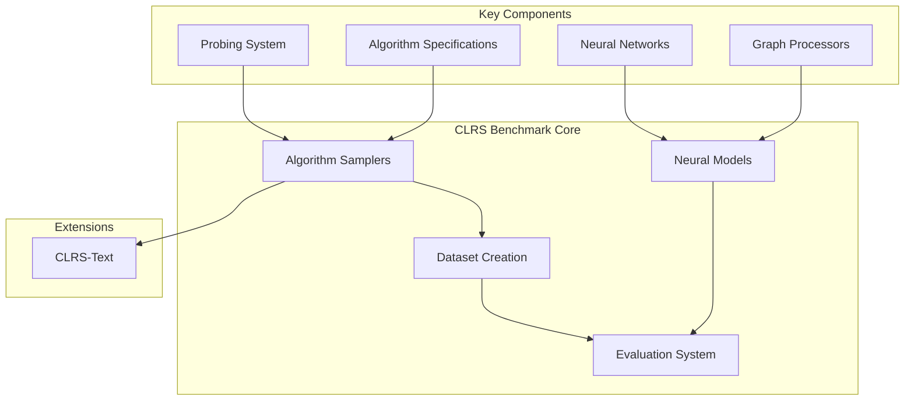
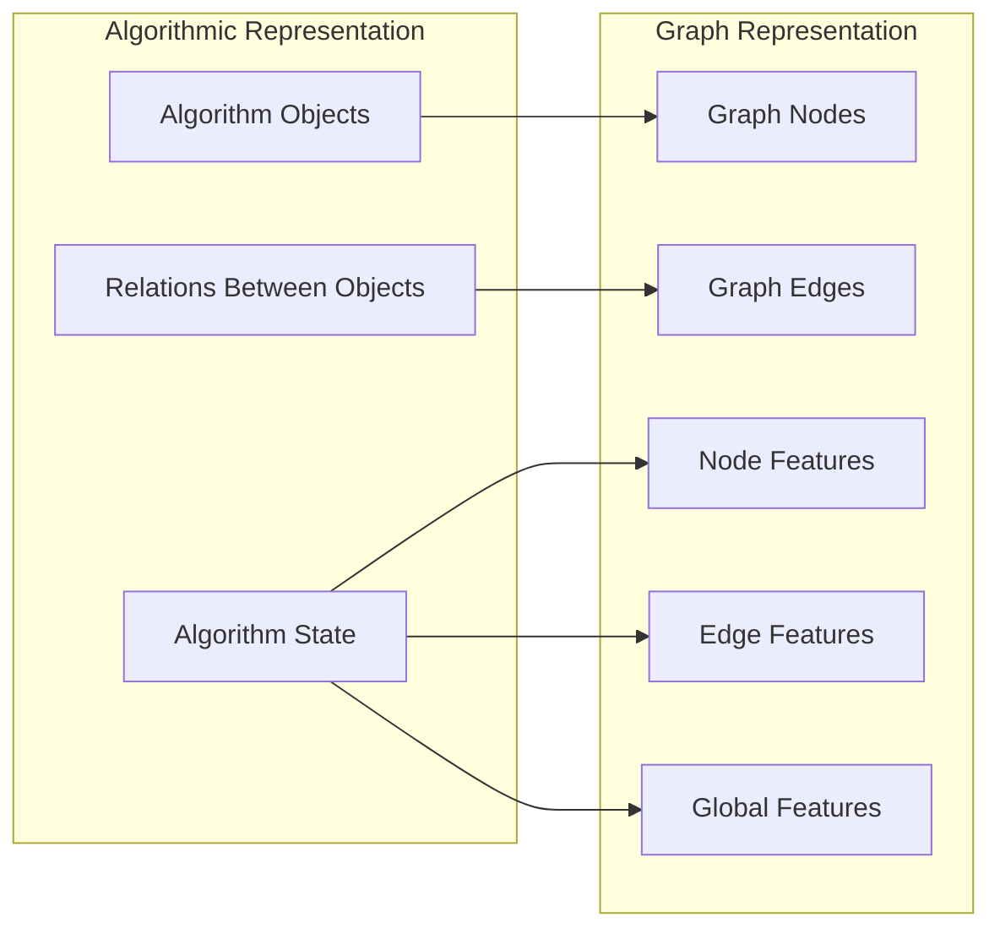
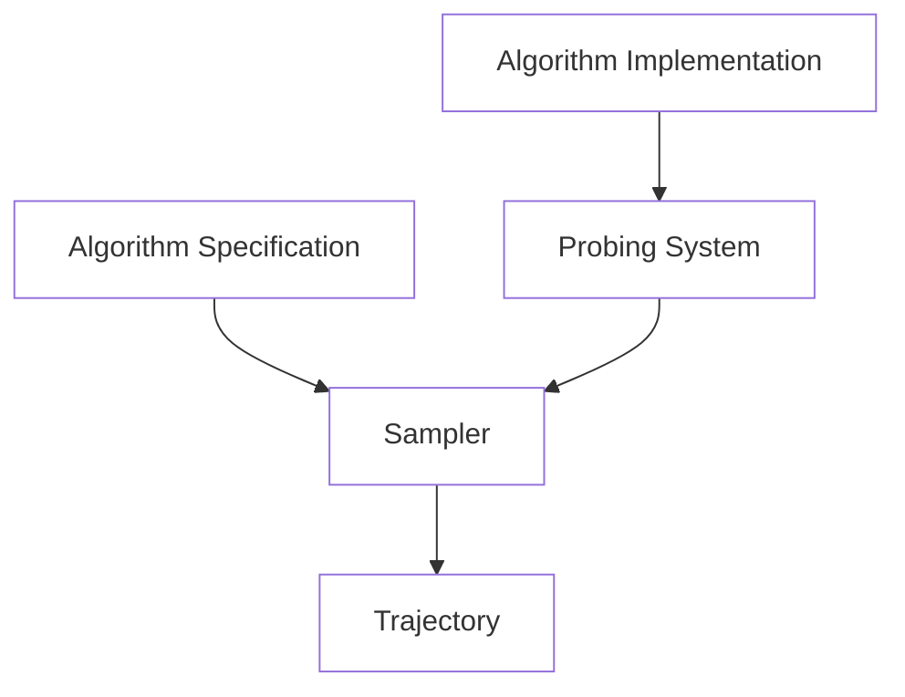
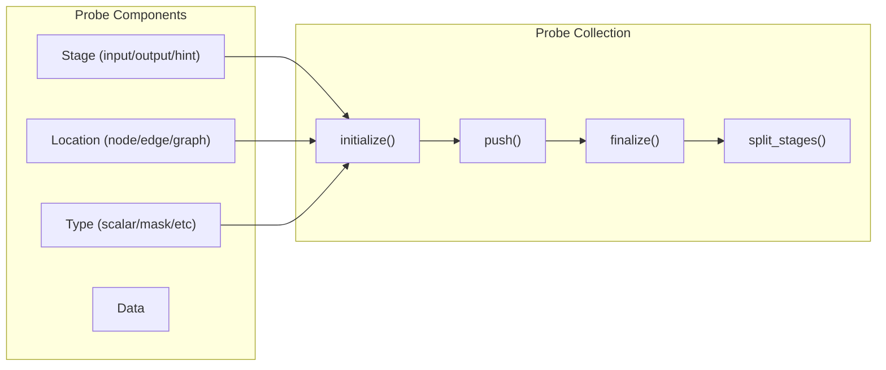
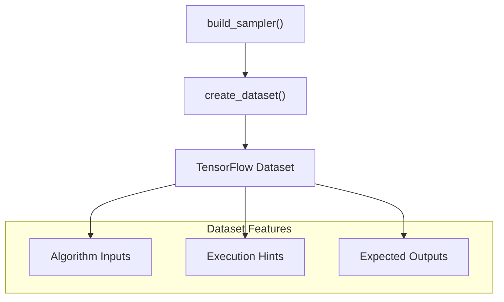
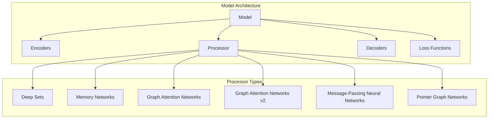
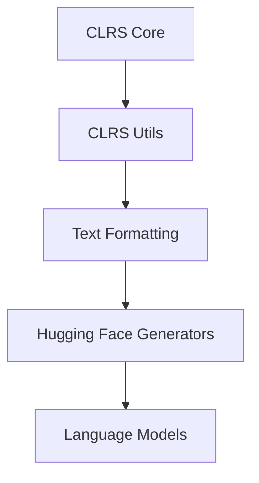
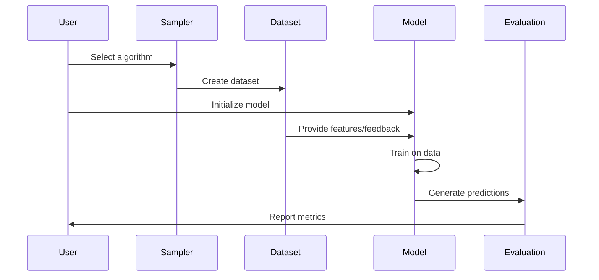

<!-- source: DeepWiki mcp.deepwiki.com · repo google-deepmind/clrs · page 1 Overview · fetched 2026-10-26 -->

# Overview

<details>
<summary>Relevant source files</summary>

The following files were used as context for generating this wiki page:

- [README.md](README.md)
- [clrs/__init__.py](clrs/__init__.py)
- [clrs/_src/clrs_text/README.md](clrs/_src/clrs_text/README.md)
- [clrs/_src/probing.py](clrs/_src/probing.py)
- [clrs/_src/probing_test.py](clrs/_src/probing_test.py)

</details>


The CLRS Algorithmic Reasoning Benchmark is a suite designed to evaluate and advance machine learning models' ability to learn and execute classical algorithms. Named after the authors of the textbook "Introduction to Algorithms" (Cormen, Leiserson, Rivest, and Stein), this benchmark consolidates algorithmic reasoning tasks in a unified framework, focusing on representing algorithms as graph operations that neural networks can learn.

Sources: [README.md:1-9](), [clrs/__init__.py:16]()

## Key Concepts

The CLRS benchmark provides:

1. **Algorithm Implementations**: 30 classic algorithms from the CLRS textbook, implemented to generate learning examples
2. **Graph Representation**: Algorithms represented through graph operations for neural processing
3. **Trajectory Hints**: Intermediate algorithm states that help models learn execution traces
4. **Generalization Testing**: Train/eval/test splits designed to evaluate out-of-distribution performance
5. **Neural Baselines**: Baseline implementations using graph neural networks and other processor architectures

The benchmark supports both the core CLRS dataset for graph-based learning and CLRS-Text, a more recent extension for evaluating algorithmic reasoning capabilities in language models.

Sources: [README.md:43-61](), [README.md:118-162]()

## System Architecture



Sources: [clrs/__init__.py:18-57](), [README.md:45-61]()

## Algorithms as Graphs

CLRS implements algorithms in an idiomatic way aligned with the original CLRS pseudocode. The core insight is representing algorithms as operations on graphs, where:



Even ordered structures like arrays or trees are represented through graph relations with additional constraints like predecessor links. The probing system captures the execution state of algorithms over time, exposing these as trajectories of "hints" that show the internal algorithm state.

Sources: [README.md:45-61](), [clrs/_src/probing.py:16-26]()

# Core Components

## 1. Algorithm Samplers

Samplers generate examples for each algorithm with appropriate inputs that conform to the algorithm's preconditions. Each algorithm has dedicated samplers creating:

- Random instances of appropriate problem structures (arrays, graphs, etc.)
- Valid inputs that meet algorithm requirements
- Complete execution traces with intermediate states



The sampler workflow:
1. Define algorithm specifications (`SPECS` in [clrs/_src/specs.py]())
2. Implement abstract algorithm with probing points ([clrs/_src/algorithms/]())
3. Create input samplers for the algorithm ([clrs/_src/samplers.py]())
4. Generate trajectories containing inputs, outputs, and hints

Sources: [README.md:208-226](), [clrs/__init__.py:43-51]()

## 2. Probing System

The probing system captures algorithm execution traces by recording data at specific points during execution:



Each probe contains:
- **Stage**: Input, output, or hint
- **Location**: Node, edge, or graph level
- **Type**: Data type (scalar, vector, mask, etc.)
- **Data**: The actual values

The probing system collects these data points during algorithm execution and organizes them for the learning task.

Sources: [clrs/_src/probing.py:16-203]()

## 3. Dataset Creation

The dataset system creates standardized train/eval/test splits for benchmarking:

| Split | Trajectories | Problem Size |
|-------|--------------|--------------|
| Train | 1000         | 16           |
| Eval  | 32×          | 16           |
| Test  | 32×          | 64           |

The dataset creation process handles:
- Creating algorithm samples
- Processing them into appropriate formats
- Optional chunking for long trajectories
- Packaging as TensorFlow datasets



Sources: [README.md:64-83](), [clrs/__init__.py:26-31]()

## 4. Models and Processors

The CLRS benchmark includes several baseline neural network models:



The model architecture consists of:
1. **Encoders**: Convert algorithm inputs and intermediate states to vector representations
2. **Processors**: Process graph-structured data (various GNN architectures)
3. **Decoders**: Convert processed data back to algorithm outputs
4. **Loss Functions**: Compare predicted outputs with expected outputs

Sources: [README.md:164-199](), [clrs/__init__.py:18-24]()

## 5. CLRS-Text Extension

CLRS-Text extends the benchmark for evaluating language models on algorithmic reasoning tasks:



CLRS-Text provides:
- Text conversion utilities for CLRS traces
- Scripts for generating datasets in text format
- Integration with Hugging Face for language model evaluation

Sources: [README.md:227-234](), [clrs/_src/clrs_text/README.md:1-57]()

# Usage Flow

The typical workflow for using the CLRS benchmark:



Basic usage pattern:
1. Create a dataset for a specific algorithm
2. Initialize a model
3. Train the model on the dataset
4. Evaluate the model's performance

Example code pattern:
```python
train_ds, num_samples, spec = clrs.create_dataset(
    folder='/tmp/CLRS30', algorithm='bfs',
    split='train', batch_size=32)

for i, feedback in enumerate(train_ds.as_numpy_iterator()):
  if i == 0:
    model.init(feedback.features, initial_seed)
  loss = model.feedback(rng_key, feedback)
```

Sources: [README.md:84-116]()

# Conclusion

The CLRS Algorithmic Reasoning Benchmark provides a comprehensive framework for evaluating and advancing algorithmic reasoning capabilities in machine learning models. By representing classic algorithms as graph operations and providing rich execution traces, it enables models to learn algorithmic behavior and generalize to new problem instances.

For installation and setup information, please see [Installation and Setup](#1.1).
For more detailed information about the system architecture, see [System Architecture](#1.2).

Sources: [README.md:11-42]()

---

