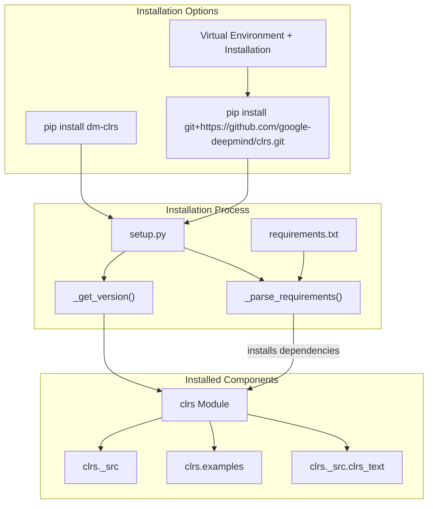
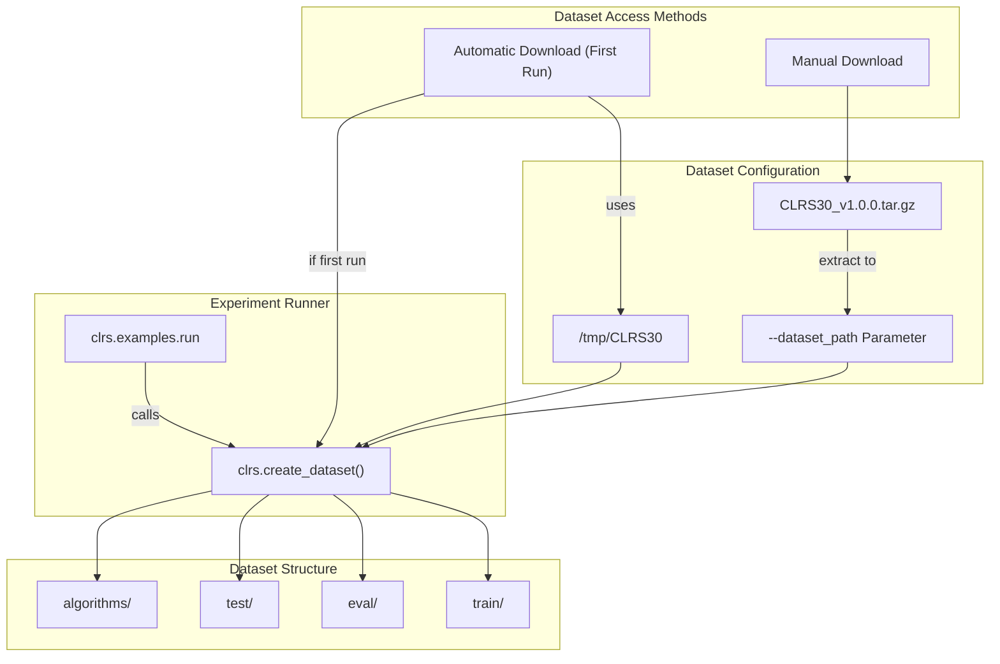
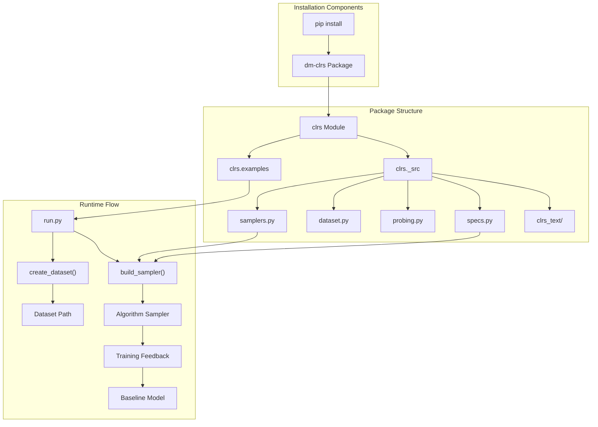

<!-- source: DeepWiki mcp.deepwiki.com · repo google-deepmind/clrs · page 1.1 Installation and Setup · fetched 2026-10-26 -->

# Installation and Setup

<details>
<summary>Relevant source files</summary>

The following files were used as context for generating this wiki page:

- [.github/workflows/pypi-publish.yml](.github/workflows/pypi-publish.yml)
- [.gitignore](.gitignore)
- [.pylintrc](.pylintrc)
- [README.md](README.md)
- [clrs/_src/clrs_text/README.md](clrs/_src/clrs_text/README.md)
- [clrs/_src/probing.py](clrs/_src/probing.py)
- [clrs/_src/probing_test.py](clrs/_src/probing_test.py)
- [requirements/requirements.txt](requirements/requirements.txt)
- [setup.py](setup.py)

</details>


This page provides detailed instructions for installing the CLRS Algorithmic Reasoning Benchmark and setting up your environment to run experiments. For information about the system architecture and core components, see [System Architecture](#1.2).

## Overview

The CLRS Algorithmic Reasoning Benchmark is a machine learning framework for algorithmic reasoning, based on algorithms from the third edition of "Introduction to Algorithms" by Cormen, Leiserson, Rivest, and Stein. This document covers:

1. Installation methods
2. Environment setup
3. Dataset configuration
4. Verification of installation
5. Troubleshooting common issues

## Installation Methods

You can install the CLRS benchmark through PyPI or directly from GitHub. The package name is `dm-clrs`.

### PyPI Installation

```bash
pip install dm-clrs
```

### GitHub Installation (for the latest version)

```bash
pip install git+https://github.com/google-deepmind/clrs.git
```

### Installing in a Virtual Environment

If you encounter dependency conflicts, installing in a virtual environment is recommended:

```bash
python3 -m venv clrs_env
source clrs_env/bin/activate
pip install git+https://github.com/google-deepmind/clrs.git
```

Sources: [README.md:13-33]()

## Installation Workflow



Sources: [README.md:13-33](), [setup.py:15-76]()

## System Requirements

### Dependencies

The CLRS benchmark has the following key dependencies:

| Dependency | Version | Purpose |
|------------|---------|---------|
| absl-py    | ≥2.1.0  | Google's Abseil Python Common Libraries |
| attrs      | ≥24.2.0 | Classes without boilerplate |
| chex       | ≥0.1.86 | Testing utilities for JAX |
| dm-haiku   | ≥0.0.12 | Neural network library for JAX |
| jax        | ≥0.4.31 | Numerical computing library |
| jaxlib     | ≥0.4.31 | JAX CPU/GPU/TPU implementation |
| tensorflow | ≥2.17.0 | Machine learning framework |
| numpy      | ≥1.26.4 | Numerical computing |
| optax      | ≥0.2.3  | Gradient processing and optimization |

For a full list of dependencies, refer to the requirements file.

Sources: [requirements/requirements.txt:1-14]()

## Dataset Setup

### Automatic Dataset Download

When running the example for the first time, the dataset will be automatically downloaded and stored in the specified dataset path (default: `/tmp/CLRS30`):

```bash
python3 -m clrs.examples.run
```

You can specify a custom dataset path with the `--dataset_path` flag:

```bash
python3 -m clrs.examples.run --dataset_path=/path/to/dataset
```

### Manual Dataset Download

Alternatively, you can manually download and extract the dataset:

```bash
wget https://storage.googleapis.com/dm-clrs/CLRS30_v1.0.0.tar.gz
tar -xzvf CLRS30_v1.0.0.tar.gz -C /desired/path
```

Then specify this path when running experiments.

Sources: [README.md:35-43]()

## Dataset Configuration Workflow



Sources: [README.md:35-43](), [README.md:83-95]()

## Verifying Installation

To verify a successful installation, run the example baseline model:

```bash
python3 -m clrs.examples.run
```

This will:
1. Download the dataset if it's not already present
2. Initialize and train a baseline model
3. Output training progress

### Example Output

```
Algorithm: bfs
Processor: mpnn
Iterations: 100
Step 1/100: Loss: 0.823, Accuracy: 0.512
...
```

Sources: [README.md:35-39]()

## Creating Custom Datasets

Instead of using the pre-generated dataset, you can create your own samples using the `build_sampler` method:

```python
import clrs

sampler, spec = clrs.build_sampler(
    name='bfs',  # algorithm name
    seed=42,     # random seed
    num_samples=1000,  # number of samples
    length=16)   # problem size

# Example of using the sampler
def iterate_sampler(batch_size):
    while True:
        yield sampler.next(batch_size)

# Generate batches of samples
for feedback in iterate_sampler(batch_size=32):
    # Process the feedback
    pass
```

Sources: [README.md:208-225]()

## Component Relationship Diagram



Sources: [README.md:13-39](), [README.md:83-95](), [README.md:208-225]()

## CLRS-Text Setup

If you're interested in the text-based variant of CLRS (CLRS-Text), the installation process is the same. CLRS-Text is included in the main package but has additional utilities:

- `clrs_utils.py`: Functions for converting CLRS traces to text
- `generate_clrs_text.py`: Scripts for generating CLRS-Text datasets
- `huggingface_generators.py`: Utilities for Hugging Face integration

For CLRS-Text specific examples and usage, refer to the [CLRS-Text](#7) documentation page.

Sources: [clrs/_src/clrs_text/README.md:1-57]()

## Troubleshooting

### Common Installation Issues

1. **Dependency Conflicts**:
   - Solution: Use a virtual environment as described earlier.

2. **JAX Installation Issues**:
   - JAX installation can be complex, especially with GPU support.
   - Follow the [official JAX installation guide](https://github.com/google/jax#installation) for your specific platform.

3. **Dataset Download Failures**:
   - If automatic dataset download fails, try the manual download method.
   - Ensure you have sufficient disk space (the dataset is approximately 5GB).

4. **Permission Issues**:
   - If you encounter permission errors with the default dataset path, specify a path in your user directory:
     ```bash
     python3 -m clrs.examples.run --dataset_path=~/clrs_data
     ```

Sources: [README.md:13-43]()

## Environment Compatibility

The CLRS package is compatible with:

- Python 3.6 or later
- Linux, Windows, and macOS operating systems

For optimal performance, especially when training models on larger algorithm instances, GPU acceleration is recommended.

Sources: [setup.py:62-74]()

---

