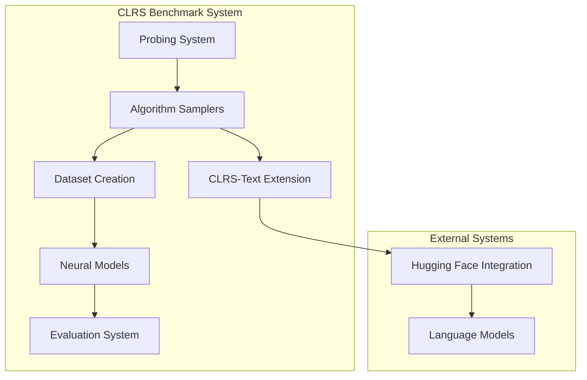
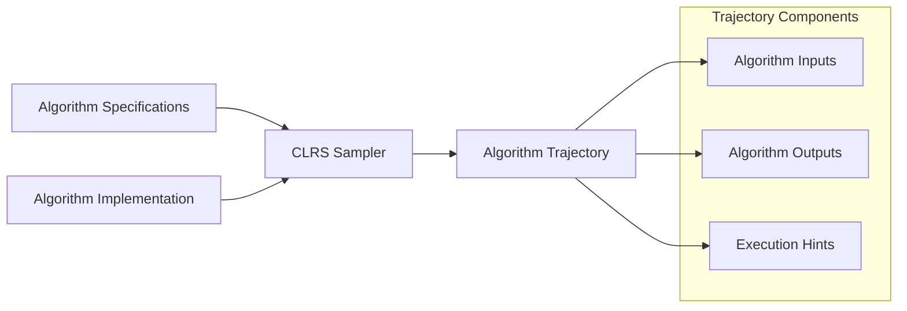
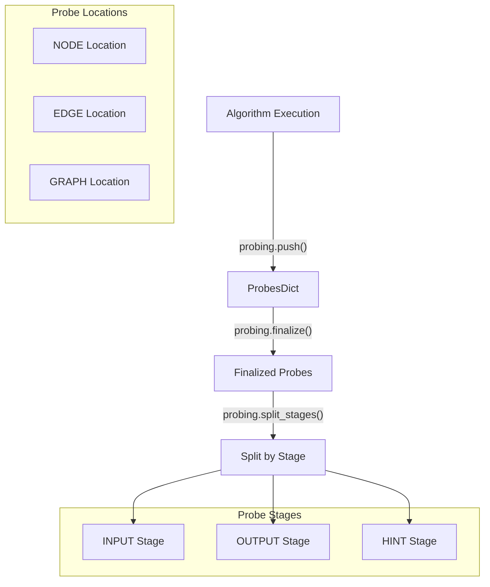
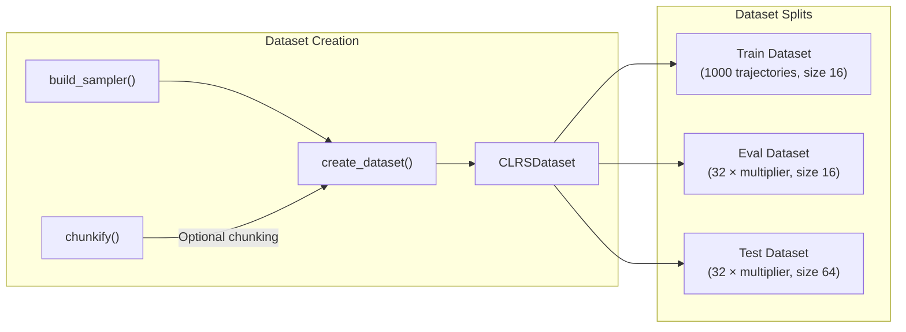
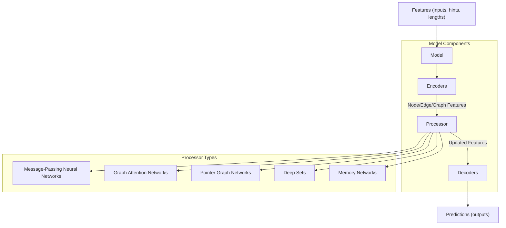
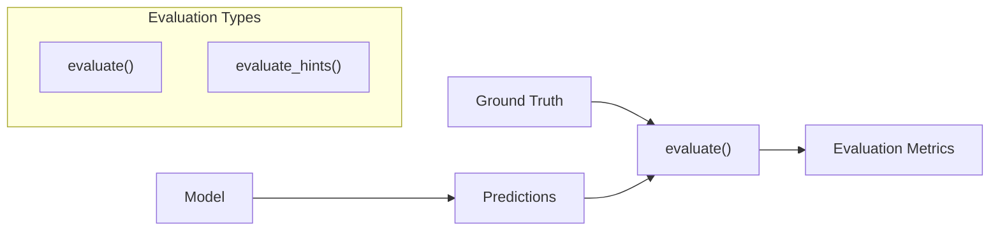
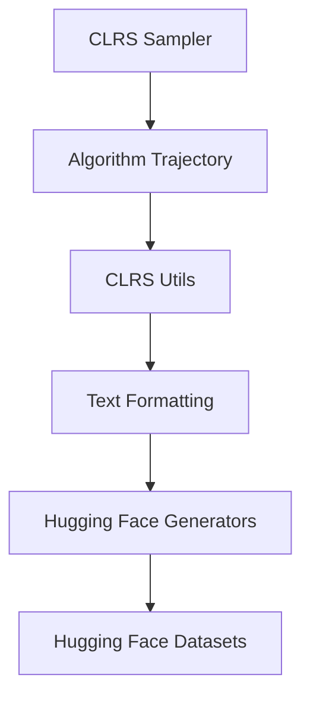
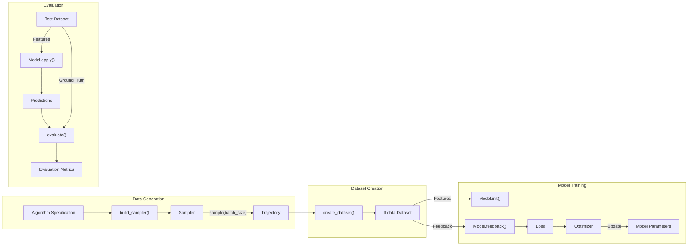
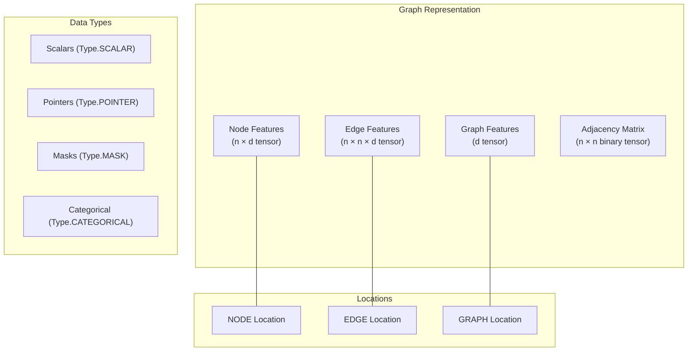
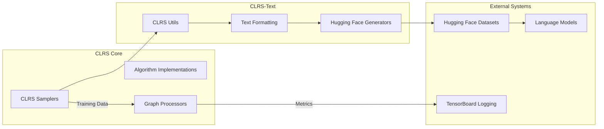

<!-- source: DeepWiki mcp.deepwiki.com · repo google-deepmind/clrs · page 1.2 System Architecture · fetched 2026-10-26 -->

# System Architecture

Relevant source files

The following files were used as context for generating this wiki page:

- [README.md](README.md)
- [clrs/__init__.py](clrs/__init__.py)
- [clrs/_src/clrs_text/README.md](clrs/_src/clrs_text/README.md)
- [clrs/_src/probing.py](clrs/_src/probing.py)
- [clrs/_src/probing_test.py](clrs/_src/probing_test.py)

This document provides a detailed overview of the system architecture of the CLRS Algorithmic Reasoning Benchmark. It explains how the different components of the system interact to enable the training and evaluation of neural network models on algorithmic reasoning tasks. For information about specific model implementations, see [Baseline Models](#2), and for details on running experiments, see [Running Experiments](#3).

## Overview

The CLRS benchmark is designed around the concept of representing algorithms as operations on graph structures, where models learn to predict algorithm execution through message-passing on these graphs. The system implements 30 classical algorithms from the "Introduction to Algorithms" textbook by Cormen, Leiserson, Rivest, and Stein, providing a standardized environment for evaluating algorithmic reasoning capabilities of neural networks.

Sources: [clrs/__init__.py:16-94](), [README.md:1-162]()

## Core Components

The CLRS architecture comprises several core components that work together to create a comprehensive benchmark for algorithmic reasoning:

### 1. Algorithm Samplers

The samplers generate input/output pairs and execution traces for each algorithm. They are responsible for:
- Creating appropriate input data distributions
- Executing algorithms on these inputs
- Capturing execution traces through the probing system
- Formatting data in a graph-based representation

Sources: [clrs/__init__.py:42-51](), [README.md:45-61](), [README.md:85-102]()

### 2. Probing System

The probing system captures the internal state of algorithms during execution, providing "hints" that expose the algorithm's reasoning process:

Sources: [clrs/_src/probing.py:16-440](), [clrs/__init__.py:38-39]()

### 3. Dataset System

The dataset system handles the creation, management, and chunking of data for model training and evaluation:

Sources: [clrs/__init__.py:26-31](), [README.md:66-83]()

### 4. Model Architecture

The model architecture is centered around graph-based neural networks that learn algorithm execution through message passing:

Sources: [clrs/__init__.py:36](), [clrs/__init__.py:21-24](), [README.md:164-185]()

### 5. Evaluation System

The evaluation system measures the performance of models on algorithm execution:

Sources: [clrs/__init__.py:33-34]()

### 6. CLRS-Text Extension

The CLRS-Text extension provides a text-based interface to the benchmark, suitable for language models:

Sources: [clrs/_src/clrs_text/README.md:1-57](), [clrs/__init__.py:21]()

## Data Flow Architecture

The following diagram illustrates how data flows through the CLRS system during model training and evaluation:

Sources: [README.md:85-95](), [clrs/__init__.py:16-94]()

## Code Structure

The CLRS codebase is organized into the following key modules:

| Module | Path | Description |
|--------|------|-------------|
| Algorithms | `clrs/_src/algorithms/` | Implementations of the 30 CLRS algorithms |
| Samplers | `clrs/_src/samplers.py` | Algorithm execution sampling |
| Specs | `clrs/_src/specs.py` | Algorithm specifications |
| Probing | `clrs/_src/probing.py` | Execution state capture system |
| Dataset | `clrs/_src/dataset.py` | Dataset creation and management |
| Model | `clrs/_src/model.py` | Base model implementation |
| Processors | `clrs/_src/processors.py` | Graph neural network components |
| Decoders | `clrs/_src/decoders.py` | Output decoders |
| Evaluation | `clrs/_src/evaluation.py` | Evaluation metrics |
| CLRS-Text | `clrs/_src/clrs_text/` | Text-based benchmark extension |

Sources: [clrs/__init__.py:16-94]()

## Graph-Based Representation

All algorithms in CLRS are represented using a graph-based formalism, which enables consistent learning and evaluation across different types of algorithms:

Sources: [README.md:45-61](), [clrs/_src/probing.py:16-26]()

## Integration With External Systems

CLRS integrates with external systems, primarily through the CLRS-Text extension which enables language model evaluation:

Sources: [clrs/_src/clrs_text/README.md:17-42]()

## Software Dependencies

The CLRS benchmark relies on several key software dependencies:

| Dependency | Purpose |
|------------|---------|
| JAX | Core numerical computation |
| NumPy | Array manipulation |
| TensorFlow | Dataset handling |
| DeepMind JAX Ecosystem | Additional tools for neural networks |
| Hugging Face | Integration with language models (CLRS-Text) |

Sources: [README.md:112-115](), [clrs/_src/probing.py:30-34]()

## Extending the System

The CLRS benchmark is designed to be extensible. New algorithms can be added by:

1. Defining their specifications in `specs.py`
2. Implementing the algorithm with appropriate probing
3. Creating a suitable input data sampler

Similarly, new neural network models can be implemented either by:
- Adding new processors to the existing model architecture
- Creating entirely new model classes that extend the Model API

Sources: [README.md:238-255](), [README.md:175-199]()

---

