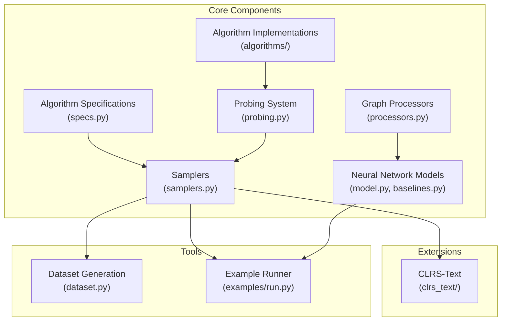
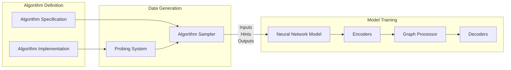
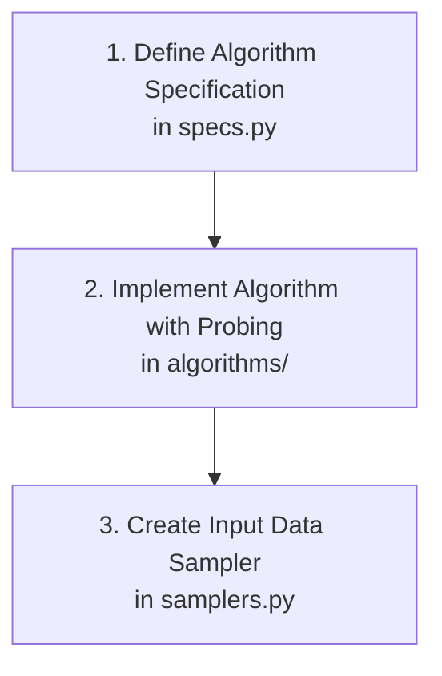
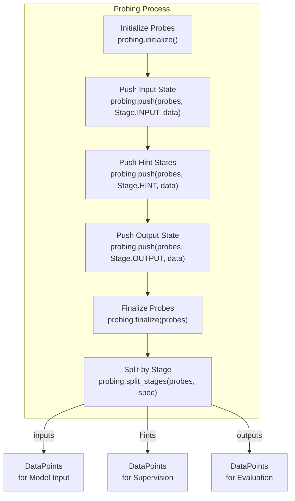

<!-- source: DeepWiki mcp.deepwiki.com · repo google-deepmind/clrs · page 10 Contributing · fetched 2026-10-26 -->

# Contributing

<details>
<summary>Relevant source files</summary>

The following files were used as context for generating this wiki page:

- [CONTRIBUTING.md](CONTRIBUTING.md)
- [README.md](README.md)
- [clrs/_src/clrs_text/README.md](clrs/_src/clrs_text/README.md)
- [clrs/_src/probing.py](clrs/_src/probing.py)
- [clrs/_src/probing_test.py](clrs/_src/probing_test.py)

</details>


This document provides guidance for developers who want to contribute to the CLRS Algorithmic Reasoning Benchmark. It covers the process of setting up a development environment, understanding the code structure, adding new algorithms or models, and submitting contributions to the project.

## Prerequisites

Before contributing to the CLRS repository, you should:

1. Be familiar with Python and JAX
2. Understand the basic concepts of algorithm implementation and graph representations
3. Have a working knowledge of Git and GitHub

Sources: [README.md:11-33]()

## Setting Up a Development Environment

To set up a development environment for contributing to CLRS:

```bash
# Clone the repository
git clone https://github.com/google-deepmind/clrs.git
cd clrs

# Create and activate a virtual environment
python3 -m venv clrs_env
source clrs_env/bin/activate

# Install the package in development mode
pip install -e .
```

This will install the package in development mode, allowing you to make changes to the code and immediately see their effects without reinstalling.

Sources: [README.md:11-33]()

## Code Structure Overview

The CLRS repository is organized as follows:



Sources: [README.md:45-61](), [README.md:119-161]()

## Data Flow Architecture

The following diagram illustrates how data flows through the system:



Sources: [README.md:45-95](), [clrs/_src/probing.py:16-24]()

## Contributor License Agreement

Before contributing to the CLRS repository, you must sign a Contributor License Agreement (CLA). This gives the project permission to use and redistribute your contributions.

1. Visit https://cla.developers.google.com/
2. If you've already submitted a CLA (even for a different project), you likely don't need to do it again
3. Otherwise, sign a new agreement

Sources: [CONTRIBUTING.md:1-16]()

## Contributing New Algorithms

Adding a new algorithm to the CLRS benchmark involves three main steps:



### 1. Define Algorithm Specification

Define the input/hint/output specification in `clrs/_src/specs.py` by adding to the `SPECS` dictionary:

```python
# Example specification format:
'my_new_algorithm': {
  'input_name': (specs.Stage.INPUT, specs.Location.NODE, specs.Type.SCALAR),
  'hint_name': (specs.Stage.HINT, specs.Location.EDGE, specs.Type.MASK),
  'output_name': (specs.Stage.OUTPUT, specs.Location.GRAPH, specs.Type.SCALAR)
}
```

### 2. Implement the Algorithm

Implement your algorithm in the `clrs/_src/algorithms/` folder. Use the `probing.push` function to capture algorithm state, and `probing.finalize` to format probes:

```python
# Simplified example:
def my_new_algorithm(A):
  # Initialize probes
  probes = probing.initialize(specs.SPECS['my_new_algorithm'])
  
  # Push initial state
  probing.push(probes, specs.Stage.INPUT, {'input_name': A})
  
  # Algorithm steps with intermediate state capture
  for step in range(steps):
    # Algorithm logic here
    # ...
    
    # Capture intermediate state
    probing.push(probes, specs.Stage.HINT, {'hint_name': intermediate_state})
  
  # Push final outputs
  probing.push(probes, specs.Stage.OUTPUT, {'output_name': result})
  
  # Finalize probes
  probing.finalize(probes)
  
  return result, probes
```

### 3. Create an Input Data Sampler

Implement a sampler for your algorithm in `clrs/_src/samplers.py` and add it to the `SAMPLERS` dictionary:

```python
def sample_my_new_algorithm(unused_rng, n):
  # Create input data of size n
  # ...
  return inputs
```

Sources: [README.md:236-255](), [clrs/_src/probing.py:103-151]()

## Contributing New Models or Processors

To implement a new processor for algorithm learning:

1. Add your processor to `clrs/_src/processors.py`
2. Make it available through the `get_processor_factory` method

Your processor should implement a `__call__` method with the following signature:

```python
def __call__(self,
             node_fts, edge_fts, graph_fts,
             adj_mat, hidden,
             nb_nodes, batch_size):
  # Process inputs and return updated node features
  # ...
  return updated_node_features
```

For more significant changes to the model architecture, create a new class that extends the Model API in `clrs/_src/model.py`. See `clrs/_src/baselines.py` for an example.

Sources: [README.md:164-198]()

## CLRS-Text Contributions

To contribute to the CLRS-Text variant:

1. Understand the core CLRS trace generation
2. Work with the text formatting utilities in `clrs/_src/clrs_text/clrs_utils.py`
3. Review the Hugging Face integration in `clrs/_src/clrs_text/huggingface_generators.py`

Note that current text converters cannot manage padding, so it's recommended to process traces sampled with a batch size of 1 and without max-hint tracking.

Sources: [clrs/_src/clrs_text/README.md:1-39]()

## Testing Guidelines

When contributing new code, ensure that:

1. You write appropriate unit tests for your contributions
2. All existing tests pass using the test runner
3. Your code follows the style guidelines of the project

Example test file structure (based on existing tests):

```python
# Example test file structure:
def test_my_new_functionality():
  # Setup inputs
  # Call your function
  # Assert expected outputs
```

Sources: [clrs/_src/probing_test.py:16-192]()

## Pull Request Process

All submissions to the CLRS repository require review via GitHub pull requests:

1. Fork the repository
2. Create a branch for your changes
3. Make your changes following the guidelines above
4. Create tests for new functionality
5. Submit a pull request
6. Address feedback from reviewers

Sources: [CONTRIBUTING.md:19-23]()

## Community Guidelines

This project follows [Google's Open Source Community Guidelines](https://opensource.google.com/conduct/). Please be respectful and constructive when participating in the project.

Sources: [CONTRIBUTING.md:25-28]()

## Probing System Deep Dive

The probing system is a core component for capturing algorithm execution traces:



The probing system organizes data into a nested dictionary structure (`ProbesDict`) with the following hierarchy:
- Stage (INPUT, HINT, OUTPUT)
- Location (NODE, EDGE, GRAPH)
- Name (algorithm-specific identifiers)
- Attributes (data, type)

When finalizing probes, INPUT and OUTPUT data are squeezed to remove the leading dimension, while HINT data is stacked to preserve the timestep dimension.

Sources: [clrs/_src/probing.py:16-202]()