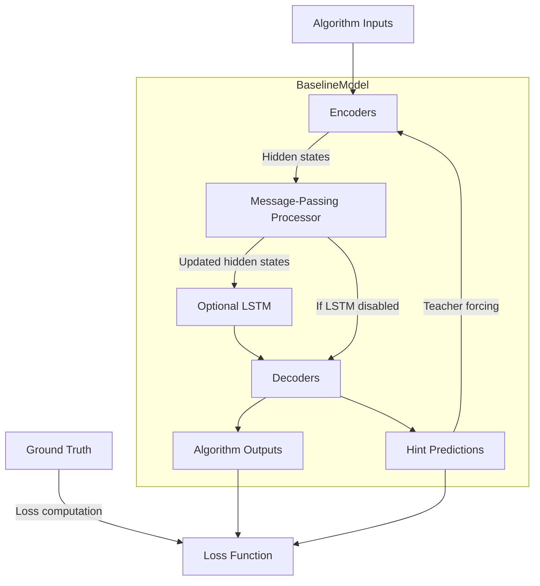
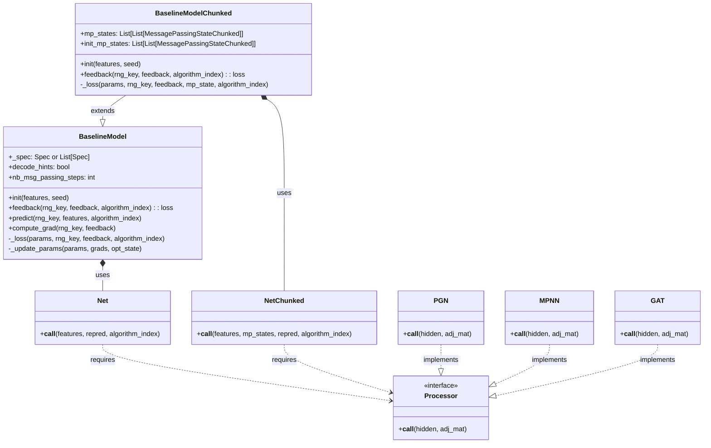
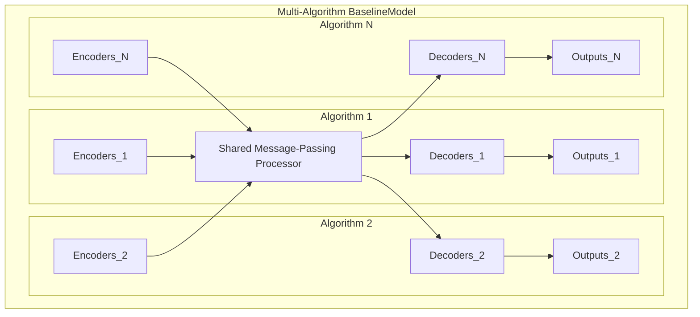
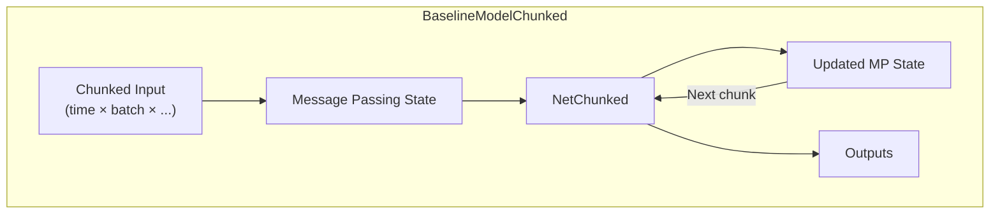
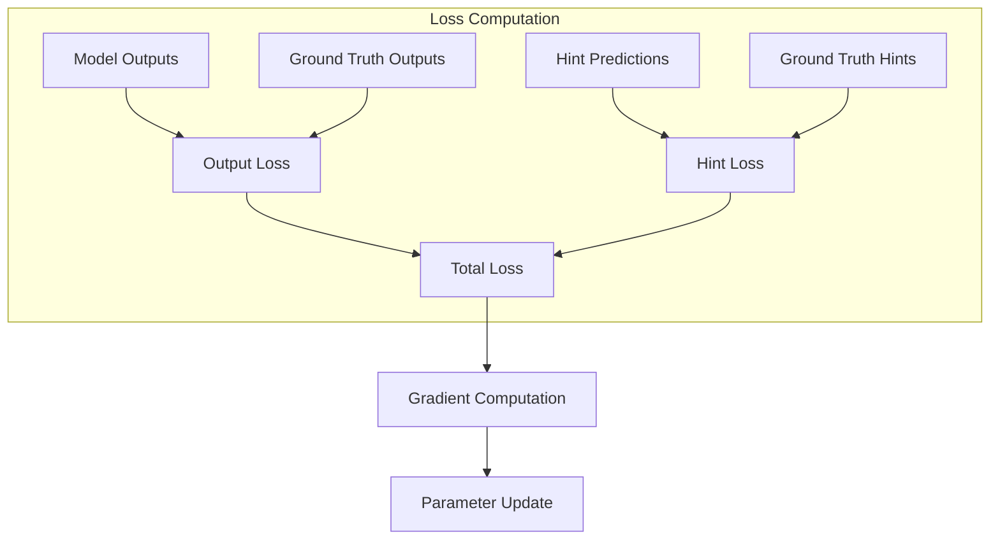

<!-- source: DeepWiki mcp.deepwiki.com · repo google-deepmind/clrs · page 2 Baseline Models · fetched 2026-10-26 -->

# Baseline Models

Relevant source files

The following files were used as context for generating this wiki page:

- [clrs/_src/baselines.py](clrs/_src/baselines.py)
- [clrs/_src/baselines_test.py](clrs/_src/baselines_test.py)
- [clrs/models.py](clrs/models.py)

This document describes the implementation and functionality of the baseline neural network models in the CLRS (Cormen, Leiserson, Rivest, and Stein) algorithmic reasoning benchmark. These models serve as reference implementations for learning to execute algorithms through neural networks. For information about specific neural architectures used within these models, see [Neural Network Architecture](#2.1).

## Overview

The CLRS baseline models implement message-passing neural networks designed to learn algorithm execution through graph-based representations. There are two primary model variants:

1. **BaselineModel**: The standard implementation for both training and evaluation
2. **BaselineModelChunked**: A variant that processes data in fixed-time chunks, optimized for training longer sequences

Both models follow a similar architecture with encoders, a processor, and decoders, but differ in how they handle sequential data and state management.

Sources: [clrs/_src/baselines.py:136-455](), [clrs/_src/baselines.py:507-687](), [clrs/models.py:1-32]()

## Model Architecture

### BaselineModel

The BaselineModel consists of three main components:

This architecture enables the model to:
1. Encode node, edge, and graph features
2. Process these features using message passing
3. Decode the processed features into algorithm outputs and intermediate state predictions (hints)
4. Optionally feed predicted hints back as inputs (with teacher forcing)

Sources: [clrs/_src/baselines.py:139-206](), [clrs/_src/baselines.py:251-269]()

### Component Relationships

Sources: [clrs/_src/baselines.py:136-455](), [clrs/_src/baselines.py:507-687](), [clrs/models.py:16-32]()

## Key Features

### Initialization and Configuration

The BaselineModel constructor takes several parameters that determine the model's behavior:

| Parameter | Description | Default |
|-----------|-------------|---------|
| `spec` | Algorithm specification(s) | (required) |
| `dummy_trajectory` | Sample feedback for initialization | (required) |
| `processor_factory` | Factory for creating the message-passing processor | (required) |
| `hidden_dim` | Size of hidden message-passing vectors | 32 |
| `encode_hints` | Whether to use hints as inputs | False |
| `decode_hints` | Whether to predict hints as outputs | True |
| `use_lstm` | Whether to add an LSTM after message passing | False |
| `hint_teacher_forcing` | Probability of using ground truth hints as inputs | 0.0 |
| `hint_repred_mode` | How to process predicted hints (`soft`, `hard`, `hard_on_eval`) | `soft` |
| `nb_msg_passing_steps` | Number of message passing steps per hint | 1 |

Sources: [clrs/_src/baselines.py:139-206]()

### Training and Inference

The BaselineModel implements several core methods:

1. **`init(features, seed)`**: Initializes model parameters
2. **`feedback(rng_key, feedback, algorithm_index)`**: Performs a training step
3. **`predict(rng_key, features, algorithm_index)`**: Runs inference
4. **`compute_grad(rng_key, feedback, algorithm_index)`**: Computes gradients without updating parameters

The training flow involves:
1. Encoding the input features
2. Processing via the message-passing neural network
3. Decoding to produce outputs and hints
4. Computing losses against ground truth
5. Updating parameters via gradient descent

Sources: [clrs/_src/baselines.py:281-391](), [clrs/_src/baselines.py:406-442]()

## Multi-Algorithm Support

One significant capability of the BaselineModel is supporting multiple algorithms with a shared processor:

Key points:
- The processor parameters are shared across all algorithms
- Each algorithm has its own dedicated encoders and decoders
- During training, only the relevant algorithm's encoders and decoders are updated
- The processor is updated regardless of which algorithm is being trained
- An optional `freeze_processor` parameter allows keeping the processor fixed while training algorithm-specific encoders/decoders

Sources: [clrs/_src/baselines.py:161-166](), [clrs/_src/baselines.py:443-456](), [clrs/_src/baselines_test.py:158-227]()

## Chunked Model for Processing Long Sequences

The BaselineModelChunked extends BaselineModel to process data in fixed-time chunks:

Key differences from BaselineModel:
- Processes fixed-time chunks rather than full sequences
- Maintains message passing state between chunks
- Uses tensors with dimensions: `chunk_length × batch_size × ...`
- Signal for new samples via an `is_first` tensor (`chunk_length × batch_size`)
- Optimized for training but not for validation/testing

The chunked model enables training on longer sequences that might not fit in memory when processed in full.

Sources: [clrs/_src/baselines.py:507-517](), [clrs/_src/baselines.py:523-548](), [clrs/_src/baselines_test.py:89-156]()

## Loss Computation and Optimization

Both models calculate loss based on:
1. Output loss: Comparing model predictions to ground truth algorithm outputs
2. Hint loss: Comparing intermediate step predictions to the ground truth algorithm state (if `decode_hints=True`)

The optimization process includes:
- Support for gradient clipping via `grad_clip_max_norm`
- Selective parameter updates based on algorithm index
- Option to freeze processor weights while updating encoders/decoders

Sources: [clrs/_src/baselines.py:406-442](), [clrs/_src/baselines.py:582-619](), [clrs/_src/baselines.py:443-456]()

## Distributed Processing Support

Both models include support for multi-device computation using JAX:

- Functions for reshaping data across devices
- pmapping computations across multiple devices
- Handling device-specific parameters and optimization state
- Utility functions for restacking results from parallel computations

This enables efficient scaling of training and inference across multiple accelerators.

Sources: [clrs/_src/baselines.py:57-133](), [clrs/_src/baselines.py:364-369]()

## Checkpoint Management

The models provide methods for saving and loading parameters:

- `save_model(file_name)`: Saves model parameters and optimizer state
- `restore_model(file_name, only_load_processor)`: Restores model parameters with option to only load processor weights

This enables model persistence and transfer learning between different algorithm sets.

Sources: [clrs/_src/baselines.py:486-504]()

---

