<!-- source: DeepWiki mcp.deepwiki.com · repo google-deepmind/clrs · page 2.1 Neural Network Architecture · fetched 2026-10-26 -->

# Neural Network Architecture

Relevant source files

The following files were used as context for generating this wiki page:

- [clrs/_src/baselines.py](clrs/_src/baselines.py)
- [clrs/_src/nets.py](clrs/_src/nets.py)

This document describes the neural network architecture used in the CLRS algorithmic reasoning benchmark. It covers the design and implementation of the neural models that learn to execute algorithms, focusing on how data flows through the system and the key components involved in processing algorithmic inputs and generating predictions.

For information about the specific loss functions used in training, see [Loss Functions](#2.2).

## Overview

The CLRS benchmark uses message-passing neural networks to learn algorithmic reasoning. The architecture processes algorithm data represented as graphs, with nodes, edges, and global features. The core design follows an encode-process-decode pattern, where inputs are encoded into latent representations, processed through message passing, and then decoded to produce outputs and algorithm state predictions.

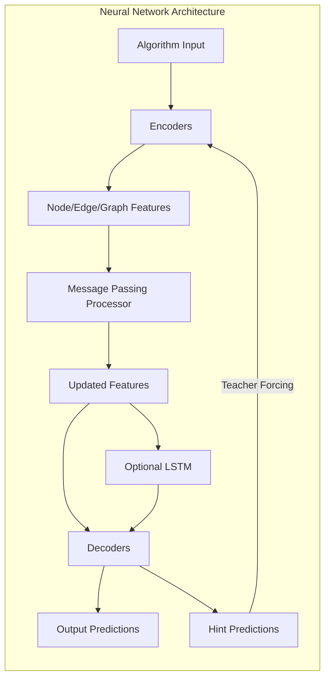

Sources: [clrs/_src/nets.py:71-449](), [clrs/_src/baselines.py:136-187]()

## Core Components

### Net Class

The `Net` class serves as the central building block for the neural architecture. It implements the encode-process-decode pattern and handles the message passing logic.

Key responsibilities include:
- Initializing encoders, decoders, and processors
- Managing data flow through the network
- Implementing message passing steps
- Handling hint predictions and teacher forcing
- Optional LSTM integration

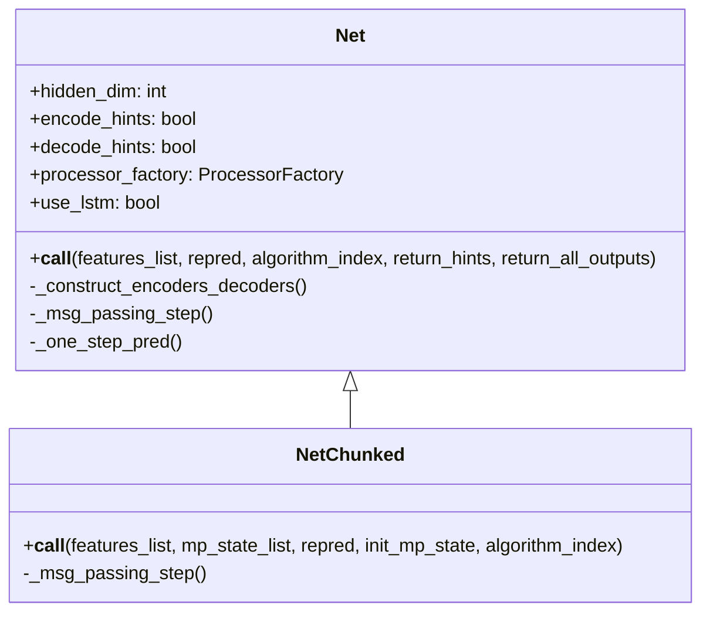

Sources: [clrs/_src/nets.py:71-449](), [clrs/_src/nets.py:451-696]()

### BaselineModel

The `BaselineModel` class wraps the neural network and provides a high-level interface for training and evaluation. It handles gradient computation, parameter updates, and inference.

Key properties:
- Manages model parameters and optimizer state
- Implements training and evaluation methods
- Handles batch processing and device placement
- Supports model checkpointing

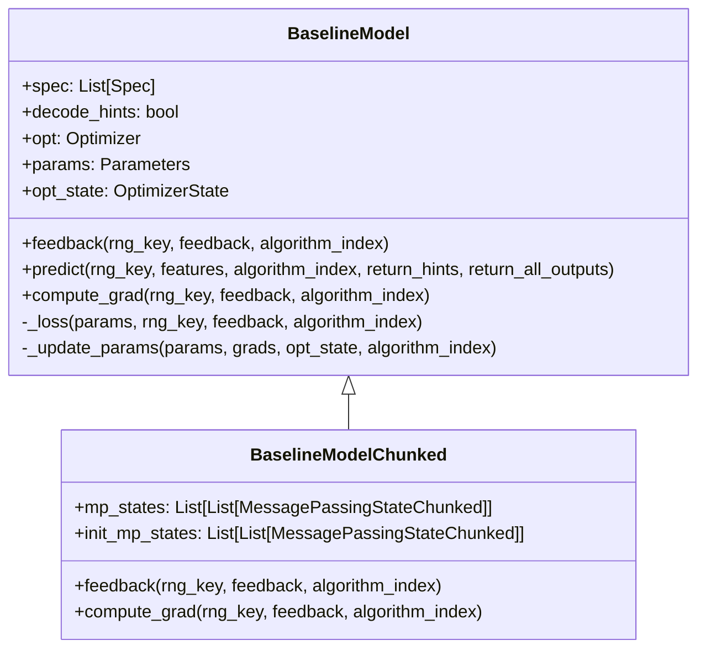

Sources: [clrs/_src/baselines.py:136-456](), [clrs/_src/baselines.py:507-687]()

## Processing Pipeline

The neural network processes data through several distinct stages:

### 1. Encoding Stage

The encoding stage transforms algorithm inputs and hints into latent representations.

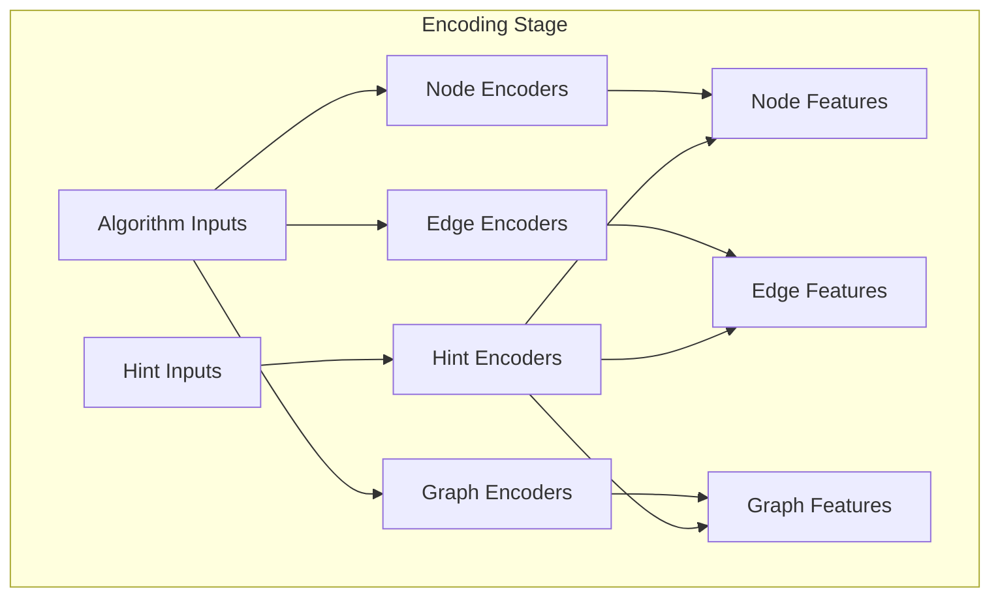

Sources: [clrs/_src/nets.py:364-404](), [clrs/_src/nets.py:329-362]()

### 2. Message Passing Stage

The processor updates node, edge, and graph features through message passing. Multiple message passing steps can be performed per time step.

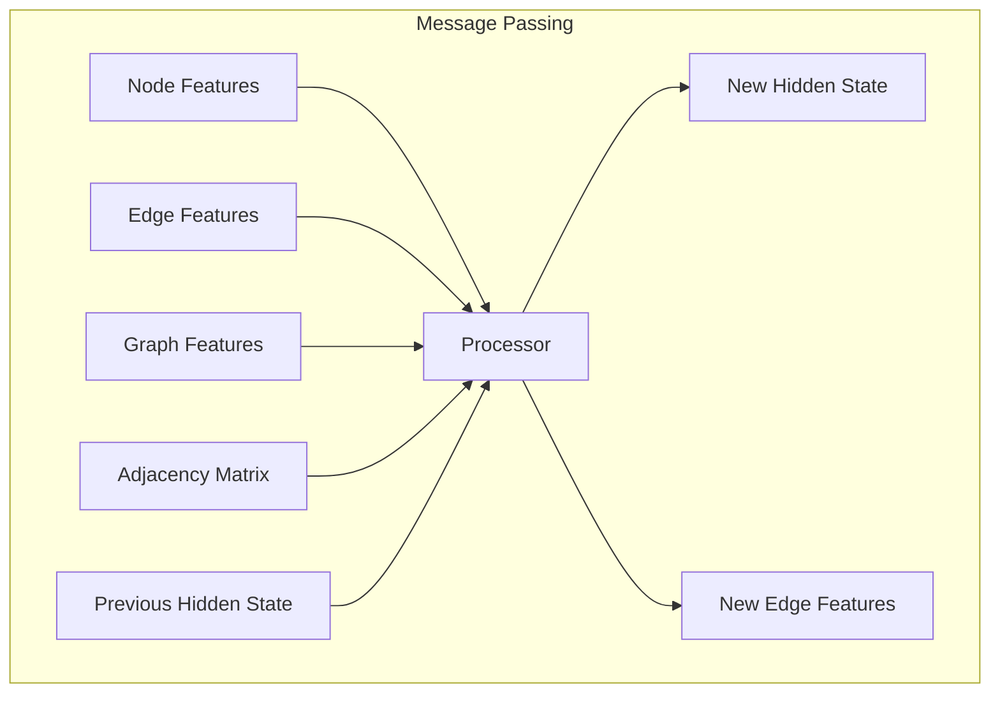

Sources: [clrs/_src/nets.py:405-432](), [clrs/_src/baselines.py:174-177]()

### 3. Optional LSTM Stage

If activated, an LSTM processes the hidden states to incorporate temporal information.

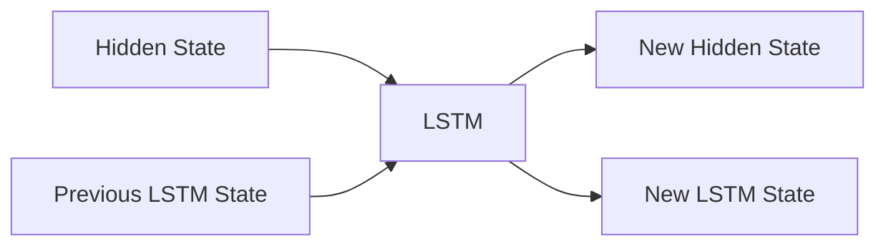

Sources: [clrs/_src/nets.py:422-426](), [clrs/_src/baselines.py:181]()

### 4. Decoding Stage

The decoding stage transforms processed features into algorithm outputs and hint predictions.

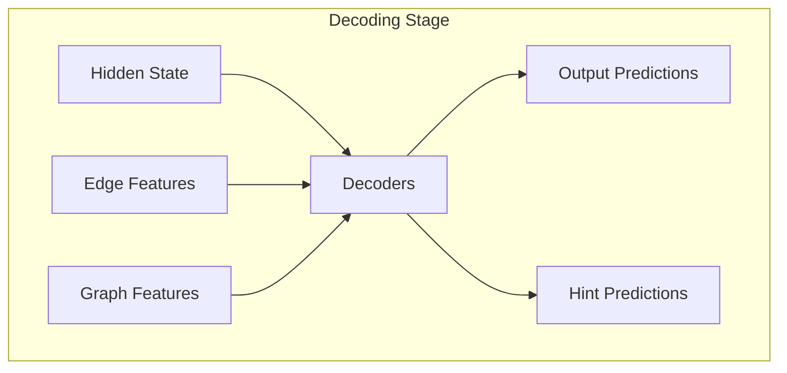

Sources: [clrs/_src/nets.py:434-447](), [clrs/_src/decoders.py]()

## Processor Types

The processor is responsible for the message passing computation. Different processor types are available:

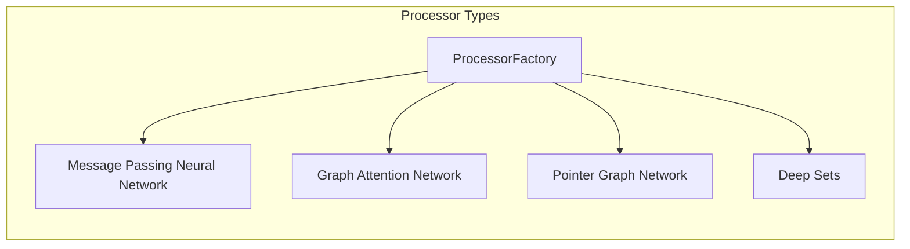

Sources: [clrs/_src/processors.py](), [clrs/_src/baselines.py:144]()

## Data Flow Through Time

Algorithm execution is modeled as a sequence of message passing steps through time:

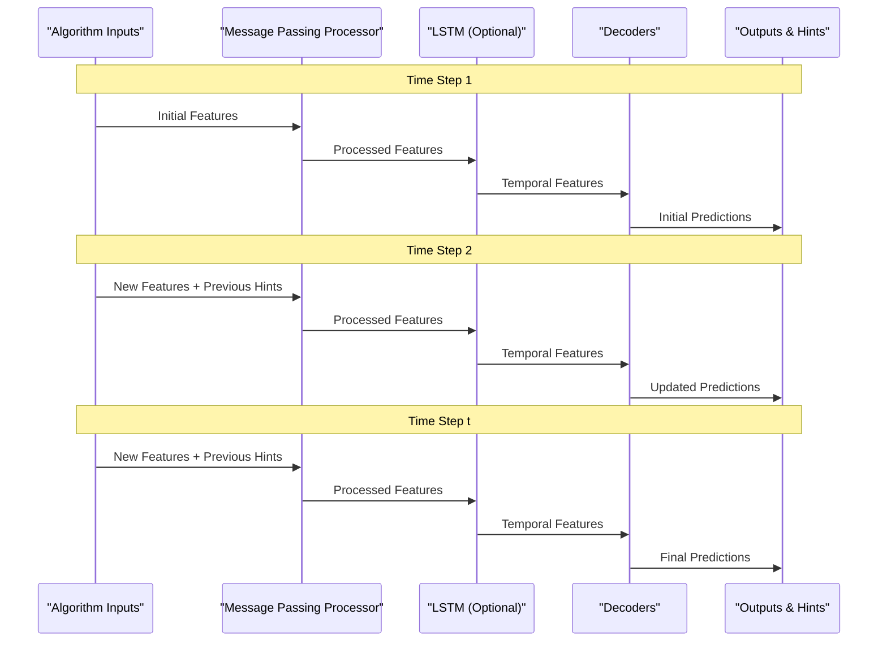

Sources: [clrs/_src/nets.py:108-195](), [clrs/_src/nets.py:197-327]()

## Hint Teacher Forcing

The architecture supports teacher forcing for algorithm hints, which can enhance learning:

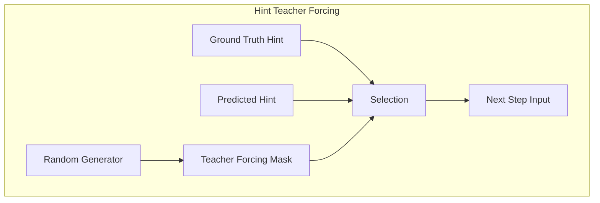

Sources: [clrs/_src/nets.py:138-165](), [clrs/_src/baselines.py:154-156]()

## Training vs. Inference Mode

The network behavior differs between training and inference:

| Mode | Hint Input | Postprocessing | Dropout | Description |
|------|------------|----------------|---------|-------------|
| Training | Mix of ground truth and predicted hints based on teacher forcing | Soft (differentiable) | Active | Uses teacher forcing for improved learning |
| Inference | Only predicted hints | Hard (discrete) | Inactive | Fully autoregressive prediction |

Sources: [clrs/_src/nets.py:124-132](), [clrs/_src/nets.py:418-419]()

## Chunked vs. Full Processing

The CLRS benchmark supports two processing modes:

1. **Full Processing** (`Net` class): Processes entire algorithm trajectories at once
2. **Chunked Processing** (`NetChunked` class): Processes fixed-length chunks of algorithm trajectories, useful for long-running algorithms

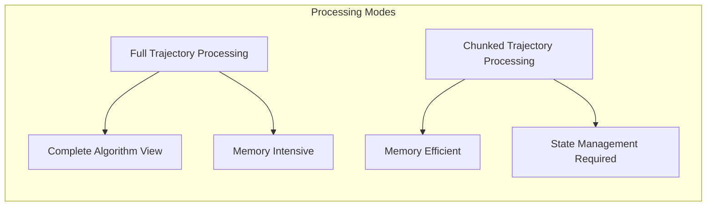

Sources: [clrs/_src/nets.py:71-449](), [clrs/_src/nets.py:451-696](), [clrs/_src/baselines.py:507-520]()

## Implementation Details

### Construction Parameters

The neural architecture accepts several configuration parameters:

| Parameter | Description |
|-----------|-------------|
| `hidden_dim` | Size of hidden state vectors |
| `encode_hints` | Whether to use algorithm hints as inputs |
| `decode_hints` | Whether to predict algorithm hints as outputs |
| `processor_factory` | Function to create the message passing processor |
| `use_lstm` | Whether to use an LSTM after message passing |
| `encoder_init` | Initialization strategy for encoders |
| `dropout_prob` | Dropout probability during message passing |
| `hint_teacher_forcing` | Probability of using ground truth hints instead of predictions |
| `hint_repred_mode` | How to process predicted hints ('soft', 'hard', 'hard_on_eval') |
| `nb_msg_passing_steps` | Number of message passing steps per time step |

Sources: [clrs/_src/baselines.py:139-186](), [clrs/_src/nets.py:74-106]()

### MessagePassingScanState

The internal state maintained during message passing:

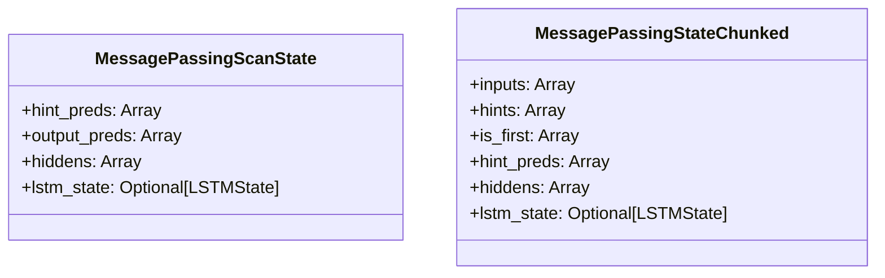

Sources: [clrs/_src/nets.py:47-53](), [clrs/_src/nets.py:62-68]()

## Practical Example

Here's a concrete example of data flow through the architecture for a single time step:

1. **Input**: Algorithm state represented as node, edge, and graph features
2. **Encoding**: Features transformed into latent space
3. **Message Passing**: Multiple passes update node and edge representations
4. **LSTM (Optional)**: Temporal information incorporated
5. **Decoding**: Latent representations converted to algorithm outputs and next-step hints
6. **Feedback**: Hints fed back into the system for the next step (with teacher forcing during training)

Sources: [clrs/_src/nets.py:364-447]()

---

