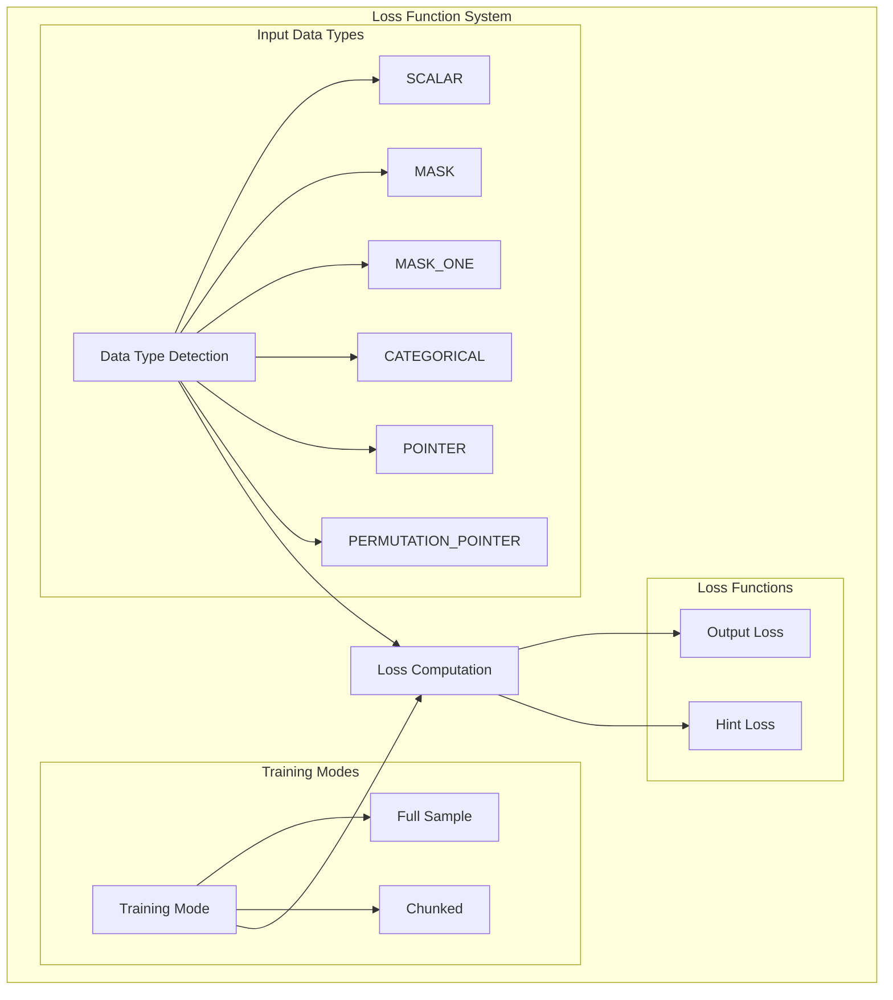
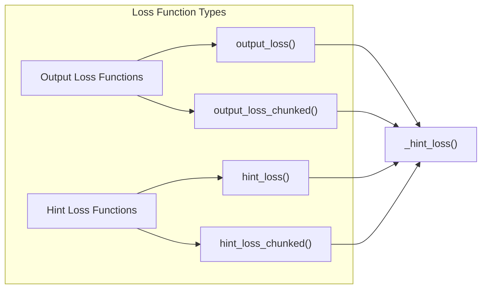
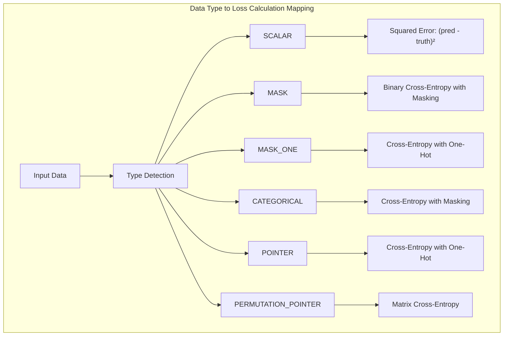
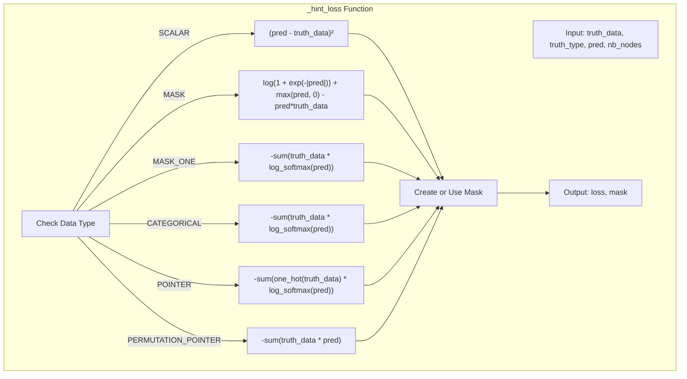
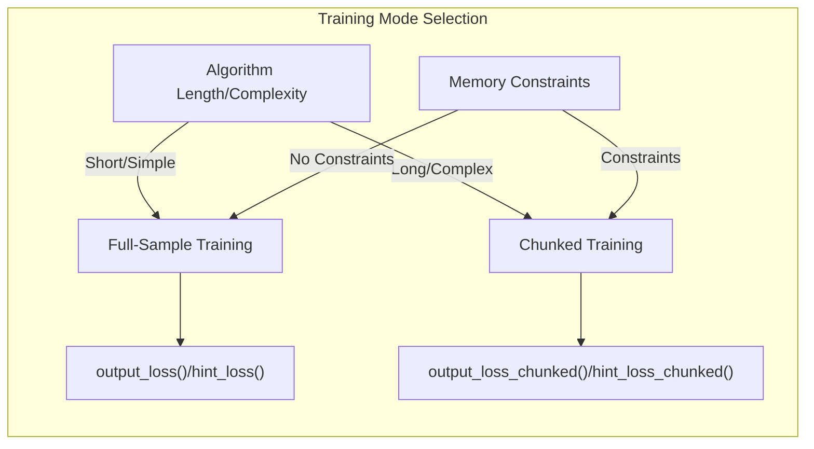

<!-- source: DeepWiki mcp.deepwiki.com · repo google-deepmind/clrs · page 2.2 Loss Functions · fetched 2026-10-26 -->

# Loss Functions

Relevant source files

The following files were used as context for generating this wiki page:

- [clrs/_src/decoders_test.py](clrs/_src/decoders_test.py)
- [clrs/_src/evaluation.py](clrs/_src/evaluation.py)
- [clrs/_src/evaluation_test.py](clrs/_src/evaluation_test.py)
- [clrs/_src/losses.py](clrs/_src/losses.py)
- [clrs/_src/losses_test.py](clrs/_src/losses_test.py)

This document provides a technical reference for the loss function system used in the CLRS algorithmic reasoning benchmark. The loss functions are critical components that quantify the difference between model predictions and ground truth values during training, enabling the neural networks to learn algorithmic behaviors. For information about the neural network architecture, see [Neural Network Architecture](#2.1).

## Overview

The CLRS benchmark uses specialized loss functions to handle different types of algorithmic data structures, including scalars, masks, categorical values, and pointers. The loss system supports two training modes: full-sample training and chunked training, with distinct implementations for each.

Sources: [clrs/_src/losses.py:37-210]()

## Loss Function Types

The CLRS benchmark utilizes two primary categories of loss functions:

1. **Output Loss**: Calculates loss between model predictions and the final algorithm outputs
2. **Hint Loss**: Calculates loss between model predictions and intermediate algorithm states (hints)

Each category has both full-sample and chunked implementations to accommodate different training approaches.

Sources: [clrs/_src/losses.py:47-162]()

### Output Loss Functions

Output loss functions measure the difference between model predictions and the ground truth outputs of algorithms.

1. **Full-Sample Output Loss** (`output_loss`):
   - Processes complete algorithm outputs
   - Handles different data types with specialized loss calculations
   - Returns a scalar loss value

2. **Chunked Output Loss** (`output_loss_chunked`):
   - Used for time-chunked training
   - Applies loss only on chunks marked as "last" in the sequence
   - Handles masking and appropriate normalization

Sources: [clrs/_src/losses.py:47-115](), [clrs/_src/losses_test.py:120-138]()

### Hint Loss Functions

Hint loss functions measure the difference between model predictions and the ground truth intermediate states (hints) during algorithm execution.

1. **Full-Sample Hint Loss** (`hint_loss`):
   - Processes entire hint trajectories
   - Accounts for variable-length sequences
   - Can return verbose loss breakdowns by hint

2. **Chunked Hint Loss** (`hint_loss_chunked`):
   - Used for time-chunked training
   - Applies loss only on non-first chunks to avoid penalizing initial states
   - Handles appropriate masking and normalization

Sources: [clrs/_src/losses.py:118-162](), [clrs/_src/losses_test.py:140-162]()

## Data Types and Loss Calculations

The loss functions handle different data types with specialized calculations. Below is a detailed mapping of data types to their respective loss calculations:

| Data Type | Description | Loss Calculation | Used For |
|-----------|-------------|------------------|----------|
| `SCALAR` | Numeric scalar values | Mean squared error | Distances, costs, weights |
| `MASK` | Binary masks | Binary cross-entropy with masking | Visited nodes, valid edges |
| `MASK_ONE` | One-hot encoded masks | Cross-entropy with masking | Selected single items |
| `CATEGORICAL` | Multi-class categorical data | Cross-entropy with masking | Node colors, state classifications |
| `POINTER` | Node pointers | Cross-entropy with one-hot encoding | Parent pointers, next pointers |
| `PERMUTATION_POINTER` | Node permutations | Cross-entropy between matrices | Sorting orders, matchings |

Sources: [clrs/_src/losses.py:165-202]()

Sources: [clrs/_src/losses.py:165-202]()

## Core Loss Function Implementation

Both output and hint loss functions rely on a common core implementation (`_hint_loss`) that handles the actual loss calculation based on data type. This function:

1. Determines the appropriate loss calculation based on the data type
2. Applies masking for masked data types
3. Returns both the loss and a mask indicating valid data points

Sources: [clrs/_src/losses.py:165-202]()

## Training Modes

The CLRS benchmark supports two training modes, each with specialized loss function implementations:

### Full-Sample Training

In full-sample training, the model processes the entire algorithm execution trajectory at once.

- Uses `output_loss` and `hint_loss`
- Processes complete sequences of data
- Normalizes losses over the entire sequence
- Suitable for shorter algorithms or when memory is not a constraint

### Chunked Training

In chunked training, long sequences are broken into chunks to manage memory efficiently.

- Uses `output_loss_chunked` and `hint_loss_chunked`
- Processes data in chunks with appropriate masking
- Uses `is_first` and `is_last` flags to apply losses correctly at chunk boundaries
- Suitable for longer algorithms or memory-constrained environments

Sources: [clrs/_src/losses.py:47-162](), [clrs/_src/losses_test.py:107-113]()

## Helper Functions

The loss calculation system uses several helper functions to handle tensor shape manipulation and masking:

1. `_expand_to`: Expands tensor dimensions to match another tensor's shape
2. `_expand_and_broadcast_to`: Expands and broadcasts a tensor to match another tensor's shape
3. `_is_not_done_broadcast`: Creates a mask based on sequence completion status

These helper functions ensure proper tensor shape handling and masking across different loss calculations.

Sources: [clrs/_src/losses.py:37-45](), [clrs/_src/losses.py:205-209]()

## Integration with Evaluation

While loss functions are used during training, a separate evaluation system handles model performance assessment. The evaluation system uses similar metrics to the loss functions but focuses on performance measurement rather than gradient-based learning.

The primary difference between loss functions and evaluation metrics:
- Loss functions produce differentiable values suitable for gradient-based optimization
- Evaluation metrics focus on interpretable performance measures (e.g., F1 score)

For more details on the evaluation system, refer to the Evaluation section of the documentation.

Sources: [clrs/_src/evaluation.py:143-202]()

## Implementation Notes

- Loss functions use a small epsilon value (`EPS = 1e-12`) to prevent division by zero
- Special handling is provided for masked values, where certain data points are excluded from loss calculation
- Chunk boundaries require special handling to ensure consistent loss calculations

Sources: [clrs/_src/losses.py:34-36](), [clrs/_src/losses.py:77-82]()

---

