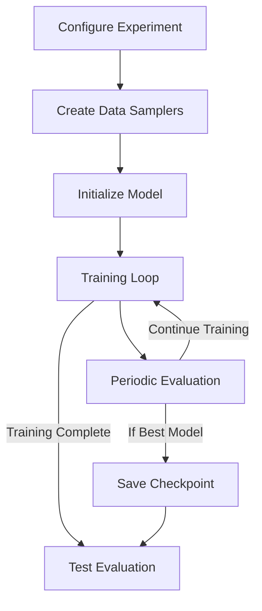
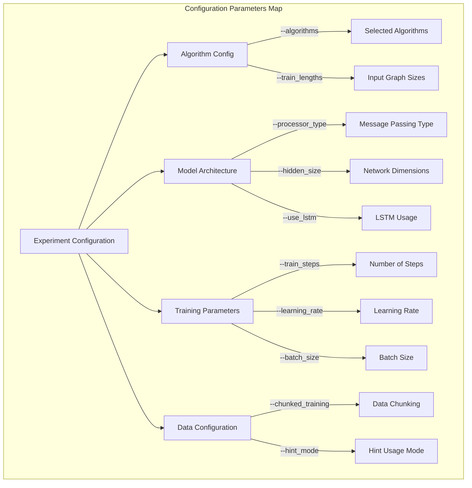
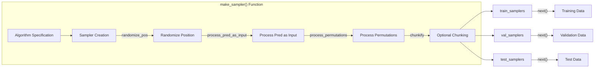
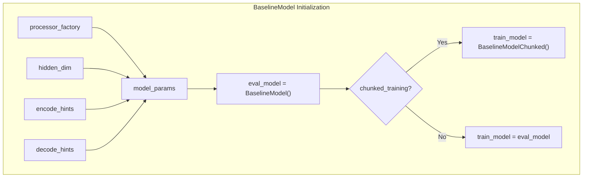
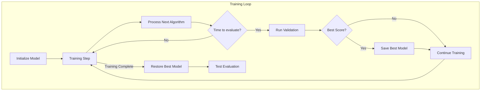
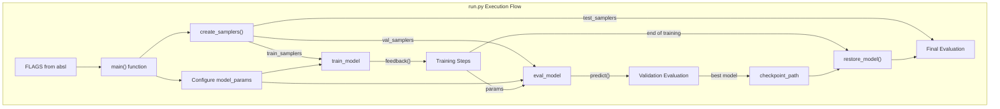

<!-- source: DeepWiki mcp.deepwiki.com · repo google-deepmind/clrs · page 3 Running Experiments · fetched 2026-10-26 -->

# Running Experiments

<details>
<summary>Relevant source files</summary>

The following files were used as context for generating this wiki page:

- [clrs/examples/run.py](clrs/examples/run.py)

</details>


This document explains how to set up and run experiments using the CLRS benchmark. It covers configuring experiments, executing training runs, and evaluating model performance on algorithmic reasoning tasks. For details on available baseline models, see [Baseline Models](#2), and for specific configuration options, see [Configuration Options](#3.1).

## Experiment Workflow Overview

Running an experiment with CLRS involves several key steps, from configuration to final evaluation.



**Experiment Workflow Diagram**

Sources: [clrs/examples/run.py:400-581]()

## Running a Basic Experiment

The primary entry point for running experiments is the `run.py` script. This script handles the full experimental pipeline including dataset creation, model initialization, training, validation, and testing.

To run a basic experiment:

```bash
python clrs/examples/run.py --algorithms=bfs --train_lengths=8,16 --train_steps=1000
```

This will train a model on the breadth-first search algorithm using two different input sizes (8 and 16 nodes) for 1000 training steps.

Sources: [clrs/examples/run.py:16-17](), [clrs/examples/run.py:33-44]()

## Key Configuration Parameters

The experiment can be customized through numerous command-line parameters:

| Parameter Group | Key Parameters | Description |
|-----------------|----------------|-------------|
| Algorithm Selection | `--algorithms` | List of algorithms to train on (default: ['bfs']) |
|  | `--train_lengths` | List of training sizes to use (default: ['4', '7', '11', '13', '16']) |
| Model Architecture | `--hidden_size` | Number of hidden units in the model (default: 128) |
|  | `--processor_type` | Type of message-passing processor (default: 'triplet_gmpnn') |
|  | `--nb_msg_passing_steps` | Message passing steps per hint (default: 1) |
| Training Parameters | `--batch_size` | Batch size for training (default: 32) |
|  | `--train_steps` | Number of training steps (default: 10000) |
|  | `--learning_rate` | Learning rate (default: 0.001) |
| Evaluation | `--eval_every` | How frequently to evaluate on validation data (default: 50) |
|  | `--test_every` | How frequently to evaluate on test data (default: 500) |
| Hint Usage | `--hint_mode` | How hints should be used ('encoded_decoded', 'decoded_only', 'none') |
|  | `--hint_teacher_forcing` | Probability of using ground-truth hints during training |
| Data Processing | `--chunked_training` | Whether to use chunking for training (default: False) |
|  | `--chunk_length` | Time chunk length for training (default: 16) |



**Configuration Parameters and their Relationships**

Sources: [clrs/examples/run.py:33-120]()

## Data Samplers

The experiment process begins with creating samplers for generating algorithm data:



**Data Sampler Creation and Flow**

The system creates three types of samplers:
1. **Training samplers**: Used for model training, can use multiple input sizes
2. **Validation samplers**: Used for periodic evaluation and checkpointing
3. **Test samplers**: Used for final evaluation on the benchmark dataset

The `create_samplers()` function orchestrates the creation of these samplers with appropriate configurations for each type.

Sources: [clrs/examples/run.py:170-397]()

## Model Initialization

The model is configured and initialized based on the processor type and other parameters:



**Model Initialization Process**

The initialization process creates either one or two model instances:
- `eval_model`: Always created, used for evaluation
- `train_model`: Either the same as `eval_model` or a `BaselineModelChunked` instance if chunked training is enabled

Sources: [clrs/examples/run.py:435-470]()

## Training Loop

The training loop iterates through steps, periodically evaluating on validation data:



**Training and Evaluation Cycle**

Key aspects of the training loop:

1. **Initialization**: The model is initialized with the first batch of samples 
2. **Training Steps**: Each step processes a batch from each algorithm
3. **Periodic Evaluation**: The model is evaluated on validation data every `eval_every` steps
4. **Checkpointing**: The best model (highest validation score) is saved
5. **Final Evaluation**: After training, the best model is restored and evaluated on test data

Sources: [clrs/examples/run.py:472-580]()

## Example Training Output

During training, the script logs progress information like:

```
INFO:absl:Algo bfs step 100 current loss 0.023456, current_train_items 3200.
INFO:absl:(val) algo bfs step 100: {'score': 0.921, 'examples_seen': 3200, 'step': 100, 'algorithm': 'bfs'}
INFO:absl:Checkpointing best model, best avg val score was 0.000, current avg val score is 0.921, val scores are: bfs: 0.921
```

This shows:
- Current training loss and number of processed examples
- Validation score after evaluation
- Checkpointing information based on score comparison

Sources: [clrs/examples/run.py:519-558]()

## Advanced Usage Examples

### Chunked Training

For algorithms with long trajectories, chunked training can be more efficient:

```bash
python clrs/examples/run.py --algorithms=floyd_warshall --chunked_training=True --chunk_length=16
```

### Multi-Algorithm Training

Train on multiple algorithms simultaneously:

```bash
python clrs/examples/run.py --algorithms=bfs,dfs,topological_sort --train_steps=5000
```

### Custom Model Architecture

Customize the neural network architecture:

```bash
python clrs/examples/run.py --algorithms=dijkstra --processor_type=gat --hidden_size=256 --nb_heads=4
```

Sources: [clrs/examples/run.py:33-120]()

## Experiment Components and Data Flow

The following diagram shows how the different components of the experiment system interact:



**CLRS Experiment System Data Flow**

Sources: [clrs/examples/run.py:400-581]()

## Conclusion

The CLRS benchmark provides a flexible framework for experimenting with neural algorithmic reasoning. By configuring the appropriate parameters, you can train models on various algorithms, with different model architectures, and evaluate their performance against benchmark datasets.

When running experiments, it's important to consider:
- The appropriate input sizes for the algorithms you're studying
- The model architecture suitable for the algorithmic task
- Whether chunked training is needed for longer trajectories
- The hint mode that best suits your research question

For more specific configuration details, see [Configuration Options](#3.1).

Sources: [clrs/examples/run.py]()

---

