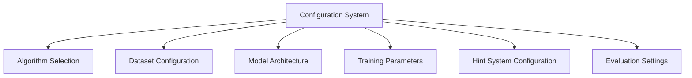
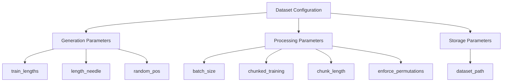
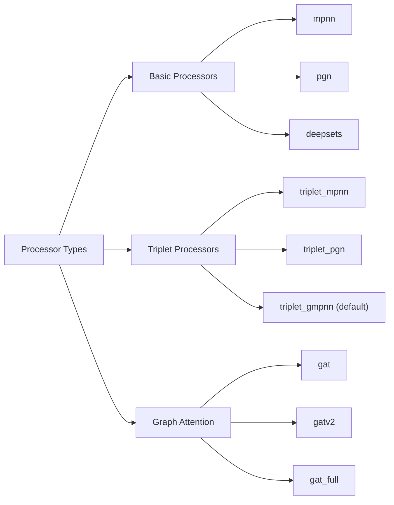
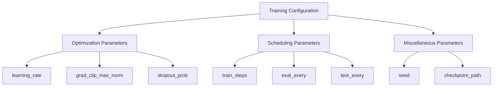
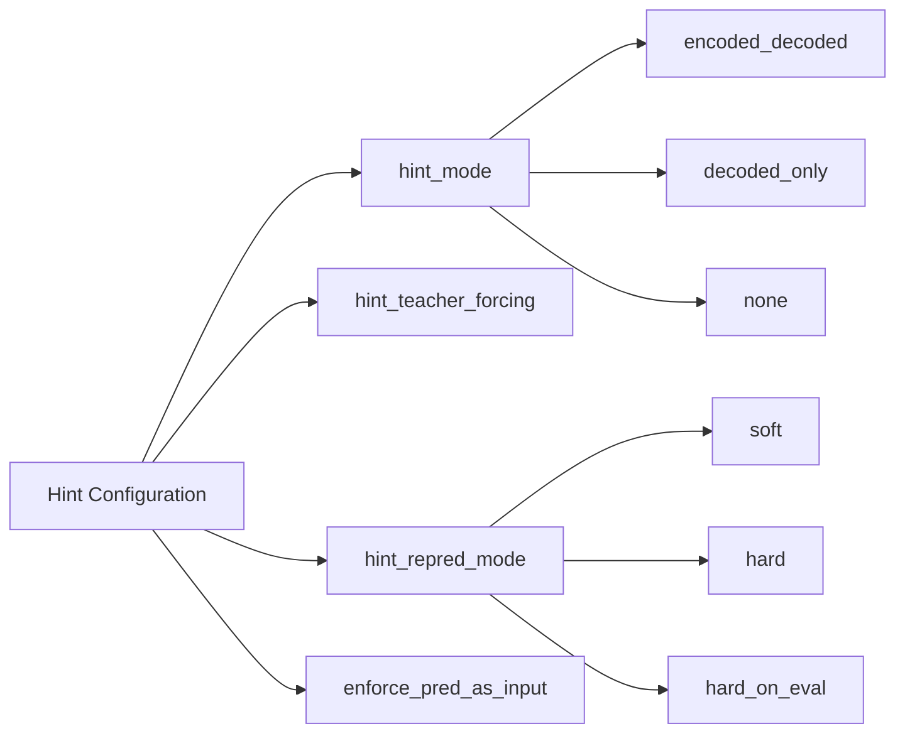
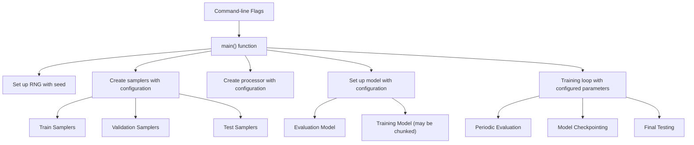

<!-- source: DeepWiki mcp.deepwiki.com · repo google-deepmind/clrs · page 3.1 Configuration Options · fetched 2026-10-26 -->

# Configuration Options

<details>
<summary>Relevant source files</summary>

The following files were used as context for generating this wiki page:

- [clrs/_src/algorithms/graphs.py](clrs/_src/algorithms/graphs.py)
- [clrs/_src/model.py](clrs/_src/model.py)
- [clrs/examples/run.py](clrs/examples/run.py)

</details>


This page documents the various configuration options available when running experiments with the CLRS algorithmic reasoning benchmark. Configuration options control aspects such as algorithm selection, model architecture, training parameters, and evaluation settings. These options are primarily defined as command-line flags in the main runner script.

For information about running complete experiments, see [Running Experiments](#3). For details about the baseline models that can be configured, see [Baseline Models](#2).

## Overview of Configuration System

The CLRS benchmark uses the Abseil flags library for configuration. Options can be specified via command-line arguments when running the training script. All configuration options have sensible defaults but can be customized for specific experimental needs.



Sources: [clrs/examples/run.py:33-122]()

## Algorithm Selection Options

The CLRS benchmark includes implementations of numerous algorithms from the "Introduction to Algorithms" textbook. You can select one or more algorithms to train on.

### Key Configuration Options:

| Flag | Description | Default |
|------|-------------|---------|
| `algorithms` | List of algorithms to run | `['bfs']` |

Some algorithms may require special handling for hints. For algorithms that use `pred` as input, set `enforce_pred_as_input` to `True`.

```mermaid
flowchart LR
    subgraph "Algorithm Categories"
        graph["Graph Algorithms"]
        string["String Algorithms"]
        dp["Dynamic Programming"]
        greedy["Greedy Algorithms"]
    end
    
    graph --> bfs["breadth-first search"]
    graph --> dfs["depth-first search"]
    graph --> topo["topological_sort"]
    graph --> apsp["floyd_warshall"]
    graph --> sssp["dijkstra/bellman_ford"]
    
    string --> kmp["kmp_matcher"]
    string --> naive["naive_string_matcher"]
    
    dp --> lcs["lcs_length"]
    dp --> mco["matrix_chain_order"]
    
    greedy --> acts["activity_selector"]
    greedy --> task["task_scheduling"]
```

Sources: [clrs/examples/run.py:33-34](), [clrs/examples/run.py:125-137]()

## Dataset Configuration Options

Dataset options control the data generation and processing for training, validation, and testing.

### Key Configuration Options:

| Flag | Description | Default |
|------|-------------|---------|
| `train_lengths` | Sizes to use for training samples | `['4', '7', '11', '13', '16']` |
| `length_needle` | Length of needle for string matching algorithms | `-8` |
| `batch_size` | Batch size for training | `32` |
| `chunked_training` | Whether to use chunking for training | `False` |
| `chunk_length` | Time chunk length if chunking is enabled | `16` |
| `random_pos` | Randomize the position input | `True` |
| `enforce_permutations` | Enforce permutation-type node pointers | `True` |
| `dataset_path` | Path for storing the dataset | `/tmp/CLRS30` |

Training lengths are specified as a list of integers representing graph sizes. A value of `-1` means using the benchmark dataset rather than generating samples.



Sources: [clrs/examples/run.py:34-51](), [clrs/examples/run.py:52-60](), [clrs/examples/run.py:115-118]()

## Model Configuration Options

Model architecture options control the neural network structure, including processor type, hidden dimensions, and other neural network parameters.

### Key Configuration Options:

| Flag | Description | Default |
|------|-------------|---------|
| `processor_type` | Type of processor to use | `triplet_gmpnn` |
| `hidden_size` | Number of hidden units | `128` |
| `nb_heads` | Number of heads for GAT processors | `1` |
| `nb_msg_passing_steps` | Number of message passing steps per hint | `1` |
| `nb_triplet_fts` | Number of triplet features to compute | `8` |
| `use_ln` | Whether to use layer normalization | `True` |
| `use_lstm` | Whether to insert an LSTM after message passing | `False` |
| `encoder_init` | Initializer to use for the encoders | `xavier_on_scalars` |
| `freeze_processor` | Whether to freeze the processor | `False` |

The processor type is particularly important as it determines how graph message passing is performed. Available processors include:



Sources: [clrs/examples/run.py:62-70](), [clrs/examples/run.py:97-120](), [clrs/examples/run.py:104-113]()

## Training Configuration Options

Training options control the learning process, including optimization parameters and training schedule.

### Key Configuration Options:

| Flag | Description | Default |
|------|-------------|---------|
| `learning_rate` | Learning rate | `0.001` |
| `grad_clip_max_norm` | Gradient clipping norm (0 disables) | `1.0` |
| `dropout_prob` | Dropout rate | `0.0` |
| `train_steps` | Number of training iterations | `10000` |
| `seed` | Random seed | `42` |
| `eval_every` | Evaluation frequency (steps) | `50` |
| `test_every` | Test evaluation frequency (steps) | `500` |
| `checkpoint_path` | Path for saving checkpoints | `/tmp/CLRS30` |

The training loop will periodically evaluate on validation data and save checkpoints for the best-performing model.



Sources: [clrs/examples/run.py:58-61](), [clrs/examples/run.py:67-70](), [clrs/examples/run.py:115-120]()

## Hint Configuration Options

Hints are a critical part of the CLRS benchmark, representing intermediate states of algorithm execution. Hint configuration controls how hints are used during training.

### Key Configuration Options:

| Flag | Description | Default |
|------|-------------|---------|
| `hint_mode` | How hints should be used | `encoded_decoded` |
| `hint_teacher_forcing` | Probability of using ground-truth hints | `0.0` |
| `hint_repred_mode` | How to process predicted hints | `soft` |
| `enforce_pred_as_input` | Change pred_h hints into pred inputs | `True` |

The `hint_mode` has three options:
- `encoded_decoded`: Hints are both encoded and decoded (hardest, but most aligned with algorithms)
- `decoded_only`: Hints are only used for reconstruction losses
- `none`: No hint usage



Sources: [clrs/examples/run.py:50-51](), [clrs/examples/run.py:71-96]()

## Configuration Flow in the Runner Script

The following diagram illustrates how configuration options are processed in the main runner script:



Sources: [clrs/examples/run.py:400-464](), [clrs/examples/run.py:472-580]()

## Example Configuration Usage

Here's an example of how to run an experiment with custom configuration:

```bash
python3 -m clrs.examples.run \
  --algorithms=bfs,dijkstra \
  --train_lengths=8,16,32 \
  --batch_size=64 \
  --hidden_size=256 \
  --processor_type=gat \
  --nb_heads=4 \
  --hint_mode=encoded_decoded \
  --learning_rate=0.0005 \
  --train_steps=20000 \
  --checkpoint_path=/path/to/checkpoints
```

This would train models for breadth-first search and Dijkstra's algorithm with graph sizes of 8, 16, and 32 nodes, using a Graph Attention Network processor with 4 attention heads.

Sources: [clrs/examples/run.py:582-584]()

---

