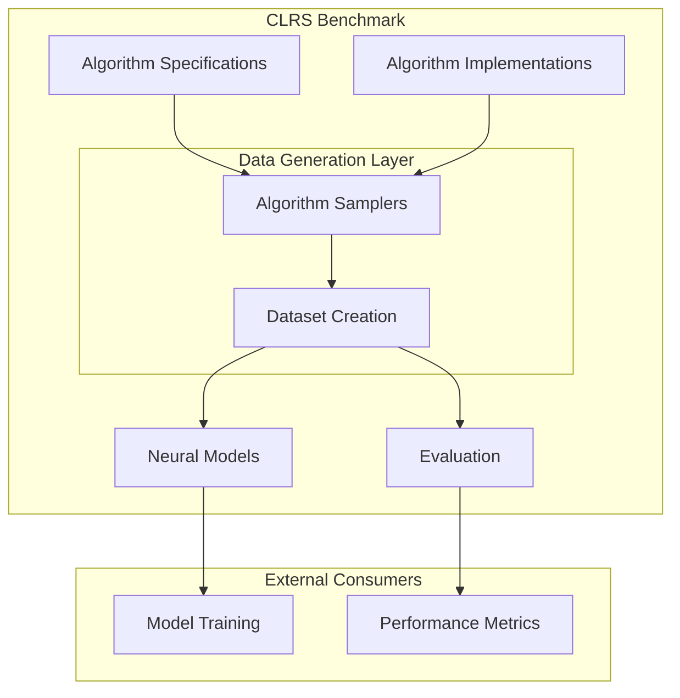
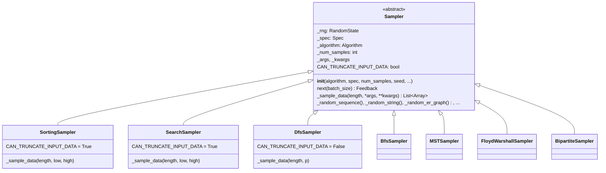
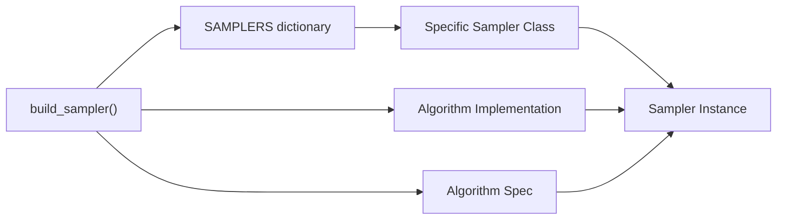
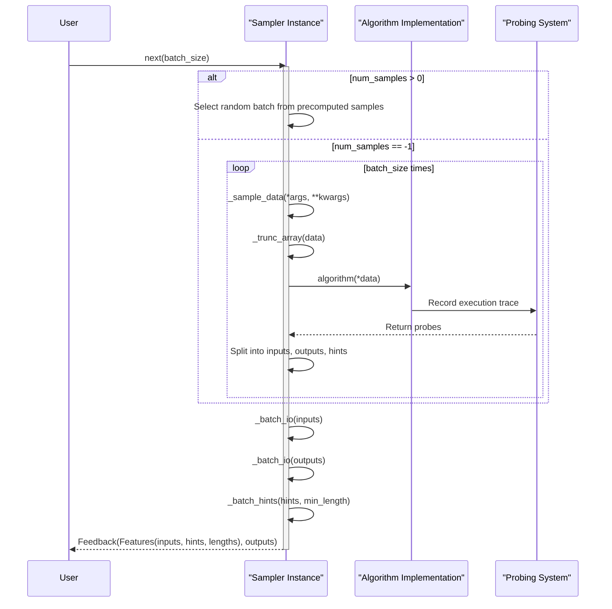
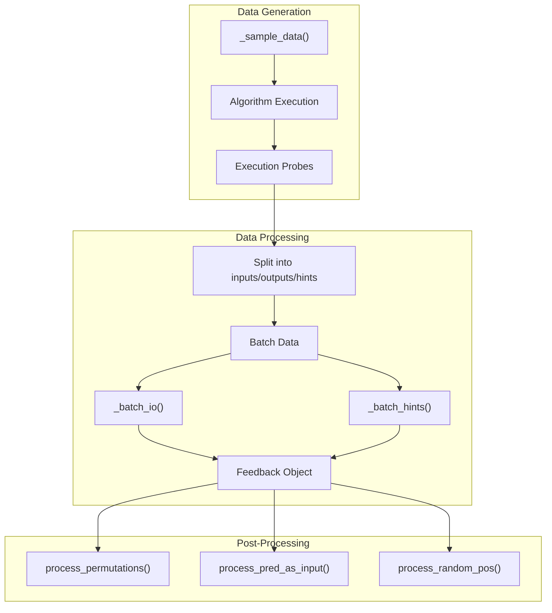

<!-- source: DeepWiki mcp.deepwiki.com · repo google-deepmind/clrs · page 4 Algorithm Samplers · fetched 2026-10-26 -->

# Algorithm Samplers

<details>
<summary>Relevant source files</summary>

The following files were used as context for generating this wiki page:

- [clrs/_src/samplers.py](clrs/_src/samplers.py)
- [clrs/_src/samplers_test.py](clrs/_src/samplers_test.py)

</details>


Algorithm Samplers are a critical component of the CLRS benchmark that generate data for training and evaluating neural networks on algorithmic reasoning tasks. They create input instances for algorithms, execute the algorithms, and collect execution traces for supervised learning.

For information about the algorithm specifications that samplers use, see [Algorithm Specifications](#4.1). For details on how samplers track algorithm execution, see [Data Probing](#4.2).

## Purpose and Role

Algorithm Samplers serve three primary purposes in the CLRS benchmark:

1. **Input Generation**: Creating diverse, controlled inputs for algorithms (e.g., random arrays, graphs)
2. **Algorithm Execution**: Running algorithms on generated inputs and capturing execution traces
3. **Dataset Creation**: Organizing the inputs, outputs, and execution traces into structured datasets

In the overall architecture, samplers serve as the data generation layer that powers model training and evaluation.



Sources: [clrs/_src/samplers.py:16-43]()

## Sampler Architecture

The `Sampler` class is an abstract base class that defines the interface for all algorithm-specific samplers. Each algorithm has its own sampler implementation that inherits from this base class.



Sources: [clrs/_src/samplers.py:65-312](), [clrs/_src/samplers.py:356-822]()

## Creating Samplers

Samplers are created using the `build_sampler` function, which maps algorithm names to their respective sampler classes through the `SAMPLERS` dictionary:



The `build_sampler` function takes the following key parameters:
- `name`: The algorithm name (e.g., 'insertion_sort', 'bfs')
- `num_samples`: Number of samples to generate (-1 for on-the-fly generation)
- `seed`: Random seed for reproducibility
- Other algorithm-specific parameters

Sources: [clrs/_src/samplers.py:321-353](), [clrs/_src/samplers.py:824-857]()

## Sampler Categories

The CLRS benchmark includes samplers for a wide range of algorithms grouped into several categories:

| Category | Samplers | Purpose |
|----------|----------|---------|
| **Sorting** | `SortingSampler` | Generates random sequences for sorting algorithms |
| **Search** | `SearchSampler` | Generates sorted arrays and target values for search algorithms |
| **Dynamic Programming** | `LCSSampler`, `OptimalBSTSampler` | Generates inputs for DP algorithms |
| **Graph Algorithms** | `DfsSampler`, `BfsSampler`, `TopoSampler`, etc. | Generates random graphs with various properties |
| **Flow Networks** | `BipartiteSampler` | Generates bipartite graphs for flow algorithms |
| **String Matching** | `MatcherSampler` | Generates strings for pattern matching |
| **Computational Geometry** | `SegmentsSampler`, `ConvexHullSampler` | Generates geometric data |

Sources: [clrs/_src/samplers.py:356-822]()

## Data Generation Process

The data generation process in samplers involves several key steps:



Sources: [clrs/_src/samplers.py:168-213](), [clrs/_src/samplers.py:860-936]()

## Sampling Methods

Each sampler implements a `_sample_data` method that generates appropriate input data for its algorithm. Here are some examples of sampling techniques:

### Random Sequence Generation
For sorting and array algorithms, samplers generate random sequences of values:

```python
# SortingSampler
arr = self._random_sequence(length=length, low=low, high=high)
```

### Random Graph Generation
For graph algorithms, samplers generate random graph adjacency matrices:

```python
# DfsSampler
graph = self._random_er_graph(
    nb_nodes=length, p=self._rng.choice(p),
    directed=True, acyclic=False, weighted=False)
```

### Community Structure Generation
For algorithms like strongly connected components:

```python
# SccSampler
graph = self._random_community_graph(
    nb_nodes=length, k=k, p=self._rng.choice(p), eps=eps,
    directed=True, acyclic=False, weighted=False)
```

Sources: [clrs/_src/samplers.py:356-822]()

## Data Batching and Processing

Samplers include utilities for batching and processing the generated data:

1. **Batching I/O Data**: `_batch_io` combines input/output samples across multiple trajectories
2. **Batching Hints**: `_batch_hints` handles variable-length hint trajectories with padding
3. **Subsampling**: `_subsample_data` creates randomized batches from precomputed samples



Sources: [clrs/_src/samplers.py:860-936](), [clrs/_src/samplers.py:966-1072]()

## Advanced Features

### On-the-fly Sampling

Samplers support two sampling modes:
- **Precomputed samples** (`num_samples > 0`): Generate all samples at initialization
- **On-the-fly sampling** (`num_samples = -1`): Generate samples as needed

On-the-fly sampling is useful for large datasets or when memory is limited, but it introduces computational overhead during training.

### Data Truncation

Samplers can truncate floating-point data to a specified number of decimal places with the `truncate_decimals` parameter:

```python
data[index] = np.trunc(input_data * 10**self._truncate_decimals) / (10**self._truncate_decimals)
```

This is useful for controlling the precision of algorithm inputs and can help reduce computational complexity and improve numerical stability.

Sources: [clrs/_src/samplers.py:292-311]()

### Permutation Processing

For algorithms that produce permutations, special processing is required to convert them into a format suitable for neural networks:

```python
new_spec, _ = process_permutations(spec, sample_iterator, enforce_permutations)
```

This converts `SHOULD_BE_PERMUTATION` types into `PERMUTATION_POINTER` and `MASK_ONE` types, making them easier to learn by pointer networks.

Sources: [clrs/_src/samplers.py:966-994]()

## Standard CLRS-30 Configuration

The CLRS benchmark provides a standard configuration for training, validation, and testing:

| Split | Samples | Length | Seed |
|-------|---------|--------|------|
| Train | 1000    | 16     | 1    |
| Val   | 32      | 16     | 2    |
| Test  | 32      | 64     | 3    |

This configuration ensures consistent evaluation across different models and experiments.

Sources: [clrs/_src/samplers.py:46-62]()

## Using Samplers

Here's a typical usage pattern for algorithm samplers:

1. Create a sampler for a specific algorithm:
```python
sampler, spec = build_sampler('insertion_sort', num_samples=1000, length=16, seed=1)
```

2. Get a batch of samples:
```python
feedback = sampler.next(batch_size=32)
```

3. Access the input data, hints (execution traces), and outputs:
```python
inputs = feedback.features.inputs   # Algorithm inputs
hints = feedback.features.hints     # Execution traces
lengths = feedback.features.lengths # Trajectory lengths
outputs = feedback.outputs          # Algorithm outputs
```

Sources: [clrs/_src/samplers.py:168-213]()

## Available Samplers

The CLRS benchmark includes samplers for 30 classic algorithms:

| Algorithm Type | Available Samplers |
|----------------|-------------------|
| **Sorting** | insertion_sort, bubble_sort, heapsort, quicksort, quickselect |
| **Search** | binary_search, minimum |
| **Array Algorithms** | find_maximum_subarray, find_maximum_subarray_kadane |
| **Dynamic Programming** | matrix_chain_order, lcs_length, optimal_bst |
| **Greedy Algorithms** | activity_selector, task_scheduling |
| **Graph Traversal** | dfs, bfs |
| **Graph Algorithms** | topological_sort, strongly_connected_components, articulation_points, bridges |
| **Minimum Spanning Trees** | mst_kruskal, mst_prim |
| **Shortest Paths** | bellman_ford, dag_shortest_paths, dijkstra, floyd_warshall |
| **Flow Networks** | bipartite_matching |
| **String Matching** | naive_string_matcher, kmp_matcher |
| **Computational Geometry** | segments_intersect, graham_scan, jarvis_march |

Sources: [clrs/_src/samplers.py:824-857]()

---

