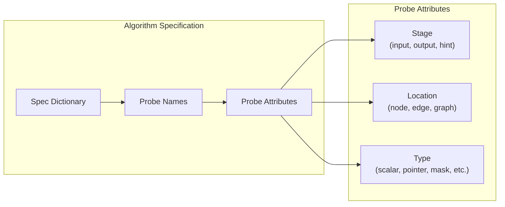
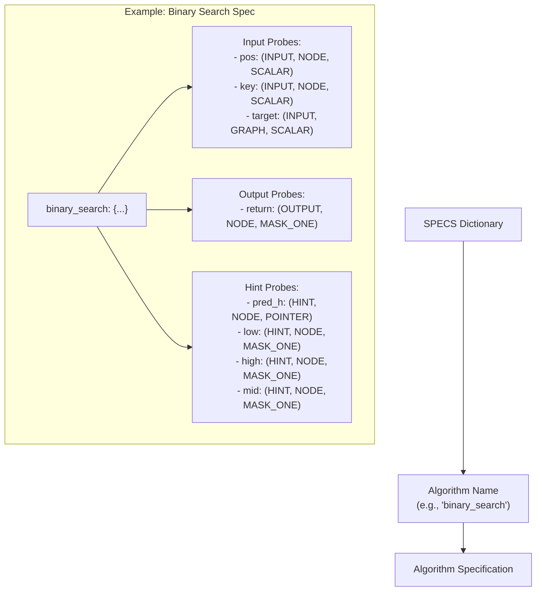
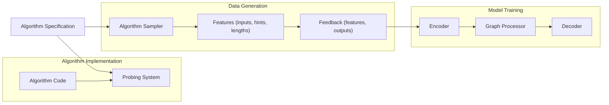
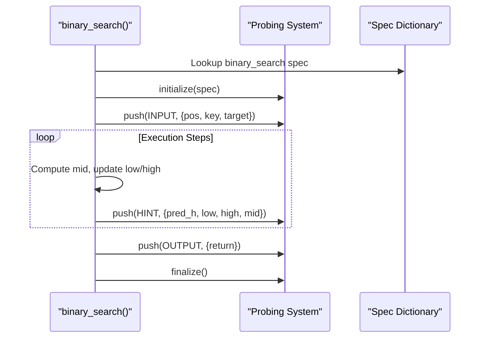
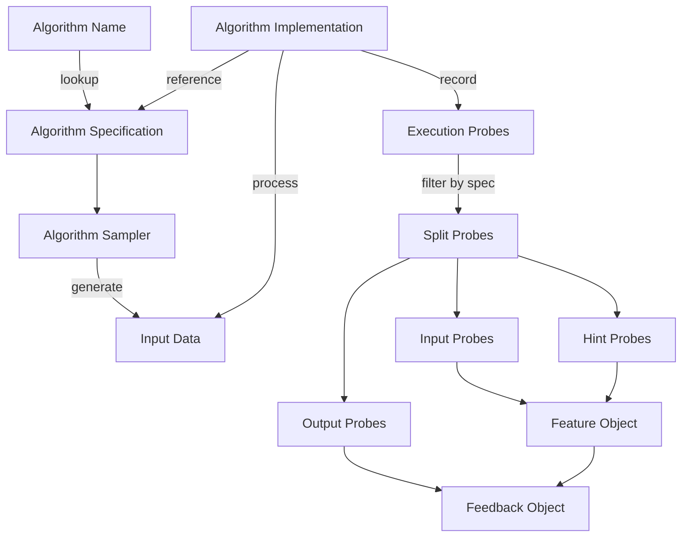

<!-- source: DeepWiki mcp.deepwiki.com · repo google-deepmind/clrs · page 4.1 Algorithm Specifications · fetched 2026-10-26 -->

# Algorithm Specifications

<details>
<summary>Relevant source files</summary>

The following files were used as context for generating this wiki page:

- [clrs/_src/algorithms/searching.py](clrs/_src/algorithms/searching.py)
- [clrs/_src/samplers.py](clrs/_src/samplers.py)
- [clrs/_src/specs.py](clrs/_src/specs.py)

</details>


## Introduction

Algorithm Specifications define the interface and data flow for each algorithm in the CLRS benchmark. These specifications formalize how algorithms are represented as operations on graphs with inputs, outputs, and intermediate state (hints). Algorithm specifications are a foundational component that connects [Algorithm Samplers](#4) with the [Probing System](#4.2) to generate training and evaluation data.

The specification system enables a consistent representation of diverse algorithms within a unified framework, making it possible to train neural models to learn algorithmic reasoning.

Sources: [clrs/_src/specs.py:16-31]()

## Specification Structure

Each algorithm specification is defined as a dictionary mapping probe names to tuples of `(stage, location, type)`:



### Stage

The `Stage` class defines where a probe appears in the algorithm execution flow:

- `INPUT`: Initial algorithm inputs
- `OUTPUT`: Final algorithm outputs
- `HINT`: Intermediate algorithm states (execution trace)

### Location

The `Location` class specifies the structural element associated with the probe:

- `NODE`: Node-level data (e.g., array elements, vertices)
- `EDGE`: Edge-level data (e.g., graph connections)
- `GRAPH`: Global algorithm state

### Type

The `Type` class defines the data type and semantic interpretation:

- `SCALAR`: Numeric values
- `CATEGORICAL`: Discrete categorical values
- `MASK`: Binary mask (over all nodes/edges)
- `MASK_ONE`: One-hot mask (single position)
- `POINTER`: Reference to another node
- `SHOULD_BE_PERMUTATION`: Special type for permutation outputs
- `PERMUTATION_POINTER`: Cyclic permutation representation
- `SOFT_POINTER`: Probabilistic pointer

Sources: [clrs/_src/specs.py:36-65]()

## Specification Registry

The CLRS benchmark includes specifications for 30 algorithms from the Introduction to Algorithms textbook. These are stored in a global `SPECS` dictionary that maps algorithm names to their specifications:



All algorithms include at least a `pos` input probe that serves as a unique index, for example, to represent sequential data where appropriate.

Sources: [clrs/_src/specs.py:115-526]()

## Algorithm Categories

The CLRS benchmark covers algorithms from various categories:

| Category | Algorithms |
| --- | --- |
| Sorting | insertion_sort, bubble_sort, heapsort, quicksort |
| Searching | minimum, binary_search, quickselect |
| Dynamic Programming | find_maximum_subarray, lcs_length, matrix_chain_order, optimal_bst |
| Greedy Algorithms | activity_selector, task_scheduling |
| Graph Algorithms | dfs, bfs, topological_sort, strongly_connected_components, articulation_points, bridges |
| Minimum Spanning Trees | mst_kruskal, mst_prim |
| Shortest Paths | bellman_ford, dag_shortest_paths, dijkstra, floyd_warshall |
| Flow Networks | bipartite_matching |
| String Matching | naive_string_matcher, kmp_matcher |
| Computational Geometry | segments_intersect, graham_scan, jarvis_march |

Sources: [clrs/_src/specs.py:67-98]()

## Specification Usage

Algorithm specifications are used in three main ways:

1. **Algorithm Implementation**: Define the interface for algorithm implementation and execution tracing
2. **Data Generation**: Define what data samplers need to generate
3. **Model Training**: Define the inputs, outputs, and hints for model prediction



Sources: [clrs/_src/samplers.py:72-84](), [clrs/_src/samplers.py:144-166]()

## Example: Binary Search Specification

Let's examine the specification for the binary search algorithm:

```python
'binary_search': {
    'pos': (Stage.INPUT, Location.NODE, Type.SCALAR),
    'key': (Stage.INPUT, Location.NODE, Type.SCALAR),
    'target': (Stage.INPUT, Location.GRAPH, Type.SCALAR),
    'return': (Stage.OUTPUT, Location.NODE, Type.MASK_ONE),
    'pred_h': (Stage.HINT, Location.NODE, Type.POINTER),
    'low': (Stage.HINT, Location.NODE, Type.MASK_ONE),
    'high': (Stage.HINT, Location.NODE, Type.MASK_ONE),
    'mid': (Stage.HINT, Location.NODE, Type.MASK_ONE),
},
```

This specification defines:

- **Inputs**: 
  - `pos`: Position index for each array element
  - `key`: Array values (sorted)
  - `target`: Value to search for

- **Output**:
  - `return`: Position of the found element (one-hot encoding)

- **Hints**:
  - `pred_h`: Current array permutation
  - `low`, `high`, `mid`: Current search boundaries and midpoint

The corresponding algorithm implementation initializes probes based on this specification and updates them during execution:



Sources: [clrs/_src/specs.py:175-184](), [clrs/_src/algorithms/searching.py:91-144]()

## Integration with Samplers

Algorithm specifications are used by samplers to generate data for training and evaluation:



The `build_sampler()` function connects algorithm specifications with their corresponding samplers:

1. Looks up the algorithm specification from `SPECS`
2. Gets the algorithm implementation
3. Creates the appropriate sampler class
4. Returns the sampler and specification

Different algorithms have specialized samplers (e.g., `SortingSampler`, `SearchSampler`) that generate appropriate input data.

Sources: [clrs/_src/samplers.py:321-353](), [clrs/_src/samplers.py:824-856]()

## Sampling Process

When a sampler is used, it follows this process:

1. Create random algorithm inputs using the appropriate sampling method
2. Execute the algorithm with these inputs while recording probes
3. Split the probes into inputs, outputs, and hints based on the specification
4. Process and batch the data for model training

The sampling system ensures that generated data follows the structure defined in the algorithm specification.

Sources: [clrs/_src/samplers.py:144-166](), [clrs/_src/samplers.py:168-213]()

## Advanced Specification Features

### Permutation Handling

Some algorithms (like sorting) produce permutations as outputs. The specification system handles these specially:

- `SHOULD_BE_PERMUTATION`: Indicates output should be a permutation
- `process_permutations()`: Converts permutations to proper pointer representations
- Special handling for cyclic permutations

### Special Input Processing

Specifications guide how inputs are processed before model training:

- `process_pred_as_input()`: Moves predecessor hint to input
- `process_random_pos()`: Randomizes position inputs
- Specialized handling for strings and graph structures

Sources: [clrs/_src/samplers.py:967-1072]()

## Conclusion

Algorithm specifications provide a standardized interface for representing diverse algorithms within the CLRS benchmark. They define the inputs, outputs, and execution traces that models learn to predict, bridging the gap between algorithm implementations and neural network training. By formalizing these specifications, the CLRS benchmark enables systematic evaluation of neural algorithmic reasoning capabilities across a wide range of classic algorithms.

For more information about the probing system that captures algorithm execution traces based on these specifications, see [Data Probing](#4.2).

---

