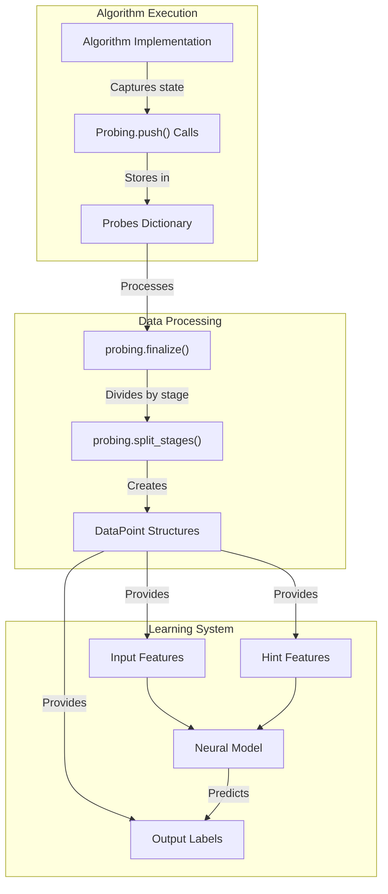
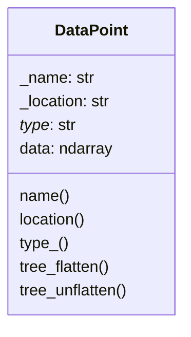
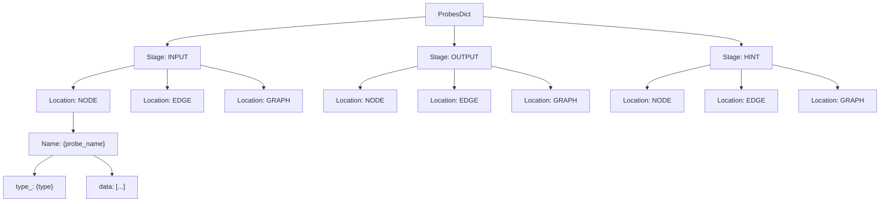
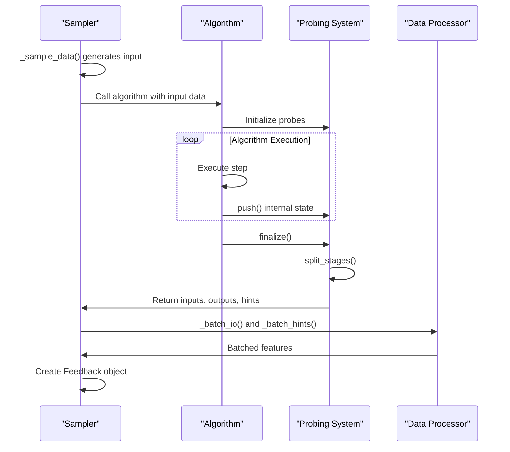
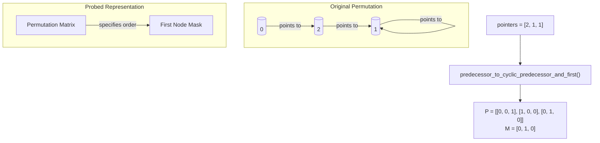
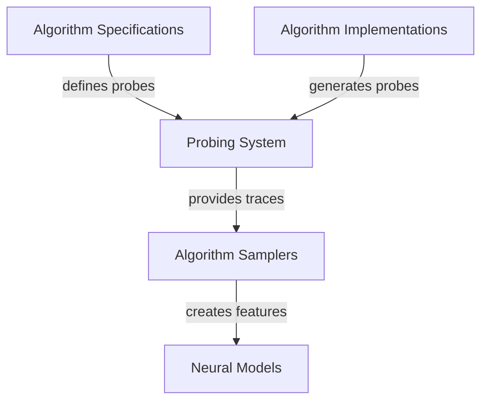

<!-- source: DeepWiki mcp.deepwiki.com · repo google-deepmind/clrs · page 4.2 Data Probing · fetched 2026-10-26 -->

# Data Probing

<details>
<summary>Relevant source files</summary>

The following files were used as context for generating this wiki page:

- [README.md](README.md)
- [clrs/_src/clrs_text/README.md](clrs/_src/clrs_text/README.md)
- [clrs/_src/probing.py](clrs/_src/probing.py)
- [clrs/_src/probing_test.py](clrs/_src/probing_test.py)
- [clrs/_src/samplers.py](clrs/_src/samplers.py)

</details>


## Purpose and Scope

This document explains the Data Probing system in the CLRS benchmark, a mechanism for capturing algorithm execution traces. Data Probing generates rich supervisory signals by exposing the internal state of algorithms at different execution stages, providing neural networks with "hints" about algorithm behavior. This page covers the probing architecture, data structures, and how the system captures algorithm execution states.

For information about Algorithm Specifications that define what data gets probed, see [Algorithm Specifications](#4.1).

Sources: [clrs/_src/probing.py:16-24](), [README.md:50-53]()

## Overview

Data Probing forms a critical part of the CLRS benchmark, enabling the collection of detailed execution traces from classical algorithms. These traces are essential for training neural networks to learn algorithmic reasoning, as they provide visibility into intermediate computation steps rather than just input-output pairs.



Sources: [clrs/_src/probing.py:16-24](), [clrs/_src/samplers.py:152-166]()

## Core Data Structures

### DataPoint

The fundamental unit of the probing system is the `DataPoint`, which encapsulates a single piece of data captured during algorithm execution:



Each `DataPoint` captures:
- `name`: Identifier for the probe (e.g., "A" for an array)
- `location`: Where the data lives - NODE, EDGE, or GRAPH
- `type_`: The data type (e.g., SCALAR, POINTER, MASK)
- `data`: The actual captured data as a numpy array

Sources: [clrs/_src/probing.py:61-96]()

### ProbesDict

Probes are organized in a nested dictionary structure called `ProbesDict` that groups them by stage, location, and name:



This structure organizes data based on:
- **Stage**: Whether the data is an input, output, or intermediate state (hint)
- **Location**: Whether the data relates to nodes, edges, or the entire graph
- **Name**: Specific identifier for the probe
- **Properties**: Type information and the actual data

Sources: [clrs/_src/probing.py:46-47](), [clrs/_src/probing.py:103-118]()

## Probing Workflow

Data probing follows a three-phase process during algorithm execution:

### 1. Initialization

Probes are initialized with the algorithm specification to create an empty `ProbesDict`:

```python
probes = probing.initialize(spec)
```

Sources: [clrs/_src/probing.py:103-118]()

### 2. Data Collection

As the algorithm executes, internal states are captured by pushing data into the `ProbesDict`:

```python
probing.push(probes, specs.Stage.HINT, { 'probe_name': value })
```

Sources: [clrs/_src/probing.py:121-131]()

### 3. Finalization

After execution, the collected probes are finalized to prepare them for use:

```python
probing.finalize(probes)
inputs, outputs, hints = probing.split_stages(probes, spec)
```

This converts the raw probes into structured `DataPoint` objects, organized by their stage (input, output, or hint).

Sources: [clrs/_src/probing.py:134-149](), [clrs/_src/probing.py:151-202]()

## Integration with Algorithm Samplers

The probing system is tightly integrated with algorithm samplers, which are responsible for generating examples for learning:



The key integration points are:
1. Samplers call algorithms with generated inputs
2. Algorithms use probing to record execution states
3. Probes are converted to DataPoint structures
4. Samplers batch the DataPoints for model training

Sources: [clrs/_src/samplers.py:142-166](), [clrs/_src/samplers.py:168-213]()

## Specialized Probe Utilities

The probing system provides specialized utilities for different data structures commonly used in algorithms:

| Probe Function | Purpose | Data Structure |
|----------------|---------|----------------|
| `array` | Captures array structure | Arrays |
| `array_cat` | Categorical representation of arrays | Arrays with categorical values |
| `heap` | Captures heap structure | Heaps |
| `graph` | Captures graph connectivity | Graphs |
| `mask_one` | One-hot encoding of selected position | Selections |
| `strings_id`, `strings_pos`, etc. | String-specific utilities | String algorithms |
| `predecessor_pointers_to_permutation_matrix` | Converts pointers to permutation | Permutations |

These utilities transform algorithm-specific data structures into a standardized format for the probing system.

Sources: [clrs/_src/probing.py:206-439]()

## Data Flow in the CLRS System

Data probing plays a central role in the overall data flow of the CLRS benchmark:

```mermaid
flowchart LR
    subgraph "Data Generation"
        Algorithm["Algorithm Implementation"]
        Probing["Probing System"]
        Sampler["Algorithm Sampler"]
    end
    
    subgraph "Dataset Creation"
        Batching["Batching Logic"]
        Dataset["CLRS Dataset"]
    end
    
    subgraph "Model Training"
        Features["Features Object"]
        Model["Neural Network Model"]
        Loss["Loss Functions"]
    end
    
    Algorithm -->|"Generates probes"| Probing
    Probing -->|"Provides traces"| Sampler
    Sampler -->|"Creates samples"| Batching
    Batching -->|"Builds"| Dataset
    Dataset -->|"Provides"| Features
    Features -->|"Trains"| Model
    Model -->|"Computes"| Loss
```



Sources: [clrs/_src/samplers.py:32-43](), [README.md:96-110]()

## Example: Probe Transformation

The data probing system transforms raw algorithm states into structured representations. For example, a permutation might be transformed into a cyclic predecessor representation:



This example shows how the probing system transforms a linked-list style representation of a permutation into a matrix form more suitable for neural network processing.

Sources: [clrs/_src/probing.py:403-439](), [clrs/_src/probing_test.py:176-188]()

## Relationship with Other Components

Data probing interconnects with several key components of the CLRS benchmark:



- **Algorithm Specifications**: Define what data needs to be probed
- **Algorithm Implementations**: Generate probes during execution
- **Algorithm Samplers**: Use probes to create learning examples
- **Neural Models**: Learn from the probed data

Sources: [clrs/_src/samplers.py:26-31](), [README.md:238-251]()

## Conclusion

The Data Probing system is a crucial component of the CLRS benchmark, providing the mechanism to capture and format algorithmic execution traces. By exposing the internal states of algorithms, it enables neural networks to learn not just input-output mappings but the actual step-by-step process of algorithmic reasoning.

---

