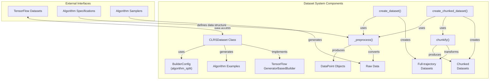
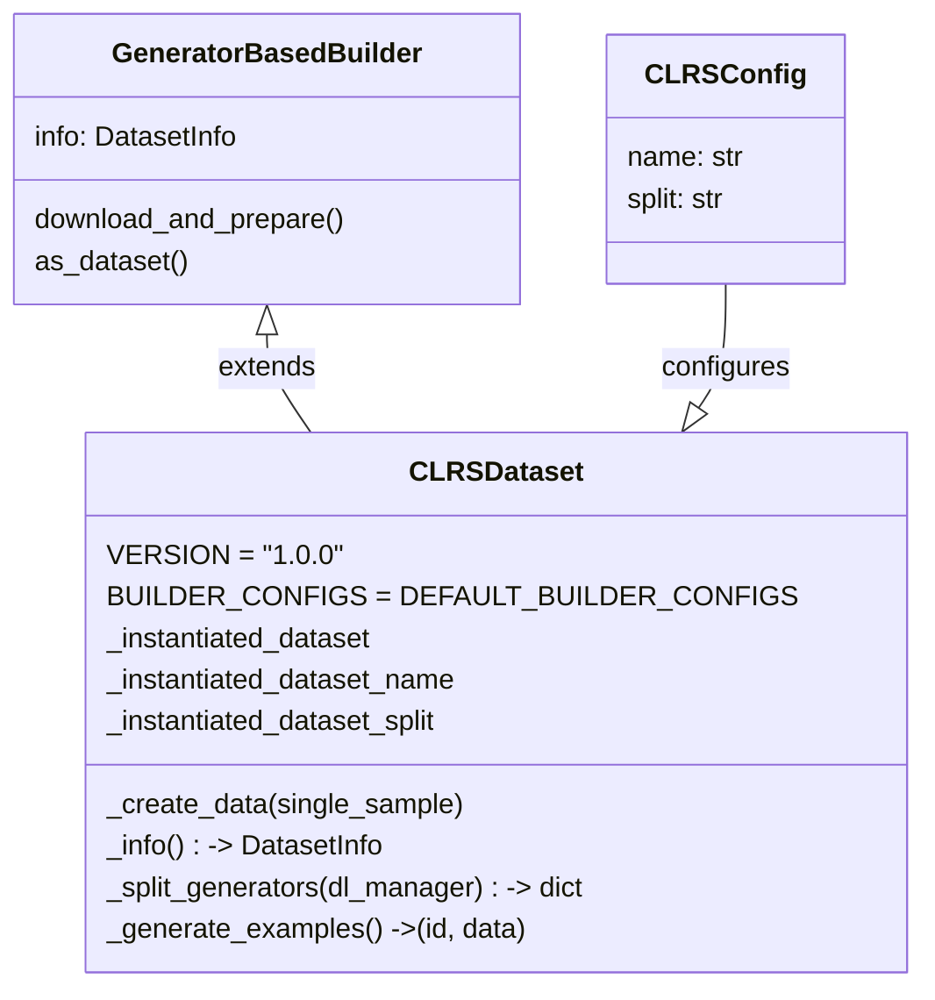
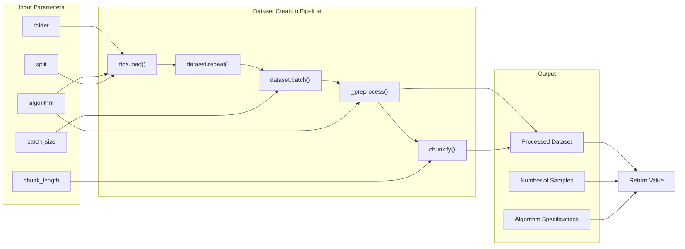
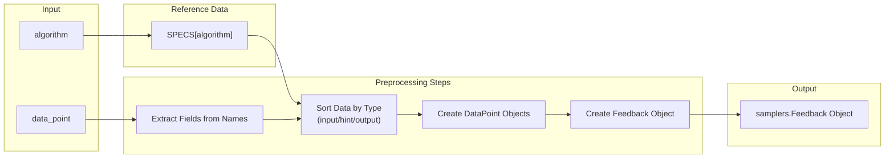
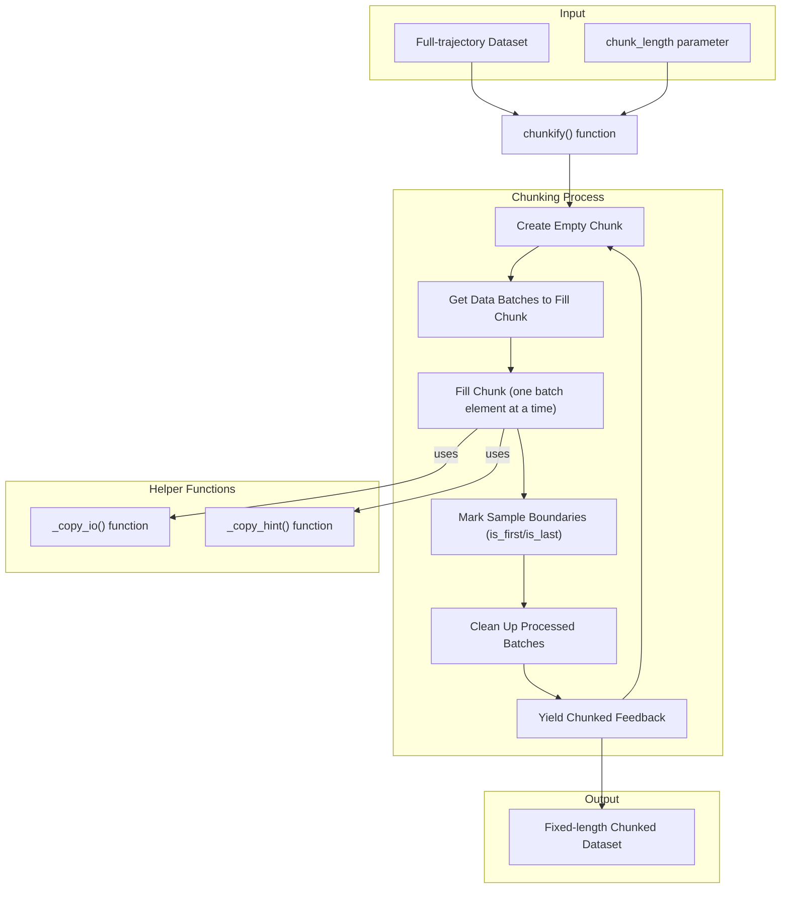
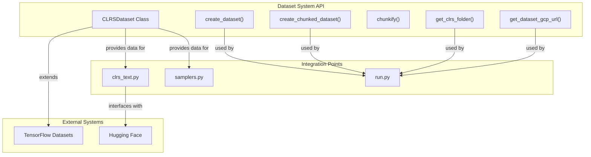

<!-- source: DeepWiki mcp.deepwiki.com · repo google-deepmind/clrs · page 5 Dataset System · fetched 2026-10-26 -->

# Dataset System

<details>
<summary>Relevant source files</summary>

The following files were used as context for generating this wiki page:

- [clrs/__init__.py](clrs/__init__.py)
- [clrs/_src/dataset.py](clrs/_src/dataset.py)
- [clrs/_src/dataset_test.py](clrs/_src/dataset_test.py)

</details>


The Dataset System in the CLRS benchmark is responsible for creating, managing, and processing algorithmic data for training and evaluation. It provides utilities for handling both full-trajectory algorithm execution traces and fixed-length chunks for more efficient training with neural networks.

For information about data chunking specifically, see [Data Chunking](#5.1).

## Architecture Overview

**Dataset System Architecture**


Sources: [clrs/_src/dataset.py:58-138](), [clrs/_src/dataset.py:153-178](), [clrs/_src/dataset.py:181-189](), [clrs/_src/dataset.py:211-330]()

## Core Components

### CLRSDataset Class

The core of the dataset system is the `CLRSDataset` class, which implements TensorFlow's `GeneratorBasedBuilder` interface. This class enables seamless integration with TensorFlow's dataset ecosystem while providing specialized functionality for algorithmic reasoning tasks.

**CLRSDataset Inheritance and Structure**


Sources: [clrs/_src/dataset.py:39-52](), [clrs/_src/dataset.py:58-138]()

The `CLRSDataset` class handles:
- Generating algorithm-specific data points
- Supporting different split configurations (train/val/test)
- Providing consistent dataset interfaces through TensorFlow Datasets
- Managing the creation and access to algorithm execution trajectories

### Dataset Creation Functions

The system provides two main functions for creating datasets:

#### 1. create_dataset

The `create_dataset` function creates datasets with full-trajectory samples:

```python
def create_dataset(folder, algorithm, split, batch_size):
    """Create dataset with full-trajectory samples."""
    # Returns (processed_dataset, num_samples, specs)
```

#### 2. create_chunked_dataset

The `create_chunked_dataset` function creates datasets with fixed-length chunks:

```python
def create_chunked_dataset(folder, algorithm, split, batch_size, chunk_length):
    """Create dataset with fixed-length chunks."""
    # Returns (chunked_dataset, specs)
```

**Dataset Creation Flow**


Sources: [clrs/_src/dataset.py:181-189](), [clrs/_src/dataset.py:323-330]()

## Data Processing

### Preprocessing

The `_preprocess` function converts raw data into structured `DataPoint` objects:

```python
def _preprocess(data_point, algorithm=None):
    """Convert sampled inputs into DataPoints."""
    # Sorts data into inputs, outputs, and hints
    # Creates DataPoint objects
    # Returns Feedback object
```

**Data Preprocessing Flow**


Sources: [clrs/_src/dataset.py:153-178]()

During preprocessing:
1. Data is sorted into inputs, outputs, and hints based on naming conventions
2. The algorithm's specifications determine the stage, location, and type of each data point
3. `DataPoint` objects are created for each component
4. A `Feedback` object is returned containing the processed data

## Data Chunking

The chunking mechanism is a critical component of the Dataset System that handles variable-length algorithm execution traces.

### Chunking Mechanism

The `chunkify` function converts full-trajectory samples into fixed-length chunks:

```python
def chunkify(dataset: Iterator[samplers.Feedback], chunk_length: int):
    """Generator of fixed-length chunks from full-trajectory samples."""
    # Yields fixed-length chunks of data
```

**Chunking Process**


Sources: [clrs/_src/dataset.py:211-320](), [clrs/_src/dataset.py:192-208]()

The chunking mechanism:
- Takes full-sample dataset and chunk_length as input
- Yields fixed-time-length chunks of data
- Uses marking tensors (`is_first` and `is_last`) to track sample boundaries
- Efficiently handles batches with samples of different lengths
- Uses helper functions `_copy_hint` and `_copy_io` to copy data to chunks

### Sample Boundaries in Chunked Data

The chunking system tracks sample boundaries using two binary indicator matrices:
- `is_first`: Marks the beginning of each sample
- `is_last`: Marks the end of each sample

For example, with `chunk_length=6` and `batch_size=2`, if one sample has length 3 and another has length 5:

| is_first | is_last |
|----------|---------|
| [1, 1]   | [0, 0]  |
| [0, 0]   | [0, 0]  |
| [0, 0]   | [1, 0]  |
| [1, 0]   | [0, 0]  |
| [0, 0]   | [0, 1]  |
| [0, 1]   | [0, 0]  |

This allows the model to recognize where samples begin and end within the batch.

Sources: [clrs/_src/dataset.py:230-235]()

## API and Integration

The Dataset System integrates with the rest of the CLRS benchmark through several exported functions:

**API and Integration Points**


Sources: [clrs/__init__.py:26-31](), [clrs/_src/dataset.py:145-150]()

## Function Reference

Here's a reference of key functions in the Dataset System:

| Function | Purpose | Parameters |
|----------|---------|------------|
| `CLRSDataset` | TensorFlow dataset implementation | - |
| `create_dataset` | Creates full-trajectory datasets | folder, algorithm, split, batch_size |
| `create_chunked_dataset` | Creates chunked datasets | folder, algorithm, split, batch_size, chunk_length |
| `chunkify` | Converts to fixed-length chunks | dataset, chunk_length |
| `get_clrs_folder` | Returns dataset folder name | - |
| `get_dataset_gcp_url` | Returns dataset download URL | - |

Sources: [clrs/__init__.py:64-94](), [clrs/_src/dataset.py:58-330]()

## Summary

The Dataset System is a flexible component of the CLRS benchmark that enables:

1. Creation of algorithm-specific datasets through the `CLRSDataset` class
2. Processing of raw algorithm data into structured `DataPoint` objects
3. Generation of both full-trajectory and chunked datasets for training
4. Efficient handling of variable-length algorithm executions through the chunking mechanism

This system forms a critical bridge between the algorithm implementation and the neural network models, providing the data structures and interfaces needed for effective algorithmic reasoning.

Sources: [clrs/_src/dataset.py:16-330]()

---

