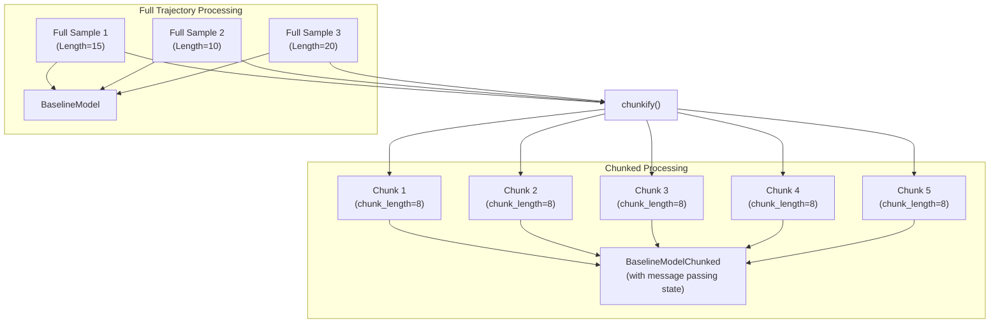
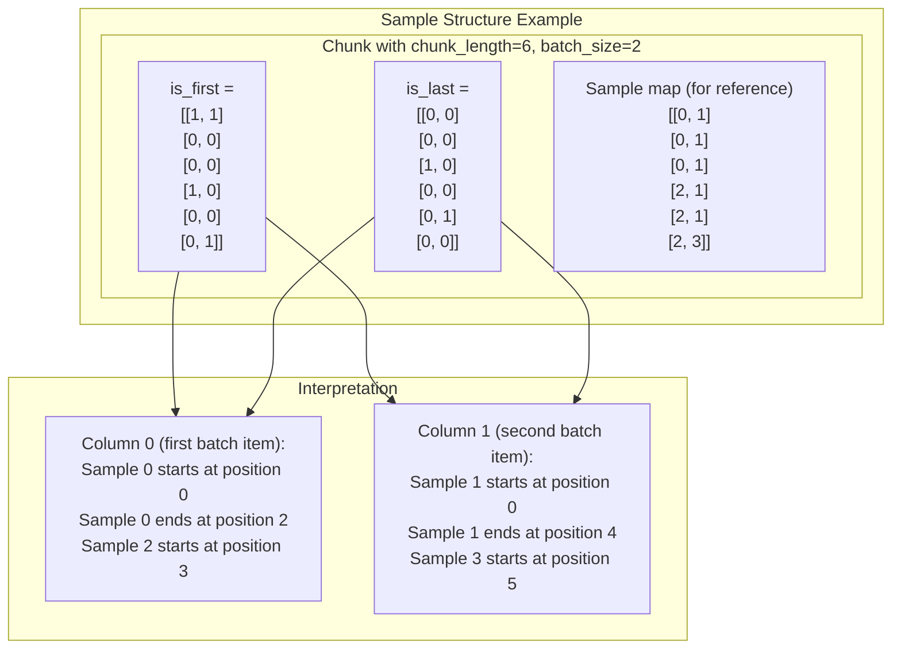
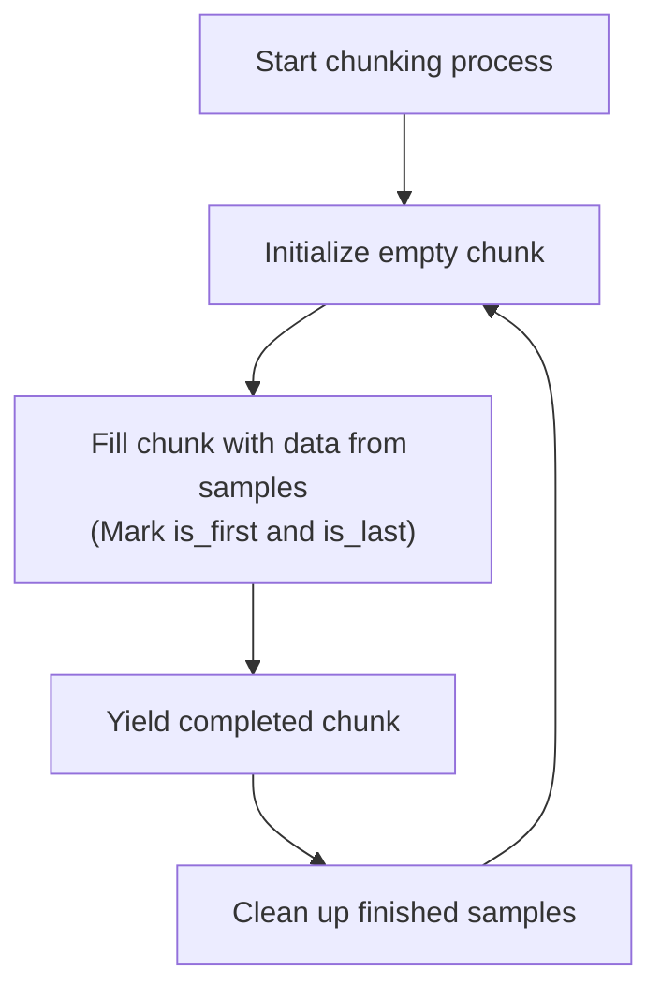
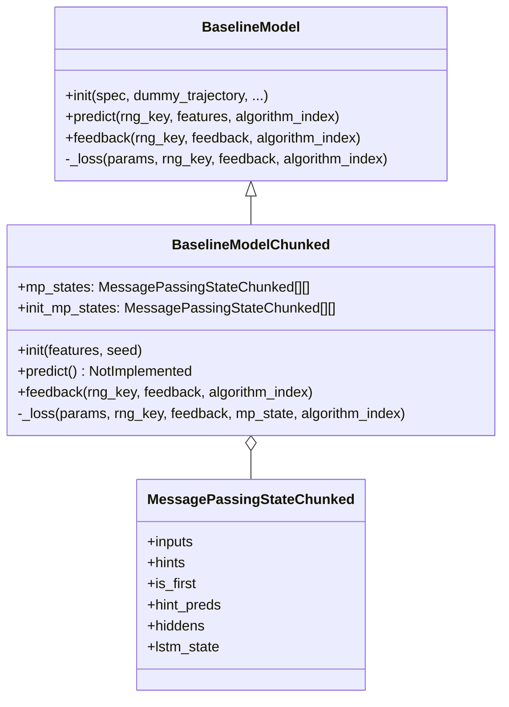
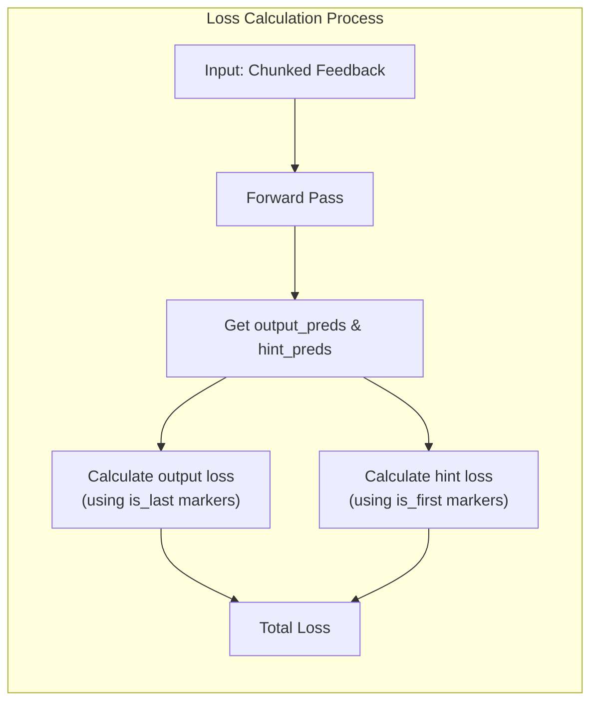

<!-- source: DeepWiki mcp.deepwiki.com · repo google-deepmind/clrs · page 5.1 Data Chunking · fetched 2026-10-26 -->

# Data Chunking

<details>
<summary>Relevant source files</summary>

The following files were used as context for generating this wiki page:

- [clrs/_src/baselines.py](clrs/_src/baselines.py)
- [clrs/_src/dataset.py](clrs/_src/dataset.py)
- [clrs/_src/dataset_test.py](clrs/_src/dataset_test.py)

</details>


## Introduction and Purpose

Data chunking is a key mechanism in the CLRS benchmark that enables processing of long algorithm execution traces in memory-efficient fixed-size segments. This page explains how algorithm trajectories are broken into chunks, how these chunks are structured, and how models can process them for neural algorithmic reasoning.

The chunking system addresses the challenge of training on algorithms with variable-length executions by breaking them into fixed-length segments while preserving temporal dependencies through message passing states.

For information about running experiments with chunked datasets, see [Running Experiments](#3). For details about the baseline models that can process chunks, see [Baseline Models](#2).

Sources: [clrs/_src/dataset.py:211-231]()

## Core Concepts

The CLRS benchmark generates algorithm execution traces of varying lengths. While full trajectories can be processed directly by standard models, this becomes memory-inefficient for algorithms that run for many time steps.

Data chunking transforms full trajectories into fixed-length segments with the following characteristics:

- Each chunk has a fixed length specified by the `chunk_length` parameter
- Different samples are concatenated together to fill chunks efficiently
- Special markers track where original samples begin and end within each chunk
- Chunks maintain batch processing capabilities

The chunking system allows the CLRS benchmark to efficiently train on longer algorithm executions by only requiring the model to process a fixed number of steps at a time while maintaining the ability to learn long-term dependencies.



Sources: [clrs/_src/dataset.py:211-242](), [clrs/_src/baselines.py:507-519]()

## Chunking Data Structure

The chunked data has a specific structure to enable efficient processing while preserving the integrity of the original samples:

1. **Dimensions**: Each tensor of inputs, hints, and outputs has dimensions `[chunk_length × batch_size × ...]`

2. **Sample Boundaries**: Since different samples can have different time lengths, the beginnings and ends of samples within a batch do not necessarily coincide.

3. **Boundary Markers**: Two special tensors indicate sample boundaries:
   - `is_first`: Marks the beginning of a sample (has value 1 at those positions)
   - `is_last`: Marks the end of a sample (has value 1 at those positions)

4. **Data Continuity**: When a sample ends in one chunk and the next sample begins, there is no padding - samples are concatenated sequentially.



The diagram above shows how `is_first` and `is_last` markers track sample boundaries in a chunk. When processing, models can use these markers to identify where samples begin and end.

Sources: [clrs/_src/dataset.py:228-241]()

## The Chunking Algorithm

The `chunkify` function in the dataset module transforms full-trajectory samples into fixed-length chunks:



The chunking process works by:

1. Creating an empty chunk of fixed length
2. Taking samples from the input dataset and filling the chunk
3. Marking the start and end of samples with `is_first` and `is_last` tensors
4. When a chunk is full, yielding it and starting a new chunk
5. If a sample isn't fully consumed in one chunk, continuing it in the next chunk

The algorithm ensures that inputs, hints, and outputs are correctly aligned in each chunk.

Key implementation details:
- Inputs and outputs are repeated for each timestep to match chunk dimensions
- Hints, which already have a time dimension, are copied into the appropriate positions
- `_copy_hint` and `_copy_io` helper functions handle the data transfer

Sources: [clrs/_src/dataset.py:211-321](), [clrs/_src/dataset.py:192-208]()

## Chunked Model Architecture

The `BaselineModelChunked` class extends the standard `BaselineModel` to process chunked data efficiently. The key differences are:

1. **State Maintenance**: Chunked models maintain message passing states between chunks
2. **Specialized Processing**: They process fixed-length chunks rather than full trajectories
3. **Training Focus**: Chunked models are designed specifically for training (not evaluation)



The `MessagePassingStateChunked` structure maintains the state needed to correctly process chunks, allowing information to flow between consecutive chunks of the same sample. This enables the model to learn long-term dependencies across chunk boundaries.

Sources: [clrs/_src/baselines.py:507-519](), [clrs/_src/baselines.py:551-573]()

## Loss Calculation for Chunked Data

Loss calculation for chunked data requires special handling to ensure that only valid positions contribute to the loss:

1. **Output Loss**: Only calculated at positions marked by `is_last` (end of samples)
2. **Hint Loss**: Calculated throughout the chunk, but takes `is_first` into account

The implementation uses specialized loss functions:
- `losses.output_loss_chunked` - For calculating loss on final outputs
- `losses.hint_loss_chunked` - For calculating loss on hints throughout execution



Sources: [clrs/_src/baselines.py:585-619]()

## Using Chunked Datasets

The CLRS benchmark provides a convenient function to create chunked datasets:

```python
chunked_dataset, spec = create_chunked_dataset(
    folder, algorithm, split, batch_size, chunk_length)
```

When choosing a `chunk_length`, consider:
- **Memory constraints**: Longer chunks use more memory
- **Long-range dependencies**: Shorter chunks might make it harder to learn long-range patterns
- **Training efficiency**: Very short chunks can lead to more overhead
- **Algorithm complexity**: More complex algorithms might benefit from longer chunks

When using a chunked dataset with a model:

1. Initialize a `BaselineModelChunked` model
2. Process chunks sequentially, maintaining message passing state
3. For evaluation, use a standard `BaselineModel` with full trajectories

Sources: [clrs/_src/dataset.py:323-330]()

## Practical Considerations

Important points to remember when working with chunked data:

1. **Evaluation**: Chunked models are intended for training only; evaluation should use the standard `BaselineModel`

2. **Message Passing State**: While the chunked model maintains message passing state, the implementation currently reinitializes states for performance reasons:
   ```python
   # Reusing init_mp_state improves performance.
   # The next, commented out line, should be used for proper state keeping.
   # mp_state = self.mp_states[length_index][algorithm_index]
   mp_state = self.init_mp_states[length_index][algorithm_index]
   ```

3. **Reproducibility**: The chunking process is deterministic when using the same seed

4. **Testing**: Comprehensive tests in `dataset_test.py` verify the correctness of the chunking implementation

Sources: [clrs/_src/baselines.py:670-673](), [clrs/_src/dataset_test.py:54-112]()

## Summary

Data chunking is a crucial technique in the CLRS benchmark that enables efficient processing of long algorithm execution traces. By breaking trajectories into fixed-length chunks and maintaining message passing state between them, the system can handle algorithms with varying execution lengths while keeping memory requirements manageable.

The chunking system consists of:
1. The `chunkify` function that transforms full trajectories into chunks
2. Special markers (`is_first` and `is_last`) to track sample boundaries
3. The `BaselineModelChunked` class that processes chunks sequentially
4. Specialized loss functions that handle chunked data correctly

This approach allows the CLRS benchmark to train neural networks on complex algorithms with long execution traces, which would otherwise be impractical due to memory constraints.

---

